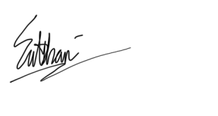

# Deklarasi Penggunaan AI

## Tugas Besar IF2150 - Rekayasa Perangkat Lunak

| Informasi | Keterangan |
|---|---|
| Kelas | *K1* |
| Nomor Kelompok | *2* |
| Nama Kelompok | *Indes A* |
| Nama Perangkat Lunak | *ITBELI* |

**Anggota Kelompok:**

| NIM | Nama |
|---|---|
| *13525124* | *Sulthan Dhiyazka Suwandi* |
| *13525034* | *Dhanesworo Muhammad Datiputro* |
| *13525115* | *Nazhif Hilmi Kistijantoro* |
| *13525121* | *I Made Adi Kusuma Ardana* |
| *13525106* | *Ghaniyul Amri Caulava* |

---

### Daftar Isi
* [Milestone 1](#milestone-1)
* [Milestone 2](#milestone-2)
* [Milestone 3](#milestone-3)
* [Milestone 4](#milestone-4)
* [Milestone 5](#milestone-5)
* [Milestone 6](#milestone-6)
* [Milestone 7](#milestone-7)
* [Milestone 8](#milestone-8)
* [Milestone 9](#milestone-9)
* [Milestone 10](#milestone-10)
* Notes: Copy bagian Daftar Isi seperti Milestone 1 untuk Milestone berikutnya, contoh ``* [Milestone 2](#milestone-2)``. Ketika Daftar isi diklik maka akan langsung diarahkan ke bagian bawah sesuai dengan Milestone tujuan.

---

### Prinsip Penggunaan AI yang Dianut Kelompok

Sesuai ketentuan penggunaan AI pada mata kuliah ini, kelompok kami membatasi pemanfaatan AI hanya sampai pada tahap **membantu pemahaman konsep, penggalian ide, penyusunan kerangka (outline), eksplorasi alternatif dan pendekatan, serta permintaan contoh umum**. AI tidak digunakan untuk menghasilkan jawaban akhir maupun isi dokumen yang langsung disalin ke laporan.

Secara operasional, batas tersebut kami terapkan melalui aturan kerja berikut:

1. Setiap keluaran AI diperlakukan sebagai bahan diskusi, bukan sebagai naskah. Seluruh kalimat yang masuk ke dokumen ditulis ulang sendiri oleh anggota yang bertanggung jawab atas subbab tersebut.
2. Setiap gagasan yang berasal dari AI wajib diuji kembali terhadap konteks ITBELI dan terhadap isi bab lain sebelum dipakai, sehingga gagasan yang tidak relevan dibuang.
3. Keputusan substantif, misalnya penetapan target platform, pemilihan aktor, dan penentuan ruang lingkup sistem, sepenuhnya diambil melalui diskusi kelompok, bukan mengikuti rekomendasi AI.
4. Data, angka, dan rujukan tidak pernah diambil dari AI, melainkan ditelusuri sendiri ke sumber aslinya.

---

### Log Penggunaan AI per Milestone

Silakan catat penggunaan AI yang berdampak signifikan pada pengerjaan tugas (misal: *generate* fungsi algoritma yang kompleks, *generate* draf dokumen SKPL/DPPL, atau *debugging* error utama). 
*Penggunaan sepele seperti memperbaiki *typo* atau auto-complete satu baris kode tidak perlu dicatat.*

### Milestone 1
| Tool AI | Tujuan Penggunaan | Contoh Prompt Utama | Modifikasi & Validasi Manusia |
| :--- | :--- | :--- | :--- |
| *Google Gemini 2.5 Flash* | *Pemahaman konsep untuk subbab 2.1 Deskripsi Perangkat Lunak (penanggung jawab: Sulthan Dhiyazka Suwandi). Menanyakan perbedaan antara mendeskripsikan perangkat lunak dari sudut pandang pengguna dan dari sudut pandang teknis, agar penulisan subbab tidak terjebak membahas implementasi.* | *"Dalam dokumen analisis solusi perangkat lunak, apa perbedaan antara mendeskripsikan sistem dari sudut pandang pengguna dan dari sudut pandang teknis? Apa saja ciri deskripsi yang masih berada pada tingkat kebutuhan dan belum masuk ke rancangan?"* | *Penjelasan AI hanya kami pakai sebagai rambu penulisan. Berdasarkan penjelasan tersebut, kami memutuskan menyusun subbab 2.1.1 dengan cara menceritakan alur pemakaian dari sisi penjual, pembeli, dan admin secara terpisah. Seluruh kalimat deskripsi ITBELI ditulis sendiri oleh anggota penanggung jawab tanpa menyalin keluaran AI.* |
| *Google Gemini 2.5 Flash* | *Penyusunan kerangka (outline) subbab 2.1 (penanggung jawab: Sulthan Dhiyazka Suwandi). Menanyakan komponen apa saja yang umumnya dibahas pada bagian deskripsi perangkat lunak sebuah dokumen analisis solusi.* | *"Secara umum, bagian apa saja yang biasanya dibahas dalam subbab deskripsi perangkat lunak pada dokumen analisis solusi? Berikan kerangka poinnya saja, tanpa isi."* | *Kerangka umum dari AI kami sesuaikan dengan kebutuhan dokumen ini. Kami memecah subbab menjadi 2.1.1 sampai 2.1.4 dan menambahkan sendiri bagian perbandingan dengan solusi yang sudah ada, karena bagian tersebut diperlukan untuk menjawab celah yang dirumuskan pada subbab 1.2 namun tidak muncul pada kerangka umum yang diberikan AI. Urutan pembahasan juga kami ubah agar mengalir dari sudut pandang pengguna terlebih dahulu.* |
| *Google Gemini 2.5 Flash* | *Eksplorasi alternatif dan pendekatan terkait target platform pada subbab 2.1.2 (penanggung jawab: Sulthan Dhiyazka Suwandi). Menanyakan pertimbangan umum dalam memilih antara aplikasi web, desktop, dan mobile.* | *"Apa saja pertimbangan umum yang biasa dipakai untuk memilih antara aplikasi web, aplikasi desktop, dan aplikasi mobile? Jelaskan kelebihan dan kekurangan masing-masing secara umum."* | *AI hanya memberikan pertimbangan yang bersifat umum dan tidak merekomendasikan pilihan tertentu. Keputusan memilih aplikasi web diambil melalui diskusi kelompok dengan menimbang asumsi pengguna multi-perangkat pada subbab 2.2, kebutuhan verifikasi surel @itb.ac.id pada US-01, dan keterbatasan durasi pengerjaan. Alasan pemilihan platform ditulis ulang sepenuhnya dengan konteks ITBELI dan ITB.* |
| *Google Gemini 2.5 Flash* | *Permintaan contoh umum aspek pembanding untuk tabel pada subbab 2.1.4 (penanggung jawab: Sulthan Dhiyazka Suwandi).* | *"Secara umum, aspek apa saja yang biasa dipakai untuk membandingkan dua platform yang melayani kebutuhan serupa? Berikan contoh aspek pembandingnya saja."* | *Daftar aspek umum dari AI kami saring dan ganti sebagian. Aspek yang terlalu umum kami buang, lalu kami tentukan sendiri enam aspek pembanding yang langsung memetakan empat celah pada subbab 1.2. Isi setiap sel tabel diisi berdasarkan pengamatan dan pengalaman langsung anggota kelompok sebagai pengguna kanal informal dan marketplace umum, bukan dari keluaran AI.* |
| *Google Gemini 2.5 Flash* | *Penggalian ide arah pengembangan jangka panjang untuk roadmap pada subbab 2.1.2 (penanggung jawab: Sulthan Dhiyazka Suwandi).* | *"Secara umum, tahapan apa saja yang biasa ditempuh sebuah aplikasi web ketika ingin dikembangkan ke arah aplikasi mobile? Sebutkan garis besarnya saja."* | *Ide tahapan dari AI kami rumuskan ulang menjadi tiga tahap yang sesuai dengan kondisi ITBELI. Kelompok menambahkan sendiri penegasan bahwa seluruh roadmap berada di luar cakupan pengerjaan tugas besar, agar tidak terbaca sebagai kebutuhan yang dijanjikan akan diimplementasikan.* |
| *Google Gemini 3.1 Pro* | *Penggalian ide sudut pandang untuk subbab 1.1 Latar Belakang Masalah (penanggung jawab: Dhanesworo Muhammad Datiputro).* | *"Bagaimana pola konsumsi barang yang cepat kehilangan relevansi pakai (seperti pakaian atau perlengkapan yang hanya dipakai dalam periode tertentu) biasa dikaitkan dengan isu keberlanjutan atau pengelolaan sampah? Sebutkan sudut pandang yang umum dipakai saja."* | *Jawaban AI hanya kami jadikan pijakan awal untuk mencari isu yang relevan. Dari situ kami sendiri yang menelusuri SDG 12 dan data SIPSN KLHK sebagai rujukan konkret, karena AI tidak diberi ruang untuk menyebut angka atau sumber data. Contoh kasus barang mahasiswa ITB (jas praktikum, buku kuliah, kalkulator, perlengkapan kos) dan narasi urgensinya ditulis sendiri berdasarkan pengamatan pribadi, bukan dari keluaran AI.* |
| *Google Gemini 3.1 Pro* | *Penyusunan kerangka subbab 1.2 Analisis Kondisi Saat Ini (penanggung jawab: Dhanesworo Muhammad Datiputro).* | *"Ketika menganalisis kondisi/solusi yang sudah ada sebelum mengusulkan sistem baru, bagian apa saja yang biasanya perlu dibahas agar analisisnya lengkap?"* | *Kerangka umum dari AI kami pakai sekadar acuan urutan penulisan yaitu kondisi eksisting dulu, baru celah. Daftar media seperti grup WhatsApp/Line, story Instagram, marketplace umum dan keempat celah yang dicatat disusun sendiri berdasarkan pengalaman langsung sebagai mahasiswa ITB.* |
| *Claude Sonnet 5* | *[Tujuan penggunaan untuk subbab 2.2 pendeskripsian masing-masing bagian sesuai dengan contoh repository yang direkomendasikan asisten ( penanggung jawab: Ghaniyul Amri Caulava)* | *Dalam dokumentasi perangkat lunak, tolong jelaskan kepada saya secara umum mengenai asumsi dan batasan meliputi sisi pengguna(tingkat kemampuan pengguna, perangkat dan infrastruktur pengguna, dan perilaku pengguna), asumsi dari sisi pengerjaan teknis perangkat lunak, batasan dan ruang lingkup(batasan regulasi, keterbatasan sumber daya, ruang lingkup solusi)* | *Kerangka umum dari AI hanya digunakan sebagai kerangka acuan dan penjelasan lebih mendalam dari bagian-bagian tersebut. Selanjutnya disusun sendiri sembari melihat contoh dan memvalidasi dari repository rekomendasi asisten* |
| *[Nama AI]* | *[Tujuan penggunaan untuk subbab 3.1 dan 3.2 - penanggung jawab: Nazhif Hilmi Kistijantoro]* | *[Tuliskan Prompt Utama, atau tandai "-" jika tidak menggunakan AI]* | *[Tuliskan Keputusan Hasil Validasi]* |
| *[Nama AI]* | *[Tujuan penggunaan untuk subbab 3.3 - penanggung jawab: I Made Adi Kusuma Ardana]* | *[Tuliskan Prompt Utama, atau tandai "-" jika tidak menggunakan AI]* | *[Tuliskan Keputusan Hasil Validasi]* |

**Catatan Milestone 1:** *Tidak ada bagian dokumen pada milestone ini yang isinya dihasilkan langsung oleh AI. Seluruh naskah ditulis oleh anggota kelompok, sementara AI hanya dipakai pada tahap memahami konsep, menyusun kerangka, menimbang alternatif, dan meminta contoh yang bersifat umum. Data timbulan sampah pada subbab 1.1 ditelusuri langsung ke sumbernya dan tidak berasal dari AI.*

### Milestone 2
| Tool AI | Tujuan Penggunaan | Contoh Prompt Utama | Modifikasi & Validasi Manusia |
| :--- | :--- | :--- | :--- |
| *Claude Opus 5.5* | *Pemahaman konsep untuk subbab 1.1 Deskripsi Umum Sistem pada dokumen Requirement Gathering (penanggung jawab: Dhanesworo Muhammad Datiputro). Menanyakan isi yang umumnya diharapkan pada deskripsi umum sistem dan bedanya dengan deskripsi perangkat lunak pada dokumen Milestone 1.* | *"Di dokumen requirement gathering, bagian deskripsi umum sistem biasanya isinya apa aja? Bedanya apa sama deskripsi perangkat lunak di dokumen analisis solusi? Kasih poin-poinnya aja, nggak usah contoh isi."* | *Poin dari AI dicocokkan dengan petunjuk templat (solusi, ekspektasi pengguna, alur kerja, dan harapan). Narasi ITBELI dari sisi Penjual, Pembeli, dan Admin ditulis sendiri dengan mengacu pada subbab 2.1 dan 3.1 Milestone 1, dan batas bahwa negosiasi serta COD terjadi di luar perangkat lunak ditegaskan sendiri sesuai batasan pada subbab 2.2 Milestone 1. Catatan asistensi Milestone 2 No. 1 menyatakan keempat unsur tersebut sudah terpenuhi.* |
| *Claude Opus 5.5* | *Permintaan contoh umum untuk subbab 1.2 Deskripsi Pengguna Perangkat Lunak (penanggung jawab: Dhanesworo Muhammad Datiputro).* | *"Contoh umum cara nulis karakteristik pengguna di dokumen kebutuhan itu kayak gimana? Cukup peran aja, atau perlu juga apa yang paling dia utamakan dari sistem?"* | *AI memberi contoh generik di luar konteks ITBELI. Isi tabel tiga aktor diambil dari identifikasi aktor pada subbab 3.1 Milestone 1 agar istilah dan prioritas tiap aktor sama di kedua dokumen, lalu diringkas ulang sendiri.* |

### Milestone 3
| Tool AI | Tujuan Penggunaan | Contoh Prompt Utama | Modifikasi & Validasi Manusia |
| :--- | :--- | :--- | :--- |
| *Claude Opus 5.5* | *Eksplorasi pendekatan untuk subbab 3.2 Identifikasi Use Case (penanggung jawab: Dhanesworo Muhammad Datiputro). Menanyakan prinsip umum menggabungkan atau memisahkan kebutuhan fungsional menjadi use case.* | *"Satu use case idealnya mencakup berapa KF? Gimana cara nentuin KF mana yang digabung jadi satu use case dan mana yang harus dipisah? Kasih prinsip umumnya aja."* | *AI hanya memberi prinsip umum, misalnya satu use case mewakili satu tujuan pengguna yang utuh. Pengelompokan KF01 sampai KF56 menjadi UC01 sampai UC24 beserta deskripsi setiap use case disusun sendiri dari tabel KF pada BAB 2. Catatan asistensi Milestone 3 No. 4 mengonfirmasi bahwa satu use case boleh menggabungkan beberapa KF.* |
| *Claude Opus 5.5* | *Pemeriksaan kelengkapan pemetaan KF ke use case pada subbab 3.2 (penanggung jawab: Dhanesworo Muhammad Datiputro).* | *"Ini daftar UC beserta KF yang dicakup [tabel ditempel]. Tolong cek apakah ada KF01–KF56 yang belum masuk use case mana pun. Sebutin ID-nya aja, jangan ubah tabelnya."* | *Hasil pemeriksaan AI dicocokkan ulang secara manual dengan menyusun tabel pemetaan balik KF ke UC. Tabel tersebut sempat dicantumkan pada dokumen, lalu dikeluarkan pada revisi 11 September karena hanya berfungsi sebagai alat periksa internal dan tidak diminta templat.* |
| *Claude Opus 5.5* | *Pemahaman konsep traceability untuk menindaklanjuti catatan asistensi Milestone 3 No. 8 (penanggung jawab: Dhanesworo Muhammad Datiputro).* | *"Asisten bilang ada use case yang nggak cocok kalau di-trace ke aktivitas milestone sebelumnya. Urutan trace yang benar dari user story sampai use case itu gimana, dan biasanya salahnya di bagian mana?"* | *AI menjelaskan urutan umum user story, aktivitas, kebutuhan, KF, lalu use case. Penyebab ketidakcocokan ditemukan sendiri dengan menelusuri tabel 2.2 dan 2.3 Milestone 2, yaitu kolom ID aktivitas yang masih memakai penomoran lama setelah A01 dipecah dan A06 ditambahkan. Perbaikan ID aktivitas pada R06 sampai R27, perbaikan ID user story, penambahan aktivitas A10, serta penggantian nama UC15 sesuai catatan No. 6 dikerjakan sendiri dan dicatat pada Daftar Perubahan butir A sampai D.* |

### Milestone 4
| Tool AI | Tujuan Penggunaan | Contoh Prompt Utama | Modifikasi & Validasi Manusia |
| :--- | :--- | :--- | :--- |
| *Claude Opus 5.5* | *Pemahaman konsep kelas boundary, control, dan entity untuk diagram kelas UC01 sampai UC08 pada subbab 4.2.1 sampai 4.2.8 (penanggung jawab: Dhanesworo Muhammad Datiputro).* | *"Dalam diagram kelas analisis, apa beda kelas boundary, control, dan entity? Kelas yang isinya cuma proses, misalnya otentikasi, sebaiknya jadi entity atau control? Jelasin pakai contoh umum aja."* | *Versi awal subbab 4.2.1 sampai 4.2.8 (19 September) masih memakai kelas SesiOtentikasi serta memisahkan Pembeli dan Penjual pada setiap use case. Setelah asistensi Milestone 4 (catatan No. 2 dan No. 3: SesiOtentikasi tidak perlu disimpan di basis data dan hindari god class), penanggung jawab merombak sendiri kedelapan use case ke pola boundary–control–entity sesuai daftar kelas 4.1, misalnya HalamanOtentikasi, AkunController, Akun, dan TokenVerifikasi, lalu menggambar ulang kedelapan diagram.* |
| *Claude Opus 5.5* | *Penggalian ide kelas yang mungkin terlewat pada subbab 4.1 Identifikasi Kelas (penanggung jawab: Dhanesworo Muhammad Datiputro).* | *"Ini daftar kelas dan use case kami [tabel ditempel]. Dari skenario use case-nya, ada tanggung jawab yang belum punya kelas nggak? Jawab dalam bentuk pertanyaan atau petunjuk aja, jangan langsung kasih nama kelas."* | *Petunjuk AI ditelusuri sendiri terhadap skenario use case. Penambahan HalamanListingPenjual (UC08, UC10 sampai UC12), PanelNotifikasi dan NotifikasiController (UC17, UC22, UC23), serta SesiLogin (UC03, UC04) diputuskan oleh penanggung jawab, kemudian seluruh ID kelas dinomori ulang menjadi C01 sampai C40 dengan urutan boundary, control, lalu entity.* |
| *Claude Opus 5.5* | *Permintaan contoh umum jenis relasi antarkelas untuk diagram kelas per use case (penanggung jawab: Dhanesworo Muhammad Datiputro).* | *"Kapan pakai asosiasi, agregasi, komposisi, generalisasi, dan dependensi di diagram kelas? Kasih contoh umum masing-masing, bukan dari sistem saya."* | *Contoh dari AI hanya dipakai sebagai acuan notasi. Jenis relasi pada setiap diagram ditentukan sendiri, misalnya generalisasi dari Akun ke Pembeli, Penjual, dan Admin. Pemisahan atribut sebagai data yang disimpan dan metode sebagai fungsi kelas dicek ulang sesuai catatan asistensi No. 4.* |

### Milestone 5
| Tool AI | Tujuan Penggunaan | Contoh Prompt Utama | Modifikasi & Validasi Manusia |
| :--- | :--- | :--- | :--- |
| *Claude Opus 5.5* | *Permintaan contoh format untuk subbab 1.4 Aturan Penomoran dan 4.1 daftar aktor final pada SKPL (penanggung jawab: Dhanesworo Muhammad Datiputro).* | *"Bagian aturan penomoran di SKPL biasanya berisi apa? Kasih contoh format tabelnya pakai artefak umum, misalnya kebutuhan, use case, dan kelas."* | *AI hanya memberi bentuk tabel umum. Daftar awalan R, KF, KNF, A, UC, dan C beserta rentang ID-nya diambil dari dokumen Milestone 2 sampai 4 dan dicek ulang terhadap jumlah artefak yang sebenarnya, yaitu R01–R27, KF01–KF56, KNF01–KNF04, UC01–UC24, dan C01–C40. Deskripsi aktor final disalin dari subbab 3.1 Milestone 3 lalu dilengkapi sendiri dengan kewenangan setiap aktor.* |
| *Claude Opus 5.5* | *Pemahaman format sitasi untuk subbab 1.5 Referensi (penanggung jawab: Dhanesworo Muhammad Datiputro).* | *"Format IEEE buat mengutip paper konferensi, buku, undang-undang, dan halaman web itu gimana? Kasih contoh pakai data rekaan aja."* | *Contoh rekaan dari AI hanya dipakai sebagai pola penulisan. Setiap rujukan dicari dan dibuka sendiri. Setelah asistensi Milestone 5 (catatan No. 4: referensi diambil dari sumber lain, bukan dari dokumen milestone sebelumnya), penanggung jawab mengganti empat rujukan dokumen Tugas 1 sampai 4 dengan sumber luar seperti Sommerville, Fowler, Visual Paradigm, PlantUML, UU PDP, SDG 12, dan SIPSN, serta menyusun ulang daftar rujukan pada revisi 29 September.* |

### Milestone 6
| Tool AI | Tujuan Penggunaan | Contoh Prompt Utama | Modifikasi & Validasi Manusia |
| :--- | :--- | :--- | :--- |
| *Claude Opus 5.5* | *Pemahaman konsep untuk BAB 2 Identifikasi Komponen/Modul/Subsistem pada APL (penanggung jawab: Dhanesworo Muhammad Datiputro). Menanyakan cara memetakan kelas analisis ke komponen MVC dan cara mengelompokkan komponen yang tidak termasuk Model, View, atau Controller.* | *"Kalau arsitekturnya MVC, kelas boundary, control, dan entity dipetakan ke komponen gimana? Terus komponen yang bukan model, view, atau controller, kayak adapter email atau fungsi hash, biasanya dikelompokkan sebagai apa?"* | *Pemetaan kelas C01 sampai C40 ke komponen disusun sendiri dari diagram kelas keseluruhan pada subbab 5.3 SKPL. Tiga jenis komponen tambahan, yaitu Pendukung, Integrasi Eksternal, dan Penyimpanan Data, ditetapkan sendiri, dan pemakaian Supabase mengikuti catatan asistensi Milestone 5 No. 3. Kolom penjelasan setiap komponen dicek satu per satu agar setiap kelas analisis diwadahi tepat satu komponen.* |
| *Claude Opus 5.5* | *Permintaan contoh umum tingkat kedalaman penjelasan komponen pada tabel BAB 2 (penanggung jawab: Dhanesworo Muhammad Datiputro).* | *"Penjelasan satu komponen di dokumen arsitektur idealnya isinya apa aja dan sepanjang apa? Kasih satu contoh dari sistem toko online."* | *Contoh dari AI hanya dipakai sebagai patokan panjang dan susunan kalimat. Isi penjelasan setiap komponen ITBELI ditulis sendiri berdasarkan KF dan skenario use case pada SKPL, termasuk alur aksi dari View ke Controller yang dituju.* |

### Milestone 7
| Tool AI | Tujuan Penggunaan | Contoh Prompt Utama | Modifikasi & Validasi Manusia |
| :--- | :--- | :--- | :--- |
| *Claude Opus 5.5* | *Penggalian ide istilah untuk subbab 1.3 Definisi, Istilah, dan Singkatan pada DPPL (penanggung jawab: Dhanesworo Muhammad Datiputro).* | *"Istilah apa aja yang biasanya perlu masuk tabel definisi di dokumen perancangan yang pakai MVC dan model 4+1 view? Sebutin istilahnya aja, tanpa definisi."* | *Daftar istilah dari AI disaring dan hanya istilah yang benar-benar muncul pada DPPL yang dipakai. Definisi setiap istilah ditulis sendiri dan dikaitkan dengan ITBELI, misalnya Supabase, Adapter, dan Service Worker. Aturan penomoran disesuaikan sendiri dengan SKPL dan APL.* |
| *Claude Opus 5.5* | *Eksplorasi pertimbangan untuk subbab 2.1 Rancangan Lingkungan Implementasi (penanggung jawab: Dhanesworo Muhammad Datiputro).* | *"Untuk aplikasi web Node.js yang dikembangkan sekarang, versi LTS mana yang aman dipakai? Terus apa saja yang perlu dicek kalau notifikasi push harus jalan di peramban klien?"* | *Versi Node.js dicek sendiri ke situs resmi Node.js. Keputusan klien berupa peramban berbasis Chromium dan iOS tidak didukung mengikuti subbab 2.5 SKPL serta catatan asistensi Milestone 5 No. 2, bukan rekomendasi AI. Isi tabel 2.1 ditulis sendiri.* |
| *Claude Opus 5.5* | *Bantuan teknis penulisan berkas SVG untuk diagram Arsitektur MVC dan Logical View pada subbab 2.2.3 dan 2.4.1 (penanggung jawab: Dhanesworo Muhammad Datiputro).* | *"Gimana cara bikin diagram komponen pakai SVG supaya garisnya rapi dan bisa diekspor ke PNG? Kasih kerangka SVG dengan dua kotak, satu panah, dan satu kelompok bergaris putus-putus aja."* | *AI hanya memberi kerangka elemen SVG, seperti penanda panah dan kotak bergaris putus-putus. Penempatan seluruh komponen, arah ketergantungan, dan label disusun sendiri dari tabel komponen subbab 2.3 dan aturan ketergantungan subbab 2.2.3. Diagram akhir diperiksa ulang agar tidak ada panah dari View langsung ke Model atau Database.* |

### Milestone 8
| Tool AI | Tujuan Penggunaan | Contoh Prompt Utama | Modifikasi & Validasi Manusia |
| :--- | :--- | :--- | :--- |
| *Claude Opus 5.5* | *Pemahaman konsep perancangan rinci kelas untuk BAB 5 subbab 5.1 sampai 5.15, yaitu kelas C01 HalamanOtentikasi sampai C15 KatalogController (penanggung jawab: Dhanesworo Muhammad Datiputro).* | *"Di perancangan rinci kelas, operasi dan atribut itu diturunkan dari mana? Kalau semua atribut private, operasi getter-nya perlu ditulis semua nggak?"* | *Aturan visibility (atribut private, operasi public) dan notasi tipe data ditetapkan sendiri agar sama dengan Tabel 4.1. Operasi setiap kelas diambil sendiri dari pesan pada sequence diagram BAB 3, dan keterangan operasi dikaitkan ke KF atau UC yang dilayaninya.* |
| *Claude Opus 5.5* | *Permintaan contoh format pseudocode untuk algoritma operasi penting pada BAB 5 (penanggung jawab: Dhanesworo Muhammad Datiputro).* | *"Contoh format pseudocode yang rapi untuk operasi controller yang memvalidasi input, memanggil model, lalu mengembalikan hasil itu kayak gimana? Pakai contoh fiktif, misalnya pendaftaran anggota perpustakaan."* | *Contoh fiktif dari AI hanya dipakai sebagai pola penulisan. Algoritma ITBELI, seperti `daftarAkun`, `verifikasiAkun`, `login`, `validasiFoto`, `buatBarang`, dan `getProduk`, ditulis sendiri berdasarkan skenario use case SKPL dan sequence diagram BAB 3, diberi ID Algo-XXX, lalu dicek agar algoritma kelas View dan Controller tidak mengakses Database secara langsung sesuai subbab 2.2.1.* |

### Milestone 9
| Tool AI | Tujuan Penggunaan | Contoh Prompt Utama | Modifikasi & Validasi Manusia |
| :--- | :--- | :--- | :--- |
| *Claude Fable 5.2 melalui Claude Code* | *Review kode pasca-merge terhadap PR #8, #31, dan #50 serta perbaikan temuannya (penanggung jawab: Ghaniyul Amri Caulava). AI membaca diff tiap PR dan kode akhirnya, menulis 12 temuan pada Tabel B.2c laporan implementasi, lalu menulis lima commit pada branch `fix/tindak-lanjut-review` beserta 11 test.* | *"kerjakan milestone 9 dengan lengkap dan detail. Isi semua bagian yang kosong." Untuk baris review PR: "tulis sendiri aja berdasarkan review kamu lalu langsung perbaiki berdasarkan review yang kamu buat".* | *Penanggung jawab memutuskan review dicatat apa adanya sebagai review pasca-merge, bukan sebagai review anggota lain. Setiap perbaikan didahului test yang gagal pada kode lama, lalu seluruh 345 test dijalankan ulang dan lulus. Enam temuan lainnya tidak diubah dan dicatat sebagai known issue pada B.3.3 No. 9 sampai 14.* |
| *Claude Fable 5.2 melalui Claude Code* | *Melengkapi laporan implementasi M9 (penanggung jawab: Ghaniyul Amri Caulava): baris review PR pada Tabel B.2, Tabel B.2c, pembaruan angka branch, commit, test, dan cakupan, B.1 No. 36 dan 37, serta B.3.3 No. 9 sampai 14.* | *Sama dengan baris di atas.* | *Setiap angka dihitung ulang dari `git log`, keluaran `npx jest --coverage`, serta data PR dan issue di GitHub, bukan dari perkiraan AI. Form asistensi tidak diisi AI karena isinya hanya diketahui peserta asistensi.* |
| *Claude Fable 5.2 melalui Claude Code* | *Menyusun logbook Milestone 9 dari riwayat commit dan pull request (penanggung jawab: Ghaniyul Amri Caulava).* | *Sama dengan baris di atas.* | *Tanggal, nama anggota, dan pekerjaan diambil dari riwayat git. Kolom durasi dikosongkan karena tidak terekam di git dan tidak dikarang.* |
| *Claude Fable 5.2 melalui Claude Code, dengan skill `logo-design`* | *Merancang logo ITBELI dan memasangnya di aplikasi (penanggung jawab: Ghaniyul Amri Caulava). AI menggambar enam konsep dalam dua putaran sebagai SVG, lalu membuat berkas master, favicon, dan ikon web untuk konsep terpilih, serta mengganti kotak "IT" pada top bar dan menambah tautan favicon di semua halaman pada branch `feat/logo-gajah`.* | *"buatkan logo ITBELI pakai skill logo-design", lalu "coba buatkan lagi", dan pilihan "A, Gajah Belanja".* | *Penanggung jawab menolak putaran pertama, memilih konsep Gajah Belanja dari putaran kedua, dan memutuskan warnanya mengikuti biru ITB setelah tema aplikasi diganti. Hasil diperiksa dengan audit SVG, lembar uji ukuran 16 sampai 256 px, 358 test otomatis, dan pemeriksaan halaman masuk di peramban. Kemiripan dengan merek dagang lain belum diperiksa.* |
| *Claude Opus 5.5* | *Perencanaan dan implementasi Modul A, UC01 sampai UC06 (penanggung jawab: Dhanesworo Muhammad Datiputro). AI membaca instruksi M9 dan PDF asistensi, mengusulkan pembagian tugas lima anggota dan rencana kerja Modul A (berkas di luar repo), lalu per tahap menyiapkan kerangka proyek dan menulis kode Modul A: model akun, sesi, dan token verifikasi, AkunController, DokumenLegalController, Otorisasi, SurelAdapter, serta halaman I-01 sampai I-03, I-09, dan I-15. AI juga menulis test Modul A, membantu menyelesaikan konflik merge, dan menjelaskan bagian back-end (Docker dan PostgreSQL) kepada penanggung jawab.* | *"pembagian tugas buat 5 orang"* | *Penanggung jawab menjalankan Docker dan aplikasi secara lokal untuk mencoba setiap tahap, membuat issue, menulis commit, membuka dan menggabungkan PR (#8, #21, #25, #26, #55), serta menutup issue terkait.* |
| *Claude Opus 5.5* | *Perbaikan dan deploy pada 13 November 2026 (penanggung jawab: Dhanesworo Muhammad Datiputro). AI mengubah validasi domain agar surel subdomain ITB diterima beserta test-nya, mengganti tema warna menjadi biru ITB, menulis konfigurasi Vercel dan penyimpanan Vercel Blob, serta membuat proyek Vercel, basis data Neon, dan Vercel Blob melalui Vercel CLI memakai token dari penanggung jawab.* | *"ubah domain email jadi contain itb.ac.id", "oke sekarang mau coba deploy, minta tutorial lengkap"* | *Masalah domain subdomain ditemukan sendiri oleh penanggung jawab saat mencoba mendaftar dengan surelnya. Penanggung jawab memilih Vercel, menyiapkan akun Vercel dan Neon beserta token, memeriksa hasil deploy, dan meminta deploy diulang ketika perubahan tampilan terakhir belum ikut (PR #57, #59, dan #70).* |

**Catatan Milestone 9:** *Entri di atas hanya mencakup sesi pada 13 November 2026 oleh Ghaniyul Amri Caulava. Berbeda dari milestone dokumen sebelumnya, pada sesi ini AI ikut menulis kode, test, dan isi laporan, sehingga hal itu dinyatakan secara terbuka di sini. Bila anggota lain memakai AI selama implementasi, penggunaannya belum tercatat di sini dan perlu ditambahkan oleh masing-masing anggota. Tiga baris terakhir pada tabel ditambahkan kemudian untuk bagian Dhanesworo Muhammad Datiputro dan mencakup sesi 2 sampai 13 November 2026.*

### Milestone 10
| Tool AI | Tujuan Penggunaan | Contoh Prompt Utama | Modifikasi & Validasi Manusia |
| :--- | :--- | :--- | :--- |
| *Claude Opus 5.5* | *Membantu bagian pengujian Modul A untuk HIUPL yang secara teknis sulit (penanggung jawab: Dhanesworo Muhammad Datiputro): (1) basis data uji terpisah untuk test integrasi, yaitu `jest.db.config.js`, `src/tests/db/siapkanBasisData.js`, dan skrip `npm run test:db`; (2) unit test C01 HalamanOtentikasi, yang memuat script browser lewat modul `vm` Node dengan DOM tiruan; (3) *mock* nodemailer untuk unit test C43 SurelAdapter; (4) test integrasi `src/tests/db/ModulA.test.js`, termasuk pengambilan kode verifikasi dari API Mailpit dan pemanggilan *token endpoint* Google; (5) analisis laporan coverage untuk menemukan cabang yang belum teruji, beserta unit test C13, C27, dan C28 untuk cabang tersebut; (6) kueri `psql` untuk uji KNF03; (7) pemformatan keluaran Jest `--json` menjadi berkas bukti.* | *"Gimana cara bikin test integrasi pakai PostgreSQL tanpa ngerusak database development?" "Kenapa HalamanOtentikasi.js nggak bisa di-require di Jest, terus gimana cara ngetesnya?" "Cara ambil kode verifikasi dari email di test otomatis gimana?" "Cara baca laporan coverage buat nyari cabang yang belum dites gimana?"* | *Bagian berikut dikerjakan sendiri oleh penanggung jawab: ID pengujian pada nama test; unit test C22, C25, dan C40 serta kueri C23 dan C26; klasifikasi tingkat pengujian pada Tabel 4.1; rancangan kasus normal, batas, dan negatif pada 4.2; pelaksanaan UC01 sampai UC06 secara manual di browser beserta tangkapan layarnya; pengisian tabel HIUPL dan traceability BAB 5; serta logbook. Hasil aktual pada setiap tabel diambil dari keluaran Jest, isi basis data (`psql`), kotak masuk Mailpit, dan tangkapan layar, bukan dari perkiraan AI. Kode aplikasi tidak diubah; yang ditambahkan hanya berkas test, `jest.db.config.js`, dan skrip `test:db`.* |

---
### Pernyataan Integritas dan Persetujuan

Kami yang bertanda tangan di bawah ini menyatakan bahwa seluruh log penggunaan AI di atas adalah benar. Kami telah memvalidasi seluruh hasil AI dan bertanggung jawab penuh atas orisinalitas, keamanan, dan kebenaran hasil akhir dari tugas ini.

| Tanda Tangan | Nama Anggota |
| :---: | :--- |
|  | **[13525124 - Sulthan Dhiyazka Suwandi]** |
|  | **[13525034 - Dhanesworo Muhammad Datiputro]** |
|  | **[13525115 - Nazhif Hilmi Kistijantoro]** |
|  | **[13525121 - I Made Adi Kusuma Ardana]** |
|  | **[13525106 - Ghaniyul Amri Caulava]** |
