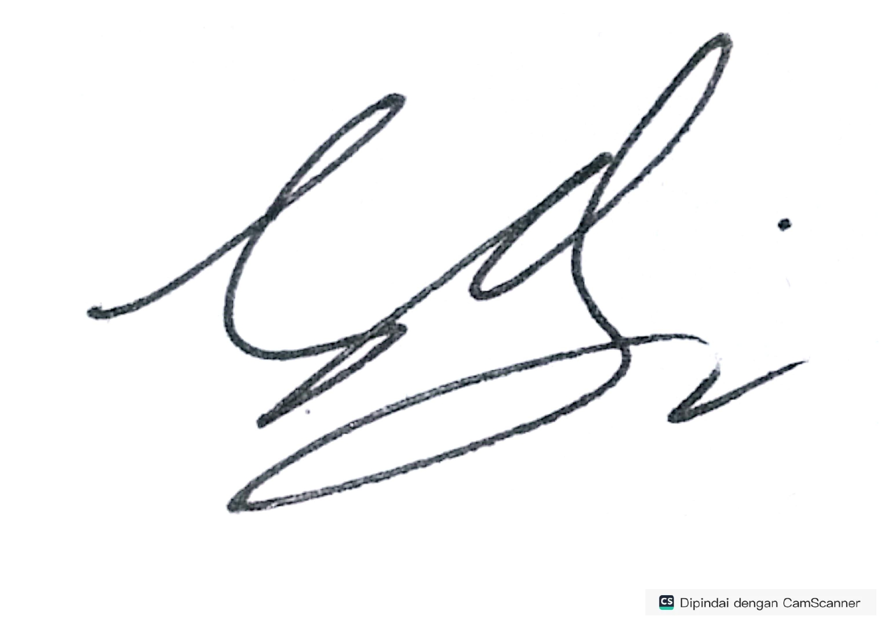
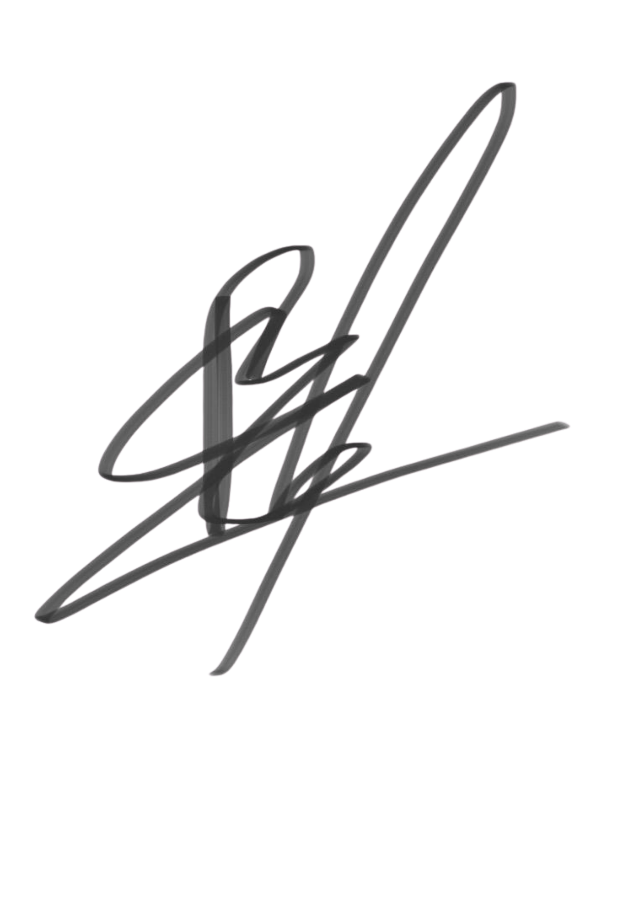

# Deklarasi Penggunaan AI

## Tugas Besar IF2150 - Rekayasa Perangkat Lunak

| Informasi | Keterangan |
|---|---|
| Kelas | *03* |
| Nomor Kelompok | *04* |
| Nama Kelompok | *pakespinwheel* |
| Nama Perangkat Lunak | *Mahasehat: Mental Health Monitoring App for Students* |

**Anggota Kelompok:**

| NIM | Nama |
|---|---|
| *13525021* | *Haikal Muhammad Royyan* |
| *13525066* | *Cynthia Winda Wijaya* |
| *13525081* | *Rendy Salastra Putra* |
| *13525090* | *Sophia Imelda Rogate Marpaung* |
| *13525141* | *Christabelcyne Costan* |

---

### Daftar Isi
- [Deklarasi Penggunaan AI](#deklarasi-penggunaan-ai)
  - [Tugas Besar IF2150 - Rekayasa Perangkat Lunak](#tugas-besar-if2150---rekayasa-perangkat-lunak)
    - [Daftar Isi](#daftar-isi)
    - [Log Penggunaan AI per Milestone](#log-penggunaan-ai-per-milestone)
    - [Milestone 1](#milestone-1)
    - [Milestone 2](#milestone-2)
    - [Milestone 3](#milestone-3)
    - [Milestone 4](#milestone-4)
    - [Milestone 5](#milestone-5)
    - [Milestone 6](#milestone-6)
    - [Milestone 7](#milestone-7)
    - [Milestone 8](#milestone-8)
    - [Milestone 9](#milestone-9)
    - [Pernyataan Integritas dan Persetujuan](#pernyataan-integritas-dan-persetujuan)

---

### Log Penggunaan AI per Milestone

### Milestone 1
| Tool AI | Tujuan Penggunaan | Contoh Prompt Utama | Modifikasi & Validasi Manusia |
| :--- | :--- | :--- | :--- |
| | | | | |
| | | | | |

### Milestone 2
| Tool AI | Tujuan Penggunaan | Contoh Prompt Utama | Modifikasi & Validasi Manusia |
| :--- | :--- | :--- | :--- |
| | | | | |
| | | | | |

### Milestone 3
| Tool AI | Tujuan Penggunaan | Contoh Prompt Utama | Modifikasi & Validasi Manusia |
| :--- | :--- | :--- | :--- |
| | | | | |
| | | | | |

### Milestone 4
| Tool AI | Tujuan Penggunaan | Contoh Prompt Utama | Modifikasi & Validasi Manusia |
| :--- | :--- | :--- | :--- |
| ChatGPT | Mengidentifikasi perbedaan jenis-jenis kelas dan penggunaannya | boundary itu frontend? entity itu database? control itu backend? | Boundary adalah interaksi antara aktor dan sistem. Control adalah pengatur alur use case. Entity adalah representasi objek dalam sistem |
| | | | | |

### Milestone 5
| Tool AI | Tujuan Penggunaan | Contoh Prompt Utama | Modifikasi & Validasi Manusia |
| :--- | :--- | :--- | :--- |
| | | | | |
| | | | | |

### Milestone 6
| Tool AI | Tujuan Penggunaan | Contoh Prompt Utama | Modifikasi & Validasi Manusia |
| :--- | :--- | :--- | :--- |
| | | | | |
| | | | | |

### Milestone 7
| Tool AI | Tujuan Penggunaan | Contoh Prompt Utama | Modifikasi & Validasi Manusia |
| :--- | :--- | :--- | :--- |
| | | | | |
| | | | | |

### Milestone 8
| Tool AI | Tujuan Penggunaan | Contoh Prompt Utama | Modifikasi & Validasi Manusia |
| :--- | :--- | :--- | :--- |
| | | | | |
| | | | | |

### Milestone 9
| Tool AI | Tujuan Penggunaan | Contoh Prompt Utama | Modifikasi & Validasi Manusia |
| :--- | :--- | :--- | :--- |
| opencode (AI coding agent) | Audit dan integrasi FE–BE | "Audit seluruh FE dan BE, apakah masih ada yang belum terhubung"; "Lakukan semua perbaikan" | Menambahkan controller/route konsultasi, laporan, profil, dan session guard; memverifikasi tiap endpoint dengan DB seed (register → login → check-in, booking → approve, laporan, logout 401) |
| opencode | Menyamakan UI halaman auth, sidebar, dan feedback | "Samakan layout auth…"; "Buang search bar sidebar yang nggak jalan"; "Pakai modal/toast yang sama" | Memusatkan style ke `AuthLayout.css` dan `components.css`, menghapus CSS duplikat, mengecek 320–1440 px tanpa scroll horizontal |
| opencode | Memperbaiki bug hasil uji manual | "Ini saya nemu beberapa bug…"; "Pola makan…"; "Tombol keluar bikin modal" | Memperbaiki label pola makan, minggu laporan, pemicu check-in, konfirmasi wali, toast, dan modal logout; tiap perbaikan diuji di browser dan dicek ke DB |
| opencode | Merapikan data demo dan dokumentasi | "Bersihkan semua yang hardcoded…"; "Buat DESIGN.md…"; "Commit message satu line" | Mengganti data dummy dengan placeholder/API, menjalankan `npm test` |
| opencode | Implementasi antarmuka halaman M9 | "Implementasikan ManajemenKonsultasiPage dan setelan tenaga kesehatan"; "Sesuaikan ReportPage, notifikasi darurat, konfirmasi registrasi, dan CheckInPage dengan design system" | Dicek manual per peran: alur konsultasi, laporan, check-in, notifikasi, dan konfirmasi registrasi berjalan sesuai skenario |
| opencode | Integrasi dan perbaikan UI lintas halaman | "Rapikan sidebar, navbar, gutter, dan tampilan dashboard biar konsisten"; "Perbaiki tampilan detail konsultasi di layar kecil"; "Samakan layout auth dan buang search bar sidebar" | Dicek manual di 390–1440 px: sidebar/navbar, layout auth, dan detail konsultasi rapi tanpa scroll horizontal |

---
### Pernyataan Integritas dan Persetujuan

Kami yang bertanda tangan di bawah ini menyatakan bahwa seluruh log penggunaan AI di atas adalah benar. Kami telah memvalidasi seluruh hasil AI dan bertanggung jawab penuh atas orisinalitas, keamanan, dan kebenaran hasil akhir dari tugas ini.

| Tanda Tangan | Nama Anggota |
| :---: | :--- |
|  | **13525021 - Haikal Muhammad Royyan** |
|  | **13525066 - Cynthia Winda Wijaya** |
|  | **13525081 - Rendy Salastra Putra** |
|  | **13525090 - Sophia Imelda Rogate Marpaung** |
|  | **13525141 - Christabelcyne Costan** |
