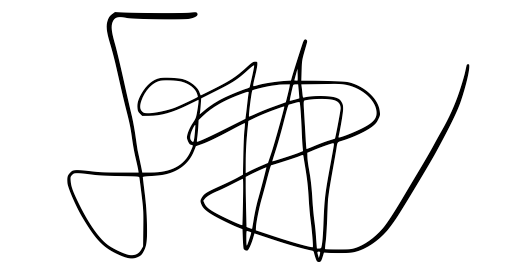
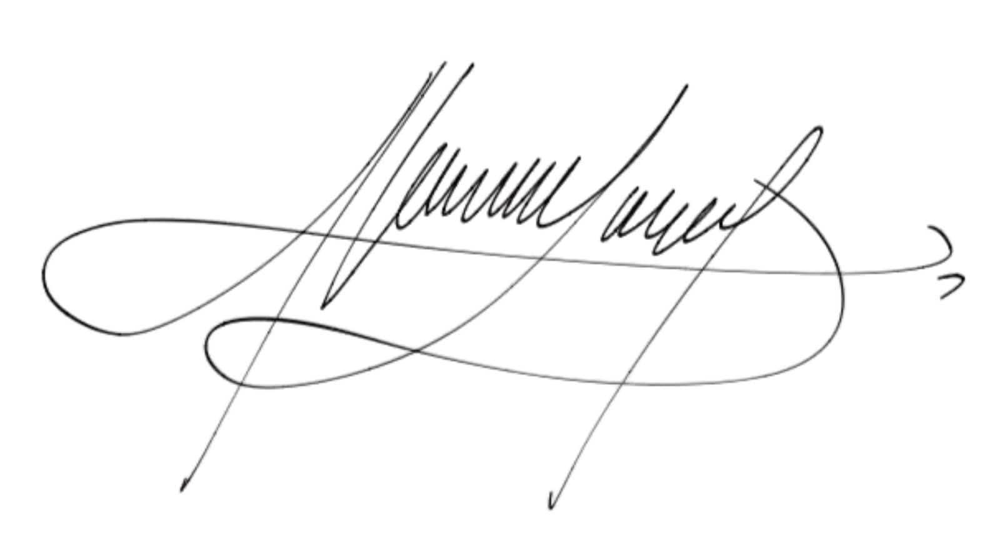

# Deklarasi Penggunaan AI

## Tugas Besar IF2150 - Rekayasa Perangkat Lunak

| Informasi | Keterangan |
|---|---|
| Kelas | *K-03* |
| Nomor Kelompok | *G07* |
| Nama Kelompok | *Siulan* |
| Nama Perangkat Lunak | *LaporKota* |

**Anggota Kelompok:**

| NIM | Nama |
|---|---|
| *13525051* | *Rafi Pradipta Andira Sulistyo* |
| *13525105* | *Pasaribu Fritz T.A.M.* |
| *13525075* | *Bagas Anugrah Putra* |
| *13525099* | *Gede Pranajayanta Suputra* |
| *13525015* | *Muhammad Atallah Ramadhan* |

---

### Daftar Isi
* [Milestone 1](#milestone-1)
* Notes: Copy bagian Daftar Isi seperti Milestone 1 untuk Milestone berikutnya, contoh ``* [Milestone 2](#milestone-2)``. Ketika Daftar isi diklik maka akan langsung diarahkan ke bagian bawah sesuai dengan Milestone tujuan.

---

### Log Penggunaan AI per Milestone

Silakan catat penggunaan AI yang berdampak signifikan pada pengerjaan tugas (misal: *generate* fungsi algoritma yang kompleks, *generate* draf dokumen SKPL/DPPL, atau *debugging* error utama). 
*Penggunaan sepele seperti memperbaiki *typo* atau auto-complete satu baris kode tidak perlu dicatat.*

### Milestone 1
| Tool AI | Tujuan Penggunaan | Contoh Prompt Utama | Modifikasi & Validasi Manusia |
| :--- | :--- | :--- | :--- |
| *Claude* | *Mencari Referensi UU yang Relevan* | *Berikan saya ide UU yang terkait pada pengembangan perangkat lunak ini (disertakan konteks berupa deskripsi singkat perangkat lunak yang kami kembangkan)* | *Beberapa UU yang relevan kami gunakan sebagai bahan pada pengerjaan milestone ini. Sebelum kami masukkan, kami validasi lagi dengan memastikan bahwa UU yang disebutkan valid berdasarkan sumber yang kredibel. Adapun, beberapa saran UU yang diberikan oleh Claude dianggap diluar konteks atau _scope_ pengerjaan proyek perangkat lunak kami.* |
| *Gemini* | *Mengecek relasi antar class* | *"Apakah relasi antara class User dan Order dalam UML ini seharusnya composition atau aggregation?"* | *AI menyarankan composition, tapi setelah dicek kembali ke requirement, kami menggunakan aggregation karena Order masih bisa eksis di history.* |
| | | | | |

### Milestone 2
| Tool AI | Tujuan Penggunaan | Contoh Prompt Utama | Modifikasi & Validasi Manusia |
| :--- | :--- | :--- | :--- |
| | | | | |
| | | | | |

### Milestone 3
| Tool AI | Tujuan Penggunaan | Contoh Prompt Utama | Modifikasi & Validasi Manusia |
| :--- | :--- | :--- | :--- |
| *Gemini* | *Belajar syntax untuk UML Diagram* | *Berikan contoh syntax untuk membuat diagram UML dengan 2 aktor dan 2 use case* | *Menyesuaikan isi kode dengan aktor pribadi, use case pribadi, dan struktur yang menyesuaikan rancangan kelompok* |
| | | | | |

### Milestone 8
| Tool AI | Tujuan Penggunaan | Contoh Prompt Utama | Modifikasi & Validasi Manusia |
| :--- | :--- | :--- | :--- |
| *Claude* | *Menentukan sumber isi setiap layar dan menyusun draf awal spesifikasi Bab 6* | *Untuk Bab 6 perancangan antarmuka, cara mengecek isi tiap page itu pakai apa? Ini Tabel 4.1 kelas perancangan kelompok kami* | *Memilih enam halaman client dari Tabel 2.3 sebagai daftar layar, mencocokkan objek setiap layar dengan atribut dan metode kelas boundary pada Tabel 4.1, menyederhanakan rancangan menjadi satu layar per halaman karena masih tahap mockup, serta menulis ulang tabel spesifikasi objek dengan format ID IXX-YY* |
| *Claude Design* | *Membuat mockup I-01 Formulir Laporan Kerusakan beserta dialog laporan terkirim* | *Buat mockup mobile formulir laporan kerusakan: dropdown kategori, deskripsi, unggah foto dan video maks. 10 MB, tombol "Gunakan Lokasi Saat Ini", peta untuk pilih lokasi manual, pesan "Lokasi di luar daerah penanganan", tombol Batal dan Kirim Laporan* | *Mengubah teks petunjuk peta dan contoh isian sesuai kebutuhan kelompok, menyesuaikan label Foto agar sama dengan tabel spesifikasi, menambahkan dialog laporan terkirim sebagai pop-up terpisah (I-01b) setelah disetujui asisten, serta memastikan dua opsi lokasi (GPS dan manual) sesuai dengan sequence diagram UC01* |
| *Claude Design* | *Membuat mockup I-02 Status Laporan untuk tab Riwayat dan tab Peta* | *Buat frame "I-02 Peta" dengan tab Peta aktif: peta sebaran laporan publik, penanda berwarna sesuai status tanpa identitas pelapor, kartu ringkas laporan terpilih dengan jumlah dukungan dan tombol "Dukung (12)"* | *Menambahkan frame tab Peta yang belum ada pada mockup awal, mempertahankan desain tab (bukan satu halaman scroll) agar sesuai dengan metode pilihMenuRiwayat() dan pilihMenuPeta(), memeriksa bahwa identitas pelapor tidak tampil sesuai batasan SKPL, serta menyelaraskan konsep upvote (manual dan otomatis dari laporan duplikat) dengan kelompok sebelum menetapkan isi tabel I-02* |
| *Claude Design* | *Membuat mockup I-03 Validasi Laporan untuk Tim Administrasi* | *Buat mockup desktop validasi laporan: sidebar admin, filter kategori, tabel antrean laporan berstatus Diterima, panel rincian berisi foto, video, deskripsi, peta, tombol Validasi dan Tolak, serta isian alasan penolakan* | *Menghapus menu "Pengaturan" pada sidebar karena tidak memiliki halaman maupun use case, memeriksa kesesuaian tombol dengan metode onValidClicked(), onTolakClicked(), dan submitAlasanPenolakan(), serta mencatat kebutuhan pengurutan antrean pada SKPL yang belum memiliki metode untuk dibahas bersama kelompok* |
| *Claude Design* | *Membuat mockup I-04 Evaluasi Hasil Kerja untuk Tim Administrasi* | *Buat mockup desktop evaluasi hasil kerja: daftar pekerjaan siap evaluasi, perbandingan foto sebelum dan sesudah, catatan eksekutor, catatan evaluasi, tombol Konfirmasi Selesai, Belum Selesai, dan Minta Ulang Bukti* | *Menghapus menu "Pengaturan" pada sidebar, mencocokkan ketiga tombol keputusan dengan metode EvaluasiPage pada Tabel 4.1, serta menuliskan perubahan status tiket untuk setiap tombol sesuai alur evaluasi pada SKPL* |
| *Claude Design* | *Membuat mockup I-05 Daftar Tugas untuk Eksekutor Lapangan* | *Buat mockup mobile daftar tugas eksekutor: filter kategori, kartu tugas urut skor prioritas, panel rincian dengan foto, deskripsi, lokasi, tombol "Buka di Google Maps" dan "Laporkan Hasil"* | *Mengganti contoh alamat sesuai kebutuhan kelompok, menyeragamkan daftar kategori dengan layar lain, memperjelas bahwa daftar hanya memuat tugas yang hasil perbaikannya belum dikirim, serta menandai skala skor prioritas dan mekanisme penugasan eksekutor sebagai hal yang perlu disepakati kelompok* |
| *Claude Design* | *Membuat mockup I-06 Formulir Hasil Perbaikan untuk Eksekutor Lapangan* | *Buat mockup mobile formulir hasil perbaikan: identitas tiket, catatan perbaikan, unggah foto bukti wajib, unggah video opsional, pesan "Gagal terkirim: foto dan deskripsi wajib diisi", tombol Kirim Hasil* | *Menyamakan teks pesan error dengan sequence diagram UC04 milik kelompok, memeriksa batasan format dan ukuran berkas sesuai SKPL, serta menuliskan alur setelah pengiriman (masuk ke daftar siap evaluasi I-04) pada tabel spesifikasi* |
| *Claude* | *Meninjau konsistensi Bab 6 terhadap SKPL dan DPPL sebelum dikumpulkan* | *Cek tabel Bab 6 ini, cocokkan dengan Tabel 4.1 dan SKPL, mana yang perlu dikoreksi?* | *Memilih koreksi yang diterapkan dan menolak sebagian saran yang tidak sesuai keputusan kelompok, menelusuri sumber daftar kategori dan skor prioritas di SKPL, menyesuaikan penomoran gambar, serta membaca ulang seluruh tabel secara manual sebelum dikumpulkan* |

---
### Pernyataan Integritas dan Persetujuan

Kami yang bertanda tangan di bawah ini menyatakan bahwa seluruh log penggunaan AI di atas adalah benar. Kami telah memvalidasi seluruh hasil AI dan bertanggung jawab penuh atas orisinalitas, keamanan, dan kebenaran hasil akhir dari tugas ini.

| Tanda Tangan | Nama Anggota |
| :---: | :--- |
|  | **13525051 - Rafi Pradipta Andira Sulistyo** |
|  | **13525105 - Pasaribu Fritz T.A.M.** |
|  | **13525075 - Bagas Anugrah Putra** |
|  | **13525099 - Gede Pranajayanta Suputra** |
|  | **13525015 - Muhammad Atallah Ramadhan** |