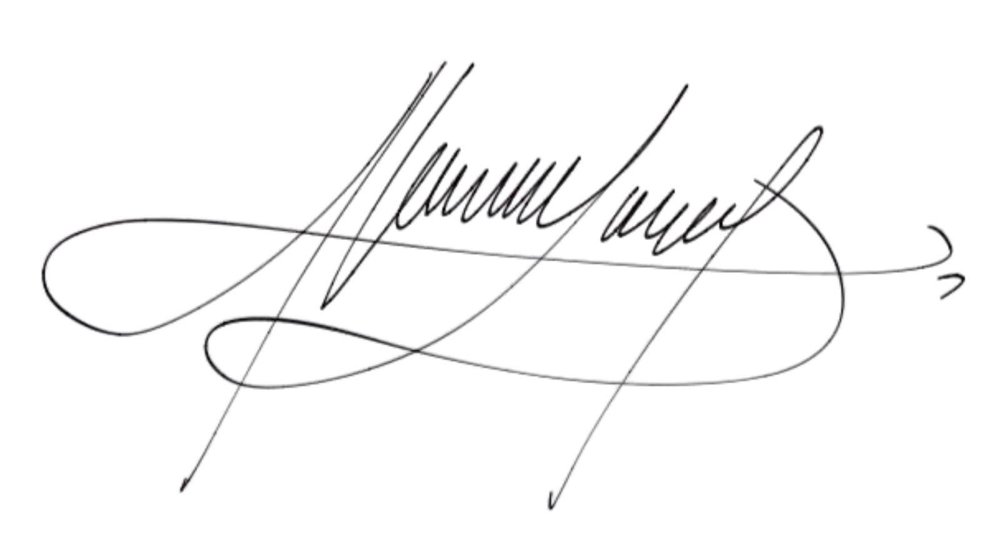

# Deklarasi Penggunaan AI

## Tugas Besar IF2150 - Rekayasa Perangkat Lunak

| Informasi | Keterangan |
|---|---|
| Kelas | *K-03* |
| Nomor Kelompok | *G07* |
| Nama Kelompok | *Siulan* |
| Nama Perangkat Lunak | *LaporKota* |

**Anggota Kelompok:**

| NIM | Nama |
|---|---|
| *13525051* | *Rafi Pradipta Andira Sulistyo* |
| *13525105* | *Pasaribu Fritz T.A.M.* |
| *13525075* | *Bagas Anugrah Putra* |
| *13525099* | *Gede Pranajayanta Suputra* |
| *13525015* | *Muhammad Atallah Ramadhan* |

---

### Daftar Isi
* [Milestone 1](#milestone-1)
* [Milestone 2](#milestone-2)
* [Milestone 3](#milestone-3)
* [Milestone 8](#milestone-8)
* [Milestone 9](#milestone-9)
* Notes: Copy bagian Daftar Isi seperti Milestone 1 untuk Milestone berikutnya, contoh ``* [Milestone 2](#milestone-2)``. Ketika Daftar isi diklik maka akan langsung diarahkan ke bagian bawah sesuai dengan Milestone tujuan.

---

### Log Penggunaan AI per Milestone

Silakan catat penggunaan AI yang berdampak signifikan pada pengerjaan tugas (misal: *generate* fungsi algoritma yang kompleks, *generate* draf dokumen SKPL/DPPL, atau *debugging* error utama). 
*Penggunaan sepele seperti memperbaiki *typo* atau auto-complete satu baris kode tidak perlu dicatat.*

### Milestone 1
| Tool AI | Tujuan Penggunaan | Contoh Prompt Utama | Modifikasi & Validasi Manusia |
| :--- | :--- | :--- | :--- |
| *Claude* | *Mencari Referensi UU yang Relevan* | *Berikan saya ide UU yang terkait pada pengembangan perangkat lunak ini (disertakan konteks berupa deskripsi singkat perangkat lunak yang kami kembangkan)* | *Beberapa UU yang relevan kami gunakan sebagai bahan pada pengerjaan milestone ini. Sebelum kami masukkan, kami validasi lagi dengan memastikan bahwa UU yang disebutkan valid berdasarkan sumber yang kredibel. Adapun, beberapa saran UU yang diberikan oleh Claude dianggap diluar konteks atau _scope_ pengerjaan proyek perangkat lunak kami.* |
| *Gemini* | *Mengecek relasi antar class* | *"Apakah relasi antara class User dan Order dalam UML ini seharusnya composition atau aggregation?"* | *AI menyarankan composition, tapi setelah dicek kembali ke requirement, kami menggunakan aggregation karena Order masih bisa eksis di history.* |
| | | | | |

### Milestone 2
| Tool AI | Tujuan Penggunaan | Contoh Prompt Utama | Modifikasi & Validasi Manusia |
| :--- | :--- | :--- | :--- |
| | | | | |
| | | | | |

### Milestone 3
| Tool AI | Tujuan Penggunaan | Contoh Prompt Utama | Modifikasi & Validasi Manusia |
| :--- | :--- | :--- | :--- |
| *Gemini* | *Belajar syntax untuk UML Diagram* | *Berikan contoh syntax untuk membuat diagram UML dengan 2 aktor dan 2 use case* | *Menyesuaikan isi kode dengan aktor pribadi, use case pribadi, dan struktur yang menyesuaikan rancangan kelompok* |
| | | | | |

### Milestone 8
| Tool AI | Tujuan Penggunaan | Contoh Prompt Utama | Modifikasi & Validasi Manusia |
| :--- | :--- | :--- | :--- |
| *Claude* | *Menentukan sumber isi setiap layar dan menyusun draf awal spesifikasi Bab 6* | *Untuk Bab 6 perancangan antarmuka, cara mengecek isi tiap page itu pakai apa? Ini Tabel 4.1 kelas perancangan kelompok kami* | *Memilih enam halaman client dari Tabel 2.3 sebagai daftar layar, mencocokkan objek setiap layar dengan atribut dan metode kelas boundary pada Tabel 4.1, menyederhanakan rancangan menjadi satu layar per halaman karena masih tahap mockup, serta menulis ulang tabel spesifikasi objek dengan format ID IXX-YY* |
| *Claude Design* | *Membuat mockup I-01 Formulir Laporan Kerusakan beserta dialog laporan terkirim* | *Buat mockup mobile formulir laporan kerusakan: dropdown kategori, deskripsi, unggah foto dan video maks. 10 MB, tombol "Gunakan Lokasi Saat Ini", peta untuk pilih lokasi manual, pesan "Lokasi di luar daerah penanganan", tombol Batal dan Kirim Laporan* | *Mengubah teks petunjuk peta dan contoh isian sesuai kebutuhan kelompok, menyesuaikan label Foto agar sama dengan tabel spesifikasi, menambahkan dialog laporan terkirim sebagai pop-up terpisah (I-01b) setelah disetujui asisten, serta memastikan dua opsi lokasi (GPS dan manual) sesuai dengan sequence diagram UC01* |
| *Claude Design* | *Membuat mockup I-02 Status Laporan untuk tab Riwayat dan tab Peta* | *Buat frame "I-02 Peta" dengan tab Peta aktif: peta sebaran laporan publik, penanda berwarna sesuai status tanpa identitas pelapor, kartu ringkas laporan terpilih dengan jumlah dukungan dan tombol "Dukung (12)"* | *Menambahkan frame tab Peta yang belum ada pada mockup awal, mempertahankan desain tab (bukan satu halaman scroll) agar sesuai dengan metode pilihMenuRiwayat() dan pilihMenuPeta(), memeriksa bahwa identitas pelapor tidak tampil sesuai batasan SKPL, serta menyelaraskan konsep upvote (manual dan otomatis dari laporan duplikat) dengan kelompok sebelum menetapkan isi tabel I-02* |
| *Claude Design* | *Membuat mockup I-03 Validasi Laporan untuk Tim Administrasi* | *Buat mockup desktop validasi laporan: sidebar admin, filter kategori, tabel antrean laporan berstatus Diterima, panel rincian berisi foto, video, deskripsi, peta, tombol Validasi dan Tolak, serta isian alasan penolakan* | *Menghapus menu "Pengaturan" pada sidebar karena tidak memiliki halaman maupun use case, memeriksa kesesuaian tombol dengan metode onValidClicked(), onTolakClicked(), dan submitAlasanPenolakan(), serta mencatat kebutuhan pengurutan antrean pada SKPL yang belum memiliki metode untuk dibahas bersama kelompok* |
| *Claude Design* | *Membuat mockup I-04 Evaluasi Hasil Kerja untuk Tim Administrasi* | *Buat mockup desktop evaluasi hasil kerja: daftar pekerjaan siap evaluasi, perbandingan foto sebelum dan sesudah, catatan eksekutor, catatan evaluasi, tombol Konfirmasi Selesai, Belum Selesai, dan Minta Ulang Bukti* | *Menghapus menu "Pengaturan" pada sidebar, mencocokkan ketiga tombol keputusan dengan metode EvaluasiPage pada Tabel 4.1, serta menuliskan perubahan status tiket untuk setiap tombol sesuai alur evaluasi pada SKPL* |
| *Claude Design* | *Membuat mockup I-05 Daftar Tugas untuk Eksekutor Lapangan* | *Buat mockup mobile daftar tugas eksekutor: filter kategori, kartu tugas urut skor prioritas, panel rincian dengan foto, deskripsi, lokasi, tombol "Buka di Google Maps" dan "Laporkan Hasil"* | *Mengganti contoh alamat sesuai kebutuhan kelompok, menyeragamkan daftar kategori dengan layar lain, memperjelas bahwa daftar hanya memuat tugas yang hasil perbaikannya belum dikirim, serta menandai skala skor prioritas dan mekanisme penugasan eksekutor sebagai hal yang perlu disepakati kelompok* |
| *Claude Design* | *Membuat mockup I-06 Formulir Hasil Perbaikan untuk Eksekutor Lapangan* | *Buat mockup mobile formulir hasil perbaikan: identitas tiket, catatan perbaikan, unggah foto bukti wajib, unggah video opsional, pesan "Gagal terkirim: foto dan deskripsi wajib diisi", tombol Kirim Hasil* | *Menyamakan teks pesan error dengan sequence diagram UC04 milik kelompok, memeriksa batasan format dan ukuran berkas sesuai SKPL, serta menuliskan alur setelah pengiriman (masuk ke daftar siap evaluasi I-04) pada tabel spesifikasi* |
| *Claude* | *Meninjau konsistensi Bab 6 terhadap SKPL dan DPPL sebelum dikumpulkan* | *Cek tabel Bab 6 ini, cocokkan dengan Tabel 4.1 dan SKPL, mana yang perlu dikoreksi?* | *Memilih koreksi yang diterapkan dan menolak sebagian saran yang tidak sesuai keputusan kelompok, menelusuri sumber daftar kategori dan skor prioritas di SKPL, menyesuaikan penomoran gambar, serta membaca ulang seluruh tabel secara manual sebelum dikumpulkan* |

### Milestone 9
| Tool AI | Tujuan Penggunaan | Contoh Prompt Utama | Modifikasi & Validasi Manusia |
| :--- | :--- | :--- | :--- |
| *Claude* | *Fondasi (Rafi Pradipta): merencanakan pembagian kerja implementasi dan panduan kerja AI agent tim (AGENTS.md)* | *Kami berlima mau mulai implementasi LaporKota pakai Next.js dan Supabase. Bantu bagi tugasnya supaya tidak saling tabrakan, dan buatkan panduan untuk AI agent tiap anggota supaya semua mengikuti nama tabel, kolom, dan aturan yang sama* | *Memutuskan pembagian kerja per use case (front end dan back end dikerjakan orang yang sama) dengan peran Fondasi menyiapkan basis data dan komponen bersama, menyesuaikan nama tabel dan kolom dengan DPPL, serta tidak memakai rancangan awal mentah-mentah karena sebagian sudah direvisi (format nomor tiket, pencabutan hak anon)* |
| *Claude Code* | *Fondasi (Rafi Pradipta): menulis migration skema awal (enum, tabel, index, view publik, fungsi bantu, dan RLS)* | *Tulis migration skema awal sesuai AGENTS.md bagian 5: enum, 9 tabel, index, view laporan_publik untuk peta tamu, fungsi bantu peran, dan policy RLS di semua tabel. Pakai (select auth.uid()) di policy dan nomor tiket lewat fungsi format_tiket. Jangan db push, jangan commit* | *Me-review hasil bersama Claude chat lalu meminta patch: hak UPDATE/DELETE lewat view dicabut, insert laporan dibatasi per kolom, upvote hanya untuk warga; migration diterapkan sendiri dan akses role anon diuji di SQL Editor* |
| *Claude* | *Fondasi (Rafi Pradipta): meninjau celah keamanan grant dan policy basis data* | *Ini policy UPDATE di migration skema awal. Cek apakah admin atau warga bisa mengubah kolom yang seharusnya tidak boleh, misalnya jumlah upvote atau peran, dan tabel mana saja yang perlu ditambal* | *Menjalankan sendiri audit pg_policies, lalu memutuskan: UPDATE laporan hanya kolom status, tahap, dan alasan penolakan; UPDATE notifikasi hanya status baca; alasan penolakan tidak bisa diubah setelah ditolak; catatan evaluasi tidak masuk riwayat warga* |
| *Claude Code* | *Fondasi (Rafi Pradipta): seed data uji dan operasi Lokasi (dalamWilayah, hitungJarak) beserta unit test* | *Buat scripts/seed.ts yang idempoten: akun uji tiap peran dan 19 laporan yang mencakup semua status, upvote, serta riwayat. Tambahkan juga Lokasi.hitungJarak (haversine, satuan meter) beserta unit test-nya. Jangan jalankan seed* | *Menerima saran Claude untuk menambah akun warga agar variasi skor upvote cukup, mengambil batas wilayah Kota Bandung dari OpenStreetMap, memperbaiki seed agar tidak menghabiskan nomor tiket saat dijalankan ulang, serta menjalankan seed sendiri dan merapikan nomor tiket ke LK-0001* |
| *Claude Code* | *Fondasi (Rafi Pradipta): autentikasi (client Supabase, proxy sesi, helper akses, halaman masuk dan daftar)* | *Buat client Supabase, proxy sesi, helper requireRole, serta halaman masuk dan daftar dengan guard per peran. Sebelum mulai, pastikan trigger handle_new_user tidak mengambil peran dari metadata, sehingga pendaftar selalu menjadi warga* | *Memutuskan pengguna tanpa profil diarahkan ke /status agar tidak terjadi redirect berulang, menambahkan penolakan redirect ke domain luar, serta menguji manual 12 skenario masuk dengan akun seed sebelum PR* |
| *Claude Code* | *Fondasi (Rafi Pradipta): migration trigger status, riwayat, notifikasi, upvote, dan RPC cari laporan duplikat* | *Tulis migration baru berisi trigger transisi status, pencatatan riwayat dan notifikasi, penambahan upvote dan skor, penerimaan hasil perbaikan, evaluasi, serta RPC cari_laporan_duplikat (radius 20 m). Tambal juga grant UPDATE per kolom dan uji di PGlite* | *Menetapkan rumus skor prioritas least(100, upvote × 10) dan pengecualian trigger untuk seed, meminta dua patch setelah review, serta menguji di PGlite dan SQL Editor (rollback) sebelum diterapkan sendiri* |
| *Claude* | *Fondasi (Rafi Pradipta): keputusan desain penyimpanan media dan pembaruan data* | *Untuk foto dan video laporan, bucket Storage sebaiknya private dengan signed URL atau public? Lalu untuk peta publik, lebih baik realtime atau refetch berkala? Jelaskan trade-off masing-masing* | *Memilih bucket public agar sederhana dengan tetap mengunci upload per peran dan path, memilih refetch berkala untuk peta publik, serta notifikasi in-app (bukan email); semua dicatat sebagai perubahan dari DPPL* |
| *Claude Code* | *Fondasi (Rafi Pradipta): bucket media, RPC kirim laporan dan kirim hasil perbaikan, komponen MediaUploader* | *Buat migration bucket media (public, maks 10 MB, JPG/PNG/MP4/MOV/MKV) dengan policy upload per peran dan path, RPC atomik kirim_laporan dan kirim_hasil_perbaikan, entity Foto/Video beserta test, dan komponen MediaUploader* | *Meminta satu revisi setelah review, memastikan berkas .jpeg disimpan sebagai jpg dan MIME .mkv yang kosong tetap diterima, serta menerapkan migration sendiri* |
| *Claude Code* | *Fondasi (Rafi Pradipta): entity bersama, MapView, StatusBadge, DetailLaporan, lonceng notifikasi, dan README* | *Buat entity Laporan, Upvote, dan Notifikasi yang dipakai semua use case, komponen MapView, StatusBadge, dan DetailLaporan, lonceng notifikasi real-time, serta README dan .env.example untuk anggota tim* | *Menentukan klik notifikasi membuka /status?tiket=, merevisi README satu kali, mencoba query entity sebagai anon dan warga, serta memeriksa tampilan komponen sebelum PR* |
| *Claude* | *Fondasi (Rafi Pradipta): panduan deploy ke Vercel dan konfigurasi Supabase Auth* | *Aplikasi sudah jalan di lokal. Bagaimana cara deploy ke Vercel, env apa saja yang perlu diisi, dan apa yang harus diatur di Supabase Auth supaya login di production berjalan?* | *Melakukan deploy sendiri lewat CLI dari branch dev yang bersih, tidak memasukkan secret key Supabase ke Vercel, serta mengatur Site URL dan redirect Supabase Auth* |
| *Claude Code* | *Fondasi (Rafi Pradipta): profiling RPC cari_laporan_duplikat (index, skrip benchmark, dokumentasi)* | *Baca issue #104. Buat migration index untuk mempercepat cari_laporan_duplikat dan skrip benchmark untuk SQL Editor dengan ±10.000 laporan dummy yang di-rollback. Bandingkan query naif tanpa bounding box dengan RPC + index, dan pastikan hasilnya sama* | *Mengikuti cakupan issue alih-alih rencana awal, menjalankan benchmark sendiri di Supabase SQL Editor, menuliskan baseline apa adanya (Index Scan, bukan Seq Scan), serta menerapkan index sendiri* |
| **Codex** | **Status (Gede Pranajayanta Suputra): meninjau implementasi UC06 dan keterkaitannya dengan issue** | **Periksa riwayat commit UC06 dan cocokkan perubahan Riwayat, Peta publik, dukungan, serta tautan notifikasi dengan acceptance criteria issue #102 dan #103** | **Mencocokkan hasil penjelasan dengan daftar PR di GitHub dan tampilan aplikasi; mencatat bahwa integrasi foto hasil perbaikan masih perlu diselesaikan** |
| **Codex** | **Status (Gede Pranajayanta Suputra): menyusun dokumentasi PR dan panduan bukti pengujian** | **Bantu susun komentar PR sesuai contoh tim, berisi ringkasan, perubahan per lapisan DPPL, hasil pengujian, dan foto bukti yang diperlukan** | **Menentukan format akhir komentar, memeriksa halaman Riwayat dan detail tiket melalui aplikasi, serta menyiapkan screenshot; membedakan hasil pemeriksaan otomatis dari pengujian browser** |
| **Codex** | **Status (Gede Pranajayanta Suputra): menambahkan tombol tutup kartu laporan pada Peta** | **Tambahkan tombol tutup pada kartu ringkasan Peta. Setelah ditutup, kartu bisa dibuka kembali dan status dukungan tetap tersimpan. Gunakan branch fix/status-tutup-kartu-peta** | **Menentukan kebutuhan tombol berdasarkan penggunaan aplikasi, menyetujui rencana perubahan, serta melakukan commit dan push sendiri. Perubahan dibatasi pada komponen kartu dan View Status; lint, typecheck, dan 288 unit test dijalankan melalui Codex** |
| **Codex** | **Status (Gede Pranajayanta Suputra): membantu pemeriksaan alur Git** | **Periksa mengapa branch perbaikan tidak memiliki perbedaan dengan dev ketika akan membuat PR** | **Memeriksa tampilan perbandingan branch di GitHub dan menggunakan hasil pemeriksaan reflog untuk mengetahui bahwa commit perbaikan telah masuk melalui push langsung ke dev** |
| **Codex** | **Status (Gede Pranajayanta Suputra): membantu penyusunan logbook dan catatan penggunaan AI** | **Susun catatan pekerjaan sesuai riwayat commit dan format dokumentasi tim** | **Tanggal dan uraian pekerjaan dicocokkan dengan riwayat commit; durasi pengerjaan tidak diisi oleh AI agar dapat dicatat sesuai waktu aktual** |

---
### Pernyataan Integritas dan Persetujuan

Kami yang bertanda tangan di bawah ini menyatakan bahwa seluruh log penggunaan AI di atas adalah benar. Kami telah memvalidasi seluruh hasil AI dan bertanggung jawab penuh atas orisinalitas, keamanan, dan kebenaran hasil akhir dari tugas ini.

| Tanda Tangan | Nama Anggota |
| :---: | :--- |
|  | **13525051 - Rafi Pradipta Andira Sulistyo** |
|  | **13525105 - Pasaribu Fritz T.A.M.** |
|  | **13525075 - Bagas Anugrah Putra** |
|  | **13525099 - Gede Pranajayanta Suputra** |
|  | **13525015 - Muhammad Atallah Ramadhan** |
