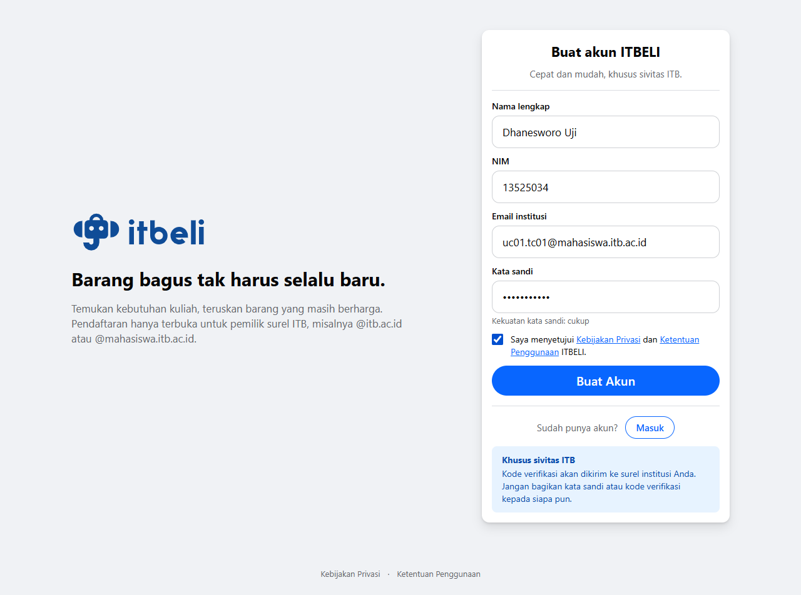
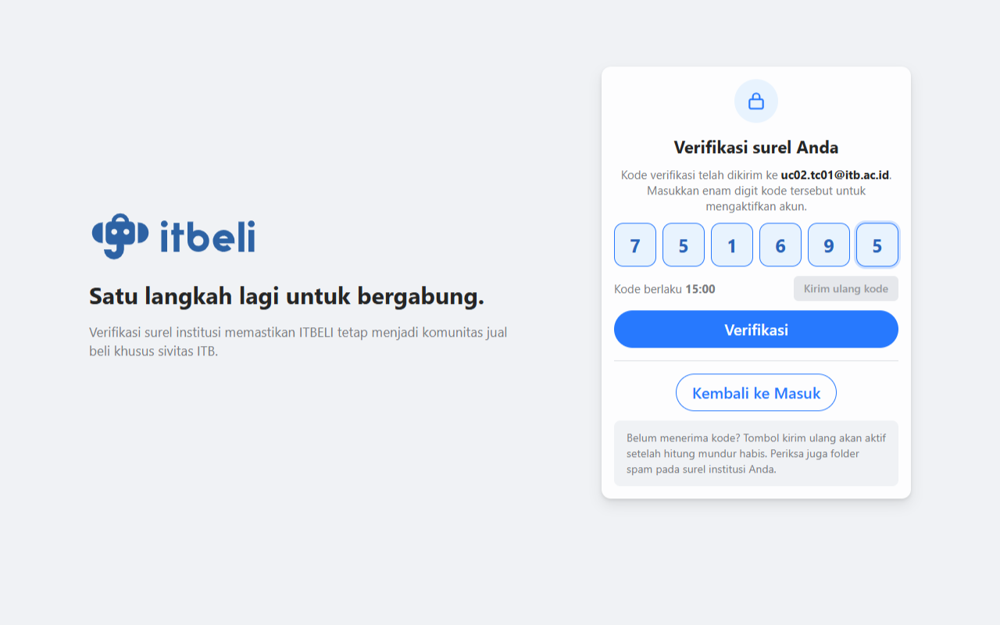
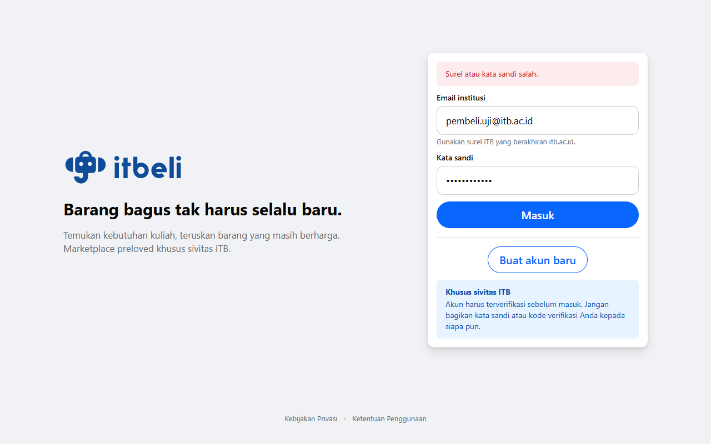
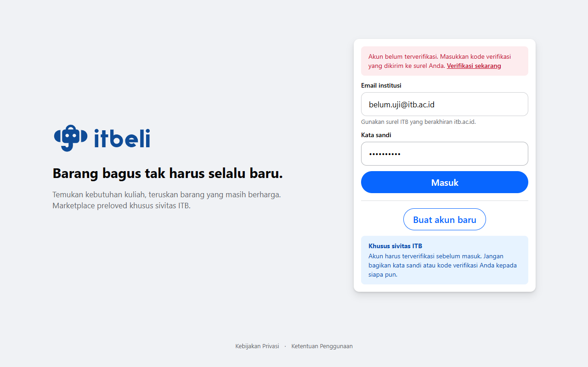
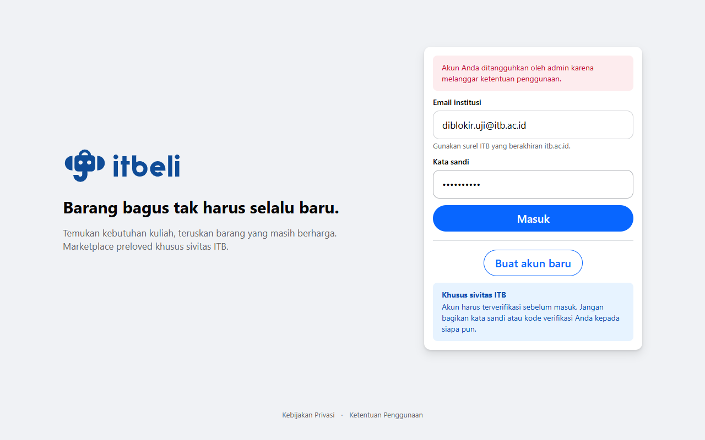
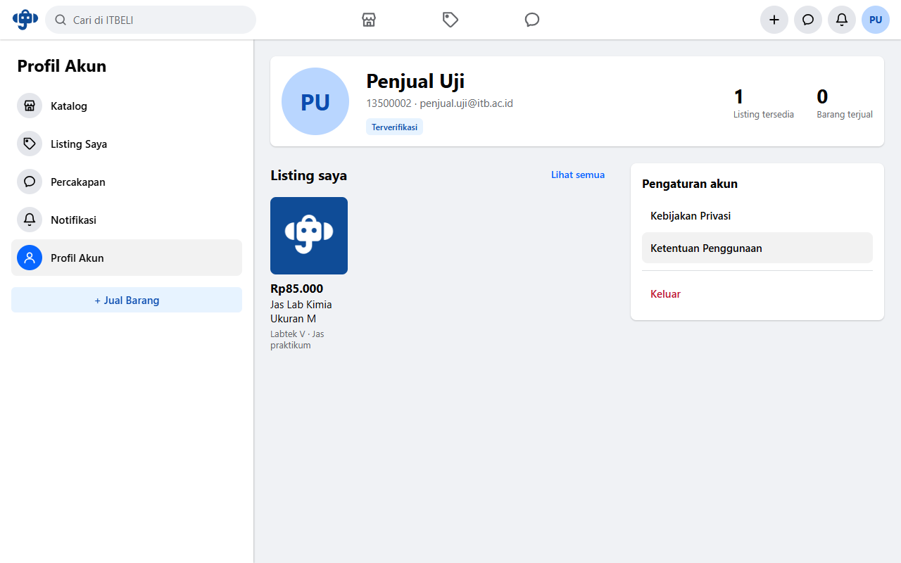

<h1>
IF2150 REKAYASA PERANGKAT LUNAK
 
TUGAS 10
 
HASIL IMPLEMENTASI DAN UJI PERANGKAT LUNAK (HIUPL)
</h1>
 

## *Nama Perangkat Lunak*
### *[Logo Perangkat Lunak]*

### Untuk: *[Nama Asisten]*

Dipersiapkan oleh:
| Informasi | Keterangan |
| --- | --- |
| Kelas | *\[Kelas\]* |
| Kelompok | *\[Nomor Kelompok\]*  |

| NIM | Nama |
|---|---|
| *[NIM 1]* | *[Nama Anggota 1]* |
| *[NIM 2]* | *[Nama Anggota 2]* |
| *[NIM 3]* | *[Nama Anggota 3]* |
| *[NIM 4]* | *[Nama Anggota 4]* |
| *[NIM 5]* | *[Nama Anggota 5]* |

---

## Daftar Isi

- [BAB 1: Pendahuluan](#bab-1-pendahuluan)
  - [1.1 Tujuan Penulisan Dokumen](#11-tujuan-penulisan-dokumen)
  - [1.2 Lingkup Masalah](#12-lingkup-masalah)
  - [1.3 Definisi, Istilah, dan Singkatan](#13-definisi-istilah-dan-singkatan)
  - [1.4 Aturan Penomoran](#14-aturan-penomoran)
  - [1.5 Referensi](#15-referensi)
  - [1.6 Deskripsi Umum Dokumen (Ikhtisar)](#16-deskripsi-umum-dokumen-ikhtisar)
- [BAB 2: Deskripsi Umum Perangkat Lunak](#bab-2-deskripsi-umum-perangkat-lunak)
- [BAB 3: Implementasi](#bab-3-implementasi)
  - [3.1 Lingkungan Implementasi](#31-lingkungan-implementasi)
  - [3.2 Implementasi Modul](#32-implementasi-modul)
  - [3.3 Implementasi Antarmuka](#33-implementasi-antarmuka)
  - [3.4 File Lain](#34-file-lain)
- [BAB 4: Hasil Pengujian](#bab-4-hasil-pengujian)
  - [4.1 Strategi dan Kedalaman Pengujian Kelas](#41-strategi-dan-kedalaman-pengujian-kelas)
  - [4.2 Pengujian Unit Kelas](#42-pengujian-unit-kelas)
  - [4.3 Pengujian Integrasi](#43-pengujian-integrasi)
  - [4.4 Pengujian Use Case](#44-pengujian-use-case)
  - [4.5 Pengujian Kebutuhan Non-Fungsional (KNF)](#45-pengujian-kebutuhan-non-fungsional-knf)
  - [4.6 Tangkapan Layar dan Bukti Hasil Pengujian](#46-tangkapan-layar-dan-bukti-hasil-pengujian)
- [BAB 5: Traceability](#bab-5-traceability)

---

## Daftar Perubahan

| Revisi | Deskripsi |
| :--- | :--- |
| *A* | *Deskripsikan perubahan yang dilakukan dari dokumen sebelumnya pada dokumen ini. Jika tidak terdapat perubahan, harap kosongkan tabel.* |
| *B* |  |
| *C* |  |
| ... |  |

---

# BAB 1: Pendahuluan

## 1.1 Tujuan Penulisan Dokumen
Tuliskan uraian ringkas mengenai isi dokumen, tujuan pembuatan dokumen HIUPL ini, dan siapa saja target pembacanya.

## 1.2 Lingkup Masalah
Tuliskan lingkup masalah, yaitu membangun perangkat lunak *[nama perangkat lunak]*. Jelaskan dengan singkat dan jelas deskripsi aplikasi serta keterkaitannya dengan perangkat lunak atau sistem lain (jika ada). Bagian ini maksimal berisi satu paragraf, dapat diambil dari SKPL/DPPL.

## 1.3 Definisi, Istilah, dan Singkatan
Semua definisi dan singkatan yang digunakan dalam dokumen ini beserta penjelasannya.

Tabel 1.3. Definisi Istilah dan Singkatan

| Singkatan, Akronim, atau Istilah | Penjelasan |
| :--- | :--- |
| *P/L* | *Singkatan dari Perangkat Lunak, yaitu aplikasi yang memberikan perintah kepada komputer untuk menjalankan tugas tertentu.* |
| *SKPL* | *Singkatan dari Spesifikasi Kebutuhan Perangkat Lunak, yaitu dokumen yang merangkum kriteria-kriteria yang diperlukan untuk membangun aplikasi menjalankan tugasnya.* |
| *DPPL* | *Singkatan dari Deskripsi Perancangan Perangkat Lunak, yaitu dokumen yang menjelaskan rancangan arsitektur, kelas, dan antarmuka P/L.* |
| *HIUPL* | *Singkatan dari Hasil Implementasi dan Uji Perangkat Lunak, yaitu dokumen yang melaporkan hasil implementasi dan pengujian P/L.* |
| *KF* | *Singkatan dari Kebutuhan Fungsional.* |
| *KNF* | *Singkatan dari Kebutuhan Non-Fungsional.* |
| *UC* | *Singkatan dari Use Case.* |
| *TC* | *Singkatan dari Test Case, yaitu satu kasus uji untuk skenario tertentu.* |
| *UT* | *Singkatan dari Unit Test, yaitu test case tingkat kelas/operasi.* |
| *INT* | *Singkatan dari Integration Test, yaitu test case yang menguji interaksi antarkomponen.* |
| *Boundary* | *Kasus uji pada nilai batas masukan, misalnya nilai minimum, maksimum, atau tepat di ambang aturan.* |
| *Coverage* | *Persentase baris/cabang kode yang dieksekusi oleh pengujian.* |
| *...* | *...* |

## 1.4 Aturan Penomoran
Tuliskan aturan penomoran (ID) yang digunakan dalam dokumen ini. Gunakan pola ID yang **sama** dengan yang sudah dipakai pada dokumen-dokumen sebelumnya (SKPL, APL, DPPL), kecuali untuk ID pengujian yang baru diperkenalkan pada dokumen ini.

Tabel 1.4. Aturan Penomoran

| Hal/Bagian | Penomoran | Keterangan |
| :--- | :--- | :--- |
| *Kebutuhan Fungsional* | *KFXX* | *Sesuai SKPL* |
| *Kebutuhan Non-Fungsional* | *KNFXX* | *Sesuai SKPL* |
| *Use Case* | *UCXX* | *Sesuai SKPL* |
| *Kelas* | *CXX* | *Sesuai DPPL* |
| *Antarmuka* | *I-XX* | *Sesuai DPPL* |
| *Test Case Unit* | *CXX-UTYY* | *XX adalah nomor kelas, YY adalah nomor urut test case unit pada kelas tersebut* |
| *Test Case Integrasi* | *INT-TCYY* | *YY adalah nomor urut test case integrasi* |
| *Test Case Use Case* | *UCXX-TCYY* | *XX adalah nomor use case, YY adalah nomor urut test case pada use case tersebut* |
| *Test Case KNF* | *KNFXX-TCYY* | *XX adalah nomor KNF, YY adalah nomor urut test case pada KNF tersebut* |
| *...* | *...* | *...* |

## 1.5 Referensi
Cantumkan daftar buku, panduan, atau dokumentasi lain yang dirujuk dalam pembuatan dokumen dan pengembangan P/L, **minimal dokumen SKPL, APL, DPPL, dan Implementasi (Tugas 9)**. Tambahkan dokumentasi *framework*/*library*/*testing tool* atau referensi lain apabila digunakan.

## 1.6 Deskripsi Umum Dokumen (Ikhtisar)
Tuliskan sistematika pembahasan dokumen ini secara ringkas dan runut bab demi bab, dengan maksimal 1 paragraf.

 

---

# BAB 2: Deskripsi Umum Perangkat Lunak

Bagian ini diisi dengan *System Overview*, dalam bentuk gambar dan narasi yang memberikan gambaran tentang aplikasi dan konteksnya. **Batasan dan keterkaitan** antara sistem yang dibangun dengan sistem lain di luarnya harus jelas. Deskripsi umum sistem perlu dilengkapi dengan pemodelan kasus yang dihadapi, seperti *use case diagram*. Berikan narasi yang jelas untuk setiap gambar yang ditampilkan.

Bagian ini dapat menyalin atau meringkas dari dokumen SKPL atau DPPL.

<i>Gambar 2.1. Use Case Diagram [Nama P/L]</i>

 

---

# BAB 3: Implementasi

Bagian ini diisi dengan informasi tentang elemen P/L yang dikembangkan (*executable files*, *configuration files*, *data files*, dan sebagainya) serta perubahannya terhadap rancangan pada DPPL (jika ada).

## 3.1 Lingkungan Implementasi

Lingkungan implementasi mengikuti Subbab 2.1 DPPL dengan tiga perubahan yang sudah dicatat pada Tabel B.1 laporan implementasi M9. Pertama, PostgreSQL berjalan lokal melalui Docker, bukan pada Supabase (B.1 No. 1). Kedua, berkas unggahan disimpan di disk lokal atau Vercel Blob, bukan Supabase Storage (B.1 No. 13, 40). Ketiga, server lokal memakai HTTP tanpa mkcert (B.1 No. 14). Versi daring di-*deploy* ke Vercel dengan basis data Neon (B.1 No. 39).

Tabel 3.1. Lingkungan Implementasi

| Aspek | Keterangan |
| :--- | :--- |
| *Hardware* | Pengembangan dan pengujian: laptop anggota, salah satunya Lenovo 80T2 (Intel Core i7-7500U 2,70 GHz, 2 core/4 thread, RAM 12 GB) yang dipakai untuk pengujian Modul A. Versi daring: satu Vercel Function di region Singapura (`sin1`) |
| *Operating System* | Pengembangan: Windows 10 Home 64-bit (build 19045) dan Windows 11. Kontainer basis data: Alpine Linux (image `postgres:16-alpine`). Klien: peramban berbasis Chromium, diuji pada Google Chrome 157 |
| *Bahasa Pemrograman* | JavaScript pada Node.js 22 ke atas (`engines: >=22`; pengujian M10 memakai Node.js 25.6.1, profiling M9 memakai 22.19), HTML5, CSS3, dan JavaScript pada peramban, serta SQL (PostgreSQL) |
| *Framework/Library* | Express 5.3.0, pg 8.23.1, bcrypt 6.0.0, nodemailer 10.3.1, multer 2.5.0, web-push 3.6.7, @vercel/blob 2.9.0, dotenv 16.6.1. Tanpa *framework* front-end |
| *DBMS* | PostgreSQL 16.15 melalui Docker Compose (`src/docker-compose.yml`) untuk lokal dan pengujian, serta PostgreSQL terkelola Neon (Singapura) untuk versi daring |
| *Development Tools* | Visual Studio Code 1.146, Git 2.37 dan GitHub (branch, *pull request*, issue tracker #48), npm, Docker Desktop dengan Docker Compose 5.2, Mailpit 1.21.8 (server SMTP lokal), Vercel CLI, Chrome DevTools, PlantUML dan draw.io |
| *Testing Tools* | Jest 30.5.2 (unit test, test integrasi, dan *coverage* istanbul lewat `--coverage`), Supertest 7.3.1 (permintaan HTTP ke aplikasi Express), PostgreSQL 16 dan Mailpit sungguhan untuk test integrasi (`npm run test:db`), `psql` untuk inspeksi tabel, Playwright Core 1.56 dengan Google Chrome untuk menjalankan skenario use case dan mengambil tangkapan layar, serta `EXPLAIN ANALYZE` untuk profiling |

## 3.2 Implementasi Modul

Daftar modul/kelas yang **TELAH** diimplementasikan. Gunakan nama dan ID kelas yang sama dengan DPPL, dan konsisten dengan Tabel B.5 pada dokumen Implementasi (Tugas 9).

Tabel 3.2. Implementasi Modul

| No | ID Kelas | Nama Modul/Kelas | Nama File Fisik | Nama File Executable |
| :--- | :--- | :--- | :--- | :--- |
| 1 | *[C01]* | *[Nama modul/kelas]* | *[path/ke/file]* | *[Nama file executable, atau - jika tidak ada]* |
| 2 | *[C02]* | *[Nama modul/kelas]* | *[path/ke/file]* | *[...]* |
| ... | *...* | *...* | *...* | *...* |

## 3.3 Implementasi Antarmuka

Daftar antarmuka yang telah diimplementasikan. Gunakan ID dan nama layar yang sama dengan ID dan nama layar pada tugas DPPL.

Tabel 3.3. Implementasi Antarmuka

| No | ID Antarmuka | Nama Antarmuka | Nama File Fisik | Nama File Executable |
| :--- | :--- | :--- | :--- | :--- |
| 1 | *[I-01]* | *[Nama layar]* | *[path/ke/file]* | *[Nama file executable, atau - jika tidak ada]* |
| 2 | *[I-02]* | *[Nama layar]* | *[path/ke/file]* | *[...]* |
| ... | *...* | *...* | *...* | *...* |

## 3.4 File Lain

Daftar file lain yang dibuat selain file kelas dan antarmuka, misalnya file *utility*, *configuration*, *database schema/seed*, *file test*, atau *data*.

Tabel 3.4. File Lain

| No | Nama File | Keterangan |
| :--- | :--- | :--- |
| 1 | *[Nama file]* | *[Fungsi file]* |
| ... | *...* | *...* |

 

---

# BAB 4: Hasil Pengujian

Bab ini melaporkan hasil pengujian P/L pada level unit, integrasi, dan sistem. Pengujian dilakukan pada tag release terakhir Tugas 9. Hasil aktual diisi berdasarkan pengamatan saat pengujian. Kesimpulan diisi `Pass` atau `Fail`, dan untuk `Fail` dilengkapi penyebab serta usulan perbaikan.

Pengujian dijalankan pada 15 November 2026 terhadap kode tag `v9.0` (`485af76`). Folder `src/` di luar `src/tests/`, `src/jest.db.config.js`, dan `src/package.json` (skrip `test:db`) tidak berubah sejak tag tersebut.

Pembagian pengujian mengikuti pembagian modul pada Tabel B.4 dokumen Implementasi (Tugas 9): Modul A Akun dan Otentikasi (UC01 sampai UC06), Modul B Listing Penjual (UC07 sampai UC12), Modul C Katalog dan Pencarian (UC13 sampai UC15), Modul D Percakapan dan Notifikasi (UC16 sampai UC18), dan Modul E Laporan dan Moderasi (UC19 sampai UC24).

## 4.1 Strategi dan Kedalaman Pengujian Kelas

Setiap kelas perancangan pada Tabel 4.1 DPPL diklasifikasikan ke dalam tiga tingkat kedalaman pengujian. Tingkat **Mendalam** diberikan pada kelas yang memuat logika bisnis, perhitungan, validasi, aturan status, algoritma, integrasi eksternal, atau keamanan. Tingkat **Sedang** diberikan pada kelas yang hanya mengoordinasikan atau mendelegasikan proses. Tingkat **Tidak perlu** diberikan pada kelas tanpa logika, seperti *entity/DTO* dan kelas konfigurasi, yang teruji secara tidak langsung melalui test case use case. Seluruh kelas wajib dicantumkan beserta alasan penentuan tingkatnya.

Tabel 4.1.1. Identifikasi Tingkat Pengujian Kelas

| ID Kelas | Nama Kelas | Tingkat | Alasan | Test Case Terkait |
| :--- | :--- | :--- | :--- | :--- |
| C01 | HalamanOtentikasi | Sedang | Memuat validasi formulir sisi klien (domain surel, NIM, kekuatan kata sandi, persetujuan kebijakan, panjang kode) sebelum memanggil API. Validasi yang menentukan tetap diulang di C13 | C01-UT01 s.d. C01-UT06, INT-TC12 |
| C02 | HalamanProfil | Tidak perlu | Hanya menampilkan hasil `GET /api/akun/profil` dan tautan Kebijakan Privasi, tanpa aturan bisnis | UC05-TC01, UC04-TC01 |
| C12 | HalamanDokumenLegal | Tidak perlu | Hanya merender judul, bagian, dan klausul dari `GET /api/dokumen-legal/:jenis` | UC06-TC01 |
| C13 | AkunController | Mendalam | Memuat validasi pendaftaran, pembuatan dan pemeriksaan kode verifikasi, aturan status akun saat login, serta pembuatan dan pencabutan sesi (Algo-002 s.d. Algo-006) | C13-UT01 s.d. C13-UT51, INT-TC01, INT-TC02, INT-TC05 s.d. INT-TC08, INT-TC12 |
| C22 | DokumenLegalController | Sedang | Mendelegasikan ke DokumenLegal, ditambah penyaringan jenis dokumen terhadap daftar tetap | C22-UT01 s.d. C22-UT05, INT-TC10 |
| C23 | Akun | Mendalam | Memuat aturan status (status blokir mengalahkan status verifikasi), normalisasi surel, serta perubahan status blokir dan verifikasi di basis data | C23-UT01 s.d. C23-UT21, INT-TC01, INT-TC02, INT-TC08 |
| C24 | Pembeli | Tidak perlu | Turunan C23 tanpa atribut dan operasi tambahan | - |
| C25 | Penjual | Sedang | Hanya satu kueri identitas publik (`getIdentitas`, Algo-027) tanpa aturan, dan belum dipanggil modul lain (B.5 M9) | C25-UT01, C25-UT02 |
| C26 | Admin | Mendalam | Keamanan: `verifikasiPeran` (Algo-028) menentukan akses seluruh fungsi moderasi (KF56) | C26-UT01 s.d. C26-UT03, INT-TC09 |
| C27 | TokenVerifikasi | Mendalam | Memuat aturan kecocokan kode, batas waktu 15 menit, dan perubahan status pakai Aktif, Terpakai, dan Hangus | C27-UT01 s.d. C27-UT11, INT-TC01, INT-TC05, INT-TC06 |
| C28 | SesiLogin | Mendalam | Keamanan: pembangkitan token sesi, masa berlaku 24 jam, dan pencabutan sesi | C28-UT01 s.d. C28-UT08, INT-TC07, INT-TC08 |
| C40 | DokumenLegal | Sedang | Kueri versi terbaru yang terbit dan berlaku, selebihnya *getter* atribut | C40-UT01 s.d. C40-UT03, INT-TC10 |
| C41 | Otorisasi | Mendalam | Keamanan: pemeriksaan token sesi dan peran admin untuk seluruh *endpoint* yang memerlukan login (Algo-064, Algo-065) | C41-UT01 s.d. C41-UT13, INT-TC07 s.d. INT-TC09 |
| C42 | Kriptografi (bagian `hash` dan `cocokkanHash`) | Mendalam | Keamanan: hash bcrypt kata sandi (Algo-066, Algo-067). Bagian AES-256-GCM diklasifikasikan oleh Modul D | C42-UT01 s.d. C42-UT04, KNF03-TC02 |
| C43 | SurelAdapter | Mendalam | Integrasi eksternal ke server SMTP, termasuk penanganan kegagalan kirim | C43-UT01 s.d. C43-UT04, INT-TC03, INT-TC04 |
| SSO (tanpa ID DPPL) | SsoController | Mendalam | Kelas tambahan B.1 No. 41. Keamanan dan integrasi eksternal: OAuth 2.0 dengan PKCE, pemeriksaan *state*, klaim `id_token`, domain surel, dan *cookie* bertanda tangan HMAC | SSO-UT01 s.d. SSO-UT30, INT-TC11 |
| *[CXX]* | *[Nama kelas]* | *[Mendalam/Sedang/Tidak perlu]* | *[Alasan penentuan tingkat pengujian]* | *[ID test case atau -]* |

## 4.2 Pengujian Unit Kelas

Pengujian unit dilakukan pada kelas bertingkat Mendalam dan Sedang. Kelas Mendalam diuji pada seluruh operasi public dengan kasus normal, batas, dan negatif, serta mencapai *coverage* minimal 70%. Kelas Sedang diuji minimal dengan satu kasus normal dan satu kasus gagal pada operasi public utama.

Cara menjalankan unit test: `cd src && npm test`. Test integrasi dengan komponen nyata pada Subbab 4.3 dijalankan terpisah dengan `cd src && docker compose up -d && npm run test:db`. *Coverage* diukur dengan `npx jest --runInBand --coverage`.

Lokasi file test: `src/tests/unit/` (unit test), `src/tests/integration/` (test API dengan Supertest; kueri basis data diganti tiruan), dan `src/tests/db/` (test integrasi dengan PostgreSQL dan Mailpit sungguhan). Setiap nama test diawali ID pengujiannya. Untuk test berparameter (`test.each`), satu ID mencakup seluruh masukan pada barisnya.

### 4.2.1 Kelas HalamanOtentikasi

**ID Kelas:** C01  
**Nama Kelas:** HalamanOtentikasi  
**Tingkat:** Sedang

Skrip View dijalankan di konteks `vm` Node.js dengan DOM, `Api`, dan penyimpanan peramban tiruan (`src/tests/unit/HalamanOtentikasi.test.js`).

Tabel 4.2.1. Hasil Pengujian Unit Kelas C01

| ID Pengujian | Operasi yang Diuji | Jenis Kasus | Prosedur/Masukan | Hasil yang Diharapkan | Hasil Pengujian | Kesimpulan |
| :--- | :--- | :--- | :--- | :--- | :--- | :--- |
| C01-UT01 | `kirimFormulirPendaftaran(nama, nim, email, kataSandi, setujuKebijakan): void` | Normal | "Mahasiswa Uji", "13599999", "uji@itb.ac.id", "rahasia123", `true`; API membalas sukses | `POST /api/akun/daftar` dipanggil dengan kelima isian, lalu diarahkan ke `/verifikasi?email=uji%40itb.ac.id` | API dipanggil dengan isian yang sama dan alamat berubah ke `/verifikasi?email=uji%40itb.ac.id` | Pass |
| C01-UT02 | `kirimFormulirPendaftaran(...)` | Negatif | Surel "uji@gmail.com", NIM "135ab", kata sandi "pendek1" | API tidak dipanggil; galat tampil di isian surel, NIM, dan kata sandi | API tidak dipanggil; ketiga galat isian tampil sesuai pesannya | Pass |
| C01-UT03 | `kirimFormulirPendaftaran(...)` | Negatif | Isian valid, `setujuKebijakan = false` | API tidak dipanggil; pesan "Anda harus menyetujui Kebijakan Privasi dan Ketentuan Penggunaan." | API tidak dipanggil; pesan tersebut tampil | Pass |
| C01-UT04 | `kirimFormulirLogin(email, kataSandi): void` | Normal | "uji@itb.ac.id", "rahasia123"; API membalas token "tkn" | Sesi disimpan (`Api.simpanSesi`) dan diarahkan ke beranda `/` | `simpanSesi("tkn", "Pengguna", "uji@itb.ac.id")` dipanggil dan alamat menjadi `/` | Pass |
| C01-UT05 | `kirimFormulirLogin(...)` | Negatif | "uji@gmail.com" | API tidak dipanggil; pesan domain ITB tampil | API tidak dipanggil; pesan memuat "itb.ac.id" | Pass |
| C01-UT06 | `kirimKodeVerifikasi(email, kode): void` | Batas | Kode "12345" (5 digit) | API tidak dipanggil; pesan "Masukkan 6 digit kode verifikasi." | API tidak dipanggil; pesan tersebut tampil | Pass |

### 4.2.2 Kelas AkunController

**ID Kelas:** C13  
**Nama Kelas:** AkunController  
**Tingkat:** Mendalam

Model, Kriptografi, dan NotifikasiController diganti tiruan (`jest.spyOn`) agar setiap aturan diuji terpisah (`src/tests/unit/AkunController.test.js`).

Tabel 4.2.2. Hasil Pengujian Unit Kelas C13

| ID Pengujian | Operasi yang Diuji | Jenis Kasus | Prosedur/Masukan | Hasil yang Diharapkan | Hasil Pengujian | Kesimpulan |
| :--- | :--- | :--- | :--- | :--- | :--- | :--- |
| C13-UT01 | `validasiDomainEmail(email): Boolean` | Normal | "uji@itb.ac.id", "uji@mahasiswa.itb.ac.id", "13525034@std.stei.itb.ac.id" | `true` | `true` untuk ketiga masukan | Pass |
| C13-UT02 | `validasiDomainEmail(email)` | Batas | "UJI@ITB.AC.ID", "␣␣uji@itb.ac.id␣␣", "uji@MAHASISWA.ITB.AC.ID", "uji@sub-domain.itb.ac.id" | `true` | `true` untuk keempat masukan | Pass |
| C13-UT03 | `validasiDomainEmail(email)` | Negatif | 13 masukan: @gmail.com, @itb.ac.id.com, @itb.ac.id.palsu.com, @bukanitb.ac.id, @itbxac.id, @.itb.ac.id, @mahasiswa..itb.ac.id, @-mahasiswa.itb.ac.id, uji@itb.ac.id@gmail.com, "@itb.ac.id", "", `null`, 12345 | `false` | `false` untuk ke-13 masukan | Pass |
| C13-UT04 | `validasiKelengkapanFormulir(...): Boolean` | Normal | Semua isian terisi, kebijakan disetujui | `true` | `true` | Pass |
| C13-UT05 | `validasiKelengkapanFormulir(...)` | Batas | Nama "", NIM berisi spasi saja, kata sandi `undefined` | `false` | `false` untuk ketiganya | Pass |
| C13-UT06 | `validasiKelengkapanFormulir(...)` | Negatif | Semua terisi, `setujuKebijakan = false` | `false` | `false` | Pass |
| C13-UT07 | `daftarAkun(nama, nim, email, kataSandi, setujuKebijakan): Boolean` | Normal | " Mahasiswa Uji ", "13599999", "Uji@ITB.ac.id", "rahasia123", `true` | `{ berhasil: true, email: "uji@itb.ac.id", surelTerkirim: true }`; akun disimpan "Belum Terverifikasi" dengan hash; kata sandi asli tidak diteruskan ke Model; kode 6 digit berlaku 15 menit dikirim | Sesuai seluruhnya; argumen `Akun.simpan` tidak memuat "rahasia123" dan selisih kedaluwarsa token tepat 15 menit | Pass |
| C13-UT08 | `daftarAkun(...)` | Batas | Surel subdomain "uji@mahasiswa.itb.ac.id" dan "13525034@std.stei.itb.ac.id" | Pendaftaran berhasil | `berhasil: true` untuk keduanya | Pass |
| C13-UT09 | `daftarAkun(...)` | Negatif | `setujuKebijakan = false` | `KEBIJAKAN_BELUM_DISETUJUI`, `Akun.simpan` tidak dipanggil | Sesuai | Pass |
| C13-UT10 | `daftarAkun(...)` | Negatif | Nama berisi spasi saja | `FORMULIR_TIDAK_LENGKAP` | `FORMULIR_TIDAK_LENGKAP` | Pass |
| C13-UT11 | `daftarAkun(...)` | Negatif | "uji@gmail.com" | `DOMAIN_TIDAK_VALID` | `DOMAIN_TIDAK_VALID` | Pass |
| C13-UT12 | `daftarAkun(...)` | Negatif | "uji@itb.ac.id.palsu.com" | `DOMAIN_TIDAK_VALID` | `DOMAIN_TIDAK_VALID` | Pass |
| C13-UT13 | `daftarAkun(...)` | Negatif | NIM "135ab" | `NIM_TIDAK_VALID` | `NIM_TIDAK_VALID` | Pass |
| C13-UT14 | `daftarAkun(...)` | Batas | Kata sandi "pendek1" (7 karakter), "hanyahuruf", "12345678" | `KATA_SANDI_LEMAH` | `KATA_SANDI_LEMAH` untuk ketiganya | Pass |
| C13-UT15 | `daftarAkun(...)` | Negatif | Surel sudah dimiliki akun lain | `SUREL_TERDAFTAR`, `Akun.simpan` tidak dipanggil | Sesuai | Pass |
| C13-UT16 | `daftarAkun(...)` | Batas | Pengiriman surel gagal | Akun tetap dibuat, `surelTerkirim: false` | `berhasil: true, surelTerkirim: false` | Pass |
| C13-UT17 | `daftarAkun(...)` | Batas | `Akun.simpan` melempar galat kode `23505` (dua pendaftaran bersamaan) | `SUREL_TERDAFTAR` | `SUREL_TERDAFTAR` | Pass |
| C13-UT18 | `daftarAkun(...)` | Negatif | `Akun.simpan` melempar galat lain (kode `08006`, koneksi putus) | Galat diteruskan ke pemanggil | *Promise* ditolak dengan pesan "koneksi putus" | Pass |
| C13-UT19 | `verifikasiAkun(email, kode): Boolean` | Normal | Akun "Belum Terverifikasi", kode " 123456 " cocok dan belum kedaluwarsa | `berhasil: true`; token ditandai terpakai; status menjadi "Terverifikasi" | `{ berhasil: true, idAkun: "akun-1", peran: "Pengguna" }`; `tandaiTerpakai` dan `perbaruiStatusAkun("Terverifikasi")` dipanggil | Pass |
| C13-UT20 | `verifikasiAkun(...)` | Negatif | Kode "" | `KODE_KOSONG` | `KODE_KOSONG` | Pass |
| C13-UT21 | `verifikasiAkun(...)` | Negatif | Surel tidak terdaftar | `AKUN_TIDAK_DITEMUKAN` | `AKUN_TIDAK_DITEMUKAN` | Pass |
| C13-UT22 | `verifikasiAkun(...)` | Negatif | Akun sudah "Terverifikasi" | `SUDAH_TERVERIFIKASI` | `SUDAH_TERVERIFIKASI` | Pass |
| C13-UT23 | `verifikasiAkun(...)` | Negatif | Akun diblokir | `AKUN_DIBLOKIR` | `AKUN_DIBLOKIR` | Pass |
| C13-UT24 | `verifikasiAkun(...)` | Negatif | Tidak ada token aktif | `KODE_TIDAK_ADA` | `KODE_TIDAK_ADA` | Pass |
| C13-UT25 | `verifikasiAkun(...)` | Negatif | Kode "654321" tidak cocok | `KODE_SALAH`, status akun tidak diubah | Sesuai; `perbaruiStatusAkun` tidak dipanggil | Pass |
| C13-UT26 | `verifikasiAkun(...)` | Batas | Kode cocok, kedaluwarsa 1 menit lalu | `KODE_KEDALUWARSA` | `KODE_KEDALUWARSA` | Pass |
| C13-UT27 | `kirimUlangKode(email): Boolean` | Normal | Akun "Belum Terverifikasi" dengan dua token aktif lama | Kedua token lama hangus, satu token baru dibuat dan dikirim, `berhasil: true` | `tandaiHangus` dipanggil pada kedua token, `TokenVerifikasi.simpan` sekali, surel berisi kode baru | Pass |
| C13-UT28 | `kirimUlangKode(email)` | Negatif | Surel tidak terdaftar | `AKUN_TIDAK_DITEMUKAN` | `AKUN_TIDAK_DITEMUKAN` | Pass |
| C13-UT29 | `kirimUlangKode(email)` | Negatif | Akun sudah terverifikasi | `SUDAH_TERVERIFIKASI` | `SUDAH_TERVERIFIKASI` | Pass |
| C13-UT30 | `kirimUlangKode(email)` | Negatif | SMTP gagal | `GAGAL_KIRIM_SUREL` | `GAGAL_KIRIM_SUREL` | Pass |
| C13-UT31 | `login(email, kataSandi): Map<String, Any>` | Normal | Kredensial benar, akun Admin terverifikasi | `berhasil: true`, token 64 karakter hex, peran "Admin", sesi berlaku 24 jam | Sesuai; selisih `waktuKedaluwarsa - waktuMulai` = 24 jam | Pass |
| C13-UT32 | `login(...)` | Batas | ("", "rahasia123"), ("uji@itb.ac.id", ""), (123, "rahasia123"), (`undefined`, `undefined`) | `ISIAN_KOSONG` | `ISIAN_KOSONG` untuk keempatnya | Pass |
| C13-UT33 | `login(...)` | Negatif | Surel tidak terdaftar | `KREDENSIAL_SALAH` | `KREDENSIAL_SALAH` | Pass |
| C13-UT34 | `login(...)` | Negatif | Kata sandi salah | `KREDENSIAL_SALAH` dengan pesan yang sama seperti surel tidak terdaftar | "Surel atau kata sandi salah." | Pass |
| C13-UT35 | `login(...)` | Negatif | Akun "Belum Terverifikasi" | `BELUM_TERVERIFIKASI` | `BELUM_TERVERIFIKASI` | Pass |
| C13-UT36 | `login(...)` | Negatif | Akun diblokir | `AKUN_DIBLOKIR`, sesi tidak dibuat | Sesuai; `SesiLogin.simpan` tidak dipanggil | Pass |
| C13-UT37 | `logout(token): Boolean` | Normal | Token sesi valid | `true`, sesi dinonaktifkan | `true`; `SesiLogin.nonaktifkan("tkn")` dipanggil | Pass |
| C13-UT38 | `logout(token)` | Negatif | Token tidak valid | `false`, tidak ada sesi yang dicabut | Sesuai | Pass |
| C13-UT39 | `getProfil(token): Map<String, Any>` | Normal | Token valid milik akun dengan satu listing | Nama, NIM, surel, status, peran, dan daftar listing; tanpa `kataSandiHash` | Sesuai; `Barang.getListingPenjual("akun-1")` dipanggil | Pass |
| C13-UT40 | `getProfil(token)` | Negatif | Token tidak valid | `null` | `null` | Pass |
| C13-UT41 | `getTautanDokumenLegal(): String` | Normal | Kebijakan Privasi berlaku tersedia | "/legal?jenis=kebijakan-privasi" | Sesuai | Pass |
| C13-UT42 | `getTautanDokumenLegal()` | Negatif | Belum ada dokumen berlaku | `null` | `null` | Pass |
| C13-UT43 | `buatKodeVerifikasi(idAkun): String` | Batas | Bilangan acak 42 | Kode "000042" (nol di depan dipertahankan), status "Aktif", berlaku 15 menit | Sesuai | Pass |
| C13-UT44 | `hanguskanKodeLama(idAkun): void` | Batas | Tidak ada token aktif | Tidak ada token yang dihanguskan | `tandaiHangus` tidak dipanggil | Pass |
| C13-UT45 | `cekStatusAkun(idAkun): String` | Normal, Negatif | Akun terverifikasi; akun diblokir; akun tidak ada | "Terverifikasi"; "Diblokir"; `null` | Sesuai | Pass |
| C13-UT46 | `getIdAkunDariSesi(token): String` | Normal, Negatif | Token valid; token tidak valid | "akun-1"; `null` | Sesuai | Pass |
| C13-UT47 | `masukDenganSso(email)` | Normal | Surel belum terdaftar | `{ berhasil: true, akunBaru: true }`, tanpa sesi | Sesuai | Pass |
| C13-UT48 | `masukDenganSso(email)` | Batas | Akun "Belum Terverifikasi" | Akun diverifikasi, hash kata sandi lama diganti, sesi dibuat | Sesuai | Pass |
| C13-UT49 | `masukDenganSso(email)` | Negatif | Akun diblokir; akun Admin | `AKUN_DIBLOKIR`; `SSO_ADMIN_DILARANG`; tanpa sesi | Sesuai | Pass |
| C13-UT50 | `daftarAkunSso(nama, nim, email, setujuKebijakan)` | Normal | "Budi", "13500001", "budi@itb.ac.id", `true` | Akun "Terverifikasi" dengan kata sandi acak 64 hex, peran "Pengguna" | Sesuai | Pass |
| C13-UT51 | `daftarAkunSso(...)` | Negatif | Kebijakan tidak disetujui; NIM kosong; NIM "135ab"; surel gmail.com | `KEBIJAKAN_BELUM_DISETUJUI`; `FORMULIR_TIDAK_LENGKAP`; `NIM_TIDAK_VALID`; `DOMAIN_TIDAK_VALID` | Sesuai; `Akun.simpan` tidak dipanggil | Pass |

Tabel 4.2.2b. Ringkasan Cakupan Kelas C13

| Informasi | Keterangan |
| :--- | :--- |
| Daftar operasi public pada DPPL | `daftarAkun()`, `validasiKelengkapanFormulir()`, `validasiDomainEmail()`, `cekKeunikanEmail()`, `hashKataSandi()`, `buatKodeVerifikasi()`, `getTautanDokumenLegal()`, `verifikasiAkun()`, `validasiKodeVerifikasi()`, `cekKedaluwarsaKode()`, `hanguskanKodeLama()`, `kirimUlangKode()`, `login()`, `cariAkunByEmail()`, `verifikasiKataSandi()`, `cekStatusAkun()`, `buatSesiLogin()`, `logout()`, `cabutSesi()`, `getProfil()`, `getIdAkunDariSesi()`, `getDaftarBarangAkun()`, ditambah `masukDenganSso()` dan `daftarAkunSso()` (B.1 No. 41) |
| Operasi yang diuji | Seluruhnya. Diuji langsung: `daftarAkun`, `validasiKelengkapanFormulir`, `validasiDomainEmail`, `buatKodeVerifikasi`, `getTautanDokumenLegal`, `verifikasiAkun`, `hanguskanKodeLama`, `kirimUlangKode`, `login`, `cekStatusAkun`, `logout`, `getProfil`, `getIdAkunDariSesi`, `masukDenganSso`, `daftarAkunSso`. Diuji melalui operasi pemanggilnya: `cekKeunikanEmail` dan `hashKataSandi` (C13-UT07, UT15), `validasiKodeVerifikasi` dan `cekKedaluwarsaKode` (C13-UT19, UT25, UT26), `cariAkunByEmail`, `verifikasiKataSandi`, dan `buatSesiLogin` (C13-UT31 s.d. UT36), `cabutSesi` (C13-UT37), `getDaftarBarangAkun` (C13-UT39) |
| ID Algoritma yang tercakup | Algo-002, Algo-003, Algo-004, Algo-005, Algo-006 |
| Coverage (wajib ≥ 70%) | 98,34% baris / 94,5% cabang (pernyataan 96,1%, fungsi 100%), Jest `--coverage`; bukti `coverage-modul-a.txt` pada 4.6 |

### 4.2.3 Kelas DokumenLegalController

**ID Kelas:** C22  
**Nama Kelas:** DokumenLegalController  
**Tingkat:** Sedang

Tabel 4.2.3. Hasil Pengujian Unit Kelas C22

| ID Pengujian | Operasi yang Diuji | Jenis Kasus | Prosedur/Masukan | Hasil yang Diharapkan | Hasil Pengujian | Kesimpulan |
| :--- | :--- | :--- | :--- | :--- | :--- | :--- |
| C22-UT01 | `getDokumen(jenis): DokumenLegal` | Normal | "kebijakan-privasi", "ketentuan-penggunaan" | Jenis diteruskan ke `DokumenLegal.getVersiTerbaru` | Diteruskan untuk kedua jenis | Pass |
| C22-UT02 | `getDokumen(jenis)` | Negatif | "kebijakan-rahasia", "../../etc", "", `undefined`, "kebijakan-privasi' OR '1'='1" | `null` tanpa kueri ke basis data | `null`; `getVersiTerbaru` tidak dipanggil untuk kelima masukan | Pass |
| C22-UT03 | `getDokumen(jenis)` | Negatif | Jenis valid, belum ada versi berlaku | `null` | `null` | Pass |
| C22-UT04 | `getKlausaPrivasi(): String` | Normal | Kebijakan Privasi berlaku memuat klausul | Teks klausul privasi percakapan | Sesuai | Pass |
| C22-UT05 | `getKlausaPrivasi()` | Negatif | Kebijakan Privasi belum tersedia | `null` | `null` | Pass |

### 4.2.4 Kelas Akun

**ID Kelas:** C23  
**Nama Kelas:** Akun  
**Tingkat:** Mendalam

Kueri `db.query` diganti tiruan untuk memeriksa SQL, parameter, dan pemetaan hasil (`src/tests/unit/ModelAkun.test.js`). Perilaku SQL terhadap PostgreSQL sungguhan diuji pada INT-TC01, INT-TC02, dan INT-TC08.

Tabel 4.2.4. Hasil Pengujian Unit Kelas C23

| ID Pengujian | Operasi yang Diuji | Jenis Kasus | Prosedur/Masukan | Hasil yang Diharapkan | Hasil Pengujian | Kesimpulan |
| :--- | :--- | :--- | :--- | :--- | :--- | :--- |
| C23-UT01 | `simpan(nama, nim, email, kataSandiHash, statusAkun, setujuKebijakan): String` | Normal | Surel " Uji@ITB.ac.id " | UUID baru; surel disimpan "uji@itb.ac.id"; peran "Pengguna" | UUID 36 karakter; parameter kueri sesuai | Pass |
| C23-UT02 | `simpan(...)` | Negatif | Basis data melempar galat `23505` | Galat diteruskan ke pemanggil | Ditolak dengan `code: "23505"` | Pass |
| C23-UT03 | `cariByEmail(email): Akun` | Normal | Basis data mengembalikan satu baris | Objek `Akun` dengan atribut terpetakan | Sesuai | Pass |
| C23-UT04 | `cariByEmail(email)` | Batas | "␣␣Uji@ITB.ac.id␣" | Kueri `LOWER(email) = LOWER($1)` dengan surel yang sudah di-*trim* | Sesuai | Pass |
| C23-UT05 | `cariByEmail(email)` | Negatif | Surel tidak terdaftar | `null` | `null` | Pass |
| C23-UT06 | `cariById(idAkun): Akun` | Normal | "akun-1" | Objek `Akun` milik "akun-1" | Sesuai | Pass |
| C23-UT07 | `cariById(idAkun)` | Negatif | ID tidak ada | `null` | `null` | Pass |
| C23-UT08 | `perbaruiStatusAkun(status): Boolean` | Normal | "Terverifikasi", 1 baris diperbarui | `true`, atribut objek berubah | Sesuai | Pass |
| C23-UT09 | `perbaruiStatusAkun(status)` | Negatif | 0 baris diperbarui | `false`, atribut tetap | Sesuai | Pass |
| C23-UT10 | `getStatusAkun(): String` | Normal | Tidak diblokir, status "Terverifikasi" / "Belum Terverifikasi" | Status apa adanya | Sesuai | Pass |
| C23-UT11 | `getStatusAkun()` | Batas | Status "Terverifikasi" tetapi `statusBlokir = true` | "Diblokir" | "Diblokir" | Pass |
| C23-UT12 | `getDataIdentitas(): Map<String, String>` | Normal | Objek dengan hash dan peran | Hanya nama, surel, dan NIM | Sesuai | Pass |
| C23-UT13 | `getSyaratTidakDiblokir(): Map<String, Any>` | Normal | - | `{ statusBlokir: false }` | Sesuai | Pass |
| C23-UT14 | `getStatusBlokir(idAkun): Boolean` | Normal | Akun diblokir | `true` | `true` | Pass |
| C23-UT15 | `getStatusBlokir(idAkun)` | Negatif | Akun aktif; akun tidak ada | `false`; `false` | Sesuai | Pass |
| C23-UT16 | `blokir(): Boolean` | Normal | Klien transaksi diberikan, 1 baris diperbarui | `true`; status "Diblokir"; kueri lewat klien transaksi, bukan *pool* | Sesuai | Pass |
| C23-UT17 | `blokir()` | Negatif | 0 baris diperbarui | `false`, atribut tetap | Sesuai | Pass |
| C23-UT18 | `bukaBlokir(): Boolean` | Normal | 1 baris diperbarui | `true`; status "Terverifikasi", `statusBlokir = false` | Sesuai | Pass |
| C23-UT19 | `bukaBlokir()` | Negatif | 0 baris diperbarui | `false`, atribut tetap | Sesuai | Pass |
| C23-UT20 | `perbaruiKataSandiHash(hash)` (B.1 No. 41) | Normal | Hash baru, 1 baris diperbarui | `true`, atribut berubah | Sesuai | Pass |
| C23-UT21 | `perbaruiKataSandiHash(hash)` | Negatif | 0 baris diperbarui | `false`, atribut tetap | Sesuai | Pass |

Tabel 4.2.4b. Ringkasan Cakupan Kelas C23

| Informasi | Keterangan |
| :--- | :--- |
| Daftar operasi public pada DPPL | `simpan()`, `cariByEmail()`, `cariById()`, `perbaruiStatusAkun()`, `getStatusAkun()`, `getDataIdentitas()`, `getSyaratTidakDiblokir()`, `getStatusBlokir()`, `blokir()`, `bukaBlokir()`, ditambah `perbaruiKataSandiHash()` |
| Operasi yang diuji | Seluruhnya |
| ID Algoritma yang tercakup | Algo-025, Algo-026 |
| Coverage (wajib ≥ 70%) | 100% baris / 100% cabang (sebelumnya 54,2% / 16,7%); bukti `coverage-modul-a.txt` |

### 4.2.5 Kelas Penjual

**ID Kelas:** C25  
**Nama Kelas:** Penjual  
**Tingkat:** Sedang

Tabel 4.2.5. Hasil Pengujian Unit Kelas C25

| ID Pengujian | Operasi yang Diuji | Jenis Kasus | Prosedur/Masukan | Hasil yang Diharapkan | Hasil Pengujian | Kesimpulan |
| :--- | :--- | :--- | :--- | :--- | :--- | :--- |
| C25-UT01 | `getIdentitas(idPenjual): Map<String, Any>` | Normal | "akun-1" ada | `{ idPenjual, namaPenjual, emailPenjual, statusVerifikasi }` | Sesuai | Pass |
| C25-UT02 | `getIdentitas(idPenjual)` | Negatif | ID tidak ada | `null` | `null` | Pass |

### 4.2.6 Kelas Admin

**ID Kelas:** C26  
**Nama Kelas:** Admin  
**Tingkat:** Mendalam

Tabel 4.2.6. Hasil Pengujian Unit Kelas C26

| ID Pengujian | Operasi yang Diuji | Jenis Kasus | Prosedur/Masukan | Hasil yang Diharapkan | Hasil Pengujian | Kesimpulan |
| :--- | :--- | :--- | :--- | :--- | :--- | :--- |
| C26-UT01 | `verifikasiPeran(idAkun): Boolean` | Normal | Kueri menghitung 1 akun | `true`; kueri menyaring `peran = 'Admin'` dan `status_blokir = false` | Sesuai | Pass |
| C26-UT02 | `verifikasiPeran(idAkun)` | Negatif | Kueri menghitung 0 akun (pengguna biasa, admin diblokir, atau ID tidak ada) | `false` | `false` | Pass |
| C26-UT03 | Pewarisan dari C23 | Batas | `Admin.dariBaris` dengan peran "Admin" | Objek `Admin` sekaligus `Akun`, operasi C23 dapat dipakai | Sesuai | Pass |

Tabel 4.2.6b. Ringkasan Cakupan Kelas C26

| Informasi | Keterangan |
| :--- | :--- |
| Daftar operasi public pada DPPL | `verifikasiPeran()` |
| Operasi yang diuji | `verifikasiPeran()`; kasus admin diblokir dan pengguna biasa terhadap tabel sungguhan diuji pada INT-TC09 |
| ID Algoritma yang tercakup | Algo-028 |
| Coverage (wajib ≥ 70%) | 100% baris / 100% cabang (sebelumnya 60,0%); bukti `coverage-modul-a.txt` |

### 4.2.7 Kelas TokenVerifikasi

**ID Kelas:** C27  
**Nama Kelas:** TokenVerifikasi  
**Tingkat:** Mendalam

Tabel 4.2.7. Hasil Pengujian Unit Kelas C27

| ID Pengujian | Operasi yang Diuji | Jenis Kasus | Prosedur/Masukan | Hasil yang Diharapkan | Hasil Pengujian | Kesimpulan |
| :--- | :--- | :--- | :--- | :--- | :--- | :--- |
| C27-UT01 | `simpan(idAkun, kode, waktuBuat, waktuKedaluwarsa, statusPakai): Boolean` | Normal | Kode "012345", berlaku 15 menit, "Aktif" | `true`, ID token UUID, parameter sesuai | Sesuai | Pass |
| C27-UT02 | `simpan(...)` | Negatif | 0 baris tersimpan | `false` | `false` | Pass |
| C27-UT03 | `cariTokenAktif(idAkun): TokenVerifikasi` | Normal | Satu baris token | Objek `TokenVerifikasi` terpetakan | Sesuai | Pass |
| C27-UT04 | `cariTokenAktif(idAkun)` | Negatif | Tidak ada token aktif | `null`; kueri menyaring "Aktif" dan mengurutkan `waktu_buat DESC` | Sesuai | Pass |
| C27-UT05 | `cocokkanKode(kodeInput): Boolean` | Normal | "012345" | `true` | `true` | Pass |
| C27-UT06 | `cocokkanKode(kodeInput)` | Batas | " 012345 "; "12345" (nol di depan hilang) | `true`; `false` | Sesuai | Pass |
| C27-UT07 | `cocokkanKode(kodeInput)` | Negatif | "012346"; angka 12345; `undefined` | `false` | `false` untuk ketiganya | Pass |
| C27-UT08 | `sudahKedaluwarsa(): Boolean` | Normal | Kedaluwarsa 1 menit lagi | `false` | `false` | Pass |
| C27-UT09 | `sudahKedaluwarsa()` | Batas | Kedaluwarsa 1 detik lalu | `true` | `true` | Pass |
| C27-UT10 | `tandaiTerpakai(): void` | Normal | Token "Aktif" | Status "Terpakai" di basis data dan objek | Sesuai | Pass |
| C27-UT11 | `tandaiHangus(): void` | Normal | Token "Aktif" | Status "Hangus" di basis data dan objek | Sesuai | Pass |

Tabel 4.2.7b. Ringkasan Cakupan Kelas C27

| Informasi | Keterangan |
| :--- | :--- |
| Daftar operasi public pada DPPL | `simpan()`, `cariTokenAktif()`, `cocokkanKode()`, `sudahKedaluwarsa()`, `tandaiTerpakai()`, `tandaiHangus()` |
| Operasi yang diuji | Seluruhnya |
| ID Algoritma yang tercakup | Algo-029 |
| Coverage (wajib ≥ 70%) | 100% baris / 100% cabang (sebelumnya 69,6% / 75,0%); bukti `coverage-modul-a.txt` |

### 4.2.8 Kelas SesiLogin

**ID Kelas:** C28  
**Nama Kelas:** SesiLogin  
**Tingkat:** Mendalam

Tabel 4.2.8. Hasil Pengujian Unit Kelas C28

| ID Pengujian | Operasi yang Diuji | Jenis Kasus | Prosedur/Masukan | Hasil yang Diharapkan | Hasil Pengujian | Kesimpulan |
| :--- | :--- | :--- | :--- | :--- | :--- | :--- |
| C28-UT01 | `buatToken(idAkun): String` | Normal | Dipanggil dua kali | 64 karakter hex, keduanya berbeda | Sesuai | Pass |
| C28-UT02 | `simpan(idAkun, token, waktuMulai, waktuKedaluwarsa): Boolean` | Normal | Sesi 24 jam | `true`, sesi disimpan dengan `status_aktif = true` | Sesuai | Pass |
| C28-UT03 | `simpan(...)` | Negatif | 0 baris tersimpan | `false` | `false` | Pass |
| C28-UT04 | `cariSesiAktif(token): SesiLogin` | Normal | Satu baris sesi | Objek `SesiLogin` terpetakan | Sesuai | Pass |
| C28-UT05 | `cariSesiAktif(token)` | Negatif | Token tidak aktif atau kedaluwarsa | `null`; kueri menyaring `status_aktif = true` dan `waktu_kedaluwarsa > now()` | Sesuai | Pass |
| C28-UT06 | `getIdAkun(): String` | Normal | Sesi milik "akun-1" | "akun-1" | Sesuai | Pass |
| C28-UT07 | `nonaktifkan(token): void` | Normal | "tkn" | `UPDATE ... SET status_aktif = false WHERE token = $1` | Sesuai | Pass |
| C28-UT08 | `nonaktifkanByAkun(idAkun): void` | Normal, Batas | Tanpa klien; dengan klien transaksi | Semua sesi aktif akun dinonaktifkan; dengan klien, kueri lewat klien tersebut | Sesuai | Pass |

Tabel 4.2.8b. Ringkasan Cakupan Kelas C28

| Informasi | Keterangan |
| :--- | :--- |
| Daftar operasi public pada DPPL | `buatToken()`, `simpan()`, `cariSesiAktif()`, `getIdAkun()`, `nonaktifkan()`, `nonaktifkanByAkun()` |
| Operasi yang diuji | Seluruhnya |
| ID Algoritma yang tercakup | Algo-030, Algo-031 |
| Coverage (wajib ≥ 70%) | 100% baris / 100% cabang (sebelumnya 73,7% / 33,3%); bukti `coverage-modul-a.txt` |

### 4.2.9 Kelas DokumenLegal

**ID Kelas:** C40  
**Nama Kelas:** DokumenLegal  
**Tingkat:** Sedang

Tabel 4.2.9. Hasil Pengujian Unit Kelas C40

| ID Pengujian | Operasi yang Diuji | Jenis Kasus | Prosedur/Masukan | Hasil yang Diharapkan | Hasil Pengujian | Kesimpulan |
| :--- | :--- | :--- | :--- | :--- | :--- | :--- |
| C40-UT01 | `getVersiTerbaru(jenis): DokumenLegal` | Normal | Satu baris Kebijakan Privasi versi 1.0 | Objek `DokumenLegal` dengan judul, versi, dan klausul | Sesuai | Pass |
| C40-UT02 | `getVersiTerbaru(jenis)` | Negatif | Tidak ada versi berlaku | `null`; kueri menyaring terbit dan `tanggal_berlaku <= CURRENT_DATE`, diurutkan terbaru | Sesuai | Pass |
| C40-UT03 | `getTautan(): String`, `getIsi(): String` | Normal | Dokumen dengan tautan dan isi | Tautan dan isi apa adanya | Sesuai | Pass |

### 4.2.10 Kelas Otorisasi

**ID Kelas:** C41  
**Nama Kelas:** Otorisasi  
**Tingkat:** Mendalam

Tabel 4.2.10. Hasil Pengujian Unit Kelas C41

| ID Pengujian | Operasi yang Diuji | Jenis Kasus | Prosedur/Masukan | Hasil yang Diharapkan | Hasil Pengujian | Kesimpulan |
| :--- | :--- | :--- | :--- | :--- | :--- | :--- |
| C41-UT01 | `ambilToken(req)` | Normal, Negatif | Header "Bearer abc123"; "bearer abc123", "Basic abc123", "Bearer", "", tanpa header | "abc123"; `null` untuk lima lainnya | Sesuai | Pass |
| C41-UT02 | `verifikasiToken(token): SesiLogin` | Normal | Token sesi aktif | Objek `SesiLogin` | Sesuai | Pass |
| C41-UT03 | `verifikasiToken(token)` | Batas | `null`, `undefined`, "", "␣␣␣" | `null` tanpa kueri ke basis data | Sesuai | Pass |
| C41-UT04 | `verifikasiToken(token)` | Negatif | Token tidak dikenal, nonaktif, atau kedaluwarsa | `null` | `null` | Pass |
| C41-UT05 | `verifikasiAdmin(token): SesiLogin` | Normal | Sesi milik admin | Objek sesi | Sesuai | Pass |
| C41-UT06 | `verifikasiAdmin(token)` | Negatif | Sesi tidak valid | `null` tanpa memeriksa peran | Sesuai | Pass |
| C41-UT07 | `verifikasiAdmin(token)` | Negatif | Sesi milik pengguna biasa | `null` | `null` | Pass |
| C41-UT08 | `wajibLogin(req, res, next)` | Normal | "Bearer tkn" valid | `req.akun` dan `req.token` terisi, `next()` dipanggil | Sesuai | Pass |
| C41-UT09 | `wajibLogin(...)` | Negatif | Tanpa header | HTTP 401 "Silakan masuk terlebih dahulu.", `next()` tidak dipanggil | Sesuai | Pass |
| C41-UT10 | `wajibAdmin(req, res, next)` | Normal | Token admin | `next()` dengan `req.akun` terisi | Sesuai | Pass |
| C41-UT11 | `wajibAdmin(...)` | Negatif | Belum masuk | HTTP 401 | Sesuai | Pass |
| C41-UT12 | `wajibAdmin(...)` | Negatif | Masuk sebagai pengguna biasa | HTTP 403 "Akses hanya untuk admin." | Sesuai | Pass |
| C41-UT13 | `wajibAdmin(...)` | Batas | Token admin | Sesi dicari tepat satu kali ke basis data | Sesuai | Pass |

Tabel 4.2.10b. Ringkasan Cakupan Kelas C41

| Informasi | Keterangan |
| :--- | :--- |
| Daftar operasi public pada DPPL | `verifikasiToken()`, `verifikasiAdmin()`, ditambah `ambilToken()`, `wajibLogin()`, `wajibAdmin()` (B.5 M9) |
| Operasi yang diuji | Seluruhnya |
| ID Algoritma yang tercakup | Algo-064, Algo-065 |
| Coverage (wajib ≥ 70%) | 100% baris / 100% cabang; bukti `coverage-modul-a.txt` |

### 4.2.11 Kelas Kriptografi (bagian hash kata sandi)

**ID Kelas:** C42  
**Nama Kelas:** Kriptografi  
**Tingkat:** Mendalam

Baris C42-UT01 s.d. C42-UT04 mencakup `hash` dan `cocokkanHash` milik Modul A. Pengujian `enkripsi` dan `dekripsi` diisi Modul D dengan ID lanjutan mulai C42-UT05.

Tabel 4.2.11. Hasil Pengujian Unit Kelas C42

| ID Pengujian | Operasi yang Diuji | Jenis Kasus | Prosedur/Masukan | Hasil yang Diharapkan | Hasil Pengujian | Kesimpulan |
| :--- | :--- | :--- | :--- | :--- | :--- | :--- |
| C42-UT01 | `hash(teks): String` | Normal | "rahasia123", 4 round | Hash bcrypt berawalan `$2b$04$`, tidak sama dengan teks asli | Sesuai | Pass |
| C42-UT02 | `hash(teks)` | Batas | Teks yang sama di-*hash* dua kali | Dua hash berbeda (salt acak) | Sesuai | Pass |
| C42-UT03 | `cocokkanHash(teks, hash): Boolean` | Normal, Negatif | "rahasia123" dan "rahasia124" terhadap hash "rahasia123" | `true`; `false` | Sesuai | Pass |
| C42-UT04 | `cocokkanHash(teks, hash)` | Negatif | Teks `null`; hash `null` | `false` | `false` untuk keduanya | Pass |

Tabel 4.2.11b. Ringkasan Cakupan Kelas C42

| Informasi | Keterangan |
| :--- | :--- |
| Daftar operasi public pada DPPL | `hash()`, `cocokkanHash()`, `enkripsi()`, `dekripsi()` |
| Operasi yang diuji | `hash()`, `cocokkanHash()` (Modul A); `enkripsi()`, `dekripsi()` oleh Modul D |
| ID Algoritma yang tercakup | Algo-066, Algo-067 |
| Coverage (wajib ≥ 70%) | 100% baris / 100% cabang untuk seluruh berkas `Kriptografi.js`; bukti `coverage-modul-a.txt` |

### 4.2.12 Kelas SurelAdapter

**ID Kelas:** C43  
**Nama Kelas:** SurelAdapter  
**Tingkat:** Mendalam

Transport nodemailer diganti tiruan (`jest.mock`). Pengiriman ke server SMTP sungguhan diuji pada INT-TC03 dan INT-TC04.

Tabel 4.2.12. Hasil Pengujian Unit Kelas C43

| ID Pengujian | Operasi yang Diuji | Jenis Kasus | Prosedur/Masukan | Hasil yang Diharapkan | Hasil Pengujian | Kesimpulan |
| :--- | :--- | :--- | :--- | :--- | :--- | :--- |
| C43-UT01 | `kirimSurel(tujuan, subjek, isi): Boolean` | Normal | "uji@itb.ac.id", "Kode Verifikasi ITBELI", "Kode: 123456" | `true`; `sendMail` menerima pengirim, tujuan, subjek, dan isi yang sama | Sesuai | Pass |
| C43-UT02 | `kirimSurel(...)` | Negatif | SMTP menolak (`ECONNREFUSED`) | `false` tanpa melempar galat; galat dicatat beserta alamat tujuan | Sesuai | Pass |
| C43-UT03 | Konstruktor `SurelAdapter(hostSmtp, portSmtp, alamatPengirim)` | Batas | Port 465, 587, 1025 | `secure: true` hanya untuk 465 | Sesuai | Pass |
| C43-UT04 | Konstruktor | Normal, Negatif | Tanpa nama pengguna; dengan "pengguna"/"sandi" | `auth` tidak dipasang; `auth: { user, pass }` | Sesuai | Pass |

Tabel 4.2.12b. Ringkasan Cakupan Kelas C43

| Informasi | Keterangan |
| :--- | :--- |
| Daftar operasi public pada DPPL | `kirimSurel()` |
| Operasi yang diuji | `kirimSurel()` dan konstruktor |
| ID Algoritma yang tercakup | - (tidak ada algoritma C43 pada DPPL) |
| Coverage (wajib ≥ 70%) | 100% baris / 100% cabang (sebelumnya 61,5% / 50,0%); bukti `coverage-modul-a.txt` |

### 4.2.13 Kelas SsoController

**ID Kelas:** - (kelas tambahan B.1 No. 41, diberi awalan ID pengujian SSO)  
**Nama Kelas:** SsoController  
**Tingkat:** Mendalam

Pengujian berjalan lewat rute `/api/akun/sso/*` dengan Supertest. Permintaan ke Google dan model Akun/SesiLogin diganti tiruan (`src/tests/integration/SsoAPI.test.js`). Penolakan oleh *token endpoint* Google sungguhan diuji pada INT-TC11.

Tabel 4.2.13. Hasil Pengujian Unit Kelas SsoController

| ID Pengujian | Operasi yang Diuji | Jenis Kasus | Prosedur/Masukan | Hasil yang Diharapkan | Hasil Pengujian | Kesimpulan |
| :--- | :--- | :--- | :--- | :--- | :--- | :--- |
| SSO-UT01 | `penyediaAktif()` | Normal, Negatif | Kredensial Google terisi; kosong | `google: true`; `google: false` | Sesuai | Pass |
| SSO-UT02 | `mulai(nama)` | Normal | `GET /sso/google/mulai` | 302 ke `accounts.google.com/o/oauth2/v2/auth` dengan `client_id`, `redirect_uri`, `scope`, `state` ≥ 30 karakter, PKCE `S256`, `hd=itb.ac.id`; *cookie* state HttpOnly, SameSite=Lax, Max-Age 600 | Sesuai | Pass |
| SSO-UT03 | `mulai(nama)` | Batas | Dua permintaan berturut-turut | Nilai `state` berbeda | Sesuai | Pass |
| SSO-UT04 | `mulai(nama)` | Negatif | Penyedia "facebook", "microsoft", "\_\_proto\_\_", "constructor" | 404 JSON | Sesuai | Pass |
| SSO-UT05 | `mulai(nama)` | Negatif | Kredensial Google kosong | 404 JSON | Sesuai | Pass |
| SSO-UT06 | `tukarKode(...)` | Normal | Callback dengan kode dan state benar | POST ke `oauth2.googleapis.com/token` dengan `client_secret` dan `code_verifier` yang SHA-256-nya sama dengan `code_challenge` | Sesuai | Pass |
| SSO-UT07 | `periksaKlaim(...)` | Batas | Surel "…@std.stei.itb.ac.id" berhuruf besar | Diterima, surel dinormalkan huruf kecil | Sesuai | Pass |
| SSO-UT08 | `selesaikan(...)` | Negatif | State query berbeda dengan *cookie* | `STATE_TIDAK_VALID`, penyedia tidak dihubungi | Sesuai | Pass |
| SSO-UT09 | `selesaikan(...)` | Negatif | State kosong | `STATE_TIDAK_VALID` | Sesuai | Pass |
| SSO-UT10 | `selesaikan(...)` | Negatif | Tanpa *cookie* state | `STATE_TIDAK_VALID` | Sesuai | Pass |
| SSO-UT11 | `selesaikan(...)` | Negatif | *Cookie* state milik penyedia lain | `STATE_TIDAK_VALID` | Sesuai | Pass |
| SSO-UT12 | `selesaikan(...)` | Negatif | `error=access_denied` | `DITOLAK_PENYEDIA` | Sesuai | Pass |
| SSO-UT13 | `periksaKlaim(...)` | Negatif | 8 klaim: surel gmail.com, itb.ac.id.palsu.com, tanpa surel, `email_verified` false, `email_verified` "true" (string), `aud` lain, `iss` lain, token kedaluwarsa | `DOMAIN_TIDAK_VALID`, `SUREL_BELUM_TERVERIFIKASI`, atau `TOKEN_TIDAK_VALID`; tanpa sesi | Sesuai untuk kedelapan klaim | Pass |
| SSO-UT14 | `tukarKode(...)` | Negatif | *Token endpoint* membalas HTTP 400 | `PERTUKARAN_GAGAL` | Sesuai | Pass |
| SSO-UT15 | `tukarKode(...)` | Negatif | Jaringan putus | `PERTUKARAN_GAGAL` | Sesuai | Pass |
| SSO-UT16 | `selesaikan(...)` | Normal | Akun lama terverifikasi | Sesi dibuat, redirect `/katalog`, token dititipkan di *cookie* singkat, *cookie* state dihapus | Sesuai | Pass |
| SSO-UT17 | `selesaikan(...)` | Batas | Akun "Belum Terverifikasi" | Menjadi "Terverifikasi" dan hash kata sandi lama diganti | Sesuai | Pass |
| SSO-UT18 | `selesaikan(...)`, `profilSementara(...)` | Normal | Surel belum terdaftar | *Cookie* profil HttpOnly bertanda tangan (Max-Age 900), redirect `/lengkapi-sso`, belum ada akun atau sesi | Sesuai | Pass |
| SSO-UT19 | `selesaikan(...)` | Negatif | Akun diblokir | Ditolak `AKUN_DIBLOKIR` | Sesuai | Pass |
| SSO-UT20 | `selesaikan(...)` | Negatif | Akun Admin | Ditolak `SSO_ADMIN_DILARANG` | Sesuai | Pass |
| SSO-UT21 | `lengkapi(...)` | Normal | NIM "13599999" dan persetujuan | 201, akun "Terverifikasi" dengan kata sandi acak 64 hex, sesi dibuat, *cookie* profil dihapus | Sesuai | Pass |
| SSO-UT22 | `lengkapi(...)` | Negatif | NIM "abc"; NIM kosong; kebijakan tidak disetujui | 400 `NIM_TIDAK_VALID`; `FORMULIR_TIDAK_LENGKAP`; `KEBIJAKAN_BELUM_DISETUJUI` | Sesuai | Pass |
| SSO-UT23 | `lengkapi(...)` | Negatif | Tanpa *cookie* profil | 401 | Sesuai | Pass |
| SSO-UT24 | `periksaTandatangan(nilai)` | Negatif | Isi *cookie* profil diubah (surel diganti) | Ditolak | Sesuai | Pass |
| SSO-UT25 | `periksaTandatangan(nilai)` | Negatif | Ditandatangani kunci lain | Ditolak | Sesuai | Pass |
| SSO-UT26 | `periksaTandatangan(nilai)` | Batas | Tanda tangan benar, lewat 15 menit | Ditolak | Sesuai | Pass |
| SSO-UT27 | `bacaCookie(...)`, `periksaTandatangan(...)` | Negatif | *Cookie* berformat sampah | Ditolak tanpa galat server | Sesuai | Pass |
| SSO-UT28 | `lengkapi(...)` | Negatif | Surel sudah terdaftar saat melengkapi | 409, akun tidak disimpan | Sesuai | Pass |
| SSO-UT29 | `selesaikan(...)` | Negatif | `KUNCI_SSO` tidak diatur, akun baru | Redirect `/masuk?sso_galat=KONFIGURASI_SALAH`, bukan HTTP 500 | Sesuai | Pass |
| SSO-UT30 | `ambilKredensial(nama)` | Negatif | Callback saat kredensial Google kosong | 404 | Sesuai | Pass |

Tabel 4.2.13b. Ringkasan Cakupan Kelas SsoController

| Informasi | Keterangan |
| :--- | :--- |
| Daftar operasi public pada DPPL | Tidak ada pada DPPL (kelas tambahan). Operasi pada kode: `ambilKredensial()`, `penyediaAktif()`, `alamatKembali()`, `mulai()`, `selesaikan()`, `tukarKode()`, `bacaKlaim()`, `periksaKlaim()`, `profilSementara()`, `lengkapi()`, `tandatangani()`, `periksaTandatangan()`, `bacaCookie()` |
| Operasi yang diuji | Seluruhnya, lewat rute `/api/akun/sso/*` |
| ID Algoritma yang tercakup | - (tidak ada pada DPPL) |
| Coverage (wajib ≥ 70%) | 98,14% baris / 92,47% cabang (pernyataan 94,77%, fungsi 100%); bukti `coverage-modul-a.txt` |

### 4.2.14 Kelas [Nama Kelas]

*[Ulangi pola 4.2.1 untuk setiap kelas bertingkat Mendalam atau Sedang.]*

 

## 4.3 Pengujian Integrasi

Pengujian integrasi memeriksa interaksi antarkomponen yang melewati batas, yaitu *Controller* ke *Model*, aplikasi ke basis data, dan aplikasi ke sistem eksternal. Daftar antarmuka mengacu pada dokumen DPPL, dengan minimal satu test case untuk setiap antarmuka. Pengujian memakai komponen nyata, bukan *mock*. Apabila ada antarmuka tambahan yang belum didaftarkan pada dokumen DPPL, cantumkan juga.

Test integrasi dengan komponen nyata berada di `src/tests/db/` (Modul A: `ModulA.test.js`) dan dijalankan dengan `npm run test:db`. Sebelum test berjalan, `globalSetup` membuat ulang basis data `itbeli_uji` dari `database/schema.sql` dan mengisi dokumen legal versi 1.0, sehingga data pengembangan tidak tersentuh. Seluruh komponen nyata, tanpa *mock*: PostgreSQL 16.15 (Docker), Mailpit 1.21.8 sebagai server SMTP yang kotak masuknya dibaca lewat API-nya, dan *token endpoint* Google.

DPPL tidak memiliki daftar antarmuka antarkomponen, sehingga daftar berikut disusun dari dependensi kelas pada Tabel 4.1 DPPL. Awalan `AK-XX` dipakai karena `I-XX` sudah dipakai DPPL untuk layar.

Tabel 4.3.1. Daftar Antarmuka Antarkomponen

| ID Antarmuka | Komponen Asal | Komponen Tujuan | Jenis Batas | Test Case |
| :--- | :--- | :--- | :--- | :--- |
| AK-01 | AkunController (C13) | Akun, TokenVerifikasi, SesiLogin (C23, C27, C28) | Controller - Model | INT-TC01, INT-TC02, INT-TC05, INT-TC06, INT-TC07 |
| AK-02 | Akun, Admin, TokenVerifikasi, SesiLogin (C23, C26, C27, C28) | PostgreSQL (tabel `akun`, `token_verifikasi`, `sesi_login`) | Aplikasi - Basis data | INT-TC01, INT-TC02, INT-TC06, INT-TC08, INT-TC09 |
| AK-03 | Otorisasi (C41) | SesiLogin (C28), Admin (C26) | Pendukung - Model | INT-TC07, INT-TC08, INT-TC09 |
| AK-04 | NotifikasiController (C19) melalui SurelAdapter (C43) | Server SMTP (Mailpit lokal; Gmail SMTP pada versi daring) | Aplikasi - Sistem eksternal | INT-TC03, INT-TC04 |
| AK-05 | SsoController | Google OAuth 2.0 (`oauth2.googleapis.com/token`) | Aplikasi - Sistem eksternal | INT-TC11 |
| AK-06 | DokumenLegalController (C22) | DokumenLegal (C40) dan tabel `dokumen_legal` | Controller - Model - Basis data | INT-TC10 |
| AK-07 | HalamanOtentikasi dan HalamanProfil (C01, C02) melalui HTTP `/api/akun/*` | `akunRoutes` dan AkunController (C13) | View - Controller | INT-TC12 |
| *[AK-XX]* | *[Komponen asal]* | *[Komponen tujuan]* | *[Jenis batas]* | *[ID test case]* |

Tabel 4.3.2. Hasil Pengujian Integrasi

| ID Pengujian | ID Antarmuka | Skenario | Prosedur/Masukan | Hasil yang Diharapkan | Hasil Pengujian | Kesimpulan |
| :--- | :--- | :--- | :--- | :--- | :--- | :--- |
| INT-TC01 | AK-01, AK-02 | Normal: daftar akun | `daftarAkun(" Mahasiswa Uji ", "13599999", <SUREL.ACAK@ITB.AC.ID>, "rahasia123", true)`, lalu baca langsung tabel `akun` dan `token_verifikasi` | Satu baris akun "Belum Terverifikasi", surel huruf kecil, peran "Pengguna", hash bcrypt 60 karakter tanpa teks asli; satu token "Aktif" 6 digit berlaku 15 menit | Baris akun dan token sesuai; hash cocok dengan pola `$2b$10$` + 53 karakter; selisih `waktu_kedaluwarsa - waktu_buat` = 900.000 ms | Pass |
| INT-TC02 | AK-01, AK-02 | Gagal: surel ganda beda huruf besar/kecil | Daftar dengan surel S, lalu dengan surel S berhuruf besar lewat Controller dan langsung lewat `Akun.simpan` | Controller mengembalikan `SUREL_TERDAFTAR`; `Akun.simpan` ditolak indeks unik `akun_email_unik` (kode 23505); tetap satu baris | Sesuai; jumlah baris untuk surel tersebut tetap 1 | Pass |
| INT-TC03 | AK-04 | Normal: kirim kode verifikasi | Daftar akun, lalu baca kotak masuk Mailpit lewat `GET /api/v1/search` | Surel dari no-reply@itbeli.local ke alamat pendaftar, subjek "Kode Verifikasi ITBELI", kode di surel sama dengan kode di tabel, memuat "Kode berlaku selama 15 menit." | Sesuai; tangkapan layar Mailpit pada 4.6 | Pass |
| INT-TC04 | AK-04 | Gagal: server SMTP tidak dapat dihubungi | `SurelAdapter` diarahkan ke 127.0.0.1 port 1, lalu `kirimSurel(...)` | `false` tanpa melempar galat | `false`; galat `ECONNREFUSED` tercatat di log | Pass |
| INT-TC05 | AK-01, AK-02 | Normal: verifikasi dengan kode dari surel | Ambil kode dari Mailpit, `verifikasiAkun(email, kode)`, lalu ulangi dengan kode yang sama | Akun "Terverifikasi", token "Terpakai"; percobaan kedua ditolak | Status akun "Terverifikasi", token `["Terpakai"]`; percobaan kedua `SUDAH_TERVERIFIKASI` | Pass |
| INT-TC06 | AK-01, AK-02 | Gagal lalu pulih: kode kedaluwarsa dan kirim ulang | Mundurkan `waktu_kedaluwarsa` token 1 detik, verifikasi dengan kode lama, `kirimUlangKode`, verifikasi dengan kode baru dari surel kedua | Kode lama `KODE_KEDALUWARSA` tanpa mengubah status; token lama "Hangus", token baru "Aktif"; kode baru diterima | Sesuai; urutan status token `["Hangus", "Aktif"]`; verifikasi kode baru `berhasil: true` | Pass |
| INT-TC07 | AK-01, AK-02, AK-03 | Normal: login dan logout | `login` akun terverifikasi, baca tabel `sesi_login`, `Otorisasi.verifikasiToken`, `logout`, periksa lagi | Sesi aktif berlaku 24 jam dan dikenali Otorisasi; setelah logout `status_aktif = false` dan token ditolak | Selisih masa berlaku 86.400.000 ms; `getIdAkun()` sesuai; setelah logout `status_aktif = false` dan `verifikasiToken` mengembalikan `null` | Pass |
| INT-TC08 | AK-02, AK-03 | Gagal: sesi kedaluwarsa dan akun diblokir | Mundurkan satu sesi; blokir akun dan cabut sesi dalam satu transaksi (`BEGIN`, `blokir(klien)`, `nonaktifkanByAkun(id, klien)`, `COMMIT`); login ulang | Sesi kedaluwarsa ditolak; sesi lama tidak berlaku; `status_blokir = true`; login `AKUN_DIBLOKIR` | Sesuai | Pass |
| INT-TC09 | AK-02, AK-03 | Normal dan gagal: peran admin | Sisipkan admin aktif, admin diblokir, dan pengguna; panggil `Admin.verifikasiPeran` dan `Otorisasi.verifikasiAdmin` | `true` hanya untuk admin aktif; `verifikasiAdmin` mengembalikan sesi admin dan `null` untuk pengguna | `true`, `false`, `false`; sesi admin dikembalikan, pengguna `null` | Pass |
| INT-TC10 | AK-06 | Normal: dokumen legal berlaku | Tambah versi 1.1 belum terbit dan versi 2.0 berlaku 30 hari lagi, lalu `getDokumen("kebijakan-privasi")`, `getKlausaPrivasi()`, `getTautanDokumenLegal()`, `getDokumen("bukan-jenis")` | Versi 1.0 (berlaku 2026-11-01); klausul "tidak dapat diakses admin maupun pengembang"; tautan "/legal?jenis=kebijakan-privasi"; jenis lain `null` | Sesuai | Pass |
| INT-TC11 | AK-05 | Gagal: Google menolak pertukaran kode | `mulai("google")` dengan *client* uji, lalu `selesaikan` dengan state benar dan kode tidak sah, sehingga permintaan sungguhan dikirim ke *token endpoint* Google | URL otorisasi mengarah ke `accounts.google.com`; Google membalas 4xx; hasil `PERTUKARAN_GAGAL`; jumlah sesi tidak bertambah | Sesuai; log mencatat "token endpoint membalas 4xx" dari Google | Pass |
| INT-TC12 | AK-07 | Normal: alur HTTP lengkap | `POST /api/akun/daftar`, kode dari Mailpit, `POST /verifikasi`, `GET /profil`, `POST /logout`, `GET /profil` | 201, 200 dengan token, profil berisi identitas tanpa hash, logout 200, profil sesudahnya 401 | Sesuai | Pass |
| *[INT-TCYY]* | *[AK-XX]* | *[...]* | *[...]* | *[...]* | *[Hasil aktual]* | *Pass/Fail* |

Skenario berhasil masuk lewat Google belum dapat diuji dengan Google sungguhan karena `GOOGLE_CLIENT_ID` belum diatur, baik di lingkungan lokal maupun di versi daring (`/api/akun/sso/penyedia` membalas `google: false`). Alur tersebut diuji dengan *token endpoint* tiruan pada SSO-UT06 dan SSO-UT16 s.d. SSO-UT21.

 

## 4.4 Pengujian Use Case

Pengujian use case dilakukan pada seluruh skenario normal dan alternatif sesuai Subbab 4.4 SKPL, dengan minimal satu test case untuk setiap skenario. Kolom ID KF menunjukkan KF yang diverifikasi oleh test case tersebut.

Pengujian dijalankan pada ITBELI lokal (`http://localhost:3100`) dengan PostgreSQL dan Mailpit dari `docker-compose.yml` serta data `npm run db:seed`. Langkah pada peramban dijalankan dengan Google Chrome 157 melalui Playwright, dan setiap tangkapan layar diambil dari layar tersebut. Kode verifikasi dibaca dari kotak masuk Mailpit, sedangkan status akun, token, dan sesi diperiksa langsung di basis data. Kata sandi akun seed adalah "ujicoba123".

### 4.4.1 Use Case Mendaftar Akun

**ID Use Case:** UC01  
**Nama Use Case:** Mendaftar Akun

Tabel 4.4.1. Hasil Pengujian Use Case UC01

| ID Pengujian | ID KF | Skenario | Prosedur Pengujian | Masukan | Hasil yang Diharapkan | Hasil Pengujian | Kesimpulan |
| :--- | :--- | :--- | :--- | :--- | :--- | :--- | :--- |
| UC01-TC01 | KF01, KF02, KF06, KF09, KF13 | Normal | 1. Buka `/daftar`. 2. Isi nama, NIM, surel, dan kata sandi. 3. Centang persetujuan Kebijakan Privasi dan Ketentuan Penggunaan. 4. Klik "Buat Akun". 5. Buka surel di Mailpit, masukkan 6 digit kode di halaman verifikasi, lalu klik "Verifikasi". | Nama: Dhanesworo Uji NIM: 13525034 Surel: uc01.tc01@mahasiswa.itb.ac.id Kata sandi: Rahasia2026 | Formulir memuat nama, NIM, surel, kata sandi, dan persetujuan beserta tautan kebijakan. Akun dibuat "Belum Terverifikasi", kata sandi tersimpan sebagai hash, kode berlaku 15 menit dikirim ke surel, dan pengguna diarahkan ke halaman verifikasi. Setelah kode dimasukkan, pengguna masuk ke sistem | Formulir tampil dengan kotak persetujuan bertautan Kebijakan Privasi dan Ketentuan Penggunaan. Setelah "Buat Akun", halaman pindah ke `/verifikasi?email=uc01.tc01%40mahasiswa.itb.ac.id`. Di basis data akun berstatus "Belum Terverifikasi" dengan hash `$2b$10$...` (60 karakter). Surel "Kode Verifikasi ITBELI" diterima dengan kode yang sama dengan tabel, berlaku 15 menit. Setelah kode dimasukkan, pengguna diarahkan ke `/katalog` dan status akun menjadi "Terverifikasi" | Pass |
| UC01-TC02 | KF05 | Alternatif 1: Domain surel tidak valid | 1. Buka `/daftar`. 2. Isi formulir dengan surel non-ITB dan centang persetujuan. 3. Klik "Buat Akun". | Surel: uc01.tc02@gmail.com NIM: 13525034 Kata sandi: Rahasia2026 | Pendaftaran gagal, tetap di halaman pendaftaran, pesan galat meminta surel berdomain ITB | Tetap di `/daftar`. Di bawah isian surel tampil "Gunakan surel ITB yang berakhiran itb.ac.id, misalnya @itb.ac.id atau @mahasiswa.itb.ac.id." Tidak ada akun dengan surel tersebut di basis data | Pass |
| UC01-TC03 | KF05 | Alternatif 2: Surel sudah terdaftar | 1. Buka `/daftar`. 2. Isi formulir dengan surel milik akun yang sudah ada (huruf besar/kecil berbeda) dan centang persetujuan. 3. Klik "Buat Akun". | Surel: Penjual.Uji@itb.ac.id NIM: 13525099 Kata sandi: Rahasia2026 | Pembuatan akun gagal dan muncul peringatan bahwa surel sudah terdaftar, dengan arahan masuk atau memakai surel lain | Tetap di `/daftar`. Kotak galat dan isian surel menampilkan "Surel sudah terdaftar. Silakan masuk atau gunakan surel lain." beserta tautan "Masuk". Jumlah akun penjual.uji@itb.ac.id tetap 1 | Pass |

### 4.4.2 Use Case Memverifikasi Surel

**ID Use Case:** UC02  
**Nama Use Case:** Memverifikasi Surel

Tabel 4.4.2. Hasil Pengujian Use Case UC02

| ID Pengujian | ID KF | Skenario | Prosedur Pengujian | Masukan | Hasil yang Diharapkan | Hasil Pengujian | Kesimpulan |
| :--- | :--- | :--- | :--- | :--- | :--- | :--- | :--- |
| UC02-TC01 | KF06, KF07 | Normal | 1. Daftar akun baru lewat `/daftar` sampai diarahkan ke halaman verifikasi. 2. Salin kode dari surel di Mailpit ke enam kotak kode. 3. Klik "Verifikasi". | Surel: uc02.tc01@itb.ac.id Kode: 6 digit dari surel | Halaman menampilkan kolom kode, hitung mundur 15 menit, dan opsi kirim ulang. Kode benar dan belum kedaluwarsa mengubah status menjadi "Terverifikasi" dan mengarahkan ke halaman utama | Halaman verifikasi menampilkan "Kode berlaku 14:59" dan tombol "Kirim ulang kode" (nonaktif selama hitung mundur). Setelah "Verifikasi", pengguna diarahkan ke `/katalog` dengan token sesi tersimpan. Di basis data akun "Terverifikasi" dan token "Terpakai" | Pass |
| UC02-TC02 | KF07 | Alternatif 1: Kode tidak valid | 1. Daftar akun baru sampai halaman verifikasi. 2. Masukkan kode yang berbeda dari kode di surel. 3. Klik "Verifikasi". | Surel: uc02.tc02@itb.ac.id Kode: 939646 (kode surel + 1) | Status akun tidak berubah dan pesan galat kode tidak valid tampil | Tampil "Kode verifikasi salah." dan tetap di halaman verifikasi. Akun tetap "Belum Terverifikasi", token tetap "Aktif" | Pass |
| UC02-TC03 | KF06, KF07 | Alternatif 1: Kode kedaluwarsa | 1. Daftar akun baru sampai halaman verifikasi. 2. Lewati batas 15 menit dengan memundurkan `waktu_buat` 16 menit dan `waktu_kedaluwarsa` 1 menit di tabel `token_verifikasi`. 3. Masukkan kode yang benar dari surel, klik "Verifikasi". | Surel: uc02.tc03@itb.ac.id Kode: 6 digit dari surel | Status akun tidak berubah dan pesan galat kode kedaluwarsa tampil, dengan arahan meminta kode baru | Tampil "Kode verifikasi sudah kedaluwarsa. Minta kode baru." Akun tetap "Belum Terverifikasi" | Pass |
| UC02-TC04 | KF06, KF08 | Alternatif 2: Meminta pengiriman ulang kode | 1. Buka `/verifikasi?email=uc02.tc03@itb.ac.id` (akun dari UC02-TC03 yang kodenya kedaluwarsa). 2. Klik "Kirim ulang kode". 3. Masukkan kode dari surel baru, klik "Verifikasi". | Surel: uc02.tc03@itb.ac.id | Kode lama hangus, kode baru berbatas 15 menit dikirim, hitung mundur diatur ulang, dan kode baru dapat dipakai | Tombol "Kirim ulang kode" aktif. Setelah diklik tampil "✓ Kode verifikasi baru telah dikirim." dan hitung mundur kembali ke 14:58. Kotak masuk berisi 2 surel. Token di basis data: lama "Hangus" dan baru "Aktif", masing-masing 15 menit. Kode baru diterima dan pengguna diarahkan ke `/katalog`; akun "Terverifikasi" | Pass |

### 4.4.3 Use Case Masuk ke Sistem (Login)

**ID Use Case:** UC03  
**Nama Use Case:** Masuk ke Sistem (*Login*)

Tabel 4.4.3. Hasil Pengujian Use Case UC03

| ID Pengujian | ID KF | Skenario | Prosedur Pengujian | Masukan | Hasil yang Diharapkan | Hasil Pengujian | Kesimpulan |
| :--- | :--- | :--- | :--- | :--- | :--- | :--- | :--- |
| UC03-TC01 | KF03, KF10, KF11 | Normal | 1. Buka `/masuk`. 2. Isi surel dan kata sandi. 3. Klik "Masuk". | Surel: pembeli.uji@itb.ac.id Kata sandi: ujicoba123 | Pengguna masuk dengan sesi bertoken berlaku paling lama 24 jam, diarahkan ke beranda, dan navigasi berubah sesuai peran | Diarahkan ke `/katalog` dengan menu profil di *top bar*. Token 64 karakter tersimpan dengan peran "Pengguna". Di tabel `sesi_login` sesi aktif berlaku tepat 24 jam | Pass |
| UC03-TC02 | KF10 | Alternatif 1: Kredensial tidak sesuai | 1. Buka `/masuk`. 2. Isi surel terdaftar dengan kata sandi salah. 3. Klik "Masuk". | Surel: pembeli.uji@itb.ac.id Kata sandi: SalahSandi99 | Login ditolak dengan pesan surel atau kata sandi salah | Tampil "Surel atau kata sandi salah.", tetap di `/masuk`, tidak ada token tersimpan | Pass |
| UC03-TC03 | KF08 | Alternatif 2: Akun belum terverifikasi | 1. Buka `/masuk`. 2. Isi kredensial akun yang belum diverifikasi. 3. Klik "Masuk". | Surel: belum.uji@itb.ac.id Kata sandi: ujicoba123 | Login ditolak dan tersedia pintasan untuk mengirim ulang kode | Tampil "Akun belum terverifikasi. Masukkan kode verifikasi yang dikirim ke surel Anda." dengan tautan "Verifikasi sekarang" menuju halaman verifikasi yang memuat tombol kirim ulang. Tidak ada token tersimpan | Pass |
| UC03-TC04 | KF53 | Alternatif 3: Akun sedang diblokir | 1. Buka `/masuk`. 2. Isi kredensial akun yang diblokir admin. 3. Klik "Masuk". | Surel: diblokir.uji@itb.ac.id Kata sandi: ujicoba123 | Login ditolak dengan pesan penangguhan | Tampil "Akun Anda ditangguhkan oleh admin karena melanggar ketentuan penggunaan.", tidak ada token tersimpan | Pass |

### 4.4.4 Use Case Keluar dari Sistem (Logout)

**ID Use Case:** UC04  
**Nama Use Case:** Keluar dari Sistem (*Logout*)

Tabel 4.4.4. Hasil Pengujian Use Case UC04

| ID Pengujian | ID KF | Skenario | Prosedur Pengujian | Masukan | Hasil yang Diharapkan | Hasil Pengujian | Kesimpulan |
| :--- | :--- | :--- | :--- | :--- | :--- | :--- | :--- |
| UC04-TC01 | KF12 | Normal | 1. Masuk sebagai Pembeli Uji. 2. Buka menu profil, halaman `/profil`. 3. Klik "Keluar" pada panel Pengaturan akun. 4. Coba pakai token lama ke `GET /api/akun/profil`. | Surel: pembeli.uji@itb.ac.id Kata sandi: ujicoba123 | Sesi aktif dicabut di server dan token lokal dihapus, lalu pengguna diarahkan ke halaman login | Diarahkan ke `/masuk`; `localStorage` tidak lagi berisi token; di tabel `sesi_login` sesi tersebut `status_aktif = false`; token lama ditolak dengan HTTP 401 | Pass |

### 4.4.5 Use Case Melihat Profil Akun

**ID Use Case:** UC05  
**Nama Use Case:** Melihat Profil Akun

Tabel 4.4.5. Hasil Pengujian Use Case UC05

| ID Pengujian | ID KF | Skenario | Prosedur Pengujian | Masukan | Hasil yang Diharapkan | Hasil Pengujian | Kesimpulan |
| :--- | :--- | :--- | :--- | :--- | :--- | :--- | :--- |
| UC05-TC01 | KF04, KF39 | Normal | 1. Masuk sebagai Penjual Uji yang memiliki satu listing. 2. Pilih menu profil. 3. Lihat panel "Pengaturan akun". | Surel: penjual.uji@itb.ac.id Kata sandi: ujicoba123 Listing: "Jas Lab Kimia Ukuran M", Rp85.000 | Halaman profil menampilkan nama, NIM, surel, dan daftar listing milik akun; pengaturan akun memuat tautan Kebijakan Privasi | Tampil "Penjual Uji", "13500002 · penjual.uji@itb.ac.id", status "Terverifikasi", 1 listing tersedia, dan kartu "Jas Lab Kimia Ukuran M" Rp85.000 (Labtek V · Jas praktikum). Panel "Pengaturan akun" langsung terbuka tanpa perlu diklik dan memuat tautan "Kebijakan Privasi" ke `/legal?jenis=kebijakan-privasi` | Pass |

### 4.4.6 Use Case Melihat Kebijakan Privasi dan Ketentuan Penggunaan

**ID Use Case:** UC06  
**Nama Use Case:** Melihat Kebijakan Privasi dan Ketentuan Penggunaan

Tabel 4.4.6. Hasil Pengujian Use Case UC06

| ID Pengujian | ID KF | Skenario | Prosedur Pengujian | Masukan | Hasil yang Diharapkan | Hasil Pengujian | Kesimpulan |
| :--- | :--- | :--- | :--- | :--- | :--- | :--- | :--- |
| UC06-TC01 | KF13, KF38, KF39 | Normal | 1. Buka `/daftar`. 2. Klik tautan "Kebijakan Privasi" pada kotak persetujuan. 3. Baca halaman yang terbuka. | - | Dokumen kebijakan tampil penuh, dengan klausul bahwa isi percakapan pribadi tidak dapat diakses admin maupun pengembang ditampilkan menonjol | Tab baru `/legal?jenis=kebijakan-privasi` menampilkan "Kebijakan Privasi", "Versi 1.0 · Berlaku sejak 1 November 2026", 7 bagian dengan daftar isi, dan kotak klausul yang kalimat pertamanya dicetak tebal: "Isi percakapan tidak dapat diakses admin maupun pengembang." | Pass |

### 4.4.7 Use Case [Nama Use Case]

*[Lanjutkan untuk seluruh use case dengan pola yang sama, hingga 4.4.N.]*

 

## 4.5 Pengujian Kebutuhan Non-Fungsional (KNF)

Setiap KNF pada Tabel 3.2 SKPL diuji secara terukur berdasarkan parameter yang telah didefinisikan. Setiap pengujian memuat target terukur, metode dan alat yang sesuai dengan parameter (misalnya Chrome DevTools untuk *response time* dan inspeksi basis data untuk *security*), serta hasil aktual berupa angka atau data. KNF yang belum dipenuhi atau tidak diimplementasikan dicantumkan beserta alasan dan rencana perbaikan.

Tabel 4.5. Hasil Pengujian KNF

| ID Pengujian | ID KNF | Parameter | Target Terukur | Metode dan Alat | Hasil Aktual | Kesimpulan |
| :--- | :--- | :--- | :--- | :--- | :--- | :--- |
| KNF03-TC01 | KNF03 | Security | 100% percobaan daftar dan masuk dengan surel di luar domain itb.ac.id (termasuk domain tiruan) ditolak, surel itb.ac.id dan subdomainnya diterima, dan 0 akun berdomain non-ITB di tabel `akun` | 11 permintaan HTTP ke `POST /api/akun/daftar` dan `POST /api/akun/login` (8 surel non-ITB atau tiruan, 3 surel ITB), lalu inspeksi tabel `akun` dengan `psql`. Masuk dengan Google diuji pada SSO-UT13 | 11 dari 11 sesuai harapan. 8 surel non-ITB ditolak saat daftar (400 `DOMAIN_TIDAK_VALID`) dan saat masuk (401). 3 surel ITB diterima (201), tetapi tetap tidak dapat masuk (403 `BELUM_TERVERIFIKASI`) sebelum diverifikasi. Akun berdomain non-ITB: 0 dari 23 | Pass |
| KNF03-TC02 | KNF03 | Security | 100% nilai `kata_sandi_hash` berupa hash bcrypt (60 karakter, cost ≥ 10) dan 0 nilai sama dengan kata sandi teks asli | Inspeksi tabel `akun` dengan `psql`: pola `^\$2[aby]\$\d{2}\$.{53}$` dan perbandingan dengan kata sandi uji "ujicoba123" dan "Rahasia2026" | 23 dari 23 hash bcrypt `$2b$10$` sepanjang 60 karakter; 0 nilai sama dengan teks asli | Pass |
| KNF03-TC03 | KNF03 | Security | Isi pesan di tabel `pesan` tidak memuat teks asli, termasuk setelah *base64* didekode; peserta dapat membaca pesannya, akun admin yang bukan peserta ditolak | Pembeli Uji mengirim pesan lewat `POST /api/percakapan/:id/pesan`, penjual dan admin membacanya lewat `GET /api/percakapan/:id`, lalu tabel `pesan` diinspeksi dengan `psql` (berkoordinasi dengan Modul D) | Kolom `isi_pesan_terenkripsi` berisi teks *base64* 140 karakter yang tidak memuat teks asli, baik sebelum maupun setelah didekode. Penjual menerima teks asli (200), sedangkan admin ditolak (403 "Anda bukan peserta percakapan ini.") | Pass |
| *[KNFXX-TCYY]* | *[KNFXX]* | *[Parameter]* | *[Target terukur]* | *[Metode dan alat]* | *[Hasil aktual]* | *Pass/Fail* |

 

## 4.6 Tangkapan Layar dan Bukti Hasil Pengujian

Bukti pengujian dilampirkan sesuai ID Pengujian pada Subbab 4.2 sampai 4.5, berupa tangkapan layar aplikasi, keluaran *test runner*, laporan *coverage* untuk setiap kelas Mendalam, atau hasil alat ukur.

Seluruh berkas bukti berada di `docs/M10/assets/bukti/`.

Tabel 4.6. Bukti Hasil Pengujian

| ID Pengujian | Bukti Hasil Pengujian |
| :--- | :--- |
| C01-UT01 – C01-UT06 | [C01-UT.txt](assets/bukti/C01-UT.txt) |
| C13-UT01 – C13-UT51 | [C13-UT.txt](assets/bukti/C13-UT.txt) |
| C22-UT01 – C22-UT05 | [C22-UT.txt](assets/bukti/C22-UT.txt) |
| C23-UT01 – C23-UT21 | [C23-UT.txt](assets/bukti/C23-UT.txt) |
| C25-UT01 – C25-UT02 | [C25-UT.txt](assets/bukti/C25-UT.txt) |
| C26-UT01 – C26-UT03 | [C26-UT.txt](assets/bukti/C26-UT.txt) |
| C27-UT01 – C27-UT11 | [C27-UT.txt](assets/bukti/C27-UT.txt) |
| C28-UT01 – C28-UT08 | [C28-UT.txt](assets/bukti/C28-UT.txt) |
| C40-UT01 – C40-UT03 | [C40-UT.txt](assets/bukti/C40-UT.txt) |
| C41-UT01 – C41-UT13 | [C41-UT.txt](assets/bukti/C41-UT.txt) |
| C42-UT01 – C42-UT04 | [C42-UT.txt](assets/bukti/C42-UT.txt) |
| C43-UT01 – C43-UT04 | [C43-UT.txt](assets/bukti/C43-UT.txt) |
| SSO-UT01 – SSO-UT30 | [SSO-UT.txt](assets/bukti/SSO-UT.txt) |
| C13, C23, C26, C27, C28, C41, C42, C43, SsoController (coverage) | [coverage-modul-a.txt](assets/bukti/coverage-modul-a.txt) |
| INT-TC01 – INT-TC12 | [INT-TC.txt](assets/bukti/INT-TC.txt) |
| INT-TC03 |  |
| UC01-TC01 |   |
| UC01-TC02 |  |
| UC01-TC03 |  |
| UC02-TC01 |   |
| UC02-TC02 |  |
| UC02-TC03 |  |
| UC02-TC04 |  |
| UC03-TC01 |  |
| UC03-TC02 |  |
| UC03-TC03 |  |
| UC03-TC04 |  |
| UC04-TC01 |   |
| UC05-TC01 |  |
| UC06-TC01 |  |
| KNF03-TC01 | [KNF03-TC01.txt](assets/bukti/KNF03-TC01.txt) |
| KNF03-TC02 | [KNF03-TC02.txt](assets/bukti/KNF03-TC02.txt) |
| KNF03-TC03 | [KNF03-TC03.txt](assets/bukti/KNF03-TC03.txt) |
| *[ID pengujian]* | *[Bukti hasil pengujian]* |

 

---

# BAB 5: Traceability

Petakan setiap KF ke KNF, use case, kelas perancangan, file implementasi, dan test case. Tabel traceability berikut akan menjadi sarana verifikasi KF. Setiap KF memiliki minimal satu test case dan dinyatakan terpenuhi apabila **seluruh** test case terkaitnya berkesimpulan `Pass`. KF yang tidak diimplementasikan tetap dicantumkan beserta alasannya.

Tabel 5.1. Matriks Kerunutan KF terhadap Implementasi dan Pengujian

| KF ID | KNF Terkait | Use Case ID | Kelas Terkait | Implementasi File Terkait | Test Case (UC) | Test Case (Unit/Integrasi/KNF) |
| :--- | :--- | :--- | :--- | :--- | :--- | :--- |
| KF01 | KNF03, KNF04 | UC01 | C01 - HalamanOtentikasi C13 - AkunController | `src/views/pages/daftar.html` `src/views/js/HalamanOtentikasi.js` | UC01-TC01 | C01-UT01 |
| KF02 | KNF03, KNF04 | UC01 | C13 - AkunController C23 - Akun | `src/controllers/AkunController.js` `src/models/Akun.js` `src/routes/akunRoutes.js` | UC01-TC01 | C13-UT07, C23-UT01, INT-TC01, INT-TC12 |
| KF03 | KNF03, KNF04 | UC03 | C01 - HalamanOtentikasi C13 - AkunController C28 - SesiLogin C41 - Otorisasi | `src/views/pages/masuk.html` `src/views/js/HalamanOtentikasi.js` `src/controllers/AkunController.js` `src/models/SesiLogin.js` | UC03-TC01 | C01-UT04, C13-UT31, INT-TC07, KNF03-TC01 |
| KF04 | KNF03, KNF04 | UC05 | C02 - HalamanProfil C13 - AkunController C23 - Akun | `src/views/pages/profil.html` `src/views/js/HalamanProfil.js` `src/controllers/AkunController.js` `src/routes/akunRoutes.js` | UC05-TC01 | C13-UT39, C13-UT40, C23-UT12, INT-TC12 |
| KF05 | KNF03, KNF04 | UC01 | C01 - HalamanOtentikasi C13 - AkunController C23 - Akun | `src/views/js/HalamanOtentikasi.js` `src/controllers/AkunController.js` `src/models/Akun.js` `src/database/schema.sql` (indeks `akun_email_unik`) | UC01-TC02, UC01-TC03 | C01-UT02, C13-UT01 s.d. C13-UT03, C13-UT11, C13-UT12, C13-UT15, C13-UT17, C23-UT04, INT-TC02, KNF03-TC01 |
| KF06 | KNF03 | UC01 UC02 | C13 - AkunController C19 - NotifikasiController C27 - TokenVerifikasi C43 - SurelAdapter | `src/controllers/AkunController.js` `src/controllers/NotifikasiController.js` `src/models/TokenVerifikasi.js` `src/integrasi/SurelAdapter.js` | UC01-TC01, UC02-TC01, UC02-TC03, UC02-TC04 | C13-UT07, C13-UT26, C13-UT43, C27-UT01, C27-UT08, C27-UT09, C43-UT01, INT-TC01, INT-TC03, INT-TC06 |
| KF07 | KNF03 | UC01 UC02 | C01 - HalamanOtentikasi C13 - AkunController C23 - Akun C27 - TokenVerifikasi | `src/views/pages/verifikasi.html` `src/views/js/HalamanOtentikasi.js` `src/controllers/AkunController.js` `src/models/TokenVerifikasi.js` | UC01-TC01, UC02-TC01, UC02-TC02, UC02-TC03 | C01-UT06, C13-UT19 s.d. C13-UT26, C23-UT08, C27-UT05 s.d. C27-UT07, C27-UT10, INT-TC05 |
| KF08 | KNF03 | UC02 UC03 | C01 - HalamanOtentikasi C13 - AkunController C27 - TokenVerifikasi | `src/views/js/HalamanOtentikasi.js` `src/controllers/AkunController.js` `src/models/TokenVerifikasi.js` | UC02-TC04, UC03-TC03 | C13-UT27 s.d. C13-UT30, C13-UT35, C13-UT44, C27-UT11, INT-TC06 |
| KF09 | KNF03 | UC01 | C13 - AkunController C42 - Kriptografi | `src/pendukung/Kriptografi.js` `src/controllers/AkunController.js` | UC01-TC01 | C42-UT01, C42-UT02, C13-UT07, INT-TC01, KNF03-TC02 |
| KF10 | KNF03 | UC03 | C13 - AkunController C42 - Kriptografi | `src/pendukung/Kriptografi.js` `src/controllers/AkunController.js` | UC03-TC01, UC03-TC02 | C42-UT03, C42-UT04, C13-UT34, INT-TC07 |
| KF11 | KNF03 | UC03 | C13 - AkunController C28 - SesiLogin C41 - Otorisasi | `src/models/SesiLogin.js` `src/pendukung/Otorisasi.js` `src/controllers/AkunController.js` | UC03-TC01 | C13-UT31, C28-UT01 s.d. C28-UT05, C41-UT02 s.d. C41-UT04, INT-TC07, INT-TC08 |
| KF12 | KNF03 | UC04 | C01 - HalamanOtentikasi C13 - AkunController C28 - SesiLogin | `src/views/js/HalamanOtentikasi.js` `src/controllers/AkunController.js` `src/models/SesiLogin.js` | UC04-TC01 | C13-UT37, C13-UT38, C28-UT07, INT-TC07, INT-TC12 |
| KF13 | KNF03 | UC01 UC06 | C01 - HalamanOtentikasi C12 - HalamanDokumenLegal C13 - AkunController C22 - DokumenLegalController C40 - DokumenLegal | `src/views/pages/daftar.html` `src/views/pages/legal.html` `src/views/js/HalamanDokumenLegal.js` `src/controllers/DokumenLegalController.js` `src/models/DokumenLegal.js` | UC01-TC01, UC06-TC01 | C13-UT41, C13-UT42, C22-UT01 s.d. C22-UT03, C40-UT01 s.d. C40-UT03, INT-TC10 |
| KF14 | KNF03 | UC01 | C01 - HalamanOtentikasi C13 - AkunController | `src/views/js/HalamanOtentikasi.js` `src/controllers/AkunController.js` | - (bukan skenario SKPL UC01) | C01-UT03, C13-UT04 s.d. C13-UT06, C13-UT09, C13-UT51 |
| KF38 | KNF03 | UC06 | C12 - HalamanDokumenLegal C22 - DokumenLegalController C40 - DokumenLegal | `src/views/js/HalamanDokumenLegal.js` `src/controllers/DokumenLegalController.js` `src/database/seedDokumenLegal.js` | UC06-TC01 | C22-UT04, C22-UT05, C40-UT01, INT-TC10 |
| KF39 | KNF03 | UC05 UC06 UC16, UC17 | C01 - HalamanOtentikasi C02 - HalamanProfil C08 - HalamanPercakapan C13 - AkunController | `src/views/pages/daftar.html` `src/views/pages/profil.html` `src/views/pages/percakapan.html` | UC05-TC01, UC06-TC01, test case UC16 dan UC17 (Modul D) | C13-UT41, INT-TC10 |
| *[KFXX]* | *[KNFXX atau -]* | *[UCXX]* | *[CXX - Nama kelas]* | *[path/ke/file]* | *[UCXX-TCYY]* | *[CXX-UTYY, INT-TCYY, KNFXX-TCYY atau -]* |

Tabel 5.2. Matriks Kerunutan KNF terhadap Pengujian

| ID KNF | Parameter | KF/UC Terkait | Test Case |
| :--- | :--- | :--- | :--- |
| KNF03 | Security | KF01 s.d. KF14, KF36, KF38, KF39 / UC01 s.d. UC06, UC16, UC17 | KNF03-TC01, KNF03-TC02, KNF03-TC03 |
| *[KNFXX]* | *[Parameter]* | *[KFXX / UCXX atau -]* | *[KNFXX-TCYY]* |
