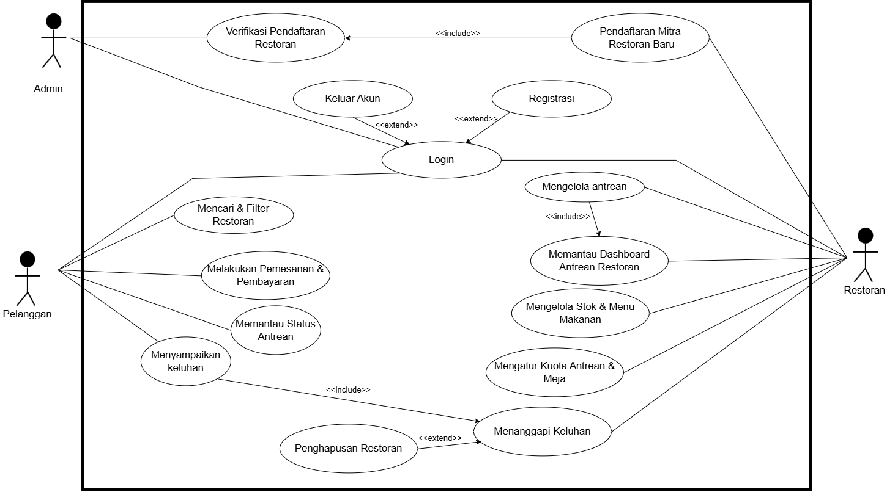

<h1>
IF2150 REKAYASA PERANGKAT LUNAK
 
TUGAS 10
 
HASIL IMPLEMENTASI DAN UJI PERANGKAT LUNAK (HIUPL)
</h1>
 

## *Antri.in*
 

### Untuk: *Angel*

Dipersiapkan oleh:
| Informasi | Keterangan |
| --- | --- |
| Kelas | *01* |
| Kelompok | *10*  |

| NIM | Nama |
|---|---|
| *13525145* | *Muhammad Nur Fikri Hariyawan* |
| *13525085* | *Bayu Palamarta Wirawan*       |
| *13525133* | *Chatima Anandakhorita*        |
| *13525148* | *Athallah Nanda Andita*        |
| *13525091* | *Muhammad Fauzi Muharam*       |

---

## Daftar Isi

- [BAB 1: Pendahuluan](#bab-1-pendahuluan)
  - [1.1 Tujuan Penulisan Dokumen](#11-tujuan-penulisan-dokumen)
  - [1.2 Lingkup Masalah](#12-lingkup-masalah)
  - [1.3 Definisi, Istilah, dan Singkatan](#13-definisi-istilah-dan-singkatan)
  - [1.4 Aturan Penomoran](#14-aturan-penomoran)
  - [1.5 Referensi](#15-referensi)
  - [1.6 Deskripsi Umum Dokumen (Ikhtisar)](#16-deskripsi-umum-dokumen-ikhtisar)
- [BAB 2: Deskripsi Umum Perangkat Lunak](#bab-2-deskripsi-umum-perangkat-lunak)
- [BAB 3: Implementasi](#bab-3-implementasi)
  - [3.1 Lingkungan Implementasi](#31-lingkungan-implementasi)
  - [3.2 Implementasi Modul](#32-implementasi-modul)
  - [3.3 Implementasi Antarmuka](#33-implementasi-antarmuka)
  - [3.4 File Lain](#34-file-lain)
- [BAB 4: Hasil Pengujian](#bab-4-hasil-pengujian)
  - [4.1 Strategi dan Kedalaman Pengujian Kelas](#41-strategi-dan-kedalaman-pengujian-kelas)
  - [4.2 Pengujian Unit Kelas](#42-pengujian-unit-kelas)
  - [4.3 Pengujian Integrasi](#43-pengujian-integrasi)
  - [4.4 Pengujian Use Case](#44-pengujian-use-case)
  - [4.5 Pengujian Kebutuhan Non-Fungsional (KNF)](#45-pengujian-kebutuhan-non-fungsional-knf)
  - [4.6 Tangkapan Layar dan Bukti Hasil Pengujian](#46-tangkapan-layar-dan-bukti-hasil-pengujian)
- [BAB 5: Traceability](#bab-5-traceability)

---

## Daftar Perubahan

| Revisi | Deskripsi |
| :--- | :--- |
| *A* | *Deskripsikan perubahan yang dilakukan dari dokumen sebelumnya pada dokumen ini. Jika tidak terdapat perubahan, harap kosongkan tabel.* |
| *B* |  |
| *C* |  |
| ... |  |

---

# BAB 1: Pendahuluan

## 1.1 Tujuan Penulisan Dokumen
Dokumen Hasil Implementasi dan Uji Perangkat Lunak (HIUPL) ini bertujuan untuk melaporkan hasil implementasi dan pengujian perangkat lunak antri.in, yaitu sistem pemesanan makanan viral dengan antrean digital berbasis web. Dokumen ini memuat informasi mengenai lingkungan implementasi, modul/kelas dan antarmuka yang telah diimplementasikan, hasil pengujian unit, integrasi, use case, dan kebutuhan non-fungsional, serta matriks kerunutan yang memetakan kebutuhan fungsional ke implementasi dan pengujiannya. Target pembaca dokumen ini adalah tim pengembang (kelompok Ducklings), asisten dosen, dan dosen mata kuliah IF2150 Rekayasa Perangkat Lunak.

## 1.2 Lingkup Masalah
Fenomena makanan viral memicu antrean panjang berjam-jam yang membebani pelanggan, karena mereka harus datang lebih awal, menunggu di lokasi, dan mengantre tanpa informasi stok menu maupun estimasi waktu tunggu, ditambah proses pemesanan dan pembayaran di kasir yang memakan waktu 2-5 menit per transaksi. Aplikasi pesan-antar seperti GoFood, GrabFood, dan ShopeeFood pun hanya berfokus pada pengantaran dan tidak membatasi kuota transaksi per rentang waktu, sehingga restoran kewalahan saat pesanan online dan pelanggan fisik datang bersamaan. Celah utamanya adalah belum adanya integrasi antara pemantauan antrean real-time, pengaturan slot waktu, serta pemesanan dan pembayaran awal, sehingga antri.in hadir untuk menghapus waktu berpikir di kasir, meratakan kedatangan pelanggan berbasis kuota jam, dan memberi kebebasan bagi konsumen selama menunggu. Dari fenomena tersebut perangkat lunak bernama antri.in yang akan kami kembangkan merupakan sistem pemesanan makanan viral dengan antrean digital berbasis web yang bertujuan agar pengguna tidak perlu mengantri secara langsung pada restoran. Sistem ini memungkinkan pengguna untuk mencari restoran makanan viral, melihat informasi makanan dan restoran, melakukan pemesanan, memantau antrean dan estimasi pesanan akan selesai, serta fitur booking tempat jika pengguna memutuskan untuk dine-in. Cara kerja dari aplikasi berbasis web ini adalah pertama pengguna memilih restoran yang tersedia, kemudian pengguna dapat membaca informasi mengenai makanan yang terdapat di restoran tersebut. Jika sudah, pengguna dapat memilih makanan yang akan dibeli dan lanjut ke proses pembayaran. Ketika pengguna sudah membayar, barulah akan mendapatkan nomor antrian dan estimasi pesanan selesai sehingga pengguna dapat memperkirakan waktu kedatangan.

## 1.3 Definisi, Istilah, dan Singkatan
Semua definisi dan singkatan yang digunakan dalam dokumen ini beserta penjelasannya.

Tabel 1.3. Definisi Istilah dan Singkatan

| Singkatan, Akronim, atau Istilah | Penjelasan |
| :--- | :--- |
| *P/L* | *Singkatan dari Perangkat Lunak, yaitu aplikasi yang memberikan perintah kepada komputer untuk menjalankan tugas tertentu.* |
| *SKPL* | *Singkatan dari Spesifikasi Kebutuhan Perangkat Lunak, yaitu dokumen yang merangkum kriteria-kriteria yang diperlukan untuk membangun aplikasi menjalankan tugasnya.* |
| *DPPL* | *Singkatan dari Deskripsi Perancangan Perangkat Lunak, yaitu dokumen yang menjelaskan rancangan arsitektur, kelas, dan antarmuka P/L.* |
| *HIUPL* | *Singkatan dari Hasil Implementasi dan Uji Perangkat Lunak, yaitu dokumen yang melaporkan hasil implementasi dan pengujian P/L.* |
| *KF* | *Singkatan dari Kebutuhan Fungsional.* |
| *KNF* | *Singkatan dari Kebutuhan Non-Fungsional.* |
| *UC* | *Singkatan dari Use Case.* |
| *TC* | *Singkatan dari Test Case, yaitu satu kasus uji untuk skenario tertentu.* |
| *UT* | *Singkatan dari Unit Test, yaitu test case tingkat kelas/operasi.* |
| *INT* | *Singkatan dari Integration Test, yaitu test case yang menguji interaksi antarkomponen.* |
| *Boundary* | *Kasus uji pada nilai batas masukan, misalnya nilai minimum, maksimum, atau tepat di ambang aturan.* |
| *Coverage* | *Persentase baris/cabang kode yang dieksekusi oleh pengujian.* |
| *...* | *...* |

## 1.4 Aturan Penomoran
Tuliskan aturan penomoran (ID) yang digunakan dalam dokumen ini. Gunakan pola ID yang **sama** dengan yang sudah dipakai pada dokumen-dokumen sebelumnya (SKPL, APL, DPPL), kecuali untuk ID pengujian yang baru diperkenalkan pada dokumen ini.

Tabel 1.4. Aturan Penomoran

| Hal/Bagian | Penomoran | Keterangan |
| :--- | :--- | :--- |
| *Kebutuhan Fungsional* | *KFXX* | *Sesuai SKPL* |
| *Kebutuhan Non-Fungsional* | *KNFXX* | *Sesuai SKPL* |
| *Use Case* | *UCXX* | *Sesuai SKPL* |
| *Kelas* | *CXX* | *Sesuai DPPL* |
| *Antarmuka* | *I-XX* | *Sesuai DPPL* |
| *Test Case Unit* | *CXX-UTYY* | *XX adalah nomor kelas, YY adalah nomor urut test case unit pada kelas tersebut* |
| *Test Case Integrasi* | *INT-TCYY* | *YY adalah nomor urut test case integrasi* |
| *Test Case Use Case* | *UCXX-TCYY* | *XX adalah nomor use case, YY adalah nomor urut test case pada use case tersebut* |
| *Test Case KNF* | *KNFXX-TCYY* | *XX adalah nomor KNF, YY adalah nomor urut test case pada KNF tersebut* |
| *...* | *...* | *...* |

## 1.5 Referensi
Cantumkan daftar buku, panduan, atau dokumentasi lain yang dirujuk dalam pembuatan dokumen dan pengembangan P/L, **minimal dokumen SKPL, APL, DPPL, dan Implementasi (Tugas 9)**. Tambahkan dokumentasi *framework*/*library*/*testing tool* atau referensi lain apabila digunakan.

## 1.6 Deskripsi Umum Dokumen (Ikhtisar)
Dokumen ini disusun dalam lima bab. Bab 1 berisi pendahuluan yang mencakup tujuan penulisan dokumen, lingkup masalah, definisi dan singkatan, aturan penomoran, referensi, serta ikhtisar dokumen. Bab 2 memaparkan deskripsi umum perangkat lunak antri.in beserta konteks, batasan, dan keterkaitannya dengan sistem eksternal, dilengkapi use case diagram. Bab 3 menjelaskan implementasi, yaitu lingkungan implementasi, daftar modul/kelas, daftar antarmuka, dan file lain yang dihasilkan, serta perubahannya terhadap rancangan pada DPPL. Bab 4 melaporkan hasil pengujian pada tingkat unit, integrasi, use case, dan kebutuhan non-fungsional beserta buktinya. Bab 5 menyajikan matriks kerunutan (traceability) yang memetakan KF, KNF, use case, kelas, file implementasi, dan test case.
 

---

# BAB 2: Deskripsi Umum Perangkat Lunak

Bagian ini diisi dengan *System Overview*, dalam bentuk gambar dan narasi yang memberikan gambaran tentang aplikasi dan konteksnya. **Batasan dan keterkaitan** antara sistem yang dibangun dengan sistem lain di luarnya harus jelas. Deskripsi umum sistem perlu dilengkapi dengan pemodelan kasus yang dihadapi, seperti *use case diagram*. Berikan narasi yang jelas untuk setiap gambar yang ditampilkan.

Bagian ini dapat menyalin atau meringkas dari dokumen SKPL atau DPPL.

## Gambaran Sistem

antri.in adalah aplikasi berbasis web untuk pemesanan makanan viral dengan antrean digital. Pelanggan tidak perlu mengantre secara fisik di restoran. Pelanggan mencari restoran viral, melihat menu dan status antrean, memesan (dine-in, takeaway/pre-order, atau booking tempat), membayar secara digital, lalu menerima nomor antrean beserta estimasi waktu tunggu. Nomor antrean hanya diterbitkan setelah pembayaran lunas.

Sistem melayani tiga aktor dengan hak akses berbeda:

- **Pelanggan**: mencari restoran, memesan dan membayar, memantau status antrean, serta menyampaikan keluhan.
- **Restoran**: mendaftar sebagai mitra, mengelola antrean (dequeue), kuota antrean dan meja, serta menu dan stok.
- **Admin**: memverifikasi pendaftaran mitra, menanggapi keluhan, dan menghapus restoran yang melanggar ketentuan.

Registrasi, login, dan logout tersedia untuk ketiga aktor.

## Batasan dan Keterkaitan dengan Sistem Lain

Sistem dirancang dengan arsitektur MVC. Lapisan View berjalan di browser Google Chrome. Lapisan Controller dan Model berjalan pada server aplikasi (localhost, Windows 11) berbasis TypeScript dan REST API. Seluruh data transaksional dan operasional disimpan pada basis data PostgreSQL 15+ yang berada di lingkungan sistem sendiri.

Dua sistem eksternal berada di luar batas tanggung jawab langsung antri.in:

| Sistem Eksternal | Keterkaitan dengan antri.in | Komponen Penghubung |
| :--- | :--- | :--- |
| *Payment Gateway* | antri.in tidak memproses transaksi sendiri. Sistem mengirim permintaan transaksi saat checkout dan menerima status lunas, gagal, atau kedaluwarsa untuk menentukan penerbitan tiket antrean dan ID pesanan. | `PaymentGatewayAdapter` dan `MetodePembayaranController` (C07) |
| *Layanan Email* | Sistem mengirim email hasil verifikasi pendaftaran mitra (diterima atau ditolak) ke alamat email restoran. | `NotifikasiEmail` (C15) |

## Pemodelan Use Case

Sistem memiliki 15 use case (UC01–UC15) yang memetakan KF01–KF21.

Tabel 2.1. Daftar Use Case antri.in

| ID UC | Nama Use Case | Aktor | ID KF |
| :--- | :--- | :--- | :--- |
| UC01 | Mencari dan filter resto | Pelanggan | KF01, KF02 |
| UC02 | Melakukan pemesanan dan pembayaran digital | Pelanggan | KF05–KF13 |
| UC03 | Menampilkan status antrean | Pelanggan | KF03 |
| UC04 | Pendaftaran mitra restoran baru | Restoran | KF14 |
| UC05 | Memverifikasi pendaftaran restoran | Admin | KF15, KF16 |
| UC06 | Mengelola antrean | Restoran | KF04 |
| UC07 | Mengatur kuota antrean dan meja | Restoran | KF17, KF18 |
| UC08 | Mengelola stok dan menu makanan | Restoran | KF07 |
| UC09 | Menampilkan dashboard antrean restoran | Restoran | KF13 |
| UC10 | Registrasi akun | Pelanggan, Restoran, Admin | KF21 |
| UC11 | Login akun | Pelanggan, Restoran, Admin | KF21 |
| UC12 | Keluar akun | Pelanggan, Restoran, Admin | KF21 |
| UC13 | Penyampaian keluhan pelanggan | Pelanggan | KF19 |
| UC14 | Penanggapan keluhan pelanggan | Admin | KF19 |
| UC15 | Penghapusan restoran | Admin | KF20 |

<i>Gambar 2.1. Use Case Diagram antri.in</i>

 

---

# BAB 3: Implementasi

Bagian ini diisi dengan informasi tentang elemen P/L yang dikembangkan (*executable files*, *configuration files*, *data files*, dan sebagainya) serta perubahannya terhadap rancangan pada DPPL (jika ada).

## 3.1 Lingkungan Implementasi

Tuliskan *hardware* dan *software* yang digunakan untuk implementasi, mencakup *operating system*, bahasa pemrograman beserta versinya, *framework*/*library*, DBMS, *development tools*, dan *version control*. Lingkungan ini harus konsisten dengan **Subbab 2.1 DPPL**; jelaskan jika ada perubahan. Cantumkan juga *framework* dan alat pengujian yang dipakai.

Tabel 3.1. Lingkungan Implementasi

| Aspek | Keterangan |
| :--- | :--- |
| *Hardware* | *[Spesifikasi perangkat keras]* |
| *Operating System* | *Windows 11* |
| *Bahasa Pemrograman* | *Typescript 7.0.2* |
| *Framework/Library* | *Node.js 20 LTS, Express 4.22.3, bcryptjs 3.0.3* |
| *DBMS* | *PostgreSQL 15+* |
| *Development Tools* | *Visual Studio Code, GitHub* |
| *Testing Tools* | *`node:test` (`npm test`, `npm run test:pg` untuk PostgreSQL), `npm run profile` (`performance.now()` dan `EXPLAIN ANALYZE`), middleware `Server-Timing` untuk waktu respons API, [isi: Chrome DevTools dan alat coverage yang dipakai]* |

## 3.2 Implementasi Modul

Daftar modul/kelas yang **TELAH** diimplementasikan. Gunakan nama dan ID kelas yang sama dengan DPPL, dan konsisten dengan Tabel B.5 pada dokumen Implementasi (Tugas 9).

Tabel 3.2. Implementasi Modul

| No | ID Kelas | Nama Modul/Kelas | Nama File Fisik | Nama File Executable |
| :--- | :--- | :--- | :--- | :--- |
| 1 | C01 | Pelanggan | `src/server/models/akun.ts` | - |
| 2 | C02 | Restoran | `src/server/models/restoran.ts` | - |
| 3 | C03 | Menu | `src/server/models/menu.ts` | - |
| 4 | C04 | Antrean | `src/server/models/antrean.ts` | - |
| 5 | C05 | Keranjang | `src/client/models/keranjang.ts` | - |
| 6 | C06 | Pesanan | `src/server/models/pesanan.ts` | - |
| 7 | C07 | MetodePembayaranController | `src/server/controllers/metodePembayaranController.ts`, `src/server/models/pembayaran.ts` | - |
| 8 | C08 | RiwayatTransaksi | `src/server/models/pembayaran.ts` | - |
| 9 | C09 | TiketAntrean | `src/server/models/antrean.ts` | - |
| 10 | C10 | PemantauAntreanController | `src/server/controllers/pemantauAntreanController.ts`, `src/server/realtime/eventBus.ts` | - |
| 11 | C11 | HalamanStatusAntrean | `src/client/views/statusAntreanView.ts` | - |
| 12 | C12 | PengajuanMitraController | `src/server/controllers/pengajuanMitraController.ts` | - |
| 13 | C13 | DokumenVerifikasi | `src/server/models/mitra.ts` | - |
| 14 | C14 | Admin | `src/server/models/akun.ts` | - |
| 15 | C15 | NotifikasiEmail | `src/server/adapters/notifikasiEmail.ts` | - |
| 16 | C16 | KelolaAntreanController | `src/server/controllers/kelolaAntreanController.ts` | - |
| 17 | C17 | KonfirmasiDequeuePage | `src/client/core/ui.ts` (`konfirmasi`) | - |
| 18 | C18 | KelolaAntreanPage | `src/client/views/kelolaAntreanView.ts` | - |
| 19 | C19 | DashboardAntreanPage | `src/client/views/kelolaAntreanView.ts` | - |
| 20 | C20 | Kuota | `src/server/models/kuota.ts` | - |
| 21 | C21 | PengaturanKuotaController | `src/server/controllers/pengaturanKuotaController.ts` | - |
| 22 | C22 | PengaturanKuotaPage | `src/client/views/pengaturanKuotaView.ts` | - |
| 23 | C23 | PengaturanMenuPage | `src/client/views/pengaturanMenuView.ts` | - |
| 24 | C24 | KelolaMenuController | `src/server/controllers/kelolaMenuController.ts` | - |
| 25 | C25 | Pengguna | `src/server/models/akun.ts` | - |
| 26 | C26 | HalamanProfilPage | `src/client/views/akunView.ts` | - |
| 27 | C27 | KonfirmasiLogoutPage | `src/client/core/ui.ts` (`konfirmasi`) | - |
| 28 | C28 | AutentikasiController | `src/server/controllers/autentikasiController.ts` | - |
| 29 | C29 | SesiPengguna | `src/server/models/akun.ts`, `src/server/middleware/auth.ts` | - |
| 30 | C30 | Keluhan | `src/server/models/keluhan.ts` | - |
| 31 | C31 | DashboardKelolaRestoranPage | `src/client/views/kelolaRestoranView.ts` | - |
| 32 | C32 | KonfirmasiHapusRestoranPage | `src/client/core/ui.ts` (`konfirmasi`) | - |
| 33 | C33 | KelolaDataRestoranController | `src/server/controllers/kelolaDataRestoranController.ts` | - |
| 34 | C34 | PencarianRestoPage | `src/client/views/pencarianView.ts` | - |
| 35 | C35 | PencarianController | `src/server/controllers/pencarianController.ts` | - |
| 36 | C36 | VerifikasiRestoranPage | `src/client/views/mitraView.ts` | - |
| 37 | C37 | RegistrasiRestoPage | `src/client/views/mitraView.ts` | - |
| 38 | C38 | RegistrasiPage | `src/client/views/akunView.ts` | - |
| 39 | C39 | LoginPage | `src/client/views/akunView.ts` | - |
| 40 | C40 | KeluhanFormPage | `src/client/views/keluhanView.ts` | - |
| 41 | C41 | KeluhanController | `src/server/controllers/keluhanController.ts` | - |
| 42 | C42 | KeluhanDashboardPage | `src/client/views/keluhanView.ts` | - |

## 3.3 Implementasi Antarmuka

Daftar antarmuka yang telah diimplementasikan. Gunakan ID dan nama layar yang sama dengan ID dan nama layar pada tugas DPPL.

Tabel 3.3. Implementasi Antarmuka

| No | ID Antarmuka | Nama Antarmuka | Nama File Fisik | Nama File Executable |
| :--- | :--- | :--- | :--- | :--- |
| 1 | I-01 | Registrasi Akun | `src/client/views/akunView.ts` (`registrasiPage`) | `src/public/index.html` |
| 2 | I-02 | Login | `src/client/views/akunView.ts` (`loginPage`) | `src/public/index.html` |
| 3 | I-03 | Profil Akun | `src/client/views/akunView.ts` (`halamanProfilPage`) | `src/public/index.html` |
| 4 | I-04 | Dialog Konfirmasi Keluar | `src/client/core/ui.ts` (`konfirmasi`), dipanggil dari `akunView.ts` | `src/public/index.html` |
| 5 | I-05 | Beranda & Pencarian Restoran | `src/client/views/pencarianView.ts` (`pencarianRestoPage`), `src/client/views/komponen.ts` | `src/public/index.html` |
| 6 | I-06 | Detail Restoran & Menu | `src/client/views/pencarianView.ts` (`detailRestoranPage`) | `src/public/index.html` |
| 7 | I-07 | Keranjang & Mode Layanan | `src/client/views/pemesananView.ts` | `src/public/index.html` |
| 8 | I-08 | Pilih Jadwal Booking | `src/client/views/pemesananView.ts` | `src/public/index.html` |
| 9 | I-09 | Pembayaran | `src/client/views/pembayaranView.ts` | `src/public/index.html` |
| 10 | I-10 | Tiket Antrean | `src/client/views/pembayaranView.ts` (`tiketPage`) | `src/public/index.html` |
| 11 | I-11 | Status Antrean | `src/client/views/statusAntreanView.ts` (`halamanStatusAntrean`) | `src/public/index.html` |
| 12 | I-12 | Formulir Keluhan | `src/client/views/keluhanView.ts` (`keluhanFormPage`) | `src/public/index.html` |
| 13 | I-13 | Pendaftaran Mitra | `src/client/views/mitraView.ts` (`registrasiRestoPage`) | `src/public/index.html` |
| 14 | I-14 | Dashboard & Kelola Antrean | `src/client/views/kelolaAntreanView.ts` (`dashboardAntreanPage`) | `src/public/index.html` |
| 15 | I-15 | Dialog Konfirmasi Dequeue | `src/client/core/ui.ts` (`konfirmasi`), dipanggil dari `kelolaAntreanView.ts` | `src/public/index.html` |
| 16 | I-16 | Pengaturan Kuota & Meja | `src/client/views/pengaturanKuotaView.ts` | `src/public/index.html` |
| 17 | I-17 | Pengaturan Menu & Stok | `src/client/views/pengaturanMenuView.ts` | `src/public/index.html` |
| 18 | I-18 | Verifikasi Pengajuan Mitra | `src/client/views/mitraView.ts` (`verifikasiRestoranPage`) | `src/public/index.html` |
| 19 | I-19 | Daftar Keluhan | `src/client/views/keluhanView.ts` (`keluhanDashboardPage`) | `src/public/index.html` |
| 20 | I-20 | Kelola Restoran Mitra | `src/client/views/kelolaRestoranView.ts` (`dashboardKelolaRestoranPage`) | `src/public/index.html` |
| 21 | I-21 | Dialog Konfirmasi Hapus Restoran | `src/client/core/ui.ts` (`konfirmasi`), dipanggil dari `kelolaRestoranView.ts` | `src/public/index.html` |

## 3.4 File Lain

Daftar file lain yang dibuat selain file kelas dan antarmuka, misalnya file *utility*, *configuration*, *database schema/seed*, *file test*, atau *data*.

Tabel 3.4. File Lain

| No | Nama File | Keterangan |
| :--- | :--- | :--- |
| 1 | `src/package.json`, `src/package-lock.json` | Dependensi dan skrip npm (`start`, `dev`, `test`, `test:pg`, `profile`) |
| 2 | `src/tsconfig.json`, `src/tsconfig.client.json` | Konfigurasi TypeScript untuk server/test dan klien |
| 3 | `src/.env.example`, `src/.gitignore` | Contoh environment variable tanpa nilai rahasia, dan daftar berkas yang tidak di-commit (`node_modules/`, `data/`, `uploads/`, `.env`, `public/js/`) |
| 4 | `src/server/config.ts` | Konfigurasi aturan bisnis (timeout pembayaran, dequeue otomatis, kuota, biaya layanan) |
| 5 | `src/server/context.ts` | Tipe dependensi bersama controller dan pengguna yang login |
| 6 | `src/server/utils/errors.ts`, `ids.ts`, `validasi.ts`, `unggah.ts` | Utilitas error HTTP, pembuat ID dan nomor antrean, validasi umum, unggah gambar |
| 7 | `src/server/middleware/auth.ts`, `errorHandler.ts`, `timing.ts` | Validasi token dan peran, penanganan error, header `Server-Timing` |
| 8 | `src/server/routes/*.ts` (`util`, `autentikasi`, `pencarian`, `menu`, `pemesanan`, `pembayaran`, `antrean`, `mitra`, `keluhan`, `ulasan`, `notifikasi`, `profilRestoran`, `simulasi`) | Definisi endpoint REST API per modul |
| 9 | `src/server/db/schema.sql` | Skema basis data (17 tabel) dan indeks |
| 10 | `src/server/db/seed.ts`, `src/server/db/seed-cli.ts` | Data contoh fiktif dan akun uji (`npm run seed`) |
| 11 | `src/docker-compose.yml` | PostgreSQL 16 lokal (opsional) |
| 12 | `src/client/core/html.ts`, `api.ts`, `konfigurasi.ts`, `session.ts` | Template HTML aman, pemanggil REST dan SSE, konfigurasi klien, penyimpanan token |
| 13 | `src/client/views/layout.ts` | Navbar pelanggan dan sidebar restoran/admin |
| 14 | `src/public/css/style.css`, `src/public/img/logo.png`, `src/public/img/favicon.svg` | Gaya tampilan dan aset gambar |
| 15 | `src/scripts/profile-dashboard.ts` | Skrip profiling dashboard antrean (`npm run profile`) |
| 16 | `src/tests/helpers.ts` | Helper pengujian bersama (aplikasi uji, login) |
| 17 | `src/tests/autentikasi.test.ts` | Test UC10–UC12 |
| 18 | `src/tests/pencarian.test.ts` | Test UC01 |
| 19 | `src/tests/pemesanan.test.ts`, `src/tests/keranjang.test.ts` | Test UC02 bagian pemesanan dan unit test `Keranjang` |
| 20 | `src/tests/pembayaran.test.ts` | Test pembayaran dan AntriPay Sandbox |
| 21 | `src/tests/antrean.test.ts` | Test UC03, UC06, UC07, UC09 |
| 22 | `src/tests/menu.test.ts` | Test UC08 |
| 23 | `src/tests/mitra.test.ts` | Test UC04, UC05 |
| 24 | `src/tests/keluhan.test.ts` | Test UC13–UC15 |
| 25 | `src/tests/ulasan.test.ts`, `notifikasi.test.ts`, `profilRestoran.test.ts`, `simulasi.test.ts` | Test fitur tambahan |
| 26 | `src/tests/api.test.ts` | Test hak akses REST API |

 

---

# BAB 4: Hasil Pengujian

Bab ini melaporkan hasil pengujian P/L pada level unit, integrasi, dan sistem. Pengujian dilakukan pada tag release terakhir Tugas 9. Hasil aktual diisi berdasarkan pengamatan saat pengujian. Kesimpulan diisi `Pass` atau `Fail`, dan untuk `Fail` dilengkapi penyebab serta usulan perbaikan.

## 4.1 Strategi dan Kedalaman Pengujian Kelas

Setiap kelas perancangan pada Tabel 4.1 DPPL diklasifikasikan ke dalam tiga tingkat kedalaman pengujian. Tingkat **Mendalam** diberikan pada kelas yang memuat logika bisnis, perhitungan, validasi, aturan status, algoritma, integrasi eksternal, atau keamanan. Tingkat **Sedang** diberikan pada kelas yang hanya mengoordinasikan atau mendelegasikan proses. Tingkat **Tidak perlu** diberikan pada kelas tanpa logika, seperti *entity/DTO* dan kelas konfigurasi, yang teruji secara tidak langsung melalui test case use case. Seluruh kelas wajib dicantumkan beserta alasan penentuan tingkatnya.

Tabel 4.1.1. Identifikasi Tingkat Pengujian Kelas

| ID Kelas | Nama Kelas | Tingkat | Alasan | Test Case Terkait |
| :--- | :--- | :--- | :--- | :--- |
| C01 | Pelanggan | Sedang | Hanya mendelegasikan `accountRegister()` ke AutentikasiController dan menyimpan profil, serta `getDetails()` berupa pembacaan data | C01-UT01 s.d. C01-UT03 |
| C02 | Restoran | Mendalam | Memuat aturan status aktif (`getDetailRestoran()` hanya restoran aktif), pencarian, `setSoftDelete()`, dan pembersihan data (`purgeData()`) | C02-UT01 s.d. C02-UT10 |
| C03 | Menu | Mendalam | Memuat validasi harga dan stok, `isTersedia()`, `kurangiStok()` yang atomik dan tidak boleh negatif, serta soft delete | C03-UT01 s.d. C03-UT12 |
| C04 | Antrean | Mendalam | Memuat algoritma dequeue, penentuan tiket terdepan, estimasi waktu tunggu (median waktu layanan), dan pembaruan status antrean | C04-UT01 s.d. C04-UT10 |
| C05 | Keranjang | Mendalam | Memuat perhitungan `hitungTotal()` dan aturan tambah/hapus item (jumlah item yang sama digabung) | C05-UT01 s.d. C05-UT08 |
| C06 | Pesanan | Mendalam | Memuat validasi booking (maksimal 7 hari, kapasitas meja per slot), transisi status pesanan, dan pembatalan yang hanya berlaku untuk status tertentu | C06-UT01 s.d. C06-UT12 |
| C07 | MetodePembayaranController | Mendalam | Integrasi eksternal ke Payment Gateway, batas waktu pembayaran, verifikasi lunas, pencegahan double-charge, dan pembatalan saat timeout | C07-UT01 s.d. C07-UT10 |
| C08 | RiwayatTransaksi | Sedang | Hanya mencatat transaksi lunas dan membaca bukti pembayaran, dipanggil oleh MetodePembayaranController | C08-UT01 s.d. C08-UT03 |
| C09 | TiketAntrean | Mendalam | Memuat algoritma nomor urut unik per hari (KNF03), estimasi waktu tunggu, dan aturan status final yang tidak boleh diubah | C09-UT01 s.d. C09-UT08 |
| C10 | PemantauAntreanController | Sedang | Hanya mengoordinasikan pembacaan status antrean dan pengiriman pembaruan lewat Server-Sent Events | C10-UT01 s.d. C10-UT03 |
| C11 | HalamanStatusAntrean | Tidak perlu | Kelas boundary yang hanya menampilkan data status antrean dari server. Teruji lewat UC03 | - |
| C12 | PengajuanMitraController | Mendalam | Memuat validasi kelengkapan data, aturan status pengajuan (hanya status menunggu yang dapat disetujui/ditolak), alasan penolakan wajib, dan pemicu email | C12-UT01 s.d. C12-UT10 |
| C13 | DokumenVerifikasi | Mendalam | Memuat validasi format (PDF/JPG/PNG) dan ukuran maksimal 5 MB | C13-UT01 s.d. C13-UT06 |
| C14 | Admin | Sedang | Hanya mendelegasikan `accountRegister()` ke AutentikasiController. Peninjauan pengajuan, keluhan, dan penghapusan dilakukan lewat controller lain | C14-UT01 s.d. C14-UT03 |
| C15 | NotifikasiEmail | Mendalam | Integrasi eksternal: validasi format email, penentuan subjek, pencatatan status kirim (terkirim/gagal) ke `log_notifikasi` | C15-UT01 s.d. C15-UT04 |
| C16 | KelolaAntreanController | Mendalam | Memuat algoritma dequeue dalam transaksi, pembaruan kapasitas, serta timer dequeue otomatis bagi pelanggan yang tidak hadir | C16-UT01 s.d. C16-UT08 |
| C17 | KonfirmasiDequeuePage | Tidak perlu | Kelas boundary berupa dialog konfirmasi tanpa logika bisnis. Teruji lewat UC06 | - |
| C18 | KelolaAntreanPage | Tidak perlu | Kelas boundary yang hanya menampilkan daftar antrean dan membuka dialog. Teruji lewat UC06 | - |
| C19 | DashboardAntreanPage | Tidak perlu | Kelas boundary yang menampilkan antrean dan memuat ulang data. Teruji lewat UC09 | - |
| C20 | Kuota | Mendalam | Memuat perhitungan kapasitas, aturan antrean tutup bila kapasitas habis atau ditutup manual, serta penyimpanan kuota terakhir | C20-UT01 s.d. C20-UT06 |
| C21 | PengaturanKuotaController | Mendalam | Memuat validasi input kuota dan meja (angka, lebih dari 0) serta penyimpanan yang memicu pembaruan kapasitas | C21-UT01 s.d. C21-UT06 |
| C22 | PengaturanKuotaPage | Tidak perlu | Kelas boundary. Validasi dilakukan ulang oleh C21 di server. Teruji lewat UC07 | - |
| C23 | PengaturanMenuPage | Tidak perlu | Kelas boundary berupa daftar dan formulir menu. Validasi berada di C24. Teruji lewat UC08 | - |
| C24 | KelolaMenuController | Mendalam | Memuat validasi nama, harga, dan stok menu, serta alur tambah, ubah, ubah stok, dan hapus menu | C24-UT01 s.d. C24-UT10 |
| C25 | Pengguna | Mendalam | Aspek keamanan: hash kata sandi, pencocokan kredensial, pengecekan duplikasi, dan pengambilan profil | C25-UT01 s.d. C25-UT10 |
| C26 | HalamanProfilPage | Tidak perlu | Kelas boundary yang hanya memicu dialog logout. Teruji lewat UC12 | - |
| C27 | KonfirmasiLogoutPage | Tidak perlu | Kelas boundary berupa dialog konfirmasi tanpa logika. Teruji lewat UC12 | - |
| C28 | AutentikasiController | Mendalam | Aspek keamanan: validasi registrasi (email, kata sandi minimal 8 karakter, duplikasi), penerbitan token sesi, login, dan logout | C28-UT01 s.d. C28-UT10 |
| C29 | SesiPengguna | Mendalam | Aspek keamanan: validasi token, masa berlaku sesi, dan penonaktifan sesi saat logout | C29-UT01 s.d. C29-UT08 |
| C30 | Keluhan | Mendalam | Memuat aturan status keluhan (BARU, DIBACA, DITANGGAPI) dan penyimpanan keluhan | C30-UT01 s.d. C30-UT06 |
| C31 | DashboardKelolaRestoranPage | Tidak perlu | Kelas boundary berupa daftar, pencarian, dan filter restoran. Teruji lewat UC15 | - |
| C32 | KonfirmasiHapusRestoranPage | Tidak perlu | Kelas boundary berupa dialog konfirmasi. Teruji lewat UC15 | - |
| C33 | KelolaDataRestoranController | Mendalam | Memuat aturan penghapusan dalam satu transaksi: soft delete restoran, penonaktifan menu, dan pembatalan antrean/pesanan aktif | C33-UT01 s.d. C33-UT06 |
| C34 | PencarianRestoPage | Tidak perlu | Kelas boundary yang hanya menerima kata kunci/filter dan menampilkan hasil. Teruji lewat UC01 | - |
| C35 | PencarianController | Mendalam | Memuat algoritma pencarian dan penerapan filter (nama, kategori, lokasi, rating) serta pengambilan status antrean dan pratinjau menu | C35-UT01 s.d. C35-UT08 |
| C36 | VerifikasiRestoranPage | Tidak perlu | Kelas boundary yang menampilkan detail pengajuan dan tombol setujui/tolak. Teruji lewat UC05 | - |
| C37 | RegistrasiRestoPage | Tidak perlu | Kelas boundary berupa formulir pendaftaran mitra. Validasi berada di C12 dan C13. Teruji lewat UC04 | - |
| C38 | RegistrasiPage | Tidak perlu | Kelas boundary berupa formulir registrasi. Validasi berada di C28. Teruji lewat UC10 | - |
| C39 | LoginPage | Tidak perlu | Kelas boundary berupa formulir login. Validasi berada di C28. Teruji lewat UC11 | - |
| C40 | KeluhanFormPage | Tidak perlu | Kelas boundary berupa formulir keluhan. Validasi berada di C41. Teruji lewat UC13 | - |
| C41 | KeluhanController | Mendalam | Memuat validasi isi dan kategori keluhan, pencatatan tanggapan admin, dan pembaruan status | C41-UT01 s.d. C41-UT06 |
| C42 | KeluhanDashboardPage | Tidak perlu | Kelas boundary berupa daftar dan detail keluhan. Teruji lewat UC14 | - |

## 4.2 Pengujian Unit Kelas

Pengujian unit dilakukan pada kelas bertingkat Mendalam dan Sedang. Kelas Mendalam diuji pada seluruh operasi public dengan kasus normal, batas, dan negatif, serta mencapai *coverage* minimal 70%. Kelas Sedang diuji minimal dengan satu kasus normal dan satu kasus gagal pada operasi public utama.

Cara menjalankan unit test: *[tuliskan perintah, mis. `pytest src/tests/`]*.

Lokasi file test: *[path, mis. `src/tests/`]*.

### 4.2.1 Kelas [Nama Kelas 1]

**ID Kelas:** *[C02]*  
**Nama Kelas:** *[Pesanan]*  
**Tingkat:** *[Mendalam]*

Tabel 4.2.1. Hasil Pengujian Unit Kelas [C02]

| ID Pengujian | Operasi yang Diuji | Jenis Kasus | Prosedur/Masukan | Hasil yang Diharapkan | Hasil Pengujian | Kesimpulan |
| :--- | :--- | :--- | :--- | :--- | :--- | :--- |
| *C02-UT01* | *`hitungTotal(): Decimal`* | *Normal* | *Pesanan berisi 2 item: 10.000 x 2 dan 5.000 x 1* | *Total = 25.000* | *[Hasil aktual]* | *Pass/Fail* |
| *C02-UT02* | *`hitungTotal(): Decimal`* | *Batas* | *Pesanan berisi tepat 1 item dengan jumlah 1* | *Total = harga item tersebut* | *[...]* | *Pass/Fail* |
| *C02-UT03* | *`hitungTotal(): Decimal`* | *Negatif* | *Pesanan tanpa item* | *Total = 0 atau melempar kesalahan sesuai rancangan* | *[...]* | *Pass/Fail* |
| *...* | *...* | *...* | *...* | *...* | *...* | *...* |

Khusus kelas **Mendalam**:

Tabel 4.2.1b. Ringkasan Cakupan Kelas [C02]

| Informasi | Keterangan |
| :--- | :--- |
| Daftar operasi public pada DPPL | *[op1(), op2(), ...]* |
| Operasi yang diuji | *[op1(), op2(), ...]* |
| ID Algoritma yang tercakup | *[Algo-001, ...]* |
| Coverage (wajib ≥ 70%) | *[% baris / % cabang, alat dan bukti pada 4.6]* |

### 4.2.2 Kelas [Nama Kelas 2]

*[Ulangi pola 4.2.1 untuk setiap kelas bertingkat Mendalam atau Sedang.]*

 

## 4.3 Pengujian Integrasi

Pengujian integrasi memeriksa interaksi antarkomponen yang melewati batas, yaitu *Controller* ke *Model*, aplikasi ke basis data, dan aplikasi ke sistem eksternal. Daftar antarmuka mengacu pada dokumen DPPL, dengan minimal satu test case untuk setiap antarmuka. Pengujian memakai komponen nyata, bukan *mock*. Apabila ada antarmuka tambahan yang belum didaftarkan pada dokumen DPPL, cantumkan juga.

Tabel 4.3.1. Daftar Antarmuka Antarkomponen

| ID Antarmuka | Komponen Asal | Komponen Tujuan | Jenis Batas | Test Case |
| :--- | :--- | :--- | :--- | :--- |
| *I-01* | *KeranjangController* | *Keranjang (Model)* | *Controller - Model* | *INT-TC01, INT-TC02* |
| *I-02* | *Pesanan (Model)* | *Database* | *Aplikasi - Basis data* | *INT-TC03* |
| *I-03* | *PaymentGatewayAdapter* | *Payment Gateway (dummy)* | *Aplikasi - Sistem eksternal* | *INT-TC04, INT-TC05* |
| *[I-XX]* | *[Komponen asal]* | *[Komponen tujuan]* | *[Jenis batas]* | *[ID test case]* |
| *...* | *...* | *...* | *...* | *...* |

Tabel 4.3.2. Hasil Pengujian Integrasi

| ID Pengujian | ID Antarmuka | Skenario | Prosedur/Masukan | Hasil yang Diharapkan | Hasil Pengujian | Kesimpulan |
| :--- | :--- | :--- | :--- | :--- | :--- | :--- |
| *INT-TC01* | *I-01* | *Normal: tambah item ke keranjang* | *Panggil `tambahItem()` melalui KeranjangController dengan produk valid* | *Item tersimpan pada Keranjang dan tampil pada daftar item* | *[Hasil aktual]* | *Pass/Fail* |
| *INT-TC03* | *I-02* | *Normal: simpan pesanan* | *Buat pesanan, lalu baca ulang langsung dari basis data* | *Baris pesanan ada dengan nilai total dan status yang sama* | *[...]* | *Pass/Fail* |
| *INT-TC05* | *I-03* | *Gagal: gateway mengembalikan status gagal* | *Kirim otorisasi dengan saldo dummy tidak cukup* | *Status pesanan tidak berubah menjadi "Lunas", pesan gagal diteruskan ke pengguna* | *[...]* | *Pass/Fail* |
| *...* | *...* | *...* | *...* | *...* | *...* | *...* |

 

## 4.4 Pengujian Use Case

Pengujian use case dilakukan pada seluruh skenario normal dan alternatif sesuai Subbab 4.4 SKPL, dengan minimal satu test case untuk setiap skenario. Kolom ID KF menunjukkan KF yang diverifikasi oleh test case tersebut.

### 4.4.1 Use Case [Nama Use Case 1]

**ID Use Case:** *[UC01 sesuai SKPL]*  
**Nama Use Case:** *[Nama use case sesuai SKPL]*

Tabel 4.4.1. Hasil Pengujian Use Case [UC01]

| ID Pengujian | ID KF | Skenario | Prosedur Pengujian | Masukan | Hasil yang Diharapkan | Hasil Pengujian | Kesimpulan |
| :--- | :--- | :--- | :--- | :--- | :--- | :--- | :--- |
| *UC01-TC01* | *KF01* | *Normal* | *1. Buka halaman login. 2. Masukkan kredensial. 3. Klik tombol "Login".* | *User: rpl@gmail.com Pass: 123456* | *Pengguna diarahkan ke Halaman Dashboard.* | *Pengguna diarahkan ke Halaman Dashboard sesuai hasil yang diharapkan.* | *Pass* |
| *UC01-TC02* | *KF01* | *Alternatif 1: [Nama skenario]* | *[Langkah-langkah pengujian]* | *[Data masukan]* | *[Hasil yang diharapkan]* | *[Hasil aktual]* | *[Pass/Fail. Jika Fail: penjelasan dan solusi]* |
| *...* | *...* | *...* | *...* | *...* | *...* | *...* | *...* |

### 4.4.2 Use Case [Nama Use Case 2]

*[Lanjutkan untuk seluruh use case dengan pola yang sama, hingga 4.4.N.]*

 

## 4.5 Pengujian Kebutuhan Non-Fungsional (KNF)

Setiap KNF pada Tabel 3.2 SKPL diuji secara terukur berdasarkan parameter yang telah didefinisikan. Setiap pengujian memuat target terukur, metode dan alat yang sesuai dengan parameter (misalnya Chrome DevTools untuk *response time* dan inspeksi basis data untuk *security*), serta hasil aktual berupa angka atau data. KNF yang belum dipenuhi atau tidak diimplementasikan dicantumkan beserta alasan dan rencana perbaikan.

Tabel 4.5. Hasil Pengujian KNF

| ID Pengujian | ID KNF | Parameter | Target Terukur | Metode dan Alat | Hasil Aktual | Kesimpulan |
| :--- | :--- | :--- | :--- | :--- | :--- | :--- |
| *KNF01-TC01* | *KNF01* | *Reliability* | *Tidak ada data hilang/ganda saat jaringan putus di tengah transaksi* | *Simulasi putus koneksi saat bayar, lalu cek status di DB* | *[Hasil aktual]* | *Pass/Fail* |
| *KNF02-TC01* | *KNF02* | *Security* | *Password tersimpan sebagai hash, bukan plain-text* | *Inspeksi tabel pengguna di DB* | *[...]* | *Pass/Fail* |
| *KNFXX-TC01* | *KNFXX* | *Response time* | *Halaman tampil ≤ 4 detik* | *Chrome DevTools, 5 kali ukur, ambil rata-rata* | *[Rata-rata ... detik, maks ... detik]* | *Pass/Fail* |
| *...* | *...* | *...* | *...* | *...* | *...* | *...* |

 

## 4.6 Tangkapan Layar dan Bukti Hasil Pengujian

Bukti pengujian dilampirkan sesuai ID Pengujian pada Subbab 4.2 sampai 4.5, berupa tangkapan layar aplikasi, keluaran *test runner*, laporan *coverage* untuk setiap kelas Mendalam, atau hasil alat ukur.

Tabel 4.6. Bukti Hasil Pengujian

| ID Pengujian | Bukti Hasil Pengujian |
| :--- | :--- |
| *C02-UT01 – C02-UT08* | *[Sisipkan hasil keluaran unit test]* |
| *C02 (coverage)* | *[Sisipkan laporan coverage kelas C02]* |
| *INT-TC01* | *[Sisipkan bukti pengujian integrasi]* |
| *UC01-TC01* | *[Sisipkan tangkapan layar UC01-TC01 sesuai prosedur pengujian]* |
| *UC01-TC02* | *[Sisipkan tangkapan layar UC01-TC02 sesuai prosedur pengujian]* |
| *KNF01-TC01* | *[Sisipkan bukti pengukuran parameter KNF01-TC01]* |
| *...* | *...* |

 

---

# BAB 5: Traceability

Petakan setiap KF ke KNF, use case, kelas perancangan, file implementasi, dan test case. Tabel traceability berikut akan menjadi sarana verifikasi KF. Setiap KF memiliki minimal satu test case dan dinyatakan terpenuhi apabila **seluruh** test case terkaitnya berkesimpulan `Pass`. KF yang tidak diimplementasikan tetap dicantumkan beserta alasannya.

Tabel 5.1. Matriks Kerunutan KF terhadap Implementasi dan Pengujian

| KF ID | KNF Terkait | Use Case ID | Kelas Terkait | Implementasi File Terkait | Test Case (UC) | Test Case (Unit/Integrasi/KNF) |
| :--- | :--- | :--- | :--- | :--- | :--- | :--- |
| *KF05* | *KNF01* | *UC03* | *C02 - Pesanan* | *`src/...`* | *UC03-TC01* | *C02-UT05, INT-TC04, KNF01-TC01* |
| *KF01* | *-* | *UC01 UC02* | *[C01 - Nama kelas] [C02 - Nama kelas]* | *[path/ke/file1] [path/ke/file2]* | *UC01-TC01, UC01-TC02 UC02-TC01* | *-* |
| *KF02* | *[KNFXX atau -]* | *[UCXX]* | *[CXX - Nama kelas]* | *[path/ke/file]* | *[UCXX-TCYY]* | *[CXX-UTYY, INT-TCYY, KNFXX-TCYY atau -]* |
| *KFXX* | *-* | *[UCXX atau -]* | *[CXX - Nama kelas atau -]* | *Tidak diimplementasikan: [alasan]* | *-* | *-* |
| *...* | *...* | *...* | *...* | *...* | *...* | *...* |

Tabel 5.2. Matriks Kerunutan KNF terhadap Pengujian

| ID KNF | Parameter | KF/UC Terkait | Test Case |
| :--- | :--- | :--- | :--- |
| KNF01 | Availability | KF01, KF02 / UC01 | KNF01-TC01 |
| KNF02 | Response time | KF01, KF02 / UC01 | KNF02-TC01 |
| KNF03 | Reliability | KF03, KF10 / UC02, UC03 | KNF03-TC01 |
| KNF04 | Ergonomy | KF03 / UC02, UC03 | KNF04-TC01 |
| KNF05 | Availability | KF03 / UC03 | KNF05-TC01 |
| KNF06 | Reliability | KF08 / UC02 | KNF06-TC01 |
| KNF07 | Availability | KF11 / UC02 | KNF07-TC01 |
| KNF08 | Security | KF11 / UC02 | KNF08-TC01 |
| KNF09 | Response time | KF12 / UC02 | KNF09-TC01 |
| KNF10 | Reliability | KF12 / UC02 | KNF10-TC01 |
| KNF11 | Availability | KF14 / UC04 | KNF11-TC01 |
| KNF12 | Response time | KF15 / UC05 | KNF12-TC01 |
| KNF13 | Ergonomy | KF01, KF03 / UC01, UC02, UC03 | KNF13-TC01 |
| KNF14 | Reliability | KF12 / UC02 | KNF14-TC01 |