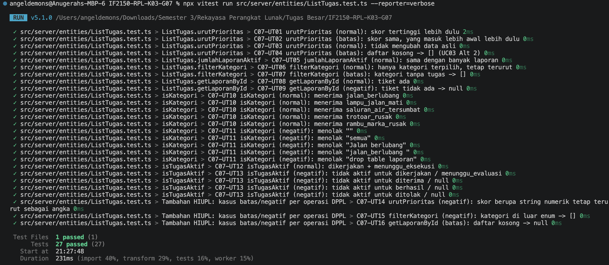
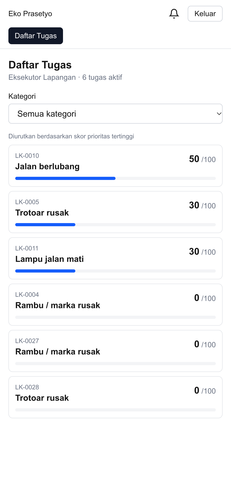
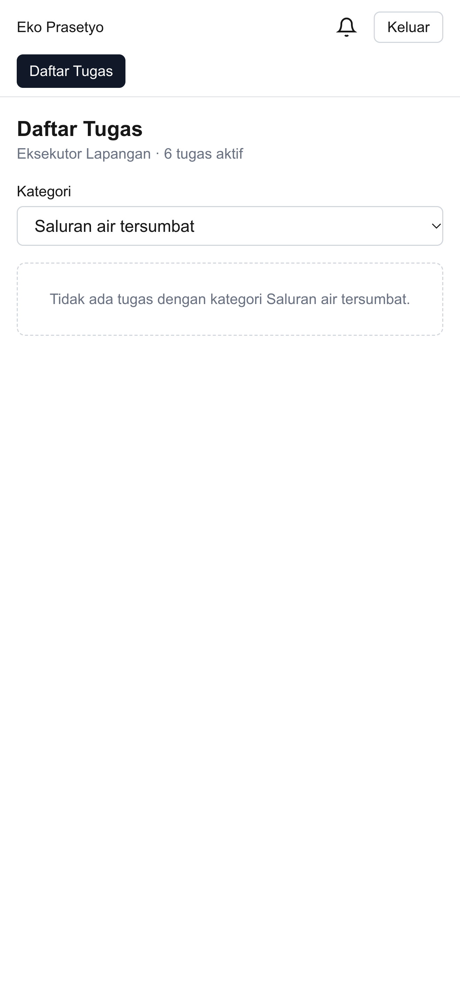
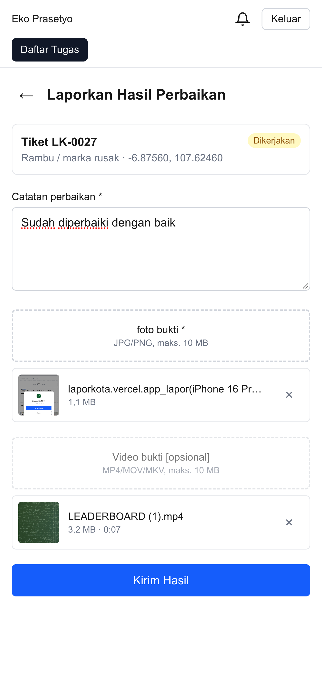
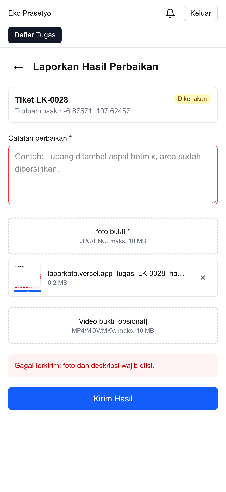
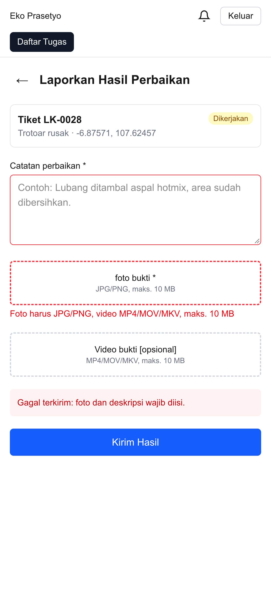
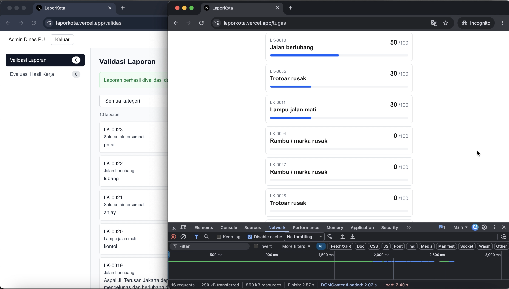
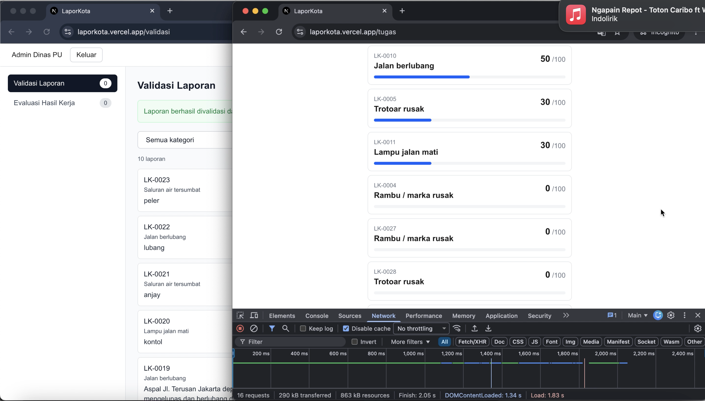
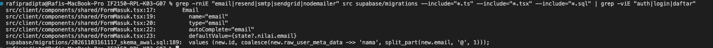
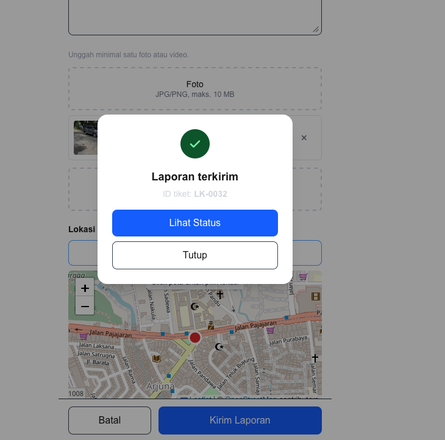

<h1>
IF2150 REKAYASA PERANGKAT LUNAK
 
TUGAS 10
 
HASIL IMPLEMENTASI DAN UJI PERANGKAT LUNAK (HIUPL)
</h1>
 

## *LaporKota*

### Untuk: *Jordhy*

Dipersiapkan oleh:
| Informasi | Keterangan |
| --- | --- |
| Kelas | *K03* |
| Kelompok | *G07*  |

| NIM | Nama |
|---|---|
| *13525051* | *Rafi Pradipta Andira Sulistyo* |
| *13525105* | *Pasaribu Fritz T.A.M.* |
| *13525075* | *Bagas Anugrah Putra* |
| *13525099* | *Gede Pranajayanta Suputra* |
| *13525015* | *Muhammad Atallah Ramadhan* |

---

## Daftar Isi

- [BAB 1: Pendahuluan](#bab-1-pendahuluan)
  - [1.1 Tujuan Penulisan Dokumen](#11-tujuan-penulisan-dokumen)
  - [1.2 Lingkup Masalah](#12-lingkup-masalah)
  - [1.3 Definisi, Istilah, dan Singkatan](#13-definisi-istilah-dan-singkatan)
  - [1.4 Aturan Penomoran](#14-aturan-penomoran)
  - [1.5 Referensi](#15-referensi)
  - [1.6 Deskripsi Umum Dokumen (Ikhtisar)](#16-deskripsi-umum-dokumen-ikhtisar)
- [BAB 2: Deskripsi Umum Perangkat Lunak](#bab-2-deskripsi-umum-perangkat-lunak)
- [BAB 3: Implementasi](#bab-3-implementasi)
  - [3.1 Lingkungan Implementasi](#31-lingkungan-implementasi)
  - [3.2 Implementasi Modul](#32-implementasi-modul)
  - [3.3 Implementasi Antarmuka](#33-implementasi-antarmuka)
  - [3.4 File Lain](#34-file-lain)
- [BAB 4: Hasil Pengujian](#bab-4-hasil-pengujian)
  - [4.1 Strategi dan Kedalaman Pengujian Kelas](#41-strategi-dan-kedalaman-pengujian-kelas)
  - [4.2 Pengujian Unit Kelas](#42-pengujian-unit-kelas)
  - [4.3 Pengujian Integrasi](#43-pengujian-integrasi)
  - [4.4 Pengujian Use Case](#44-pengujian-use-case)
  - [4.5 Pengujian Kebutuhan Non-Fungsional (KNF)](#45-pengujian-kebutuhan-non-fungsional-knf)
  - [4.6 Tangkapan Layar dan Bukti Hasil Pengujian](#46-tangkapan-layar-dan-bukti-hasil-pengujian)
- [BAB 5: Traceability](#bab-5-traceability)

---

## Daftar Perubahan

| Revisi | Deskripsi |
| :--- | :--- |
| *A* | *Deskripsikan perubahan yang dilakukan dari dokumen sebelumnya pada dokumen ini. Jika tidak terdapat perubahan, harap kosongkan tabel.* |
| *B* |  |
| *C* |  |
| ... |  |

---

# BAB 1: Pendahuluan

## 1.1 Tujuan Penulisan Dokumen
Dokumen Hasil Implementasi dan Uji Perangkat Lunak (HIUPL) ini disusun untuk melaporkan hasil implementasi platform LaporKota beserta hasil pengujiannya. Dokumen ini memuat rancangan dan deskripsi perangkat lunka, lingkungan dan hasil implementasinya serta bukti hasil pengujiannya yang mencakup Pengujian Unit, Integrasi, Use Case, dan Kebutuhan Non-Fungsional. Dokumen ini ditujukan bagi Tim Pengembang (anggota kelompok) sebagai catatan hasil akhir implementasi perangkat lunak, dan Tim Penguji (asisten/dosen) sebagai landasan pengujian kesesuaian implementasi dengan rancangan awal.

## 1.2 Lingkup Masalah
Perangkat lunak yang akan dikembangkan adalah LaporKota, sebuah platform pelaporan kerusakan infrastruktur publik berbasis website yang dirancang untuk mempermudah warga dalam menyampaikan dan memantau laporannya. Sistem pelaporan ini memfasilitasi pengguna untuk melaporkan masalah fasilitas umum dalam lingkup satu kota, kapan saja dan di mana saja dengan menyertakan foto serta koordinat lokasi. Dengan adanya sistem ini diharapkan pengguna tidak lagi kesulitan mencari saluran pengaduan yang responsif dan proses perbaikan kerusakan fasilitas publik dapat berjalan dengan efisien.

## 1.3 Definisi, Istilah, dan Singkatan
Semua definisi dan singkatan yang digunakan dalam dokumen ini beserta penjelasannya.

Tabel 1.3. Definisi Istilah dan Singkatan

| Singkatan, Akronim, atau Istilah | Penjelasan |
| :--- | :--- |
| *P/L* | *Singkatan dari Perangkat Lunak, yaitu aplikasi yang memberikan perintah kepada komputer untuk menjalankan tugas tertentu.* |
| *SKPL* | *Singkatan dari Spesifikasi Kebutuhan Perangkat Lunak, yaitu dokumen yang merangkum kriteria-kriteria yang diperlukan untuk membangun aplikasi menjalankan tugasnya.* |
| *DPPL* | *Singkatan dari Deskripsi Perancangan Perangkat Lunak, yaitu dokumen yang menjelaskan rancangan arsitektur, kelas, dan antarmuka P/L.* |
| *HIUPL* | *Singkatan dari Hasil Implementasi dan Uji Perangkat Lunak, yaitu dokumen yang melaporkan hasil implementasi dan pengujian P/L.* |
| *KF* | *Singkatan dari Kebutuhan Fungsional.* |
| *KNF* | *Singkatan dari Kebutuhan Non-Fungsional.* |
| *UC* | *Singkatan dari Use Case.* |
| *TC* | *Singkatan dari Test Case, yaitu satu kasus uji untuk skenario tertentu.* |
| *UT* | *Singkatan dari Unit Test, yaitu test case tingkat kelas/operasi.* |
| *INT* | *Singkatan dari Integration Test, yaitu test case yang menguji interaksi antarkomponen.* |
| *Boundary* | *Kasus uji pada nilai batas masukan, misalnya nilai minimum, maksimum, atau tepat di ambang aturan.* |
| *Coverage* | *Persentase baris/cabang kode yang dieksekusi oleh pengujian.* |
| *CD* | *Singkatan dari Class Diagram, Diagram yang menggambarkan struktur kelas beserta atribut, metode, dan hubungan antarkelas di dalam sistem.* |
| *GPS* | *Singkatan dari Global Positioning System, yaitu sistem navigasi berbasis satelit untuk menentukan posisi.* |
| *API* | *Singkatan dari Application Programming Interface, yaitu antarmuka yang memungkinkan program saling terhubung.* |
| *Latitude / Longitude* | *Garis lintang dan garis bujur, yaitu dua nilai koordinat posisi di bumi.* |
| *DPPL* | *Singkatan dari Deskripsi Perancangan Perangkat Lunak, yaitu dokumen yang berfungsi sebagai panduan bagi pengembang untuk mengimplementasikan perangkat lunak dalam bentuk kode program.* |
| *APL* | *Singkatan dari Arsitektur Perangkat Lunak, yaitu dokumen yang menetapkan pola arsitektur, komponen, dan model view dari perangkat lunak.* |
| *Server Action* | *Fungsi server Next.js yang dipanggil langsung dari antarmuka* |
| *RLS* | *Row Level Security, aturan akses per baris di PostgreSQL/Supabase* |
| *RPC* | *Remote Procedure Call, fungsi PostgreSQL yang dipanggil aplikasi* |
| *Trigger* | *Fungsi database yang berjalan otomatis saat data berubah* |
| *Mock* | *Objek pengganti dependensi dalam unit test untuk pengujian kelas terpisah dari database* |
| *Vitest* | *Framework unit test Typescript yang digunakan pada proyek* |
| *CI* | *Continuous Integration, Github Actions yang menjalankan lint, typecheck, dan test pada setiap Pull Request* |
| *Seed* | *Skrip npm run seed yang mengisi akun uji dan data contoh fiktif* |
| *ID Tiket* | *Kode unik laporan dalam platform dengan format LK-XXXX* |

| *...* | *...* |

## 1.4 Aturan Penomoran
Tuliskan aturan penomoran (ID) yang digunakan dalam dokumen ini. Gunakan pola ID yang **sama** dengan yang sudah dipakai pada dokumen-dokumen sebelumnya (SKPL, APL, DPPL), kecuali untuk ID pengujian yang baru diperkenalkan pada dokumen ini.

Tabel 1.4. Aturan Penomoran

| Hal/Bagian | Penomoran | Keterangan |
| :--- | :--- | :--- |
| *Kebutuhan Fungsional* | *KFXX* | *Sesuai SKPL* |
| *Kebutuhan Non-Fungsional* | *KNFXX* | *Sesuai SKPL* |
| *Use Case* | *UCXX* | *Sesuai SKPL* |
| *Kelas* | *CXX* | *Sesuai DPPL* |
| *Antarmuka* | *I-XX* | *Sesuai DPPL* |
| *Antarmuka antarkomponen* | *IK-XX* | *Dibedakan dari antarmuka layar (I-XX); daftar pada Tabel 4.3.1* |
| *Objek Antarmuka* | *IXX-YY* | *Sesuai DPPL, contoh I06-08* |
| *Algoritma* | *Algo-XXX* | *Sesuai DPPL* |
| *Query* | *Q-XXX* | *Sesuai DPPL* |
| *Test Case Unit* | *CXX-UTYY* | *XX adalah nomor kelas, YY adalah nomor urut test case unit pada kelas tersebut* |
| *Test Case Integrasi* | *INT-TCYY* | *YY adalah nomor urut test case integrasi* |
| *Test Case Use Case* | *UCXX-TCYY* | *XX adalah nomor use case, YY adalah nomor urut test case pada use case tersebut* |
| *Test Case KNF* | *KNFXX-TCYY* | *XX adalah nomor KNF, YY adalah nomor urut test case pada KNF tersebut* |
| *...* | *...* | *...* |

## 1.5 Referensi
| 1 | Dokumen Spesifikasi Kebutuhan Perangkat Lunak LaporKota | Repository IF2150-RPL-K03-G07/docs/M5/K03_G07_SKPL.md |
| 2 | Dokumen Aristektur Perangkat Lunak LaporKota | Repository IF2150-RPL-K03-G07/docs/M6/K03_G07_APL.md |
| 3 | Dokumen Deskripsi Perancangan Perangkat Lunak LaporKota | Repository IF2150-RPL-K03-G07/docs/M8/K03_G07_DPPL2.md |
| 4 | Laporan Implementasi Perangkat Lunak LaporKota | Repository IF2150-RPL-K03-G07/docs/M9/K03_G07_Implementasi.md |

## 1.6 Deskripsi Umum Dokumen (Ikhtisar)
Dokumen Hasil Implementasi dan Uji Perangkat Lunak (HIUPL) ini disusun dengan sistematika berikut. **BAB 1: Pendahuluan** memuat tujuan penulisan dokumen, lingkup masalah, daftar definisi, aturan penomoran, referensi, serta ikhtisar dokumen. **BAB 2: Deskripsi Umum Perangkat Lunak** menjelaskan gambaran rancangan sistem, batasan, dan keterkaitannya dengan sistem eksternal. Terlampir juga pemodelan sistem perangkat lunak menggunakan Use Case Diagram. **BAB 3: Implementasi**  menjabarkan lingkungan implementasi, dan hasil-hasil implementasi perangkat lunak (modul, antarmuka, dll) yang telah dibuat berdasarkan DPPL. **BAB 4: Hasil Pengujian** menguraikan kedalaman pengujian pada setiap kelas, serta masing-masing hasil pengujiannya yang meliputi pengujian Unit, Integrasi, Use Case, dan Kebutuhan Non-Fungsional. **BAB 5: Traceability** memetakan seluruh KF, KNF, UC, Kelas, Hasil Implementasi, dan Test Case untuk memverifikasi kelengkapan dan keterkaitannya.

 

---

# BAB 2: Deskripsi Umum Perangkat Lunak

Bagian ini diisi dengan *System Overview*, dalam bentuk gambar dan narasi yang memberikan gambaran tentang aplikasi dan konteksnya. **Batasan dan keterkaitan** antara sistem yang dibangun dengan sistem lain di luarnya harus jelas. Deskripsi umum sistem perlu dilengkapi dengan pemodelan kasus yang dihadapi, seperti *use case diagram*. Berikan narasi yang jelas untuk setiap gambar yang ditampilkan.

Bagian ini dapat menyalin atau meringkas dari dokumen SKPL atau DPPL.

<i>Gambar 2.1. Use Case Diagram [Nama P/L]</i>

 

---

# BAB 3: Implementasi

Bagian ini diisi dengan informasi tentang elemen P/L yang dikembangkan (*executable files*, *configuration files*, *data files*, dan sebagainya) serta perubahannya terhadap rancangan pada DPPL (jika ada).

## 3.1 Lingkungan Implementasi

## 3.1 Lingkungan Implementasi

Lingkungan implementasi mengikuti rancangan pada Subbab 2.1 DPPL dengan dua perbedaan: versi Next.js yang digunakan adalah 16.4.4 (DPPL: 16.3, pembaruan minor), serta penambahan Cloudflare Turnstile sebagai layanan verifikasi anti-bot (KNF04). Selain itu ditambahkan alat pengujian yang digunakan pada Tugas 10.

Tabel 3.1. Lingkungan Implementasi

| Aspek | Keterangan |
| :--- | :--- |
| *Hardware* | Laptop masing-masing anggota (macOS, Linux, dan Windows) untuk pengembangan; server Vercel (*serverless*) dan Supabase (*cloud*) untuk *production* |
| *Operating System* | Pengembangan: macOS, Linux, dan Windows. Pengguna: *cross platform* melalui *browser* (Android, iOS, Windows, macOS, Linux) |
| *Bahasa Pemrograman* | TypeScript 5.9.3 di atas Node.js 24.13.0 (LTS); SQL (PostgreSQL) untuk *migration*, RPC, *trigger*, dan RLS |
| *Framework/Library* | Next.js 16.4.4, React 19.3.0, React DOM 19.3.0, @supabase/supabase-js 2.118.0, @supabase/ssr 0.12.7, Leaflet 1.9.4 dan React Leaflet 5.0.0 dengan *tile* OpenStreetMap, Tailwind CSS 4.3.4, Cloudflare Turnstile (anti-bot) |
| *DBMS* | PostgreSQL 17 yang dikelola Supabase, beserta Supabase Auth, Supabase Storage (bucket `media`), dan Supabase Realtime |
| *Development Tools* | Visual Studio Code, Supabase CLI 3.0.0 (*migration* dan *generate types*), Vercel CLI (*deploy*), ESLint 9.39.5, tsx 4.23.15 (menjalankan skrip seed), Git dan GitHub (*version control*, *pull request*, GitHub Actions sebagai CI untuk lint, typecheck, dan test) |
| *Testing Tools* | Vitest 5.1.0 (unit dan integrasi), @vitest/coverage-v8 5.1.0 (laporan *coverage*), Chrome DevTools dan Lighthouse (pengukuran KNF), pengujian manual melalui *browser* (use case) |
## 3.2 Implementasi Modul

Daftar modul/kelas yang **TELAH** diimplementasikan. Gunakan nama dan ID kelas yang sama dengan DPPL, dan konsisten dengan Tabel B.5 pada dokumen Implementasi (Tugas 9).

Tabel 3.2. Implementasi Modul

| No | ID Kelas | Nama Modul/Kelas | Nama File Fisik | Nama File Executable |
| :--- | :--- | :--- | :--- | :--- |
| 1 | *[C01]* | *[Nama modul/kelas]* | *[path/ke/file]* | *[Nama file executable, atau - jika tidak ada]* |
| 2 | *[C02]* | *[Nama modul/kelas]* | *[path/ke/file]* | *[...]* |
| ... | *...* | *...* | *...* | *...* |

## 3.3 Implementasi Antarmuka

Daftar antarmuka yang telah diimplementasikan. Gunakan ID dan nama layar yang sama dengan ID dan nama layar pada tugas DPPL.

Tabel 3.3. Implementasi Antarmuka

| No | ID Antarmuka | Nama Antarmuka | Nama File Fisik | Nama File Executable |
| :--- | :--- | :--- | :--- | :--- |
| 1 | *[I-01]* | *[Nama layar]* | *[path/ke/file]* | *[Nama file executable, atau - jika tidak ada]* |
| 2 | *[I-02]* | *[Nama layar]* | *[path/ke/file]* | *[...]* |
| ... | *...* | *...* | *...* | *...* |

## 3.4 File Lain

Tabel 3.4. File Lain

| No | Nama File | Keterangan |
| :--- | :--- | :--- |
| 1 | `supabase/migrations/*.sql` | Skema basis data: tabel, relasi, RLS, RPC (mis. `kirim_laporan`, `cari_laporan_duplikat`), *trigger* riwayat status dan notifikasi, *sequence* ID tiket, dan *policy* Storage |
| 2 | `scripts/seed.ts` | Skrip `npm run seed` untuk mengisi akun uji (warga, admin, eksekutor) dan data laporan contoh fiktif |
| 3 | `src/types/database.ts` | Tipe TypeScript hasil *generate* dari skema Supabase |
| 4 | `src/lib/supabase/client.ts`, `server.ts`, `proxy.ts` | Pembuatan client Supabase untuk *browser*, *server*, dan penyegaran sesi |
| 5 | `src/proxy.ts` | Proteksi rute berdasarkan sesi dan peran pengguna |
| 6 | `src/lib/auth.ts`, `src/lib/validasi-auth.ts` | Utilitas autentikasi dan validasi masukan form masuk/daftar |
| 7 | `src/server/controllers/AuthController.ts` | Controller masuk, daftar, dan keluar (tidak tercantum sebagai kelas pada DPPL karena autentikasi ditangani Supabase Auth) |
| 8 | `src/lib/constants.ts`, `src/lib/batas-wilayah.ts` | Konstanta aplikasi, termasuk pusat peta dan *polygon* batas wilayah kota |
| 9 | `src/lib/media.ts` | Utilitas unggah berkas foto/video ke Supabase Storage |
| 10 | `src/lib/format.ts`, `error-db.ts`, `action-result.ts`, `navigasi.ts`, `validasi-perbaikan.ts` | Utilitas format tampilan, penerjemahan galat basis data, bentuk hasil *server action*, navigasi per peran, dan validasi hasil perbaikan |
| 11 | `.env.example` | Contoh variabel lingkungan (URL dan key Supabase, key Turnstile, akun uji integrasi) tanpa nilai rahasia |
| 12 | `package.json`, `package-lock.json` | Daftar dependensi dan skrip (`dev`, `build`, `lint`, `typecheck`, `test`, `test:coverage`, `test:integration`, `seed`) |
| 13 | `eslint.config.mjs`, `tsconfig.json`, `next.config.ts` | Konfigurasi lint, TypeScript, dan Next.js |
| 14 | `vitest.config.mts` | Konfigurasi unit test dan *coverage*; mengecualikan uji integrasi |
| 15 | `vitest.integration.config.mts` | Konfigurasi uji integrasi terhadap basis data Supabase |
| 16 | `src/**/*.test.ts` | File unit test yang diletakkan di sebelah file yang diuji |
| 17 | `tests/integration/*.int.test.ts` | File uji integrasi |
| 18 | `tests/integration/helpers/` | Helper uji integrasi: client per peran, penanda data uji `[TEST-INT]`, koordinat uji, pelacak dan pembersih data, pengecekan sisa data |
| 19 | `.github/workflows/[nama-file].yml` | Konfigurasi CI GitHub Actions (lint, typecheck, test) pada setiap *pull request* |
| 20 | `src/README.md` | Dokumentasi aplikasi: instalasi, konfigurasi, cara menjalankan, akun uji, dan cara pengujian |

 

---

# BAB 4: Hasil Pengujian

Bab ini melaporkan hasil pengujian P/L pada level unit, integrasi, dan sistem. Pengujian dilakukan pada tag release terakhir Tugas 9. Hasil aktual diisi berdasarkan pengamatan saat pengujian. Kesimpulan diisi `Pass` atau `Fail`, dan untuk `Fail` dilengkapi penyebab serta usulan perbaikan.

## 4.1 Strategi dan Kedalaman Pengujian Kelas

Setiap kelas perancangan pada Tabel 4.1 DPPL diklasifikasikan ke dalam tiga tingkat kedalaman pengujian. Tingkat **Mendalam** diberikan pada kelas yang memuat logika bisnis, perhitungan, validasi, aturan status, algoritma, integrasi eksternal, atau keamanan. Tingkat **Sedang** diberikan pada kelas yang hanya mengoordinasikan atau mendelegasikan proses. Tingkat **Tidak perlu** diberikan pada kelas tanpa logika, seperti *entity/DTO* dan kelas konfigurasi, yang teruji secara tidak langsung melalui test case use case. Seluruh kelas wajib dicantumkan beserta alasan penentuan tingkatnya.

Tabel 4.1.1. Identifikasi Tingkat Pengujian Kelas

| ID Kelas | Nama Kelas | Tingkat | Alasan | Test Case Terkait |
| :--- | :--- | :--- | :--- | :--- |
| C02 | Laporan | Mendalam | Memuat perhitungan skor prioritas, transisi status, penambahan upvote, serta filter dan pengurutan laporan (`src/server/entities/Laporan.ts`) | C02-UT01 s.d. C02-UTxx |
| C03 | Lokasi | Mendalam | Memuat validasi titik di dalam batas wilayah (`dalamWilayah`) dan perhitungan jarak haversine (`hitungJarak`) | C03-UT01 s.d. C03-UTxx |
| C04 | Foto | Mendalam | Memuat validasi format dan ukuran berkas foto, termasuk nilai batas ukuran maksimum | C04-UT01 s.d. C04-UTxx |
| C05 | Video | Mendalam | Memuat validasi format dan ukuran berkas video, termasuk nilai batas ukuran maksimum | C05-UT01 s.d. C05-UTxx |
| C06 | Upvote | Mendalam | Memuat aturan satu upvote per pengguna untuk setiap laporan | C06-UT01 s.d. C06-UTxx |
| C07 | ListTugas | Mendalam | Memuat algoritma pengurutan tugas berdasarkan skor prioritas dan filter kategori | C07-UT01 s.d. C07-UTxx |
| C08 | HasilPerbaikan | Mendalam | Memuat validasi berkas bukti perbaikan dan catatan hasil kerja | C08-UT01 s.d. C08-UTxx |
| C09 | Evaluasi | Mendalam | Memuat aturan keputusan evaluasi (setuju/tolak) yang mengubah status laporan dan tahap pengerjaan | C09-UT01 s.d. C09-UTxx |
| C17 | LaporanController | Mendalam | Memuat verifikasi anti-bot Cloudflare Turnstile (keamanan, integrasi eksternal) dan validasi masukan laporan sebelum disimpan | C17-UT01 s.d. C17-UTxx |
| C10 | Notifikasi | Sedang | Hanya membentuk dan meneruskan data notifikasi; notifikasi dibuat oleh *trigger* basis data saat status berubah | C10-UT01 s.d. C10-UTxx |
| C18 | ValidasiController | Sedang | Meneruskan aksi validasi/penolakan ke Laporan setelah pemeriksaan peran | C18-UT01 s.d. C18-UTxx |
| C19 | PenugasanController | Sedang | Meneruskan permintaan daftar tugas ke ListTugas setelah pemeriksaan peran | C19-UT01 s.d. C19-UTxx |
| C20 | PerbaikanController | Sedang | Meneruskan unggahan hasil perbaikan ke HasilPerbaikan | C20-UT01 s.d. C20-UTxx |
| C21 | EvaluasiController | Sedang | Meneruskan keputusan evaluasi ke Evaluasi | C21-UT01 s.d. C21-UTxx |
| C22 | StatusController | Sedang | Meneruskan permintaan data status, peta publik, dan upvote ke Laporan dan Upvote | C22-UT01 s.d. C22-UTxx |
| C23 | NotifikasiController | Sedang | Meneruskan pengambilan dan penandaan notifikasi ke Notifikasi | C23-UT01 s.d. C23-UTxx |
| C01 | User | Tidak perlu | Entity yang hanya menyimpan data akun dan peran tanpa logika (`src/server/entities/User.ts`); autentikasi ditangani Supabase Auth | - |
| C11 | LaporPage | Tidak perlu | Kelas *view* yang hanya menampilkan formulir dan meneruskan masukan ke controller | - (teruji melalui UC01-TC) |
| C12 | ValidasiPage | Tidak perlu | Kelas *view* yang hanya menampilkan antrean dan rincian laporan | - (teruji melalui UC02-TC) |
| C13 | PenugasanPage | Tidak perlu | Kelas *view* yang hanya menampilkan daftar tugas | - (teruji melalui UC03-TC) |
| C14 | HasilPerbaikanForm | Tidak perlu | Kelas *view* yang hanya menampilkan formulir hasil perbaikan | - (teruji melalui UC04-TC) |
| C15 | EvaluasiPage | Tidak perlu | Kelas *view* yang hanya menampilkan perbandingan bukti dan tombol keputusan | - (teruji melalui UC05-TC) |
| C16 | StatusLaporanPage | Tidak perlu | Kelas *view* yang hanya menampilkan linimasa status dan peta publik | - (teruji melalui UC06-TC) |

| *...* | *...* | *...* | *...* | *...* |

## 4.2 Pengujian Unit Kelas

Pengujian unit dilakukan pada kelas bertingkat Mendalam dan Sedang. Kelas Mendalam diuji pada seluruh operasi public dengan kasus normal, batas, dan negatif, serta mencapai *coverage* minimal 70%. Kelas Sedang diuji minimal dengan satu kasus normal dan satu kasus gagal pada operasi public utama.

engujian unit dilakukan secara otomatis menggunakan Vitest 5.1.0. Setiap file test diletakkan di sebelah file kelas yang diuji dan diberi nama sesuai ID test case, misalnya `C03-UT01 dalamWilayah: titik di tengah kota → true`, sehingga keluaran *test runner* dapat langsung dirujuk sebagai bukti pada Subbab 4.6. Kelas *entity* yang tidak bergantung pada basis data diuji sebagai fungsi murni. Kelas *controller* diuji dengan *mock* untuk autentikasi dan client Supabase, sehingga logika controller dapat diuji terpisah dari basis data; interaksi nyata dengan basis data diuji pada Subbab 4.3. *Coverage* diukur dengan @vitest/coverage-v8 dan dilaporkan per kelas Mendalam dalam bentuk persentase *line* dan *branch*.

Cara menjalankan unit test:
- Seluruh unit test: `npm test`
- Unit test beserta laporan *coverage*: `npm run test:coverage` (ringkasan tampil di terminal, laporan HTML di folder `coverage/`)
- Satu file tertentu: `npx vitest run <path file test>`

Lokasi file test: `src/**/*.test.ts`, di sebelah file yang diuji (contoh: `src/server/entities/Lokasi.test.ts` untuk `src/server/entities/Lokasi.ts`).

### 4.2.1 Kelas [Nama Kelas 1]

**ID Kelas:** *[C02]*  
**Nama Kelas:** *[Pesanan]*  
**Tingkat:** *[Mendalam]*

Tabel 4.2.1. Hasil Pengujian Unit Kelas [C02]

| ID Pengujian | Operasi yang Diuji | Jenis Kasus | Prosedur/Masukan | Hasil yang Diharapkan | Hasil Pengujian | Kesimpulan |
| :--- | :--- | :--- | :--- | :--- | :--- | :--- |
| *C02-UT01* | *`hitungTotal(): Decimal`* | *Normal* | *Pesanan berisi 2 item: 10.000 x 2 dan 5.000 x 1* | *Total = 25.000* | *[Hasil aktual]* | *Pass/Fail* |
| *C02-UT02* | *`hitungTotal(): Decimal`* | *Batas* | *Pesanan berisi tepat 1 item dengan jumlah 1* | *Total = harga item tersebut* | *[...]* | *Pass/Fail* |
| *C02-UT03* | *`hitungTotal(): Decimal`* | *Negatif* | *Pesanan tanpa item* | *Total = 0 atau melempar kesalahan sesuai rancangan* | *[...]* | *Pass/Fail* |
| *...* | *...* | *...* | *...* | *...* | *...* | *...* |

Khusus kelas **Mendalam**:

Tabel 4.2.1b. Ringkasan Cakupan Kelas [C02]

| Informasi | Keterangan |
| :--- | :--- |
| Daftar operasi public pada DPPL | *[op1(), op2(), ...]* |
| Operasi yang diuji | *[op1(), op2(), ...]* |
| ID Algoritma yang tercakup | *[Algo-001, ...]* |
| Coverage (wajib ≥ 70%) | *[% baris / % cabang, alat dan bukti pada 4.6]* |

### 4.2.2 Kelas [Nama Kelas 2]

*[Ulangi pola 4.2.1 untuk setiap kelas bertingkat Mendalam atau Sedang.]*

### 4.2.7 Kelas ListTugas

**ID Kelas:** *C07*  
**Nama Kelas:** *ListTugas*  
**Tingkat:** *Mendalam*

Tabel 4.2.7. Hasil Pengujian Unit Kelas [C07]

| ID Pengujian | Operasi yang Diuji | Jenis Kasus | Prosedur/Masukan | Hasil yang Diharapkan | Hasil Pengujian | Kesimpulan |
| :--- | :--- | :--- | :--- | :--- | :--- | :--- |
| *C07-UT01* | *`urutPrioritas()`* | *Normal* | *3 tugas dengan skor: 30, 92, 50* | *LK-002, LK-003, LK-001* | *Sesuai harapan; tes lulus (2ms)* | *Pass* |
| *C07-UT02* | *`urutPrioritas()`* | *Batas* | *2 tugas skor sama, waktu masuk berbeda* | *Yang masuk lebih awal di depan* | *Sesuai harapan; tes lulus (0ms)* | *Pass* |
| *C07-UT03* | *`urutPrioritas()`* | *Normal* | *Daftar asli yang terurut* | *Daftar asli tak beruhbah* | *Sesuai harapan; tes lulus (0ms)* | *Pass* |
| *C07-UT04* | *`urutPrioritas()`* | *Batas* | *Daftar kosong* | *[]* | *Sesuai harapan; tes lulus (0ms)* | *Pass* |
| *C07-UT05* | *`jumlahLaporanAktif`* | *Normal* | *2 tugas; 0 tugas* | *2; 0* | *Sesuai harapan; tes lulus (0ms)* | *Pass* |
| *C07-UT06* | *`filterKategori(kategori)`* | *Normal* | *3 tugas, filter lampu_jalan_mati* | *LK-003, LK-001 (terurut)* | *Sesuai harapan; tes lulus (0ms)* | *Pass* |
| *C07-UT07* | *`filterKategori(kategori)`* | *Batas* | *Filter trotoar_rusak (tidak ada laporan sesuai)* | *[]* | *Sesuai harapan; tes lulus (0ms)* | *Pass* |
| *C07-UT08* | *`getLaporanById(idTiket)`* | *Normal* | *LK-002* | *Laporan LK-002* | *Sesuai harapan; tes lulus (0ms)* | *Pass* |
| *C07-UT09* | *`getLaporanById(idTiket)`* | *Negatif* | *LK-9999* | *null* | *Sesuai harapan; tes lulus (0ms)* | *Pass* |
| *C07-UT10* | *`isKategori(nilai)`* | *Normal* | *5 nilai enum kategori* | *true untuk semuanya* | *Sesuai harapan; 5/5 kasus lulus* | *Pass* |
| *C07-UT11* | *`isKategori(nilai)`* | *Negatif* | *"", "semua", label tampilan, nilai berspasi, teks injeksi SQL* | *false untuk semuanya* | *Sesuai harapan; 5/5 kasus lulus* | *Pass* |
| *C07-UT12* | *`isTugasAktif(laporan)`* | *Normal* | *dikerjakan + menunggu_eksekusi* | *true* | *Sesuai harapan; tes lulus (0ms)* | *Pass* |
| *C07-UT13* | *`isTugasAktif(laporan)`* | *Negatif* | *4 kombinasi status/tahap lain* | *false* | *Sesuai harapan; 4/4 kasus lulus* | *Pass* |
| *C07-UT14* | *`urutPrioritas()`* | *Negatif* | *skor berupa string numerik "2.5" dan "10"* | *Terurut sesuai angka LK-002, LK-001* | *Sesuai harapan; tes lulus (0ms)* | *Pass* |
| *C07-UT15* | *`filterKategori(kategori)`* | *Negatif* | *Kategori di luar enum* | *[]* | *Sesuai harapan; tes lulus (0ms)* | *Pass* |
| *C07-UT16* | *`getLaporanById(idTiket)`* | *Batas* | *Daftar tugas kosong* | *null* | *Sesuai harapan; tes lulus (0ms)* | *Pass* |
| *...* | *...* | *...* | *...* | *...* | *...* | *...* |

Tabel 4.2.7b. Ringkasan Cakupan Kelas C07

| Informasi | Keterangan |
| :--- | :--- |
| Daftar operasi public pada DPPL | `urutPrioritas(idTiket)`, `filterKategori(idTiket)`, `getLaporanById()` |
| Operasi yang diuji | `urutPrioritas(idTiket)`, `filterKategori(idTiket)`, `getLaporanById()` |
| ID Algoritma yang tercakup | `Algo-012`, `Algo-013` |
| Coverage (wajib ≥ 70%) | *100% line / 100% branch (100% statement, 100% function), tool: Vitest 5.1.0 + @vitest/coverage-v8. Bukti pada Subbab 4.6 (C07-coverage.png)* |

### 4.2.8 Kelas HasilPerbaikan

**ID Kelas:** *C08*  
**Nama Kelas:** *HasilPerbaikan*  
**Tingkat:** *Mendalam*

Tabel 4.2.8. Hasil Pengujian Unit Kelas C08

| ID Pengujian | Operasi yang Diuji | Jenis Kasus | Prosedur/Masukan | Hasil yang Diharapkan | Hasil Pengujian | Kesimpulan |
| :--- | :--- | :--- | :--- | :--- | :--- | :--- |
| *C08-UT01* | *`validasiBerkas(foto, video)`* | *Normal* | *Foto JPG/PNG & Video MP4/MOV/MKV 2 MB* | *true* | *Sesuai harapan; tes lulus (2ms)* | *Pass* |
| *C08-UT02* | *`validasiBerkas()`* | *Normal* | *Foto tanpa video* | *true* | *Sesuai harapan; tes lulus (0ms)* | *Pass* |
| *C08-UT03* | *`validasiBerkas()`* | *Batas* | *Foto & video kosong* | *true* | *Sesuai harapan; tes lulus (0ms)* | *Pass* |
| *C08-UT04* | *`validasiBerkas()`* | *Negatif* | *Foto a.heic* | *false* | *Sesuai harapan; 3/3 kasus lulus* | *Pass* |
| *C08-UT05* | *`validasiBerkas()`* | *Negatif* | *Video a.avi* | *false* | *Sesuai harapan; 3/3 kasus lulus* | *Pass* |
| *C08-UT06* | *`validasiBerkas()`* | *Batas* | *10 MB ; +1 byte* | *true ; false* | *Sesuai harapan; tes lulus (0ms)* | *Pass* |
| *C08-UT07* | *`validasiBerkas()`* | *Batas* | *Berkas 0 byte* | *false* | *Sesuai harapan; tes lulus (0ms)* | *Pass* |
| *C08-UT08* | *`pilihBuktiSelesai(daftar)`* | *Batas* | *Belum ada hasil* | *null* | *Sesuai harapan; tes lulus (0ms)* | *Pass* |
| *C08-UT09* | *`pilihBuktiSelesai()`* | *Negatif* | *Belum ada hasil yang dievaluasi* | *null* | *Sesuai harapan; tes lulus (0ms)* | *Pass* |
| *C08-UT10* | *`pilihBuktiSelesai()`* | *Negatif* | *Semua hasil dikembalikan* | *null* | *Sesuai harapan; tes lulus (0ms)* | *Pass* |
| *C08-UT11* | *`pilihBuktiSelesai()`* | *Normal* | *Hasil lama dikembalikan & hasil baru selesai* | *Hasil yang selesai* | *Sesuai harapan; tes lulus (0ms)* | *Pass* |
| *C08-UT12* | *`pilihBuktiSelesai()`* | *Normal* | *Beberapa hasil yang selesai* | *Hasil terbaru* | *Sesuai harapan; tes lulus (0ms)* | *Pass* |
| *C08-UT13* | *`pilihBuktiSelesai()`* | *Normal* | *Satu hasil selesai* | *Objek tanpa field evaluasi* | *Sesuai harapan; tes lulus (1ms)* | *Pass* |
| *C08-UT14* | *`pilihBuktiSelesai()`* | *Normal* | *Dua hasil yang selesai* | *Urutan daftar asli tidak berubah* | *Sesuai harapan; tes lulus (0ms)* | *Pass* |
| *C08-UT15* | *`sumpanBukti()`* | *Normal* | *Client palsu; idLaporan, catatan, 1 foto* | *RPC `kirim_hasil_perbaikan` dipanggil dengan argumen yang benar* | *Sesuai harapan; tes lulus (1ms)* | *Pass* |
| *C08-UT16* | *`sumpanBukti()`* | *Negatif* | *RPC mengembalikan error P0001* | *Error diteruskan* | *Sesuai harapan; tes lulus (0ms)* | *Pass* |
| *C08-UT17* | *`simpanBukti()`* | *Batas* | *3 foto + 1 video* | *Satu panggilan RPC membawa 4 media* | *Sesuai harapan; tes lulus (1ms)* | *Pass* |
| *C08-UT18* | *`getBuktiLengkap`* | *Normal* | *Hasil lama minta_ulang_bukti + hasil baru selesai* | *Membaca hasil_perbaikan per id_laporan; mengembalikan hasil selesai* | *Sesuai harapan; tes lulus (1ms)* | *Pass* |
| *C08-UT19* | *`getBuktiLengkap`* | *Batas* | *Database mengembalikan data: null* | *{ data: null, error: null}* | *Sesuai harapan; tes lulus (0ms)* | *Pass* |
| *C08-UT20* | *`getBuktiLengkap`* | *Negatif* | *Database mengembalikan error* | *{ data: null, error }* | *Sesuai harapan; tes lulus (1ms)* | *Pass* |
| *...* | *...* | *...* | *...* | *...* | *...* | *...* |

Khusus kelas **Mendalam**:

Tabel 4.2.8b. Ringkasan Cakupan Kelas C08

| Informasi | Keterangan |
| :--- | :--- |
| Daftar operasi public pada DPPL | `validasiBerkas()`, `simpanBukti()`, `getBuktiLengkap()` |
| Operasi yang diuji | `validasiBerkas()`, `simpanBukti()`, `getBuktiLengkap()`, `pilihBuktiSelesai()` |
| ID Algoritma yang tercakup | *`Algo-014`, `Algo-015`* |
| Coverage (wajib ≥ 70%) | *100% line / 100% branch (100% statement, 100% function), tool: Vitest 5.1.0 + @vitest/coverage-v8. Bukti pada Subbab 4.6 (C08-coverage.png)* |

### 4.2.19 Kelas PenugasanController

**ID Kelas:** *C19*  
**Nama Kelas:** *PenugasanController*  
**Tingkat:** *Sedang*

Tabel 4.2.19. Hasil Pengujian Unit Kelas C19

| ID Pengujian | Operasi yang Diuji | Jenis Kasus | Prosedur/Masukan | Hasil yang Diharapkan | Hasil Pengujian | Kesimpulan |
| :--- | :--- | :--- | :--- | :--- | :--- | :--- |
| *C19-UT01* | *`verifikasiAkses()`* | *Normal* | *Sesi eksekutor* | *true* | *Sesuai harapan; tes lulus* | *Pass* |
| *C19-UT02* | *`verifikasiAkses()`* | *Negatif* | *Sesi ditolak* | *false* | *Sesuai harapan; tes lulus* | *Pass* |
| *C19-UT03* | *`doSorting()`* | *Normal* | *3 tugas (skor 5, 9, 9)* | *LK-003, LK-002, LK-001* | *Sesuai harapan; tes lulus (1ms)* | *Pass* |
| *C19-UT04* | *`doSorting()`* | *Batas* | *Tugas kosong* | *ok([])* | *Sesuai harapan; tes lulus (0ms)* | *Pass* |
| *C19-UT05* | *`doSorting()`* | *Negatif* | *Akses ditolak* | *Pesan tanpa akses, database tak dibaca* | *Sesuai harapan; tes lulus (1ms)* | *Pass* |
| *C19-UT06* | *`doSorting()`* | *Negatif* | *Error database* | *Gagal memuat daftar tugas* | *Sesuai harapan; tes lulus (0ms)* | *Pass* |
| *C19-UT07* | *`doFilter(kategori)`* | *Normal* | *lampu_jalan_mati* | *2 tugas lampu terurut* | *Sesuai harapan; tes lulus (0ms)* | *Pass* |
| *C19-UT08* | *`doFilter(kategori)`* | *Negatif* | *"semua", "". label, teks injeksi* | *Kategori tak dikenal... (tanpa query)* | *Sesuai harapan; 4/4 kasus lulus* | *Pass* |
| *C19-UT09* | *`doFilter(kategori)`* | *Negatif* | *Database error* | *Pesan gagal memuat* | *Sesuai harapan; tes lulus (0ms)* | *Pass* |
| *C19-UT10* | *`bukaLaporan(idTiket)`* | *Normal* | *Tugas aktif tanpa evaluasi* | *Rincian lengkap, evaluasiTerakhir: null* | *Sesuai harapan; tes lulus (0ms)* | *Pass* |
| *C19-UT11* | *`bukaLaporan(idTiket)`* | *Normal* | *Tugas dengan evaluasi* | *Rincian lengkap, evaluasiTerakhir berisi catatan* | *Sesuai harapan; tes lulus (0ms)* | *Pass* |
| *C19-UT12* | *`bukaLaporan(idTiket)`* | *Negatif* | *Tiket tidak ada/sudah berhasil* | *Tugas tidak ditemukan atau sudah tidak aktif* | *Sesuai harapan; 3/3 kasus lulus* | *Pass* |
| *C19-UT13* | *`bukaLaporan(idTiket)`* | *Negatif* | *Error membaca rincian* | *Gagal memuat rincian tugas* | *Sesuai harapan; tes lulus (0ms)* | *Pass* |
| *C19-UT14* | *`bukaLaporan(idTiket)`* | *Negatif* | *Error membaca evaluasi* | *Gagal memuat rincian tugas* | *Sesuai harapan; tes lulus (0ms)* | *Pass* |
| *C19-UT15* | *`bukaLaporan(idTiket)`* | *Negatif* | *Belum login* | *Pesan tanpa akses, client tak dibuat* | *Sesuai harapan; tes lulus (0ms)* | *Pass* |
| *...* | *...* | *...* | *...* | *...* | *...* | *...* |

### 4.2.20 Kelas PerbaikanController

**ID Kelas:** *C20*  
**Nama Kelas:** *PerbaikanController*  
**Tingkat:** *Sedang*

Tabel 4.2.20. Hasil Pengujian Unit Kelas C20

| ID Pengujian | Operasi yang Diuji | Jenis Kasus | Prosedur/Masukan | Hasil yang Diharapkan | Hasil Pengujian | Kesimpulan |
| :--- | :--- | :--- | :--- | :--- | :--- | :--- |
| *C20-UT01* | *`validasiForm(catatan, foto, video)`* | *Normal* | *Catatan + 1 foto* | *true* | *Sesuai harapan; tes lulus (2ms)* | *Pass* |
| *C20-UT02* | *`validasiForm()`* | *Normal* | *Catatan + foto + video* | *true* | *Sesuai harapan; tes lulus (0ms)* | *Pass* |
| *C20-UT03* | *`validasiForm()`* | *Negatif* | *catatan "" / "  " / "\n\t* | *false* | *Sesuai harapan; 3/3 kasus lulus* | *Pass* |
| *C20-UT04* | *`validasiForm()`* | *Negatif* | *Tanpa foto, ada video* | *false* | *Sesuai harapan; tes lulus (0ms)* | *Pass* |
| *C20-UT05* | *`validasiForm()`* | *Batas* | *Catatan 1 karakter + 1 foto* | *true* | *Sesuai harapan; tes lulus (0ms)* | *Pass* |
| *C20-UT06* | *`cekKelengkapan()`* | *Normal* | *catatan/foto kosong* | *Mennadai bagian yang kosong* | *Sesuai harapan; tes lulus (1ms)* | *Pass* |
| *C20-UT07* | *`cekMediaTerunggah()`* | *Normal* | *Foto/video di hasil/<idUser>/* | *true* | *Sesuai harapan; tes lulus (0ms)* | *Pass* |
| *C20-UT08* | *`cekMediaTerunggah()`* | *Negatif* | *Folder eksekutor lain* | *false* | *Sesuai harapan; tes lulus (0ms)* | *Pass* |
| *C20-UT09* | *`cekMediaTerunggah()`* | *Negatif* | *Folder laporan/warga* | *false* | *Sesuai harapan; tes lulus (0ms)* | *Pass* |
| *C20-UT10* | *`cekMediaTerunggah()`* | *Negatif* | *Video di daftar foto* | *false* | *Sesuai harapan; tes lulus (0ms)* | *Pass* |
| *C20-UT11* | *`cekMediaTerunggah()`* | *Negatif* | *format tidak sesuai batasan ekstensi* | *false* | *Sesuai harapan; tes lulus (0ms)* | *Pass* |
| *C20-UT12* | *`verifikasiAkses()`* | *Normal* | *Sesi eksekutor* | *true* | *Sesuai harapan; tes lulus* | *Pass* |
| *C20-UT13* | *`verifikasiAkses()`* | *Negatif* | *Sesi ditolak* | *false* | *Sesuai harapan; tes lulus* | *Pass* |
| *C20-UT14* | *`unggahHasil(idTiket, catatan, foto, video)`* | *Normal* | *Catatan berspasi + 1 foto + 1 video* | *ok({idTiket}), catatan di-trim* | *Sesuai harapan; tes lulus (1ms)* | *Pass* |
| *C20-UT15* | *`unggahHasil()`* | *Batas* | *Foto tepat 10 MB* | *ok* | *Sesuai harapan; tes lulus (0ms)* | *Pass* |
| *C20-UT16* | *`unggahHasil()`* | *Negatif* | *Akses ditolak* | *Pesan akses, database tak tersentuh* | *Sesuai harapan; tes lulus (1ms)* | *Pass* |
| *C20-UT17* | *`unggahHasil()`* | *Negatif* | *Catatan kosong* | *PESAN_TAK_LENGKAP* | *Sesuai harapan; 3/3 kasus lulus* | *Pass* |
| *C20-UT18* | *`unggahHasil()`* | *Negatif* | *Tipe masukan salah dari client* | *PESAN_TAK_LENGKAP* | *Sesuai harapan; tes lulus (0ms)* | *Pass* |
| *C20-UT19* | *`unggahHasil()`* | *Negatif* | *GIF, > 10MB, folder lain* | *PESAN_BERKAS_TIDAK_VALID, berkas tak disimpan* | *Sesuai harapan; 5/5 kasus lulus* | *Pass* |
| *C20-UT20* | *`unggahHasil()`* | *Negatif* | *Tiket tidak ada/menunggu_evaluasi* | *Pesan tugas tak aktif, tidak disimpan* | *Sesuai harapan; 2/2 kasus lulus* | *Pass* |
| *C20-UT21* | *`unggahHasil()`* | *Negatif* | *Error membaca laporan* | *pesanErrorDB(error)* | *Sesuai harapan; tes lulus (0ms)* | *Pass* |
| *C20-UT22* | *`unggahHasil()`* | *RPC menolak (P0001)* | *Pesan database diteruskan* | *xxx* | *Sesuai harapan; tes lulus (0ms)* | *Pass/Fl* |
| *C20-UT23* | *`unggahHasil()`* | *Negatif* | *Koneksi gagal* | *Gagal mengirim hasil perbaikan* | *Sesuai harapan; tes lulus (0ms)* | *Pass* |
| *C20-UT24* | *`unggahHasil()`* | *Negatif* | *xxx* | *xxx* | *Sesuai harapan; tes lulus (0ms)* | *Pass* |
| *...* | *...* | *...* | *...* | *...* | *...* | *...* |

 

## 4.3 Pengujian Integrasi

## 4.3 Pengujian Integrasi

Pengujian integrasi memeriksa interaksi antarkomponen yang melewati batas, yaitu *Controller* ke *Model*, aplikasi ke basis data, dan aplikasi ke sistem eksternal. Daftar antarmuka mengacu pada dokumen DPPL, dengan minimal satu test case untuk setiap antarmuka. Pengujian memakai komponen nyata, bukan *mock*. Apabila ada antarmuka tambahan yang belum didaftarkan pada dokumen DPPL, cantumkan juga.

Pengujian integrasi dilakukan secara otomatis menggunakan Vitest dengan konfigurasi terpisah (`vitest.integration.config.mts`) dan memakai komponen nyata tanpa *mock*: kode aplikasi, PostgreSQL beserta RLS, RPC, dan *trigger*, Supabase Auth, Supabase Storage, serta layanan eksternal. Setiap pengujian masuk sebagai akun uji sesuai peran (warga, admin, eksekutor) sehingga aturan hak akses ikut teruji.

Karena kelompok tidak memiliki databse uji terpisah, pengujian integrasi dijalankan pada basis data Supabase *production* dengan pengaman berikut:
1. Setiap data uji diberi penanda `[TEST-INT]` pada deskripsi atau catatannya.
2. Laporan uji memakai koordinat khusus (`KOORDINAT_TES`) yang berada di dalam batas wilayah tetapi berjarak lebih dari 4 km dari laporan lain, sehingga tidak terdeteksi sebagai duplikat laporan asli.
3. Setiap ID data yang dibuat dicatat, lalu dihapus berdasarkan ID tersebut setelah pengujian selesai, termasuk berkas pada Storage. Penghapusan menolak laporan yang tidak berpenanda.
4. Setelah pengujian, jumlah sisa data berpenanda diperiksa dan harus bernilai 0.
5. Pengujian integrasi tidak dijalankan oleh CI dan tidak ikut perintah `npm test`.

Efek samping yang tidak dapat dihindari adalah terpakainya nomor urut ID tiket oleh laporan uji, sehingga nomor tiket laporan asli berikutnya melompat.

Cara menjalankan uji integrasi: `npm run test:integration` (memerlukan variabel `TEST_INT_*` dan `SUPABASE_SECRET_KEY` pada `.env.local`, lihat `.env.example`).

Lokasi file test: `tests/integration/*.int.test.ts`, dengan helper bersama di `tests/integration/helpers/`.

Tabel 4.3.1. Daftar Antarmuka Antarkomponen

| ID Antarmuka | Komponen Asal | Komponen Tujuan | Jenis Batas | Test Case |
| :--- | :--- | :--- | :--- | :--- |
| IK-01 | LaporanController | Laporan, Lokasi, Foto, Video (Model) | Controller - Model | INT-TC01 dst. |
| IK-02 | Laporan (Model) | PostgreSQL (RPC `kirim_laporan`, `cari_laporan_duplikat`, *sequence* ID tiket) | Aplikasi - Basis data | INT-TC01 dst. |
| IK-03 | LaporPage (unggah media) | Supabase Storage (bucket `media`) | Aplikasi - Basis data | INT-TC01 dst. |
| IK-04 | LaporanController | Cloudflare Turnstile (verifikasi token) | Aplikasi - Sistem eksternal | INT-TC01 dst. |
| IK-05 | ValidasiController | Laporan (Model) | Controller - Model | INT-TC20 dst. |
| IK-06 | Laporan (Model) | PostgreSQL (pembaruan status, RLS peran admin, *trigger* riwayat status) | Aplikasi - Basis data | INT-TC20 dst. |
| IK-07 | EvaluasiController | Evaluasi, HasilPerbaikan (Model) | Controller - Model | INT-TC20 dst. |
| IK-08 | Evaluasi (Model) | PostgreSQL (tabel evaluasi, perubahan status laporan) | Aplikasi - Basis data | INT-TC20 dst. |
| IK-09 | PostgreSQL (*trigger* perubahan status) | Notifikasi, NotifikasiController, Supabase Realtime | Basis data - Aplikasi | INT-TC20 dst. |
| IK-10 | PenugasanController | ListTugas (Model) | Controller - Model | INT-TC40 – INT-TC43, INT-TC47 |
| IK-11 | ListTugas (Model) | PostgreSQL (daftar tugas terurut prioritas, RLS peran eksekutor) | Aplikasi - Basis data | INT-TC40 – INT-TC43 |
| IK-12 | PerbaikanController | HasilPerbaikan (Model) | Controller - Model | INT-TC44 – INT-TC46 |
| IK-13 | HasilPerbaikan (Model) | PostgreSQL dan Supabase Storage (hasil perbaikan dan berkas bukti) | Aplikasi - Basis data | INT-TC44 – INT-TC46 |
| IK-14 | StatusController | Laporan, Upvote (Model) | Controller - Model | INT-TC60 dst. |
| IK-15 | Upvote (Model) | PostgreSQL (tabel upvote, batas satu upvote per pengguna) | Aplikasi - Basis data | INT-TC60 dst. |
| IK-16 | StatusController | PostgreSQL (view `laporan_publik` tanpa identitas pelapor) | Aplikasi - Basis data | INT-TC60 dst. |
| IK-17 | AuthController dan proteksi rute | Supabase Auth (sesi dan peran pengguna) | Aplikasi - Sistem eksternal | INT-TC60 dst. |
| IK-18 | StatusLaporanPage, LaporPage (peta) | OpenStreetMap (*tile* peta melalui Leaflet) | Aplikasi - Sistem eksternal | INT-TC60 dst. |

Tabel 4.3.2. Hasil Pengujian Integrasi

| ID Pengujian | ID Antarmuka | Skenario | Prosedur/Masukan | Hasil yang Diharapkan | Hasil Pengujian | Kesimpulan |
| :--- | :--- | :--- | :--- | :--- | :--- | :--- |
| *INT-TC01* | *I-01* | *Normal: tambah item ke keranjang* | *Panggil `tambahItem()` melalui KeranjangController dengan produk valid* | *Item tersimpan pada Keranjang dan tampil pada daftar item* | *[Hasil aktual]* | *Pass/Fail* |
| *INT-TC03* | *I-02* | *Normal: simpan pesanan* | *Buat pesanan, lalu baca ulang langsung dari basis data* | *Baris pesanan ada dengan nilai total dan status yang sama* | *[...]* | *Pass/Fail* |
| *INT-TC05* | *I-03* | *Gagal: gateway mengembalikan status gagal* | *Kirim otorisasi dengan saldo dummy tidak cukup* | *Status pesanan tidak berubah menjadi "Lunas", pesan gagal diteruskan ke pengguna* | *[...]* | *Pass/Fail* |
| *INT-TC40* | *I-05* | *Normal, data flow: daftar tugas* | *Laporan tes [TEST-INT] disetujui admin tes; eksekutor tes doSorting()* | *Laporan tes ada, daftar terurut prioritas* | *Laporan tes [TES-INT] muncul di hasil doSorting() dan seluruh daftar terurut skor menurun, seri waktu masuk lebih awal (452ms)* | *Pass* |
| *INT-TC41* | *I-05* | *Normal, interface coordination: filter* | *doFilter("rambu_marka_rusak")* | *Laporan tes ada, semua berkategori rambu_marka_rusak, daftar terurut* | *doFilter("rambu_marka_rusak") memuat laporan tes, semua item berkategori tampil terurut (292ms)* | *Pass* |
| *INT-TC42* | *I-05* | *Gagal, protocol: Role warga* | *Warga tes doSorting()* | *ok: false* | *Akun warga tes ditolak oleh requrieRole (315ms)* | *Pass* |
| *INT-TC43* | *I-05* | *Normal + gagal: rincian* | *bukaLaporan(<tiket tes>), lalu "LK-TIDAK-ADA"* | *Path foto sama, evaluasi null, tiket fiktif ditolak* | *Rincian laporan tes sesuai database, path foto sama dengan berkas yang diunggah, evaluasiTerakhir null, tiket fiktif ditolak (2164ms)* | *Pass* |
| *INT-TC44* | *I-06* | *Normal, data flow: Storage -> RPC -> tabel* | *Unggah JPG ke hasil/<id>/, unggahHasil()* | *1 baris hasil + 1 foto, tahap = menunggu_evaluasi* | *unggahHasil() ok, tepat 1 baris hasil_perbaikan + 1 baris foto. Laporan berstatus dikerjakan, tahap menunggu_evaluasi (1462ms)* | *Pass* |
| *INT-TC45* | *I-06* | *Gagal, protocol: kirim ulang* | *unggahHasil() kedua kali* | *ok: false, baris hasil tetap 1* | *Kirim ulang diolak, jumlah bars hasil_perbaikan tetap satu (472ms)* | *Pass* |
| *INT-TC46* | *I-06* | *Gagal, interface coordination: path orang lain* | *Path hasil/<id warga>/..* | *PESAN_BERKAS_TIDAK_VALID* | *Ditolak dengan PESAN_BERKAS_TIDAK_VALID, data tidak tersimpan (362ms)* | *Pass* |
| *INT-TC47* | *I-05* | *Normal, data flow: UC05 -> UC03* | *Admin tes evaluasi minta_ulang_bukti, eksekutor bukaLaporan()* | *Tahap kembali menunggu_eksekusi, catatan evaluasi tampil* | *Setelah minta_ulang_bukti, tugas kembali ke tahap menunggu_eksekusi, evaluasiTerakhir memuat catatan admin (1055ms)* | *Pass* |
| *...* | *...* | *...* | *...* | *...* | *...* | *...* |

 

## 4.4 Pengujian Use Case

Pengujian use case dilakukan pada seluruh skenario normal dan alternatif sesuai Subbab 4.4 SKPL, dengan minimal satu test case untuk setiap skenario. Kolom ID KF menunjukkan KF yang diverifikasi oleh test case tersebut.

### 4.4.1 Use Case [Nama Use Case 1]

**ID Use Case:** *[UC01 sesuai SKPL]*  
**Nama Use Case:** *[Nama use case sesuai SKPL]*

Tabel 4.4.1. Hasil Pengujian Use Case [UC01]

| ID Pengujian | ID KF | Skenario | Prosedur Pengujian | Masukan | Hasil yang Diharapkan | Hasil Pengujian | Kesimpulan |
| :--- | :--- | :--- | :--- | :--- | :--- | :--- | :--- |
| *UC01-TC01* | *KF01* | *Normal* | *1. Buka halaman login. 2. Masukkan kredensial. 3. Klik tombol "Login".* | *User: rpl@gmail.com Pass: 123456* | *Pengguna diarahkan ke Halaman Dashboard.* | *Pengguna diarahkan ke Halaman Dashboard sesuai hasil yang diharapkan.* | *Pass* |
| *UC01-TC02* | *KF01* | *Alternatif 1: [Nama skenario]* | *[Langkah-langkah pengujian]* | *[Data masukan]* | *[Hasil yang diharapkan]* | *[Hasil aktual]* | *[Pass/Fail. Jika Fail: penjelasan dan solusi]* |
| *...* | *...* | *...* | *...* | *...* | *...* | *...* | *...* |

### 4.4.2 Use Case [Nama Use Case 2]

*[Lanjutkan untuk seluruh use case dengan pola yang sama, hingga 4.4.N.]*

### 4.4.3 Use Case Melihat Penugasan Lapangan

**ID Use Case:** UC03
**Nama Use Case:** Melihat Penugasan Lapangan

Tabel 4.4.3. Hasil Pengujian Use Case UC03

| ID Pengujian | ID KF | Skenario | Prosedur Pengujian | Masukan | Hasil yang Diharapkan | Hasil Pengujian | Kesimpulan |
| :--- | :--- | :--- | :--- | :--- | :--- | :--- | :--- |
| *UC03-TC01* | *KF13, KF14* | *Normal* | *1. Login eksekutor. 2. Buka daftar tugas* | *Akun eksekutor* | *Tugas "Dikerjakan" tampil, terurut skor (jika seri sesuai waktu masuk)* | *Daftar tugas menampilkan 6 tugas aktif yang terurut berdasarkan skor prioritas, dan untuk yang seri sesuai waktu masuk.* | *Pass* |
| *UC03-TC02* | *KF14* | *Normal (rincian)* | *1. Klik kartu LK-0027.* | *LK-0027* | *Rincian lengkap: ID, kategori, deskripsi, foto, peta, koordinat, dukungan, tombol Gmaps, Laporkan hasil* | *Rincian LK--027 tampil: Kategori Rambu/marka rusak, Masuk 19 Nov 2026 22.14, Status Dikerjakan Menunggu eksekusi, Foto, Deskripsi, Peta, Lokasi, Koordinat -6.87560, 107.62460, 0 dukungan, tombol GMaps & Laporkan Hasil tampil.* | *Pass* |
| *UC03-TC03* | *KF14* | *Alternatif 1: menyaring berdasarkan kategori* | *1. Pilih "Rambu / marka jalan rusak". 2. Pilih "Semua kategori".* | *Kategori rambu_marka_rusak* | *Hanya kategori itu yang tampil, setelah itu semua kembali tanpa error.* | *Filter "Rambu / marka rusak" menampilkan 2 tugas (LK-0004 & LK-0027) dan tetap terurut. Kembali ke kategori "Semua kategori" menampilkan seluruh tugas kembali.* | *Pass* |
| *UC03-TC04* | *KF14* | *Alternatif 2: belum ada penugasan* | *1. Pilih kategori tanpa tugas* | *Kategori Saluran air tersumbat* | *Pesan belum ada penugasan, tanpa error* | *Tampil "Tidak ada tugas dengan kategori saluran air tersumgat"* | *Pass* |
| *UC03-TC05* | *KF14, KF17* | *Tambahan: tugas hasil revisi* | *1. Admin "Minta ulang bukti" LK-X. 2. Eksekutor buka LK-X.* | *LK-0027* | *Kotak "Dikembalikan Tim Administrasi" + catatan admin* | *Rincian LK-0027 tetap lengkap dan menambahkan kotak "Dikembalikan Tim Administrasi: Minta ulang bukti" dengan catatan admin "Masih kurang bener". Lonceng notifikasi menampilkan 1 pesan baru.* | *Pass* |
| *...* | *...* | *...* | *...* | *...* | *...* | *...* | *...* |

### 4.4.4 Use Case Melaporkan Hasil Penugasan

**ID Use Case:** UC04
**Nama Use Case:** Melaporkan Hasil Penugasan

Tabel 4.4.1. Hasil Pengujian Use Case UC04

| ID Pengujian | ID KF | Skenario | Prosedur Pengujian | Masukan | Hasil yang Diharapkan | Hasil Pengujian | Kesimpulan |
| :--- | :--- | :--- | :--- | :--- | :--- | :--- | :--- |
| *UC04-TC01* | *KF15* | *Normal* | *1. Rincian LK-X -> Laporkan Hasil. 2. Isi catatan, unggah foto + video. 3. Kirim.* | *Catatan, foto, video* | *Layar terkirim, LK-X hilang dari Daftar Tugas, muncul di /evaluasi* | *Muncul layar "Hasil perbaikan terkirim". Laporan sudah tidak ada di DaftarTugas. Tiket terkirim sampai ke Tim Admin.* | *Pass* |
| *UC04-TC02* | *KF15* | *Alternatif 1: data belum lengkap.* | *1. Formulir LK-Y, foto saja.* | *foto* | *Gagal terkirim: foto dan deskripsi wajib diisi, bagian catatan bergaris merah.* | *Muncul pesan "Gagal terkirim: Foto dan deskripsi wajib diisi", kolom catatan bergaris tepi merah, data tidak terkirim.* | *Pass* |
| *UC04-TC03* | *KF15* | *Alternatif 1: data belum lengkap* | *1. Catatan saja. 2. Kirim.* | *Catatan* | *Gagal terkirim: foto dan deskripsi wajib diisi, bagian foto bergaris merah.* | *Muncul pesan "Gagal terkirim: Foto dan deskripsi wajib diisi", kolom foto bukti bergaris tepi merah, data tidak terkirim.* | *Pass* |
| *UC04-TC04* | *KF15* | *Alternatif 2: berkas tidak valid* | *1. Unggah animasi.gif dan foto besar.jpg* | *Berkas gif & foto besar* | *Berkas ditolak dengan pesan format/ukuran* | *Berkas ditolak "Foto harus JPG/PNG, video MP4/MOV/MKV, maks. 10 MB". Foto tidak tampil sebagai daftar unggahan, data tidak terkirim* | *Pass* |
| *...* | *...* | *...* | *...* | *...* | *...* | *...* | *...* |

 

## 4.5 Pengujian Kebutuhan Non-Fungsional (KNF)

Setiap KNF pada Tabel 3.2 SKPL diuji secara terukur berdasarkan parameter yang telah didefinisikan. Setiap pengujian memuat target terukur, metode dan alat yang sesuai dengan parameter (misalnya Chrome DevTools untuk *response time* dan inspeksi basis data untuk *security*), serta hasil aktual berupa angka atau data. KNF yang belum dipenuhi atau tidak diimplementasikan dicantumkan beserta alasan dan rencana perbaikan.

Tabel 4.5. Hasil Pengujian KNF

| ID Pengujian | ID KNF | Parameter | Target Terukur | Metode dan Alat | Hasil Aktual | Kesimpulan |
| :--- | :--- | :--- | :--- | :--- | :--- | :--- |
| *KNF01-TC01* | *KNF01* | *Reliability* | *Tidak ada data hilang/ganda saat jaringan putus di tengah transaksi* | *Simulasi putus koneksi saat bayar, lalu cek status di DB* | *[Hasil aktual]* | *Pass/Fail* |
| *KNF02-TC01* | *KNF02* | *Security* | *Password tersimpan sebagai hash, bukan plain-text* | *Inspeksi tabel pengguna di DB* | *[...]* | *Pass/Fail* |
| *KNFXX-TC01* | *KNFXX* | *Response time* | *Halaman tampil ≤ 4 detik* | *Chrome DevTools, 5 kali ukur, ambil rata-rata* | *[Rata-rata ... detik, maks ... detik]* | *Pass/Fail* |
| *KNF09-TC01* | *KNF09* | *Response time* | *Antrean tiket dihitung ulang dan diurutkan berdasarkan Skor Prioritas dalam ≤ 3 detik setiap ada laporan baru masuk.* | *Chrome DevTools (Disable chche), 5 kali ukur & refresh, ambil rata-rata* | *Rata-rata 2.152 detik, maks 2.97 detik* | *Pass* |
| *KNF10-TC01* | *KNF09* | *Ergonomy* | *Koordinat lokasi terintegrasi langsung dengan Google Maps, eksekutor tidak perlu mengetik ulang alamat* | *Klik "Buka di Google Maps" dari rincian 3 tugas berbeda, cocokan koordinat di Rincian Tugas dengan di URL Google Maps. Hitung jumlah klik yang diperlukan.* | *3/3 berhasil, 2 klik dari daftar.* | *Pass* |
| KNF13-TC01 | KNF13 | Response time | Notifikasi email terkirim ke pelapor ≤ 2 menit setelah status laporan berubah | Pemeriksaan kode sumber dan *migration* basis data untuk mencari integrasi pengiriman email (`grep` kata kunci email, SMTP, Resend, SendGrid, Nodemailer) | Tidak ditemukan integrasi pengiriman email; kemunculan kata "email" hanya pada formulir masuk dan pembuatan profil. Notifikasi perubahan status disampaikan melalui notifikasi dalam aplikasi (lonceng) secara *realtime* via Supabase Realtime | Fail. Penyebab: layanan pengiriman email belum diintegrasikan. Usulan perbaikan: menambahkan pengiriman email (mis. melalui Supabase Edge Function dan Resend) yang dipicu oleh perubahan status laporan |
| KNF02-TC01 | KNF02 | Availability | Aplikasi dapat diakses dan menerima laporan di luar jam kerja tanpa ada akun Tim Administrasi yang sedang masuk | Seluruh sesi admin dikeluarkan, lalu warga mengirim laporan melalui `laporkota.vercel.app` pada Jumat, 20 November 2026 pukul 17.32 WIB (di luar jam kerja); status *deployment* Vercel dan *project* Supabase diperiksa | Laporan terkirim dengan ID tiket LK-0031; *deployment* Vercel berstatus Ready (Production), *project* Supabase berstatus Healthy dengan *success rate* 97,4% dari 155 permintaan dalam 60 menit terakhir | Pass |
| KNF05-TC01 | KNF05 | Response time | Pemeriksaan duplikasi berdasarkan radius menghasilkan hasil ≤ 3 detik setelah laporan dikirim | Mengirim laporan berkategori sama (`trotoar_rusak`) pada titik laporan LK-0031 melalui `laporkota.vercel.app`, lalu mengukur durasi permintaan *server action* `lapor` (yang menjalankan pemeriksaan duplikasi) dengan Safari Web Inspector (Network), 5 kali | Durasi 1,33 s; 1,75 s; 2,00 s; 2,10 s; 0,90 s. Rata-rata 1,62 detik, maksimum 2,10 detik. Dialog "Laporan serupa sudah ada (LK-0031)" tampil pada 5/5 percobaan | Pass |
| KNF06-TC01 | KNF06 | Reliability | Setiap laporan memiliki tepat satu ID tiket unik; tidak ada ID tiket ganda | Pemeriksaan basis data *production* di Supabase SQL Editor: (1) pengelompokan `id_tiket` dengan jumlah > 1, (2) daftar *constraint* unik pada tabel `laporan`, (3) perbandingan jumlah laporan dengan jumlah `id_tiket` berbeda | (1) 0 ID tiket ganda. (2) Terdapat *constraint* `laporan_id_tiket_key UNIQUE (id_tiket)` sehingga basis data menolak ID tiket ganda. (3) 30 laporan dengan 30 ID tiket unik | Pass |
| KNF06-TC02 | KNF06 | Reliability | Laporan pada lokasi yang sama tidak menghasilkan tiket ganda | (1) Mengirim laporan berkategori sama (`trotoar_rusak`) pada titik LK-0031 (jarak ≤ 20 m), 5 kali. (2) Mengirim laporan berkategori sama pada jarak 73,3 m dari LK-0031, lalu memeriksa jarak kedua laporan dengan *query* haversine di Supabase SQL Editor | (1) Sistem menampilkan dialog "Laporan serupa sudah ada (LK-0031)" dan tidak menerbitkan tiket baru pada 5/5 percobaan. (2) Laporan di luar radius 20 m diterbitkan sebagai tiket baru LK-0032, sesuai aturan fungsi `cari_laporan_duplikat` (kategori sama, status diterima/dikerjakan, jarak ≤ 20 m) | Pass |
| *...* | *...* | *...* | *...* | *...* | *...* | *...* |

 

## 4.6 Tangkapan Layar dan Bukti Hasil Pengujian

Bukti pengujian dilampirkan sesuai ID Pengujian pada Subbab 4.2 sampai 4.5, berupa tangkapan layar aplikasi, keluaran *test runner*, laporan *coverage* untuk setiap kelas Mendalam, atau hasil alat ukur.

Tabel 4.6. Bukti Hasil Pengujian

| ID Pengujian | Bukti Hasil Pengujian |
| :--- | :--- |
| *C02-UT01 – C02-UT08* | *[Sisipkan hasil keluaran unit test]* |
| *C02 (coverage)* | *[Sisipkan laporan coverage kelas C02]* |
| *INT-TC01* | *[Sisipkan bukti pengujian integrasi]* |
| *UC01-TC01* | *[Sisipkan tangkapan layar UC01-TC01 sesuai prosedur pengujian]* |
| *UC01-TC02* | *[Sisipkan tangkapan layar UC01-TC02 sesuai prosedur pengujian]* |
| *KNF01-TC01* | *[Sisipkan bukti pengukuran parameter KNF01-TC01]* |
| *C07-UT01 - C07-UT16* |  |
| *C07 (coverage)* |  |
| *C08-UT01 - C08-UT20* |  |
| *C08 (coverage)* |  |
| *C19-UT01 - C19-UT15* |  |
| *C20-UT01 - C20-UT24* |  |
| *C02-UT40 - C02-UT42* |  |
| *INT-TC40 - INT-TC47* |  |
| *UC03-TC01* |  |
| *UC03-TC02* |  |
| *UC03-TC03* |     |
| *UC03-TC04* |  |
| *UC03-TC05* |  |
| *UC04-TC01* |     |
| *UC04-TC02* |  |
| *UC04-TC03* |  |
| *UC04-TC04* |  |
| *KNF09-TC01* |              |
| *KNF10-TC01* |        |
| *KNF13-TC01* |  |
| *KNF02-TC01* |        |
| *KNF05-TC01* |              |
| *KNF06-TC01* |        |
| *KNF06-TC02* | Bagian (1) pada bukti KNF05-TC01-1 s.d. KNF05-TC01-5.       |
| *...* | *...* |

 

---

# BAB 5: Traceability

Petakan setiap KF ke KNF, use case, kelas perancangan, file implementasi, dan test case. Tabel traceability berikut akan menjadi sarana verifikasi KF. Setiap KF memiliki minimal satu test case dan dinyatakan terpenuhi apabila **seluruh** test case terkaitnya berkesimpulan `Pass`. KF yang tidak diimplementasikan tetap dicantumkan beserta alasannya.

Tabel 5.1. Matriks Kerunutan KF terhadap Implementasi dan Pengujian

| KF ID | KNF Terkait | Use Case ID | Kelas Terkait | Implementasi File Terkait | Test Case (UC) | Test Case (Unit/Integrasi/KNF) |
| :--- | :--- | :--- | :--- | :--- | :--- | :--- |
| *KF05* | *KNF01* | *UC03* | *C02 - Pesanan* | *`src/...`* | *UC03-TC01* | *C02-UT05, INT-TC04, KNF01-TC01* |
| *KF01* | *-* | *UC01 UC02* | *[C01 - Nama kelas] [C02 - Nama kelas]* | *[path/ke/file1] [path/ke/file2]* | *UC01-TC01, UC01-TC02 UC02-TC01* | *-* |
| *KF02* | *[KNFXX atau -]* | *[UCXX]* | *[CXX - Nama kelas]* | *[path/ke/file]* | *[UCXX-TCYY]* | *[CXX-UTYY, INT-TCYY, KNFXX-TCYY atau -]* |
| *KF13* | *KN09* | *UC03, UC02, UC06* | *C02 - Laporan C07 - ListTugas C19 - PenugasanController* | `src/server/entities/Laporan.ts` (trigger `tambah_upvote`) `src/server/entities/ListTugas.ts` `src/server/controllers/PenugasanController.ts` | *UC03-TC01* | *C02-UT43 – C02-UT45, C07-UT01 – C07-UT04, C07-UT14, C19-UT03, C19-UT04, INT-TC40, KNF09-TC01* |
| KF14 | KNF09, KNF10 | UC03 | C02 - Laporan C07 - ListTugas C13 - PenugasanPage C19 - PenugasanController | `src/server/entities/Laporan.ts` `src/server/entities/ListTugas.ts` `src/client/views/PenugasanPage.tsx` `src/client/components/penugasan/*` `src/server/controllers/PenugasanController.ts` | UC03-TC01 – UC03-TC05 | C02-UT40 – C02-UT42, C07-UT01 – C07-UT16, C19-UT01 – C19-UT15, INT-TC40 – INT-TC43, KNF10-TC01 |
| KF15 | - | UC04 | C04 - Foto C05 - Video C08 - HasilPerbaikan C14 - HasilPerbaikanForm C20 - PerbaikanController | `src/server/entities/HasilPerbaikan.ts` `src/client/views/HasilPerbaikanForm.tsx` `src/server/controllers/PerbaikanController.ts` `src/lib/validasi-perbaikan.ts` | UC04-TC01 – UC04-TC04 | C08-UT01 – C08-UT07, C08-UT15 – C08-UT17, C20-UT01 – C20-UT24, INT-TC44 – INT-TC46 |
| KF17 | - | UC05, UC03 | C09 - Evaluasi C19 - PenugasanController | `src/server/entities/Evaluasi.ts` (`getEvaluasiTerakhir`) `src/server/controllers/PenugasanController.ts` | UC03-TC05 | C19-UT11, INT-TC47 |
| KF19 | - | UC06 | C08 - HasilPerbaikan C22 - StatusController | `src/server/entities/HasilPerbaikan.ts` (`getBuktiLengkap`) | UC06-TC… (D) | C08-UT08 – C08-UT14, C08-UT18 – C08-UT20 |
| *KFXX* | *-* | *[UCXX atau -]* | *[CXX - Nama kelas atau -]* | *Tidak diimplementasikan: [alasan]* | *-* | *-* |
| *...* | *...* | *...* | *...* | *...* | *...* | *...* |

Tabel 5.2. Matriks Kerunutan KNF terhadap Pengujian

| ID KNF | Parameter | KF/UC Terkait | Test Case |
| :--- | :--- | :--- | :--- |
| *KNF01* | *Reliability* | *KF05 / UC03* | *KNF01-TC01* |
| KNF09 | Response time | KF13, KF14 / UC03 | KNF09-TC01 |
| KNF10 | Ergonomy | KF14 / UC03 | KNF10-TC01 |
| *KNFXX* | *[Parameter]* | *[KFXX / UCXX atau -]* | *[KNFXX-TCYY]* |
| KNF13 | Response time | KF18, KF19 / UC05, UC06 | KNF13-TC01 |
| KNF02 | Availability | KF01 / UC01 | KNF02-TC01 |
| KNF06 | Reliability | [KF ID tiket unik] / UC01 | KNF06-TC01, KNF06-TC02 |
| KNF05 | Response time | [KF cek duplikat] / UC01 | KNF05-TC01 |
| *...* | *...* | *...* | *...* |