<h1>
IF2150 REKAYASA PERANGKAT LUNAK
 
TUGAS 10
 
HASIL IMPLEMENTASI DAN UJI PERANGKAT LUNAK (HIUPL)
</h1>
 

## *LaporKota*

### Untuk: *Jordhy*

Dipersiapkan oleh:
| Informasi | Keterangan |
| --- | --- |
| Kelas | *K03* |
| Kelompok | *G07*  |

| NIM | Nama |
|---|---|
| *13525051* | *Rafi Pradipta Andira Sulistyo* |
| *13525105* | *Pasaribu Fritz T.A.M.* |
| *13525075* | *Bagas Anugrah Putra* |
| *13525099* | *Gede Pranajayanta Suputra* |
| *13525015* | *Muhammad Atallah Ramadhan* |

---

**Salinan bagian D. Laporan gabungan utama: [K03_G07_HIUPL.md](../K03_G07_HIUPL.md).**  
Penanggung jawab: Gede Pranajayanta Suputra (13525099). Tanggal pengujian: 20 November 2026.

## Daftar Perubahan

| Revisi | Tanggal | Deskripsi |
| :--- | :--- | :--- |
| Draf D | 20 November 2026 | Melengkapi pendahuluan, konteks sistem, pemetaan implementasi, hasil pengujian bagian D, bukti, dan traceability. Menambahkan pengukuran KNF11 dan verifikasi pembersihan data manual LK-0038. |

# BAB 1: Pendahuluan

## 1.1 Tujuan Penulisan Dokumen
Dokumen Hasil Implementasi dan Uji Perangkat Lunak (HIUPL) ini disusun untuk melaporkan hasil implementasi platform LaporKota beserta hasil pengujiannya. Dokumen ini memuat rancangan dan deskripsi perangkat lunak, lingkungan dan hasil implementasinya serta bukti hasil pengujiannya yang mencakup Pengujian Unit, Integrasi, Use Case, dan Kebutuhan Non-Fungsional. Dokumen ini ditujukan bagi Tim Pengembang (anggota kelompok) sebagai catatan hasil akhir implementasi perangkat lunak, dan Tim Penguji (asisten/dosen) sebagai landasan pengujian kesesuaian implementasi dengan rancangan awal.

## 1.2 Lingkup Masalah
Perangkat lunak yang akan dikembangkan adalah LaporKota, sebuah platform pelaporan kerusakan infrastruktur publik berbasis website yang dirancang untuk mempermudah warga dalam menyampaikan dan memantau laporannya. Sistem pelaporan ini memfasilitasi pengguna untuk melaporkan masalah fasilitas umum dalam lingkup satu kota, kapan saja dan di mana saja dengan menyertakan foto serta koordinat lokasi. Dengan adanya sistem ini diharapkan pengguna tidak lagi kesulitan mencari saluran pengaduan yang responsif dan proses perbaikan kerusakan fasilitas publik dapat berjalan dengan efisien.

## 1.3 Definisi, Istilah, dan Singkatan
Semua definisi dan singkatan yang digunakan dalam dokumen ini beserta penjelasannya.

Tabel 1.3. Definisi Istilah dan Singkatan

| Singkatan, Akronim, atau Istilah | Penjelasan |
| :--- | :--- |
| *P/L* | *Singkatan dari Perangkat Lunak, yaitu aplikasi yang memberikan perintah kepada komputer untuk menjalankan tugas tertentu.* |
| *SKPL* | *Singkatan dari Spesifikasi Kebutuhan Perangkat Lunak, yaitu dokumen yang merangkum kriteria-kriteria yang diperlukan untuk membangun aplikasi menjalankan tugasnya.* |
| *DPPL* | *Singkatan dari Deskripsi Perancangan Perangkat Lunak, yaitu dokumen yang menjelaskan rancangan arsitektur, kelas, dan antarmuka P/L.* |
| *HIUPL* | *Singkatan dari Hasil Implementasi dan Uji Perangkat Lunak, yaitu dokumen yang melaporkan hasil implementasi dan pengujian P/L.* |
| *KF* | *Singkatan dari Kebutuhan Fungsional.* |
| *KNF* | *Singkatan dari Kebutuhan Non-Fungsional.* |
| *UC* | *Singkatan dari Use Case.* |
| *TC* | *Singkatan dari Test Case, yaitu satu kasus uji untuk skenario tertentu.* |
| *UT* | *Singkatan dari Unit Test, yaitu test case tingkat kelas/operasi.* |
| *INT* | *Singkatan dari Integration Test, yaitu test case yang menguji interaksi antarkomponen.* |
| *Boundary* | *Kasus uji pada nilai batas masukan, misalnya nilai minimum, maksimum, atau tepat di ambang aturan.* |
| *Coverage* | *Persentase baris/cabang kode yang dieksekusi oleh pengujian.* |
| *CD* | *Singkatan dari Class Diagram, Diagram yang menggambarkan struktur kelas beserta atribut, metode, dan hubungan antarkelas di dalam sistem.* |
| *GPS* | *Singkatan dari Global Positioning System, yaitu sistem navigasi berbasis satelit untuk menentukan posisi.* |
| *API* | *Singkatan dari Application Programming Interface, yaitu antarmuka yang memungkinkan program saling terhubung.* |
| *Latitude / Longitude* | *Garis lintang dan garis bujur, yaitu dua nilai koordinat posisi di bumi.* |
| *APL* | *Singkatan dari Arsitektur Perangkat Lunak, yaitu dokumen yang menetapkan pola arsitektur, komponen, dan model view dari perangkat lunak.* |
| *Server Action* | *Fungsi server Next.js yang dipanggil langsung dari antarmuka* |
| *RLS* | *Row Level Security, aturan akses per baris di PostgreSQL/Supabase* |
| *RPC* | *Remote Procedure Call, fungsi PostgreSQL yang dipanggil aplikasi* |
| *Trigger* | *Fungsi database yang berjalan otomatis saat data berubah* |
| *Mock* | *Objek pengganti dependensi dalam unit test untuk pengujian kelas terpisah dari database* |
| *Vitest* | *Framework unit test Typescript yang digunakan pada proyek* |
| *CI* | *Continuous Integration, Github Actions yang menjalankan lint, typecheck, dan test pada setiap Pull Request* |
| *Seed* | *Skrip npm run seed yang mengisi akun uji dan data contoh fiktif* |
| *ID Tiket* | *Kode unik laporan dalam platform dengan format LK-XXXX* |

## 1.4 Aturan Penomoran

Tabel 1.4. Aturan Penomoran

| Hal/Bagian | Penomoran | Keterangan |
| :--- | :--- | :--- |
| *Kebutuhan Fungsional* | *KFXX* | *Sesuai SKPL* |
| *Kebutuhan Non-Fungsional* | *KNFXX* | *Sesuai SKPL* |
| *Use Case* | *UCXX* | *Sesuai SKPL* |
| *Kelas* | *CXX* | *Sesuai DPPL* |
| *Antarmuka* | *I-XX* | *Sesuai DPPL* |
| *Objek Antarmuka* | *IXX-YY* | *Sesuai DPPL, contoh I06-08* |
| *Algoritma* | *Algo-XXX* | *Sesuai DPPL* |
| *Query* | *Q-XXX* | *Sesuai DPPL* |
| *Test Case Unit* | *CXX-UTYY* | *XX adalah nomor kelas, YY adalah nomor urut test case unit pada kelas tersebut* |
| *Test Case Integrasi* | *INT-TCYY* | *YY adalah nomor urut test case integrasi* |
| *Test Case Use Case* | *UCXX-TCYY* | *XX adalah nomor use case, YY adalah nomor urut test case pada use case tersebut* |
| *Test Case KNF* | *KNFXX-TCYY* | *XX adalah nomor KNF, YY adalah nomor urut test case pada KNF tersebut* |

## 1.5 Referensi

| No | Referensi | Sumber |
| :--- | :--- | :--- |
| 1 | SKPL LaporKota | [M5 SKPL](../../M5/K03_G07_SKPL.md) |
| 2 | Arsitektur Perangkat Lunak | [M6 APL](../../M6/K03_G07_APL.md) |
| 3 | DPPL LaporKota | [M8 DPPL](../../M8/K03_G07_DPPL2.md) |
| 4 | Implementasi dan pemetaan kelas, Tabel B.5 | [M9 Implementasi](../../M9/K03_G07_Implementasi.md) |
| 5 | Vitest dan coverage V8 | [Vitest Coverage](https://vitest.dev/guide/coverage.html) |
| 6 | Next.js App Router | [Next.js Docs](https://nextjs.org/docs) |
| 7 | Supabase | [Supabase Docs](https://supabase.com/docs) |
| 8 | Chrome DevTools Network | [Network](https://developer.chrome.com/docs/devtools/network) |
| 9 | Lighthouse | [Lighthouse](https://developer.chrome.com/docs/lighthouse/overview) |

Lighthouse dicantumkan sebagai referensi alat; pengukuran KNF bagian D menggunakan Chrome DevTools Network.

## 1.6 Deskripsi Umum Dokumen (Ikhtisar)
Dokumen Hasil Implementasi dan Uji Perangkat Lunak (HIUPL) ini disusun dengan sistematika berikut. **BAB 1: Pendahuluan** memuat tujuan penulisan dokumen, lingkup masalah, daftar definisi, aturan penomoran, referensi, serta ikhtisar dokumen. **BAB 2: Deskripsi Umum Perangkat Lunak** menjelaskan gambaran rancangan sistem, batasan, dan keterkaitannya dengan sistem eksternal. Terlampir juga pemodelan sistem perangkat lunak menggunakan Use Case Diagram. **BAB 3: Implementasi**  menjabarkan lingkungan implementasi, dan hasil-hasil implementasi perangkat lunak (modul, antarmuka, dll) yang telah dibuat berdasarkan DPPL. **BAB 4: Hasil Pengujian** menguraikan kedalaman pengujian pada setiap kelas, serta masing-masing hasil pengujiannya yang meliputi pengujian Unit, Integrasi, Use Case, dan Kebutuhan Non-Fungsional. **BAB 5: Traceability** memetakan seluruh KF, KNF, UC, Kelas, Hasil Implementasi, dan Test Case untuk memverifikasi kelengkapan dan keterkaitannya.

 

---

# BAB 2: Deskripsi Umum Perangkat Lunak

## 2.1 Gambaran Sistem

LaporKota merupakan platform pelaporan kerusakan infrastruktur publik dalam lingkup Kota Bandung. Warga mengirim kategori, deskripsi, bukti foto/video, dan koordinat lokasi, lalu memantau laporan melalui tiket. Tim Administrasi memvalidasi laporan dan mengevaluasi hasil kerja. Eksekutor Lapangan melihat tugas berdasarkan prioritas, membuka navigasi lokasi, serta mengunggah hasil perbaikan.

Status laporan meliputi Diterima, Ditolak, Dikerjakan, dan Berhasil. Dikerjakan memiliki tahap menunggu eksekusi atau menunggu evaluasi. Peta publik dapat dibaca tanpa login. Dukungan memerlukan akun warga, berlaku satu kali per pengguna per laporan, dan tidak dapat diberikan pada laporan sendiri. Perubahan implementasi dari rancangan dijelaskan pada B.1 laporan M9.

## 2.2 Hubungan dengan Sistem Eksternal

~~~mermaid
flowchart LR
  W[Warga] --> C[Browser LaporKota]
  A[Tim Administrasi] --> C
  E[Eksekutor Lapangan] --> C
  C --> V[Next.js pada Vercel]
  V --> DB[Supabase Auth dan PostgreSQL]
  C --> ST[Supabase Storage]
  V --> ST
  C --> RT[Supabase Realtime untuk notifikasi]
  C --> T[Cloudflare Turnstile]
  V --> T
  C --> M[Tile OpenStreetMap melalui Leaflet]
  C --> G[Google Maps untuk navigasi]
~~~

Gambar 2.1. Konteks LaporKota dan layanan eksternal

| Sistem eksternal | Hubungan dengan LaporKota |
| :--- | :--- |
| Vercel | Menjalankan aplikasi Next.js dan Server Actions. |
| Supabase Auth dan PostgreSQL | Mengelola autentikasi dan data, serta menjalankan RLS, RPC, constraint, dan trigger. |
| Supabase Storage | Menyimpan foto/video; browser mengunggah berkas langsung sesuai aturan akses. |
| Supabase Realtime | Menyalurkan notifikasi di dalam aplikasi. Peta publik dimuat ulang berkala karena datanya berasal dari view. |
| Cloudflare Turnstile | Menyediakan token anti-bot pada formulir dan memverifikasinya di server. |
| OpenStreetMap dan Leaflet | Menampilkan tile peta, batas kota, dan lokasi laporan. |
| Google Maps | Membuka navigasi koordinat bagi eksekutor. |

Aplikasi diakses melalui browser dan HTTPS. Cakupan lokasi dibatasi Kota Bandung. Ketersediaan layanan dan respons jaringan memengaruhi akses sistem.

## 2.3 Use Case Diagram

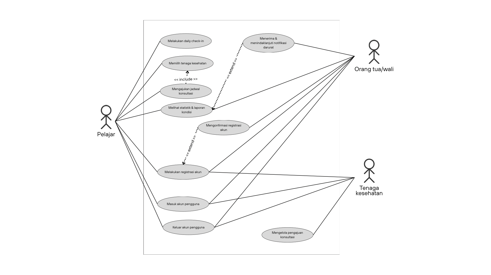

Gambar 2.2. Use Case Diagram LaporKota

| Use case | Aktor | Tujuan |
| :--- | :--- | :--- |
| UC01 Mengirim Laporan Kerusakan | Warga | Menyampaikan kerusakan beserta bukti dan lokasi. |
| UC02 Memvalidasi Laporan Baru | Tim Administrasi | Menyetujui penanganan atau menolak dengan alasan. |
| UC03 Melihat Penugasan Lapangan | Eksekutor Lapangan | Melihat tugas terurut prioritas dan lokasinya. |
| UC04 Melaporkan Hasil Perbaikan | Eksekutor Lapangan | Mengunggah bukti dan catatan pekerjaan. |
| UC05 Mengevaluasi Hasil Kerja | Tim Administrasi | Menyetujui penyelesaian atau meminta perbaikan ulang. |
| UC06 Memantau Status Laporan | Warga dan publik | Memantau riwayat pribadi, alasan penolakan, peta anonim, serta memberi dukungan sesuai akses. |

Diagram use case menggunakan model SKPL. Sistem eksternal pada Gambar 2.1 menjelaskan konteks teknis implementasi.

# BAB 3: Implementasi

## 3.2 Implementasi Modul

Tabel berikut mengikuti Tabel B.5 laporan M9. Kelas diwujudkan sebagai modul fungsi, kelas TypeScript, komponen React, Server Action, dan/atau aturan database. Modul tidak memiliki executable tersendiri karena dibundel oleh Next.js.

Tabel 3.2. Implementasi Modul

| No | ID Kelas | Nama Modul/Kelas | Nama File Fisik dan Implementasi | Nama File Executable |
| :--- | :--- | :--- | :--- | :--- |
| 1 | C01 | User | `src/server/entities/User.ts`: `muatProfil`; dipakai `src/lib/auth.ts`: `getCurrentUser`, `requireRole`, `requireRoleOrRedirect`, tipe `UserAktif` | —, dibundel Next.js |
| 2 | C02 | Laporan | `src/server/entities/Laporan.ts`: `simpanLaporan`, `getByStatus`, `getMilikSaya`, `getRincian`, `getDaftarPublik`, `getRincianPublik`, `urutPrioritas`, `filterKategori` | —, dibundel Next.js |
| 3 | C03 | Lokasi | `src/server/entities/Lokasi.ts`: `dalamWilayah`, `hitungJarak`, `getKoordinat`, tipe `Koordinat`; batas kota di `src/lib/batas-wilayah.ts` | —, dibundel Next.js |
| 4 | C04 | Foto | `src/server/entities/Foto.ts`: `isFotoValid`, `formatDariNama`, `ukuranValid`, `urlMedia`, tipe `Berkas`, `MediaTerunggah` | —, dibundel Next.js |
| 5 | C05 | Video | `src/server/entities/Video.ts`: `isVideoValid` | —, dibundel Next.js |
| 6 | C06 | Upvote | `src/server/entities/Upvote.ts`: `catatUpvote`, `getJumlahUpvote`, `sudahUpvote` | —, dibundel Next.js |
| 7 | C07 | ListTugas | `src/server/entities/ListTugas.ts`: kelas `ListTugas`, fungsi `isKategori`, `isTugasAktif`, tipe `TugasLaporan`, `RincianTugas`, `EvaluasiTerakhir` | —, dibundel Next.js |
| 8 | C08 | HasilPerbaikan | `src/server/entities/HasilPerbaikan.ts`: `validasiBerkas`, `simpanBukti`, `getBuktiLengkap`, `pilihBuktiSelesai`, tipe `BuktiLengkap`; tabel `hasil_perbaikan` dan baris `foto`/`video` dengan `id_hasil` | —, dibundel Next.js |
| 9 | C09 | Evaluasi | `src/server/entities/Evaluasi.ts`: `simpanEvaluasi`, `ambilDaftarSiapEvaluasi`, `ambilDetailEvaluasi`, `cariIdLaporan`, `getEvaluasiTerakhir`, tipe `DetailEvaluasi`, `DataEvaluasiBaru` | —, dibundel Next.js |
| 10 | C10 | Notifikasi | `src/server/entities/Notifikasi.ts`: `getMilikSaya`, `jumlahBelumDibaca`, `tandaiDibaca`; real-time di `src/client/components/shared/useNotifikasi.ts` | —, dibundel Next.js |
| 11 | C11 | LaporPage | `src/client/views/LaporPage.tsx`: `LaporPage`; route `src/app/(warga)/lapor/page.tsx`; `src/client/components/lapor/`: `HeaderLapor`, `AreaBerkas`, `AreaLokasi`, `DialogTerkirim`, `DialogDuplikat`, `WidgetAntiBot` (`src/client/components/lapor/WidgetAntiBot.tsx`) | —, dibundel Next.js |
| 12 | C12 | ValidasiPage | `src/client/views/ValidasiPage.tsx`: `ValidasiPage`; route `src/app/(admin)/validasi/page.tsx`; `src/client/components/validasi/`: `AntreanLaporan`, `RincianLaporan`, `DialogTolak`, `AdminSidebar` | —, dibundel Next.js |
| 13 | C13 | PenugasanPage | `src/client/views/PenugasanPage.tsx`: `PenugasanPage`, `DaftarTugas`, `renderRincianLaporan`; route `src/app/(eksekutor)/tugas/page.tsx`; `src/client/components/penugasan/`: `FilterKategori`, `KartuTugas`, `PanelRincianTugas`, `tautan.ts` | —, dibundel Next.js |
| 14 | C14 | HasilPerbaikanForm | `src/client/views/HasilPerbaikanForm.tsx`: `HasilPerbaikanForm`, `renderTerkirim`, `renderGagal`; route `src/app/(eksekutor)/tugas/[idTiket]/hasil/page.tsx` | —, dibundel Next.js |
| 15 | C15 | EvaluasiPage | `src/client/views/EvaluasiPage.tsx`: `EvaluasiPage`; route `src/app/(admin)/evaluasi/page.tsx`; `src/client/components/evaluasi/`: `DaftarSiapEvaluasi`, `KomparasiEvaluasi`, `DialogKeputusanEvaluasi` | —, dibundel Next.js |
| 16 | C16 | StatusLaporanPage | `src/client/views/StatusLaporanPage.tsx`: `StatusLaporanPage`; route `src/app/(warga)/status/page.tsx`; `src/client/components/status/`: `KartuLaporanPublik`, `BuktiPerbaikan`, `pembaruanPeta`; komponen bersama `DetailLaporan`, `MapView`, `LoncengNotifikasi` | —, dibundel Next.js |
| 17 | C17 | LaporanController | `src/server/controllers/LaporanController.ts`: `kirimLaporan`, `verifikasiAntiBot` (tidak diekspor), `dukungLaporanDuplikat`; `src/server/controllers/laporan-validasi.ts`: `validasiForm`, `validasiLokasi`, `validasiBerkas`, `PESAN_ANTIBOT_BELUM`, `PESAN_ANTIBOT_GAGAL` | —, dibundel Next.js |
| 18 | C18 | ValidasiController | `src/server/controllers/ValidasiController.ts`: `susunAntrean`, `saringAntrean`, `ambilRincianLaporan`, `setujuiLaporan`, `tolakLaporan` | —, dibundel Next.js |
| 19 | C19 | PenugasanController | `src/server/controllers/PenugasanController.ts`: `verifikasiAkses`, `doSorting`, `doFilter`, `bukaLaporan` | —, dibundel Next.js |
| 20 | C20 | PerbaikanController | `src/server/controllers/PerbaikanController.ts`: `verifikasiAkses`, `unggahHasil`; `src/lib/validasi-perbaikan.ts`: `validasiForm`, `cekKelengkapan`, `cekMediaTerunggah` | —, dibundel Next.js |
| 21 | C21 | EvaluasiController | `src/server/controllers/EvaluasiController.ts`: `ambilDaftarUntukEvaluasi`, `ambilDetailEvaluasi`, `simpanKeputusan` | —, dibundel Next.js |
| 22 | C22 | StatusController | `src/server/controllers/StatusController.ts`: `ambilRiwayatWarga`, `ambilDetailStatus`, `ambilLaporanPublik`, `prosesUpvote`, tipe `DetailStatus`, `BuktiHasilPerbaikan` | —, dibundel Next.js |
| 23 | C23 | NotifikasiController | `src/server/controllers/NotifikasiController.ts`: `ambilNotifikasi`, `updateStatusBaca`; komponen `LoncengNotifikasi` dan hook `useNotifikasi` | —, dibundel Next.js |

Operasi C02 tambahUpvote/hitungPrioritas diwujudkan trigger tambah_upvote pada <code>supabase/migrations/20261107155512_trigger_status.sql</code>. Efek tambahUpvote diuji melalui integrasi, bukan dengan menambahkan fungsi aplikasi baru.

## 3.3 Implementasi Antarmuka

Tabel 3.3. Implementasi Antarmuka

| No | ID | Nama Antarmuka | File Fisik | Executable/Route |
| :--- | :--- | :--- | :--- | :--- |
| 1 | I-01 | Formulir Laporan Kerusakan | <code>src/app/(warga)/lapor/page.tsx</code>; <code>src/client/views/LaporPage.tsx</code>; <code>src/client/components/lapor/</code> | —, /lapor |
| 2 | I-02 | Status Laporan dan Peta Publik | <code>src/app/(warga)/status/page.tsx</code>; <code>src/client/views/StatusLaporanPage.tsx</code>; <code>src/client/components/status/</code>; DetailLaporan dan MapView | —, /status |
| 3 | I-03 | Validasi Laporan | <code>src/app/(admin)/validasi/page.tsx</code>; <code>src/client/views/ValidasiPage.tsx</code>; <code>src/client/components/validasi/</code> | —, /validasi |
| 4 | I-04 | Evaluasi Hasil Kerja | <code>src/app/(admin)/evaluasi/page.tsx</code>; <code>src/client/views/EvaluasiPage.tsx</code>; <code>src/client/components/evaluasi/</code> | —, /evaluasi |
| 5 | I-05 | Daftar Tugas | <code>src/app/(eksekutor)/tugas/page.tsx</code>; <code>src/client/views/PenugasanPage.tsx</code>; <code>src/client/components/penugasan/</code> | —, /tugas |
| 6 | I-06 | Formulir Hasil Perbaikan | <code>src/app/(eksekutor)/tugas/[idTiket]/hasil/page.tsx</code>; <code>src/client/views/HasilPerbaikanForm.tsx</code>; MediaUploader | —, /tugas/[idTiket]/hasil |
| 7 | —, tambahan | Masuk | <code>src/app/(auth)/login/page.tsx</code> | —, /login |
| 8 | —, tambahan | Daftar | <code>src/app/(auth)/daftar/page.tsx</code> | —, /daftar |

Autentikasi tambahan mengikuti perubahan B.1 M9. Subbab 3.1 dan 3.4 digabungkan oleh Fondasi.

# BAB 4: Hasil Pengujian Bagian D

## 4.1 Strategi dan Kedalaman Pengujian Kelas

Tabel 4.1.1-D. Klasifikasi Bagian D

| Kelas | Tingkat | Alasan dan Cakupan | Test Case |
| :--- | :--- | :--- | :--- |
| C02 Laporan | Mendalam | D menangani getRincianPublik dan efek tambahUpvote di database; coverage gabungan A–D diukur Fondasi. | C02-UT60–C02-UT70; INT-TC60–INT-TC64 |
| C06 Upvote | Mendalam | Akses dukungan dan aturan satu dukungan per pengguna. | C06-UT01–C06-UT10; INT-TC60–INT-TC63 |
| C22 StatusController | Sedang, sesuai pembagian M10 | Koordinasi entity, pemeriksaan akses, dan respons UI; normal dan negatif untuk empat operasi public. | C22-UT01–C22-UT08; 48 kasus regresi tambahan |
| C16 StatusLaporanPage | Tidak perlu unit test wajib | Boundary diperiksa melalui alur use case dan screenshot. | UC06-TC01–UC06-TC05 |

Unit test menggunakan mock sehingga tidak menulis database. Integrasi menggunakan entity asli, RLS, constraint, view, dan trigger pada fixture production berpenanda. Pengujian browser dilakukan pada <https://laporkota.vercel.app>. Hasil browser dicatat terpisah dari kelulusan unit test.

## 4.2 Pengujian Unit Kelas

Verifikasi gabungan tiga file unit test bagian D: 77 kasus lulus, tanpa kegagalan. [Hasil terstruktur](../assets/bukti-test/unit-test/ut-uc06/D-unit-results.json).

~~~cmd
npx vitest run src/server/entities/Upvote.test.ts src/server/entities/LaporanPublik.test.ts src/server/controllers/StatusController.test.ts --reporter=verbose
~~~

### 4.2.2 Kelas Laporan Bagian D

**ID Kelas:** C02. **Tingkat:** Mendalam.  
**File uji:** <code>src/server/entities/LaporanPublik.test.ts</code>

| ID | Operasi | Jenis | Prosedur/Masukan | Hasil Diharapkan | Hasil Aktual | Kesimpulan |
| :--- | :--- | :--- | :--- | :--- | :--- | :--- |
| C02-UT60 | getRincianPublik | Normal | Mock laporan lengkap LK-0001. | View publik, filter tiket, kolom tanpa identitas. | Data lengkap, view, dan filter sesuai assertion; wildcard/field identitas tidak diminta. | Pass |
| C02-UT61 | getRincianPublik | Batas | jumlah_upvote = 0. | Laporan tetap dikembalikan dengan angka 0. | Jumlah dukungan tetap 0. | Pass |
| C02-UT62 | getRincianPublik | Negatif | id = null. | Data tidak lengkap ditolak. | data = null, error = null. | Pass |
| C02-UT63 | getRincianPublik | Negatif | id_tiket = null. | Data tidak lengkap ditolak. | data = null, error = null. | Pass |
| C02-UT64 | getRincianPublik | Negatif | kategori = null. | Data tidak lengkap ditolak. | data = null, error = null. | Pass |
| C02-UT65 | getRincianPublik | Negatif | latitude = null. | Data tidak lengkap ditolak. | data = null, error = null. | Pass |
| C02-UT66 | getRincianPublik | Negatif | longitude = null. | Data tidak lengkap ditolak. | data = null, error = null. | Pass |
| C02-UT67 | getRincianPublik | Negatif | status = null. | Data tidak lengkap ditolak. | data = null, error = null. | Pass |
| C02-UT68 | getRincianPublik | Negatif | waktu_masuk = null. | Data tidak lengkap ditolak. | data = null, error = null. | Pass |
| C02-UT69 | getRincianPublik | Batas | Tidak ada laporan yang cocok. | data = null tanpa error. | Sesuai harapan. | Pass |
| C02-UT70 | getRincianPublik | Negatif | Error database 42501. | data = null dan error diteruskan. | Error dipertahankan pada respons. | Pass |

Tabel 4.2.2b-D. Ringkasan Cakupan C02 Bagian D

| Informasi | Keterangan |
| :--- | :--- |
| Operasi perancangan bagian D | tambahUpvote dan getRincianPublik. |
| Operasi diuji | getRincianPublik, termasuk tujuh pemeriksaan kolom wajib. |
| Pengujian database | Trigger tambah_upvote melalui INT-TC60–INT-TC63; counter dan skor terutama INT-TC60–INT-TC61. |
| Algoritma | Algo-003 untuk getRincianPublik; pemetaan trigger mengikuti B.5 M9. |
| Hasil | 11 unit test lulus. |
| Coverage | Coverage gabungan kelas diukur Fondasi dari tes A–D. Cakupan satu file tes D tidak dipakai sebagai cakupan gabungan. V8 tidak mengukur PL/pgSQL. |

### 4.2.6 Kelas Upvote

**ID Kelas:** C06. **Tingkat:** Mendalam.  
**File uji:** <code>src/server/entities/Upvote.test.ts</code>

| ID | Operasi | Jenis | Prosedur/Masukan | Hasil Diharapkan | Hasil Aktual | Kesimpulan |
| :--- | :--- | :--- | :--- | :--- | :--- | :--- |
| C06-UT01 | catatUpvote | Normal | Mock INSERT berhasil. | Payload memuat ID laporan dan pengguna, respons diteruskan. | Tabel upvote, dua ID, dan respons sesuai assertion. | Pass |
| C06-UT02 | catatUpvote | Batas satu dukungan | Mock error 23505 untuk dukungan kedua. | Error keunikan diteruskan. | code 23505 dan respons dipertahankan. | Pass |
| C06-UT03 | catatUpvote | Negatif | Mock error akses 42501. | Error akses diteruskan. | code 42501 dan respons dipertahankan. | Pass |
| C06-UT04 | getJumlahUpvote | Normal | View mengembalikan jumlah 5. | data = 5; query berdasarkan ID laporan. | Jumlah 5, view, dan filter sesuai assertion. | Pass |
| C06-UT05 | getJumlahUpvote | Batas | Jumlah dukungan 0. | Angka 0 dipertahankan. | data = 0, error = null. | Pass |
| C06-UT06 | getJumlahUpvote | Batas | Laporan publik tidak ditemukan. | data = null tanpa error. | Sesuai harapan. | Pass |
| C06-UT07 | getJumlahUpvote | Negatif | Pembacaan ditolak dengan 42501. | data = null dan error diteruskan. | Sesuai harapan. | Pass |
| C06-UT08 | sudahUpvote | Normal | count = 1. | true; filter pasangan laporan/pengguna benar. | Boolean true dan dua filter sesuai assertion. | Pass |
| C06-UT09 | sudahUpvote | Batas | count = 0. | false tanpa error. | Sesuai harapan. | Pass |
| C06-UT10 | sudahUpvote | Negatif | count = null dan error pembacaan. | false dan error diteruskan. | Sesuai harapan; pemanggil tetap memeriksa error. | Pass |

Tabel 4.2.6b. Ringkasan Cakupan C06

| Informasi | Keterangan |
| :--- | :--- |
| Operasi public implementasi | catatUpvote, getJumlahUpvote, sudahUpvote. |
| Kasus | Masing-masing 3, 4, dan 3; total 10 lulus. |
| Algoritma | Algo-011 melalui catatUpvote; operasi tambahan mengikuti B.5 M9. |
| Coverage | 100% line / 100% branch; statement dan function juga 100%. Vitest 5.1.0 dan coverage V8. |
| Bukti | C06-UT.png dan C06-coverage.png pada 4.6. |

Unit test memeriksa respons database tiruan. Penegakan constraint dan RLS nyata dibuktikan oleh tes integrasi.

### 4.2.22 Kelas StatusController

**ID Kelas:** C22. **Tingkat:** Sedang.  
**File uji:** <code>src/server/controllers/StatusController.test.ts</code>

| ID | Operasi | Jenis | Prosedur/Masukan | Hasil Diharapkan | Hasil Aktual | Kesimpulan |
| :--- | :--- | :--- | :--- | :--- | :--- | :--- |
| C22-UT01 | ambilRiwayatWarga | Normal | Sesi sah dan entity mengembalikan laporan pribadi. | ID sesi dipakai; hanya kolom kartu dikirim. | Query dan proyeksi sesuai assertion. | Pass |
| C22-UT02 | ambilRiwayatWarga | Negatif | Guard menolak pengguna belum login. | Penolakan sebelum membuat client/query entity. | Pesan masuk terlebih dahulu; tidak ada akses database. | Pass |
| C22-UT03 | ambilDetailStatus | Normal | Rincian memuat media, linimasa, profil, dan skor internal. | DTO detail memuat media/linimasa tanpa profil dan skor. | DTO sesuai assertion. | Pass |
| C22-UT04 | ambilDetailStatus | Negatif | Entity mengembalikan data null. | Pesan tiket tidak ditemukan atau tidak dapat diakses. | Pesan yang sama untuk kedua kondisi. | Pass |
| C22-UT05 | ambilLaporanPublik | Normal | Data entity berisi field pribadi tambahan. | DTO marker hanya berisi kolom publik. | Field tambahan tidak ikut dikirim. | Pass |
| C22-UT06 | ambilLaporanPublik | Negatif | Entity mengembalikan error 42703. | Pesan aman tanpa detail internal database. | Pesan umum sesuai assertion. | Pass |
| C22-UT07 | prosesUpvote | Normal | Warga mendukung laporan aktif milik akun lain. | Memakai identitas sesi dan mengembalikan counter terbaru. | Pemanggilan entity dan respons sesuai assertion. | Pass |
| C22-UT08 | prosesUpvote | Negatif | Pengguna sudah mendukung. | Penolakan, dukunganTercatat = true, tanpa INSERT ulang. | Sesuai harapan. | Pass |

Delapan kasus utama mencakup normal dan negatif pada empat operasi public (Algo-051–Algo-053 serta ambilDetailStatus). Seluruh file memiliki 56 kasus lulus. Filter C22-UT menghasilkan 8 passed dan 48 skipped; 48 kasus tersebut merupakan regresi tambahan yang tidak dipilih filter.

## 4.3 Pengujian Integrasi

**File uji:** <code>tests/integration/uc06.int.test.ts</code>

~~~cmd
npm run test:integration -- tests/integration/uc06.int.test.ts --reporter=verbose
~~~

Fixture diberi penanda <code>[TEST-INT]</code> dan koordinat helper tim. Service role hanya untuk setup, baca ulang hasil, dan pembersihan. Pemilik fixture umum adalah akun admin tes agar berbeda dari pemberi dukungan; INT-TC63 memakai warga tes sebagai pemilik. Setup ini bukan pengujian pengiriman laporan UC01. Aksi dukungan menggunakan client warga atau anonim sehingga RLS, constraint, dan trigger tetap berlaku.

Tabel 4.3.2-D. Hasil Integrasi UC06

| ID | Antarmuka/Komponen | Skenario | Prosedur/Masukan | Hasil Diharapkan | Hasil Aktual | Kesimpulan |
| :--- | :--- | :--- | :--- | :--- | :--- | :--- |
| INT-TC60 | I-02; C06 ↔ tabel upvote ↔ trigger C02 | Normal | Buat fixture 0 dukungan; upvote sebagai warga lain; baca database/view. | 1 baris, counter 1, skor 10. | Assertion baris, counter, skor, dan getJumlahUpvote lulus. | Pass |
| INT-TC61 | I-02; C06 ↔ constraint | Batas/negatif | Pengguna sama mendukung dua kali. | Error kedua 23505; baris 1, counter 1, skor 10. | Seluruh assertion lulus. | Pass |
| INT-TC62 | I-02; anonim ↔ RLS | Negatif | Client tanpa sesi mencoba upvote. | Ditolak; baris dan counter 0. | Ditolak dan tidak ada pertambahan. | Pass |
| INT-TC63 | I-02; warga ↔ RLS kepemilikan | Negatif | Pelapor mendukung fixture sendiri. | Error 42501; baris dan counter 0. | Sesuai harapan. | Pass |
| INT-TC64 | I-02; C02 ↔ view publik | Normal/keamanan | Anonim membaca daftar, rincian entity, dan seluruh kolom view untuk fixture. | Laporan terbaca tanpa identitas pelapor. | Ketiga respons lolos assertion. | Pass |

Kelima kasus lulus. Pelacak menghapus hanya ID data tes yang dicatat, termasuk baris dukungan. Keluaran run yang didokumentasikan menyatakan seluruh fixture UC06 sudah dibersihkan dan sisa laporan <code>[TEST-INT]</code> adalah 0. Laporan manual LK-0038 memakai penanda berbeda dan telah dibersihkan setelah pengukuran KNF11; bukti pembersihannya dicatat terpisah pada 4.6.

## 4.4 Pengujian Use Case

**Use case:** UC06 Memantau Status Laporan. **Acuan:** SKPL 4.4.6.  
**Lingkungan:** production, Chrome; akun seed untuk riwayat dan akun warga tes untuk dukungan.

Tabel 4.4.6. Hasil Pengujian UC06

| ID | ID KF | Skenario | Prosedur/Masukan | Hasil Diharapkan | Hasil Aktual | Kesimpulan |
| :--- | :--- | :--- | :--- | :--- | :--- | :--- |
| UC06-TC01 | KF19; pembacaan KF11/KF12 | Normal: riwayat dan linimasa | Masuk sebagai warga1; buka Riwayat dan LK-0022; tinjau linimasa LK-0001. | Tiket, kategori, tanggal, status, serta linimasa dan waktunya tampil. | LK-0022: Diterima 12 Nov 2026 22.09. LK-0001: Diterima → Dikerjakan/menunggu eksekusi → Dikerjakan/menunggu evaluasi → Berhasil, dengan waktu. | Pass untuk riwayat/linimasa. Foto selesai diperiksa pada TC04. |
| UC06-TC02 | KF13, KF20 | Alternatif 1: peta dan dukungan | Buat LK-0038 khusus tes sebagai warga1; masuk sebagai warga8; pilih pada peta; Dukung; refresh dan pilih ulang. | Dukungan bertambah tepat satu, tersimpan, tombol tidak menerima ulang, identitas pelapor tersembunyi. | Dukung (0) menjadi Didukung (1), tetap 1 setelah refresh. Anonim melihat 1 dukungan dan Masuk untuk mendukung. | Pass untuk dukungan/persistensi/akses publik. Kelengkapan kartu diperiksa pada TC05. |
| UC06-TC03 | KF11, KF19 | Alternatif 2: Ditolak | Sebagai warga1, buka LK-0012. | Status, alasan penolakan, dan linimasa tampil. | Alasan: lokasi di area Gedung Sate di luar kewenangan kota. Diterima 31 Okt 2026 12.00 → Ditolak 1 Nov 2026 09.00. | Pass |
| UC06-TC04 | KF19 | Normal: bukti hasil perbaikan | Buka bagian Hasil perbaikan LK-0001 yang berstatus Berhasil. | Dokumentasi foto hasil tersedia sesuai skenario normal SKPL. | “Belum ada bukti hasil perbaikan untuk laporan ini.” Foto tidak tampil pada sampel. | Fail pada sampel; data hasil/evaluasi dan akses warga perlu dikonfirmasi. |
| UC06-TC05 | KF20; SKPL alternatif 1 langkah 4 | Kelengkapan rincian publik | Pilih LK-0038 yang memiliki deskripsi dan gambar uji. | Kartu menampilkan foto, kategori, deskripsi, lokasi, status, dukungan. | Kartu menampilkan tiket, kategori, status, dukungan; foto/deskripsi tidak tampil. ItemPeta/KartuLaporanPublik hanya memuat ringkasan. | Fail terhadap kelengkapan kartu SKPL; selaraskan perubahan UI M9 atau lengkapi pada pengembangan berikutnya. |

Untuk TC04, C08 memilih hasil dengan evaluasi selesai, sedangkan policy evaluasi pada migration membatasi pembacaan kepada admin/eksekutor. Ini merupakan dugaan penyebab yang perlu dikonfirmasi terhadap data dan konfigurasi production. Hasil unit test tidak dipakai untuk mengubah temuan browser menjadi Pass. Perubahan fitur/skema tidak dilakukan dalam pengujian rilis.

## 4.5 Pengujian Kebutuhan Non-Fungsional

Tabel 4.5-D. Hasil KNF Bagian D

| ID | KNF/Parameter | Target Terukur | Metode dan Pengulangan | Hasil Aktual | Kesimpulan |
| :--- | :--- | :--- | :--- | :--- | :--- |
| KNF11-TC01 | KNF11 / Memory | Daftar dashboard memakai thumbnail; gambar asli dimuat saat detail dibuka. | Chrome DevTools Network; Disable cache aktif; filter Img, lalu storage untuk detail. 1 sampel LK-0038 diamati pada dua kondisi, sebelum dan sesudah detail dibuka. | Sebelum: 0 request gambar, 0,0 kB. Pada rekaman sesudah: 2 request PNG, 7.308 kB dan 7.309 kB, total transfer 14.617 kB. Daftar tidak menampilkan thumbnail; gambar asli dimuat saat detail. Inspeksi kode menunjukkan URL Storage asli dipakai untuk pratinjau dan perbesaran. | Fail terhadap kewajiban thumbnail pada daftar; pemuatan gambar asli saat detail sudah teramati. Usulan: buat thumbnail terpisah saat unggah dan pakai pada daftar, dengan URL asli untuk detail. |
| KNF12-TC01 | KNF12 / Security | 0 field identitas pribadi pelapor pada data peta publik. | Incognito tanpa login; Network → Doc → status → Response; 1 respons disalin dan objek data diperiksa; pencarian id_pelapor. | Respons 21.774 byte, 27 objek laporan, tanpa field id_pelapor/nama/email/kontak. LK-0038 memiliki 8 field publik, 1 dukungan, sudahDidukung = null. UI tidak menampilkan nama pelapor. | Pass pada respons dan sampel yang diperiksa. |

Field id pada DTO adalah ID laporan. Kata “pelapor” dapat muncul pada teks UI; pemeriksaan identitas dilakukan pada field dan isi objek data laporan.

## 4.6 Tangkapan Layar dan Bukti Hasil Pengujian

Tabel 4.6-D. Bukti Hasil Pengujian

| ID | Bukti |
| :--- | :--- |
| C06-UT01–C06-UT10 | 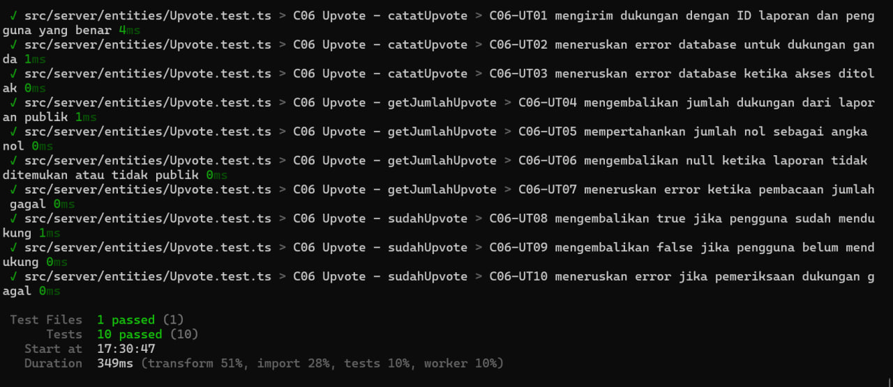 |
| C06 coverage | 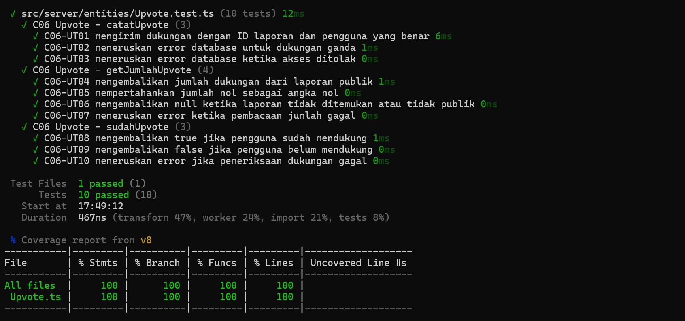 |
| C02-UT60–C02-UT70 | 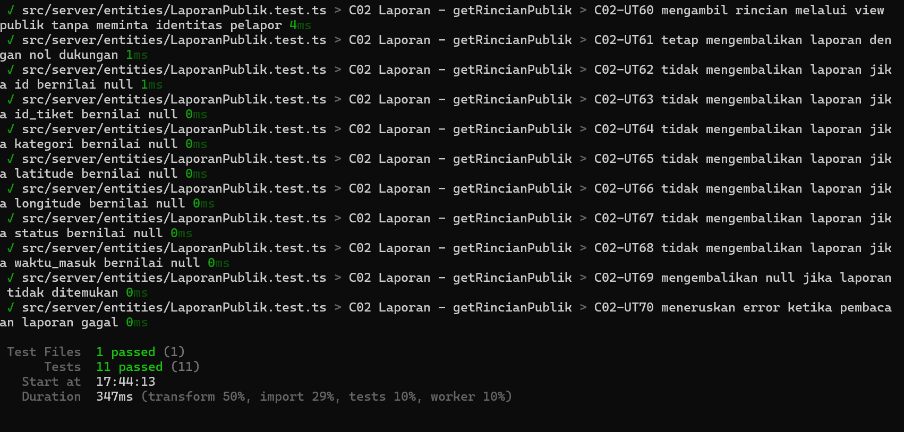 |
| C22-UT01–C22-UT08 | 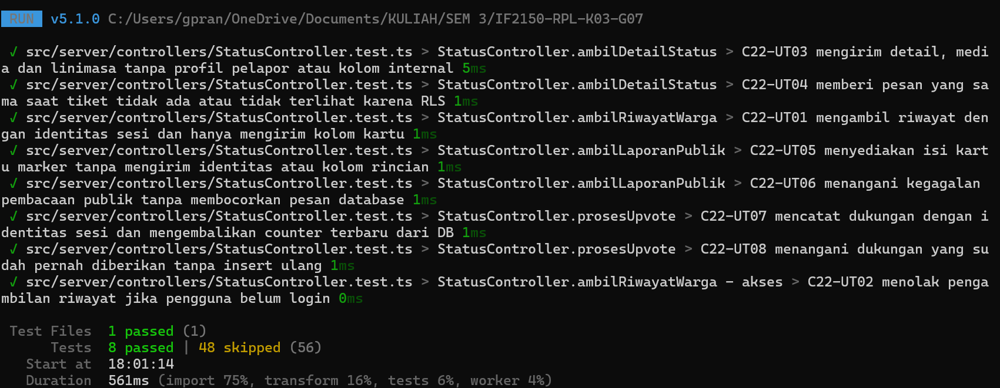 |
| INT-TC60–INT-TC64 | 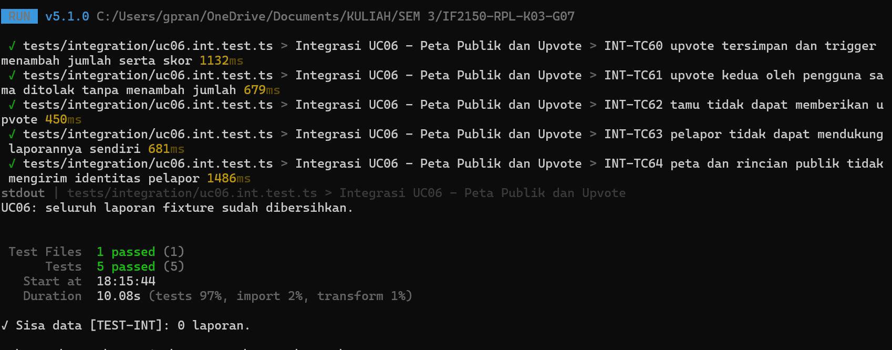 |
| UC06-TC01, daftar | 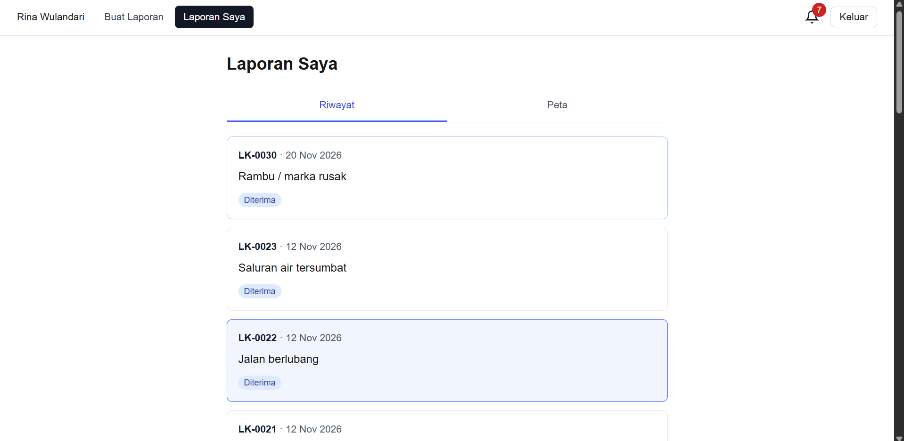 |
| UC06-TC01, detail | 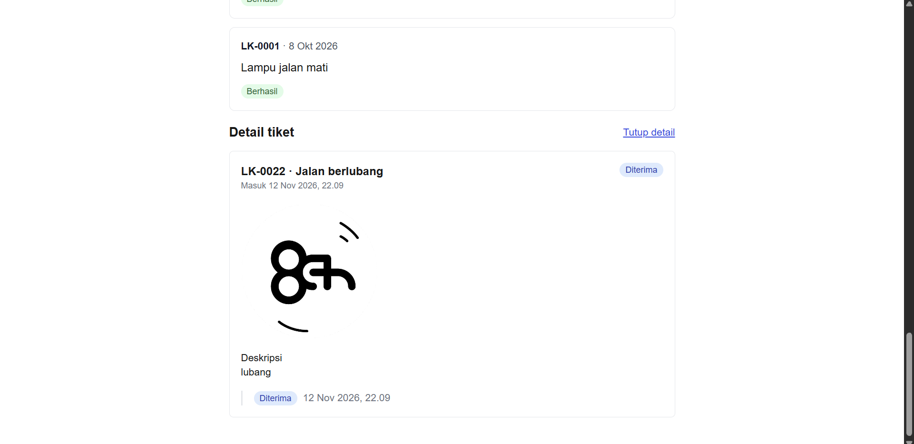 |
| UC06-TC01 dan UC06-TC04 | 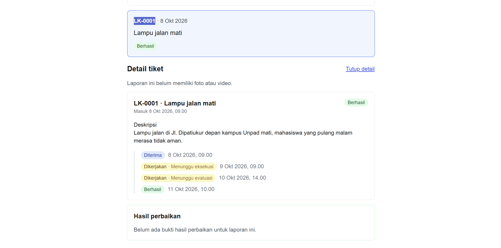 |
| UC06-TC02, peta | 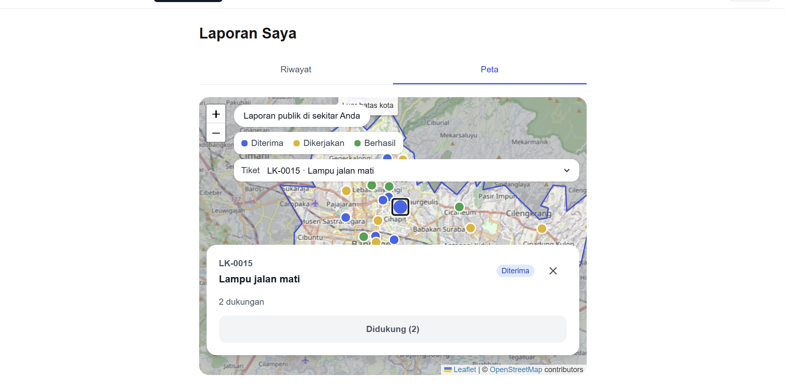 |
| UC06-TC02, setup | 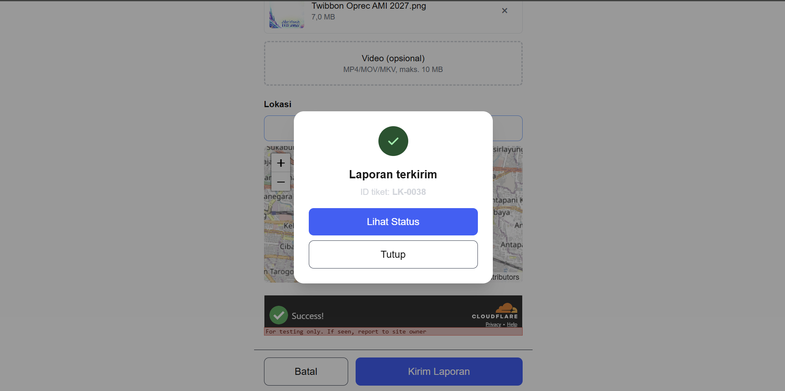 |
| UC06-TC02 dan UC06-TC05, sebelum | 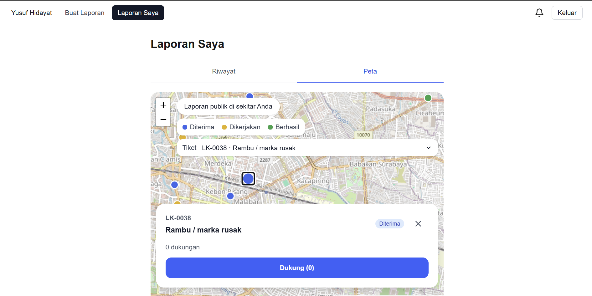 |
| UC06-TC02, sesudah | 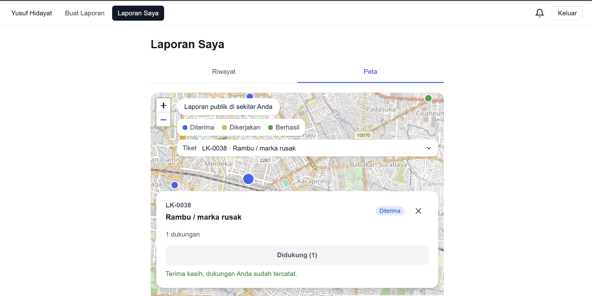 |
| UC06-TC02, refresh | 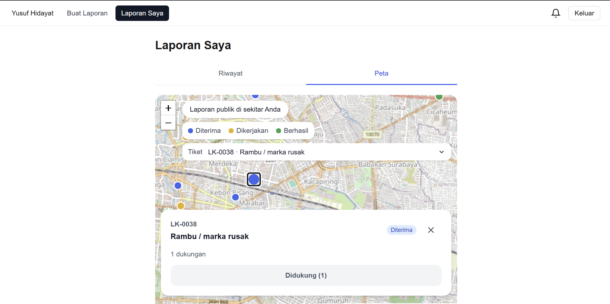 |
| UC06-TC03 | 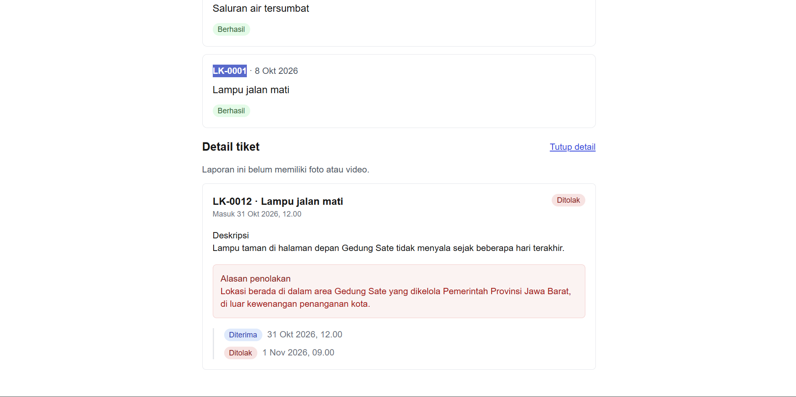 |
| KNF12-TC01, UI | 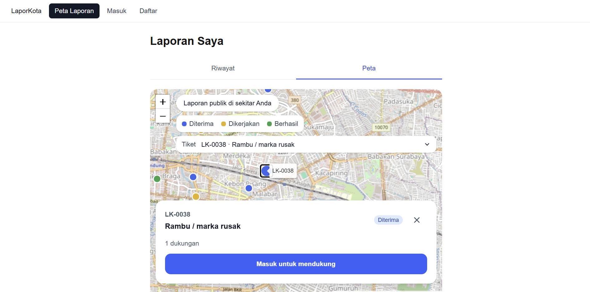 |
| KNF12-TC01, Network | 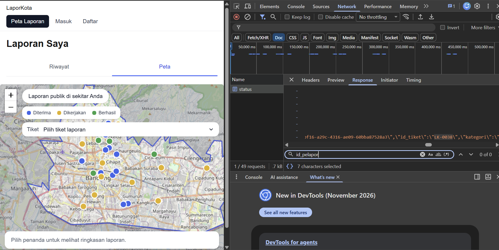 |
| KNF12-TC01, teks respons | [Respons HTML anonim](../assets/bukti-test/knf-test/knf-uc06/KNF12-response.txt) |
| KNF11-TC01, daftar | 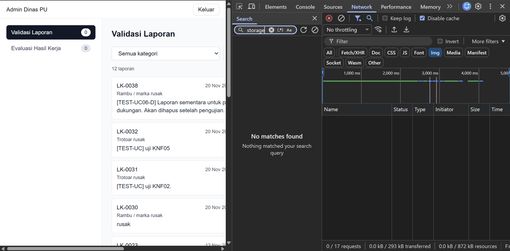 |
| KNF11-TC01, detail | 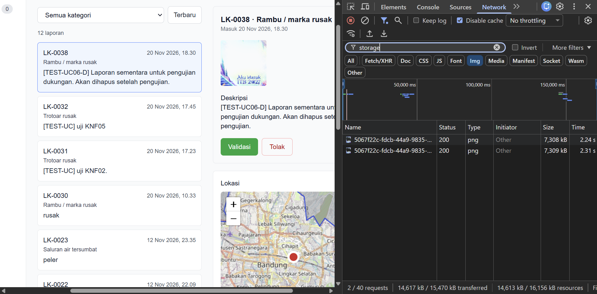 |
| Pembersihan LK-0038 | [Verifikasi database dan Storage](../assets/bukti-test/uc-test/uc-uc06/UC06-cleanup.json) |

Pembersihan manual menghapus hanya LK-0038 berdasarkan ID, tiket, dan penanda yang cocok, beserta satu berkas PNG terkait. Verifikasi menunjukkan 0 baris laporan/anak terkait dan 0 berkas tersebut pada Storage. Sisa laporan berpenanda [TEST-UC06-D] saat pemeriksaan: 0. Akun dan laporan lain tidak menjadi target pembersihan.

# BAB 5: Bahan Traceability Bagian D

Tabel 5.1-D. Pemetaan Kebutuhan dan Pengujian

| KF | KNF | UC | Kelas/Implementasi | Kasus Uji | Cakupan dan Temuan |
| :--- | :--- | :--- | :--- | :--- | :--- |
| KF06 | — | UC01, UC06 | C06; C02 trigger tambah_upvote | C06-UT01–C06-UT10; INT-TC60–INT-TC63; UC06-TC02 | D menguji komponen dukungan. Deteksi duplikat dan pengalihan dari formulir dibuktikan kasus UC01 milik A. |
| KF07 | — | UC06 dan perubahan status | C10/C23 notifikasi; C16 halaman status | UC06-TC01 melalui menu riwayat; pengiriman notifikasi digabung dari B/F | Pembacaan riwayat tidak dipakai sebagai bukti pengiriman notifikasi oleh D. |
| KF11 | — | UC02, UC06 | C22 ambilDetailStatus; C16 | C22-UT03–C22-UT04; UC06-TC03 | D memeriksa pembacaan alasan/status Ditolak; aksi penolakan dibuktikan B. |
| KF12 | — | UC02, UC06 | C22 dan C16 linimasa | C22-UT01, C22-UT03; UC06-TC01 | D memeriksa riwayat Dikerjakan; aksi validasi dibuktikan B. |
| KF13 | — | UC02, UC03, UC06 | C06; C22 prosesUpvote; trigger C02 | C06-UT01–C06-UT10; C22-UT07–C22-UT08; INT-TC60–INT-TC63; UC06-TC02 | Counter dan skor diuji; pengurutan daftar tugas digabung dengan C. |
| KF19 | — | UC06 | C22; C08 getBuktiLengkap; C16 | C22-UT01–C22-UT04; UC06-TC01, UC06-TC03, UC06-TC04; tes C08 dari C | Riwayat/alasan tampil; bukti hasil pada LK-0001 tidak tampil, dicatat Fail. |
| KF20 | KNF12 | UC06 | C02; C22 ambilLaporanPublik; C16 | C02-UT60–C02-UT70; C22-UT05–C22-UT06; INT-TC64; UC06-TC02, UC06-TC05; KNF12-TC01 | Peta anonim diuji; foto/deskripsi kartu belum sesuai rincian SKPL. |
| KF10 | KNF11 | UC02 | ValidasiPage; DetailLaporan; media | KNF11-TC01 | 0 request gambar pada daftar; PNG asli dimuat saat detail. Thumbnail daftar belum tersedia, dicatat Fail pada KNF11-TC01. |

Baris ini sudah digabungkan ke BAB 5 pada [laporan utama](../K03_G07_HIUPL.md). Kebutuhan bersama tidak dinyatakan tertutup seluruhnya hanya dari pengujian satu anggota.
