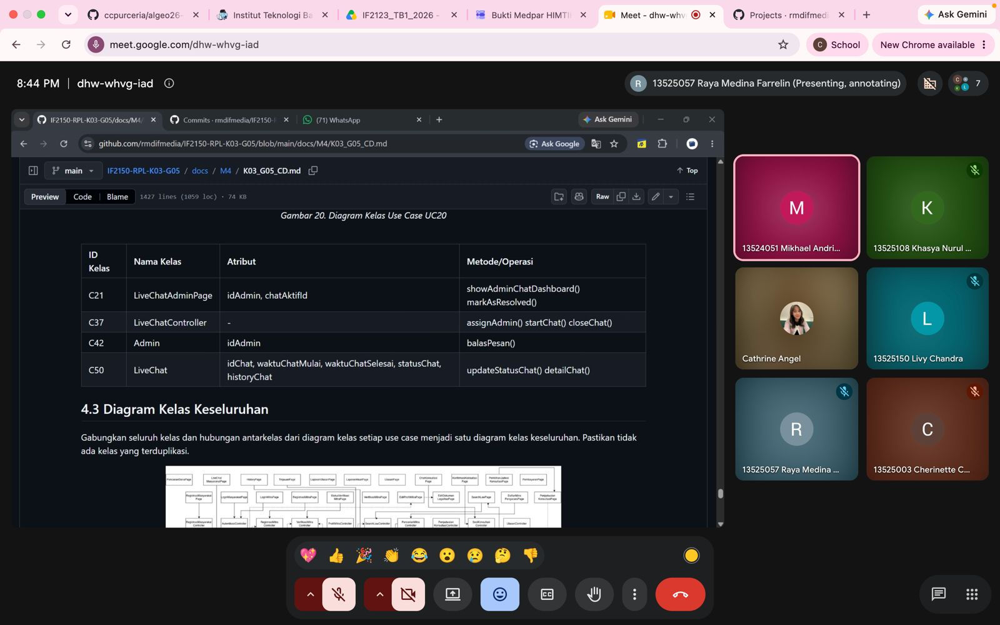

# Form Asistensi

## Tugas Besar IF2150 - Rekayasa Perangkat Lunak

| Informasi | Keterangan |
| --- | --- |
| **Hari** | *Jumat* |
| **Tanggal** | *28/09/2026* |
| **Kelas** | *K03* |
| **Nomor Kelompok** | *G07*  |
| **Nama Kelompok** | *Siulan*  |
| **Nama Perangkat Lunak** | *LaporKota*  |
| **Dokumen** | *K03_G07_SKPL: Spesifikasi Kebutuhan Perangkat Lunak*  |

### Anggota Kelompok

| NIM | Nama |
| --- | --- |
| *13525051* | *Rafi Pradipta Andira Sulistyo* |
| *13525105* | *Pasaribu Fritz T.A.M.* |
| *13525075* | *Bagas Anugrah Putra* |
| *13525099* | *Gede Pranajayanta Suputra* |
| *13525015* | *Muhammad Atallah Ramadhan* |

### Catatan

| Catatan |
| --- |
| 1. *Contoh buat Class Diagram UC03, relasi aktor ke list tugas bisa dihapus & dihubungin lewat page ke controller*  |
| 2. controller bisa ditambahin method pengecekan tiap user siapa yang berhak |
| 3. disarankan user sebagai parent class, yang isinya ada warga, eksekutor, dll |
| 4. Semua action aktor masuknya bisa dari page dulu |
| 5. Multiplisitas di CD ga wajib dulu |

**Notes for this section:**  
*Catatan dapat dituliskan dalam bentuk paragraf atau poin-poin, disesuaikan saja.* 

## Dokumentasi

<!--  -->

  

  <i>Gambar 1. Dokumentasi kegiatan asistensi.</i>

