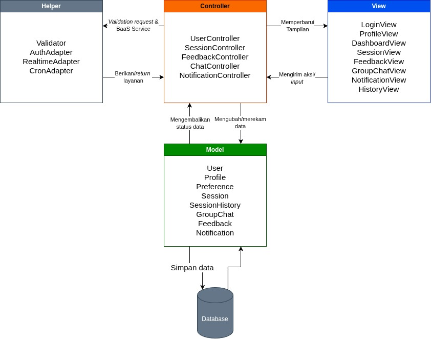
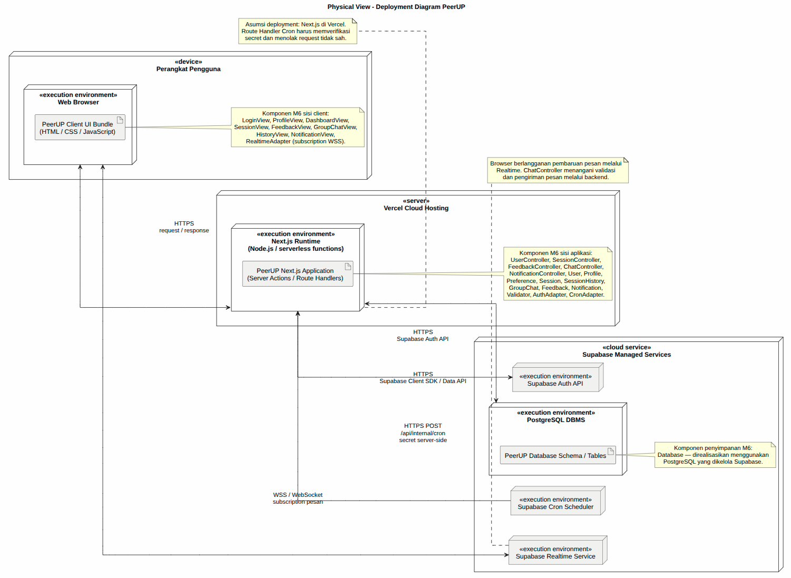

<h1>
IF2150 REKAYASA PERANGKAT LUNAK
 
TUGAS 6
 
ARSITEKTUR PERANGKAT LUNAK (APL)
</h1>
 

## PeerUP

### Untuk: Mikhael Andrian Yonatan

Dipersiapkan oleh:
| Informasi | Keterangan |
| --- | --- |
| Kelas | *K01* |
| Kelompok | *G09* |
| Nama Kelompok | *PindahCSUI*|

| NIM        | Nama                                 |
|---         |---                                   |
| *13525049* | *Hugo Daniel Johansen Napitupulu*    |
| *13525001* | *Matthew Allen Reynaldo*             |
| *13525010* | *Fabian Amzar Susanto*               |
| *13525025* | *David Christian*                    |
| *13525028* | *Markus Christiano Simanjuntak*      |

---

 
 

# BAB 1: Style/Pattern Arsitektur Acuan

## 1.1 Style/Pattern Arsitektur yang Dipilih
Perangkat lunak PeerUp akan memakai *style* **Model-View-Controller (MVC)** yang berjalan di atas **Client-Server Architecture**. *Style* *Client-Server* memisahkan sistem menjadi sisi *frontend* dan sisi *backend*, sementara *MVC* mengatur struktur pada kode perangkat lunaknya. Berikut adalah rincian peran setiap bagiannya.

1. **Client (Sisi Pengguna):**
   * Mewadahi lapisan **View**, yang bertanggung jawab menampilkan antarmuka, menyajikan informasi, dan menangkap *input* atau interaksi dari pengguna.
2. **Server (Sisi Pemrosesan & Basis Data):**
   * Mewadahi lapisan **Controller**, yang bertindak sebagai pengatur logika bisnis, memvalidasi aturan sistem, dan menjadi perantara antara *View* dengan *Model*.
   * Mewadahi lapisan **Model**, yang merepresentasikan struktur entitas data dan aturan penyimpanannya.
   * Mewadahi lapisan **Helper** dan **Integrasi Eksternal (Adapter)** untuk mendelegasikan tugas-tugas spesifik seperti validasi, autentikasi, serta tugas terjadwal (*cron*) tanpa membebani *Controller* utama.

## 1.2 Alasan Pemilihan Style/Pattern Arsitektur
Kombinasi *MVC* dan *Client-Server* dipilih karena sesuai dengan karakteristik teknis, pemodelan objek, dan pemenuhan spesifikasi Kebutuhan Non-Fungsional (KNF) pada dokumen SKPL PeerUP:

1. **Karakteristik Pengguna & Proses Bisnis:** Dua aktor utama (*Mentor* dan *Mentee*) akan banyak berinteraksi secara bersamaan (*real-time*) pada antarmuka dinamis (pencarian sesi, pembuatan sesi, ruang obrolan) yang semuanya mengakses dan mengubah keadaan data (sesi) yang sama. Pemisahan *Client-Server* memastikan data tetap tersinkronisasi secara terpusat.
2. **Keselarasan dengan Pemodelan Kelas SKPL:** Desain perangkat lunak pada dokumen SKPL menggunakan pola *Boundary-Controller-Entity* (BCE). Pola ini terpetakan secara langsung ke dalam arsitektur *View-Controller-Model*, sehingga mempermudah lokalisasi dampak apabila terjadi perubahan pada satu komponen (misalnya perubahan antarmuka tidak akan merusak algoritma *matchmaking*).
3. **Pemenuhan 5 Kebutuhan Non-Fungsional (KNF) SKPL:**
   * **KNF01 (Keamanan Hashing) & KNF04 (Reliabilitas Validasi Email):** Pemisahan arsitektur menempatkan `Validator` dan integrasi autentikasi di sisi server (*Controller/Adapter*) sehingga sistem keamanan dan validasi tidak dapat dimanipulasi dari peramban *Client*.
   * **KNF02 (Waktu Respons Matchmaking < 3 detik) & KNF05 (Waktu Respons Riwayat < 3 detik):** Komputasi pencocokan algoritma dan penarikan data yang berat dilakukan secara efisien oleh *Controller* di server, sehingga *Client (View)* hanya bertugas merender hasil akhirnya saja.
   * **KNF03 (Reliabilitas Notifikasi 15 Menit):** Logika waktu (*Cron*) dipusatkan di sisi server, memastikan pemicu notifikasi otomatis berjalan $\ge 99\%$ meskipun *Client* sedang menutup aplikasinya.

## 1.3 Penerapan Pattern MVC pada Perangkat Lunak PeerUP

<i>Gambar 1. Penerapan Arsitektur MVC pada PeerUP</i>

Gambar 1 menjabarkan siklus interaksi komponen PeerUP di dalam struktur MVC. Aliran data dimulai ketika **View** menerima *input* dari pengguna dan mengirimkannya ke **Controller**. Selanjutnya, **Controller** mendelegasikan validasi aturan bisnis atau permintaan layanan *cloud* kepada lapisan **Helper / Integrasi Eksternal**, lalu menerima respons layanannya kembali. Setelah data divalidasi, **Controller** mengirimkan perintah untuk merekam atau mengubah data (*state*) pada **Model**. **Model** akan menyimpan perubahan tersebut ke dalam **Database** secara persisten, lalu mengembalikan status keberhasilan operasi kepada **Controller**. Pada tahap akhir, **Controller** merespons kembali ke **View** untuk memperbarui tampilan layar pengguna sesuai data terbaru.

## 1.4 Lingkungan Operasi Perangkat Lunak

Tabel 1.1. Lingkungan Operasi Perangkat Lunak

| Komponen | Spesifikasi |
| :--- | :--- |
| *Client* | *Web browser modern seperti Google Chrome, Mozilla Firefox, Microsoft Edge, atau Safari yang mendukung JavaScript dan koneksi WebSocket.* |
| *Frontend* | *Next.js dengan TypeScript dan Tailwind CSS.* |
| *Backend* | *Next.js Server-Side menggunakan Server Actions / API Routes yang terintegrasi dengan Supabase Client SDK.* |
| *DBMS* | *PostgreSQL yang dikelola melalui layanan Supabase.* |
| *Server & Hosting* | *Lingkungan lokal (Node.js) untuk pengembangan/pengujian serta Vercel sebagai layanan cloud hosting aplikasi Next.js jika diperlukan.* |
| *Authentication* | *Supabase Auth untuk registrasi dan autentikasi pengguna serta pengelolaan password secara aman. Validasi domain email institusi universitas dilakukan pada sisi aplikasi.* |
| *Real-time Communication* | *Supabase Realtime berbasis WebSocket untuk mendukung komunikasi group chat sementara secara real-time.* |
| *Scheduled Task* | *Supabase Cron untuk menjalankan pemeriksaan jadwal sesi, memproses pengingat sesi, dan melakukan pembersihan data group chat yang telah melewati batas waktu penyimpanan.* |
| *OS* | *Cross-platform, yaitu Windows, Linux, macOS, Android, dan iOS selama perangkat memiliki web browser modern dan koneksi internet aktif.* |
| *Deployment* | *Aplikasi di-deploy melalui local (dapat di-deploy dari vercel jika diperlukan), sedangkan basis data, autentikasi, komunikasi real-time, dan scheduled task dikelola melalui Supabase.* |

## 1.5 Kaitan Teknologi Lingkungan Operasi dengan Style/Pattern Arsitektur
1. **Frontend (Next.js Client Components & Tailwind CSS):**
   Mewujudkan seluruh lapisan *View* yang berjalan di sisi *Client* (peramban web). *Frontend* menangani tampilan visual, pengisian formulir, dan penangkapan aksi pengguna secara independen dari logika di pusat data.
2. **Backend (Next.js Server Actions & API Routes):**
   Mewujudkan lapisan *Controller* yang berjalan terpusat di server. Logika bisnis dieksekusi di sisi *backend* untuk menangani pemeriksaan tabrakan jadwal, algoritma rekomendasi sesi (*matchmaking*), validasi batas kapasitas, dan verifikasi sebelum data diteruskan ke basis data.
3. **DBMS (Supabase PostgreSQL):**
   Layanan PostgreSQL pada Supabase menjadi titik penyimpanan persisten (*Database*) untuk seluruh entitas *Model* melalui aturan integritas relasional, mewakili keadaan (*state*) tunggal dari seluruh data aplikasi.
4. **Integrasi Eksternal:**
   Layanan infrastruktur pihak ketiga digolongkan sebagai *Adapter* (Pendukung) di dalam payung server pusat, yaitu:
   * **Supabase Auth:** Terhubung dengan `UserController` (via `AuthAdapter`) untuk registrasi pengguna dan validasi token sesi klien.
   * **Supabase Realtime:** Terhubung dengan `ChatController` (via `RealtimeAdapter`) menggunakan protokol WebSocket agar pembaruan pesan di *View* tampil secara instan (*real-time*).
   * **Supabase Cron:** Terhubung (via `CronAdapter`) untuk memicu `NotificationController` membuat pengingat otomatis, dan `ChatController` untuk membersihkan obrolan yang sudah mencapai batas retensi 48 jam.
   * **Vercel:** Berperan sebagai infrastruktur operasi (*hosting platform*) untuk menjalankan dan mendistribusikan aplikasi Next.js ke pengguna.

---

# BAB 2: Identifikasi Komponen / Modul / Subsistem

Tabel 2.1. Identifikasi Komponen/Modul/Subsistem

| Nama Komponen/Modul/Subsistem | Kelas yang Dicakup (SKPL) | Jenis | Penjelasan |
| :--- | :--- | :--- | :--- |
| *LoginView* | *C15 (LoginPage)* | *View* | *Menampilkan formulir registrasi dan login, lalu meneruskan masukan ke UserController. Mendukung UC01.* |
| *ProfileView* | *C16 (ProfilePage)* | *View* | *Menampilkan profil, formulir pengubahan tag materi, ketersediaan waktu, dan format sesi. Mendukung UC02 dan UC15.* |
| *DashboardView* | *C11 (Dashboard)* | *View* | *Menampilkan sesi aktif terdekat, rekomendasi matchmaking, dan navigasi pencarian sesi. Mendukung UC04 dan UC14.* |
| *SessionView* | *C17 (SessionPage), C18 (HostSessionPage), C19 (ParticipantSessionPage)* | *View* | *Menampilkan detail sesi untuk Mentor (membuat, mengedit, dan menghapus sesi) maupun Mentee (bergabung dan membatalkan keikutsertaan). Mendukung UC03, UC04, UC05, UC10, UC11, UC12, dan UC13.* |
| *FeedbackView* | *C20 (FeedbackForm)* | *View* | *Menampilkan formulir rating dan ulasan setelah sesi selesai beserta opsi untuk melewati pengisian feedback. Mendukung UC07.* |
| *GroupChatView* | *C21 (GroupChatPage)* | *View* | *Menampilkan kotak pesan dan riwayat obrolan grup sesi. Mendukung UC08.* |
| *HistoryView* | *C24 (HistoryPage)* | *View* | *Menampilkan daftar riwayat sesi berstatus Selesai, Tidak Terlaksana, atau Dibatalkan. Mendukung UC06.* |
| *NotificationView* | *C23 (PopUpNotification)* | *View* | *Menampilkan notifikasi pengingat sesi serta menyediakan navigasi ke detail sesi terkait. Mendukung UC09.* |
| *UserController* | *C12 (UserControl)* | *Controller* | *Mengoordinasikan registrasi, login, pembaruan profil dan preferensi, serta pengambilan data profil pengguna. Mendukung UC01, UC02, dan UC15.* |
| *SessionController* | *C13 (SessionControl)* | *Controller* | *Mengoordinasikan pembuatan, pengubahan, dan penghapusan sesi; validasi jadwal; matchmaking; pendaftaran dan pembatalan keikutsertaan; konfirmasi keterlaksanaan; serta pengambilan riwayat sesi. Mendukung UC03, UC04, UC05, UC06, UC10, UC11, UC12, dan UC14.* |
| *FeedbackController* | *C14 (FeedbackControl)* | *Controller* | *Mengoordinasikan validasi dan penyimpanan ulasan serta pengambilan daftar feedback per sesi untuk Mentor. Mendukung UC07 dan UC13.* |
| *ChatController* | *— (Komponen tambahan M6; bukan kelas SKPL tersendiri)* | *Controller* | *Mengoordinasikan pengiriman pesan, pemeriksaan hak akses peserta, dan pengelolaan masa aktif ruang obrolan. Mendukung UC08.* |
| *NotificationController* | *— (Komponen tambahan M6; bukan kelas SKPL tersendiri)* | *Controller* | *Mengoordinasikan pembuatan notifikasi pengingat 15 menit sebelum sesi dimulai dan penyampaian hasilnya ke NotificationView. Mendukung UC09.* |
| *User* | *C01 (User), C02 (Mentor), C03 (Mentee)* | *Model* | *Merepresentasikan akun pengguna secara umum beserta spesialisasinya, yaitu Mentor dan Mentee, serta data dan perilaku domain terkait pengguna.* |
| *Profile* | *C10 (Profile)* | *Model* | *Merepresentasikan data identitas pengguna, termasuk nama, universitas, program studi, dan bio.* |
| *Preference* | *C09 (Preference)* | *Model* | *Menyimpan tag materi, ketersediaan waktu, dan preferensi metode belajar sebagai dasar matchmaking.* |
| *Session* | *C04 (Session)* | *Model* | *Merepresentasikan sesi belajar beserta topik, jadwal, format, kapasitas, peserta, dan statusnya.* |
| *SessionHistory* | *C07 (SessionHistory)* | *Model* | *Merepresentasikan kumpulan arsip sesi pengguna yang dikelompokkan berdasarkan statusnya.* |
| *GroupChat* | *C05 (GroupChat), C08 (ChatMessage)* | *Model* | *Merepresentasikan ruang obrolan sesi beserta kumpulan pesan di dalamnya.* |
| *Feedback* | *C06 (Feedback)* | *Model* | *Merepresentasikan data rating dan ulasan teks yang diberikan setelah sesi belajar selesai.* |
| *Notification* | *C22 (Notification)* | *Model* | *Merepresentasikan data pesan pengingat beserta isi, waktu, dan status terbaca.* |
| *Validator* | *— (Komponen tambahan M6; bukan kelas SKPL tersendiri)* | *Pendukung* | *Memvalidasi masukan dan aturan bisnis yang digunakan bersama, termasuk domain email universitas, kelengkapan preferensi, kapasitas peserta 1–20 orang, tabrakan jadwal, dan validitas feedback sesuai aturan sistem.* |
| *AuthAdapter* | *— (Komponen tambahan M6; bukan kelas SKPL tersendiri)* | *Integrasi Eksternal* | *Menghubungkan UserController dengan Supabase Auth untuk registrasi, login, dan pengelolaan sesi autentikasi. Pengelolaan kredensial ditangani oleh Supabase Auth.* |
| *RealtimeAdapter* | *— (Komponen tambahan M6; bukan kelas SKPL tersendiri)* | *Integrasi Eksternal* | *Menghubungkan ChatController dengan Supabase Realtime melalui WebSocket untuk pengiriman dan penerimaan pesan secara real-time.* |
| *CronAdapter* | *— (Komponen tambahan M6; bukan kelas SKPL tersendiri)* | *Integrasi Eksternal* | *Menerima pemicu terjadwal dari Supabase Cron dan meneruskannya ke NotificationController untuk pengingat sesi serta ChatController untuk pengelolaan masa aktif chat sesuai aturan retensi yang ditetapkan.* |
| *Database* | *— (Komponen penyimpanan M6; bukan kelas SKPL)* | *Penyimpanan Data* | *Menyediakan penyimpanan persisten bagi data Model menggunakan PostgreSQL yang dikelola melalui Supabase.* |

---

# BAB 3: Model Arsitektur Perangkat Lunak

Untuk menggambarkan arsitektur perangkat lunak PeerUP dari sudut pandang yang berbeda, dipilih dua architectural view, yaitu **Development View** dan **Physical View**. Development View digunakan untuk menjelaskan organisasi statis modul dan dependensi antarkomponen, sedangkan Physical View digunakan untuk menggambarkan penempatan perangkat lunak pada lingkungan eksekusi dan jalur komunikasi antar-node.

## 3.1 Development View (Package Diagram)

Development View dipilih untuk memperlihatkan bagaimana 26 komponen arsitektur pada Tabel 2.1 dikelompokkan ke dalam paket-paket fungsional dari sudut pandang pengembangan perangkat lunak. Package Diagram digunakan untuk menggambarkan pengelompokan komponen menjadi paket Presentation / View, Application / Controller, Domain / Model, Shared Support, External Integration / Adapters, dan Persistence.

<i>Gambar 2. Development View (Package Diagram) pada Perangkat Lunak PeerUP</i>

Gambar 2 memperlihatkan pengorganisasian modul dan ketergantungan antarpaket. Garis putus-putus menunjukkan dependency, yaitu ketergantungan suatu paket terhadap layanan atau elemen yang disediakan paket lain. Paket Presentation / View bergantung pada Application / Controller untuk memproses aksi pengguna. Paket Application / Controller menggunakan Domain / Model untuk operasi domain serta Shared Support untuk validasi yang digunakan bersama. Application / Controller juga bergantung pada modul External Integration / Adapters dan Persistence sesuai kebutuhan layanan eksternal dan penyimpanan data.

Layanan Supabase ditampilkan sebagai sistem eksternal untuk memperjelas batas antara modul kode PeerUP dan layanan yang digunakannya. Nama komponen pada diagram diselaraskan dengan Tabel 2.1, sedangkan nama kelas SKPL dicantumkan sebagai pemetaan komponen.

## 3.2 Physical View (Deployment Diagram)

Physical View dipilih untuk menggambarkan penempatan perangkat lunak PeerUP pada perangkat pengguna, lingkungan hosting aplikasi, dan layanan cloud yang digunakan. Deployment Diagram memperlihatkan node, lingkungan eksekusi, artefak perangkat lunak, serta jalur komunikasi antarnode sesuai lingkungan operasi yang ditetapkan pada SKPL.

<i>Gambar 3. Physical View (Deployment Diagram) pada Perangkat Lunak PeerUP</i>

Gambar 3 menggambarkan tiga kelompok lingkungan operasi utama:

1. **Perangkat pengguna («device»):** menjalankan web browser sebagai lingkungan eksekusi untuk memuat antarmuka PeerUP dan menangani interaksi pengguna.
2. **Vercel Cloud Hosting:** menyediakan lingkungan deployment Next.js untuk menjalankan kode aplikasi sisi server, termasuk Server Actions dan Route Handlers yang diperlukan.
3. **Supabase Cloud Services:** menyediakan layanan autentikasi, komunikasi real-time, penjadwalan pekerjaan, serta PostgreSQL sebagai penyimpanan data persisten.

Komunikasi antara browser dan aplikasi Next.js dilakukan melalui HTTPS. Koneksi browser ke Supabase Realtime melalui WSS digunakan apabila client berlangganan pembaruan pesan secara langsung. Pekerjaan terjadwal dari Supabase Cron dapat memicu endpoint internal Next.js melalui HTTP/HTTPS sesuai mekanisme autentikasi yang ditetapkan. Akses data dilakukan melalui mekanisme Supabase yang digunakan dalam implementasi.

Dengan demikian, Development View menjelaskan organisasi dan dependensi modul, sedangkan Physical View menjelaskan penempatan serta komunikasi antarlingkungan eksekusi. Kedua view menggambarkan sistem PeerUP yang sama dari sudut pandang berbeda.

---

# Referensi

- Sommerville, I. (2016). *Software Engineering* (10th ed.). Pearson. Chapter 6: *Architectural Design*: [https://software-engineering-book.com/slides/](https://software-engineering-book.com/slides/)
- Diagram arsitektur: [https://www.drawio.com/](https://www.drawio.com/), [https://staruml.io/](https://staruml.io/)
