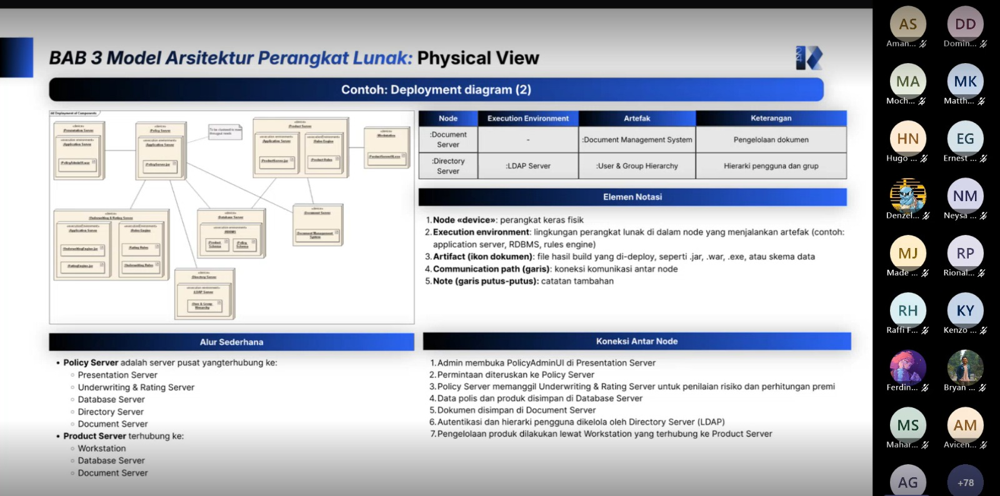
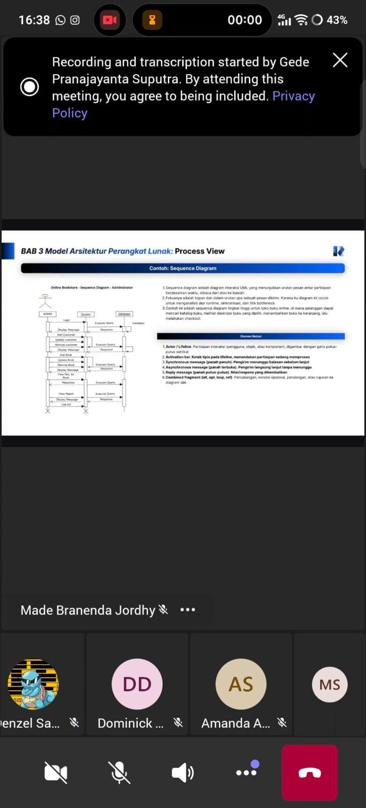

# Form Asistensi

## Tugas Besar IF2150 - Rekayasa Perangkat Lunak

| Informasi | Keterangan |
| --- | --- |
| **Hari** | Jumat |
| **Tanggal** | 02/10/2026 |
| **Kelas** | K01 |
| **Nomor Kelompok** | G09 |
| **Nama Kelompok** | PindahCSUI |
| **Nama Perangkat Lunak** | PeerUP |
| **Dokumen** | Spesifikasi Kebutuhan Perangkat Lunak (SKPL) |

### Anggota Kelompok

| NIM      | Nama                            |
| -------- | ------------------------------- |
| 13525049 | Hugo Daniel Johansen Napitupulu |
| 13525001 | Matthew Allen Reynaldo          |
| 13525010 | Fabian Amzar Susanto            |
| 13525025 | David Christian                 |
| 13525028 | Markus Christiano Simanjuntak   |
### Catatan

Di tugas ini, fokus utama pengerjaan adalah Arsitektur Perangkat Lunak. Dokumen SKPL yang telah dibuat sebelumnya digunakan sebagai acuan dasar (seperti jenis sistem, skala, dan *tech stack*) untuk menentukan arsitektur. Terdapat tiga bagian utama yang harus diselesaikan:

1. Style atau Pattern Arsitektur Acuan: minimal satu *pattern* arsitektur (seperti MVC, *Layered Architecture*, *Client-Server*, *Repository*, atau *Pipe and Filter*) wajib dipilih. Penggunaan lebih dari satu *pattern* diperbolehkan jika satu *pattern* dinilai tidak cukup untuk menggambarkan sistem secara utuh. Pada bagian ini, peran dari tiap bagian harus dijelaskan, beserta alasan pemilihannya yang wajib disesuaikan dengan 5 Kebutuhan Non-Fungsional (KNF) dari dokumen SKPL. Diagram penerapan dan lingkungan operasi juga dilampirkan berdasarkan data dari SKPL.

2. Identifikasi Komponen: memuat nama, jenis, dan penjelasan dari tiap komponen sistem harus dilengkapi. Komponen-komponen yang diidentifikasi tersebut harus mencakup seluruh kelas dan mendukung seluruh *use case* yang telah didefinisikan pada SKPL.

3. Model Arsitektur Perangkat Lunak: pemodelan didasarkan pada kerangka kerja **4+1 Architectural View Model** (meliputi *Logical View*, *Process View*, *Physical View*, *Development View*, dan *Scenario/Use Case*). Minimal satu *architectural view* wajib dibuat untuk keseluruhan sistem.

Panduan pemilihan diagram untuk *View*:
*   **Logical View:** Difokuskan pada abstraksi utama fungsionalitas sistem (layanan dan fitur) untuk memenuhi kebutuhan bisnis. Diagram yang dapat digunakan adalah *Class Diagram*, *Object Diagram*, atau *State Machine Diagram*.
*   **Process View:** Difokuskan pada proses dinamis saat sistem berjalan (*runtime*), termasuk aspek komunikasi, konkurensi, performa, dan sinkronisasi untuk mendeteksi potensi *bottleneck*. Diagram yang dapat digunakan adalah *Activity Diagram*, *Sequence Diagram*, atau *Communication Diagram*.

**Catatan Asistensi:**

| Catatan |
| --- |
| 1. Evaluasi Kesesuaian SKPL: Arsitektur yang dipilih harus dipastikan benar-benar sesuai dengan spesifikasi yang telah dijabarkan pada SKPL. |
| 2. Fleksibilitas View: Jumlah *view* yang dibuat tidak bergantung pada jumlah *pattern* arsitektur yang dipakai. Hal yang diutamakan adalah setiap *view* mampu menjelaskan sudut pandang yang berbeda dari sistem yang sama. |
| 3. Ketelitian Notasi Diagram: Penggunaan notasi pada diagram yang dipilih harus diperhatikan dengan teliti (contoh: kesesuaian lima notasi utama pada *State Machine Diagram* atau arah panah dan hierarki nomor urut pada *Communication Diagram*). |
## Dokumentasi

<!--  -->

  

  <i>Gambar 1. Dokumentasi kegiatan asistensi.</i>

