<h1>
IF2150 REKAYASA PERANGKAT LUNAK
 
TUGAS 5
 
DESKRIPSI PERANCANGAN PERANGKAT LUNAK (DPPL)
</h1>
 

## PeerUP

### 

### Untuk: Mikhael Andrian Yonatan

Dipersiapkan oleh:
| Informasi | Keterangan |
| --- | --- |
| Kelas | *K01* |
| Kelompok | *G09* |
| Nama Kelompok | *PindahCSUI*|

| NIM        | Nama                                 |
|---         |---                                   |
| *13525049* | *Hugo Daniel Johansen Napitupulu*    |
| *13525001* | *Matthew Allen Reynaldo*             |
| *13525010* | *Fabian Amzar Susanto*               |
| *13525025* | *David Christian*                    |
| *13525028* | *Markus Christiano Simanjuntak*      |

---

## Daftar Perubahan

| Revisi | Deskripsi |
| :--- | :--- |
| *A* | *Deskripsikan perubahan yang dilakukan dari dokumen sebelumnya pada dokumen ini. Jika tidak terdapat perubahan, harap kosongkan tabel.* |
| *B* |  |
| *C* |  |
| ... |  |

---

 

> **Petunjuk pengerjaan:** *[Silahkan hapus bagian ini setelah selesai mengerjakan]*
>
> Dokumen ini melanjutkan **Spesifikasi Kebutuhan Perangkat Lunak (SKPL)** dan **Arsitektur Perangkat Lunak (APL)**. Gunakan nama, ID, kebutuhan, dan use case yang konsisten dengan kedua dokumen tersebut. Contoh pola ID baru di bawah dapat disesuaikan dengan kesepakatan kelompok, ID yang sudah ada tetap dipertahankan.

 

---

# BAB 1: Pendahuluan

## 1.1 Tujuan Penulisan Dokumen
Dokumen ini ditulis untuk mendefinisikan secara lengkap, rinci, dan terstruktur seluruh kebutuhan fungsional, kebutuhan non-fungsional, batasan sistem, pemodelan *use case*, serta pemodelan kelas dari perangkat lunak **PeerUP**. Dokumen ini ditujukan bagi:
1. **Tim Pengembang (Developer):** Sebagai acuan teknis utama dalam mengimplementasikan kode program, merancang basis data, dan mengintegrasikan antarmuka perangkat lunak.
2. **Penguji Perangkat Lunak (Tester / QA):** Sebagai dasar pengujian untuk memvalidasi apakah seluruh fitur dan skenario telah berjalan sesuai spesifikasi.
3. **Dosen dan/atau Asisten Pengampu IF2150:** Sebagai dokumen evaluasi akademik terhadap perancangan rekayasa perangkat lunak yang dilakukan oleh Kelompok ini.

## 1.2 Lingkup Masalah
**PeerUP** adalah platform web pembelajaran kolaboratif (*peer-to-peer tutoring*) yang dirancang untuk mengatasi ketimpangan akses bimbingan belajar berbiaya mahal serta isolasi sosial di kalangan pelajar dan mahasiswa. Di tengah maraknya platform *EdTech* berlangganan yang bersifat satu arah dan pencarian teman belajar manual yang tidak terstruktur, PeerUP hadir sebagai fasilitator otomatis yang mempertemukan *Mentee* (pelajar yang membutuhkan bimbingan) dengan *Mentor* (tutor sebaya) berdasarkan kecocokan materi, ketersediaan jadwal, dan format belajar (daring/luring), dilengkapi dengan fitur ruang obrolan grup sementara (*temporary group chat*), pengingat jadwal otomatis, serta sistem *feedback*.

## 1.3 Definisi, Istilah, dan Singkatan
Semua definisi dan singkatan yang digunakan dalam dokumen ini beserta penjelasannya disajikan pada Tabel 1.3.

Tabel 1.3. Definisi Istilah dan Singkatan

| Singkatan, Akronim, atau Istilah | Penjelasan |
| :--- | :--- |
| *P/L* | *Singkatan dari Perangkat Lunak, yaitu aplikasi yang memberikan perintah kepada komputer untuk menjalankan tugas tertentu.* |
| *SKPL* | *Singkatan dari Spesifikasi Kebutuhan Perangkat Lunak, yaitu dokumen yang merangkum kriteria-kriteria yang diperlukan untuk membangun aplikasi menjalankan tugasnya.* |
| *KF* | *Singkatan dari Kebutuhan Fungsional.* |
| *KNF* | *Singkatan dari Kebutuhan Non-Fungsional.* |
| *UC* | *Singkatan dari Use Case.* |
| *EARS* | *Easy Approach to Requirements Syntax, yaitu pola penulisan kebutuhan agar konsisten dan mudah diuji.* |
| *Mentor / Tutor* | *Pengguna sebaya yang memiliki penguasaan materi lebih baik dan membuka sesi belajar untuk membimbing pengguna lain.* |
| *Mentee* | *Pengguna (siswa/mahasiswa) yang mencari bantuan pemahaman materi dan bergabung ke dalam sesi belajar.* |
| *Matchmaking* | *Proses pencocokan otomatis antara preferensi materi serta jadwal kosong Mentee dengan sesi belajar yang tersedia.* | 
| *BaaS* | *Backend-as-a-Service, layanan cloud yang menyediakan infrastruktur backend siap pakai seperti basis data, autentikasi, dan komunikasi real-time.* |

## 1.4 Aturan Penomoran
Tabel 1.4. Aturan Penomoran

| Hal/Bagian | Penomoran | Keterangan |
| :--- | :--- | :--- |
| *User Story* | *US-XX* | *XX menyatakan dua digit nomor urut kebutuhan pengguna awal (contoh: US-01).* |
| *Aktivitas* | *AXX* | *XX menyatakan dua digit nomor urut aktivitas proses bisnis (contoh: A01).* |
| *Kebutuhan* | *RXX* | *XX menyatakan dua digit nomor urut pemetaan kebutuhan (contoh: R01).* |
| *Kebutuhan Fungsional* | *KFXX* | *XX menyatakan dua digit nomor urut kebutuhan fungsional (contoh: KF01).* |
| *Kebutuhan Non-Fungsional* | *KNFXX* | *XX menyatakan dua digit nomor urut kebutuhan non-fungsional (contoh: KNF01).* |
| *Aktor* | *AXX* | *XX menyatakan dua digit nomor urut aktor pada pemodelan use case (contoh: A01).* |
| *Use Case* | *UCXX* | *XX menyatakan dua digit nomor urut use case (contoh: UC01).* |
| *Kelas* | *CXX* | *XX menyatakan dua digit nomor urut kelas pada diagram kelas (contoh: C01).* |

## 1.5 Referensi
1. Dokumentasi Perangkat Lunak *Topic Brainstorming* (Tugas 1), *Requirement Gathering* (Tugas 2), *Use Case & Scenario Use Case* (Tugas 3), dan *Class Diagram* (Tugas 4) Kelompok G09 IF2150 Rekayasa Perangkat Lunak.
2. Mavin, A., Wilkinson, P., Harwood, A., & Novak, M. (2009). *Easy Approach to Requirements Syntax (EARS)*. 17th IEEE International Requirements Engineering Conference.
3. Undang-Undang Republik Indonesia Nomor 27 Tahun 2022 tentang Perlindungan Data Pribadi (UU PDP).
4. Undang-Undang Republik Indonesia Nomor 1 Tahun 2024 tentang Perubahan Kedua atas UU ITE.

## 1.6 Deskripsi Umum Dokumen (Ikhtisar)
Dokumen ini dibagi menjadi enam bab utama:
- **BAB 1: Pendahuluan**, menjelaskan tujuan penulisan dokumen, lingkup masalah, definisi dan singkatan, aturan penomoran, referensi, serta ikhtisar dokumen.
- **BAB 2: Deskripsi Perangkat Lunak**, menguraikan deskripsi umum sistem beserta *Activity Diagram* proses bisnis, deskripsi umum perangkat lunak dan komponen eksternal, karakteristik pengguna, batasan perangkat lunak, serta lingkungan operasi perangkat lunak.
- **BAB 3: Deskripsi Kebutuhan Perangkat Lunak**, merinci seluruh Kebutuhan Fungsional (KF) dan Kebutuhan Non-Fungsional (KNF).
- **BAB 4: Pemodelan Use Case**, memuat identifikasi aktor, identifikasi *use case*, *Use Case Diagram*, serta skenario normal dan alternatif untuk masing-masing *use case*.
- **BAB 5: Pemodelan Kelas**, menyajikan identifikasi kelas (arsitektur *Boundary, Controller, Entity*), diagram kelas per *use case*, serta diagram kelas keseluruhan beserta atribut dan operasinya.
- **BAB 6: Traceability**, memetakan keterlacakan antara ID Kelas, ID Use Case, dan ID Kebutuhan Fungsional.

---

# BAB 2: Perancangan Arsitektur

## 2.1 Rancangan Lingkungan Implementasi

Sebutkan *operating system*, DBMS, *development tools*, *filing system*, dan bahasa pemrograman yang digunakan.

| Komponen | Spesifikasi |
| :--- | :--- |
| *Sistem Operasi Pengembangan* | *Windows, Linux, atau macOS yang mendukung Node.js dan perkakas pengembangan web.* |
| *Sistem Operasi Client* | *Cross-platform, yaitu Windows, Linux, macOS, Android, dan iOS selama perangkat memiliki peramban web modern serta koneksi internet aktif.* |
| *Bahasa Pemrograman* | *TypeScript untuk kode frontend dan backend Next.js. SQL digunakan untuk definisi skema, constraint, query, dan kebijakan basis data yang diperlukan pada PostgreSQL/Supabase.* |
| *Framework & UI* | *Next.js berbasis React dengan Tailwind CSS untuk penyusunan tampilan antarmuka.* |
| *Runtime & Backend* | *Node.js untuk menjalankan lingkungan pengembangan lokal. Next.js Server Actions dan Route Handlers/API Routes menjadi titik masuk pemrosesan sisi server dan terintegrasi dengan Supabase Client SDK.* |
| *DBMS* | *PostgreSQL yang dikelola melalui layanan Supabase sebagai penyimpanan data persisten.* |
| *Authentication* | *Supabase Auth untuk registrasi, login, dan pengelolaan sesi autentikasi. Validasi domain email universitas dilakukan oleh logika aplikasi pada sisi tepercaya.* |
| *Real-time Communication* | *Supabase Realtime berbasis WebSocket untuk mendukung penerimaan pembaruan pesan secara real-time sesuai otorisasi pengguna.* |
| *Scheduled Task* | *Supabase Cron untuk memicu pekerjaan pengingat sesi 15 menit sebelum sesi dimulai dan pengelolaan masa retensi group chat. Dalam rancangan ini, pemicu Cron diteruskan ke endpoint internal Next.js yang dilindungi autentikasi server-side.* |
| *Server & Hosting* | *Pengembangan dan pengujian dapat dijalankan secara lokal menggunakan Node.js. Vercel direncanakan sebagai hosting aplikasi Next.js pada lingkungan deployment; keputusan ini harus disamakan dengan target deployment final tim.* |
| *Development Tools* | *Node.js dan package manager proyek; editor kode yang disepakati tim (misalnya Visual Studio Code); Git dan GitHub untuk kontrol versi; Supabase Dashboard/CLI untuk pengelolaan layanan; serta draw.io dan PlantUML untuk penyusunan diagram.* |
| *Filing System* | *Sistem berkas lokal pada sistem operasi pengembang digunakan untuk menyimpan kode sumber, konfigurasi, dan aset statis. Kode sumber dikelola melalui repositori Git. Data aplikasi yang persisten disimpan pada PostgreSQL/Supabase, bukan pada sistem berkas lokal server aplikasi.* |

## 2.2 Style/Pattern Arsitektur Acuan

### 2.2.1 Style/Pattern Arsitektur yang Dipilih
Perangkat lunak PeerUp akan memakai *style* **Model-View-Controller (MVC)** yang berjalan di atas **Client-Server Architecture**. *Style* *Client-Server* memisahkan sistem menjadi sisi *frontend* dan sisi *backend*, sementara *MVC* mengatur struktur pada kode perangkat lunaknya. Berikut adalah rincian peran setiap bagiannya.

1. **Client (Sisi Pengguna):**
   * Mewadahi lapisan **View**, yang bertanggung jawab menampilkan antarmuka, menyajikan informasi, dan menangkap *input* atau interaksi dari pengguna.
2. **Server (Sisi Pemrosesan & Basis Data):**
   * Mewadahi lapisan **Controller**, yang bertindak sebagai pengatur logika bisnis, memvalidasi aturan sistem, dan menjadi perantara antara *View* dengan *Model*.
   * Mewadahi lapisan **Model**, yang merepresentasikan struktur entitas data dan aturan penyimpanannya.
   * Mewadahi lapisan **Helper** dan **Integrasi Eksternal (Adapter)** untuk mendelegasikan tugas-tugas spesifik seperti validasi, autentikasi, serta tugas terjadwal (*cron*) tanpa membebani *Controller* utama.

### 2.2.2 Alasan Pemilihan Style/Pattern Arsitektur
Kombinasi *MVC* dan *Client-Server* dipilih karena sesuai dengan karakteristik teknis, pemodelan objek, dan pemenuhan spesifikasi Kebutuhan Non-Fungsional (KNF) pada dokumen PeerUP:

1. **Karakteristik Pengguna & Proses Bisnis:** Dua aktor utama (*Mentor* dan *Mentee*) akan banyak berinteraksi secara bersamaan (*real-time*) pada antarmuka dinamis (pencarian sesi, pembuatan sesi, ruang obrolan) yang semuanya mengakses dan mengubah keadaan data (sesi) yang sama. Pemisahan *Client-Server* memastikan data tetap tersinkronisasi secara terpusat.
2. **Keselarasan dengan Pemodelan Kelas:** Desain perangkat lunak pada dokumen menggunakan pola *Boundary-Controller-Entity* (BCE). Pola ini terpetakan secara langsung ke dalam arsitektur *View-Controller-Model*, sehingga mempermudah lokalisasi dampak apabila terjadi perubahan pada satu komponen (misalnya perubahan antarmuka tidak akan merusak algoritma *matchmaking*).
3. **Pemenuhan 5 Kebutuhan Non-Fungsional (KNF):**
   * **KNF01 (Keamanan Hashing) & KNF04 (Reliabilitas Validasi Email):** Pemisahan arsitektur menempatkan `Validator` dan integrasi autentikasi di sisi server (*Controller/Adapter*) sehingga sistem keamanan dan validasi tidak dapat dimanipulasi dari peramban *Client*.
   * **KNF02 (Waktu Respons Matchmaking < 3 detik) & KNF05 (Waktu Respons Riwayat < 3 detik):** Komputasi pencocokan algoritma dan penarikan data yang berat dilakukan secara efisien oleh *Controller* di server, sehingga *Client (View)* hanya bertugas merender hasil akhirnya saja.
   * **KNF03 (Reliabilitas Notifikasi 15 Menit):** Logika waktu (*Cron*) dipusatkan di sisi server, memastikan pemicu notifikasi otomatis berjalan $\ge 99\%$ meskipun *Client* sedang menutup aplikasinya.

### 2.2.3 Penerapan Pattern MVC pada Perangkat Lunak PeerUP

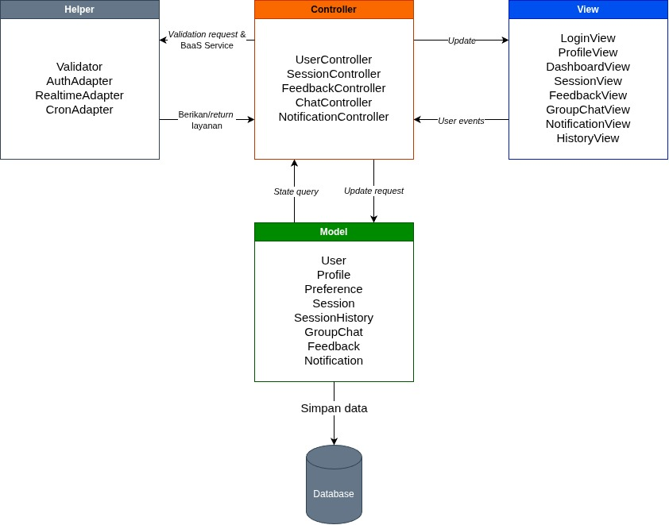

<i>Gambar 1. Penerapan Arsitektur MVC pada PeerUP</i>

Gambar 1 menjabarkan siklus interaksi komponen PeerUP di dalam struktur MVC. Aliran data dimulai ketika **View** menerima *input* dari pengguna dan mengirimkannya ke **Controller**. Selanjutnya, **Controller** mendelegasikan validasi aturan bisnis atau permintaan layanan *cloud* kepada lapisan **Helper / Integrasi Eksternal**, lalu menerima respons layanannya kembali. Setelah data divalidasi, **Controller** mengirimkan perintah untuk merekam atau mengubah data (*state*) pada **Model**. **Model** akan menyimpan perubahan tersebut ke dalam **Database** secara persisten, lalu mengembalikan status keberhasilan operasi kepada **Controller**. Pada tahap akhir, **Controller** merespons kembali ke **View** untuk memperbarui tampilan layar pengguna sesuai data terbaru.

### 2.2.4 Kaitan Teknologi Lingkungan Operasi dengan Style/Pattern Arsitektur
1. **Frontend (Next.js Client Components & Tailwind CSS):**
   Mewujudkan seluruh lapisan *View* yang berjalan di sisi *Client* (peramban web). *Frontend* menangani tampilan visual, pengisian formulir, dan penangkapan aksi pengguna secara independen dari logika di pusat data.
2. **Backend (Next.js Server Actions & API Routes):**
   Mewujudkan lapisan *Controller* yang berjalan terpusat di server. Logika bisnis dieksekusi di sisi *backend* untuk menangani pemeriksaan tabrakan jadwal, algoritma rekomendasi sesi (*matchmaking*), validasi batas kapasitas, dan verifikasi sebelum data diteruskan ke basis data.
3. **DBMS (Supabase PostgreSQL):**
   Layanan PostgreSQL pada Supabase menjadi titik penyimpanan persisten (*Database*) untuk seluruh entitas *Model* melalui aturan integritas relasional, mewakili keadaan (*state*) tunggal dari seluruh data aplikasi.
4. **Integrasi Eksternal:**
   Layanan infrastruktur pihak ketiga digolongkan sebagai *Adapter* (Pendukung) di dalam payung server pusat, yaitu:
   * **Supabase Auth:** Terhubung dengan `UserController` (via `AuthAdapter`) untuk registrasi pengguna dan validasi token sesi klien.
   * **Supabase Realtime:** Terhubung dengan `ChatController` (via `RealtimeAdapter`) menggunakan protokol WebSocket agar pembaruan pesan di *View* tampil secara instan (*real-time*).
   * **Supabase Cron:** Terhubung (via `CronAdapter`) untuk memicu `NotificationController` membuat pengingat otomatis, dan `ChatController` untuk membersihkan obrolan yang sudah mencapai batas retensi 48 jam.
   * **Vercel:** Berperan sebagai infrastruktur operasi (*hosting platform*) untuk menjalankan dan mendistribusikan aplikasi Next.js ke pengguna.

---

##   2.3 Identifikasi Komponen / Modul / Subsistem

Tabel 2.3. Identifikasi Komponen/Modul/Subsistem

| Nama Komponen/Modul/Subsistem | Kelas yang Dicakup | Jenis | Penjelasan |
| :--- | :--- | :--- | :--- |
| *LoginView* | *C15 (LoginPage)* | *View* | *Menampilkan formulir registrasi dan login, lalu meneruskan masukan ke UserController. Mendukung UC01.* |
| *ProfileView* | *C16 (ProfilePage)* | *View* | *Menampilkan profil, formulir pengubahan tag materi, ketersediaan waktu, dan format sesi. Mendukung UC02 dan UC15.* |
| *DashboardView* | *C11 (Dashboard)* | *View* | *Menampilkan sesi aktif terdekat, rekomendasi matchmaking, dan navigasi pencarian sesi. Mendukung UC04 dan UC14.* |
| *SessionView* | *C17 (SessionPage), C18 (HostSessionPage), C19 (ParticipantSessionPage)* | *View* | *Menampilkan detail sesi untuk Mentor (membuat, mengedit, dan menghapus sesi) maupun Mentee (bergabung dan membatalkan keikutsertaan). Mendukung UC03, UC04, UC05, UC10, UC11, UC12, dan UC13.* |
| *FeedbackView* | *C20 (FeedbackForm)* | *View* | *Menampilkan formulir rating dan ulasan setelah sesi selesai beserta opsi untuk melewati pengisian feedback. Mendukung UC07.* |
| *GroupChatView* | *C21 (GroupChatPage)* | *View* | *Menampilkan kotak pesan dan riwayat obrolan grup sesi. Mendukung UC08.* |
| *HistoryView* | *C24 (HistoryPage)* | *View* | *Menampilkan daftar riwayat sesi berstatus Selesai, Tidak Terlaksana, atau Dibatalkan. Mendukung UC06.* |
| *NotificationView* | *C23 (PopUpNotification)* | *View* | *Menampilkan notifikasi pengingat sesi serta menyediakan navigasi ke detail sesi terkait. Mendukung UC09.* |
| *UserController* | *C12 (UserControl)* | *Controller* | *Mengoordinasikan registrasi, login, pembaruan profil dan preferensi, serta pengambilan data profil pengguna. Mendukung UC01, UC02, dan UC15.* |
| *SessionController* | *C13 (SessionControl)* | *Controller* | *Mengoordinasikan pembuatan, pengubahan, dan penghapusan sesi; validasi jadwal; matchmaking; pendaftaran dan pembatalan keikutsertaan; konfirmasi keterlaksanaan; serta pengambilan riwayat sesi. Mendukung UC03, UC04, UC05, UC06, UC10, UC11, UC12, dan UC14.* |
| *FeedbackController* | *C14 (FeedbackControl)* | *Controller* | *Mengoordinasikan validasi dan penyimpanan ulasan serta pengambilan daftar feedback per sesi untuk Mentor. Mendukung UC07 dan UC13.* |
| *ChatController* | *— (Komponen tambahan M6; bukan kelas tersendiri)* | *Controller* | *Mengoordinasikan pengiriman pesan, pemeriksaan hak akses peserta, dan pengelolaan masa aktif ruang obrolan. Mendukung UC08.* |
| *NotificationController* | *— (Komponen tambahan M6; bukan kelas tersendiri)* | *Controller* | *Mengoordinasikan pembuatan notifikasi pengingat 15 menit sebelum sesi dimulai dan penyampaian hasilnya ke NotificationView. Mendukung UC09.* |
| *User* | *C01 (User), C02 (Mentor), C03 (Mentee)* | *Model* | *Merepresentasikan akun pengguna secara umum beserta spesialisasinya, yaitu Mentor dan Mentee, serta data dan perilaku domain terkait pengguna.* |
| *Profile* | *C10 (Profile)* | *Model* | *Merepresentasikan data identitas pengguna, termasuk nama, universitas, program studi, dan bio.* |
| *Preference* | *C09 (Preference)* | *Model* | *Menyimpan tag materi, ketersediaan waktu, dan preferensi metode belajar sebagai dasar matchmaking.* |
| *Session* | *C04 (Session)* | *Model* | *Merepresentasikan sesi belajar beserta topik, jadwal, format, kapasitas, peserta, dan statusnya.* |
| *SessionHistory* | *C07 (SessionHistory)* | *Model* | *Merepresentasikan kumpulan arsip sesi pengguna yang dikelompokkan berdasarkan statusnya.* |
| *GroupChat* | *C05 (GroupChat), C08 (ChatMessage)* | *Model* | *Merepresentasikan ruang obrolan sesi beserta kumpulan pesan di dalamnya.* |
| *Feedback* | *C06 (Feedback)* | *Model* | *Merepresentasikan data rating dan ulasan teks yang diberikan setelah sesi belajar selesai.* |
| *Notification* | *C22 (Notification)* | *Model* | *Merepresentasikan data pesan pengingat beserta isi, waktu, dan status terbaca.* |
| *Validator* | *— (Komponen tambahan M6; bukan kelas tersendiri)* | *Pendukung* | *Memvalidasi masukan dan aturan bisnis yang digunakan bersama, termasuk domain email universitas, kelengkapan preferensi, kapasitas peserta 1–20 orang, tabrakan jadwal, dan validitas feedback sesuai aturan sistem.* |
| *AuthAdapter* | *— (Komponen tambahan M6; bukan kelas tersendiri)* | *Integrasi Eksternal* | *Menghubungkan UserController dengan Supabase Auth untuk registrasi, login, dan pengelolaan sesi autentikasi. Pengelolaan kredensial ditangani oleh Supabase Auth.* |
| *RealtimeAdapter* | *— (Komponen tambahan M6; bukan kelas tersendiri)* | *Integrasi Eksternal* | *Menghubungkan ChatController dengan Supabase Realtime melalui WebSocket untuk pengiriman dan penerimaan pesan secara real-time.* |
| *CronAdapter* | *— (Komponen tambahan M6; bukan kelas tersendiri)* | *Integrasi Eksternal* | *Menerima pemicu terjadwal dari Supabase Cron dan meneruskannya ke NotificationController untuk pengingat sesi serta ChatController untuk pengelolaan masa aktif chat sesuai aturan retensi yang ditetapkan.* |
| *Database* | *— (Komponen penyimpanan M6; bukan kelas)* | *Penyimpanan Data* | *Menyediakan penyimpanan persisten bagi data Model menggunakan PostgreSQL yang dikelola melalui Supabase.* |

## 2.4 Model Arsitektur Perangkat Lunak

Untuk menggambarkan arsitektur perangkat lunak PeerUP dari sudut pandang yang berbeda, dipilih dua architectural view, yaitu **Development View** dan **Physical View**. Development View digunakan untuk menjelaskan organisasi statis modul dan dependensi antarkomponen, sedangkan Physical View digunakan untuk menggambarkan penempatan perangkat lunak pada lingkungan eksekusi dan jalur komunikasi antar-node.

### 2.4.1 Development View (Package Diagram)

Development View dipilih untuk memperlihatkan bagaimana 26 komponen arsitektur pada Tabel 2.1 dikelompokkan ke dalam paket-paket fungsional dari sudut pandang pengembangan perangkat lunak. Package Diagram digunakan untuk menggambarkan pengelompokan komponen menjadi paket Presentation / View, Application / Controller, Domain / Model, Shared Support, External Integration / Adapters, dan Persistence.

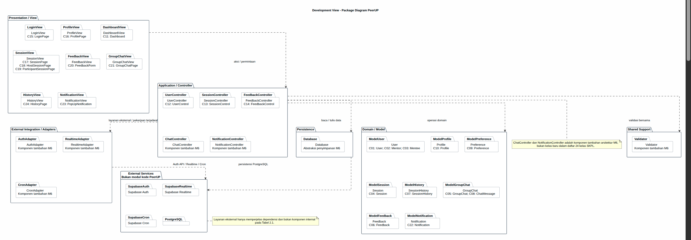

<i>Gambar 2. Development View (Package Diagram) pada Perangkat Lunak PeerUP</i>

Gambar 2 memperlihatkan pengorganisasian modul dan ketergantungan antarpaket. Garis putus-putus menunjukkan dependency, yaitu ketergantungan suatu paket terhadap layanan atau elemen yang disediakan paket lain. Paket Presentation / View bergantung pada Application / Controller untuk memproses aksi pengguna. Paket Application / Controller menggunakan Domain / Model untuk operasi domain serta Shared Support untuk validasi yang digunakan bersama. Application / Controller juga bergantung pada modul External Integration / Adapters dan Persistence sesuai kebutuhan layanan eksternal dan penyimpanan data.

Layanan Supabase ditampilkan sebagai sistem eksternal untuk memperjelas batas antara modul kode PeerUP dan layanan yang digunakannya. Nama komponen pada diagram diselaraskan dengan Tabel 2.1, sedangkan nama kelas dicantumkan sebagai pemetaan komponen.

## 2.4.2 Physical View (Deployment Diagram)

Physical View dipilih untuk menggambarkan penempatan perangkat lunak PeerUP pada perangkat pengguna, lingkungan hosting aplikasi, dan layanan cloud yang digunakan. Deployment Diagram memperlihatkan node, lingkungan eksekusi, artefak perangkat lunak, serta jalur komunikasi antarnode sesuai lingkungan operasi yang ditetapkan pada dokumen ini.

<i>Gambar 3. Physical View (Deployment Diagram) pada Perangkat Lunak PeerUP</i>

Gambar 3 menggambarkan tiga kelompok lingkungan operasi utama:

1. **Perangkat pengguna («device»):** menjalankan web browser sebagai lingkungan eksekusi untuk memuat antarmuka PeerUP dan menangani interaksi pengguna.
2. **Vercel Cloud Hosting:** menyediakan lingkungan deployment Next.js untuk menjalankan kode aplikasi sisi server, termasuk Server Actions dan Route Handlers yang diperlukan.
3. **Supabase Cloud Services:** menyediakan layanan autentikasi, komunikasi real-time, penjadwalan pekerjaan, serta PostgreSQL sebagai penyimpanan data persisten.

Komunikasi antara browser dan aplikasi Next.js dilakukan melalui HTTPS. Koneksi browser ke Supabase Realtime melalui WSS digunakan apabila client berlangganan pembaruan pesan secara langsung. Pekerjaan terjadwal dari Supabase Cron dapat memicu endpoint internal Next.js melalui HTTP/HTTPS sesuai mekanisme autentikasi yang ditetapkan. Akses data dilakukan melalui mekanisme Supabase yang digunakan dalam implementasi.

Dengan demikian, Development View menjelaskan organisasi dan dependensi modul, sedangkan Physical View menjelaskan penempatan serta komunikasi antarlingkungan eksekusi. Kedua view menggambarkan sistem PeerUP yang sama dari sudut pandang berbeda.

---

# BAB 3: Realisasi Use Case

## 3.1 Use Case Mendaftarkan Akun dan Autentikasi

**ID Use Case:** *UC01*  
**Nama Use Case:** *Mendaftarkan Akun dan Autentikasi*

### 3.1.1 Identifikasi Kelas

Kelas *LoginPage* pada SKPL direalisasikan sebagai komponen *LoginView* sesuai Tabel 2.3. Pengelolaan kredensial yang pada SKPL berada pada atribut `passwordHash` serta operasi `register()` dan `login()` di kelas *User* dipindahkan ke Supabase Auth melalui *AuthAdapter*, sehingga kata sandi tidak disimpan pada basis data aplikasi. Validasi domain email universitas yang pada SKPL berada di `UserControl.validateEmail()` dipindahkan ke kelas pendukung *Validator*. Data identitas yang diisi pada formulir registrasi (dibungkus sebagai `ProfileData`) disimpan sebagai *Profile*, sedangkan peran yang dipilih pengguna menentukan spesialisasi *Mentor* atau *Mentee*. Setelah autentikasi berhasil, pengguna diarahkan ke *DashboardView* yang pemuatan isinya dijelaskan pada UC14.

Tabel 3.1. Identifikasi Kelas Use Case UC01

| No | Nama Kelas Perancangan | Nama Kelas Analisis Terkait |
|:--- | :--- | :--- |
| 1 | *LoginView* | *C15 (LoginPage)* |
| 2 | *DashboardView* | *C11 (Dashboard)* |
| 3 | *UserController* | *C12 (UserControl)* |
| 4 | *Validator* | *C12 (UserControl), khusus validasi domain email universitas* |
| 5 | *AuthAdapter* | *— (komponen integrasi eksternal, Tabel 2.3), menggantikan passwordHash, register(), dan login() pada C01 (User)* |
| 6 | *User* | *C01 (User)* |
| 7 | *Profile* | *C10 (Profile)* |
| 8 | *Mentor* | *C02 (Mentor)* |
| 9 | *Mentee* | *C03 (Mentee)* |

### 3.1.2 Sequence Diagram

- **Skenario Normal**

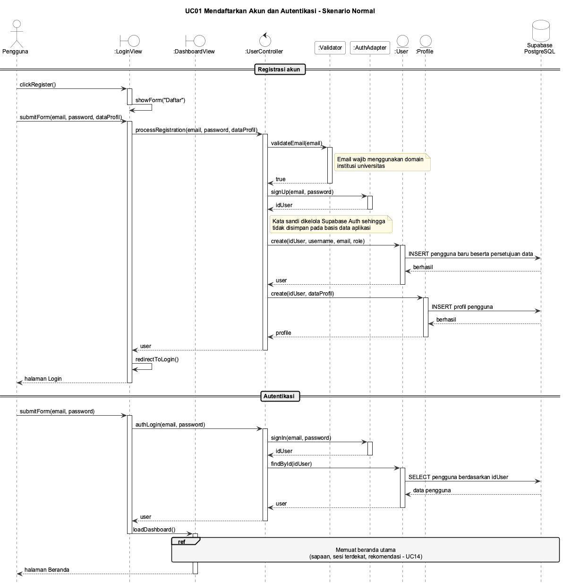

<i>Gambar 3.1.1. Sequence Diagram UC01 - Skenario Normal</i>

Pengguna memilih opsi "Daftar" sehingga *LoginView* menampilkan formulir registrasi. Setelah pengguna mengisi email universitas, kata sandi, dan data profil lalu menekan "Simpan", *UserController* meminta *Validator* memastikan email menggunakan domain institusi universitas, kemudian mendaftarkan kredensial ke Supabase Auth melalui *AuthAdapter*. Identitas yang dikembalikan Supabase Auth digunakan sebagai `idUser` ketika *User* dan *Profile* disimpan ke basis data beserta rekaman persetujuan data. *LoginView* lalu mengarahkan pengguna ke halaman Login. Saat pengguna memasukkan email dan kata sandi lalu menekan "Masuk", *UserController* memverifikasi kredensial melalui *AuthAdapter*, mengambil data *User*, dan menyerahkan kendali ke *DashboardView* untuk menampilkan halaman beranda (UC14).

- **Skenario Alternatif 1: Email Universitas Tidak Valid**

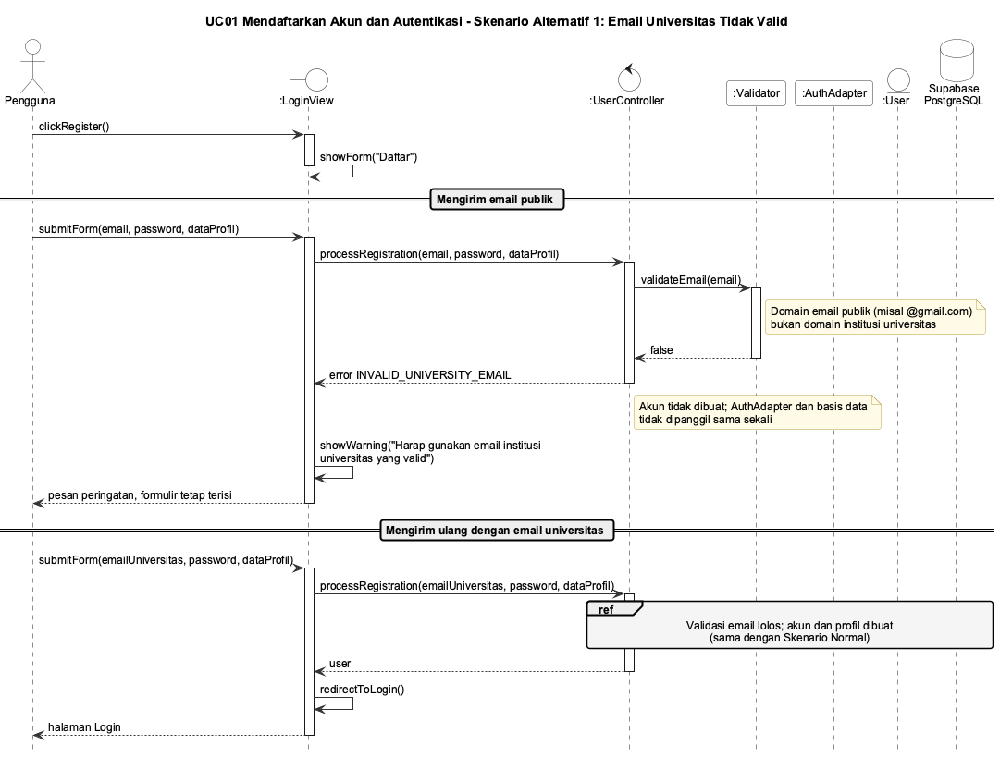

<i>Gambar 3.1.2. Sequence Diagram UC01 - Email Universitas Tidak Valid</i>

Pengguna memasukkan email publik, misalnya `@gmail.com`, sehingga `validateEmail()` pada *Validator* bernilai `false`. *UserController* mengembalikan galat `INVALID_UNIVERSITY_EMAIL` tanpa memanggil *AuthAdapter* maupun menyimpan data ke basis data. *LoginView* menampilkan notifikasi "Harap gunakan email institusi universitas yang valid" dan mempertahankan isi formulir. Setelah pengguna mengirim ulang dengan email universitas, alur berlanjut seperti skenario normal.

### 3.1.3 Diagram Kelas

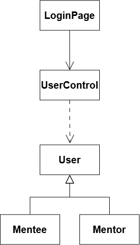

<i>Gambar 3.1.3. Diagram Kelas Mendaftarkan Akun dan Autentikasi</i>

## 3.2 Use Case Mengelola Preferensi Profil

**ID Use Case:** *UC02*  
**Nama Use Case:** *Mengelola Preferensi Profil*

### 3.2.1 Identifikasi Kelas

Kelas *ProfilePage* pada SKPL direalisasikan sebagai komponen *ProfileView* sesuai Tabel 2.3. Pemeriksaan kelengkapan pilihan preferensi yang pada SKPL tersirat di `UserControl.savePreference()` dipindahkan ke kelas pendukung *Validator*. Tag materi, format sesi, dan kalender ketersediaan waktu disimpan pada *Preference* (masukan formulir dibungkus sebagai `PreferenceData`), sedangkan *Profile* menyediakan data identitas yang ditampilkan pada halaman Profil sesuai UC15. Preferensi yang lengkap membuat `isComplete()` bernilai `true` sehingga dapat digunakan oleh *matchmaking* pada UC04 dan UC14.

Tabel 3.2. Identifikasi Kelas Use Case UC02

| No | Nama Kelas Perancangan | Nama Kelas Analisis Terkait |
|:--- | :--- | :--- |
| 1 | *ProfileView* | *C16 (ProfilePage)* |
| 2 | *UserController* | *C12 (UserControl)* |
| 3 | *Validator* | *C12 (UserControl), khusus pemeriksaan kelengkapan preferensi* |
| 4 | *Preference* | *C09 (Preference)* |
| 5 | *Profile* | *C10 (Profile)* |
| 6 | *User* | *C01 (User)* |
| 7 | *Mentor* | *C02 (Mentor)* |
| 8 | *Mentee* | *C03 (Mentee)* |

### 3.2.2 Sequence Diagram

- **Skenario Normal**

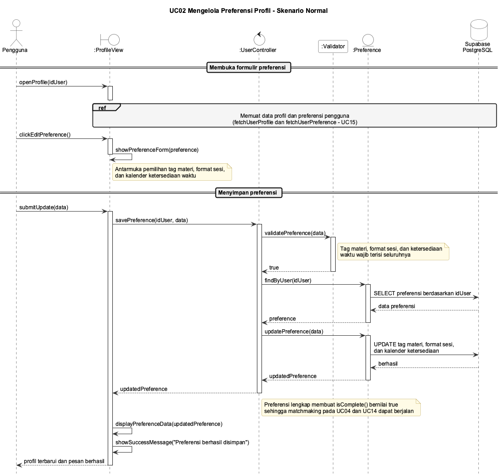

<i>Gambar 3.2.1. Sequence Diagram UC02 - Skenario Normal</i>

Pengguna membuka halaman "Profil", yang memuat data profil dan preferensi seperti pada UC15, lalu memilih "Edit Preferensi". *ProfileView* menampilkan antarmuka pemilihan tag materi, format sesi, dan kalender ketersediaan waktu. Setelah pengguna menentukan pilihannya dan menekan "Simpan", *UserController* meminta *Validator* memastikan seluruh pilihan telah terisi, lalu memperbarui *Preference* pengguna di basis data melalui `updatePreference()`. *ProfileView* menampilkan preferensi terbaru beserta notifikasi "Preferensi berhasil disimpan".

- **Skenario Alternatif 1: Menyimpan Preferensi Tanpa Memilih Preferensi**

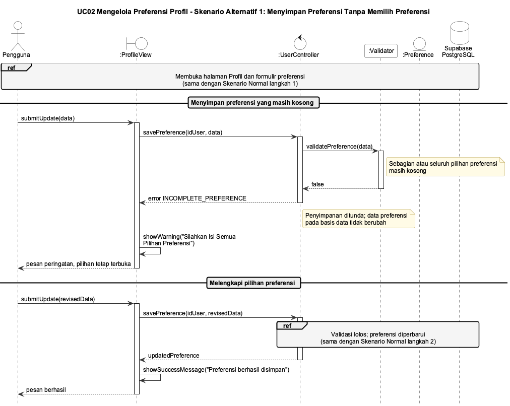

<i>Gambar 3.2.2. Sequence Diagram UC02 - Menyimpan Preferensi Tanpa Memilih Preferensi</i>

Pengguna mengosongkan sebagian atau seluruh pilihan preferensi lalu menekan "Simpan". *Validator* mendeteksi pilihan yang masih kosong sehingga *UserController* mengembalikan galat `INCOMPLETE_PREFERENCE` dan menunda penyimpanan tanpa mengubah basis data. *ProfileView* menampilkan notifikasi "Silahkan Isi Semua Pilihan Preferensi" dan antarmuka pemilihan tetap terbuka.

### 3.2.3 Diagram Kelas

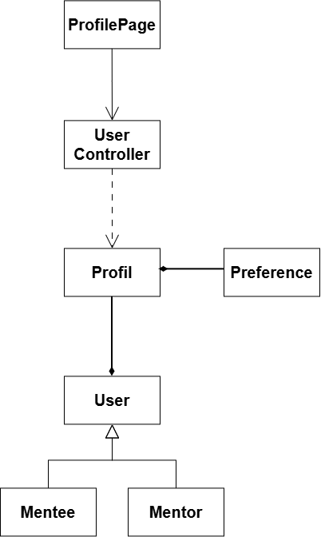

<i>Gambar 3.2.3. Diagram Kelas Mengelola Preferensi Profil</i>

## 3.3 Use Case Membuat Sesi Belajar

**ID Use Case:** *UC03*  
**Nama Use Case:** *Membuat Sesi Belajar*

### 3.3.1 Identifikasi Kelas

Seperti pada UC12, kelas *SessionPage* dan *HostSessionPage* direalisasikan dalam satu komponen *SessionView* sesuai Tabel 2.3, sedangkan validasi kapasitas (1–20 peserta) dan tabrakan jadwal yang pada SKPL berada di *SessionControl* dipindahkan ke kelas pendukung *Validator*. Masukan formulir dibungkus dalam kelas *SessionData* agar parameter operasi tetap ringkas. Mentor yang mengirim formulir dicatat sebagai host sesi melalui `idMentor`, dan sesi baru berstatus Terjadwal.

Tabel 3.3. Identifikasi Kelas Use Case UC03

| No | Nama Kelas Perancangan | Nama Kelas Analisis Terkait |
|:--- | :--- | :--- |
| 1 | *SessionView* | *C17 (SessionPage), C18 (HostSessionPage)* |
| 2 | *SessionController* | *C13 (SessionControl)* |
| 3 | *Validator* | *C13 (SessionControl), khusus validasi kapasitas dan tabrakan jadwal* |
| 4 | *Session* | *C04 (Session)* |
| 5 | *SessionData* | *— (kelas data perancangan untuk masukan formulir pembuatan sesi)* |
| 6 | *User* | *C01 (User)* |
| 7 | *Mentor* | *C02 (Mentor)* |

### 3.3.2 Sequence Diagram

- **Skenario Normal**

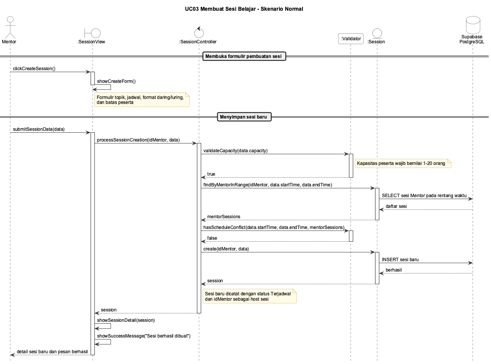

<i>Gambar 3.3.1. Sequence Diagram UC03 - Skenario Normal</i>

Mentor memilih menu "Buat Sesi Baru" sehingga *SessionView* menampilkan formulir topik, jadwal, format daring/luring, dan batas peserta. Saat Mentor menekan "Simpan", *SessionController* meminta *Validator* memeriksa kapasitas peserta, mengambil sesi Mentor pada rentang waktu yang sama, lalu meminta *Validator* memastikan tidak ada tabrakan jadwal. Setelah kedua pemeriksaan lolos, *Session* baru disimpan ke basis data dan *SessionView* menampilkan detail sesi beserta pesan "Sesi berhasil dibuat".

- **Skenario Alternatif 1: Kapasitas Peserta Melebihi Batas Maksimum**

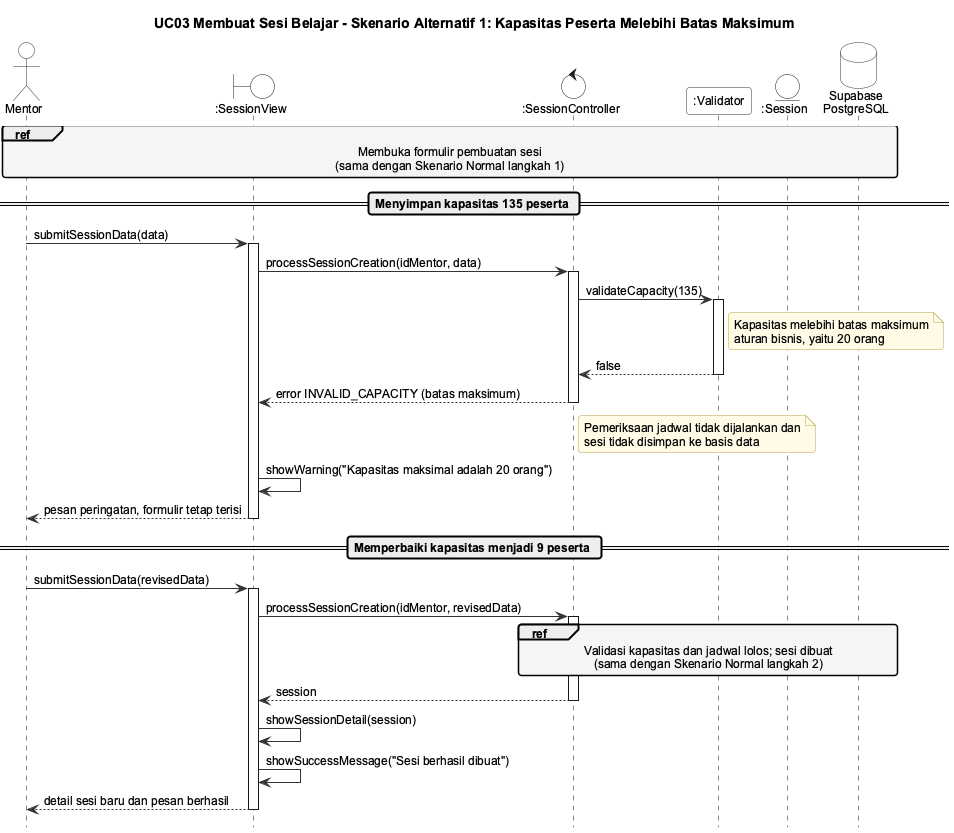

<i>Gambar 3.3.2. Sequence Diagram UC03 - Kapasitas Peserta Melebihi Batas Maksimum</i>

Mentor memasukkan batas peserta 135 orang sehingga `validateCapacity()` bernilai `false`. *SessionController* mengembalikan galat `INVALID_CAPACITY` sebelum pemeriksaan jadwal dilakukan dan tidak menyimpan data. *SessionView* menampilkan pesan "Kapasitas maksimal adalah 20 orang". Setelah Mentor memperbaiki angka menjadi 9 orang dan menekan "Simpan", alur berlanjut seperti skenario normal.

- **Skenario Alternatif 2: Kapasitas Peserta Kurang dari Batas Minimum**

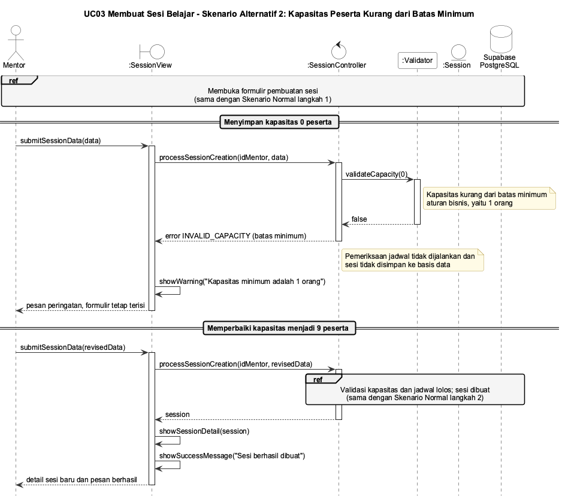

<i>Gambar 3.3.3. Sequence Diagram UC03 - Kapasitas Peserta Kurang dari Batas Minimum</i>

Mentor memasukkan batas peserta 0 orang sehingga `validateCapacity()` bernilai `false`. *SessionController* mengembalikan galat `INVALID_CAPACITY` tanpa menyimpan data, dan *SessionView* menampilkan pesan "Kapasitas minimum adalah 1 orang". Setelah Mentor memperbaiki angka menjadi 9 orang dan menekan "Simpan", alur berlanjut seperti skenario normal.

- **Skenario Alternatif 3: Waktu Sesi Bertabrakan**

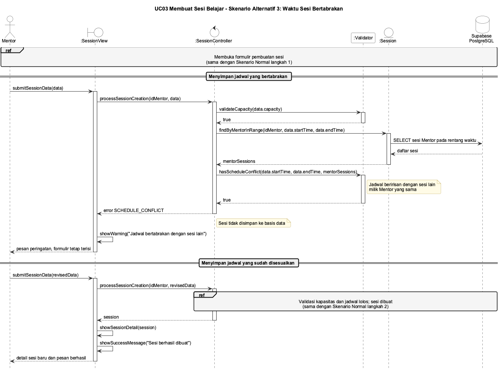

<i>Gambar 3.3.4. Sequence Diagram UC03 - Waktu Sesi Bertabrakan</i>

Kapasitas lolos validasi, tetapi `hasScheduleConflict()` pada *Validator* bernilai `true` karena jadwal beririsan dengan sesi lain milik Mentor yang sama. *SessionController* mengembalikan galat `SCHEDULE_CONFLICT` tanpa menyimpan data, dan *SessionView* menampilkan pesan "Jadwal bertabrakan dengan sesi lain". Setelah Mentor mengubah jam atau tanggal dan menekan "Simpan", alur berlanjut seperti skenario normal.

### 3.3.3 Diagram Kelas

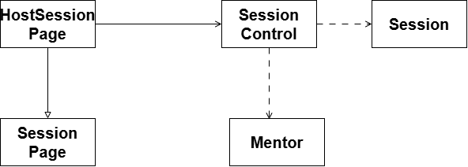

<i>Gambar 3.3.5. Diagram Kelas Membuat Sesi Belajar</i>

## 3.4 Use Case Mencari dan Bergabung ke Sesi

**ID Use Case:** *UC04*  
**Nama Use Case:** *Mencari dan Bergabung ke Sesi*

### 3.4.1 Identifikasi Kelas

Halaman "Cari Sesi" merupakan bagian dari *DashboardView* (realisasi *Dashboard* pada SKPL) yang menampilkan rekomendasi hasil *matchmaking*, sedangkan *ParticipantSessionPage* direalisasikan sebagai bagian dari *SessionView* sesuai Tabel 2.3. Algoritma *matchmaking* tetap berada di *SessionController* dan memakai *Preference* Mentee, sama dengan UC14. Pemeriksaan slot yang pada SKPL berada di `SessionControl.validateCapacity()` dan `Session.checkCapacity()` direalisasikan sebagai `hasAvailableSlot()` pada *Session*. *SessionHistory* tidak diperbarui secara eksplisit karena daftar sesi mendatang diturunkan langsung dari data peserta *Session*.

Tabel 3.4. Identifikasi Kelas Use Case UC04

| No | Nama Kelas Perancangan | Nama Kelas Analisis Terkait |
|:--- | :--- | :--- |
| 1 | *DashboardView* | *C11 (Dashboard)* |
| 2 | *SessionView* | *C17 (SessionPage), C19 (ParticipantSessionPage)* |
| 3 | *SessionController* | *C13 (SessionControl)* |
| 4 | *Preference* | *C09 (Preference)* |
| 5 | *Session* | *C04 (Session), C07 (SessionHistory)* |
| 6 | *User* | *C01 (User)* |
| 7 | *Mentee* | *C03 (Mentee)* |

### 3.4.2 Sequence Diagram

- **Skenario Normal**

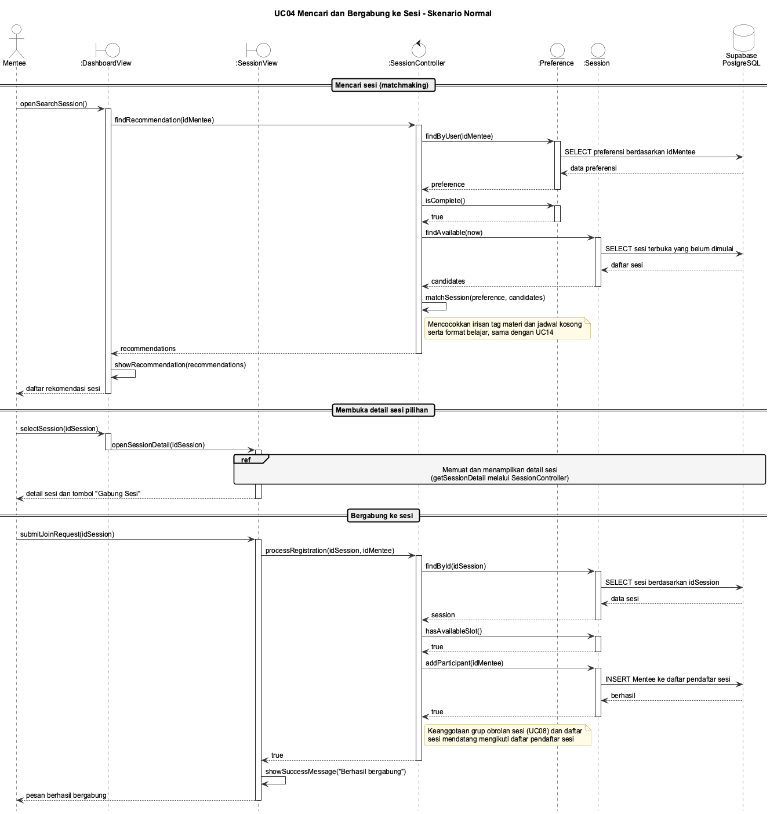

<i>Gambar 3.4.1. Sequence Diagram UC04 - Skenario Normal</i>

Mentee membuka halaman "Cari Sesi", lalu *DashboardView* meminta rekomendasi ke *SessionController*. *SessionController* mengambil *Preference* Mentee, memastikan preferensinya lengkap, mengambil sesi terbuka yang belum dimulai, lalu mencocokkan irisan tag materi, jadwal kosong, dan format belajar melalui `matchSession()`. *DashboardView* menampilkan daftar rekomendasi. Setelah Mentee memilih sebuah sesi, *SessionView* menampilkan detailnya. Saat Mentee menekan "Gabung Sesi", *SessionController* memvalidasi ketersediaan slot melalui `hasAvailableSlot()`, lalu menambahkan Mentee ke daftar partisipan sesi dan *SessionView* menampilkan notifikasi "Berhasil bergabung".

- **Skenario Alternatif 1: Tidak Ada Rekomendasi Sesi yang Cocok**

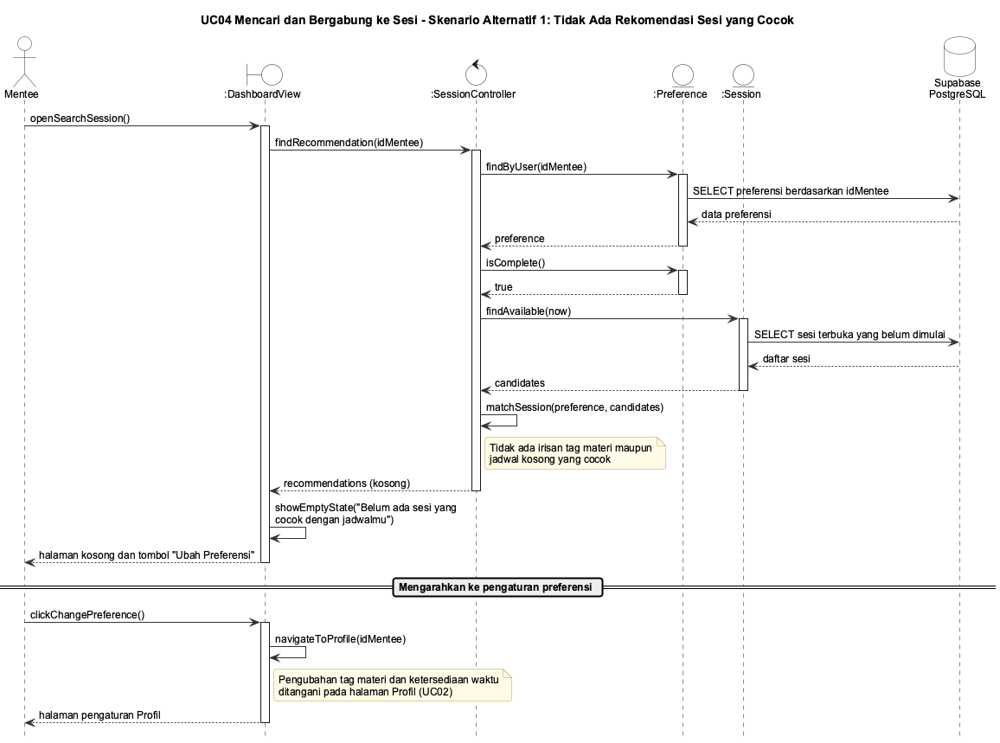

<i>Gambar 3.4.2. Sequence Diagram UC04 - Tidak Ada Rekomendasi Sesi yang Cocok</i>

`matchSession()` tidak menemukan irisan materi atau jadwal yang cocok sehingga *SessionController* mengembalikan daftar rekomendasi kosong. *DashboardView* menampilkan pesan "Belum ada sesi yang cocok dengan jadwalmu" beserta tombol "Ubah Preferensi". Saat tombol ditekan, Mentee diarahkan ke halaman pengaturan profil untuk mengubah ketersediaan waktu (UC02).

### 3.4.3 Diagram Kelas

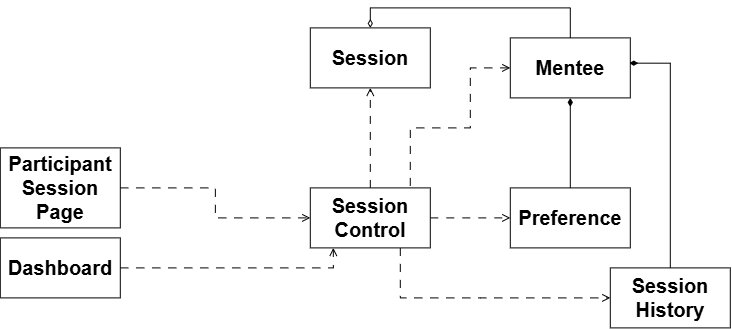

<i>Gambar 3.4.3. Diagram Kelas Mencari dan Bergabung ke Sesi</i>

## 3.5 Use Case Mengonfirmasi Keterlaksanaan Sesi

**ID Use Case:** *UC05*  
**Nama Use Case:** *Mengonfirmasi Keterlaksanaan Sesi*

### 3.5.1 Identifikasi Kelas

Kelas *SessionPage* pada SKPL direalisasikan sebagai komponen *SessionView* sesuai Tabel 2.3. Operasi `processSessionConfirmation()` dan `updateSessionStatus()` pada *SessionControl* digabung menjadi satu operasi `processSessionConfirmation()` pada *SessionController*, yang menerima status keterlaksanaan beserta alasan opsional. Konfirmasi dapat dilakukan oleh Mentor maupun Mentee yang terlibat dalam sesi, sehingga pemeriksaan hak akses menggunakan `involves()` pada *Session*.

Tabel 3.5. Identifikasi Kelas Use Case UC05

| No | Nama Kelas Perancangan | Nama Kelas Analisis Terkait |
|:--- | :--- | :--- |
| 1 | *SessionView* | *C17 (SessionPage)* |
| 2 | *SessionController* | *C13 (SessionControl)* |
| 3 | *Session* | *C04 (Session)* |
| 4 | *User* | *C01 (User)* |
| 5 | *Mentor* | *C02 (Mentor)* |
| 6 | *Mentee* | *C03 (Mentee)* |

### 3.5.2 Sequence Diagram

- **Skenario Normal**

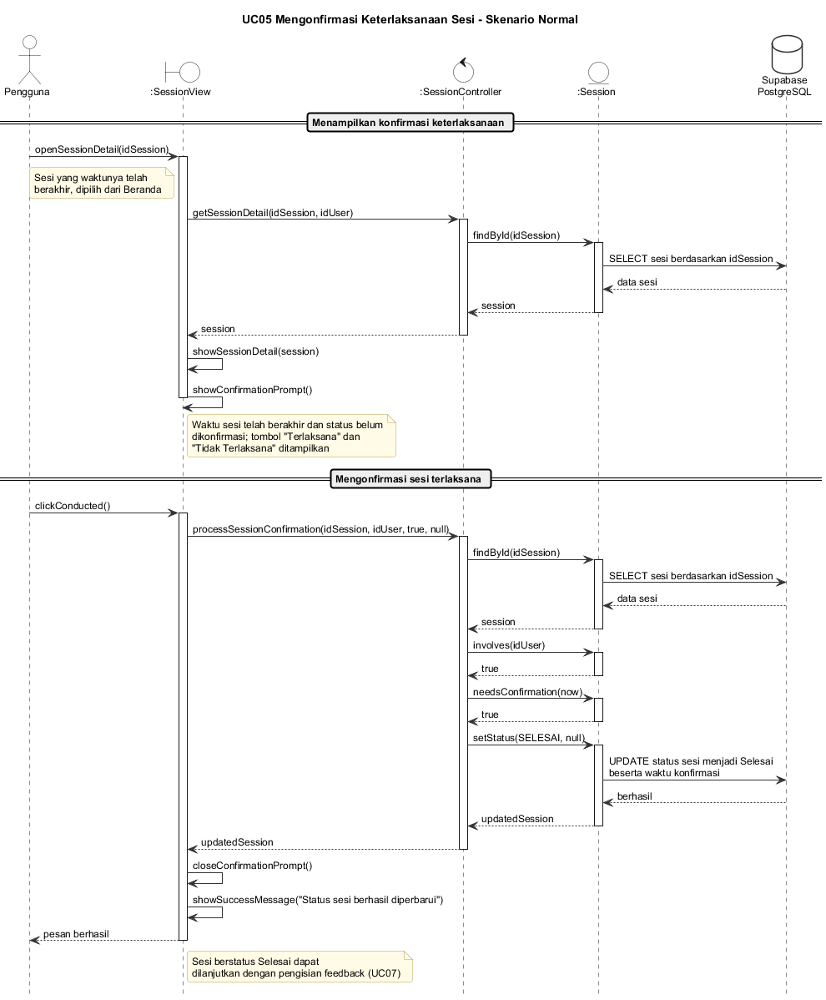

<i>Gambar 3.5.1. Sequence Diagram UC05 - Skenario Normal</i>

Pengguna membuka sesi yang waktunya telah berakhir, lalu *SessionView* menampilkan detail sesi beserta tombol "Terlaksana" dan "Tidak Terlaksana" karena status sesi belum dikonfirmasi. Saat pengguna memilih "Terlaksana", *SessionController* memastikan pengguna terlibat dalam sesi dan sesi memang menunggu konfirmasi, lalu mengubah status *Session* menjadi Selesai beserta waktu konfirmasi. *SessionView* kemudian menampilkan pesan "Status sesi berhasil diperbarui". Sesi berstatus Selesai dapat dilanjutkan dengan pengisian feedback pada UC07.

- **Skenario Alternatif 1: Sesi Ditandai Tidak Terlaksana**

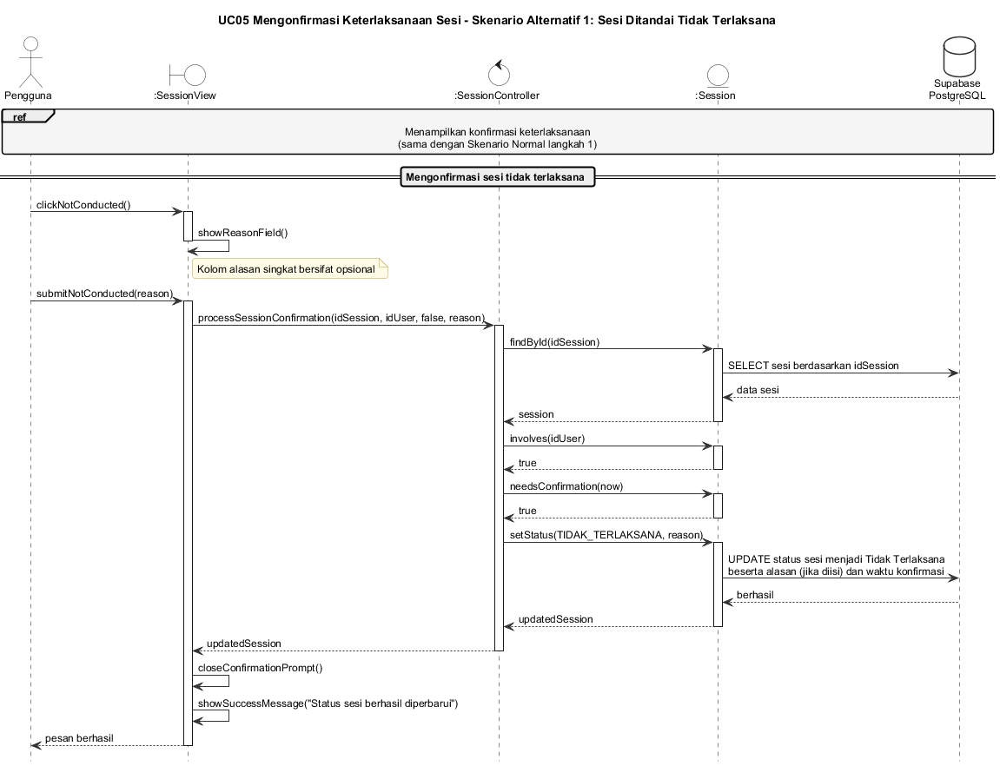

<i>Gambar 3.5.2. Sequence Diagram UC05 - Sesi Ditandai Tidak Terlaksana</i>

Saat pengguna memilih "Tidak Terlaksana", *SessionView* menampilkan kolom alasan yang bersifat opsional. Setelah pengguna menekan "Kirim", *SessionController* menjalankan pemeriksaan yang sama dengan skenario normal, lalu mengubah status *Session* menjadi Tidak Terlaksana beserta alasan (jika diisi) dan waktu konfirmasi.

### 3.5.3 Diagram Kelas

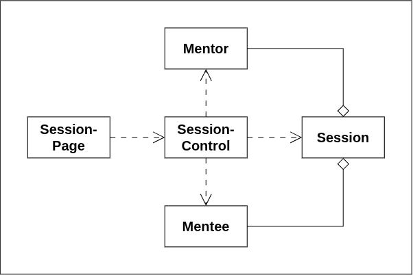

<i>Gambar 3.5.3. Diagram Kelas Mengonfirmasi Keterlaksanaan Sesi</i>

## 3.6 Use Case Melihat Riwayat Sesi

**ID Use Case:** *UC06*  
**Nama Use Case:** *Melihat Riwayat Sesi*

### 3.6.1 Identifikasi Kelas

Kelas *HistoryPage* pada SKPL direalisasikan sebagai *HistoryView*. Pada tahap perancangan, *SessionHistory* tidak disimpan sebagai tabel tersendiri, melainkan dibentuk oleh *SessionController* dari daftar *Session* milik atau yang diikuti pengguna dengan status akhir Selesai, Tidak Terlaksana, atau Dibatalkan. *SessionHistory* kemudian mengelompokkan sesi tersebut berdasarkan statusnya untuk ditampilkan.

Tabel 3.6. Identifikasi Kelas Use Case UC06

| No | Nama Kelas Perancangan | Nama Kelas Analisis Terkait |
|:--- | :--- | :--- |
| 1 | *HistoryView* | *C24 (HistoryPage)* |
| 2 | *SessionView* | *C17 (SessionPage)* |
| 3 | *SessionController* | *C13 (SessionControl)* |
| 4 | *Session* | *C04 (Session)* |
| 5 | *SessionHistory* | *C07 (SessionHistory)* |
| 6 | *User* | *C01 (User)* |
| 7 | *Mentor* | *C02 (Mentor)* |
| 8 | *Mentee* | *C03 (Mentee)* |

### 3.6.2 Sequence Diagram

- **Skenario Normal**

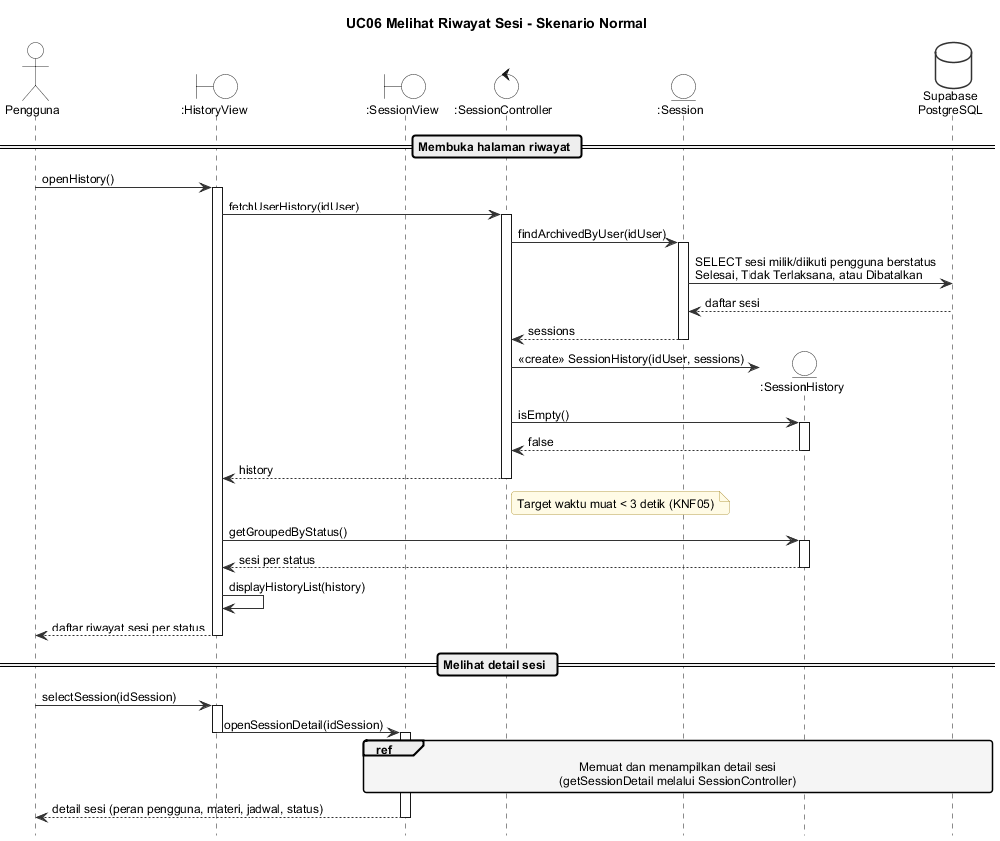

<i>Gambar 3.6.1. Sequence Diagram UC06 - Skenario Normal</i>

Pengguna menekan "Riwayat", lalu *HistoryView* meminta riwayat ke *SessionController*. *SessionController* mengambil seluruh *Session* milik atau yang diikuti pengguna dengan status akhir Selesai, Tidak Terlaksana, atau Dibatalkan, lalu membentuk objek *SessionHistory* dari daftar tersebut. *HistoryView* menampilkan sesi yang dikelompokkan berdasarkan status melalui `getGroupedByStatus()`. Proses pemuatan dirancang selesai dalam waktu kurang dari 3 detik sesuai KNF05. Saat pengguna memilih salah satu sesi, *SessionView* menampilkan detail sesi tersebut, termasuk peran pengguna, materi, jadwal, dan status.

- **Skenario Alternatif 1: Riwayat Kosong**

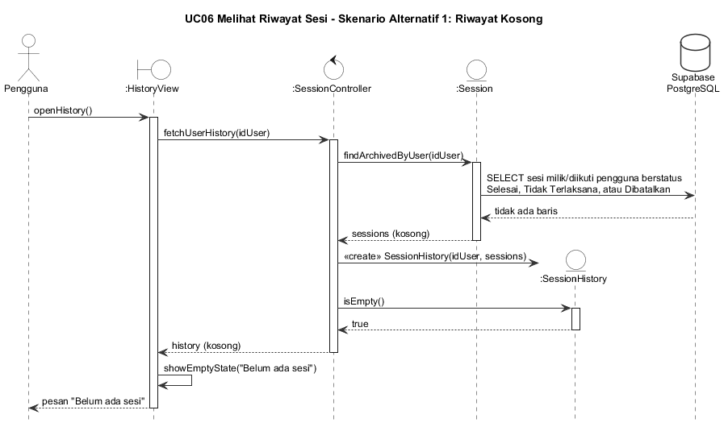

<i>Gambar 3.6.2. Sequence Diagram UC06 - Riwayat Kosong</i>

Apabila pengguna belum memiliki sesi dengan status akhir, *SessionHistory* yang dibentuk bernilai kosong sehingga `isEmpty()` mengembalikan `true`. *HistoryView* menampilkan pesan "Belum ada sesi".

### 3.6.3 Diagram Kelas

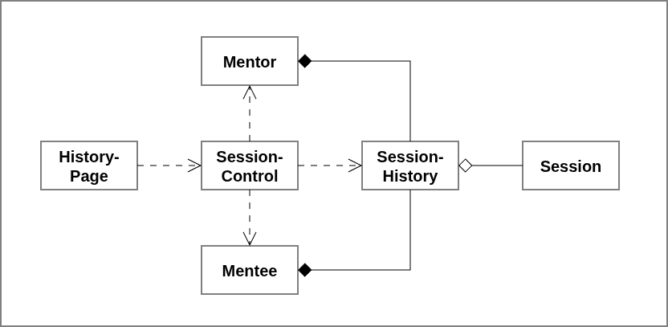

<i>Gambar 3.6.3. Diagram Kelas Melihat Riwayat Sesi</i>

## 3.7 Use Case Memberikan Penilaian Sehabis Sesi

**ID Use Case:** *UC07*  
**Nama Use Case:** *Memberikan Penilaian Sehabis Sesi*

### 3.7.1 Identifikasi Kelas

Kelas *FeedbackForm* pada SKPL direalisasikan sebagai *FeedbackView*, sedangkan validasi isi feedback dipindahkan dari *FeedbackControl* ke kelas pendukung *Validator*. Sesuai deskripsi kelas pada SKPL dan UC13, feedback diberikan oleh Mentee terhadap sesi yang telah diikutinya. *FeedbackController* memastikan sesi telah selesai, Mentee terdaftar sebagai peserta, dan Mentee belum pernah memberikan feedback untuk sesi tersebut.

Tabel 3.7. Identifikasi Kelas Use Case UC07

| No | Nama Kelas Perancangan | Nama Kelas Analisis Terkait |
|:--- | :--- | :--- |
| 1 | *SessionView* | *C17 (SessionPage)* |
| 2 | *FeedbackView* | *C20 (FeedbackForm)* |
| 3 | *FeedbackController* | *C14 (FeedbackControl)* |
| 4 | *Validator* | *C14 (FeedbackControl), khusus validasi feedback* |
| 5 | *Session* | *C04 (Session), C07 (SessionHistory)* |
| 6 | *Feedback* | *C06 (Feedback)* |
| 7 | *User* | *C01 (User)* |
| 8 | *Mentor* | *C02 (Mentor)* |
| 9 | *Mentee* | *C03 (Mentee)* |

### 3.7.2 Sequence Diagram

- **Skenario Normal**

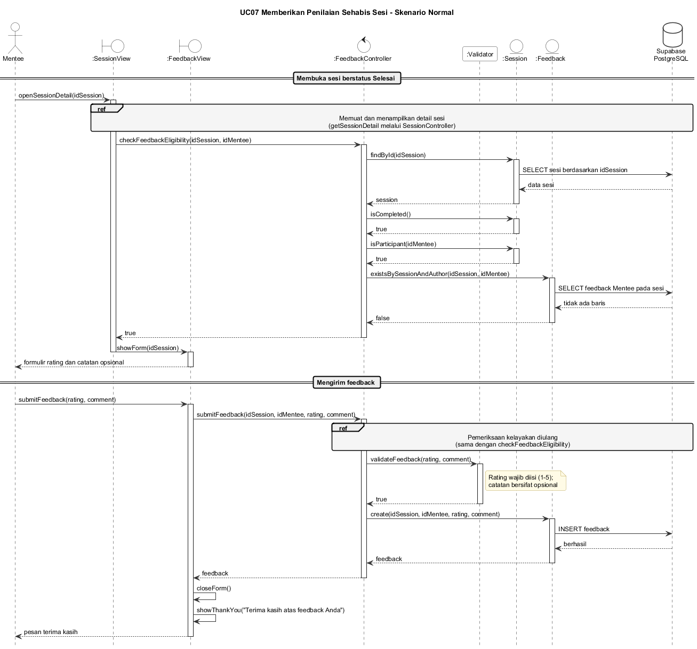

<i>Gambar 3.7.1. Sequence Diagram UC07 - Skenario Normal</i>

Mentee membuka sesi berstatus Selesai. *SessionView* meminta *FeedbackController* memeriksa kelayakan pemberian feedback, yaitu sesi telah selesai, Mentee terdaftar sebagai peserta, dan Mentee belum pernah memberikan feedback untuk sesi tersebut. Jika layak, *FeedbackView* menampilkan formulir rating dan catatan opsional. Saat Mentee menekan "Kirim", *FeedbackController* mengulang pemeriksaan kelayakan, meminta *Validator* memastikan rating telah diisi, lalu menyimpan *Feedback* baru ke basis data. *FeedbackView* menutup formulir dan menampilkan pesan "Terima kasih atas feedback Anda".

- **Skenario Alternatif 1: Pengguna Tidak Mengisi Form Feedback**

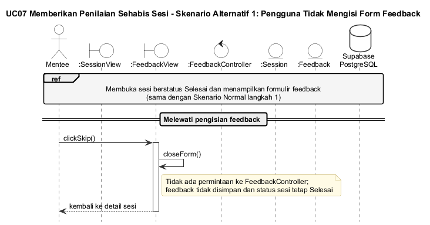

<i>Gambar 3.7.2. Sequence Diagram UC07 - Pengguna Tidak Mengisi Form Feedback</i>

Mentee menekan "Skip" tanpa mengisi formulir. *FeedbackView* hanya menutup formulir tanpa mengirim permintaan ke *FeedbackController*, sehingga feedback tidak disimpan dan status sesi tetap Selesai.

### 3.7.3 Diagram Kelas

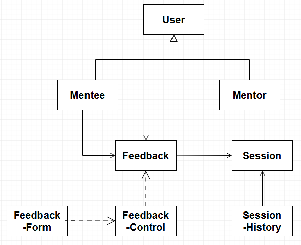

<i>Gambar 3.7.3. Diagram Kelas Memberikan Penilaian Sehabis Sesi</i>

## 3.8 Use Case Berkomunikasi Menggunakan Grup Obrolan Sementara

**ID Use Case:** *UC08*  
**Nama Use Case:** *Berkomunikasi Menggunakan Grup Obrolan Sementara*

### 3.8.1 Identifikasi Kelas

Pada tahap perancangan, logika obrolan yang pada SKPL tersebar di kelas *User* (`createMessage()`, `sendMessage()`) dan *Session* (`openGroupChat()`) dipusatkan pada *ChatController*. Pengiriman pesan secara *real-time* ke anggota lain ditangani oleh *RealtimeAdapter* yang terhubung dengan Supabase Realtime melalui WebSocket. Masa aktif grup obrolan (48 jam setelah sesi selesai) dikelola oleh *CronAdapter*, yang memicu *ChatController* untuk menghapus pesan dan menandai grup obrolan berakhir.

Tabel 3.8. Identifikasi Kelas Use Case UC08

| No | Nama Kelas Perancangan | Nama Kelas Analisis Terkait |
|:--- | :--- | :--- |
| 1 | *GroupChatView* | *C21 (GroupChatPage)* |
| 2 | *ChatController* | *— (komponen tambahan M6), menggantikan createMessage() dan sendMessage() pada C01 (User) serta openGroupChat() pada C04 (Session)* |
| 3 | *GroupChat* | *C05 (GroupChat)* |
| 4 | *ChatMessage* | *C08 (ChatMessage)* |
| 5 | *RealtimeAdapter* | *— (komponen integrasi eksternal, Tabel 2.3)* |
| 6 | *CronAdapter* | *— (komponen integrasi eksternal, Tabel 2.3)* |

### 3.8.2 Sequence Diagram

- **Skenario Normal**

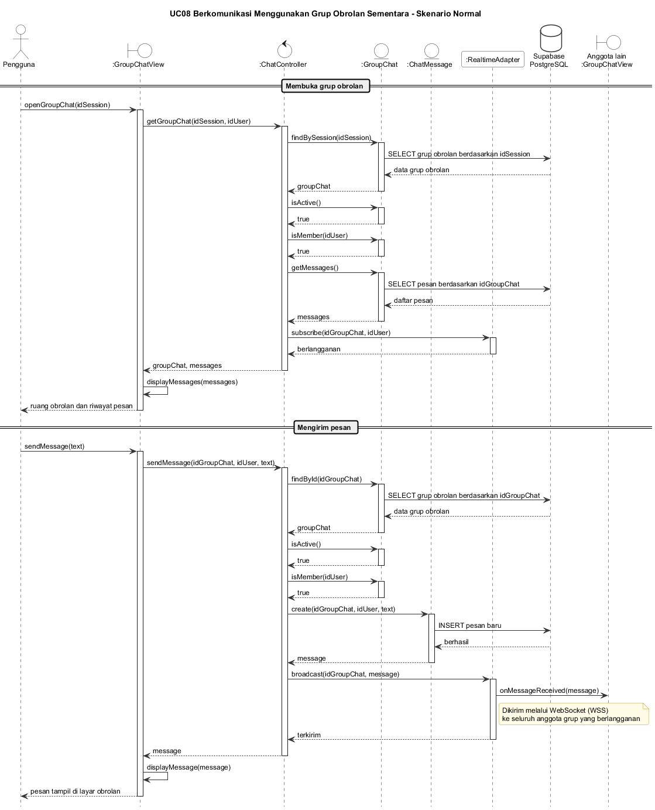

<i>Gambar 3.8.1. Sequence Diagram UC08 - Skenario Normal</i>

Pengguna membuka grup obrolan sebuah sesi melalui *GroupChatView*. *ChatController* mengambil *GroupChat* milik sesi tersebut, memastikan grup obrolan masih aktif dan pengguna adalah anggotanya, lalu memuat riwayat pesan dan mendaftarkan pengguna ke kanal *real-time* melalui *RealtimeAdapter*. Saat pengguna mengirim pesan, *ChatController* memeriksa ulang hak akses, menyimpan *ChatMessage* baru ke basis data, lalu menyiarkannya melalui *RealtimeAdapter* sehingga pesan langsung tampil di layar seluruh anggota grup.

- **Skenario Alternatif 1: Grup Obrolannya Sudah Berakhir**

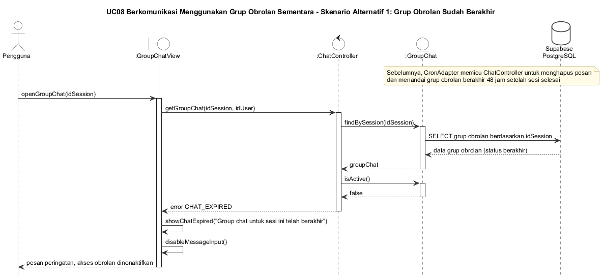

<i>Gambar 3.8.2. Sequence Diagram UC08 - Grup Obrolan Sudah Berakhir</i>

Grup obrolan yang sesinya telah selesai lebih dari 48 jam sudah dibersihkan oleh pekerjaan terjadwal: pesannya dihapus dan statusnya ditandai berakhir. Ketika pengguna mencoba membukanya, `isActive()` bernilai `false` sehingga *ChatController* mengembalikan galat `CHAT_EXPIRED`. *GroupChatView* menampilkan pesan "Group chat untuk sesi ini telah berakhir" dan menonaktifkan kolom pengiriman pesan.

### 3.8.3 Diagram Kelas

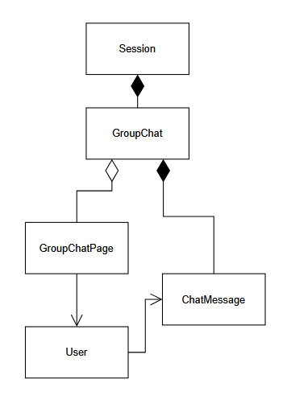

<i>Gambar 3.8.3. Diagram Kelas Berkomunikasi Menggunakan Grup Obrolan Sementara</i>

## 3.9 Use Case Menerima Notifikasi Sesi

**ID Use Case:** *UC09*  
**Nama Use Case:** *Menerima Notifikasi Sesi*

### 3.9.1 Identifikasi Kelas

Pemicu waktu pengingat yang pada SKPL berada di `Session.pushNotification()` direalisasikan sebagai pekerjaan terjadwal Supabase Cron yang diterima *CronAdapter* dan diteruskan ke *NotificationController*. Notifikasi disimpan sebagai *Notification* di basis data, lalu dikirim ke perangkat pengguna melalui *RealtimeAdapter* agar pop-up dapat langsung tampil. *Dashboard* dan *PopUpNotification* pada SKPL direalisasikan sebagai *NotificationView*, sedangkan navigasi ke detail sesi ditangani *SessionView*.

Tabel 3.9. Identifikasi Kelas Use Case UC09

| No | Nama Kelas Perancangan | Nama Kelas Analisis Terkait |
|:--- | :--- | :--- |
| 1 | *NotificationView* | *C23 (PopUpNotification), C11 (Dashboard)* |
| 2 | *SessionView* | *C17 (SessionPage)* |
| 3 | *CronAdapter* | *— (komponen integrasi eksternal, Tabel 2.3), menggantikan pemicu pushNotification() pada C04 (Session)* |
| 4 | *NotificationController* | *— (komponen tambahan M6)* |
| 5 | *Session* | *C04 (Session)* |
| 6 | *Notification* | *C22 (Notification)* |
| 7 | *RealtimeAdapter* | *— (komponen integrasi eksternal, Tabel 2.3)* |

### 3.9.2 Sequence Diagram

- **Skenario Normal**

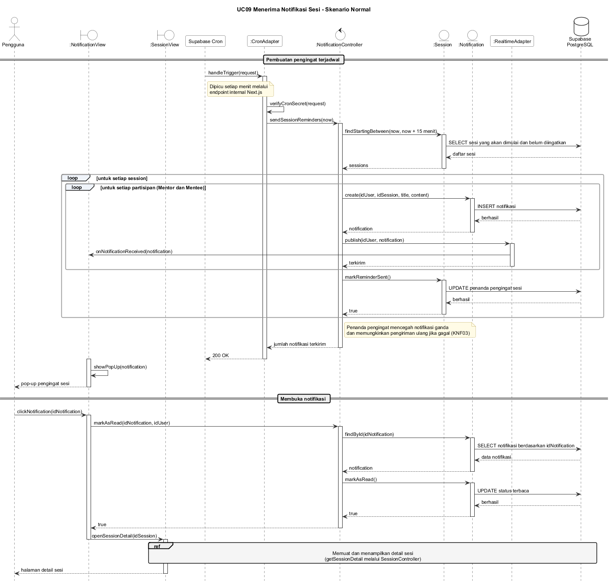

<i>Gambar 3.9.1. Sequence Diagram UC09 - Skenario Normal</i>

Supabase Cron memanggil endpoint internal setiap menit. *CronAdapter* memverifikasi bahwa permintaan berasal dari Cron, lalu meminta *NotificationController* mengirim pengingat. *NotificationController* mengambil sesi yang akan dimulai dalam 15 menit dan belum diingatkan, membuat *Notification* untuk setiap partisipan (Mentor dan Mentee), lalu mengirimkannya melalui *RealtimeAdapter* sehingga *NotificationView* menampilkan pop-up. Setelah semua partisipan sebuah sesi diberi notifikasi, sesi ditandai sudah diingatkan agar tidak terjadi notifikasi ganda dan sesi yang gagal dapat diproses ulang pada pemicu berikutnya (KNF03). Saat pengguna menekan notifikasi, notifikasi ditandai terbaca dan pengguna diarahkan ke halaman detail sesi.

SKPL tidak mendefinisikan skenario alternatif untuk UC09, sehingga hanya skenario normal yang dimodelkan.

### 3.9.3 Diagram Kelas

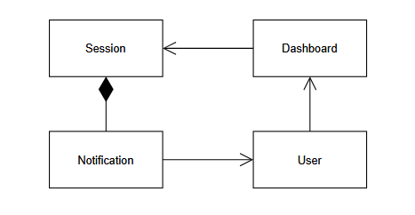

<i>Gambar 3.9.2. Diagram Kelas Menerima Notifikasi Sesi</i>

## 3.10 Use Case Membatalkan Keikutsertaan Sesi

**ID Use Case:** *UC10*  
**Nama Use Case:** *Membatalkan Keikutsertaan Sesi*

### 3.10.1 Identifikasi Kelas

Kelas *ParticipantSessionPage* dan *SessionPage* direalisasikan dalam komponen *SessionView* sesuai Tabel 2.3. Pembatalan dilakukan dengan menghapus Mentee dari daftar pendaftar *Session* melalui `removeParticipant()`. Kelas *SessionHistory* tidak diperbarui secara eksplisit karena daftar sesi mendatang Mentee diturunkan langsung dari data pendaftar sesi.

Tabel 3.10. Identifikasi Kelas Use Case UC10

| No | Nama Kelas Perancangan | Nama Kelas Analisis Terkait |
|:--- | :--- | :--- |
| 1 | *SessionView* | *C17 (SessionPage), C19 (ParticipantSessionPage)* |
| 2 | *SessionController* | *C13 (SessionControl)* |
| 3 | *Session* | *C04 (Session), C07 (SessionHistory)* |
| 4 | *User* | *C01 (User)* |
| 5 | *Mentee* | *C03 (Mentee)* |

### 3.10.2 Sequence Diagram

- **Skenario Normal**

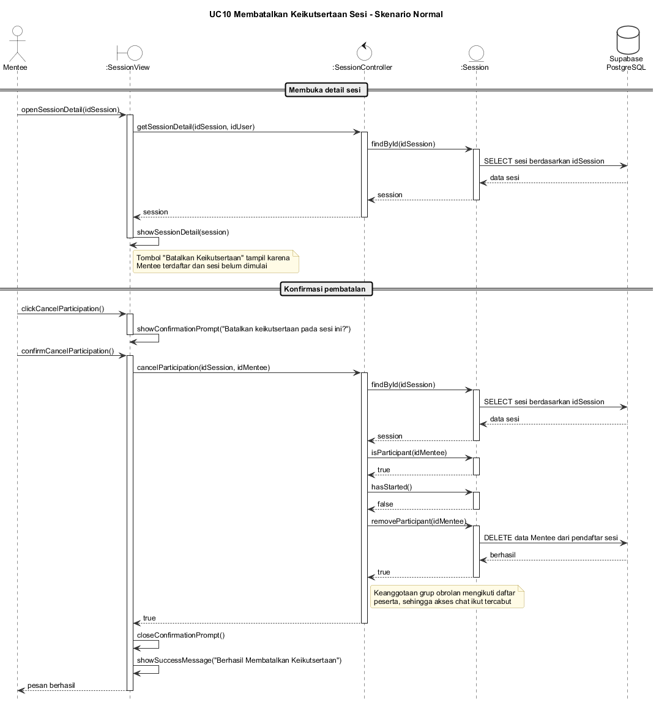

<i>Gambar 3.10.1. Sequence Diagram UC10 - Skenario Normal</i>

Mentee membuka detail sesi yang telah didaftarinya, lalu *SessionView* menampilkan tombol "Batalkan Keikutsertaan" karena Mentee terdaftar dan sesi belum dimulai. Setelah Mentee mengonfirmasi dengan menekan "Ya, Batalkan", *SessionController* memastikan Mentee memang terdaftar dan sesi belum dimulai, lalu menghapus Mentee dari daftar pendaftar sesi di basis data. Karena keanggotaan grup obrolan mengikuti daftar peserta, akses Mentee ke grup obrolan sesi tersebut ikut tercabut. *SessionView* kemudian menampilkan pesan "Berhasil Membatalkan Keikutsertaan".

- **Skenario Alternatif 1: Mentee Tidak Jadi Membatalkan Sesi**

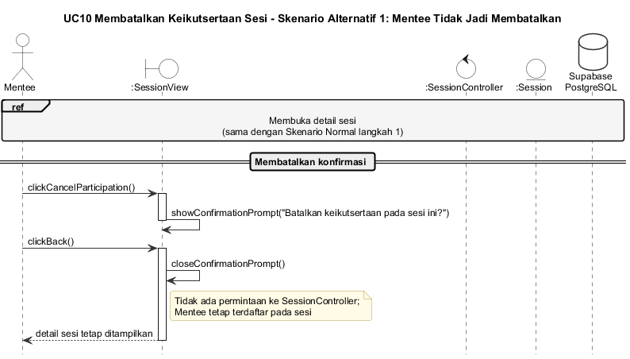

<i>Gambar 3.10.2. Sequence Diagram UC10 - Mentee Tidak Jadi Membatalkan Sesi</i>

Setelah pesan konfirmasi tampil, Mentee menekan "Kembali". *SessionView* hanya menutup pesan konfirmasi tanpa mengirim permintaan ke *SessionController*, sehingga Mentee tetap terdaftar pada sesi.

### 3.10.3 Diagram Kelas

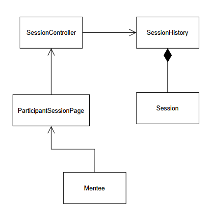

<i>Gambar 3.10.3. Diagram Kelas Membatalkan Keikutsertaan Sesi</i>

## 3.11 Use Case Menghapus Sesi

**ID Use Case:** *UC11*  
**Nama Use Case:** *Menghapus Sesi*

### 3.11.1 Identifikasi Kelas

Seperti pada UC12, kelas *HostSessionPage* dan *SessionPage* direalisasikan dalam komponen *SessionView* sesuai Tabel 2.3. Penghapusan sesi dirancang sebagai *soft delete*: *Session* tidak dihapus dari basis data, melainkan statusnya diubah menjadi Dibatalkan melalui `markAsDeleted()`. Dengan demikian sesi tidak lagi ditampilkan sebagai sesi aktif, tetapi tetap muncul pada riwayat peserta dengan status Dibatalkan (UC06). Kelas *SessionHistory* tidak perlu diperbarui secara eksplisit karena riwayat diturunkan langsung dari status *Session*.

Tabel 3.11. Identifikasi Kelas Use Case UC11

| No | Nama Kelas Perancangan | Nama Kelas Analisis Terkait |
|:--- | :--- | :--- |
| 1 | *SessionView* | *C17 (SessionPage), C18 (HostSessionPage)* |
| 2 | *SessionController* | *C13 (SessionControl)* |
| 3 | *Session* | *C04 (Session), C07 (SessionHistory)* |
| 4 | *User* | *C01 (User)* |
| 5 | *Mentor* | *C02 (Mentor)* |

### 3.11.2 Sequence Diagram

- **Skenario Normal**

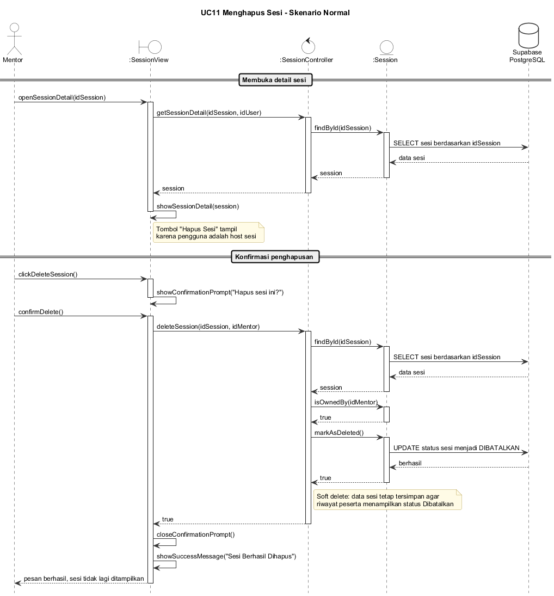

<i>Gambar 3.11.1. Sequence Diagram UC11 - Skenario Normal</i>

Mentor membuka detail sesi melalui *SessionView*, yang menampilkan tombol "Hapus Sesi" karena pengguna adalah host sesi. Setelah Mentor menekan tombol tersebut, *SessionView* menampilkan pesan konfirmasi. Saat Mentor menekan "Ya, Hapus", *SessionController* memastikan Mentor adalah pemilik sesi, lalu memanggil `markAsDeleted()` pada *Session* untuk mengubah statusnya di basis data. *SessionView* kemudian menutup konfirmasi dan menampilkan pesan "Sesi Berhasil Dihapus".

- **Skenario Alternatif 1: Mentor Tidak Jadi Menghapus Sesi**

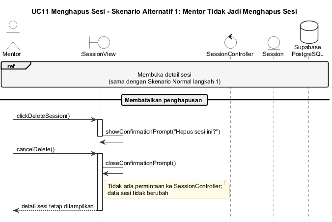

<i>Gambar 3.11.2. Sequence Diagram UC11 - Mentor Tidak Jadi Menghapus Sesi</i>

Setelah pesan konfirmasi tampil, Mentor menekan "Batal". *SessionView* hanya menutup pesan konfirmasi tanpa mengirim permintaan ke *SessionController*, sehingga data sesi tidak berubah.

### 3.11.3 Diagram Kelas

<i>Gambar 3.11.3. Diagram Kelas Menghapus Sesi</i>

## 3.12 Use Case Mengedit Sesi

**ID Use Case:** *UC12*  
**Nama Use Case:** *Mengedit Sesi*

### 3.12.1 Identifikasi Kelas

Pada tahap perancangan, kelas *HostSessionPage* dan *SessionPage* direalisasikan dalam satu komponen *SessionView* sesuai Tabel 2.3, sedangkan validasi kapasitas dan tabrakan jadwal yang pada SKPL berada di *SessionControl* dipindahkan ke kelas pendukung *Validator*. Kelas *SessionHistory* tidak lagi diperbarui secara eksplisit karena daftar sesi mendatang diturunkan langsung dari data *Session* di basis data. Data masukan formulir dibungkus dalam kelas *SessionData* agar parameter operasi tetap ringkas.

Tabel 3.12. Identifikasi Kelas Use Case UC12

| No | Nama Kelas Perancangan | Nama Kelas Analisis Terkait |
|:--- | :--- | :--- |
| 1 | *SessionView* | *C17 (SessionPage), C18 (HostSessionPage)* |
| 2 | *SessionController* | *C13 (SessionControl)* |
| 3 | *Validator* | *C13 (SessionControl), khusus validasi kapasitas dan tabrakan jadwal* |
| 4 | *Session* | *C04 (Session)* |
| 5 | *SessionData* | *— (kelas data perancangan untuk masukan formulir edit sesi)* |
| 6 | *User* | *C01 (User)* |
| 7 | *Mentor* | *C02 (Mentor)* |

### 3.12.2 Sequence Diagram

- **Skenario Normal**

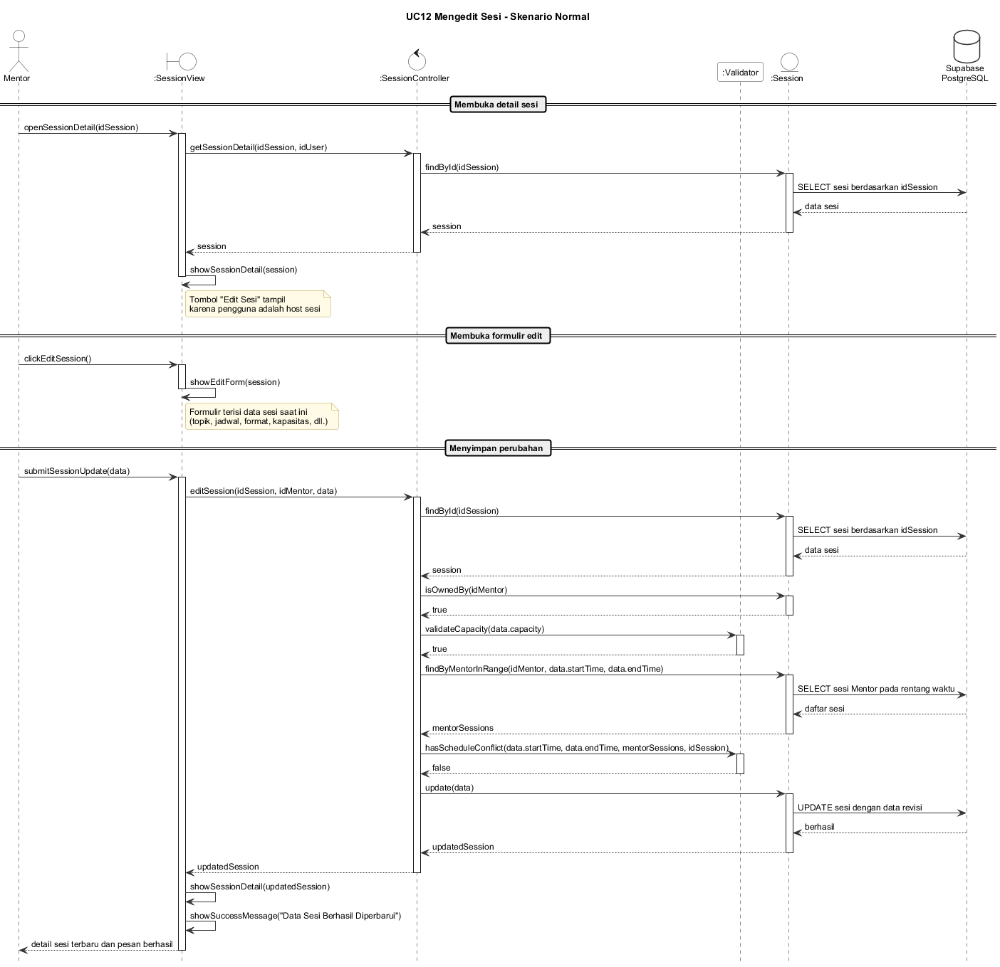

<i>Gambar 3.12.1. Sequence Diagram UC12 - Skenario Normal</i>

Mentor membuka detail sesi melalui *SessionView*, yang meminta data sesi ke *SessionController*. Setelah Mentor menekan "Edit Sesi", *SessionView* menampilkan formulir yang sudah terisi data sesi saat ini. Saat Mentor menekan "Simpan Perubahan", *SessionController* memastikan Mentor adalah pemilik sesi, meminta *Validator* memeriksa kapasitas (1–20 peserta) dan tabrakan jadwal terhadap sesi Mentor yang lain, lalu memperbarui *Session* di basis data dan mengembalikan data terbaru untuk ditampilkan bersama pesan "Data Sesi Berhasil Diperbarui".

- **Skenario Alternatif 1: Jadwal yang Direvisi Mentor Bertabrakan dengan Sesi Lain**

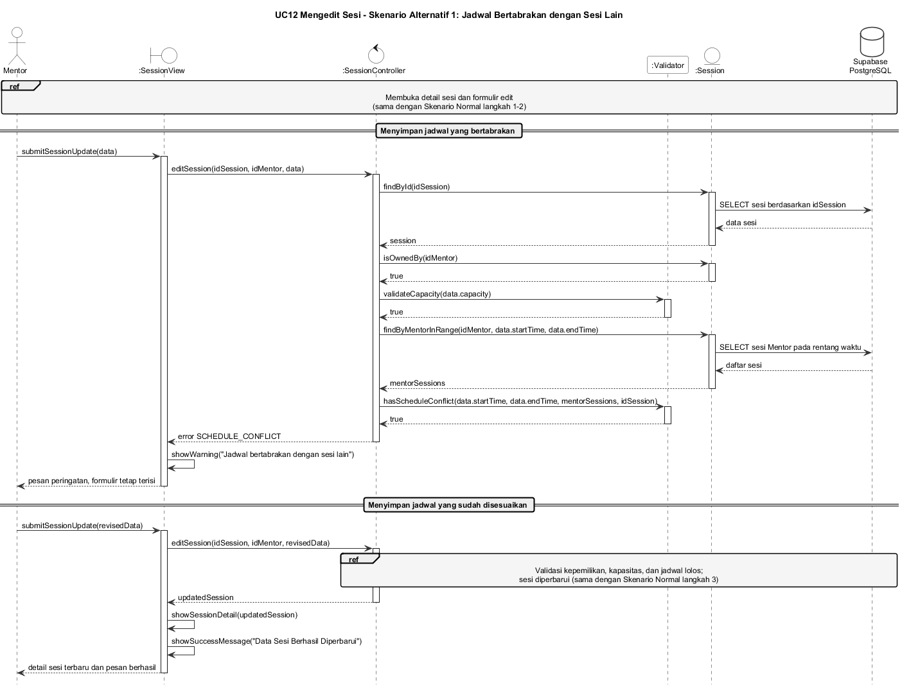

<i>Gambar 3.12.2. Sequence Diagram UC12 - Jadwal Bertabrakan dengan Sesi Lain</i>

*Validator* mendeteksi tabrakan jadwal sehingga *SessionController* menolak pembaruan dengan galat `SCHEDULE_CONFLICT` tanpa mengubah basis data. *SessionView* menampilkan peringatan dan mempertahankan isi formulir. Setelah Mentor menyesuaikan jadwal dan mengirim ulang, alur berlanjut seperti skenario normal.

- **Skenario Alternatif 2: Jumlah Partisipan yang Direvisi Mentor Lebih Sedikit dari Batas Minimum**

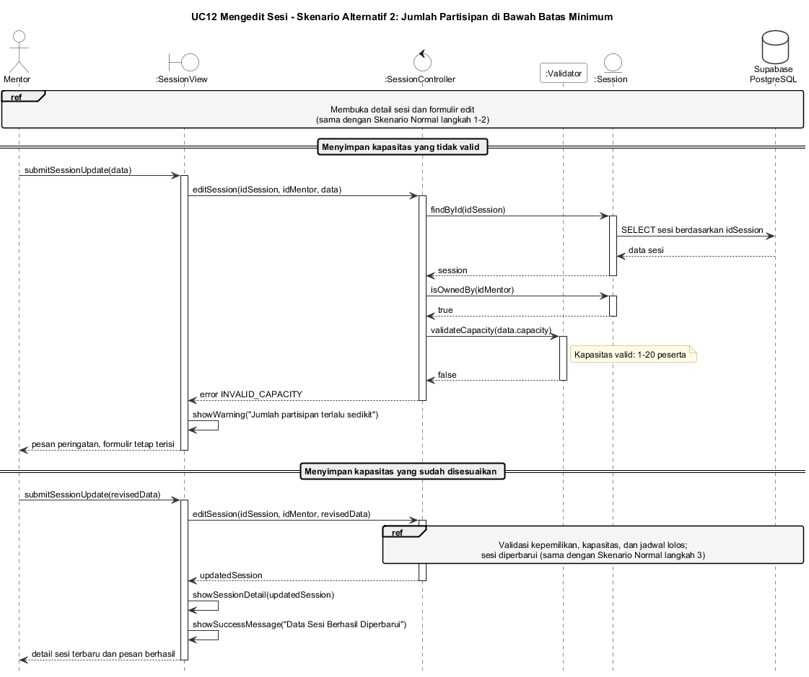

<i>Gambar 3.12.3. Sequence Diagram UC12 - Jumlah Partisipan di Bawah Batas Minimum</i>

*Validator* menyatakan kapasitas tidak valid sehingga *SessionController* mengembalikan galat `INVALID_CAPACITY` sebelum pemeriksaan jadwal dilakukan. *SessionView* menampilkan peringatan jumlah partisipan terlalu sedikit. Setelah Mentor memperbaiki batas peserta, alur berlanjut seperti skenario normal.

### 3.12.3 Diagram Kelas

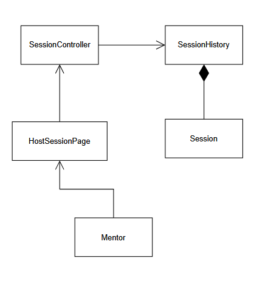

<i>Gambar 3.12.4. Diagram Kelas Mengedit Sesi</i>

## 3.13 Use Case Melihat Feedback Sesi

**ID Use Case:** *UC13*  
**Nama Use Case:** *Melihat Feedback Sesi*

### 3.13.1 Identifikasi Kelas

Mentor membuka sesi yang telah selesai dari halaman riwayat, sehingga *HistoryView* dilibatkan sebagai titik awal navigasi. Daftar riwayat sudah dimuat pada UC06, sehingga kelas *SessionHistory* tidak dipanggil kembali pada use case ini. Pengambilan feedback ditangani oleh *FeedbackController*, yang juga memeriksa bahwa sesi telah selesai dan dimiliki oleh Mentor yang meminta.

Tabel 3.13. Identifikasi Kelas Use Case UC13

| No | Nama Kelas Perancangan | Nama Kelas Analisis Terkait |
|:--- | :--- | :--- |
| 1 | *HistoryView* | *C24 (HistoryPage), C07 (SessionHistory)* |
| 2 | *SessionView* | *C18 (HostSessionPage)* |
| 3 | *SessionController* | *C13 (SessionControl)* |
| 4 | *FeedbackController* | *C14 (FeedbackControl)* |
| 5 | *Session* | *C04 (Session)* |
| 6 | *Feedback* | *C06 (Feedback)* |
| 7 | *User* | *C01 (User)* |
| 8 | *Mentor* | *C02 (Mentor)* |
| 9 | *Mentee* | *C03 (Mentee)* |

### 3.13.2 Sequence Diagram

- **Skenario Normal**

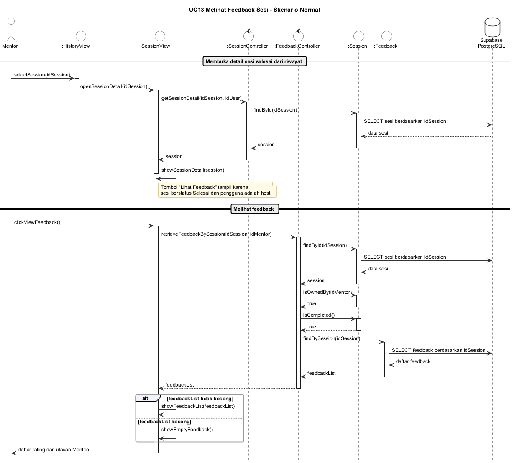

<i>Gambar 3.13.1. Sequence Diagram UC13 - Skenario Normal</i>

Mentor memilih sesi berstatus Selesai pada *HistoryView*, lalu *SessionView* menampilkan detail sesi beserta tombol "Lihat Feedback". Saat tombol ditekan, *FeedbackController* memastikan sesi dimiliki Mentor tersebut dan telah selesai, lalu mengambil seluruh *Feedback* untuk sesi itu dari basis data. *SessionView* menampilkan daftar rating dan ulasan, atau keadaan kosong apabila belum ada Mentee yang memberikan feedback.

SKPL tidak mendefinisikan skenario alternatif untuk UC13, sehingga hanya skenario normal yang dimodelkan.

### 3.13.3 Diagram Kelas

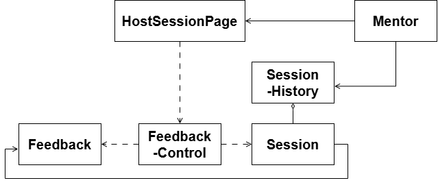

<i>Gambar 3.13.2. Diagram Kelas Melihat Feedback Sesi</i>

## 3.14 Use Case Membuka Beranda Utama

**ID Use Case:** *UC14*  
**Nama Use Case:** *Membuka Beranda Utama*

### 3.14.1 Identifikasi Kelas

Verifikasi sesi aktif pengguna dilakukan oleh *UserController* melalui *AuthAdapter* yang terhubung ke Supabase Auth. Pengambilan sesi terdekat dan algoritma *matchmaking* tetap berada di *SessionController*, sedangkan *Dashboard* pada SKPL direalisasikan sebagai *DashboardView* yang hanya menampilkan hasil.

Tabel 3.14. Identifikasi Kelas Use Case UC14

| No | Nama Kelas Perancangan | Nama Kelas Analisis Terkait |
|:--- | :--- | :--- |
| 1 | *DashboardView* | *C11 (Dashboard)* |
| 2 | *UserController* | *C12 (UserControl)* |
| 3 | *AuthAdapter* | *— (komponen integrasi eksternal, Tabel 2.3)* |
| 4 | *SessionController* | *C13 (SessionControl)* |
| 5 | *User* | *C01 (User)* |
| 6 | *Mentor* | *C02 (Mentor)* |
| 7 | *Mentee* | *C03 (Mentee)* |
| 8 | *Session* | *C04 (Session)* |
| 9 | *Preference* | *C09 (Preference)* |

### 3.14.2 Sequence Diagram

- **Skenario Normal**

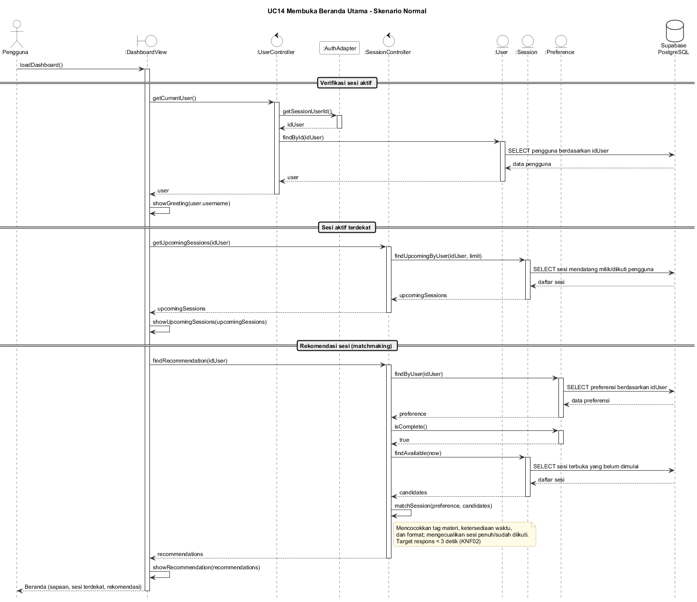

<i>Gambar 3.14.1. Sequence Diagram UC14 - Skenario Normal</i>

*DashboardView* meminta data pengguna yang sedang masuk ke *UserController*, yang memverifikasi sesi autentikasi melalui *AuthAdapter* lalu mengambil data *User* untuk pesan sapaan. Selanjutnya *SessionController* mengambil daftar sesi aktif terdekat milik atau yang diikuti pengguna. Untuk rekomendasi, *SessionController* mengambil *Preference* pengguna, memastikan preferensinya lengkap, mengambil sesi yang masih terbuka, lalu menjalankan `matchSession()` berdasarkan tag materi, ketersediaan waktu, dan format belajar. Proses ini dirancang selesai dalam waktu kurang dari 3 detik sesuai KNF02.

- **Skenario Alternatif 1: Preferensi Belum Diatur (Khusus Mentee)**

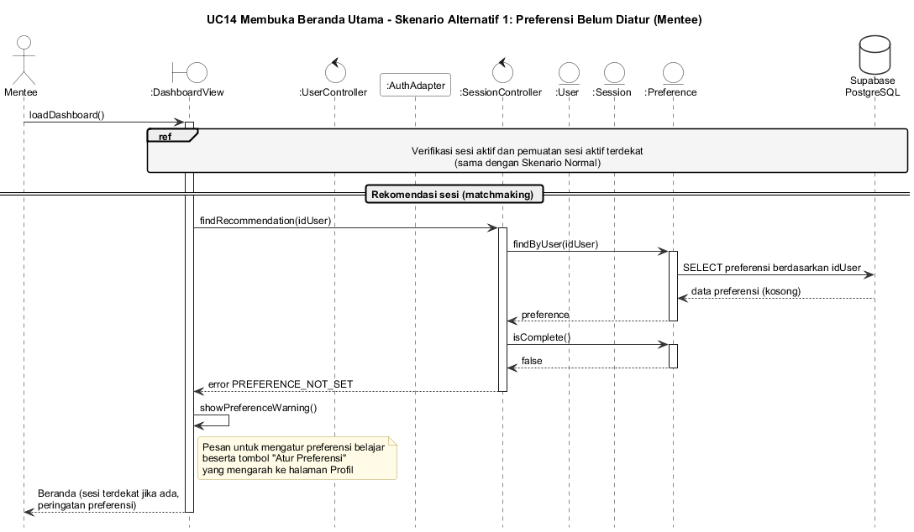

<i>Gambar 3.14.2. Sequence Diagram UC14 - Preferensi Belum Diatur</i>

Verifikasi sesi dan pemuatan sesi terdekat berjalan seperti skenario normal. Ketika `isComplete()` pada *Preference* bernilai `false`, *SessionController* tidak menjalankan *matchmaking* dan mengembalikan galat `PREFERENCE_NOT_SET`. *DashboardView* menampilkan pesan peringatan beserta tombol "Atur Preferensi" yang mengarah ke halaman Profil.

### 3.14.3 Diagram Kelas

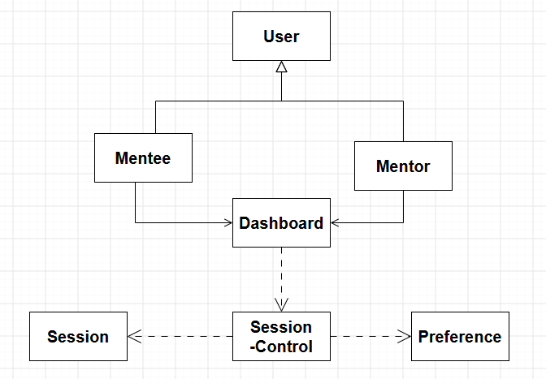

<i>Gambar 3.14.3. Diagram Kelas Membuka Beranda Utama</i>

## 3.15 Use Case Melihat Profil

**ID Use Case:** *UC15*  
**Nama Use Case:** *Melihat Profil*

### 3.15.1 Identifikasi Kelas

Halaman profil digunakan untuk melihat profil sendiri maupun pengguna lain, sehingga *ProfileView* menerima `idUser` sebagai parameter. Data identitas dan tag materi disimpan pada kelas yang berbeda, yaitu *Profile* dan *Preference*, sehingga *UserController* menyediakan dua operasi pengambilan data.

Tabel 3.15. Identifikasi Kelas Use Case UC15

| No | Nama Kelas Perancangan | Nama Kelas Analisis Terkait |
|:--- | :--- | :--- |
| 1 | *ProfileView* | *C16 (ProfilePage)* |
| 2 | *UserController* | *C12 (UserControl)* |
| 3 | *User* | *C01 (User)* |
| 4 | *Profile* | *C10 (Profile)* |
| 5 | *Preference* | *C09 (Preference)* |

### 3.15.2 Sequence Diagram

- **Skenario Normal**

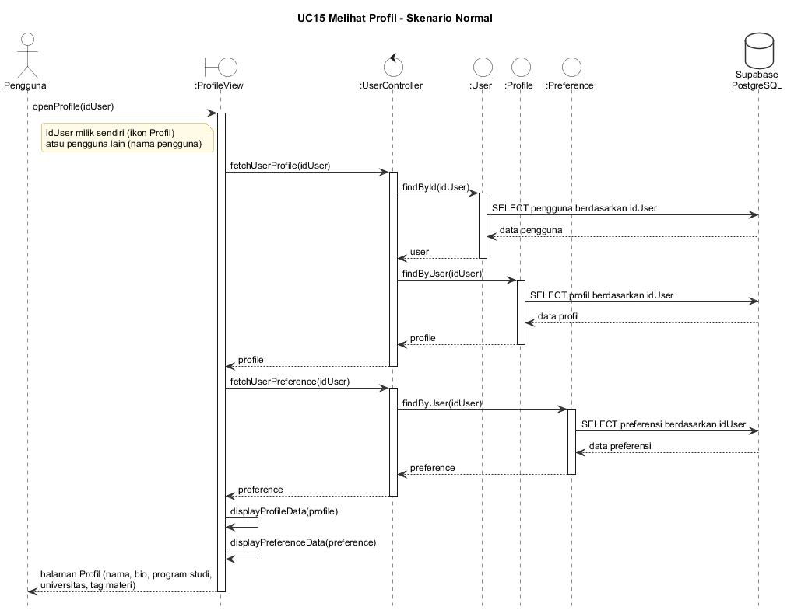

<i>Gambar 3.15.1. Sequence Diagram UC15 - Skenario Normal</i>

Pengguna menekan ikon Profil miliknya atau nama pengguna lain, lalu *ProfileView* meminta data profil ke *UserController*. *UserController* memastikan *User* dengan `idUser` tersebut ada, lalu mengambil *Profile* (nama, universitas, program studi, bio). *ProfileView* kemudian meminta *Preference* untuk menampilkan tag materi, lalu menampilkan seluruh data pada halaman Profil.

- **Skenario Alternatif 1: Profil Tidak Ditemukan**

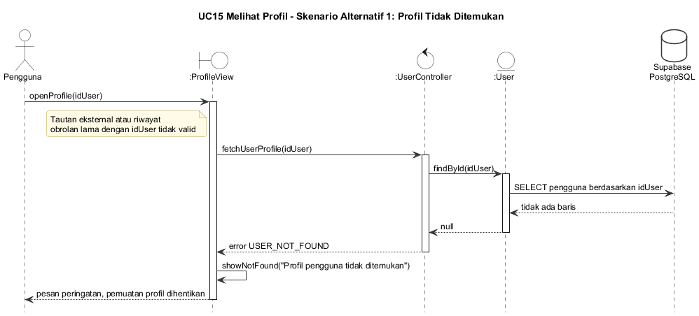

<i>Gambar 3.15.2. Sequence Diagram UC15 - Profil Tidak Ditemukan</i>

Apabila `findById()` tidak menemukan pengguna karena ID tidak valid atau akun telah dihapus, *UserController* mengembalikan galat `USER_NOT_FOUND`. *ProfileView* menampilkan pesan "Profil pengguna tidak ditemukan" dan tidak melanjutkan pemuatan data profil maupun preferensi.

### 3.15.3 Diagram Kelas

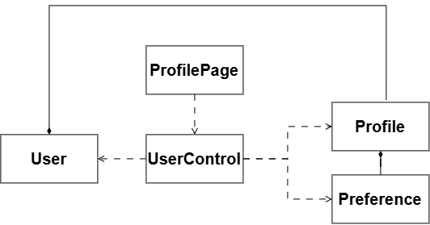

<i>Gambar 3.15.3. Diagram Kelas Melihat Profil</i>

Sumber PlantUML untuk seluruh sequence diagram pada subbab 3.5–3.15 tersedia di folder `assets/diagram/src/`.

 

---

# BAB 4: Diagram Kelas Keseluruhan

## 4.1 Diagram Kelas

<i>Gambar 4.1. Diagram Kelas Perancangan Keseluruhan PeerUP</i>

Tabel 4.1. Daftar Kelas Perancangan Keseluruhan

| ID Kelas | Nama Kelas | Atribut | Metode/Operasi |
| :--- | :--- | :--- | :--- |
| *C01* | *User* | *idUser, username, email, passwordHash* | *register(), login(), logout(), saveAccount(), getProfile(), openDashboard(), openSessionDashboard(), checkSchedule(), getUserID(), isActive(), createMessage(), sendMessage()* |
| *C02* | *Mentor* | *listSessionsMade, feedbackList* | *receiveFeedback(), viewFeedback()* |
| *C03* | *Mentee* | *attendedSessions, listSessionsJoined* | *giveFeedback(), checkCompletedSession()* |
| *C04* | *Session* | *idSession, topic, schedule, scheduledTime, format, capacity, userList, status, reasonNotConducted, groupChat* | *saveSession(), addParticipant(), checkCapacity(), getSessionDetails(), getSessionStatus(), setStatus(), getStatus(), isCompleted(), openGroupChat(), pushNotification(), getSessionID(), editTitle(), editDescription(), editPreference(), editSchedule()* |
| *C05* | *GroupChat* | *listChatMessage, listMentee, mentor* | *searchMessage(), displayMessage(), editMessage(), deleteMessage()* |
| *C06* | *Feedback* | *idFeedback, rating, comment, date* | *setRating(), setComment(), getRating(), getComment(), getDate()* |
| *C07* | *SessionHistory* | *historyList, completedSessions, cancelledSessions, oncomingSession* | *getArchivedSessions(), getCompletedSessions(), addSessionToHistory(), updateOncomingSession()* |
| *C08* | *ChatMessage* | *sender, timeStamp, text* | *getSender(), getTime(), getText()* |
| *C09* | *Preference* | *materialTag, availability, sessionFormatPreference* | *getPreference(), getPreferenceDetails(), updatePreference()* |
| *C10* | *Profile* | *name, university, studyProgram, bio* | *getProfileData(), updateProfile()* |
| *C11* | *Dashboard* | *upcomingSessions, sessionRecommendation, listSessions* | *showSession(), matchMakeSession(), searchSession(), showRecommendation(), checkSchedule()* |
| *C12* | *UserControl* | *-* | *authLogin(), validateEmail(), processRegistration(), saveProfile(), savePreference(), fetchUserProfile()* |
| *C13* | *SessionControl* | *sessionList, sessionHistory, session* | *processSessionCreation(), validateScheduleConflict(), validateCapacity(), processRegistration(), processSessionConfirmation(), updateSessionStatus(), fetchUserHistory(), getUpcomingSessions(), findRecommendation(), matchSession(), editSession(), cancelSession(), deleteSession()* |
| *C14* | *FeedbackControl* | *feedbackList* | *validateFeedback(), submitFeedback(), saveFeedback(), retrieveFeedbackBySession()* |
| *C15* | *LoginPage* | *-* | *showForm(), submitForm()* |
| *C16* | *ProfilePage* | *-* | *displayProfileData(), displayPreferenceData(), submitUpdate()* |
| *C17* | *SessionPage* | *confirmationPrompt* | *showSessionDetails(), showConfirmationPrompt(), submitConfirmation()* |
| *C18* | *HostSessionPage* | *-* | *showCreateForm(), submitSessionData(), showFeedbackList()* |
| *C19* | *ParticipantSessionPage* | *-* | *showSessionDetails(), submitJoinRequest()* |
| *C20* | *FeedbackForm* | *rating, comment* | *showForm(), submitFeedback()* |
| *C21* | *GroupChatPage* | *-* | *displayMessage()* |
| *C22* | *Notification* | *notificationId, title, content, timestamp, isRead* | *markAsRead(), showContent(), getTime(), openApp()* |
| *C23* | *PopUpNotification* | *-* | *markAsRead(), showContent(), getTime(), openApp()* |
| *C24* | *HistoryPage* | *historyList* | *displayHistoryList(), showEmptyState()* |

 

---

# BAB 5: Matriks Kerunutan

Matriks kerunutan berikut memetakan keterkaitan antara setiap kelas perancangan dengan *use case* yang diimplementasikannya pada perangkat lunak **PeerUP**.

Tabel 5.1. Matriks Kerunutan Kelas terhadap Use Case

| Kelas | Use Case Terkait |
| :--- | :--- |
| *C01 - User* | *UC01, UC02, UC05, UC06, UC07, UC08, UC09, UC14, UC15* |
| *C02 - Mentor* | *UC01, UC02, UC03, UC05, UC06, UC07, UC08, UC09, UC11, UC12, UC13, UC14, UC15* |
| *C03 - Mentee* | *UC01, UC02, UC04, UC05, UC06, UC07, UC08, UC09, UC10, UC14, UC15* |
| *C04 - Session* | *UC03, UC04, UC05, UC06, UC07, UC08, UC09, UC10, UC11, UC12, UC13, UC14* |
| *C05 - GroupChat* | *UC08* |
| *C06 - Feedback* | *UC07, UC13* |
| *C07 - SessionHistory* | *UC05, UC06, UC10, UC11, UC12, UC13* |
| *C08 - ChatMessage* | *UC08* |
| *C09 - Preference* | *UC02, UC04, UC14, UC15* |
| *C10 - Profile* | *UC01, UC02, UC15* |
| *C11 - Dashboard* | *UC01, UC04, UC06, UC09, UC14* |
| *C12 - UserControl* | *UC01, UC02, UC15* |
| *C13 - SessionControl* | *UC03, UC04, UC05, UC06, UC10, UC11, UC12, UC14* |
| *C14 - FeedbackControl* | *UC07, UC13* |
| *C15 - LoginPage* | *UC01* |
| *C16 - ProfilePage* | *UC02, UC15* |
| *C17 - SessionPage* | *UC03, UC04, UC05, UC10, UC11, UC12* |
| *C18 - HostSessionPage* | *UC03, UC05, UC11, UC12, UC13* |
| *C19 - ParticipantSessionPage* | *UC04, UC05, UC10* |
| *C20 - FeedbackForm* | *UC07, UC13* |
| *C21 - GroupChatPage* | *UC08* |
| *C22 - Notification* | *UC09* |
| *C23 - PopUpNotification* | *UC09* |
| *C24 - HistoryPage* | *UC06* |
