<h1>
IF2150 REKAYASA PERANGKAT LUNAK
 
TUGAS 5
 
DESKRIPSI PERANCANGAN PERANGKAT LUNAK (DPPL)
</h1>
 

## *antri.in*

 

### Untuk: *Angel*

Dipersiapkan oleh:
| Informasi | Keterangan |
| --- | --- |
| Kelas | *K01* |
| Kelompok | *10*  |

| NIM | Nama |
|---|---|
| *13525145* | *Muhammad Nur Fikri Hariyawan* |
| *13525085* | *Bayu Palamarta Wirawan*       |
| *13525133* | *Chatima Anandakhorita*        |
| *13525148* | *Athallah Nanda Andita*        |
| *13525091* | *Muhammad Fauzi Muharam*       |
---

## Daftar Perubahan

| Revisi | Deskripsi |
| :--- | :--- |
| *A* | *Menambahkan mulaiTimer() pada kelas KelolaAntreanController, hapusMenu() pada kelas menu, dan handleFetchMenuDetail() pada kelas KelolaMenuController* |
| *B* |  |
| *C* |  |
| ... |  |

---

 

> **Petunjuk pengerjaan:** *[Silahkan hapus bagian ini setelah selesai mengerjakan]*
>
> Dokumen ini melanjutkan **Spesifikasi Kebutuhan Perangkat Lunak (SKPL)** dan **Arsitektur Perangkat Lunak (APL)**. Gunakan nama, ID, kebutuhan, dan use case yang konsisten dengan kedua dokumen tersebut. Contoh pola ID baru di bawah dapat disesuaikan dengan kesepakatan kelompok, ID yang sudah ada tetap dipertahankan.

 

---

# BAB 1: Pendahuluan

## 1.1 Tujuan Penulisan Dokumen
Tuliskan dengan ringkas tujuan dokumen DPPL ini dibuat dan siapa saja yang akan menggunakan dokumen ini.

## 1.2 Lingkup Masalah
Fenomena makanan viral memicu antrean panjang berjam-jam yang membebani pelanggan, karena mereka harus datang lebih awal, menunggu di lokasi, dan mengantre tanpa informasi stok menu maupun estimasi waktu tunggu, ditambah proses pemesanan dan pembayaran di kasir yang memakan waktu 2-5 menit per transaksi. Aplikasi pesan-antar seperti GoFood, GrabFood, dan ShopeeFood pun hanya berfokus pada pengantaran dan tidak membatasi kuota transaksi per rentang waktu, sehingga restoran kewalahan saat pesanan online dan pelanggan fisik datang bersamaan. Celah utamanya adalah belum adanya integrasi antara pemantauan antrean real-time, pengaturan slot waktu, serta pemesanan dan pembayaran awal, sehingga antri.in hadir untuk menghapus waktu berpikir di kasir, meratakan kedatangan pelanggan berbasis kuota jam, dan memberi kebebasan bagi konsumen selama menunggu. Dari fenomena tersebut perangkat lunak bernama antri.in yang akan kami kembangkan merupakan sistem pemesanan makanan viral dengan antrean digital berbasis web yang bertujuan agar pengguna tidak perlu mengantri secara langsung pada restoran. Sistem ini memungkinkan pengguna untuk mencari restoran makanan viral, melihat informasi makanan dan restoran, melakukan pemesanan, memantau antrean dan estimasi pesanan akan selesai, serta fitur booking tempat jika pengguna memutuskan untuk dine-in. Cara kerja dari aplikasi berbasis web ini adalah pertama pengguna memilih restoran yang tersedia, kemudian pengguna dapat membaca informasi mengenai makanan yang terdapat di restoran tersebut. Jika sudah, pengguna dapat memilih makanan yang akan dibeli dan lanjut ke proses pembayaran. Ketika pengguna sudah membayar, barulah akan mendapatkan nomor antrian dan estimasi pesanan selesai sehingga pengguna dapat memperkirakan waktu kedatangan.

## 1.3 Definisi, Istilah, dan Singkatan
Semua definisi dan singkatan yang digunakan dalam dokumen ini beserta penjelasannya.

Tabel 1.3. Definisi Istilah dan Singkatan

| Singkatan, Akronim, atau Istilah | Penjelasan |
| :--- | :--- |
| *P/L* | *Singkatan dari Perangkat Lunak, yaitu aplikasi yang memberikan perintah kepada komputer untuk menjalankan tugas tertentu.* |
| *DPPL* | *Singkatan dari Spesifikasi Kebutuhan Perangkat Lunak, yaitu dokumen yang merangkum kriteria-kriteria yang diperlukan untuk membangun aplikasi menjalankan tugasnya.* |
| *US* | *Singkatan dari User Story.* |
| *A* | *Singkatan dari Aktivitas.* |
| *R* | *Singkatan dari Requirement.* |
| *KF* | *Singkatan dari Kebutuhan Fungsional.* |
| *KNF* | *Singkatan dari Kebutuhan Non-Fungsional.* |
| *UC* | *Singkatan dari Use Case.* |
| *C* | *Singkatan dari Class.* |
| *EARS* | *Easy Approach to Requirements Syntax, yaitu pola penulisan kebutuhan agar konsisten dan mudah diuji.* |
| *AC* | *Singkatan dari Aktor.* |
| *...* | *...* |

## 1.4 Aturan Penomoran
Tuliskan aturan penomoran (ID) yang digunakan dalam dokumen ini. Gunakan pola ID yang **sama** dengan yang sudah dipakai pada dokumen-dokumen sebelumnya, jangan membuat pola baru di dokumen ini.

Tabel 1.4. Aturan Penomoran

| Hal/Bagian | Penomoran | Keterangan |
| :--- | :--- | :--- |
| *User Story* | *USXX* | Mulai dari 01, 02, dan seterusnya |
| *Kebutuhan Fungsional* | *KFXX* | Mulai dari 01, 02, dan seterusnya |
| *Kebutuhan Non-Fungsional* | *KNFXX* | Mulai dari 01, 02, dan seterusnya |
| *Aktivitas* | *AXX* | Mulai dari 01, 02, dan seterusnya |
| *Use Case* | *UCXX* | Mulai dari 01, 02, dan seterusnya |
| *Kelas* | *CXX* | Mulai dari 01, 02, dan seterusnya |
| *Requirement* | *RXX* | Mulai dari 01, 02, dan seterusnya |
| *Aktor* | *ACXX* | Mulai dari 01, 02, dan seterusnya |
| *...* | *...* |

## 1.5 Referensi
Cantumkan dokumentasi P/L yang dirujuk oleh dokumen ini, **minimal dokumen SKPL dan APL**. Tambahkan buku, panduan, atau dokumentasi lain apabila digunakan.

Pressman, R. S., _Software Engineering: A Practitioner's Approach_, _8th Edition_, McGraw-Hill, 2015.  
Sommerville, I., _Software Engineering_, _10th Edition_, Pearson, 2016.  
Larman, C., _Applying UML and Patterns: An Introduction to Object-Oriented Analysis and Design and Iterative Development_, _3rd Edition_, Prentice Hall, 2004.

## 1.6 Deskripsi Umum Dokumen (Ikhtisar)
Dokumen DPPL antri.in ini terdiri dari lima bab yang disusun secara berurutan. Bab 1 Pendahuluan memuat tujuan penulisan dokumen, lingkup masalah, definisi istilah dan singkatan, aturan penomoran, referensi, serta ikhtisar dokumen. Bab 2 Perancangan Arsitektu) menjelaskan rancangan lingkungan implementasi, pola arsitektur MVC yang menjadi acuan, identifikasi komponen, modul, dan subsistem, serta model arsitektur dalam bentuk Logical View dan Process View. Bab 3 Realisasi Use Case menguraikan realisasi setiap use case melalui identifikasi kelas perancangan, sequence diagram untuk skenario normal dan alternatif, serta diagram kelas per use case. Bab 4 Diagram Kelas Keseluruhan menyajikan diagram kelas perancangan seluruh sistem beserta daftar atribut dan metode setiap kelas. Bab 5 Matriks Kerunutan memetakan setiap kelas perancangan ke use case terkait sebagai bukti keterlacakan antara SKPL, APL, dan DPPL.

 

---

# BAB 2: Perancangan Arsitektur

## 2.1 Rancangan Lingkungan Implementasi

Sebutkan *operating system*, DBMS, *development tools*, *filing system*, dan bahasa pemrograman yang digunakan.

| Komponen | Spesifikasi |
| :--- | :--- |
| *Server* | *Lokal (localhost)* |
| *Client* | *Google Chrome* |
| *DBMS* | *PostgreSQL 15+* |
| *OS* | *Windows 11* |
| *Bahasa Pemrograman* | *Typescript* |
| *API* | *REST API* |
| *filing system* | *NTFS* |
| *Code Editor / IDE* | *Visual Studio Code* |
| *Package Manager* | *npm* |
| *Version Control* | *Git* |
| *API Testing Tool* | *Postman* |
| *Database Management Tool* | *pgAdmin* |

## 2.2 Style/Pattern Arsitektur Acuan

Tentukan *architectural style* atau *pattern* yang menjadi acuan aplikasi, misalnya *layered architecture*, *client-server*, *repository*, *pipe and filter*, atau MVC (*Model-View-Controller*).

Gunakan hasil **BAB 1 Style/Pattern Arsitektur Acuan pada dokumen APL**, termasuk alasan pemilihan dan gambar penerapannya pada P/L kelompok. Gunakan komponen aplikasi sendiri pada gambar, bukan hanya contoh pola umum.

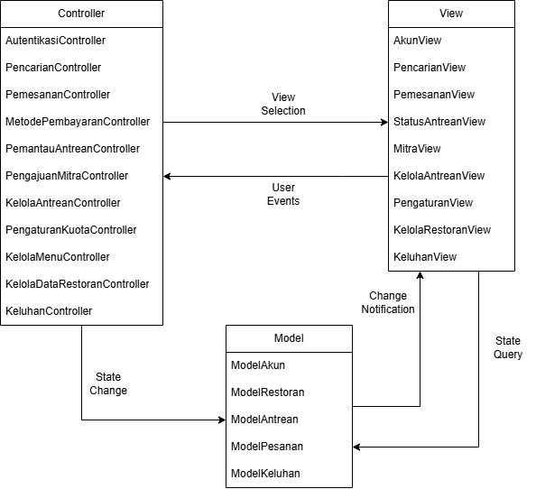

<i>Gambar 1. Arsitektur MVC</i>

## 2.3 Identifikasi Komponen / Modul / Subsistem

Identifikasi komponen, modul, atau subsistem penyusun aplikasi berdasarkan *pattern* yang telah ditetapkan. Jelaskan tanggung jawab masing-masing komponen. Pengelompokan dapat mengikuti lapisan arsitektur atau fungsi/peran komponen dalam sistem.

Ambil dari **Tabel 2.1 dokumen APL**, lalu kelompokkan berdasarkan lapisan (Model/View/Controller). Kolom **Jenis** diisi sesuai pattern, misalnya View, Controller, Model, Service, Repository. Satu komponen merepresentasikan saatu tanggung jawab utama yang jelas,

Tabel 2.3. Identifikasi Komponen/Modul/Subsistem

| Nama Komponen/Modul/Subsistem | Jenis | Penjelasan |
| :--- | :--- | :--- |
| *ModelAkun*                 | *Model*                | *Menyimpan identitas dan kredensial pengguna (Pelanggan, Admin), hak akses (role), serta token dan status sesi login.*     |
| *ModelRestoran*               | *Model*                | *Menyimpan profil restoran mitra, status verifikasi dan keaktifan, dokumen perizinan, daftar menu beserta stok, serta konfigurasi kuota antrean dan kapasitas meja.*                                                       |
| *ModelAntrean*                | *Model*                | *Menyimpan antrean per restoran dan tiket antrean (nomor urut, tipe dine-in/takeaway, status, estimasi waktu tunggu).*                                      |                                      |
| *ModelPesanan*           | *Model*          | *Menyimpan keranjang sementara, data pesanan (mode, jumlah rombongan, jadwal booking, total harga, status), dan riwayat transaksi pembayaran.*                                             |
| *ModelKeluhan*         | *Model*          | *Menyimpan isi, waktu kirim, dan status keluhan pelanggan.*                                          |
| *AkunView*        | *View*          | *Halaman registrasi, login, profil, dan dialog konfirmasi logout untuk Pelanggan, Restoran, dan Admin.*                |
| *PencarianView*           | *View*          | *Halaman pencarian dan filter restoran, kartu ringkasan restoran, serta pesan hasil kosong.*                                                              |
| *PemesananView*                      | *View*               | *Halaman pemilihan menu dan mode layanan (dine-in, takeaway, booking), keranjang, checkout, pembayaran, dan konfirmasi tiket antrean.*                        |
| *StatusAntreanView*                   | *View*               | *Halaman pelanggan untuk melihat status antrean secara real-time dan menerima notifikasi pengambilan pesanan.*       |
| *MitraView*                     | *View*               | *Formulir pendaftaran mitra restoran (restoran) dan halaman peninjauan pengajuan (admin).*          |
| *KelolaAntreanView*                   | *View*               | *Dashboard antrean restoran, tombol dequeue, dan dialog konfirmasi dequeue.*                                |
| *PengaturanView*                    | *View*           | *Halaman restoran untuk mengatur kuota antrean, kapasitas meja, serta menu dan stok makanan.*                                                      |
| *KelolaRestoranView*       | *View* | *Halaman admin untuk melihat daftar restoran mitra dan dialog konfirmasi penghapusan restoran.* |
| *KeluhanView*                    | *View*    | *Formulir pengiriman keluhan (pelanggan) dan daftar keluhan (admin).*   |
| *AutentikasiController*                    | *Controller*    | *Registrasi akun, validasi kredensial, penerbitan token sesi, dan logout untuk semua peran.*   |
| *PencarianController*                    | *Controller*    | *Menjalankan pencarian dan filter restoran, mengambil preview menu dan status antrean.*   |
| *PemesananController*                    | *Controller*    | *Mengatur alur pemesanan: mencatat item ke keranjang, memvalidasi stok dan kuota meja, memvalidasi booking (maks. 7 hari), membuat pesanan, serta menerbitkan tiket antrean setelah pembayaran lunas.*   |
| *MetodePembayaranController*                    | *Controller*    | *Formulir pengiriman keluhan (pelanggan) dan daftar keluhan (admin).Membuat tagihan, memverifikasi status pembayaran, dan menangani timeout melalui PaymentGatewayAdapter.*   |
| *PemantauAntreanController*                    | *Controller*    | *Membaca data antrean dan mendorong pembaruan status antrean ke pelanggan secara real-time.*   |
| *PengajuanMitraController*                    | *Controller*    | *Memvalidasi dan menyimpan pengajuan mitra, serta memproses keputusan admin (setujui/tolak) dan memicu notifikasi email.*   |
| *KelolaAntreanController*                    | *Controller*    | *Menampilkan dashboard antrean, memproses dequeue manual maupun otomatis (timeout 30 menit), dan memperbarui antrean.*   |
| *PengaturanKuotaController*                    | *Controller*    | *Memvalidasi input dan menyimpan kuota antrean serta kapasitas meja, termasuk penutupan antrean sementara.*   |
| *KelolaMenuController*                    | *Controller*    | *Menambah, mengubah, menghapus menu, dan memperbarui stok.*   |
| *KelolaDataRestoranController*                    | *Controller*    | *Menonaktifkan dan menghapus data restoran beserta relasi menunya.*   |
| *KeluhanController*                    | *Controller*    | *Menerima dan menyimpan keluhan pelanggan serta menampilkan daftar keluhan kepada admin.*   |
| *PaymentGatewayAdapter*                    | *Integrasi Eksternal*    | *Penghubung ke Payment Gateway: mengirim permintaan transaksi dan menerima status lunas, gagal, atau kedaluwarsa. Penyedia dapat diganti tanpa mengubah controller.*   |
| *NotifikasiEmail*                    | *Integrasi Eksternal*    | *Mengirim email hasil verifikasi pendaftaran mitra (diterima/ditolak) melalui layanan email pihak ketiga.*   |
| *Payment Gateway*                    | *Sistem Eksternal*    | *Sistem pihak ketiga yang memvalidasi dan mengotorisasi pembayaran digital (penyedia belum ditentukan).*   |
| *Layanan Email*                    | *Sistem Eksternal*    | *Layanan pengiriman email pihak ketiga.*   |
| *BasisDataPostgreSQL*                    | *Pendukung*    | *Penyimpanan seluruh data transaksional dan operasional pada PostgreSQL 15+ di lingkungan sistem sendiri; diakses oleh seluruh komponen Model.*   |
| *...* | *...* | *...* |

## 2.4 Model Arsitektur Perangkat Lunak

Buat model arsitektur dalam bentuk satu atau lebih *view* yang memperlihatkan interaksi dan kolaborasi komponen, modul, serta subsistem dalam menjalankan fungsi sistem. Pilih notasi yang sesuai. Contoh *view*: *Logical View*, *Process View*, *Development View*, dan *Physical View*.

Gunakan hasil **BAB 3 Model Arsitektur Perangkat Lunak pada dokumen APL**. 

### 2.4.1 Logical View

Tuliskan secara singkat model arsitektur yang dipilih dan alasan model tersebut cocok untuk aplikasi.

Arsitektur aplikasi **antri.in** dibagi menjadi beberapa lapisan utama:
1. **Layer View (Antarmuka Pengguna)**
   - Berfungsi untuk menampilkan antarmuka interaktif kepada pengguna, baik untuk pelanggan, pengelola restoran, maupun pihak mitra.
   - **Komponen**: `AkunView`, `KeluhanView`, `StatusAntreanView`, `KelolaAntreanView`, `PemesananView`, `PencarianView`, `KelolaRestoranView`, `PengaturanView`, dan `MitraView`. Setiap komponen *view* menangani fungsi spesifik seperti melihat status antrean, pemesanan menu, hingga pendaftaran mitra baru.

2. **Layer Controller (Logika Bisnis & Kendali)**
   - Menerima input dari *View*, memproses alur kerja (*use case*), dan memperbarui data pada *Model*.
   - **Komponen**: `AutentikasiController`, `KeluhanController`, `PemantauAntreanController`, `KelolaAntreanController`, `PemesananController`, `MetodePembayaranController`, `PencarianController`, `KelolaDataRestoranController`, `PengaturanKuotaController`, `KelolaMenuController`, dan `PengajuanMitraController`.

3. **Layer Model (Domain Data & Aturan Bisnis)**
   - Mengelola data utama, status aplikasi, serta transaksi bisnis.
   - **Komponen**: 
     - `ModelAkun`: Mengelola sesi dan kredensial pengguna.
     - `ModelKeluhan`: Mengelola catatan keluhan dari pengguna.
     - `ModelAntrean`: Mengelola siklus antrean, nomor tiket, dan status penerbitan antrean.
     - `ModelPesanan`: Mengelola rincian transaksi dan pesanan pelanggan.
     - `ModelRestoran`: Mengelola data restoran, stok menu, kuota meja, dan status kemitraan.

4. **Integrasi Eksternal & Layer Pendukung (Infrastructure/Persistence)**
   - **Integrasi Eksternal**:
     - `PaymentGatewayAdapter` yang terhubung ke layanan *Payment Gateway* eksternal untuk pemrosesan transaksi.
     - `NotifikasiEmail` yang terhubung ke *Layanan Email* eksternal untuk pengiriman pesan notifikasi/konfirmasi.
   - **Pendukung (Database)**: `BasisDataPostgreSQL` digunakan untuk menyimpan data relasional bagi semua model data aplikasi.

<i>Gambar 2. Logical View antri.in</i>

### 2.4.2 Process View

Process View dipilih karena antri.in memiliki tiga perilaku yang hanya terlihat saat sistem berjalan, yaitu pembayaran yang bersifat asinkron, pembaruan antrean secara *real-time*, dan proses yang dipicu oleh waktu. 

Komponen pada Tabel 2.1 berjalan di dalam proses berikut:
1. **Proses Klien (Google Chrome)**
   - Setiap pengguna yang sedang aktif, baik Pelanggan, Restoran, maupun Admin, menjalankan satu browser yang memuat komponen-komponen.
   - **Komponen**: `AkunView`, `PencarianView`, `PemesananView`, `KeluhanView`, `MitraView`, `KelolaAntreanView`, `PengaturanView`, `KelolaRestoranView`, dan `StatusAntreanView`.
2. **Proses Server Aplikasi (*localhost*, Windows 11)**
   - Satu proses server melayani banyak permintaan secara bersamaan dan terbagi menjadi empat unit eksekusi:
     - **Thread penanganan request REST**: setiap permintaan HTTP ditangani oleh satu *thread* secara sinkron. Komponen: `AutentikasiController`, `PencarianController`, `PemesananController`, `MetodePembayaranController`, `PengajuanMitraController`, `KeluhanController`, `KelolaAntreanController`, `PengaturanKuotaController`, `KelolaMenuController`, dan `KelolaDataRestoranController`.
     - **Kanal real-time**: koneksi yang tetap terbuka selama pelanggan memantau antrean, sehingga perubahan dapat didorong (*push*) tanpa pelanggan memuat ulang halaman. Komponen: `PemantauAntreanController`.
     - **Lapisan Model**: dipakai bersama oleh seluruh *thread*, sehingga akses ke data yang sama perlu dijaga dengan transaksi basis data. Komponen: `ModelAkun`, `ModelKeluhan`, `ModelPesanan`, `ModelRestoran`, dan `ModelAntrean`.
     - **Pekerja integrasi**: menangani komunikasi dengan sistem eksternal secara asinkron agar *request* pengguna tidak tertahan menunggu respons pihak luar. Komponen: `PaymentGatewayAdapter` dan `NotifikasiEmail`.

3. **Proses DBMS (PostgreSQL 15+)**
   - Proses terpisah yang menyimpan seluruh data secara persisten. **Komponen**: `BasisDataPostgreSQL`.

4. **Sistem Eksternal**
   - Proses di luar batas P/L yang berkomunikasi melalui pekerja integrasi. **Komponen**: *Payment Gateway* dan *Layanan Email*.

<i>Gambar 3. Process View antri.in</i>

 

---

# BAB 3: Realisasi Use Case

## 3.1 Use Case 1

**ID Use Case:** *UC01*  
**Nama Use Case:** *Mencari dan filter resto*

### 3.1.1 Identifikasi Kelas

Identifikasi kelas yang terkait dengan use case tersebut. Kelas di tahap perancangan dapat berbeda dengan dengan kelas di tahap analisis. Dapat menggunakan tabel di bawah:

Tabel 3.1. Identifikasi Kelas Use Case [UC01]

| No | Nama Kelas Perancangan | Nama Kelas Analisis Terkait |
|:--- | :--- | :--- |
| 1 | *ModelAkun* | *Pelanggan* |
| 2 | *ModelRestoran* | *Restoran* |
| 3 | *ModelRestoran* | *Menu* |
| 4 | *ModelAntrean* | *Antrean* |
| 5 | *PencarianView* | *PencarianRestoPage* |
| 6 | *PencarianController* | *PencarianController* |

### 3.1.2 Sequence Diagram

Buat *sequence diagram* untuk **setiap skenario use case**, mencakup skenario normal dan alternatif pada subbab 4.4 SKPL. Diagram melibatkan kelas-kelas yang telah diidentifikasi pada SKPL. 

- **Skenario Normal Serta Alternatifnya**

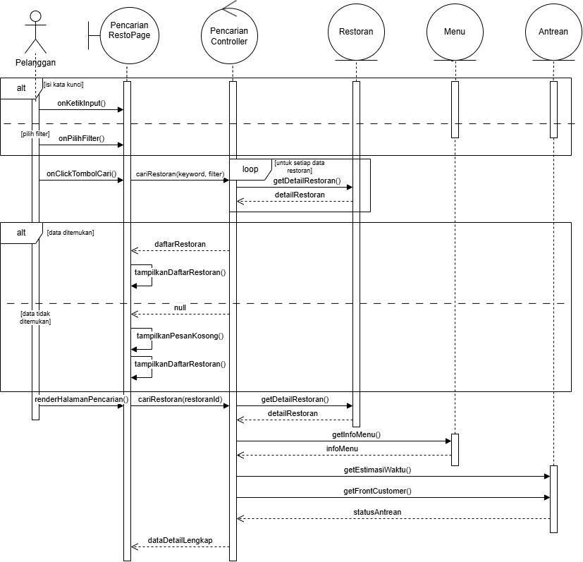

<i>Gambar 4. Sequence Diagram UC01</i>

### 3.1.3 Diagram Kelas

Buatlah diagram kelas untuk use case ini yang terdiri atas kelas-kelas dari 3.1.1. **Setiap kelas pada diagram wajib menampilkan atribut dan metode/operasi langsung di dalam kotak kelasnya**, sehingga tidak perlu membuat tabel daftar atribut dan metode per kelas pada subbab ini. Daftar lengkap atribut dan metode seluruh kelas disajikan pada Tabel 4.1 (Bab 4).

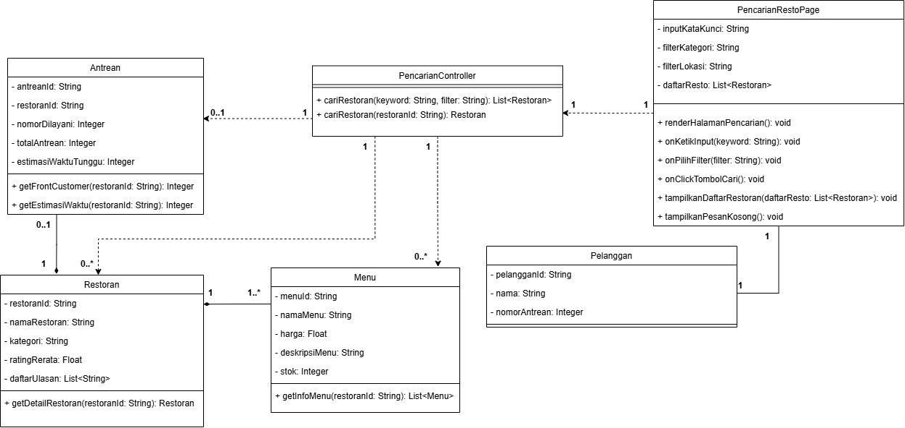

<i>Gambar 5. Diagram Kelas UC01</i>

Pada diagram, pastikan:
- Atribut dituliskan beserta visibilitas dan tipe datanya, misalnya `- email: String`.
- Operasi dituliskan beserta visibilitas, parameter, dan tipe kembaliannya, misalnya `+ login(email: String, password: String): Boolean`.
- Relasi antarkelas (asosiasi, agregasi, komposisi, generalisasi, dan dependensi) digambarkan lengkap dengan multiplisitas.
- Semua operasi yang dipanggil pada sequence diagram 3.1.2 (skenario normal dan alternatif) ada pada kelas yang bersangkutan.
- Kelas yang sama dengan kelas di use case lain memakai nama, atribut, dan metode yang konsisten.

## 3.2 Use Case 2

**ID Use Case:** *UC02*  
**Nama Use Case:** *Melakukan pemesanan dan pembayaran digital*

### 3.2.1 Identifikasi Kelas

Identifikasi kelas yang terkait dengan use case tersebut. Kelas di tahap perancangan dapat berbeda dengan dengan kelas di tahap analisis. Dapat menggunakan tabel di bawah:

Tabel 3.2. Identifikasi Kelas Use Case [UC02]

| No | Nama Kelas Perancangan | Nama Kelas Analisis Terkait |
|:--- | :--- | :--- |
| 1 | *ModelAkun* | *Pelanggan* |
| 2 | *ModelRestoran* | *Menu* |
| 3 | *ModelRestoran* | *Keranjang* |
| 4 | *ModelPesanan* | *Pesanan* |
| 5 | *MetodePembayaranController* | *MetodePembayaranController* |
| 6 | *ModelPesanan* | *RiwayatTransaksi* |
| 7 | *ModelAntrean* | *TiketAntrean* |
| ... | *...* | *...* |

### 3.2.2 Sequence Diagram

Buat *sequence diagram* untuk **setiap skenario use case**, mencakup skenario normal dan alternatif pada subbab 4.4 SKPL. Diagram melibatkan kelas-kelas yang telah diidentifikasi pada SKPL. 

- **Skenario Normal**

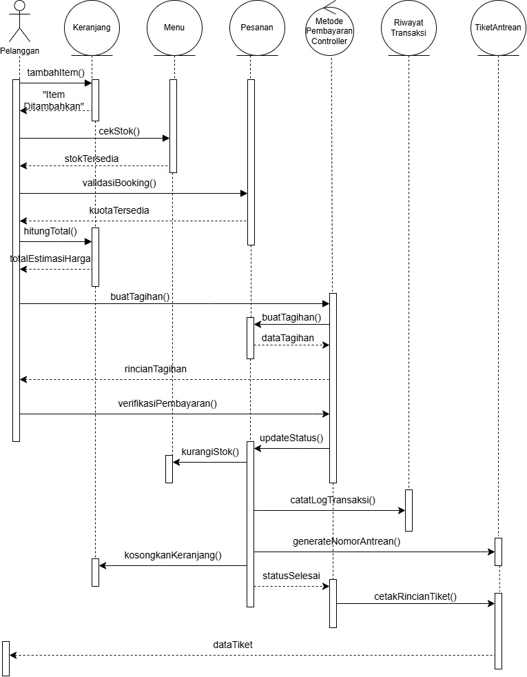

<i>Gambar 6. Sequence Diagram UC02 - Skenario Normal</i>

- **Skenario Alternatif 1: Pre-Order Takeaway**

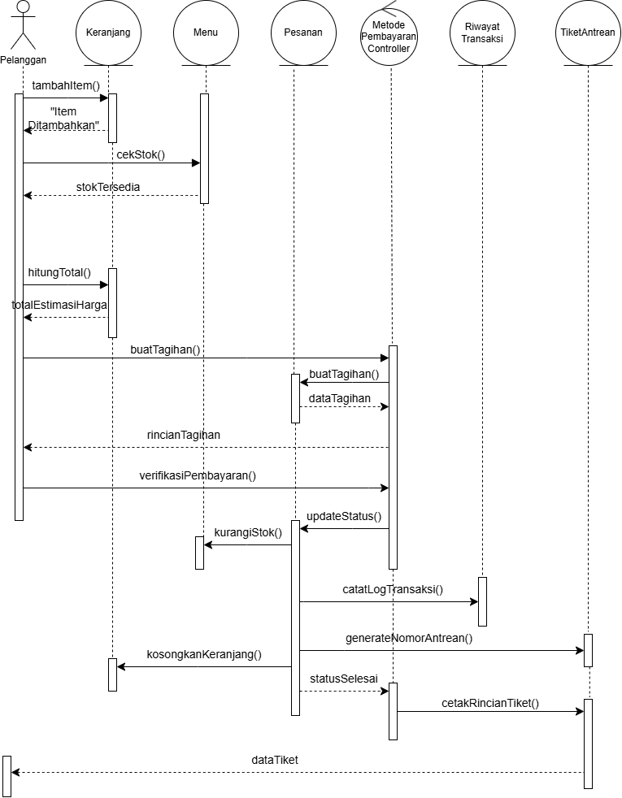

<i>Gambar 7. Sequence Diagram UC02 - Pre-Order Takeaway</i>

- **Skenario Alternatif 2: Booking Tempat**

<i>Gambar 8. Sequence Diagram UC02 - Booking Tempat</i>

 <!-- SAMA DENGAN SKENARIO NORMAL!!! -->

- **Skenario Alternatif 3: Stok Menu Habis**

<i>Gambar 9. Sequence Diagram UC03 - Stok Menu Habis</i>

 

### 3.2.3 Diagram Kelas

Buatlah diagram kelas untuk use case ini yang terdiri atas kelas-kelas dari 3.1.1. **Setiap kelas pada diagram wajib menampilkan atribut dan metode/operasi langsung di dalam kotak kelasnya**, sehingga tidak perlu membuat tabel daftar atribut dan metode per kelas pada subbab ini. Daftar lengkap atribut dan metode seluruh kelas disajikan pada Tabel 4.1 (Bab 4).

<i>Gambar 9. Diagram Kelas UC02</i>

 

## 3.3 Use Case 3

**ID Use Case:** *UC03*  
**Nama Use Case:** *Menampilkan Status Antrean*

### 3.3.1 Identifikasi Kelas

Identifikasi kelas yang terkait dengan use case tersebut. Kelas di tahap perancangan dapat berbeda dengan dengan kelas di tahap analisis. Dapat menggunakan tabel di bawah:

Tabel 3.3. Identifikasi Kelas Use Case [UC03]

| No | Nama Kelas Perancangan | Nama Kelas Analisis Terkait |
|:--- | :--- | :--- |
| 1 | *StatusAntreanView* | *HalamanStatusAntrean* |
| 2 | *PemantauAntreanController* | *PemantauAntreanController* |
| 3 | *ModelAntrean* | *TiketAntrean* |
| 4 | *ModelAntrean* | *Antrean* |
| 5 | *ModelPesanan* | *Pesanan* |
| 6 | *ModelAkun* | *Pelanggan* |
| ... | *...* | *...* |

### 3.3.2 Sequence Diagram

Buat *sequence diagram* untuk **setiap skenario use case**, mencakup skenario normal dan alternatif pada subbab 4.4 SKPL. Diagram melibatkan kelas-kelas yang telah diidentifikasi pada SKPL. 

- **Skenario Normal**

<i>Gambar 10. Sequence Diagram UC03</i>

### 3.3.3 Diagram Kelas

Buatlah diagram kelas untuk use case ini yang terdiri atas kelas-kelas dari 3.1.1. **Setiap kelas pada diagram wajib menampilkan atribut dan metode/operasi langsung di dalam kotak kelasnya**, sehingga tidak perlu membuat tabel daftar atribut dan metode per kelas pada subbab ini. Daftar lengkap atribut dan metode seluruh kelas disajikan pada Tabel 4.1 (Bab 4).

<i>Gambar 11. Diagram Kelas UC03</i>

 

## 3.4 Use Case 4

**ID Use Case:** *UC04*  
**Nama Use Case:** *Pendaftaran Mitra Restoran Baru*

### 3.4.1 Identifikasi Kelas

Identifikasi kelas yang terkait dengan use case tersebut. Kelas di tahap perancangan dapat berbeda dengan dengan kelas di tahap analisis. Dapat menggunakan tabel di bawah:

Tabel 3.4. Identifikasi Kelas Use Case [UC04]

| No | Nama Kelas Perancangan | Nama Kelas Analisis Terkait |
|:--- | :--- | :--- |
| 1 | *MitraView* | *RegistrasiRestoPage* |
| 2 | *PengajuanMitraController* | *PengajuanMitraController* |
| 3 | *ModelRestoran* | *Restoran* |
| 4 | *ModelRestoran* | *DokumenVerifikasi* |
| 5 | *ModelRestoran* | *Menu* |

### 3.4.2 Sequence Diagram

Buat *sequence diagram* untuk **setiap skenario use case**, mencakup skenario normal dan alternatif pada subbab 4.4 SKPL. Diagram melibatkan kelas-kelas yang telah diidentifikasi pada SKPL. 

- **Skenario Normal**

<i>Gambar 12. Sequence Diagram UC04</i>

- **Skenario Alternatif 1: Data Form Tidak Lengkap atau Format Tidak Sesuai**

<i>Gambar 13. Sequence Diagram UC04 - Data Form Tidak Lengkap atau Format Tidak Sesuai</i>

### 3.4.3 Diagram Kelas

Buatlah diagram kelas untuk use case ini yang terdiri atas kelas-kelas dari 3.1.1. **Setiap kelas pada diagram wajib menampilkan atribut dan metode/operasi langsung di dalam kotak kelasnya**, sehingga tidak perlu membuat tabel daftar atribut dan metode per kelas pada subbab ini. Daftar lengkap atribut dan metode seluruh kelas disajikan pada Tabel 4.1 (Bab 4).

<i>Gambar 14. Diagram Kelas UC04</i>

 

## 3.5 Use Case 5

**ID Use Case:** *UC05*  
**Nama Use Case:** *Memverifikasi Pendaftaran Restoran*

### 3.5.1 Identifikasi Kelas

Identifikasi kelas yang terkait dengan use case tersebut. Kelas di tahap perancangan dapat berbeda dengan dengan kelas di tahap analisis. Dapat menggunakan tabel di bawah:

Tabel 3.5. Identifikasi Kelas Use Case [UC05]

| No | Nama Kelas Perancangan | Nama Kelas Analisis Terkait |
|:--- | :--- | :--- |
| 1 | *MitraView* | *VerifikasiRestoranPage* |
| 2 | *PengajuanMitraController* | *PengajuanMitraController* |
| 3 | *ModelRestoran* | *Restoran* |
| 4 | *ModelRestoran* | *DokumenVerifikasi* |
| 5 | *ModelRestoran* | *Menu* |
| 6 | *ModelAkun* | *Admin* |
| 7 | *NotifikasiEmail* | *NotifikasiEmail* |

### 3.5.2 Sequence Diagram

Buat *sequence diagram* untuk **setiap skenario use case**, mencakup skenario normal dan alternatif pada subbab 4.4 SKPL. Diagram melibatkan kelas-kelas yang telah diidentifikasi pada SKPL. 

- **Skenario Normal**

<i>Gambar 15. Sequence Diagram UC05</i>

- **Skenario Alternatif 1: Pengajuan Pendaftaran Ditolak**

<i>Gambar 16. Sequence Diagram UC05 - Pengajuan Pendaftaran Ditolak</i>

### 3.5.3 Diagram Kelas

Buatlah diagram kelas untuk use case ini yang terdiri atas kelas-kelas dari 3.1.1. **Setiap kelas pada diagram wajib menampilkan atribut dan metode/operasi langsung di dalam kotak kelasnya**, sehingga tidak perlu membuat tabel daftar atribut dan metode per kelas pada subbab ini. Daftar lengkap atribut dan metode seluruh kelas disajikan pada Tabel 4.1 (Bab 4).

<i>Gambar 17. Diagram Kelas UC05</i>

 

## 3.6 Use Case 6

**ID Use Case:** *UC06*  
**Nama Use Case:** *Mengelola Antrean*

### 3.6.1 Identifikasi Kelas

Identifikasi kelas yang terkait dengan use case tersebut. Kelas di tahap perancangan dapat berbeda dengan dengan kelas di tahap analisis. Dapat menggunakan tabel di bawah:

Tabel 3.6. Identifikasi Kelas Use Case [UC06]

| No | Nama Kelas Perancangan | Nama Kelas Analisis Terkait |
|:--- | :--- | :--- |
| 1 | *ModelAkun* | *Pelanggan* |
| 2 | *ModelRestoran* | *Restoran* |
| 3 | *ModelAntrean* | *Antrean* |
| 4 | *ModelPesanan* | *Pesanan* |
| 5 | *ModelAntrean* | *TiketAntrean* |
| 6 | *KelolaAntreanController* | *KelolaAntreanController* |
| 7 | *KelolaAntreanView* | *KonfirmasiDequeuePage* |
| 8 | *KelolaAntreanView* | *KelolaAntreanPage* |
| ... | *...* | *...* |

### 3.6.2 Sequence Diagram

Buat *sequence diagram* untuk **setiap skenario use case**, mencakup skenario normal dan alternatif pada subbab 4.4 SKPL. Diagram melibatkan kelas-kelas yang telah diidentifikasi pada SKPL. 

- **Skenario Normal**

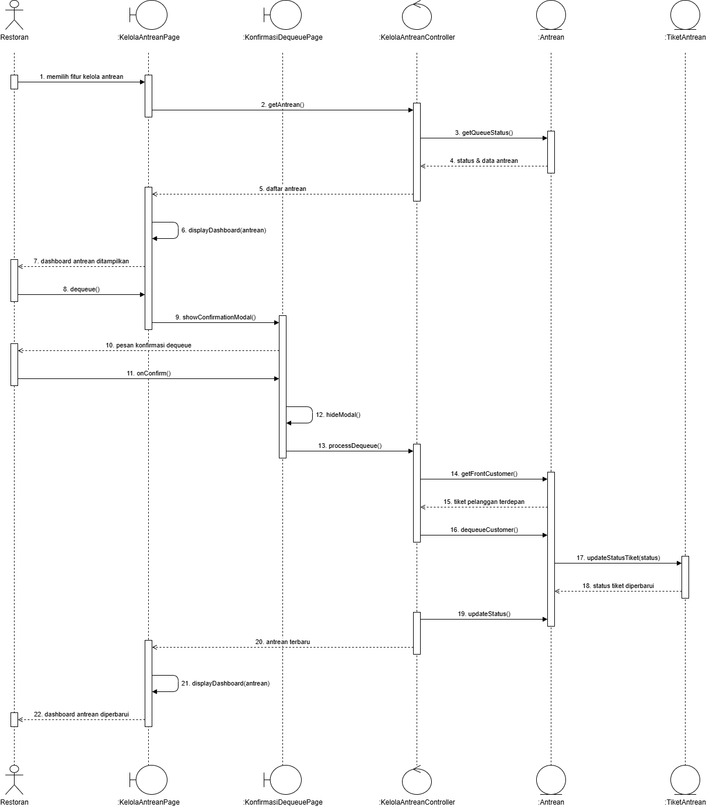

<i>Gambar 18. Sequence Diagram UC06</i>

- **Skenario Alternatif 1: Restoran membatalkan dequeue**

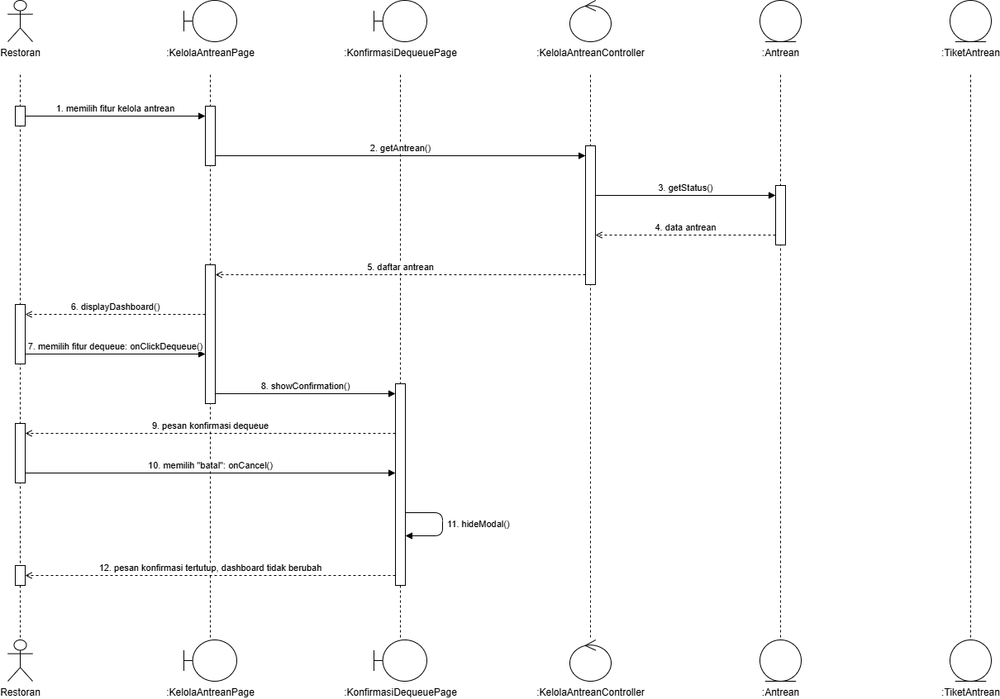

<i>Gambar 19. Sequence Diagram UC06 - Restoran membatalkan dequeue</i>

- **Skenario Alternatif 2: Pelanggan tidak hadir**

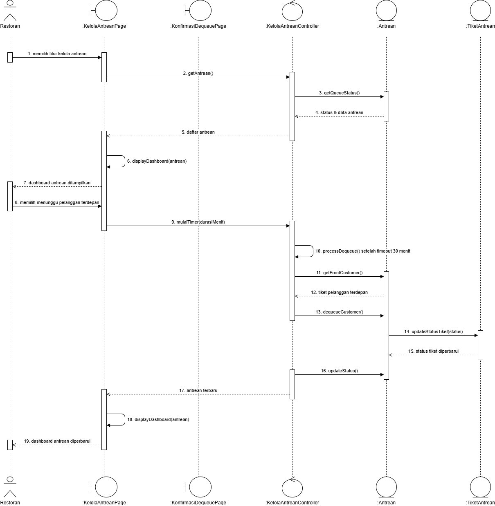

<i>Gambar 20. Sequence Diagram UC06 - Pelanggan tidak hadir</i>

### 3.6.3 Diagram Kelas

Buatlah diagram kelas untuk use case ini yang terdiri atas kelas-kelas dari 3.1.1. **Setiap kelas pada diagram wajib menampilkan atribut dan metode/operasi langsung di dalam kotak kelasnya**, sehingga tidak perlu membuat tabel daftar atribut dan metode per kelas pada subbab ini. Daftar lengkap atribut dan metode seluruh kelas disajikan pada Tabel 4.1 (Bab 4).

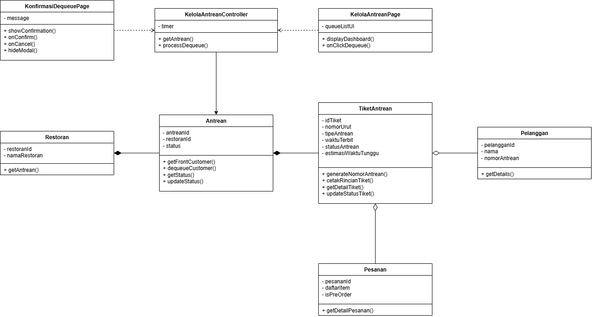

<i>Gambar 21. Diagram Kelas UC06</i>

 

## 3.7 Use Case 7

**ID Use Case:** *UC07*  
**Nama Use Case:** *Mengatur Kuota Antrean & Meja*

### 3.7.1 Identifikasi Kelas

Identifikasi kelas yang terkait dengan use case tersebut. Kelas di tahap perancangan dapat berbeda dengan dengan kelas di tahap analisis. Dapat menggunakan tabel di bawah:

Tabel 3.7. Identifikasi Kelas Use Case [UC07]

| No | Nama Kelas Perancangan | Nama Kelas Analisis Terkait |
|:--- | :--- | :--- |
| 1 | *ModelRestoran* | *Kuota, Restoran* |
| 2 | *PengaturanKuotaController* | *PengaturanKuotaController* |
| 3 | *PengaturanView* | *PengaturanKuotaPage* |
| ... | *...* | *...* |

### 3.7.2 Sequence Diagram

Buat *sequence diagram* untuk **setiap skenario use case**, mencakup skenario normal dan alternatif pada subbab 4.4 SKPL. Diagram melibatkan kelas-kelas yang telah diidentifikasi pada SKPL. 

- **Skenario Normal**

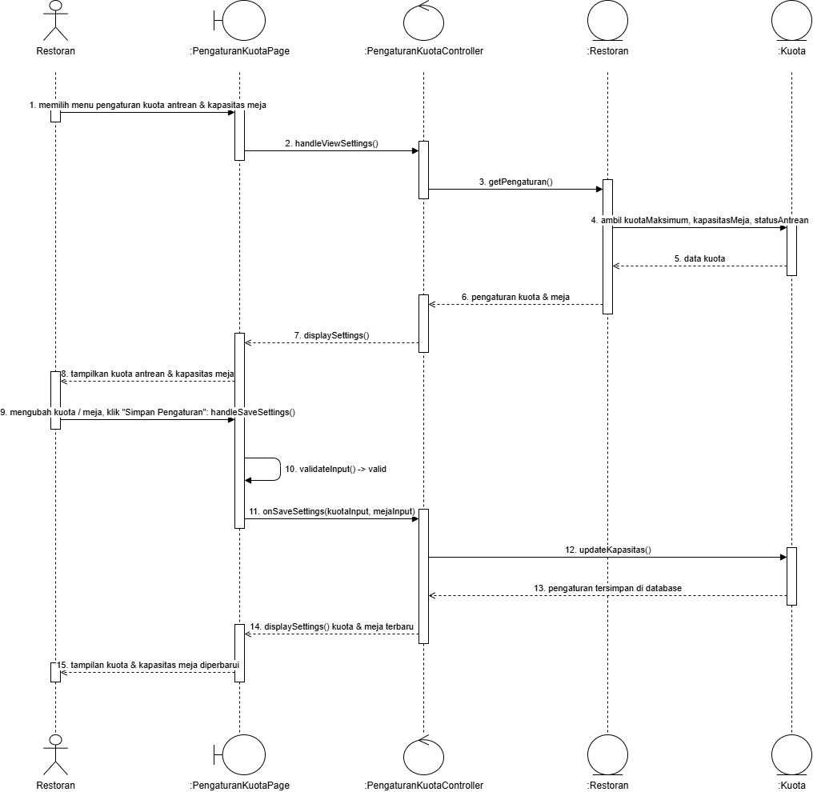

<i>Gambar 22. Sequence Diagram UC07</i>

- **Skenario Alternatif 1: Input Tidak Valid**

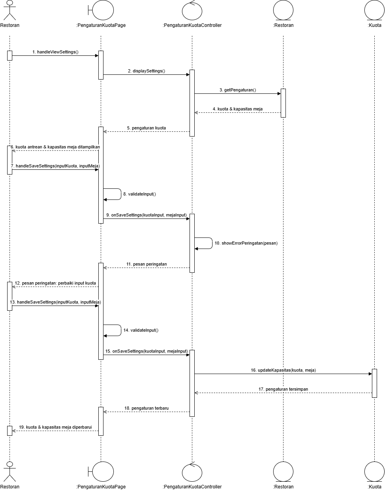

<i>Gambar 23. Sequence Diagram UC07 - Input Tidak Valid</i>

- **Skenario Alternatif 2: Restoran Menutup Antrean Sementara**

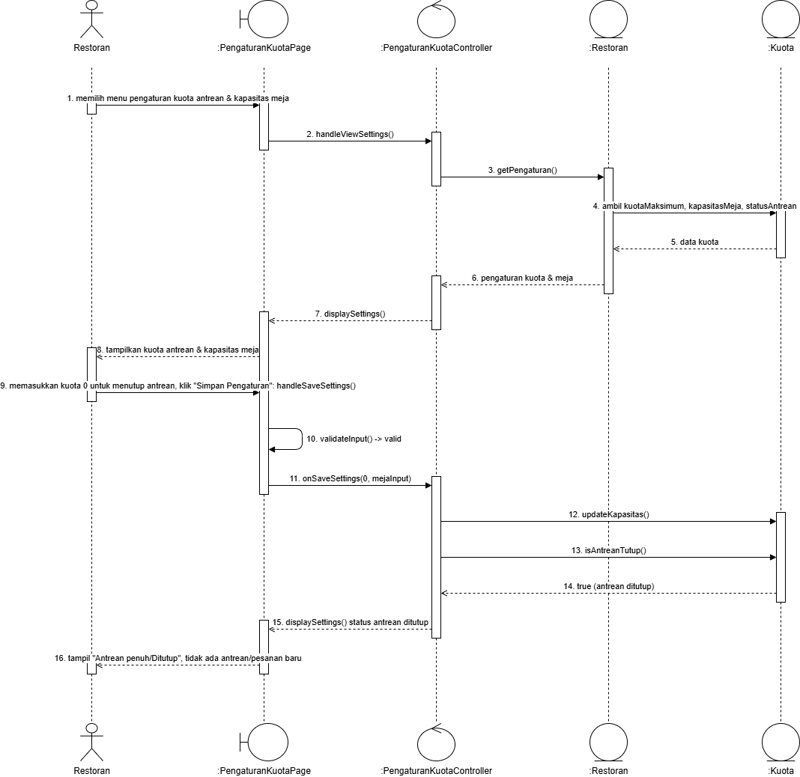

<i>Gambar 24. Sequence Diagram UC07 - Restoran Menutup Antrean Sementara</i>

### 3.7.3 Diagram Kelas

Buatlah diagram kelas untuk use case ini yang terdiri atas kelas-kelas dari 3.1.1. **Setiap kelas pada diagram wajib menampilkan atribut dan metode/operasi langsung di dalam kotak kelasnya**, sehingga tidak perlu membuat tabel daftar atribut dan metode per kelas pada subbab ini. Daftar lengkap atribut dan metode seluruh kelas disajikan pada Tabel 4.1 (Bab 4).

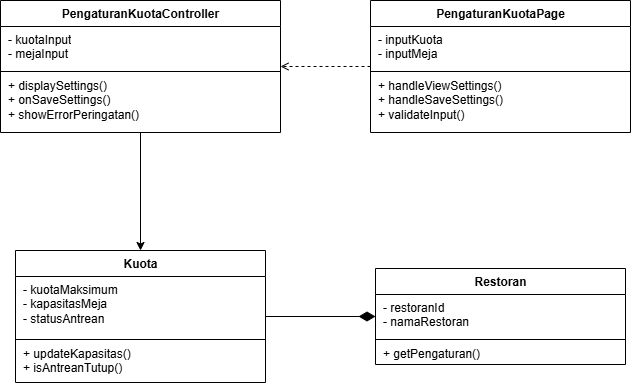

<i>Gambar 25. Diagram Kelas UC07</i>

 

## 3.8 Use Case 8

**ID Use Case:** *UC08*  
**Nama Use Case:** *Mengelola Stok dan Menu Makanan*

### 3.8.1 Identifikasi Kelas

Identifikasi kelas yang terkait dengan use case tersebut. Kelas di tahap perancangan dapat berbeda dengan dengan kelas di tahap analisis. Dapat menggunakan tabel di bawah:

Tabel 3.8. Identifikasi Kelas Use Case [UC08]

| No | Nama Kelas Perancangan | Nama Kelas Analisis Terkait |
|:--- | :--- | :--- |
| 1 | *ModelRestoran* | *Menu, Restoran* |
| 2 | *PengaturanView* | *PengaturanMenuPage* |
| 3 | *KelolaMenuController* | *KelolaMenuController* |
| ... | *...* | *...* |

### 3.8.2 Sequence Diagram

Buat *sequence diagram* untuk **setiap skenario use case**, mencakup skenario normal dan alternatif pada subbab 4.4 SKPL. Diagram melibatkan kelas-kelas yang telah diidentifikasi pada SKPL. 

- **Skenario Normal**

<i>Gambar 26. Sequence Diagram UC08</i>

- **Skenario Alternatif 1: Restoran menambahkan menu baru**

<i>Gambar 27. Sequence Diagram UC08 - Restoran menambahkan menu baru</i>

- **Skenario Alternatif 2: Restoran menghapus salah satu menu**

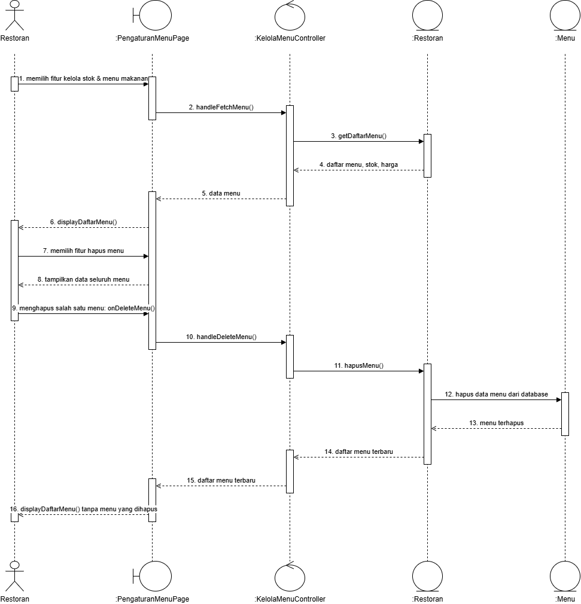

<i>Gambar 28. Sequence Diagram UC08 - Restoran menghapus salah satu menu</i>

- **Skenario Alternatif 3: Stok makanan tidak cukup**

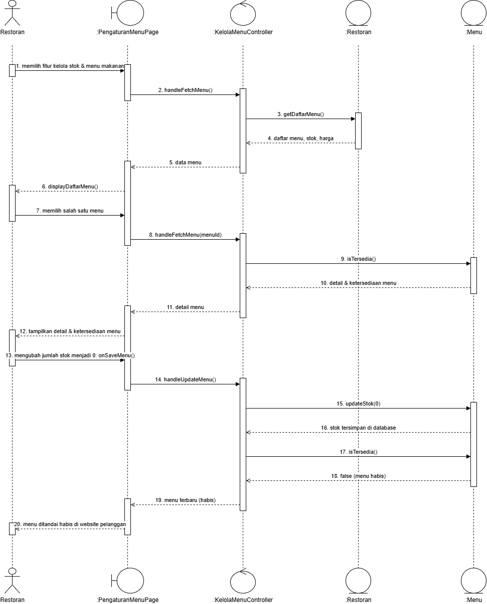

<i>Gambar 29. Sequence Diagram UC08 - Stok makanan tidak cukup</i>

### 3.8.3 Diagram Kelas

Buatlah diagram kelas untuk use case ini yang terdiri atas kelas-kelas dari 3.1.1. **Setiap kelas pada diagram wajib menampilkan atribut dan metode/operasi langsung di dalam kotak kelasnya**, sehingga tidak perlu membuat tabel daftar atribut dan metode per kelas pada subbab ini. Daftar lengkap atribut dan metode seluruh kelas disajikan pada Tabel 4.1 (Bab 4).

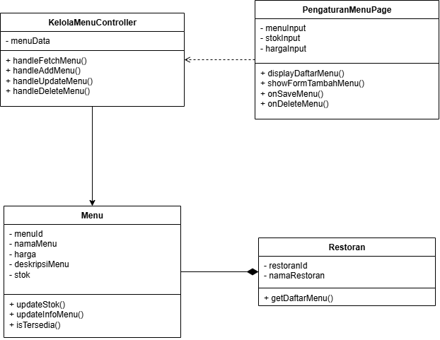

<i>Gambar 30. Diagram Kelas UC08</i>

Pada diagram, pastikan:
- Atribut dituliskan beserta visibilitas dan tipe datanya, misalnya `- email: String`.
- Operasi dituliskan beserta visibilitas, parameter, dan tipe kembaliannya, misalnya `+ login(email: String, password: String): Boolean`.
- Relasi antarkelas (asosiasi, agregasi, komposisi, generalisasi, dan dependensi) digambarkan lengkap dengan multiplisitas.
- Semua operasi yang dipanggil pada sequence diagram 3.1.2 (skenario normal dan alternatif) ada pada kelas yang bersangkutan.
- Kelas yang sama dengan kelas di use case lain memakai nama, atribut, dan metode yang konsisten.

Silahkan lanjutkan untuk  *use case* berikutnya dengan content yang sama dengan 3.1

 

## 3.09 Use Case 09

**ID Use Case:** *UC09*  
**Nama Use Case:** *Menampilkan Dashboard Antrean Restoran*

### 3.09.1 Identifikasi Kelas

Identifikasi kelas yang terkait dengan use case tersebut. Kelas di tahap perancangan dapat berbeda dengan dengan kelas di tahap analisis. Dapat menggunakan tabel di bawah:

Tabel 3.09. Identifikasi Kelas Use Case [UC09]

| No | Nama Kelas Perancangan | Nama Kelas Analisis Terkait |
| :--- | :--- | :--- |
| 1 | *KelolaAntreanView* | *DashboardAntreanPage* |
| 2 | *KelolaAntreanController* | *KelolaAntreanController* |
| 3 | *ModelAntrean* | *Antrean* |
| 4 | *ModelAntrean* | *TiketAntrean* |
| 5 | *ModelRestoran* | *Restoran* |
| 6 | *ModelPesanan* | *Pesanan* |
| ... | *...* | *...* |

### 3.09.2 Sequence Diagram

Buat *sequence diagram* untuk **setiap skenario use case**, mencakup skenario normal dan alternatif pada subbab 4.4 SKPL. Diagram melibatkan kelas-kelas yang telah diidentifikasi pada SKPL. 

- **Skenario Normal**

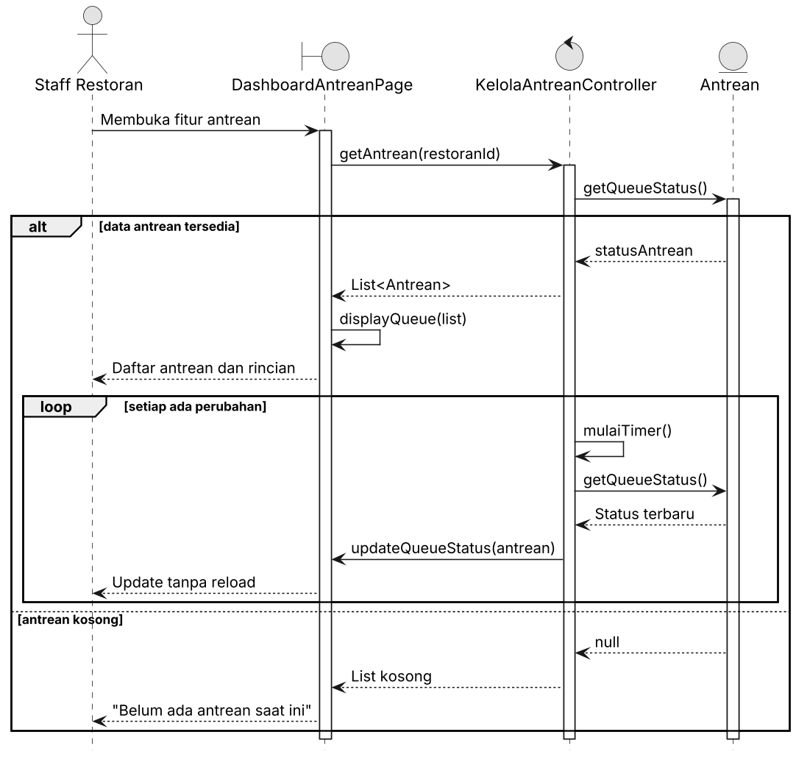

<i>Gambar 31. Sequence Diagram UC09</i>

### 3.09.3 Diagram Kelas

Buatlah diagram kelas untuk use case ini yang terdiri atas kelas-kelas dari 3.1.1. **Setiap kelas pada diagram wajib menampilkan atribut dan metode/operasi langsung di dalam kotak kelasnya**, sehingga tidak perlu membuat tabel daftar atribut dan metode per kelas pada subbab ini. Daftar lengkap atribut dan metode seluruh kelas disajikan pada Tabel 4.1 (Bab 4).

<i>Gambar 32. Diagram Kelas UC09</i>

 

## 3.10 Use Case 10

**ID Use Case:** *UC10*  
**Nama Use Case:** *Registrasi Akun*

### 3.10.1 Identifikasi Kelas

Identifikasi kelas yang terkait dengan use case tersebut. Kelas di tahap perancangan dapat berbeda dengan dengan kelas di tahap analisis. Dapat menggunakan tabel di bawah:

Tabel 3.10. Identifikasi Kelas Use Case [UC10]

| No | Nama Kelas Perancangan | Nama Kelas Analisis Terkait |
|:--- | :--- | :--- |
| 1 | *AkunView* | *RegistrasiPage* |
| 2 | *AutentikasiController* | *AutentikasiController* |
| 3 | *ModelAkun* | *Pengguna* |
| 4 | *ModelAkun* | *SesiPengguna* |
| 5 | *ModelAkun* | *Pelanggan* |
| 6 | *ModelAkun* | *Admin* |
| 7 | *ModelRestoran* | *Restoran* |
| ... | *...* | *...* |

### 3.10.2 Sequence Diagram

Buat *sequence diagram* untuk **setiap skenario use case**, mencakup skenario normal dan alternatif pada subbab 4.4 SKPL. Diagram melibatkan kelas-kelas yang telah diidentifikasi pada SKPL. 

- **Skenario Normal**

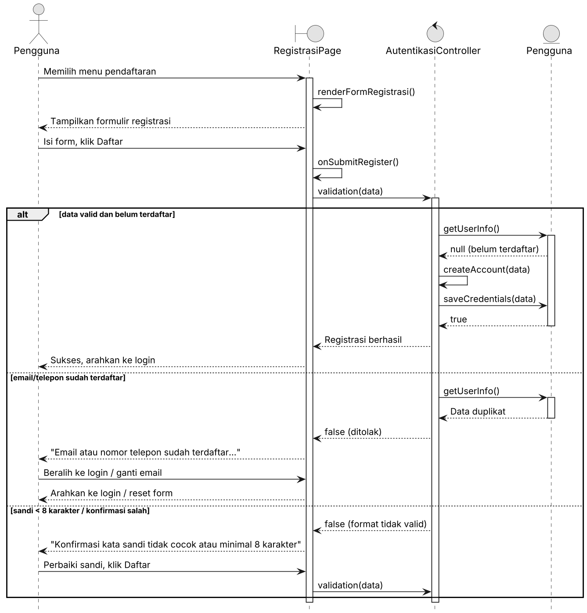

<i>Gambar 33. Sequence Diagram UC10</i>

### 3.10.3 Diagram Kelas

Buatlah diagram kelas untuk use case ini yang terdiri atas kelas-kelas dari 3.1.1. **Setiap kelas pada diagram wajib menampilkan atribut dan metode/operasi langsung di dalam kotak kelasnya**, sehingga tidak perlu membuat tabel daftar atribut dan metode per kelas pada subbab ini. Daftar lengkap atribut dan metode seluruh kelas disajikan pada Tabel 4.1 (Bab 4).

<i>Gambar 34. Diagram Kelas UC10</i>

 

## 3.11 Use Case 11

**ID Use Case:** *UC11*  
**Nama Use Case:** *Registrasi Akun*

### 3.11.1 Identifikasi Kelas

Identifikasi kelas yang terkait dengan use case tersebut. Kelas di tahap perancangan dapat berbeda dengan dengan kelas di tahap analisis. Dapat menggunakan tabel di bawah:

Tabel 3.11. Identifikasi Kelas Use Case [UC11]

| No | Nama Kelas Perancangan | Nama Kelas Analisis Terkait |
|:--- | :--- | :--- |
| 1 | *AkunView* | *LoginPage* |
| 2 | *AutentikasiController* | *AutentikasiController* |
| 3 | *ModelAkun* | *Pengguna* |
| 4 | *ModelAkun* | *SesiPengguna* |
| ... | *...* | *...* |

### 3.11.2 Sequence Diagram

Buat *sequence diagram* untuk **setiap skenario use case**, mencakup skenario normal dan alternatif pada subbab 4.4 SKPL. Diagram melibatkan kelas-kelas yang telah diidentifikasi pada SKPL. 

- **Skenario Normal**

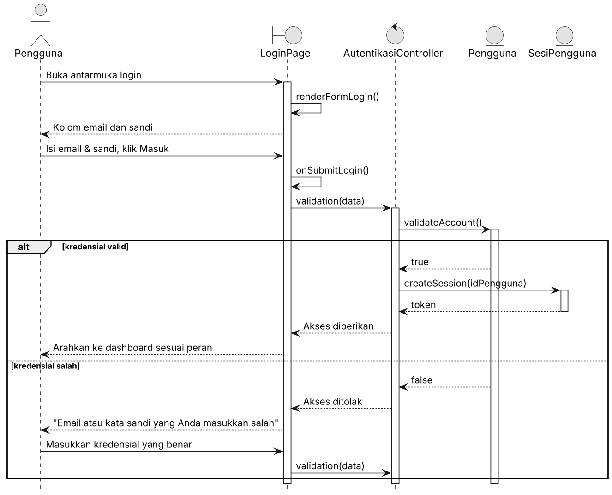

<i>Gambar 35. Sequence Diagram UC11</i>

### 3.10.3 Diagram Kelas

Buatlah diagram kelas untuk use case ini yang terdiri atas kelas-kelas dari 3.1.1. **Setiap kelas pada diagram wajib menampilkan atribut dan metode/operasi langsung di dalam kotak kelasnya**, sehingga tidak perlu membuat tabel daftar atribut dan metode per kelas pada subbab ini. Daftar lengkap atribut dan metode seluruh kelas disajikan pada Tabel 4.1 (Bab 4).

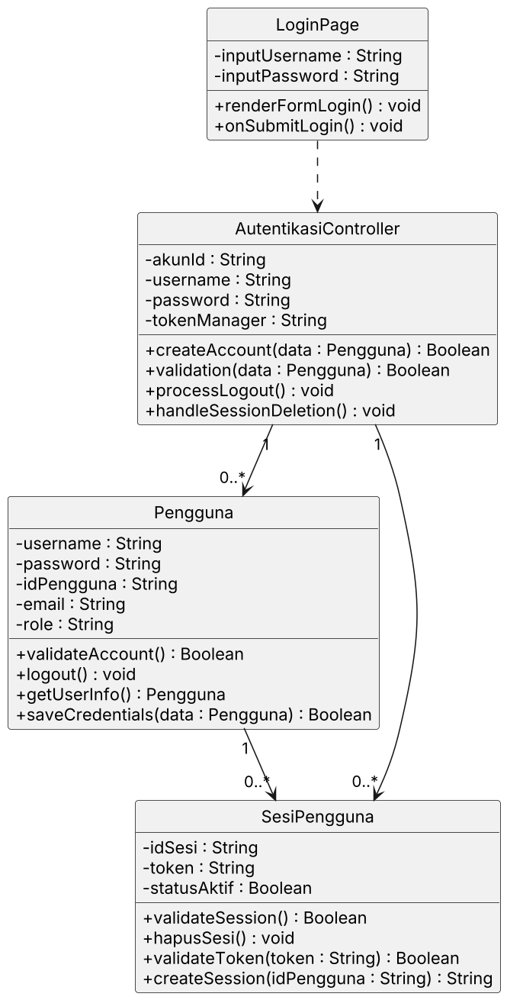

<i>Gambar 36. Diagram Kelas UC11</i>

 

## 3.12 Use Case 12

**ID Use Case:** *UC12*  
**Nama Use Case:** *Keluar Akun*

### 3.12.1 Identifikasi Kelas

Identifikasi kelas yang terkait dengan use case tersebut. Kelas di tahap perancangan dapat berbeda dengan dengan kelas di tahap analisis. Dapat menggunakan tabel di bawah:

Tabel 3.12. Identifikasi Kelas Use Case [UC12]

| No | Nama Kelas Perancangan | Nama Kelas Analisis Terkait |
|:--- | :--- | :--- |
| 1 | *AkunView* | *HalamanProfilePage* |
| 2 | *AkunView* | *KonfirmasiLogoutPage* |
| 3 | *AkunView* | *LoginPage* |
| 4 | *AutentikasiController* | *AutentikasiController* |
| 5 | *ModelAkun* | *Pengguna* |
| 6 | *ModelAkun* | *SesiPengguna* |
| ... | *...* | *...* |

### 3.12.2 Sequence Diagram

Buat *sequence diagram* untuk **setiap skenario use case**, mencakup skenario normal dan alternatif pada subbab 4.4 SKPL. Diagram melibatkan kelas-kelas yang telah diidentifikasi pada SKPL. 

- **Skenario Normal**

<i>Gambar 37. Sequence Diagram UC12</i>

- **Skenario Alternatif 1: Aktor Membatalkan Keluar Akun**

<i>Gambar 38. Sequence Diagram UC12 - Aktor Membatalkan Keluar Akun</i>

### 3.12.3 Diagram Kelas

Buatlah diagram kelas untuk use case ini yang terdiri atas kelas-kelas dari 3.1.1. **Setiap kelas pada diagram wajib menampilkan atribut dan metode/operasi langsung di dalam kotak kelasnya**, sehingga tidak perlu membuat tabel daftar atribut dan metode per kelas pada subbab ini. Daftar lengkap atribut dan metode seluruh kelas disajikan pada Tabel 4.1 (Bab 4).

<i>Gambar 39. Diagram Kelas UC12</i>

 

## 3.13 Use Case 13

**ID Use Case:** *UC13*  
**Nama Use Case:** *Penyampaian Keluhan Pelanggan*

### 3.13.1 Identifikasi Kelas

Identifikasi kelas yang terkait dengan use case tersebut. Kelas di tahap perancangan dapat berbeda dengan dengan kelas di tahap analisis. Dapat menggunakan tabel di bawah:

Tabel 3.13. Identifikasi Kelas Use Case [UC13]

| No | Nama Kelas Perancangan | Nama Kelas Analisis Terkait |
|:--- | :--- | :--- |
| 1 | *KeluhanView* | *KeluhanFormPage* |
| 2 | *KeluhanController* | *KeluhanController* |
| 3 | *ModelKeluhan* | *Keluhan* |
| 4 | *ModelAkun* | *Pelanggan* |

### 3.13.2 Sequence Diagram

Buat *sequence diagram* untuk **setiap skenario use case**, mencakup skenario normal dan alternatif pada subbab 4.4 SKPL. Diagram melibatkan kelas-kelas yang telah diidentifikasi pada SKPL. 

- **Skenario Normal**

<i>Gambar 40. Sequence Diagram UC13</i>

### 3.13.3 Diagram Kelas

Buatlah diagram kelas untuk use case ini yang terdiri atas kelas-kelas dari 3.1.1. **Setiap kelas pada diagram wajib menampilkan atribut dan metode/operasi langsung di dalam kotak kelasnya**, sehingga tidak perlu membuat tabel daftar atribut dan metode per kelas pada subbab ini. Daftar lengkap atribut dan metode seluruh kelas disajikan pada Tabel 4.1 (Bab 4).

<i>Gambar 41. Diagram Kelas UC13</i>

 

## 3.14 Use Case 14

**ID Use Case:** *UC14*  
**Nama Use Case:** *Penanggapan Keluhan Pelanggan*

### 3.14.1 Identifikasi Kelas

Identifikasi kelas yang terkait dengan use case tersebut. Kelas di tahap perancangan dapat berbeda dengan dengan kelas di tahap analisis. Dapat menggunakan tabel di bawah:

Tabel 3.14. Identifikasi Kelas Use Case [UC14]

| No | Nama Kelas Perancangan | Nama Kelas Analisis Terkait |
|:--- | :--- | :--- |
| 1 | *KeluhanView* | *KeluhanDashboardPage* |
| 2 | *KeluhanController* | *KeluhanController* |
| 3 | *ModelKeluhan* | *Keluhan* |
| 4 | *ModelAkun* | *Admin* |

### 3.14.2 Sequence Diagram

Buat *sequence diagram* untuk **setiap skenario use case**, mencakup skenario normal dan alternatif pada subbab 4.4 SKPL. Diagram melibatkan kelas-kelas yang telah diidentifikasi pada SKPL. 

- **Skenario Normal**

<i>Gambar 42. Sequence Diagram UC14</i>

### 3.14.3 Diagram Kelas

Buatlah diagram kelas untuk use case ini yang terdiri atas kelas-kelas dari 3.1.1. **Setiap kelas pada diagram wajib menampilkan atribut dan metode/operasi langsung di dalam kotak kelasnya**, sehingga tidak perlu membuat tabel daftar atribut dan metode per kelas pada subbab ini. Daftar lengkap atribut dan metode seluruh kelas disajikan pada Tabel 4.1 (Bab 4).

<i>Gambar 43. Diagram Kelas UC14</i>

 

## 3.15 Use Case 15

**ID Use Case:** *UC15*  
**Nama Use Case:** *Penghapusan Restoran*

### 3.15.1 Identifikasi Kelas

Identifikasi kelas yang terkait dengan use case tersebut. Kelas di tahap perancangan dapat berbeda dengan dengan kelas di tahap analisis. Dapat menggunakan tabel di bawah:

Tabel 3.15. Identifikasi Kelas Use Case [UC15]

| No | Nama Kelas Perancangan | Nama Kelas Analisis Terkait |
|:--- | :--- | :--- |
| 1 | *KelolaRestoranView* | *DashboardKelolaRestoranPage* |
| 2 | *KelolaRestoranView* | *KonfirmasiHapusRestoranPage* |
| 3 | *KelolaDataRestoranController* | *KelolaDataRestoranController* |
| 4 | *ModelRestoran* | *Restoran* |
| 5 | *ModelRestoran* | *Menu* |
| 6 | *ModelAkun* | *Admin* |
| ... | *...* | *...* |

### 3.15.2 Sequence Diagram

Buat *sequence diagram* untuk **setiap skenario use case**, mencakup skenario normal dan alternatif pada subbab 4.4 SKPL. Diagram melibatkan kelas-kelas yang telah diidentifikasi pada SKPL. 

- **Skenario Normal**

<i>Gambar 44. Sequence Diagram UC15</i>

- **Skenario Alternatif 1: Admin Membatalkan Proses Penghapusan Restoran**

<i>Gambar 45. Sequence Diagram UC15 - Admin Membatalkan Proses Penghapusan Restoran</i>

### 3.15.3 Diagram Kelas

Buatlah diagram kelas untuk use case ini yang terdiri atas kelas-kelas dari 3.1.1. **Setiap kelas pada diagram wajib menampilkan atribut dan metode/operasi langsung di dalam kotak kelasnya**, sehingga tidak perlu membuat tabel daftar atribut dan metode per kelas pada subbab ini. Daftar lengkap atribut dan metode seluruh kelas disajikan pada Tabel 4.1 (Bab 4).

<i>Gambar 46. Diagram Kelas UC15</i>

 

---

# BAB 4: Diagram Kelas Keseluruhan

## 4.1 Diagram Kelas

**Bagian ini diisi dengan diagram kelas keseluruhan.**

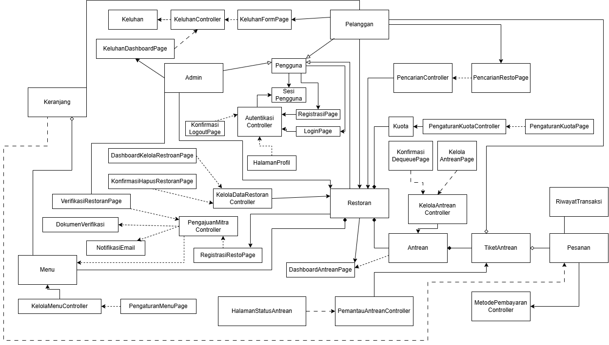

<i>Gambar 4.1. Diagram Kelas Perancangan Keseluruhan antri.in</i>

Tabel 4.1. Daftar Kelas Perancangan Keseluruhan

| ID Kelas | Nama Kelas | Atribut | Metode/Operasi |
| :--- | :--- | :--- | :--- |
| *C01* | *Pelanggan* | *pelangganId, nama, nomorAntrean, noHp, idAkun, email* | *getDetails(), cariRestoran(), pilihMenu(), pilihMetodeBayar(), konfirmasiPembayaran(), lihatStatusAntrean(), accountRegister(), kirimKeluhan()* |
| *C02* | *Restoran* | *restoranId, namaRestoran, kategori, ratingRerata, daftarUlasan, emailKontak, statusAktif* | *getDetailRestoran(), getMenu(), getAntrean(), ajukanPendaftaran(), getPengaturan(), getDaftarMenu(), showDashboard(), accountRegister(), setSoftDelete(), purgeData()* |
| *C03* | *Menu* | *menuId, namaMenu, harga, deskripsiMenu, stok* | *getInfoMenu(), cekStok(), kurangiStok(), tambahMenu(), updateStok(), updateInfoMenu(), isTersedia(), hapusMenu()* |
| *C04* | *Antrean* | *antreanId, restoranId, nomorDilayani, totalAntrean, estimasiWaktuTunggu, statusAntrean* | *getFrontCustomer(), getEstimasiWaktu(), getDetailAntrean(), updateStatus(), dequeueCustomer(), getPesananPreOrder(), getQueueStatus(), updateMenu()* |
| *C05* | *Keranjang* | *idKeranjang, daftarMenu, totalEstimasiHarga* | *tambahItem(), hapusItem(), hitungTotal(), kosongkanKeranjang()* |
| *C06* | *Pesanan* | *pesananId, modePemesanan, jumlahRombongan, tanggalBooking, slotWaktuBooking, totalHarga, statusPemesanan* | *validasiBooking(), buatTagihan(), batalkanPesanan(), updateStatus(), getDetailPesanan(), showOrderDetails()* |
| *C07* | *MetodePembayaranController* | *idPembayaran, tipePembayaran, batasWaktuBayar, statusPembayaran* | *buatTagihan(), verifikasiPembayaran(), cekTimeout()* |
| *C08* | *RiwayatTransaksi* | *idTransaksi, tanggalTransaksi, jumlahDibayar, statusPelunasan* | *catatLogTransaksi(), getBuktiPembayaran()* |
| *C09* | *TiketAntrean* | *idTiket, nomorUrut, tipeAntrean, waktuTerbit, statusAntrean, estimasiWaktuTunggu* | *generateNomorAntrean(), cetakRincianTiket(), getDetailTiket(), updateStatusTiket()* |
| *C10* | *PemantauAntreanController* | *antreanId* | *getStatusAntrean(), updateTampilanAntrean()* |
| *C11* | *HalamanStatusAntrean* | *antreanId, statusAntrean, sisaAntrean* | *tampilkanStatusAntrean(), renderData()* |
| *C12* | *PengajuanMitraController* | *idPengajuan, status, tglPengajuan, alasanPenolakan* | *validasiKelengkapan(), simpanPengajuan(), setujui(), tolak(alasan)* |
| *C13* | *DokumenVerifikasi* | *idDokumen, jenisDokumen* | *unggahDokumen(), validasiFormat()* |
| *C14* | *Admin* | *idAdmin, nama, emailAdmin* | 8tinjauPengajuan(), accountRegister(), lihatKeluhan(), konfirmasiPenghapusan()* |
| *C15* | *NotifikasiEmail* | *penerima, isiPesan, jenis* | *kirimEmail()* |
| *C16* | *KelolaAntreanController* | *timer* | *getAntrean(), processDequeue(), mulaiTimer()* |
| *C17* | *KonfirmasiDequeuePage* | *message* | *showConfirmationModal(), hideModal(), onConfirm(), onCancel()* |
| *C18* | *KelolaAntreanPage* | *queueListUI* | *displayDashboard(antrean: Antrean), dequeue()* |
| *C19* | *DashboardAntreanPage* | *daftarAntrean, statusAntrean* | *displayQueue(), updateQueueStatus()* |
| *C20* | *Kuota* | *kuotaMaksimum, kapasitasMeja, statusAntrean* | *updateKapasitas(), isAntreanTutup()* |
| *C21* | *PengaturanKuotaController* | *kuotaInput, mejaInput* | *displaySettings(), onSaveSettings(), showErrorPeringatan()* |
| *C22* | *PengaturanKuotaPage* | *inputKuota, inputMeja* | *handleViewSettings(), handleSaveSettings(), validateInput()* |
| *C23* | *PengaturanMenuPage* | *menuInput, stokInput, hargaInput* | *displayDaftarMenu(), showFormTambahMenu(), onSaveMenu(), onDeleteMenu()* |
| *C24* | *KelolaMenuController* | *menuData* | *handleFetchMenu(),  handleFetchMenuDetail(), handleAddMenu(), handleUpdateMenu(), handleDeleteMenu()* |
| *C25* | *Pengguna* | *username, password, idPengguna, email, role* | *validateAccount(), logout(), getUserInfo(), saveCredentials()* |
| *C26* | *HalamanProfilPage* | *idPengguna, namaUser* | *tekanTombolLogout()* |
| *C27* | *KonfirmasiLogoutPage* | *pesanKonfirmasi* | *konfirmasiYa(), konfirmasiBatal()* |
| *C28* | *AutentikasiController* | *akunId, username, password, tokenManager* | *createAccount(), validation(), processLogout(), handleSessionDeletion()* |
| *C29* | *SesiPengguna* | *idSesi, token, statusAktif* | *validateSession(), hapusSesi(), validateToken()* |
| *C30* | *Keluhan* | *idKeluhan, isiKeluhan, waktuKirim, status* | *simpanKeluhan(), updateStatusKeluhan()* |
| *C31* | *DashboardKelolaRestoranPage* | *daftarRestoran, kataKunci* | *pilihRestoran(), klikHapusRestoran()* |
| *C32* | *KonfirmasiHapusRestoranPage* | *restoranId, pesanPeringatan* | *setujuiPenghapusan(), batalHapus()* |
| *C33* | *KelolaDataRestoranController* | *restoranId* | *hapusDataRestoran(), nonaktifkanRelasiMenu()* |
| *C34* | *PencarianRestoPage* | *inputKataKunci, filterKategori, filterLokasi, daftarResto* | *renderHalamanPencarian(), onKetikInput(), onPilihFilter(), onClickTombolCari(), tampilkanDaftarRestoran(), tampilkanPesanKosong()* |
| *C35* | *PencarianController* | *kataKunci, filterSelected* | *cariRestoran(), terapkanFilter(), ambilStatusAntrean(), ambilPreviewMenu()* |
| *C36* | *VerifikasiRestoranPage* | *idPengajuan, berkasMitra* | *tampilkanDetailBerkas(), renderStatusVerifikasi()* |
| *C37* | *RegistrasiRestoPage* | *formResto, dokumenUpload* | 8renderFormRegistrasi(), onSubmitRegistrasi()* |
| *C38* | *RegistrasiPage* | *inputUsername, inputEmail, inputPassword* | *renderFormRegistrasi(), onSubmitRegister()* |
| *C39* | *LoginPage* | *inputUsername, inputPassword* | *renderFormLogin(), onSubmitLogin()* |
| *C40* | *KeluhanFormPage* | *inputKeluhan, waktuKirim* | *renderFormKeluhan(), onSubmitKeluhan()* |
| *C41* | *KeluhanController* | *daftarKeluhan* | *kirimKeluhan(), tampilkanKeluhan(), tanggapiKeluhan()* |
| *C42* | *KeluhanDashboardPage* | *listKeluhanUI* | *displayKeluhanList(), showDetailKeluhan()* |
| *...* | *...* | *...* | *...* |

 

---

# BAB 5: Matriks Kerunutan

Petakan kelas perancangan dengan use case yang terkait. Gunakan **BAB 6 Traceability pada dokumen SKPL** sebagai acuan keterkaitan kelas analisis dan use case, lalu sesuaikan dengan realisasi use case dan kelas perancangan pada BAB 3–BAB 5 DPPL.

Tabel 5.1. Matriks Kerunutan Kelas terhadap Use Case

| Kelas | Use Case Terkait |
| :--- | :--- |
| *C01 - Pelanggan* | *UC01 - Mencari dan filter resto UC02 - Melakukan pemesanan dan pembayaran digital UC03 - Menampilkan Status Antrean UC06 - Mengelola Antrian UC10 - Registrasi Akun UC13 - Penyampaian Keluhan Pelanggan* |
| *C02 - Restoran* | *UC01 - Mencari dan filter resto UC04 - Pendaftaran Mitra Restoran Baru UC06 - Mengelola Antrian UC07 - Mengatur Kuota Antrean & Meja UC08 - Mengelola Stok dan Menu Makanan UC09 - Menampilkan Dashboard Antrean Restoran UC10 - Registrasi Akun UC15 - Penghapusan Restoran* |
| *C03 - Menu* | *UC01 - Mencari dan filter resto UC02 - Melakukan pemesanan dan pembayaran digital UC04 - Pendaftaran Mitra Restoran Baru UC08 - Mengelola Stok dan Menu Makanan* |
| *C04 - Antrean* | *UC01 - Mencari dan filter resto UC03 - Menampilkan Status Antrean UC06 - Mengelola Antrian UC09 - Menampilkan Dashboard Antrean Restoran* |
| *C05 - Keranjang* | *UC02 - Melakukan pemesanan dan pembayaran digital* |
| *C06 - Pesanan* | *UC02 - Melakukan pemesanan dan pembayaran digital UC03 - Menampilkan Status Antrean UC06 - Mengelola Antrian UC09 - Menampilkan Dashboard Antrean Restoran* |
| *C07 - MetodePembayaranController* | *UC02 - Melakukan pemesanan dan pembayaran digital* |
| *C08 - RiwayatTransaksi* | *UC02 - Melakukan pemesanan dan pembayaran digital* |
| *C09 - TiketAntrean* | *UC02 - Melakukan pemesanan dan pembayaran digital UC03 - Menampilkan Status Antrean UC06 - Mengelola Antrian* |
| *C10 - PemantauAntreanController* | *UC03 - Menampilkan Status Antrean* |
| *C11 - HalamanStatusAntrean* | *UC03 - Menampilkan Status Antrean* |
| *C12 - PengajuanMitraController* | *UC04 - Pendaftaran Mitra Restoran Baru UC05 - Memverifikasi Pendaftaran Restoran* |
| *C13 - DokumenVerifikasi* | *UC04 - Pendaftaran Mitra Restoran Baru* |
| *C14 - Admin* | *UC05 - Memverifikasi Pendaftaran Restoran UC10 - Registrasi Akun UC14 - Penanggapan Keluhan Pelanggan UC15 - Penghapusan Restoran* |
| *C15 - NotifikasiEmail* | *UC05 - Memverifikasi Pendaftaran Restoran* |
| *C16 - KelolaAntreanController* | *UC06 - Mengelola Antrian* |
| *C17 - KonfirmasiDequeuePage* | *UC06 - Mengelola Antrian* |
| *C18 - KelolaAntreanPage* | *UC06 - Mengelola Antrian* |
| *C19 - DashboardAntreanPage* | *UC09 - Menampilkan Dashboard Antrean Restoran* |
| *C20 - Kuota* | *UC07 - Mengatur Kuota Antrean & Meja* |
| *C21 - PengaturanKuotaController* | *UC07 - Mengatur Kuota Antrean & Meja* |
| *C22 - PengaturanKuotaPage* | *UC07 - Mengatur Kuota Antrean & Meja* |
| *C23 - PengaturanMenuPage* | *UC08 - Mengelola Stok dan Menu Makanan* |
| *C24 - KelolaMenuController* | *UC08 - Mengelola Stok dan Menu Makanan* |
| *C25 - Pengguna* | *UC10 - Registrasi Akun UC11 - Login Akun UC12 - Keluar Akun* |
| *C26 - HalamanProfilPage* | *UC12 - Keluar Akun* |
| *C27 - KonfirmasiLogoutPage* | *UC12 - Keluar Akun* |
| *C28 - AutentikasiController* | *UC12 - Keluar Akun* |
| *C29 - SesiPengguna* | *UC12 - Keluar Akun* |
| *C30 - Keluhan* | *UC13 - Penyampaian Keluhan Pelanggan UC14 - Penanggapan Keluhan Pelanggan* |
| *C31 - DashboardKelolaRestoranPage* | *UC15 - Penghapusan Restoran* |
| *C32 - KonfirmasiHapusRestoranPage* | *UC15 - Penghapusan Restoran* |
| *C33 - KelolaDataRestoranController* | *UC15 - Penghapusan Restoran* |
| *C34 - PencarianRestoPage* | *UC01 - Mencari dan filter resto* |
| *C35 - PencarianController* | *UC01 - Mencari dan filter resto* |
| *C36 - VerifikasiRestoranPage* | *UC05 - Memverifikasi Pendaftaran Restoran* |
| *C37 - RegistrasiRestoPage* | *UC04 - Pendaftaran Mitra Restoran Baru* |
| *C38 - RegistrasiPage* | *UC10 - Registrasi Akun* |
| *C39 - LoginPage* | *UC11 - Login Akun* |
| *C40 - KeluhanFormPage* | *UC13 - Penyampaian Keluhan Pelanggan* |
| *C41 - KeluhanController* | *UC13 - Penyampaian Keluhan Pelanggan UC14 - Penanggapan Keluhan Pelanggan* |
| *C42 - KeluhanDashboardPage* | *UC14 - Penanggapan Keluhan Pelanggan* |
