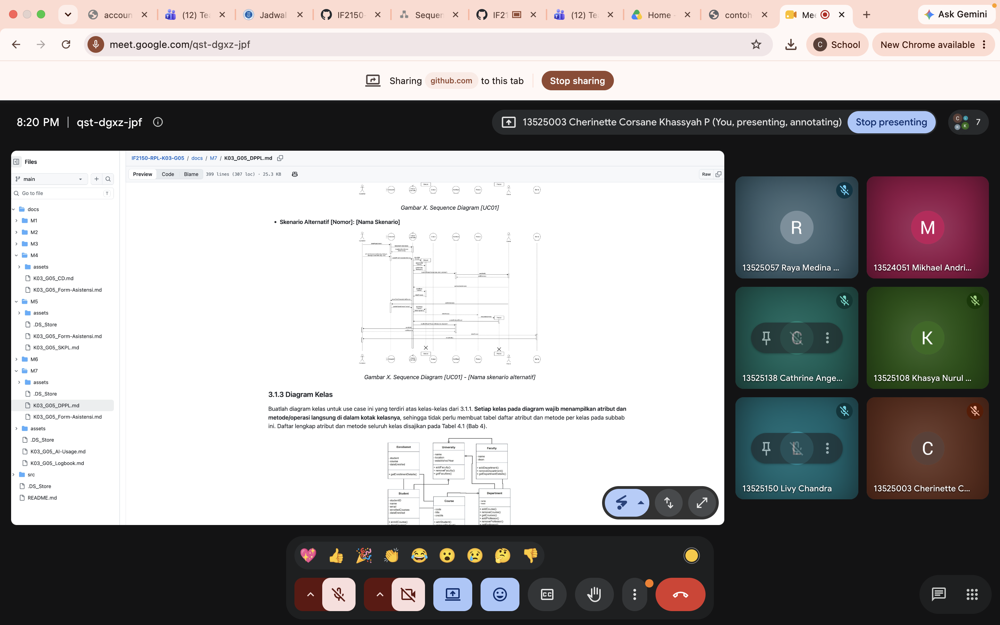
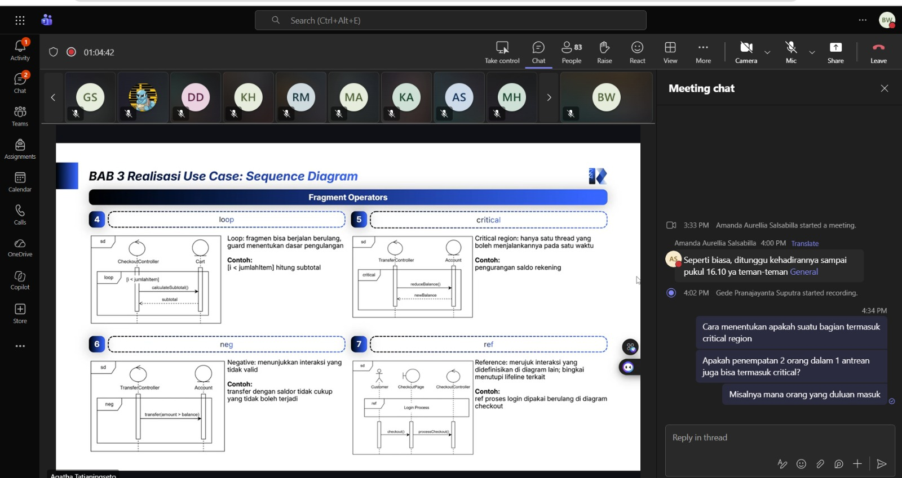

# Form Asistensi

## Tugas Besar IF2150 - Rekayasa Perangkat Lunak

| Informasi | Keterangan |
| --- | --- |
| **Hari** | *Jum'at* |
| **Tanggal** | *9/10/2026* |
| **Kelas** | *K01* |
| **Nomor Kelompok** | *G10*  |
| **Nama Kelompok** | *Ducklings*  |
| **Nama Perangkat Lunak** | *antri.in*  |
| **Dokumen** | *K01_G10_DPPL.md*  |

### Anggota Kelompok

| NIM | Nama |
| --- | --- |
| *13525145* | *Muhammad Nur Fikri Hariyawan* |
| *13525085* | *Bayu Palamarta Wirawan* |
| *13525133* | *Chatima Anandakhorita* |
| *13525148* | *Athallah Nanda Andita* |
| *13525091* | *Muhammad Fauzi Muharam* |

### Catatan

| Catatan |
| --- |
| 1. *Menentukan orang mana yang masuk duluan pada sebuah antrean yang diikuti oleh 2 orang bukan critical region karena critical lebih fokus pada proses yang tidak boleh diganggu proses lainnya. Tetapi, sebuah queue bisa dibedakan dengan queue id dan queue number.*  |
| 2. Diagram kelas dibuat dengan menambahkan atribut serita method masing-masing kelas, lengkap dengan enkapsulasinya (misal public +, private -, protected #). Attribut dan method ditulis yang digunakan pada use casenya saja. |
| 3. Diagram sekuens menggunakan unsur-unsur kelas, bukan komponen yang juga pernah didefinisikan pada milestone sebelumnya. |

**Notes for this section:**  
*Catatan dapat dituliskan dalam bentuk paragraf atau poin-poin, disesuaikan saja.* 

## Dokumentasi

<!--  -->

  

  <i>Gambar 1. Dokumentasi kegiatan asistensi.</i>

