<h1>
IF2150 REKAYASA PERANGKAT LUNAK
 
TUGAS 5
 
DESKRIPSI PERANCANGAN PERANGKAT LUNAK (DPPL)
</h1>
 

## LawHub
### 

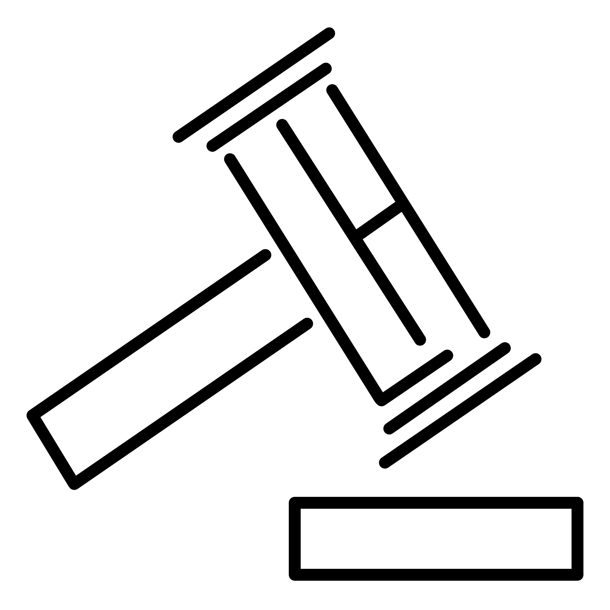

### Untuk: Mikhael Andrian Yonatan

Dipersiapkan oleh:
| Informasi | Keterangan |
| --- | --- |
| Kelas | K03 |
| Kelompok | G05 |

| NIM | Nama |
|---|---|
| 13525057 | Raya Medina Farrelin |
| 13525003 | Cherinette Corsane Khassyah Purceria |
| 13525108 | Khasya Nurul Amini |
| 13525150 | Livy Chandra |
| 13525138 | Cathrine Angel Siburian |
---

## Daftar Perubahan

| Revisi | Deskripsi |
| :--- | :--- |
| A | Komponen LiveChatMasyarakatView pada tabel identifikasi komponen diganti menjadi LiveChatView menyesuaikan dengan fungsinya|

---

# BAB 1: Pendahuluan

## 1.1 Tujuan Penulisan Dokumen

Dokumen Deskripsi Perancangan Perangkat Lunak (DPPL) ini disusun untuk menjabarkan rancangan perangkat lunak LawHub, yaitu platform layanan konsultasi hukum digital yang menghadirkan fitur HaloLaw dan SearchLaw. Dokumen ini menerjemahkan kebutuhan yang telah ditetapkan pada Spesifikasi Kebutuhan Perangkat Lunak (SKPL) dan Arsitektur Perangkat Lunak (APL) menjadi rancangan yang siap diimplementasikan, mencakup rancangan arsitektur berbasis Model-View-Controller (MVC), identifikasi komponen, realisasi setiap use case melalui sequence diagram dan diagram kelas, diagram kelas keseluruhan, serta matriks kerunutan antara kelas perancangan dan use case.

Dokumen ini ditujukan bagi tim pengembang LawHub sebagai acuan dalam tahap implementasi dan pengujian, serta bagi dosen dan asisten mata kuliah IF2150 Rekayasa Perangkat Lunak sebagai bahan penilaian kesesuaian rancangan dengan kebutuhan yang telah ditetapkan.

## 1.2 Lingkup Masalah
LawHub merupakan platform layanan konsultasi hukum digital yang dikembangkan untuk memperluas akses bantuan hukum bagi masyarakat Indonesia, di tengah tingginya angka sengketa dan konflik hukum yang belum terselesaikan serta terbatasnya kanal konsultasi hukum yang interaktif dan efisien. Berbeda dari laman bantuan hukum yang sudah ada dan umumnya berfokus pada forum tanya jawab terbuka, LawHub menghadirkan dua fitur utama, yaitu HaloLaw untuk konsultasi hukum on-demand secara langsung dengan mitra pengacara melalui chat, dan SearchLaw untuk membantu masyarakat menemukan dasar hukum yang relevan dengan kasus yang dihadapi, sehingga proses konsultasi hukum menjadi lebih cepat, transparan, dan mudah diakses oleh berbagai kalangan.

## 1.3 Definisi, Istilah, dan Singkatan

Tabel 1.3. Definisi Istilah dan Singkatan

| Singkatan, Akronim, atau Istilah | Penjelasan |
| :--- | :--- |
| P/L | Singkatan dari Perangkat Lunak, yaitu aplikasi yang memberikan perintah kepada komputer untuk menjalankan tugas tertentu. |
| SKPL | Singkatan dari Spesifikasi Kebutuhan Perangkat Lunak, yaitu dokumen yang merangkum kriteria-kriteria yang diperlukan untuk membangun aplikasi menjalankan tugasnya. |
| KF | Singkatan dari Kebutuhan Fungsional. |
| KNF | Singkatan dari Kebutuhan Non-Fungsional. |
| UC | Singkatan dari Use Case. |
| EARS | Easy Approach to Requirements Syntax, yaitu pola penulisan kebutuhan agar konsisten dan mudah diuji. |

## 1.4 Aturan Penomoran

Tabel 1.4. Aturan Penomoran

| Hal/Bagian | Penomoran |
| :--- | :--- |
| Kebutuhan Fungsional | KFXX | 
| Kebutuhan Non-Fungsional | KNFXX | 
| Use Case | UCXX | 
| Kelas | CXX | 
| Kebutuhan | RXX | 

## 1.5 Referensi
Dokumen SKPL ini disusun dengan merujuk pada sumber-sumber berikut:
1. SPESIFIKASI KEBUTUHAN PERANGKAT LUNAK (SKPL) IF2150-RPL-K03-G05
2. ARSITEKTUR PERANGKAT LUNAK (APL) IF2150-RPL-K03-G05
3. Materi kuliah IF2150 Rekayasa Perangkat Lunak, Program Studi Teknik Informatika, Institut Teknologi Bandung.

## 1.6 Deskripsi Umum Dokumen (Ikhtisar)

Dokumen ini terdiri atas lima bab.
- BAB 1 Pendahuluan memuat tujuan penulisan, lingkup masalah, definisi istilah dan singkatan, aturan penomoran, serta referensi. 
- BAB 2 Perancangan Arsitektur menjelaskan lingkungan implementasi, pola arsitektur MVC yang digunakan beserta alasan pemilihannya, identifikasi komponen (View, Controller, Model, integrasi eksternal, dan penyimpanan data), serta model arsitektur melalui Logical View. 
- BAB 3 Realisasi Use Case menyajikan, untuk setiap use case, identifikasi kelas perancangan beserta kelas analisis terkait, sequence diagram skenario normal dan alternatif, serta diagram kelas use case tersebut. 
- BAB 4 Diagram Kelas Keseluruhan menyatukan seluruh kelas perancangan dalam satu diagram lengkap dengan daftar atribut dan metodenya. 
- BAB 5 Matriks Kerunutan memetakan setiap kelas perancangan ke use case yang terkait untuk memastikan seluruh kebutuhan terpenuhi oleh rancangan.
 

---

# BAB 2: Perancangan Arsitektur

## 2.1 Rancangan Lingkungan Implementasi

Tabel 2.1  Rancangan Lingkungan Implementasi

| Komponen | Spesifikasi | Keterangan |
| :--- | :--- | :--- |
| Server | Local | |
| Client | Chromium Based Browser | |
| DBMS | PostgreSQL  | |
| OS | Cross-platform (Windows/Linux/MacOS) melalui browser | |
| Development Tools | | |
| Filing System | | |
| Bahasa Pemrograman | JavaScript | |

## 2.2 Style/Pattern Arsitektur Acuan

Architectural style atau pattern yang menjadi acuan untuk aplikasi LawHub yang kami kembangkan adalah MVC (Model-View-Controller). Pada MVC, view berperan untuk memperlihatkan antarmuka pada perangkat lunak. View menerima aksi atau masukan awal dari pengguna lalu meneruskan informasi ke controller. Pada LawHub, view direpresentasikan dengan kelas antarmuka seperti SearchLawpage, DaftarMitraPengacaraPage, dan ChatKonsultasiPage. Lalu, controller menjadi penghubung antara view dan model. Controller menerima permintaan pengguna dari view, memproses logika melalui model, dan mengembalikan view setelah data selesai diproses. Contoh controller pada LawHub adalah SesiKonsultasiController dan PencarianMitraController.Terakhir, model merupakan representasi struktur data dan state aplikasi. Model menerima masukan permintaan data yang diperlukan sesuai instruksi controller. Setelah itu, model melakukan operasi create, read, update, dan delete pada database. Selain itu, model juga dapat menyimpan informasi apabila diinstruksikan oleh database. Contoh model pada LawHub adalah Kasus, MitraPengacara, dan DasarHukum.

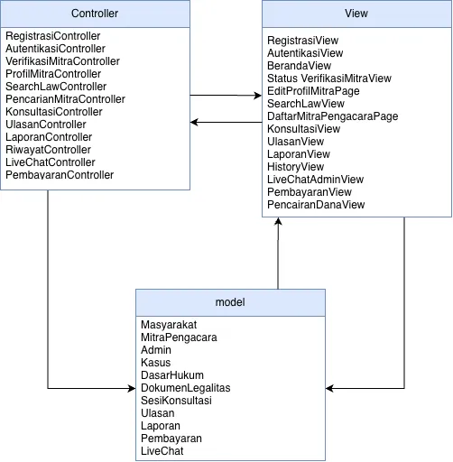

<i>Gambar 1. Arsitektur MVC LawHub</i>

MVC dipilih karena sesuai dengan karakteristik aplikasi Lawhub serta kebutuhan fungsional dan non-fungsional. Pada class diagram yang telah dibuat, LawHub telah memakai stereotype <<boundery>>, <<control>>, dan <<entity>> yang dapat langsung diadaptasi dengan rancangan arsitektur MVC tanpa perlu mengatur ulang struktur kelas. Selain itu, LawHub memiliki tiga aktor dengan antarmuka yang berbeda tetapi ketiganya dapat memanipulasi data yang sama. Dengan MVC, antarmuka untuk setiap peran dapat dikembangakn secara mandiri tanpa perlu memengaruhi logika di belakangnya. Kemudian, berdasarkan alur bisnis dan KF, fitur dengan algoritma pencarian membutuhkan pemisahan tugas antara view dan controller. View hanya memproses masukan pengguna, sementara logika pencariannya dijalankan oleh controller. Terakhir, MVC mendukung keamanan sistem saat mengenkripsi pesan karena dapat diisolasi pada controller dan model.

## 2.3 Identifikasi Komponen / Modul / Subsistem

Tabel 2.1. Identifikasi Komponen/Modul/Subsistem

| Nama Komponen/Modul/Subsistem | Jenis                 | Penjelasan                                                                                                           |
| :---------------------------- | :-------------------- | :------------------------------------------------------------------------------------------------------------------- |
RegistrasiView | View | Menampilkan formulir pendaftaran akun bagi masyarakat dan mitra pengacar, serta meneruskan input ke RegistrasiController. |
AutentikasiView | View | Menampilkan halaman login bagi masyarakat dan mitra pengacara untuk masuk sebagai akun terdaftar |
BerandaView | View | Menampilkan halaman utama setelah login. |
StatusVerifikasiMitraView | View | Menampilkan status terkini verifikasi akun kepada Mitra Pengacara, serta menampilkan dokumen pendaftar bagi Admin untuk ditinjau dan diverifikasi. |
EditProfilMitraPage | View |  Menampilkan formulir pengeditan profil/identitas firma serta pengunggahan dan pengeditan dokumen legalitas milik Mitra Pengacara. |
SearchLawView | View | Menampilkan hasil pencarian pasal berdasarkan kata kunci yang dimasukkan pengguna pada fitur SearchLaw. |
DaftarMitraPengacaraPage | View | Menampilkan daftar Mitra Pengacara lengkap dengan filter pencarian. |
KonsultasiView | View |  Menampilkan pemilihan Mitra Pengacara dan jadwal konsultasi, konfirmasi penerimaan konsultasi oleh Mitra Pengacara, serta ruang chat sesi konsultasi (HaloLaw) antara Masyarakat dan Mitra Pengacara. |
UlasanView | View | Menampilkan formulir pengisian ulasan, feedback, dan rating setelah sesi konsultasi selesai. |
LaporanView | View | Menampilkan formulir pelaporan pelanggaran akun (oleh Masyarakat maupun Mitra Pengacara) dan pelaporan ulasan yang dianggap tidak relevan (oleh Mitra Pengacara), serta halaman tinjauan laporan bagi Admin. |
HistoryView | View | Menampilkan riwayat kasus dan sesi konsultasi yang telah dilakukan Masyarakat maupun Mitra Pengacara. |
LiveChatAdminView | View | Menampilkan ruang live chat bagi Masyarakat untuk bertanya dan bagi Admin untuk menjawab pertanyaan. |
PembayaranView | View | Menampilkan pemilihan metode dan konfirmasi pembayaran sesi konsultasi. |
PencairanDanaView | View | Menampilkan formulir pengajuan pencairan dana bagi Mitra Pengacara. |
RegistrasiController | Controller | Mengatur alur pendaftaran akun baru, termasuk validasi data dan pembuatan akun Masyarakat, serta pendaftaran akun dan pengunggahan dokumen legalitas Mitra Pengacara untuk diverifikasi.
AutentikasiController | Controller | Mengelola proses log in dan verifikasi kredensial, dipakai bersama oleh Masyarakat maupun Mitra Pengacara. |
| VerifikasiMitraController | Controller | Mengelola proses verifikasi Mitra Pengacara, mencakup penampilan status bagi Mitra Pengacara maupun peninjauan dan penentuan status oleh Admin berdasarkan dokumen legalitas. |
| ProfilMitraController | Controller | Mengelola pembaruan profil dan dokumen legalitas Mitra Pengacara. |
| SearchLawController | Controller | Memproses permintaan pencarian pasal berdasarkan kata kunci pada basis data peraturan perundang-undangan dalam fitur SearchLaw. |
| PencarianMitraController | Controller | Memproses pencarian dan filter daftar Mitra Pengacara berdasarkan kasus yang dimasukkan Masyarakat dalam fitur HaloLaw. |
| KonsultasiController | Controller | Mengelola pemilihan Mitra Pengacara dan jadwal sesi konsultasi oleh Masyarakat, alur penerimaan sesi oleh Mitra Pengacara, serta berjalannya sesi konsultasi melalui chat yang baru dapat dimulai setelah pembayaran lunas. |
| UlasanController | Controller | Mengelola pengiriman ulasan, feedback, dan rating dari Masyarakat kepada Mitra Pengacara. |
| LaporanController | Controller | Mengatur alur pelaporan pelanggaran akun maupun ulasan (baik oleh Masyarakat maupun Mitra Pengacara), serta memproses tinjauan laporan dan eksekusi pemblokiran akun yang melanggar kebijakan oleh Admin. |
| RiwayatController | Controller | Mengambil dan menyusun data riwayat kasus/konsultasi yang telah dilakukan Masyarakat maupun Mitra Pengacara. |
| LiveChatController | Controller | Mengelola pengiriman dan penerimaan pesan live chat antara Masyarakat dan Admin. |
| PembayaranController | Controller | Memproses transaksi pembayaran sesi konsultasi melalui PaymentGatewayAdapter; pembayaran harus lunas sebagai syarat sebelum sesi chat dibuka. |
| PencairanDanaController | Controller | Memproses permintaan dan validasi pencairan dana Mitra Pengacara ke rekening terdaftar melalui PaymentGatewayAdapter, secara terpisah dan tidak otomatis setelah pembayaran diterima sistem. |
Masyarakat | Model | Menyimpan data akun Masyarakat yang mengajukan kasus, mencari pasal dan mitra, berkonsultasi, membayar, memberi ulasan, dan melapor. |
MitraPengacara | Model | Menyimpan data akun dan profil Mitra Pengacara, mencakup tag keahlian, status verifikasi, status ketersediaan, rating, saldo, dan rekening pencairan. |
Admin | Model | Menyimpan data akun Admin yang memverifikasi Mitra Pengacara, meninjau laporan, memblokir akun, dan melayani live chat. |
Kasus | Model | Menyimpan data kasus/kondisi Masyarakat yang menjadi dasar pencarian dan pemilihan Mitra Pengacara pada fitur HaloLaw, serta dikaitkan dengan sesi konsultasi dan riwayat penanganan. |
DasarHukum | Model | Menyimpan data peraturan dan perundang-undangan (pasal) yang menjadi basis data pencarian pada fitur SearchLaw. |
DokumenLegalitas | Model | Menyimpan berkas dan data legalitas yang diunggah Mitra Pengacara untuk keperluan verifikasi. |
SesiKonsultasi | Model | Menyimpan data sesi konsultasi antara Masyarakat dan Mitra Pengacara beserta status dan waktu mulai/selesai. |
Ulasan | Model | Menyimpan data ulasan berupa teks, foto, dan/atau rating yang diberikan Masyarakat setelah sesi konsultasi, dan ditampilkan pada profil Mitra Pengacara. |
Laporan | Model | Menyimpan data laporan pelanggaran akun maupun ulasan beserta status peninjauannya oleh Admin. |
Pembayaran | Model | Menyimpan data transaksi pembayaran sesi konsultasi, termasuk metode, jumlah, status, dan waktu transaksi. |
LiveChat | Model | Menyimpan data percakapan live chat antara Masyarakat dan Admin. |
| PencairanDana | Model | Menyimpan data transaksi pencairan dana Mitra Pengacara, termasuk jumlah, tanggal, status, dan rekening tujuan. |
| PaymentGatewayAdapter | Integrasi Eksternal | Mengirim permintaan otorisasi ke Payment Gateway pihak ketiga (dummy) untuk pembayaran sesi konsultasi maupun pencairan dana Mitra Pengacara, lalu meneruskan status transaksi ke PembayaranController dan PencairanDanaController. |
| Database | Penyimpanan Data | Menyimpan seluruh data Model secara persisten dan terpusat, diakses oleh seluruh Controller LawHub. |

## 2.4 Model Arsitektur Perangkat Lunak

### 2.4.1 Logical View

Logical View dipilih karena bertujuan untuk menunjukkan interaksi dan alur pemrosesan antarkomponen arsitektur tingkat tinggi yang masing-masing dapat mewadahi satu atau lebih kelas fungsional. Selain itu, logical View juga mampu memvisualisasikan pemisahan fungsi  MVC, sehingga alur pemrosesan antar-aktor (Masyarakat, Pengacara, Admin) mudah dipahami.

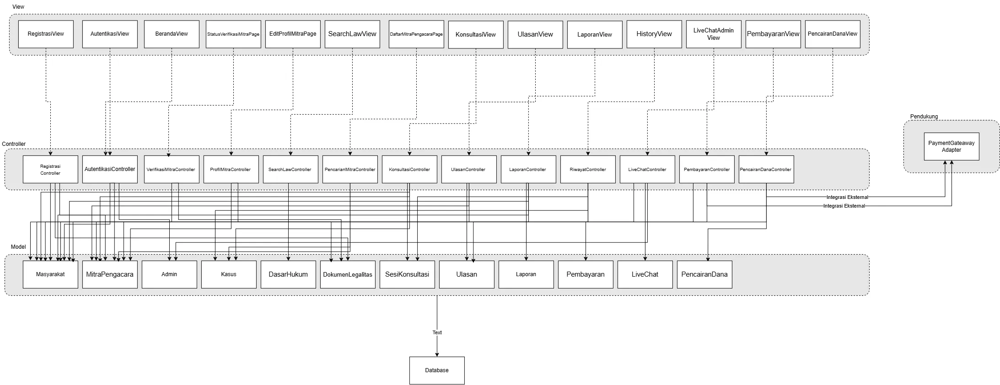

<i>Gambar 2. Diagram Logical View LawHub</i>

Diagram dibagi menjadi tiga jalur utama, yaitu View, Controller, dan Model, sesuai dengan penerapan pola arsitektur Model-View-Controller (MVC) yang telah ditetapkan pada BAB 1. Komponen Integrasi Eksternal (PaymentGatewayAdapter) diletakkan di luar jalur utama (sebelah kanan) karena komponen ini bertindak sebagai perantara komunikasi diluar dari sistem dan hanya dipanggil oleh Controller. Komponen Penyimpanan Data (Database) diletakkan di bagian paling bawah sebagai fondasi penyimpanan data keseluruhan.

### 2.4.X View [Nama View]
*[Lakukan hal yang sama dengan bagian sebelumnya]*

 

---

# BAB 3: Realisasi Use Case

## 3.1 Use Case UC01

**ID Use Case:** *UC01*  
**Nama Use Case:** *Daftar Akun bagi Masyarakat*

### 3.1.1 Identifikasi Kelas

Identifikasi kelas yang terkait dengan use case tersebut. Kelas di tahap perancangan dapat berbeda dengan dengan kelas di tahap analisis. Dapat menggunakan tabel di bawah:

Tabel 3.1. Identifikasi Kelas Use Case [UC01]

| No | Nama Kelas Perancangan | Nama Kelas Analisis Terkait |
|:--- | :--- | :--- |
| 1 | *RegistrasiView* | *RegistrasiMasyarakatPage* |
| 2 | *RegistrasiController* | *RegistrasiMasyarakatController* |
| 3 | *Masyarakat* | *Masyarakat* |
| ... | *...* | *...* |

### 3.1.2 Sequence Diagram

Buat *sequence diagram* untuk **setiap skenario use case**, mencakup skenario normal dan alternatif pada subbab 4.4 SKPL. Diagram melibatkan kelas-kelas yang telah diidentifikasi pada SKPL. 

- **Skenario Normal**

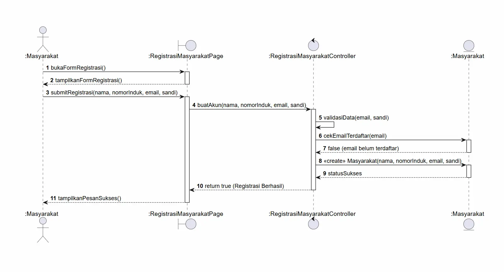

<i>Gambar 1. Sequence Diagram UC01</i>

- **Skenario Alternatif 1 : Registrasi Gagal saat email sudah terdaftar atau password lemah**

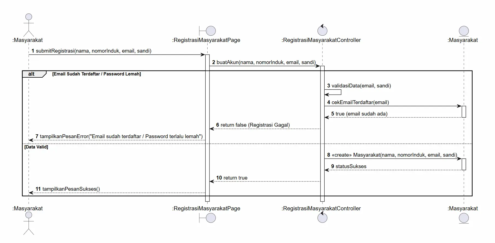

<i>Gambar 2. Sequence Diagram UC01 - email sudah terdaftar atau password lemah</i>

### 3.1.3 Diagram Kelas

Buatlah diagram kelas untuk use case ini yang terdiri atas kelas-kelas dari 3.1.1. **Setiap kelas pada diagram wajib menampilkan atribut dan metode/operasi langsung di dalam kotak kelasnya**, sehingga tidak perlu membuat tabel daftar atribut dan metode per kelas pada subbab ini. Daftar lengkap atribut dan metode seluruh kelas disajikan pada Tabel 4.1 (Bab 4).

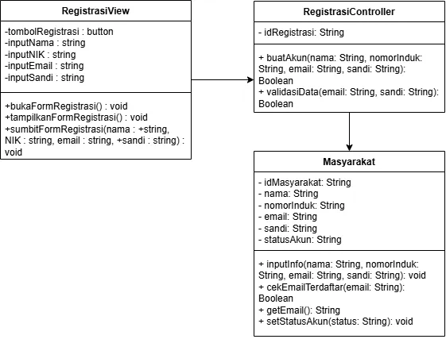

<i>Gambar X. Diagram Kelas [Nama Uce Case]</i>

Pada diagram, pastikan:
- Atribut dituliskan beserta visibilitas dan tipe datanya, misalnya `- email: String`.
- Operasi dituliskan beserta visibilitas, parameter, dan tipe kembaliannya, misalnya `+ login(email: String, password: String): Boolean`.
- Relasi antarkelas (asosiasi, agregasi, komposisi, generalisasi, dan dependensi) digambarkan lengkap dengan multiplisitas.
- Semua operasi yang dipanggil pada sequence diagram 3.1.2 (skenario normal dan alternatif) ada pada kelas yang bersangkutan.
- Kelas yang sama dengan kelas di use case lain memakai nama, atribut, dan metode yang konsisten.

## 3.2 Use Case 02

**ID Use Case:** UC02
**Nama Use Case:** Melakukan Login bagi Masyarakat

### 3.1.1 Identifikasi Kelas

Tabel 3.2. Identifikasi Kelas Use Case [UC02]

| No | Nama Kelas Perancangan | Nama Kelas Analisis Terkait |
|:--- | :--- | :--- |
| 1 | *[Nama kelas perancangan]* | *[Nama kelas analisis pada SKPL]* |
| 2 | *[Nama kelas perancangan]* | *[Nama kelas analisis pada SKPL]* |
| ... | *...* | *...* |

### 3.1.2 Sequence Diagram

Buat *sequence diagram* untuk **setiap skenario use case**, mencakup skenario normal dan alternatif pada subbab 4.4 SKPL. Diagram melibatkan kelas-kelas yang telah diidentifikasi pada SKPL. 

- **Skenario Normal**

<i>Gambar X. Sequence Diagram [UC01]</i>

- **Skenario Alternatif [Nomor]: [Nama Skenario]**

<i>Gambar X. Sequence Diagram [UC01] - [Nama skenario alternatif]</i>

### 3.1.3 Diagram Kelas

Buatlah diagram kelas untuk use case ini yang terdiri atas kelas-kelas dari 3.1.1. **Setiap kelas pada diagram wajib menampilkan atribut dan metode/operasi langsung di dalam kotak kelasnya**, sehingga tidak perlu membuat tabel daftar atribut dan metode per kelas pada subbab ini. Daftar lengkap atribut dan metode seluruh kelas disajikan pada Tabel 4.1 (Bab 4).

<i>Gambar X. Diagram Kelas [Nama Uce Case]</i>

Pada diagram, pastikan:
- Atribut dituliskan beserta visibilitas dan tipe datanya, misalnya `- email: String`.
- Operasi dituliskan beserta visibilitas, parameter, dan tipe kembaliannya, misalnya `+ login(email: String, password: String): Boolean`.
- Relasi antarkelas (asosiasi, agregasi, komposisi, generalisasi, dan dependensi) digambarkan lengkap dengan multiplisitas.
- Semua operasi yang dipanggil pada sequence diagram 3.1.2 (skenario normal dan alternatif) ada pada kelas yang bersangkutan.
- Kelas yang sama dengan kelas di use case lain memakai nama, atribut, dan metode yang konsisten.

## 3.6 Use Case UC06

**ID Use Case:** *UC06*  
**Nama Use Case:** *Memverifikasi Pendaftar Mitra Pengacara*

### 3.6.1 Identifikasi Kelas

Tabel 3.6.1 Identifikasi Kelas Use Case [UC01]

| No | Nama Kelas Perancangan | Nama Kelas Analisis Terkait |
|:--- | :--- | :--- |
| 1 | *StatusVerifikasiMitraView* | *VerifikasiMitraPage* |
| 2 | *VerifikasiMitraController* | *VerifikasiMitraController* |
| 3 | *Admin* | *Admin* |
| ... | *...* | *...* |

### 3.6.2 Sequence Diagram

Buat *sequence diagram* untuk **setiap skenario use case**, mencakup skenario normal dan alternatif pada subbab 4.4 SKPL. Diagram melibatkan kelas-kelas yang telah diidentifikasi pada SKPL. 

- **Skenario Normal**

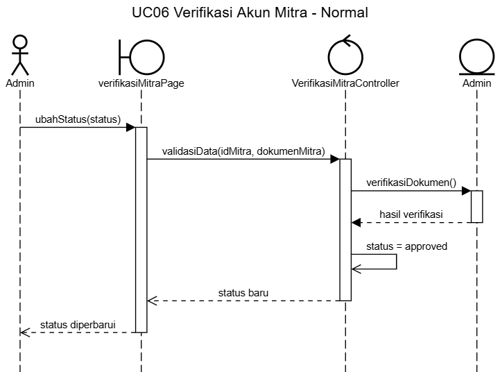

<i>Gambar 6. Sequence Diagram UC06</i>

- **Skenario Alternatif 1 : Admin meminta penambahan/revisi dokumen**
- **Skenario Alternatif 2 : Dokumen tidak memenuhi syarat atau terindikasi pelanggaran**

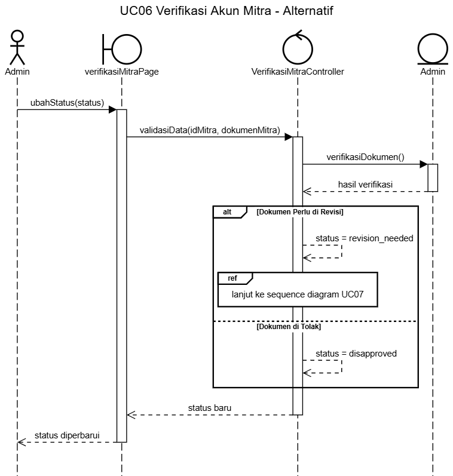

<i>Gambar 2. Sequence Diagram Alternatif UC06 </i>

### 3.6.3 Diagram Kelas

<i>Gambar 6. Diagram Kelas UC06</i>

## 3.7 Use Case UC07

**ID Use Case:** *UC07*  
**Nama Use Case:** *Verifikasi Akun Pengacara (Edit Profil)*

### 3.7.1 Identifikasi Kelas

Tabel 3.7.1 Identifikasi Kelas Use Case [UC01]

| No | Nama Kelas Perancangan | Nama Kelas Analisis Terkait |
|:--- | :--- | :--- |
| 1 | *EditProfilMitraPage* | *EditDokumenLegalitasPage* |
| 2 | *EditProfilMitraPage View* | *EditProfilMitraPage* |
| 3 | *MitraPengacara* | *MitraPengacara* |
| ... | *...* | *...* |

### 3.7.2 Sequence Diagram

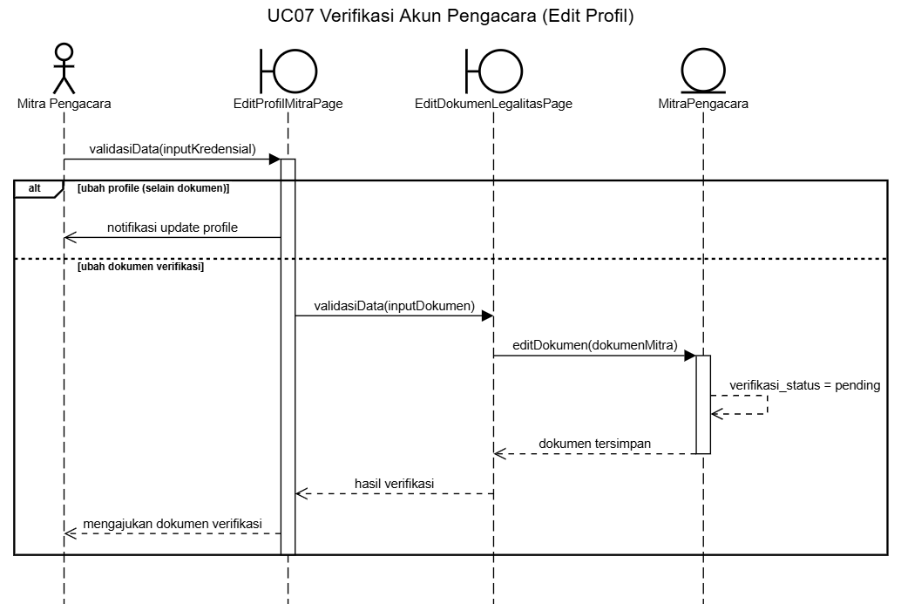

<i>Gambar 7. Sequence Diagram UC07</i>

### 3.7.3 Diagram Kelas

<i>Gambar 7. Diagram Kelas UC07</i>

## 3.8 Use Case UC08

**ID Use Case:** *UC08*  
**Nama Use Case:** *Melakukan Pencarian Pasal*

### 3.8.1 Identifikasi Kelas

Tabel 3.8.1 Identifikasi Kelas Use Case [UC01]

| No | Nama Kelas Perancangan | Nama Kelas Analisis Terkait |
|:--- | :--- | :--- |
| 1 | *searchLawController* | *searchLawController* |
| 2 | *searchLawPage* | *searchLawPage* |
| 3 | *Masyarakat* | *Masyarakat* |
| 4 | *Dasar Hukum* | *Dasar Hukum* |

### 3.8.2 Sequence Diagram

<i>Gambar 8. Sequence Diagram UC08</i>

### 3.8.3 Diagram Kelas

<i>Gambar 8. Diagram Kelas UC08</i>

## 3.9 Use Case UC09

**ID Use Case:** *UC09*  
**Nama Use Case:** *Mencari Mitra Pengacara*

### 3.9.1 Identifikasi Kelas

Tabel 3.9.1 Identifikasi Kelas Use Case [UC09]

| No | Nama Kelas Perancangan | Nama Kelas Analisis Terkait |
|:--- | :--- | :--- |
| 1 | *DaftarMitraPengacaraView* | *DaftarMitraPengacaraPage* |
| 2 | *PencarianMitraController* | *PencarianMitraController* |
| 3 | *Masyarakat* | *Masyarakat* |
| 4 | *Kasus* | *Kasus* |
| 5 | *MitraPengacara* | *MitraPengacara* |
| 6 | *Ulasan* | *Ulasan* |

### 3.9.2 Sequence Diagram

<i>Gambar 9. Sequence Diagram UC09</i>

### 3.9.3 Diagram Kelas

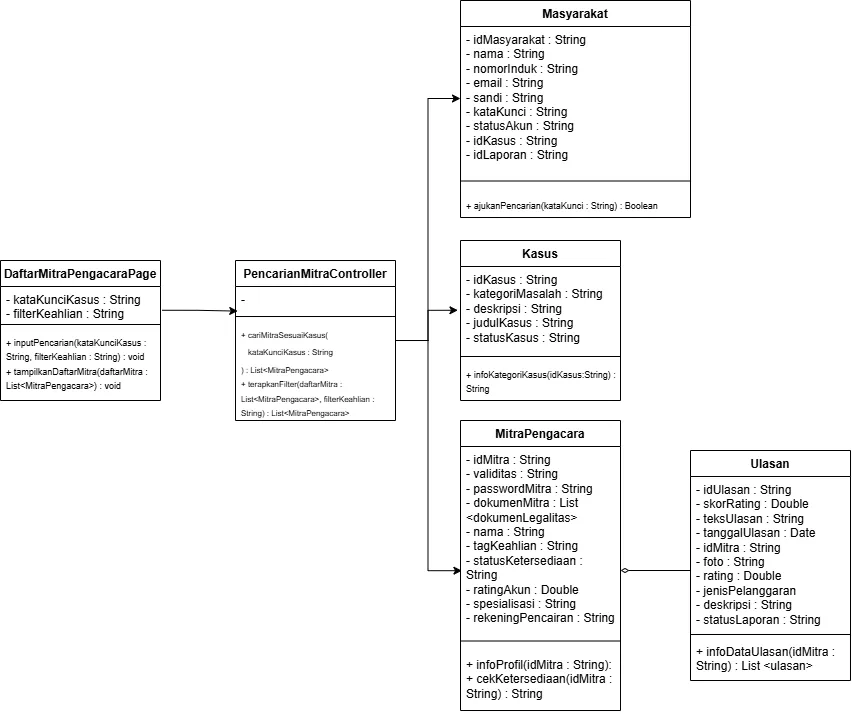

<i>Gambar 9. Diagram Kelas UC09</i>

## 3.10 Use Case UC10

**ID Use Case:** *UC10*  
**Nama Use Case:** *Memilih Mitra Pengacara untuk Sesi Konsultasi*

### 3.10.1 Identifikasi Kelas

Tabel 3.10.1 Identifikasi Kelas Use Case [UC10]

| No | Nama Kelas Perancangan | Nama Kelas Analisis Terkait |
|:--- | :--- | :--- |
| 1 | *PemilihanJadwalKonsultasiView* | *PemilihanJadwalKonsultasiPage* |
| 2 | *PenjadwalanKonsultasiController* | *PenjadwalanKonsultasiController* |
| 3 | *Masyarakat* | *Masyarakat* |
| 4 | *Kasus* | *Kasus* |
| 5 | *MitraPengacara* | *MitraPengacara* |
| 6 | *SesiKonsultasi* | *SesiKonsultasi* |

### 3.10.2 Sequence Diagram

<i>Gambar 9. Sequence Diagram UC09</i>

- **Skenario Alternatif 1 : Semua jadwal penuh atau tidak sesuai kebutuhan masyarakat**

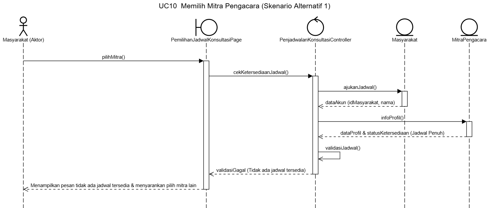

<i>Gambar 10. Sequence Diagram Alternatif UC10 </i>

### 3.9.3 Diagram Kelas

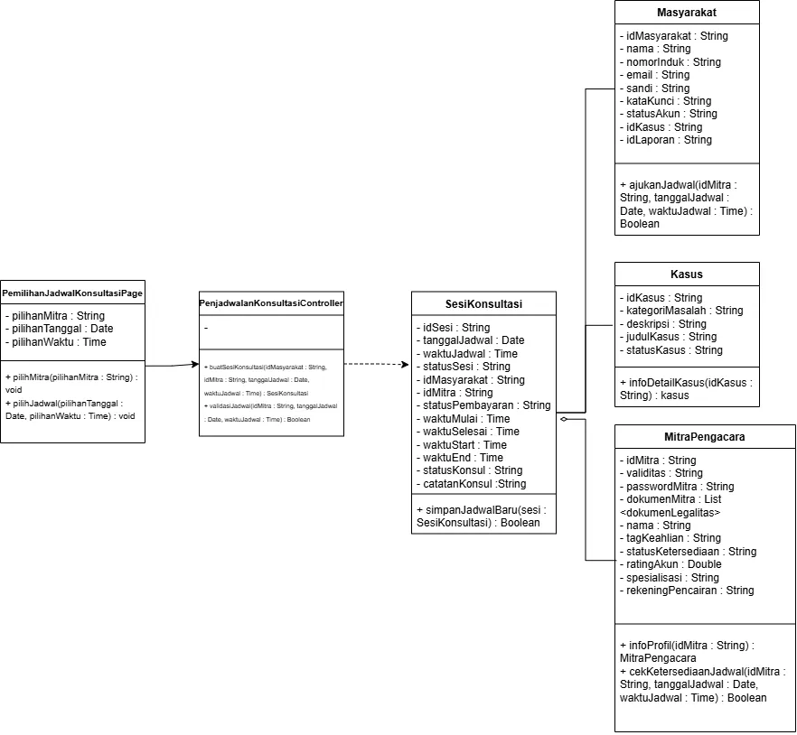

<i>Gambar 10. Diagram Kelas UC10</i>

## 3.11 Use Case UC11

**ID Use Case:** UC11  
**Nama Use Case:** Menanggapi Sesi Konsultasi 

### 3.11.1 Identifikasi Kelas

Tabel 3.11.1 Identifikasi Kelas Use Case [UC11]

| No | Nama Kelas Perancangan | Nama Kelas Analisis Terkait |
|:--- | :--- | :--- |
| 1 | KonfirmasiKonsultasiPage | KonfirmasiKonsultasiPage |
| 2 | SesiKonsultasiController | SesiKonsultasiController |
| 3 | MitraPengacara | MitraPengacara |
| 4 | SesiKonsultasi | SesiKonsultasi |

### 3.11.2 Sequence Diagram

- **Skenario Normal**

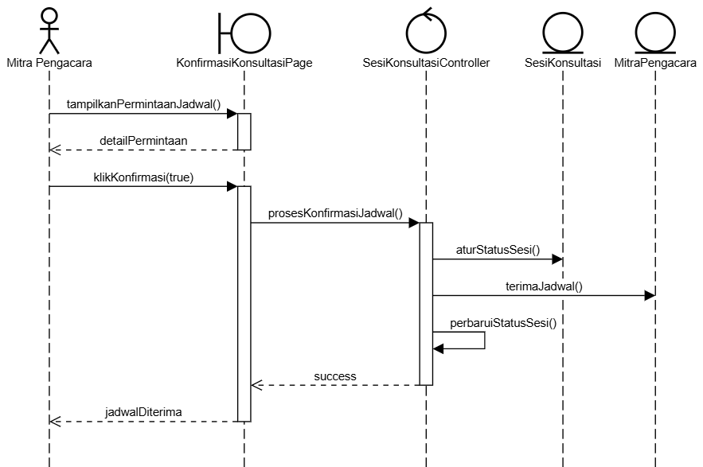

<i>Gambar 35. Sequence Diagram [UC11]</i>

- **Skenario Alternatif 1: Mitra menolak permintaan konsultasi**

<i>Gambar 36. Sequence Diagram [UC11] - Mitra menolak permintaan konsultasi</i>

- **Skenario Alternatif 2: Mitra tidak merespon dalam waktu tertentu**

<i>Gambar 37. Sequence Diagram [UC11] - Mitra tidak merespon dalam waktu tertentu</i>

### 3.11.3 Diagram Kelas

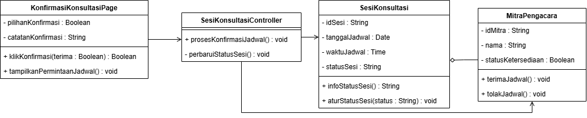

<i>Gambar 38. Diagram Kelas Menanggapi Sesi Konsultasi</i>

## 3.12 Use Case UC12

**ID Use Case:** UC12
**Nama Use Case:** Melakukan Sesi Konsultasi 

### 3.12.1 Identifikasi Kelas

Tabel 3.12.1 Identifikasi Kelas Use Case [UC12]

| No | Nama Kelas Perancangan | Nama Kelas Analisis Terkait |
|:--- | :--- | :--- |
| 1 | ChatKonsultasiPage | ChatKonsultasiPage |
| 2 | SesiKonsultasiController | SesiKonsultasiController |
| 3 | Masyarakat | Masyarakat |
| 4 | MitraPengacara | MitraPengacara |
| 5 | Kasus | Kasus |
| 6 | SesiKonsultasi | SesiKonsultasi |
| 7 | Pembayaran | Pembayaran |

### 3.12.2 Sequence Diagram

- **Skenario Normal**

<i>Gambar 39. Sequence Diagram [UC12]</i>

- **Skenario Alternatif 1: Sesi terputus/salah satu pihak tidak merespon**

<i>Gambar 40. Sequence Diagram [UC12] - Sesi terputus/salah satu pihak tidak merespon</i>

### 3.12.3 Diagram Kelas

<i>Gambar 41. Diagram Kelas Melakukan Sesi Konsultasi</i>

## 3.13 Use Case UC13

**ID Use Case:** UC13
**Nama Use Case:** Memberi Ulasan, Feedback, dan/atau Rating 

### 3.13.1 Identifikasi Kelas

Tabel 3.13.1 Identifikasi Kelas Use Case [UC13]

| No | Nama Kelas Perancangan | Nama Kelas Analisis Terkait |
|:--- | :--- | :--- |
| 1 | UlasanPage | UlasanPage |
| 2 | UlasanController | UlasanController |
| 3 | Masyarakat | Masyarakat |
| 4 | Ulasan | Ulasan |

### 3.13.2 Sequence Diagram

- **Skenario Normal**

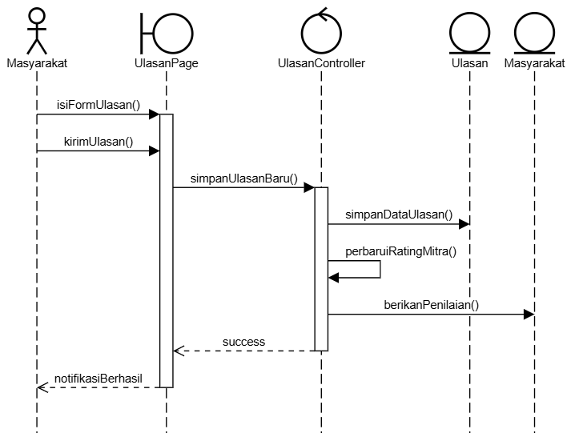

<i>Gambar 42. Sequence Diagram [UC13]</i>

- **Skenario Alternatif 1: Gagal mengirim ulasan**

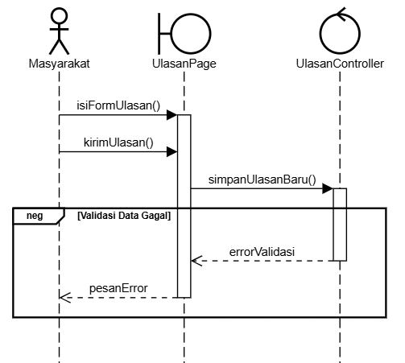

<i>Gambar 43. Sequence Diagram [UC13] - Gagal mengirim ulasan</i>

### 3.13.3 Diagram Kelas

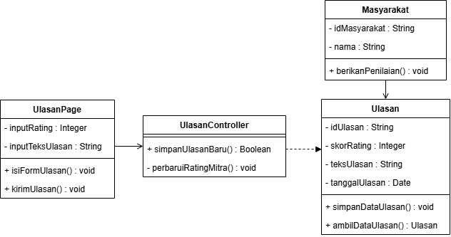

<i>Gambar 44. Diagram Kelas Memberi Ulasan, Feedback, dan/atau Rating</i>

## 3.14 Use Case UC14 

**ID Use Case:** UC14
**Nama Use Case:** Melaporkan Pelanggaran Akun 

### 3.14.1 Identifikasi Kelas

Tabel 3.14.1 Identifikasi Kelas Use Case [UC14]

| No | Nama Kelas Perancangan | Nama Kelas Analisis Terkait |
|:--- | :--- | :--- |
| 1 | LaporanAkunPage | LaporanAkunPage |
| 2 | LaporanController | LaporanController |
| 3 | Masyarakat | Masyarakat |
| 4 | Laporan | Laporan |

### 3.14.2 Sequence Diagram

- **Skenario Normal**

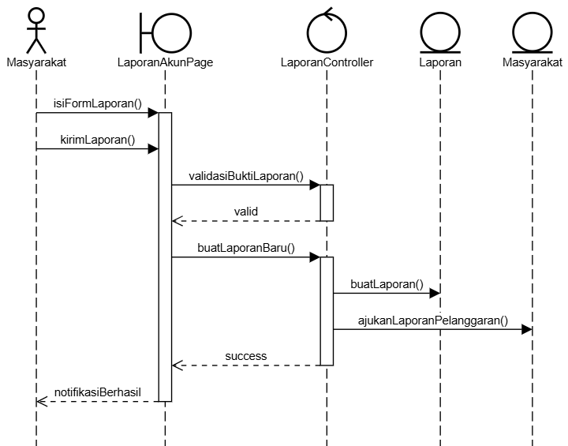

<i>Gambar 45. Sequence Diagram [UC14]</i>

- **Skenario Alternatif 1: Formulir laporan tidak lengkap**

<i>Gambar 46. Sequence Diagram [UC14] - Formulir laporan tidak lengkap</i>

### 3.14.3 Diagram Kelas

<i>Gambar 47. Diagram Kelas Melaporkan Pelanggaran Akun</i>

## 3.15 Use Case UC15

**ID Use Case:** UC15
**Nama Use Case:** Melaporkan Pelanggaran

### 3.15.1 Identifikasi Kelas

Tabel 3.15.1 Identifikasi Kelas Use Case [UC15]

| No | Nama Kelas Perancangan | Nama Kelas Analisis Terkait |
|:--- | :--- | :--- |
| 1 | LaporanAkunPage | LaporanAkunPage |
| 2 | LaporanController | LaporanController |
| 3 | Masyarakat | Masyarakat |
| 4 | Laporan | Laporan |
| 5 | Mitra Pengacara | Mitra Pengacara |

### 3.15.2 Sequence Diagram

- **Skenario Normal**

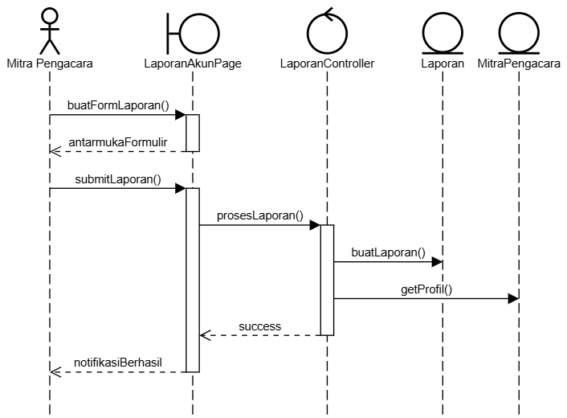

<i>Gambar 48. Sequence Diagram [UC15]</i>

- **Skenario Alternatif 1: Formulir laporan tidak lengkap**

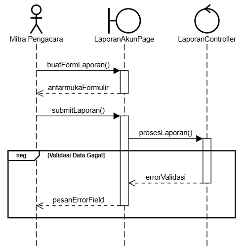

<i>Gambar 49. Sequence Diagram [UC15] - Formulir laporan tidak lengkap</i>

### 3.15.3 Diagram Kelas

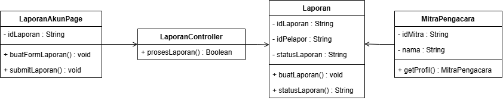

<i>Gambar 50. Diagram Kelas Melaporkan Pelanggara</i>

## 3.16 Use Case UC16

**ID Use Case:** UC16
**Nama Use Case:** Melaporkan Ulasan

### 3.16.1 Identifikasi Kelas

Tabel 3.16. Identifikasi Kelas Use Case [UC16]

| No | Nama Kelas Perancangan | Nama Kelas Analisis Terkait |
|:--- | :--- | :--- |
| 1 | LaporanUlasanPage | LaporanView |
| 2 | LaporanController| LaporanController | 
| 3 | Laporan | Laporan |
| 4 | Ulasan | Alasan |

### 3.16.2 Sequence Diagram

- **Skenario Normal**

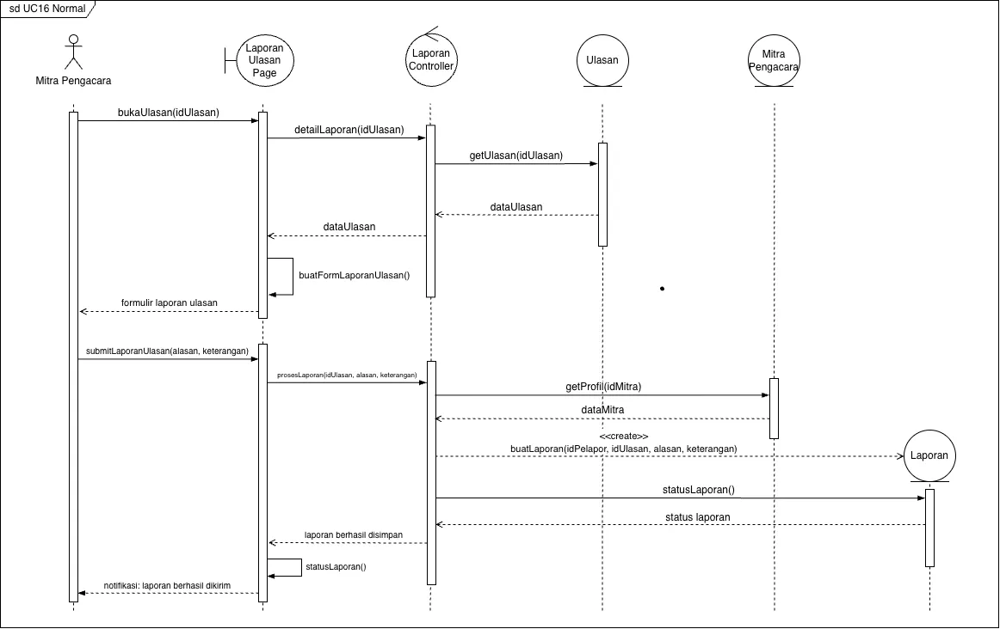

<i>Gambar 48. Sequence Diagram UC16</i>

- **Skenario Alternatif 1 : Formulir Laporan Tidak Lengkap**

<i>Gambar 49. Sequence Diagram UC16 - formulir tidak lengkap</i>

### 3.16.3 Diagram Kelas

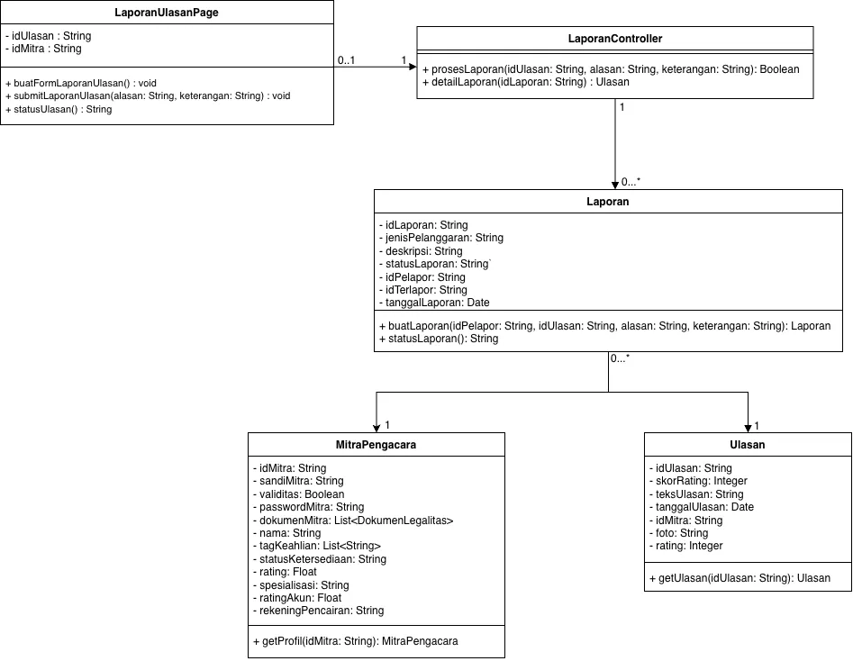

<i>Gambar 50. Diagram Kelas Melaporkan Ulasan</i>

## 3.17 Use Case UC17

**ID Use Case:** UC17
**Nama Use Case:** Memblokir Akun

### 3.17.1 Identifikasi Kelas

Tabel 3.17. Identifikasi Kelas Use Case [UC17]

| No | Nama Kelas Perancangan | Nama Kelas Analisis Terkait |
|:--- | :--- | :--- |
| 1 | TinjauanPage | LaporanView |
| 2 | ModerasiAkunController| LaporanController | 
| 3 | Admin | Admin |
| 4 | Laporan | Laporan |

### 3.17.2 Sequence Diagram

- **Skenario Normal**

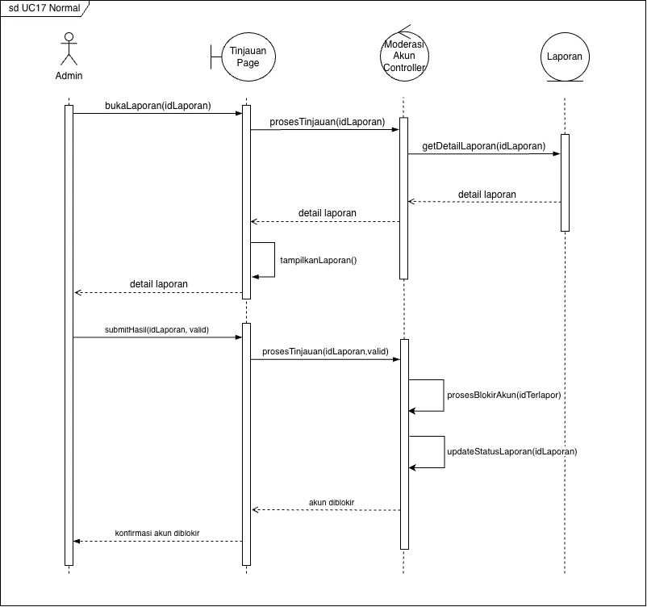

<i>Gambar 51. Sequence Diagram UC17</i>

- **Skenario Alternatif 1 : Laporan Tidak Disetujui Admin**

<i>Gambar 52. Sequence Diagram UC17 - laporan tidak disetujui admin</i>

### 3.17.3 Diagram Kelas

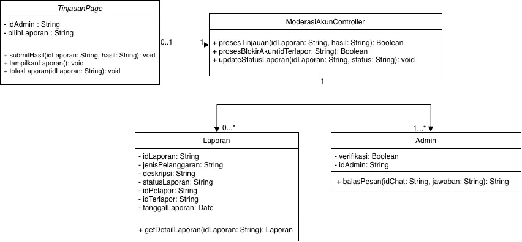

<i>Gambar 53. Diagram Kelas Memblokir Akun</i>

## 3.18 Use Case UC18

**ID Use Case:** UC18
**Nama Use Case:** Melihat Riwayat Penanganan

### 3.18.1 Identifikasi Kelas

Tabel 3.18. Identifikasi Kelas Use Case [UC18]

| No | Nama Kelas Perancangan | Nama Kelas Analisis Terkait |
|:--- | :--- | :--- |
| 1 | HistoryPage | HistoryView |
| 2 | RiwayatController | RiwayatController |
| 3 | Masyarakat | Masyarakat | 
| 4 | MitraPengacara | MitraPengacara |
| 5 | Kasus | Kasus |
| 6 | SesiKonsultasi | SesiKonsultasi |

### 3.18.2 Sequence Diagram

- **Skenario Normal**

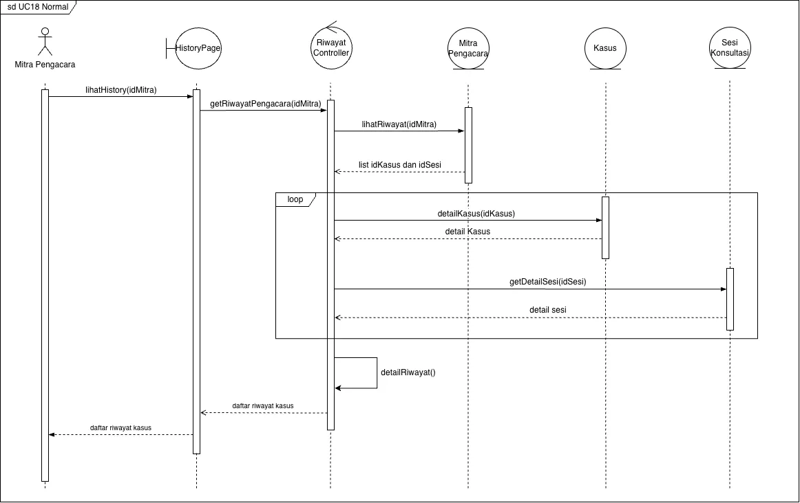

<i>Gambar 54. Sequence Diagram UC18</i>

- **Skenario Alternatif 1 : Laporan Tidak Disetujui Admin**

<i>Gambar 55. Sequence Diagram UC18 - laporan tidak disetujui admin</i>

### 3.18.3 Diagram Kelas

<i>Gambar 56. Diagram Kelas Melihat Riwayat Penanganan</i>

## 3.19 Use Case UC19

**ID Use Case:** UC19
**Nama Use Case:** Live Chat dengan Admin

### 3.19.1 Identifikasi Kelas

Tabel 3.19. Identifikasi Kelas Use Case [UC19 & UC20]

| No | Nama Kelas Perancangan | Nama Kelas Analisis Terkait |
|:--- | :--- | :--- |
| 1 | LiveChatMasyarakatPage | LiveChatView | 
| 2 | LiveChatController | LiveChatController | 
| 3 | Masyarakat | Masyarakat |
| 4 | Admin | Admin |
| 5 | LiveChat | LiveChat |

### 3.19.2 Sequence Diagram

- **Skenario Normal**

<i>Gambar 57. Sequence Diagram UC19 & UC20</i>

- **Skenario Alternatif 1 : Tidak Ada Admin yang Tersedia

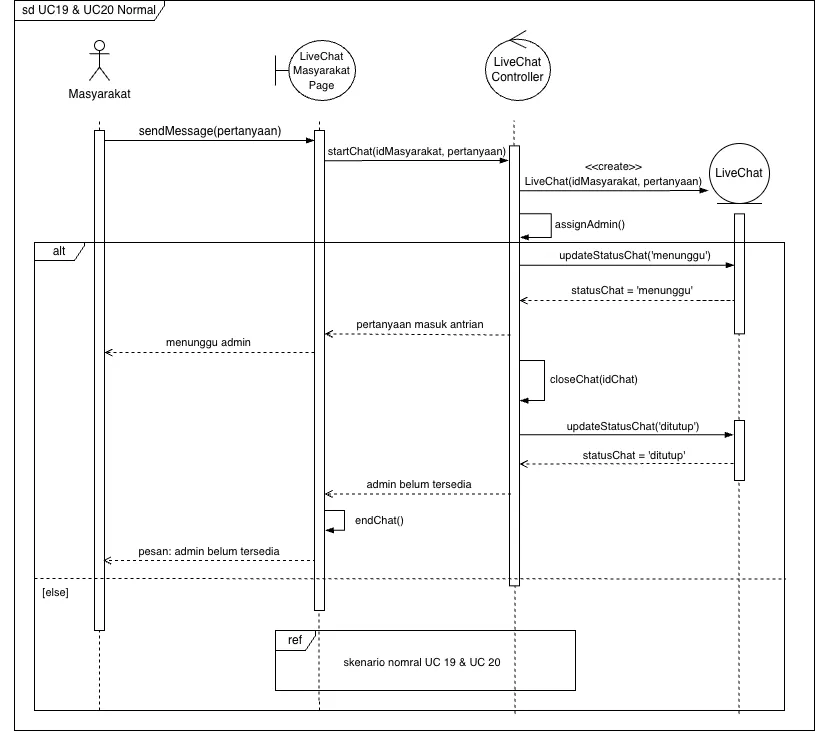

<i>Gambar 58. Sequence Diagram UC1 & UC20 - tidak ada admin yang standby</i>

### 3.19.3 Diagram Kelas

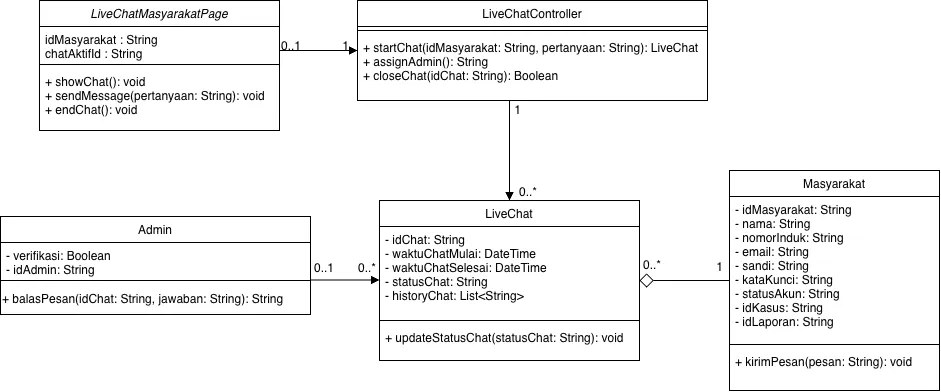

<i>Gambar 59. Diagram Kelas Live Chat Masyarakat</i>

<i>Gambar 60. Diagram Kelas Live Chat Admin</i>

 

## 3.21 Use Case UC21

**ID Use Case:** UC21
**Nama Use Case:** Membayar Biaya Sesi Konsultasi

### 3.21.1 Identifikasi Kelas

Tabel 3.21. Identifikasi Kelas Use Case [UC21]

| No | Nama Kelas Perancangan | Nama Kelas Analisis Terkait |
|:--- | :--- | :--- | 
| 1 | PembayaranPage | PembayaranPage |
| 2 | PembayaranController | PembayaranController |
| 3 | Masyarakat  | Masyarakat |
| 4 | SesiKonsultasi | SesiKonsultasi |
| 5 | Pembayaran | Pembayaran |

### 3.21.2 Sequence Diagram

- **Skenario Normal**

<i>Gambar X. Sequence Diagram UC21</i>

-**Skenario Alternatif 1: Pembayaran ditolak**

<i>Gambar X. Sequence Diagram UC21 - Pembayaran ditolak</i>

### 3.21.3 Diagram Kelas

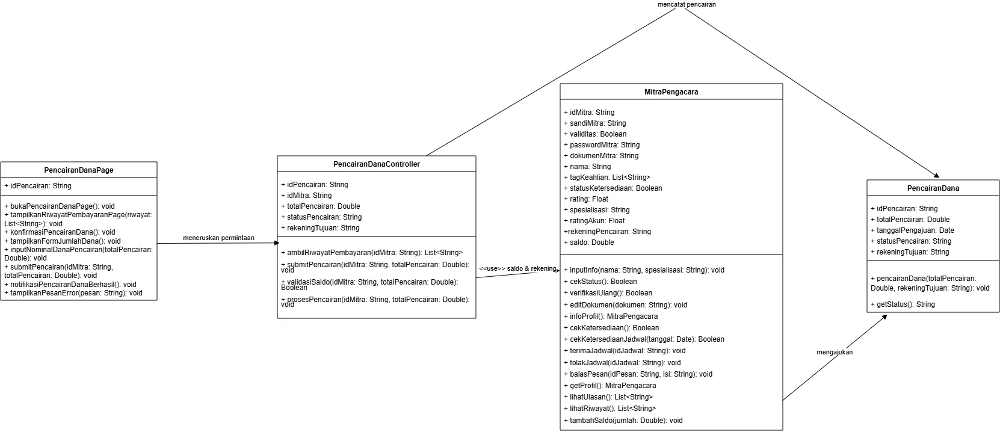

<i>Gambar X. Diagram Kelas Membayar Biaya Sesi Konsultasi</i>

 

## 3.22 Use Case UC22

**ID Use Case:** UC22
**Nama Use Case:** Mencairkan Dana

### 3.22.1 Identifikasi Kelas

Tabel 3.22. Identifikasi Kelas Use Case [UC22]

| No | Nama Kelas Perancangan | Nama Kelas Analisis Terkait |
|:--- | :--- | :--- | 
| 1 | PencairanDanaPage | PencairanDanaPage |
| 2 | PencairanDanaController | PencairanDanaController |
| 3 | MitraPengacara | MitraPengacara |
| 4 | PencairanDana | PencairanDana |

### 3.22.2 Sequence Diagram

- **Skenario Normal**

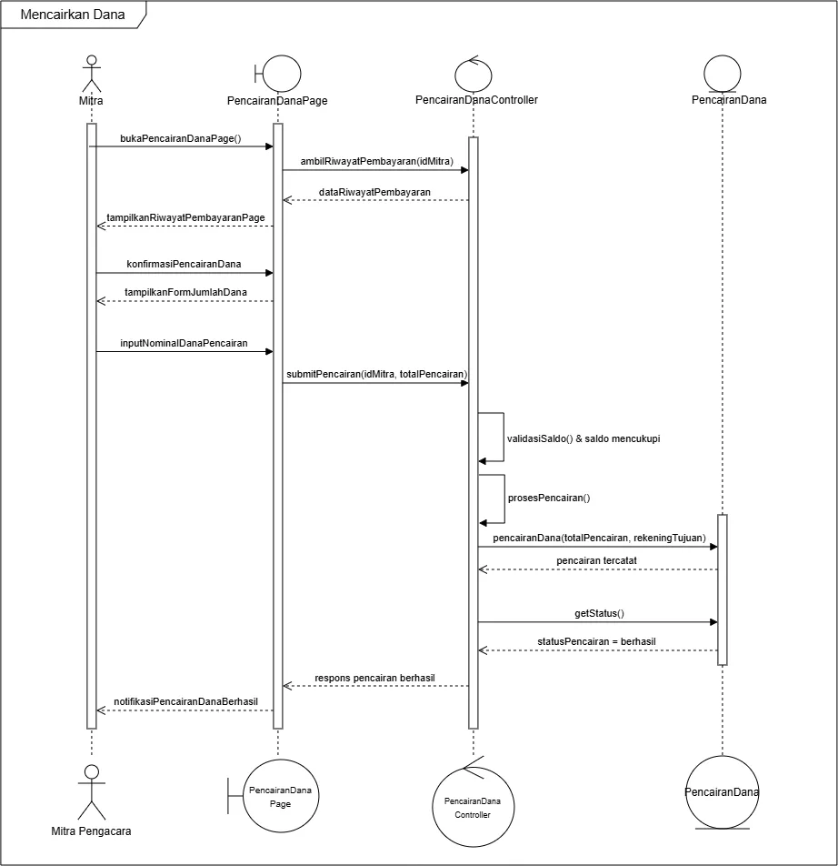

<i>Gambar X. Sequence Diagram UC22</i>

-**Skenario Alternatif 1: Pencairan ditolak**

<i>Gambar X. Sequence Diagram UC22 - Pencairan ditolak</i>

### 3.22.3 Diagram Kelas

<i>Gambar X. Diagram Kelas Mencairkan Dana</i>

 
---

# BAB 4: Diagram Kelas Keseluruhan

## 4.1 Diagram Kelas

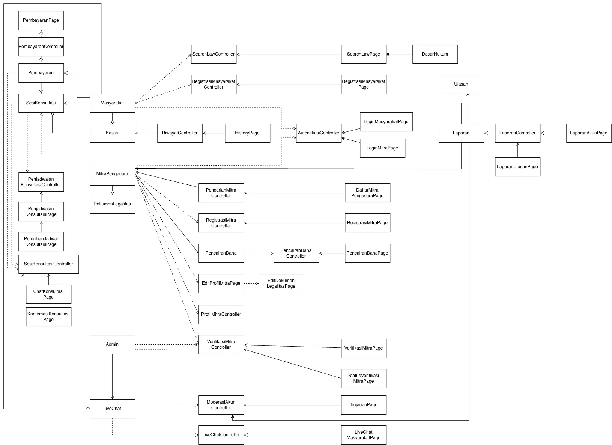

<i>Gambar 4.1. Diagram Kelas Perancangan Keseluruhan LawHub</i>

Tabel 4.1. Daftar Kelas Perancangan Keseluruhan

| ID Kelas | Nama Kelas | Atribut | Metode/Operasi |
| :--- | :--- | :--- | :--- |
| C01 | RegistrasiMasyarakatPage | tombolRegistrasi | submitRegistrasi() |
| C02 | LoginMasyarakatPage | tombolVerifikasi | submitVerifikasi() |
| C04 | RegistrasiMitraPage | tombolRegistrasi | submitRegistrasi() |
| C05 | LoginMitraPage | tombolVerifikasi, inputKredensial | submitVerifikasi() |
| C06 | StatusVerifikasiMitraPage | status | infoStatus() |
| C07 | VerifikasiMitraPage | status | ubahStatus() |
| C08 | EditProfilMitraPage | inputKredensial | validasiData() |
| C09 | EditDokumenLegalitasPage | inputDokumen | validasiData() |
| C10 | SearchLawPage | tombolCari, infoPasal | cariPasal() |
| C11 | DaftarMitraPengacaraPage | kataKunciKasus, filterKeahlian | inputPencarian(), tampilkanDaftarMitra() |
| C12 | PemilihanJadwalKonsultasiPage | pilihanMitra, pilihanTanggal, pilihanWaktu | pilihMitra(), pilihJadwal() |
| C13 | KonfirmasiKonsultasiPage | pilihanKonfirmasi, catatanKonfirmasi | klikKonfirmasi(), tampilkanPermintaanJadwal() |
| C14 | ChatKonsultasiPage | pesanInput, lampiranFile | kirimPesan(), tampilkanPesanTerkini() |
| C15 | UlasanPage | inputRating, inputTeksUlasan | isiFormUlasan(), kirimUlasan() |
| C16 | LaporanAkunPage / LaporanUlasanPage | kategoriPelanggaran, teksAlasan, buktiLampiran, idLaporan, idUlasan, idMitra | isiFormLaporan(), kirimLaporan(), buatFormLaporan(), submitLaporan(), buatFormLaporanUlasan(), submitLaporanUlasan(), statusUlasan() |
| C18 | TinjauanPage | idAdmin, pilihLaporan | submitHasil(), tampilkanLaporan(), tolakLaporan() |
| C19 | HistoryPage | listRiwayat, idMasyarakat, idMitra | lihatHistory() |
| C20 | LiveChatMasyarakatPage | idMasyarakat, chatAktifId | showChat(), sendMessage(), endChat() |
| C21 | LiveChatAdminPage | idAdmin, chatAktifId | showAdminChatDashboard(), markAsResolved() |
| C22 | PembayaranPage | metodePembayaran | pilihMetodePembayaran(), submitPembayaran() |
| C23 | PencairanDanaPage | idPencairan | submitPencairan() |
| C24 | RegistrasiMasyarakatController | idRegistrasi, id | buatAkun() |
| C25 | AutentikasiController | tombolVerifikasi, inputKredensial, idMitra, passwordMitra | validasiData() |
| C26 | RegistrasiMitraController | idRegistrasi, idDokumen, status, idMitra, passwordMitra | validasiData(), buatAkunBaru() |
| C27 | VerifikasiMitraController | status, idMitra, passwordMitra, dokumenMitra | validasiData() |
| C29 | SearchLawController | tombolCari, infoPasal, kataKunci, idPasal | validasiData() |
| C30 | PencarianMitraController | - | cariMitraSesuaiKasus(), terapkanFilter() |
| C31 | PenjadwalanKonsultasiController | - | buatSesiKonsultasi(), validasiJadwal() |
| C32 | SesiKonsultasiController | - | prosesKonfirmasiJadwal(), perbaruiStatusSesi(), kelolaPesanChat(), validasiStatusPembayaran(), akhiriSesiKonsultasi() |
| C33 | UlasanController | - | simpanUlasanBaru(), perbaruiRatingMitra() |
| C34 | LaporanController | - | buatLaporanBaru(), validasiBuktiLaporan(), prosesLaporan(), detailLaporan() |
| C35 | ModerasiAkunController | - | prosesTinjauan(), prosesBlokirAkun(), updateStatusLaporan() |
| C36 | RiwayatController | - | getRiwayatPengacara(), getRiwayatMasyarakat(), detailRiwayat() |
| C37 | LiveChatController | - | assignAdmin(), startChat(), closeChat() |
| C38 | PembayaranController | idPembayaran, idSesi, totalPembayaran, statusPembayaran | prosesPembayaran(), bukaSesiChat() |
| C39 | PencairanDanaController | idPencairan, idMitra, totalPencairan, statusPencairan, rekeningTujuan | validasiSaldo(), prosesPencairan() |
| C40 | Masyarakat | idMasyarakat, nama, nomorInduk, email, sandi, kataKunci, statusAkun, idKasus, idLaporan | inputInfo(), cekPasal(), ajukanPencarian(), ajukanJadwal(), kirimPesan(), berikanPenilaian(), ajukanLaporanPelanggaran(), getProfil(), lihatHistory(), ajukanKasus(), cariMitra(), beriUlasan(), buatLaporan() |
| C41 | MitraPengacara | idMitra, sandiMitra, validitas, passwordMitra, dokumenMitra, nama, tagKeahlian, statusKetersediaan, rating, spesialisasi, ratingAkun, rekeningPencairan | inputInfo(), cekStatus(), verifikasiUlang(), editDokumen(), infoProfil(), cekKetersediaan(), cekKetersediaanJadwal(), terimaJadwal(), tolakJadwal(), balasPesan(), getProfil(), lihatUlasan(), lihatRiwayat(), tambahSaldo() |
| C42 | Admin | verifikasi, idAdmin | verifikasiDokumen(), login(), balasPesan() |
| C43 | Kasus | idKasus, kategoriMasalah, deskripsi, judulKasus, statusKasus | infoKategoriKasus(), infoDetailKasus(), detailKasus(), getIdKasus() |
| C44 | DasarHukum | idPasal | infoPasal(), updatePasal() |
| C45 | DokumenLegalitas | idDokumen, validitas | tambahDokumen() |
| C46 | SesiKonsultasi | idSesi, tanggalJadwal, waktuJadwal, statusSesi, idMasyarakat, idMitra, statusPembayaran, waktuMulai, waktuSelesai, waktuStart, waktuEnd, statusKonsul, catatanKonsul | simpanJadwalBaru(), infoStatusSesi(), aturStatusSesi(), catatWaktuMulaiSelesai(), getDetailSesi(), mulaiSesi(), akhiriSesi() |
| C47 | Ulasan / Laporan | idUlasan, skorRating, teksUlasan, tanggalUlasan, idMitra, foto, rating, jenisPelanggaran, deskripsi, statusLaporan | infoDataUlasan(), simpanDataUlasan(), ambilDataUlasan(), simpanDataLaporan(), infoStatusLaporan(), getUlasan() |
| C48 | Laporan | idLaporan, idPelapor, idTerlapor, tanggalLaporan, statusLaporan | buatLaporan(), statusLaporan(), getDetailLaporan() |
| C49 | Pembayaran | idPembayaran, nominal, statusPembayaran, metodeBayar, idSesi, waktuTransaksi | cekStatusLunas(), getStatus() |
| C50 | LiveChat | idChat, waktuChatMulai, waktuChatSelesai, statusChat, historyChat | updateStatusChat(), detailChat() |
| C51 | PencairanDana | idPencairan, totalPencairan, tanggalPengajuan, statusPencairan, rekeningTujuan | getStatus() |

 

---

# BAB 5: Matriks Kerunutan

Petakan kelas perancangan dengan use case yang terkait. Gunakan **BAB 6 Traceability pada dokumen SKPL** sebagai acuan keterkaitan kelas analisis dan use case, lalu sesuaikan dengan realisasi use case dan kelas perancangan pada BAB 3–BAB 5 DPPL.

Tabel 7.1. Matriks Kerunutan Kelas terhadap Use Case

| Kelas | Use Case Terkait |
| :--- | :--- |
| *[ID kelas - Nama kelas]* | *[ID UC - Nama use case]* |
| C01 - RegistrasiMasyarakatPage | UC01 - Melakukan Registrasi Akun bagi Masyarakat |
| C02 - LoginMasyarakatPage | UC02 - Melakukan Login bagi Masyarakat |
| C03 - BerandaPage | UC02 - Melakukan Login bagi Masyarakat |
| C04 - RegistrasiMitraPage | UC03 - Melakukan Registrasi Akun bagi Mitra Pengacara |
| C05 - LoginMitraPage | UC04 - Melakukan Login bagi Mitra Pengacara |
| C06 - StatusVerifikasiMitraPage | UC05 - Melihat Status Registrasi Akun Mitra Pengacara |
| C07 - VerifikasiMitraPage | UC06 - Memverifikasi Pendaftar Mitra Pengacara |
| C08 - EditProfilMitraPage | UC07 - Verifikasi Akun Pengacara |
| C09 - EditDokumenLegalitasPage | UC07 - Verifikasi Akun Pengacara |
| C10 - SearchLawPage | UC08 - Melakukan Pencarian Pasal |
| C11 - DaftarMitraPengacaraPage | UC09 - Melihat Daftar Pengacara |
| C12 - PemilihanJadwalKonsultasiPage | UC10 - Memilih Mitra Pengacara untuk Sesi Konsultasi |
| C13 - KonfirmasiKonsultasiPage | UC11 - Menanggapi Sesi Konsultasi |
| C14 - ChatKonsultasiPage | UC12 - Melakukan Sesi Konsultasi |
| C15 - UlasanPage | UC13 - Memberi Ulasan, Feedback, dan/atau Rating |
| C16 - LaporanAkunPage / LaporanUlasanPage | UC14 - Melaporkan Pelanggaran, UC15 - Melaporkan Pelanggaran |
| C17 - LaporanUlasanPage | UC16 - Melaporkan Ulasan |
| C18 - TinjauanPage | UC17 - Memblokir Akun |
| C19 - HistoryPage | UC18 - Melihat Riwayat Penanganan |
| C20 - LiveChatMasyarakatPage | UC19 - Menanyakan Masalah Teknis |
| C21 - LiveChatAdminPage | UC20 - Menjawab Pertanyaan |
| C22 - PembayaranPage | UC21 - Membayar Biaya Sesi Konsultasi |
| C23 - PencairanDanaPage | UC22 - Mencairkan Dana |
| C24 - RegistrasiMasyarakatController | UC01 - Melakukan Registrasi Akun bagi Masyarakat |
| C25 - AutentikasiController | UC02 - Melakukan Login bagi Masyarakat, UC04 - Melakukan Login bagi Mitra Pengacara |
| C26 - RegistrasiMitraController | UC03 - Melakukan Registrasi Akun bagi Mitra Pengacara |
| C27 - VerifikasiMitraController | UC05 - Melihat Status Registrasi Akun Mitra Pengacara, UC06 - Memverifikasi Pendaftar Mitra Pengacara |
| C28 - ProfilMitraController | UC07 - Verifikasi Akun Pengacara |
| C29 - SearchLawController | UC08 - Melakukan Pencarian Pasal |
| C30 - PencarianMitraController | UC09 - Melihat Daftar Pengacara |
| C31 - PenjadwalanKonsultasiController | UC10 - Memilih Mitra Pengacara untuk Sesi Konsultasi |
| C32 - SesiKonsultasiController | UC11 - Menanggapi Sesi Konsultasi, UC12 - Melakukan Sesi Konsultasi |
| C33 - UlasanController | UC13 - Memberi Ulasan, Feedback, dan/atau Rating |
| C34 - LaporanController | UC14 - Melaporkan Pelanggaran, UC15 - Melaporkan Pelanggaran, UC16 - Melaporkan Ulasan |
| C35 - ModerasiAkunController | UC17 - Memblokir Akun |
| C36 - RiwayatController | UC18 - Melihat Riwayat Penanganan |
| C37 - LiveChatController | UC19 - Menanyakan Masalah Teknis, UC20 - Menjawab Pertanyaan |
| C38 - PembayaranController | UC21 - Membayar Biaya Sesi Konsultasi |
| C39 - PencairanDanaController | UC22 - Mencairkan Dana |
| C40 - Masyarakat | UC01 - Melakukan Registrasi Akun bagi Masyarakat, UC02 - Melakukan Login bagi Masyarakat, UC08 - Melakukan Pencarian Pasal, UC09 - Melihat Daftar Pengacara, UC10 - Memilih Mitra Pengacara untuk Sesi Konsultasi, UC12 - Melakukan Sesi Konsultasi, UC13 - Memberi Ulasan, Feedback, dan/atau Rating, UC14 - Melaporkan Pelanggaran, UC18 - Melihat Riwayat Penanganan, UC19 - Menanyakan Masalah Teknis, UC21 - Membayar Biaya Sesi Konsultasi |
| C41 - MitraPengacara | UC03 - Melakukan Registrasi Akun bagi Mitra Pengacara, UC04 - Melakukan Login bagi Mitra Pengacara, UC05 - Melihat Status Registrasi Akun Mitra Pengacara, UC06 - Memverifikasi Pendaftar Mitra Pengacara, UC07 - Verifikasi Akun Pengacara, UC09 - Melihat Daftar Pengacara, UC11 - Menanggapi Sesi Konsultasi, UC12 - Melakukan Sesi Konsultasi, UC15 - Melaporkan Pelanggaran, UC16 - Melaporkan Ulasan, UC18 - Melihat Riwayat Penanganan, UC22 - Mencairkan Dana |
| C42 - Admin | UC06 - Memverifikasi Pendaftar Mitra Pengacara, UC17 - Memblokir Akun, UC19 - Menanyakan Masalah Teknis, UC20 - Menjawab Pertanyaan |
| C43 - Kasus | UC10 - Memilih Mitra Pengacara untuk Sesi Konsultasi, UC12 - Melakukan Sesi Konsultasi, UC18 - Melihat Riwayat Penanganan |
| C44 - DasarHukum | UC08 - Melakukan Pencarian Pasal |
| C45 - DokumenLegalitas | UC03 - Melakukan Registrasi Akun bagi Mitra Pengacara, UC05 - Melihat Status Registrasi Akun Mitra Pengacara, UC06 - Memverifikasi Pendaftar Mitra Pengacara, UC07 - Verifikasi Akun Pengacara |
| C46 - SesiKonsultasi | UC10 - Memilih Mitra Pengacara untuk Sesi Konsultasi, UC11 - Menanggapi Sesi Konsultasi, UC12 - Melakukan Sesi Konsultasi, UC18 - Melihat Riwayat Penanganan, UC21 - Membayar Biaya Sesi Konsultasi |
| C47 - Ulasan / Laporan | UC09 - Melihat Daftar Pengacara, UC13 - Memberi Ulasan, Feedback, dan/atau Rating, UC16 - Melaporkan Ulasan |
| C48 - Laporan |  UC14 - Melaporkan Pelanggaran, UC15 - Melaporkan Pelanggaran, UC16 - Melaporkan Ulasan, UC17 - Memblokir Akun |
| C49 - Pembayaran | UC12 - Melakukan Sesi Konsultasi, UC21 - Membayar Biaya Sesi Konsultasi |
| C50 - LiveChat | UC19 - Menanyakan Masalah Teknis, UC20 - Menjawab Pertanyaan |
| C51 - PencairanDana | UC22 - Mencairkan Dana |
