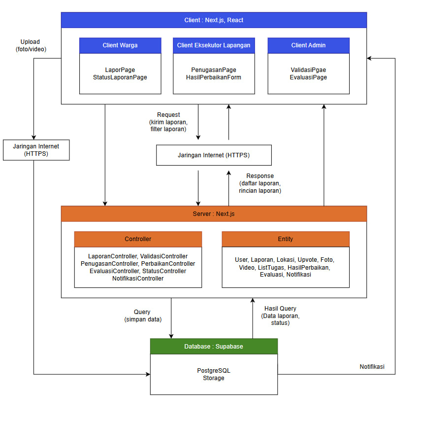
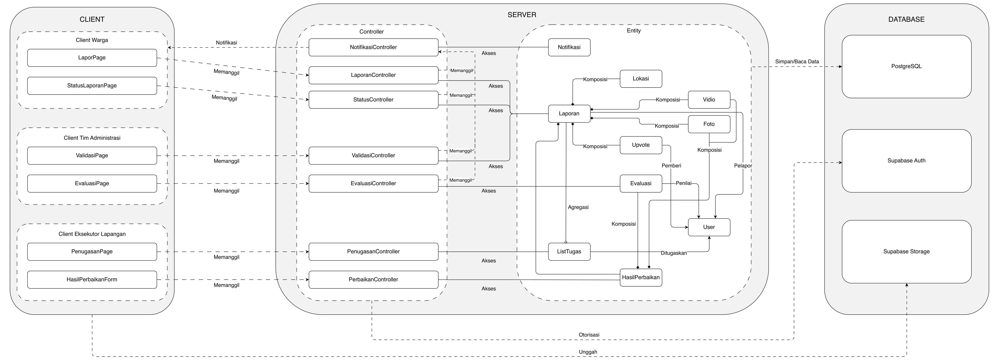
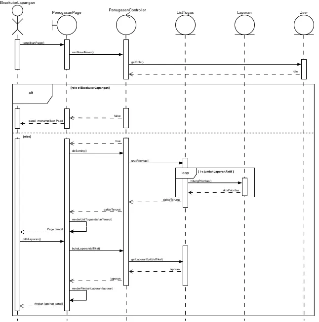
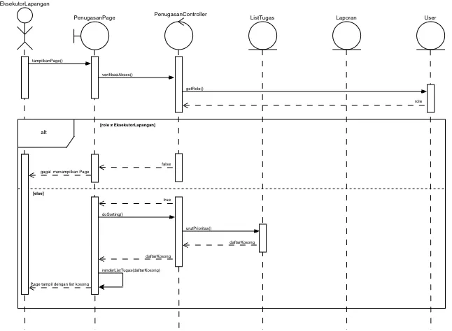
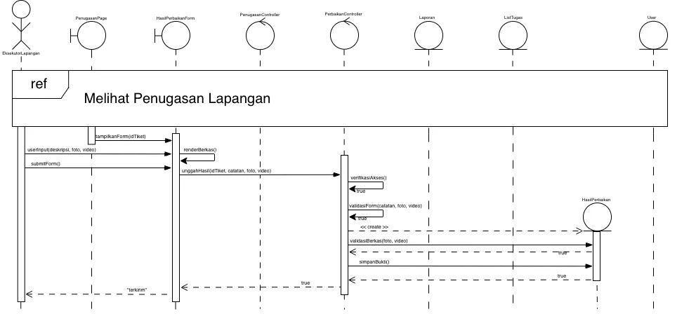
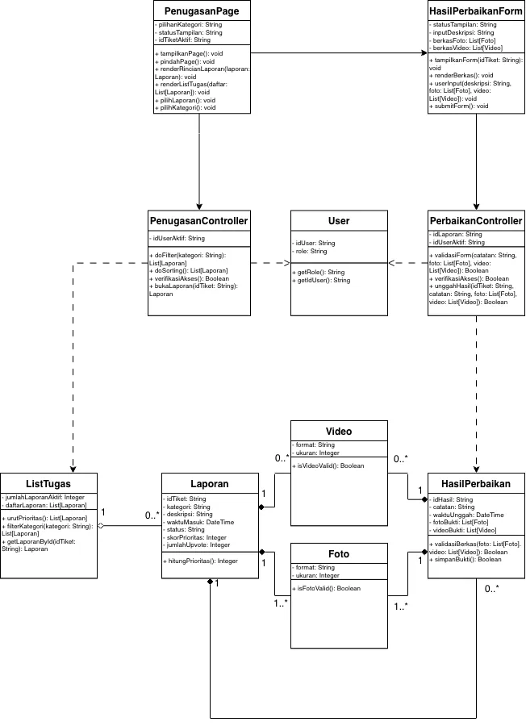

<h1>
IF2150 REKAYASA PERANGKAT LUNAK
 
TUGAS 5
 
DESKRIPSI PERANCANGAN PERANGKAT LUNAK (DPPL)
</h1>
 

## *LaporKota*
### *[Logo Perangkat Lunak]*

### Untuk: *Jordhy*

Dipersiapkan oleh:
| Informasi | Keterangan |
| --- | --- |
| Kelas | *K - 03* |
| Kelompok | *G07* |

| NIM | Nama |
| --- | --- |
| *13525051* | *Rafi Pradipta Andira Sulistyo* |
| *13525105* | *Pasaribu Fritz T.A.M.* |
| *13525075* | *Bagas Anugrah Putra* |
| *13525099* | *Gede Pranajayanta Suputra* |
| *13525015* | *Muhammad Atallah Ramadhan* |
---

## Daftar Perubahan

| Revisi | Deskripsi |
| :--- | :--- |
| *A* | *Deskripsikan perubahan yang dilakukan dari dokumen sebelumnya pada dokumen ini. Jika tidak terdapat perubahan, harap kosongkan tabel.* |
| *B* |  |
| *C* |  |
| ... |  |

---

# BAB 1: Pendahuluan

## 1.1 Tujuan Penulisan Dokumen
[[[Tuliskan dengan ringkas tujuan dokumen DPPL ini dibuat dan siapa saja yang akan menggunakan dokumen ini.]]]

## 1.2 Lingkup Masalah
Perangkat lunak yang akan dikembangkan adalah LaporKota, sebuah platform pelaporan kerusakan infrastruktur publik berbasis website yang dirancang untuk mempermudah warga dalam menyampaikan dan memantau laporannya. Sistem pelaporan ini memfasilitasi pengguna untuk melaporkan masalah fasilitas umum dalam lingkup satu kota, kapan saja dan di mana saja dengan menyertakan foto serta koordinat lokasi. Dengan adanya sistem ini diharapkan pengguna tidak lagi kesulitan mencari saluran pengaduan yang responsif dan proses perbaikan kerusakan fasilitas publik dapat berjalan dengan efisien.

## 1.3 Definisi, Istilah, dan Singkatan
Semua definisi dan singkatan yang digunakan dalam dokumen ini beserta penjelasannya.

Tabel 1.3. Definisi Istilah dan Singkatan

| Singkatan, Akronim, atau Istilah | Penjelasan |
| :--- | :--- |
| *P/L* | *Singkatan dari Perangkat Lunak, yaitu aplikasi yang memberikan perintah kepada komputer untuk menjalankan tugas tertentu.* |
| *SKPL* | *Singkatan dari Spesifikasi Kebutuhan Perangkat Lunak, yaitu dokumen yang merangkum kriteria-kriteria yang diperlukan untuk membangun aplikasi menjalankan tugasnya.* |
| *KF* | *Singkatan dari Kebutuhan Fungsional, yaitu fungsi atau perilaku yang dimiliki sistem.* |
| *KNF* | *Singkatan dari Kebutuhan Non-Fungsional, yaitu kualitas sistem seperti kecepatan, keamanan, dan ketersediaan.* |
| *UC* | *Singkatan dari Use Case, yaitu gambaran interaksi antara aktor dan sistem.* |
| *CD* | *Singkatan dari Class Diagram, Diagram yang menggambarkan struktur kelas beserta atribut, metode, dan hubungan antarkelas di dalam sistem.* |
| *GPS* | *Singkatan dari Global Positioning System, yaitu sistem navigasi berbasis satelit untuk menentukan posisi.* |
| *API* | *Singkatan dari Application Programming Interface, yaitu antarmuka yang memungkinkan program saling terhubung.* |
| *Latitude / Longitude* | *Garis lintang dan garis bujur, yaitu dua nilai koordinat posisi di bumi.* |
| *DPPL* | *Singkatan dari Deskripsi Perancangan Perangkat Lunak, yaitu dokumen yang berfungsi sebagai panduan bagi pengembang untuk mengimplementasikan perangkat lunak dalam bentuk kode program.* |
| *APL* | *Singkatan dari Arsitektur Perangkat Lunak, yaitu dokumen yang menetapkan pola arsitektur, komponen, dan model view dari perangkat lunak.* |
| *...* | *...* |

## 1.4 Aturan Penomoran
Tuliskan aturan penomoran (ID) yang digunakan dalam dokumen ini. Gunakan pola ID yang **sama** dengan yang sudah dipakai pada dokumen-dokumen sebelumnya, jangan membuat pola baru di dokumen ini.

Tabel 1.4. Aturan Penomoran

| Hal/Bagian | Penomoran | Keterangan |
| :--- | :--- | :--- |
| *Kebutuhan Fungsional* | *KFXX* | Contoh: KF01 |
| *Kebutuhan Non-Fungsional* | *KNFXX* | Contoh: KNF02 |
| *Use Case* | *UCXX* | Contoh: UC03 |
| *Kelas* | *CXX* | Contoh: C04 |
| *...* | *...* |

## 1.5 Referensi
| Nomor | Judul Referensi | Sumber |
| :--- | :--- | :--- |
| 1 | Dokumen Spesifikasi Kebutuhan Perangkat Lunak LaporKota | Repository IF2150-RPL-K03-G07/docs/M5/K03_G07_SKPL.md |
| 2 | Dokumen Aristektur Perangkat Lunak LaporKota | Repository IF2150-RPL-K03-G07/docs/M6/K03_G07_APL.md |

## 1.6 Deskripsi Umum Dokumen (Ikhtisar)
Dokumen Deskripsi Perancangan Perangkat Lunak (DPPL) ini disusun dengan sistematika berikut. **BAB 1: Pendahuluan** memuat tujuan penulisan dokumen, lingkup masalah, daftar definisi, aturan penomoran, referensi, serta ikhtisar dokumen. **BAB 2: Perancangan Arsitektur** menjelaskan rancangan lingkungan implementasi, pola arsitektur (beserta alasan pemilihannya), identifikasi komponen (beserta tanggung jawabnya), dan model arsitektur yang mengacu pada dokumen APL. **BAB 3: Realisasi Use Case**  menguraikan perancangan setiap Use Case melalui identifikasi kelas perancangan, sequence diagram (untuk skenario normal dan alternatif), serta diagram kelas. **BAB 4: Diagram Kelas Keseluruhan** menggambungkan seluruh kelas perancangan dalam satu diagram. **BAB 5: Matriks Kerunutan** memetakan keterkaitan setiap kelas perancangan dengan use case untuk memastikan rancangan telah mendukung kebutuhan pada SKPL.

 

---

# BAB 2: Perancangan Arsitektur

## 2.1 Rancangan Lingkungan Implementasi

Sebutkan *operating system*, DBMS, *development tools*, *filing system*, dan bahasa pemrograman yang digunakan.

| Komponen | Spesifikasi |
| :--- | :--- |
| *Server/Hosting* | Vercel dengan *runtime* Node.js 24 (LTS) |
| *Framework* | Next.js 16.3 dan React 19.3 |
| *Backend-as-a-Service* | Supabase (Auth, Database, Storage, Realtime) |
| *DBMS* | PostgreSQL 17 yang dikelola oleh Supabase |
| *Penyimpanan Berkas* | Supabase Storage |
| *Layanan Peta* | *Tile* OpenStreetMap yang ditampilkan dengan pustaka Leaflet |
| *Client* | *Web browser* modern versi terbaru (Google Chrome, Mozilla Firefox, Safari, Microsoft Edge) yang mendukung JavaScript, WebSocket, dan *Geolocation API* |
| *Perangkat Klien* | Warga dan Eksekutor Lapangan: *smartphone* atau laptop yang memiliki kamera dan layanan lokasi (GPS). Tim Administrasi: komputer atau laptop |
| *OS* | *Cross platform* melalui *browser* (Android, iOS, Windows, macOS, Linux, bisa banyak OS asal terhubung dengan jaringan internet) |
| *Jaringan* | Koneksi internet dengan protokol HTTPS |

## 2.2 Style/Pattern Arsitektur Acuan

LaporKota menggunakan pola arsitektur *client-server*. Pemilihan pola arsitektur *client-server* didasarkan pada karakteristik LaporKota yang telah ditetapkan pada dokumen SKPL sebelumnya. 

<i>Gambar 1. Arsitektur client-server</i>

## Style Arsitektur yang Dipilih

Pada pola *client-server*, fungsionalitas sistem disusun sebagai sekumpulan layanan yang disediakan oleh *server*, sedangkan *client* mengakses layanan tersebut melalui jaringan. Pola ini terdiri atas tiga bagian sebagai berikut: 

1. ***Client*** adalah antarmuka yang digunakan oleh pengguna. *Client* bertugas menampilkan data, menerima masukan pengguna, memanfaatkan fitur perangkat seperti kamera dan GPS, serta meneruskan permintaan ke *server*. *Client* tidak menyimpan data laporan secara permanen dan tidak menjalankan aturan bisnis. LaporKota memiliki tiga jenis *client* sesuai dengan aktornya, yaitu *client* Warga, *client* Eksekutor Lapangan, dan *client* Tim Administrasi.
2. ***Server*** menyediakan layanan yang dipakai bersama oleh seluruh *client*. *Server* menjalankan *logic* aplikasi melalui kelas-kelas *controller*, misalnya validasi berkas, pengecekan laporan duplikat, peralihan status laporan, dan pengiriman notifikasi. *Server* juga memuat kelas-kelas *entity* yang merepresentasikan data yang diolah oleh *controller*, seperti laporan, pengguna, dan hasil perbaikan.
3. ***Database*** menyimpan seluruh data *entity* serta berkas foto dan video secara terpusat dan persisten. Data laporan dicatat ke *database* melalui *server*, sedangkan berkas foto dan video diunggah langsung dari *client* ke penyimpanan berkas karena batas ukuran *request* pada *server* (batasan vercel). Dengan penyimpanan terpusat ini, seluruh *client* selalu memperoleh data yang sama dan *updated*.
4. **Jaringan** menghubungkan *client* dengan *server* melalui koneksi internet dengan protokol HTTPS.

## Alasan Pemilihan

Pola *client-server* dipilih karena LaporKota memiliki tiga aktor dengan perangkat dan kebutuhan antarmuka yang berbeda, tetapi seluruhnya mengolah data laporan yang sama. Warga dan Eksekutor Lapangan membutuhkan *client* yang dapat mengakses kamera dan GPS perangkat, sedangkan Tim Administrasi membutuhkan *client* untuk mengelola antrean laporan. Karena satu laporan berpindah tangan dari Warga ke Tim Administrasi, Eksekutor Lapangan, lalu kembali ke Tim Administrasi untuk diverifikasi ulang, setiap aktor harus melihat status laporan yang sama dan mutakhir sehingga data perlu dikelola oleh satu *server* dan disimpan pada sarana yang terpusat di *database*. Selain itu, beberapa kebutuhan fungsional hanya dapat dijalankan di *server* karena membutuhkan akses ke seluruh data laporan, yaitu pemeriksaan duplikasi dalam radius 20 meter (KF05, KF06) dan perhitungan ulang urutan prioritas (KF13), sedangkan penguncian koordinat GPS (KF01) dijalankan di *client*. Pengumpulan layanan di *server* juga mendukung kebutuhan nonfungsional, yaitu setiap laporan memiliki tepat satu ID tiket unik karena ID diterbitkan secara terpusat (KNF06), dan hak akses antrean verifikasi dapat dibatasi hanya untuk Tim Administrasi (KNF07).

Konsekuensi dari pola ini adalah server dan layanan Supabase menjadi titik kegagalan tunggal, sehingga ketersediaan 24 jam (KNF02) bergantung pada ketersediaan Vercel dan Supabase, serta waktu respons (KNF03, KNF05) bergantung pada kualitas jaringan pengguna. Risiko ini diterima karena beban LaporKOta tergolong sedang dan tidak membutuhkan ketersediaan tingkat kritis.

## 2.3 Identifikasi Komponen / Modul / Subsistem

Tabel 2.3. Identifikasi Komponen/Modul/Subsistem

| Nama Komponen/Modul/Subsistem | Jenis                 | Penjelasan                                                                                                                                                                                                |
| :---------------------------- | :-------------------- | :-------------------------------------------------------------------------------------------------------------------------------------------------------------------------------------------------------- |
| LaporPage                     | Client                | Menampilkan formulir pelaporan Warga, mengunci koordinat GPS via Geolocation API, menandai lokasi via Leaflet, memicu verifikasi anti-bot, mengunggah media bukti, dan memanggil LaporanController        |
| StatusLaporanPage             | Client                | Menampilkan linimasa status tiket pribadi (termasuk alasan penolakan), memvisualisasikan peta sebaran publik via Leaflet secara anonim, menerima upvote, dan memanggil StatusController                   |
| ValidasiPage                  | Client                | Menampilkan antrean laporan Diterima bagi Tim Administrasi, menyediakan filter kategori dan waktu, menampilkan rincian tiket, serta memanggil ValidasiController untuk persetujuan atau penolakan.        |
| EvaluasiPage                  | Client                | Menampilkan antarmuka evaluasi bagi Tim Administrasi untuk mengomparasi bukti kerusakan awal dan hasil kerja perbaikan, serta memanggil EvaluasiController untuk konfirmasi hasil penanganan              |
| PenugasanPage                 | Client                | Menampilkan daftar tugas Dikerjakan bagi Eksekutor sesuai prioritas, menyediakan filter kategori dan lokasi, tautan navigasi Google Maps, membuka HasilPerbaikanForm, dan memanggil PenugasanController   |
| HasilPerbaikanForm            | Client                | Menampilkan formulir bagi Eksekutor untuk mengisi catatan teknis perbaikan, mengunggah foto atau video bukti penyelesaian ke Supabase Storage, dan memanggil PerbaikanController                          |
| NotifikasiController          | Server                | Mengonstruksi pesan perubahan status tiket laporan dan menyalurkan notifikasi secara real-time ke antarmuka akun Warga pelapor melalui kanal WebSocket Supabase Realtime                                  |
| LaporanController             | Server                | Memvalidasi kelayakan berkas, memeriksa lokasi, mengecek duplikasi radius 20 meter, mengalihkan duplikat menjadi upvote, menerbitkan ID tiket unik, serta memanggil NotifikasiController                  |
| StatusController              | Server                | Mengambil linimasa laporan warga, menyajikan data laporan publik secara anonim, memproses upvote, dan memicu kalkulasi ulang skor prioritas serta pembaruan notifikasi                                    |
| ValidasiController            | Server                | Menyusun antrean laporan Diterima, menyimpan alasan penolakan (status Ditolak), menyetujui laporan (status Dikerjakan), menghitung prioritas, serta memanggil NotifikasiController                        |
| EvaluasiController            | Server                | Menyimpan evaluasi admin, menyetujui laporan (status Berhasil) atau mengembalikan tugas (status Dikerjakan), merekam stempel waktu, serta memanggil NotifikasiController                                  |
| PenugasanController           | Server                | Mengambil laporan Dikerjakan dari basis data untuk mengonstruksi ListTugas, serta mengoordinasikan fitur pengurutan prioritas dan penyaringan kategori atau lokasi penugasan                              |
| PerbaikanController           | Server                | Memvalidasi kelengkapan bukti kerja, mengaitkan rekaman HasilPerbaikan ke laporan di basis data, dan memperbarui status tiket agar siap dievaluasi oleh Tim Administrasi                                  |
| Notifikasi                    | Server                | Entitas data pesan perubahan status laporan yang menyimpan idNotifikasi, isi pesan, waktu kirim, dan status baca, serta menyediakan operasi pembuatan pesan notifikasi                                    |
| Laporan                       | Server                | Entitas data utama laporan yang menyimpan atribut tiket, status (Diterima, Ditolak, Dikerjakan, Berhasil), waktu masuk, skor prioritas, dan alasan penolakan, serta mengelola mutasi statusnya            |
| Lokasi                        | Server                | Entitas data posisi geospasial yang menyimpan koordinat latitude dan longitude kerusakan, serta menyediakan metode hitungJarak untuk kalkulasi radius deteksi duplikasi laporan                           | 
| Video                         | Server                | Entitas data berkas audio-visual bukti laporan dan hasil perbaikan dengan batasan format MP4, MOV, atau MKV maksimal 10 MB, serta memvalidasi keabsahan spesifikasi berkas                                |
| Foto                          | Server                | Entitas data berkas gambar bukti laporan dan hasil perbaikan dengan batasan format JPG atau PNG maksimal 10 MB, serta memvalidasi keabsahan spesifikasi berkas gambar                                     |
| Upvote                        | Server                | Entitas data dukungan warga pada laporan aktif melalui idUpvote dan waktuUpvote guna meningkatkan tingkat urgensi dan prioritas penanganan laporan kerusakan                                              |
| Evaluasi                      | Server                | Entitas data verifikasi hasil kerja yang memuat idEvaluasi, keputusan persetujuan, uraian catatan evaluasi, dan waktu evaluasi penanganan oleh Tim Administrasi                                           |
| ListTugas                     | Server                | Entitas data koleksi penugasan aktif Eksekutor yang memuat daftar laporan yang harus ditangani beserta metode pengurutan skala prioritas dan penyaringan kategori tugas                                   |
| HasilPerbaikan                | Server                | Entitas data dokumentasi penanganan fisik fasilitas yang menyimpan idHasil, catatan teknis, waktu unggah, identitas eksekutor, serta relasi berkas media bukti penyelesaian kerja                         |
| User                          | Server                | Entitas data akun seluruh pengguna yang menyimpan idUser, nama, email, dan role, serta menyediakan metode validasi hak akses untuk peran Warga, Tim Administrasi, dan Eksekutor Lapangan                  |
| PostgreSQL                    | Database              | Menyimpan seluruh data entitas model secara terpusat dan persisten, menjaga integritas relasional data antartabel, dan menjamin keunikan ID tiket laporan                                                 |
| Supabase Auth                 | Database              | Menyimpan kredensial identitas pengguna, mengelola sesi login, dan menegakkan otorisasi hak akses berbasis peran (Role-Based Access Control) bagi seluruh aktor sistem                                    |
| Supabase Storage              | Database              | Menyimpan berkas biner foto dan video bukti laporan serta bukti hasil perbaikan fisik yang diunggah langsung dari klien guna mengatasi batasan ukuran muatan request serverless Vercel                    |

## 2.4 Model Arsitektur Perangkat Lunak
 

### 2.4.1 Logical View

<i>Gambar 2. Logical View pada LaporKota</i>

Gambar 2 menunjukkan model arsitektur Client-Server dari sistem LaporKota dalam perspektif Logical View dengan menggunakan Block Diagram. Seluruh komponen pada Tabel 2.1 digambarkan dan dikelompokkan sesuai pola Client-Server (*Client*, *Server*, *Database*). Setiap garis antar komponen diberi label yang merincikan bentuk hubungan pada masing-masing komponen.

Model Logical View ini dipilih karena *LaporKota* memiliki tiga peran dengan hak akses yang berbeda (berdasarkan SKPL 2.3) dan enam use case yang masing-masing dilayani halaman dan controller sendiri, sehingga pembagian tanggung jawab antarkomponen perlu terlihat lebih jelas dalam satu gambar. Selain itu, beberapa KNF hanya dapat dibuktikan lewat letak tanggung jawab komponen: seperti pembatasan akses (KNF07, KNF12), serta tiket unik dan pemeriksaan duplikasi laporan (KNF05, KNF06).

 

---

# BAB 3: Realisasi Use Case

## 3.1 Use Case [Nama Use Case 1]

**ID Use Case:** *[UC01 sesuai SKPL]*  
**Nama Use Case:** *[Nama use case sesuai SKPL]*

### 3.1.1 Identifikasi Kelas

Identifikasi kelas yang terkait dengan use case tersebut. Kelas di tahap perancangan dapat berbeda dengan dengan kelas di tahap analisis. Dapat menggunakan tabel di bawah:

Tabel 3.1. Identifikasi Kelas Use Case [UC01]

| No | Nama Kelas Perancangan | Nama Kelas Analisis Terkait |
|:--- | :--- | :--- |
| 1 | *[Nama kelas perancangan]* | *[Nama kelas analisis pada SKPL]* |
| 2 | *[Nama kelas perancangan]* | *[Nama kelas analisis pada SKPL]* |
| ... | *...* | *...* |

### 3.1.2 Sequence Diagram

Buat *sequence diagram* untuk **setiap skenario use case**, mencakup skenario normal dan alternatif pada subbab 4.4 SKPL. Diagram melibatkan kelas-kelas yang telah diidentifikasi pada SKPL. 

- **Skenario Normal**

<i>Gambar X. Sequence Diagram [UC01]</i>

- **Skenario Alternatif [Nomor]: [Nama Skenario]**

<i>Gambar X. Sequence Diagram [UC01] - [Nama skenario alternatif]</i>

### 3.1.3 Diagram Kelas

<i>Gambar X. Diagram Kelas [Nama Uce Case]</i>

## 3.2 Use Case [Nama Use Case 2]

**ID Use Case:** *[UC01 sesuai SKPL]*  
**Nama Use Case:** *[Nama use case sesuai SKPL]*

### 3.2.1 Identifikasi Kelas

Identifikasi kelas yang terkait dengan use case tersebut. Kelas di tahap perancangan dapat berbeda dengan dengan kelas di tahap analisis. Dapat menggunakan tabel di bawah:

Tabel 3.2. Identifikasi Kelas Use Case [UC01]

| No | Nama Kelas Perancangan | Nama Kelas Analisis Terkait |
|:--- | :--- | :--- |
| 1 | *[Nama kelas perancangan]* | *[Nama kelas analisis pada SKPL]* |
| 2 | *[Nama kelas perancangan]* | *[Nama kelas analisis pada SKPL]* |
| ... | *...* | *...* |

### 3.2.2 Sequence Diagram

Buat *sequence diagram* untuk **setiap skenario use case**, mencakup skenario normal dan alternatif pada subbab 4.4 SKPL. Diagram melibatkan kelas-kelas yang telah diidentifikasi pada SKPL. 

- **Skenario Normal**

<i>Gambar X. Sequence Diagram [UC01]</i>

- **Skenario Alternatif [Nomor]: [Nama Skenario]**

<i>Gambar X. Sequence Diagram [UC01] - [Nama skenario alternatif]</i>

### 3.2.3 Diagram Kelas

<i>Gambar X. Diagram Kelas [Nama Uce Case]</i>

## 3.3 Use Case Melihat Penugasan Lapangan

**ID Use Case:** *UC03*  
**Nama Use Case:** *Melihat Penugasan Lapangan*

### 3.3.1 Identifikasi Kelas

Tabel 3.3. Identifikasi Kelas Use Case UC03

| No | Nama Kelas Perancangan | Nama Kelas Analisis Terkait |
|:--- | :--- | :--- |
| 1 | *PenugasanPage* | *PenugasanPage* |
| 2 | *PenugasanController* | *PenugasanController* |
| 3 | *ListTugas* | *ListTugas* |
| 4 | *Laporan* | *Laporan* |
| 5 | *User* | *User* |
| 6 | *Foto* | *Foto* |
| 7 | *Video* | *Video* |

### 3.3.2 Sequence Diagram

- **Skenario Normal**

<i>Gambar X. Sequence Diagram UC03</i>

- **Skenario Alternatif [1]: Menyaring Daftar Penugasan Berdasarkan Kategori**

<i>Gambar X. Sequence Diagram UC03 - Menyaring Daftar Penugasan Berdasarkan Kategori</i>

- **Skenario Alternatif [2]: Belum Ada Penugasan yang Tersedia**

<i>Gambar X. Sequence Diagram UC03 - Belum Ada Penugasan yang Tersedia</i>

### 3.3.3 Diagram Kelas

<i>Gambar X. Diagram Kelas Melihat Penugasan Lapangan</i>

## 3.4 Use Case Melaporkan Hasil Penugasan

**ID Use Case:** *UC04*  
**Nama Use Case:** *Melaporkan Hasil Penugasan*

### 3.4.1 Identifikasi Kelas

Tabel 3.4. Identifikasi Kelas Use Case UC04

| No | Nama Kelas Perancangan | Nama Kelas Analisis Terkait |
|:--- | :--- | :--- |
| 1 | *PenugasanPage* | *PenugasanPage* |
| 2 | *PenugasanController* | *PenugasanController* |
| 3 | *HasilPerbaikanForm* | *HasilPerbaikanForm* |
| 4 | *PerbaikanController* | *PerbaikanController* |
| 5 | *ListTugas* | *ListTugas* |
| 6 | *Laporan* | *Laporan* |
| 7 | *HasilPerbaikan* | *HasilPerbaikan* |
| 8 | *User* | *User* |
| 9 | *Foto* | *Foto* |
| 10 | *Video* | *Video* |

### 3.4.2 Sequence Diagram

- **Skenario Normal**

<i>Gambar X. Sequence Diagram UC04</i>

- **Skenario Alternatif 1: Data Laporan Belum Lengkap**

<i>Gambar X. Sequence Diagram UC04 - Data Laporan Belum Lengkap</i>

### 3.4.3 Diagram Kelas

<i>Gambar X. Diagram Kelas Melaporkan Hasil Penugasan</i>

## 3.5 Use Case [Nama Use Case 5]

**ID Use Case:** *[UC01 sesuai SKPL]*  
**Nama Use Case:** *[Nama use case sesuai SKPL]*

### 3.5.1 Identifikasi Kelas

Identifikasi kelas yang terkait dengan use case tersebut. Kelas di tahap perancangan dapat berbeda dengan dengan kelas di tahap analisis. Dapat menggunakan tabel di bawah:

Tabel 3.5. Identifikasi Kelas Use Case [UC01]

| No | Nama Kelas Perancangan | Nama Kelas Analisis Terkait |
|:--- | :--- | :--- |
| 1 | *[Nama kelas perancangan]* | *[Nama kelas analisis pada SKPL]* |
| 2 | *[Nama kelas perancangan]* | *[Nama kelas analisis pada SKPL]* |
| ... | *...* | *...* |

### 3.5.2 Sequence Diagram

Buat *sequence diagram* untuk **setiap skenario use case**, mencakup skenario normal dan alternatif pada subbab 4.4 SKPL. Diagram melibatkan kelas-kelas yang telah diidentifikasi pada SKPL. 

- **Skenario Normal**

<i>Gambar X. Sequence Diagram [UC01]</i>

- **Skenario Alternatif [Nomor]: [Nama Skenario]**

<i>Gambar X. Sequence Diagram [UC01] - [Nama skenario alternatif]</i>

### 3.5.3 Diagram Kelas

<i>Gambar X. Diagram Kelas [Nama Uce Case]</i>

## 3.6 Use Case [Nama Use Case 6]

**ID Use Case:** *[UC01 sesuai SKPL]*  
**Nama Use Case:** *[Nama use case sesuai SKPL]*

### 3.6.1 Identifikasi Kelas

Identifikasi kelas yang terkait dengan use case tersebut. Kelas di tahap perancangan dapat berbeda dengan dengan kelas di tahap analisis. Dapat menggunakan tabel di bawah:

Tabel 3.6. Identifikasi Kelas Use Case [UC01]

| No | Nama Kelas Perancangan | Nama Kelas Analisis Terkait |
|:--- | :--- | :--- |
| 1 | *[Nama kelas perancangan]* | *[Nama kelas analisis pada SKPL]* |
| 2 | *[Nama kelas perancangan]* | *[Nama kelas analisis pada SKPL]* |
| ... | *...* | *...* |

### 3.6.2 Sequence Diagram

Buat *sequence diagram* untuk **setiap skenario use case**, mencakup skenario normal dan alternatif pada subbab 4.4 SKPL. Diagram melibatkan kelas-kelas yang telah diidentifikasi pada SKPL. 

- **Skenario Normal**

<i>Gambar X. Sequence Diagram [UC01]</i>

- **Skenario Alternatif [Nomor]: [Nama Skenario]**

<i>Gambar X. Sequence Diagram [UC01] - [Nama skenario alternatif]</i>

### 3.6.3 Diagram Kelas

<i>Gambar X. Diagram Kelas [Nama Uce Case]</i>

## 3.X Use Case XX

Buatlah diagram kelas untuk use case ini yang terdiri atas kelas-kelas dari 3.1.1. **Setiap kelas pada diagram wajib menampilkan atribut dan metode/operasi langsung di dalam kotak kelasnya**, sehingga tidak perlu membuat tabel daftar atribut dan metode per kelas pada subbab ini. Daftar lengkap atribut dan metode seluruh kelas disajikan pada Tabel 4.1 (Bab 4).

<i>Gambar X. Diagram Kelas [Nama Uce Case]</i>

Pada diagram, pastikan:
- Atribut dituliskan beserta visibilitas dan tipe datanya, misalnya `- email: String`.
- Operasi dituliskan beserta visibilitas, parameter, dan tipe kembaliannya, misalnya `+ login(email: String, password: String): Boolean`.
- Relasi antarkelas (asosiasi, agregasi, komposisi, generalisasi, dan dependensi) digambarkan lengkap dengan multiplisitas.
- Semua operasi yang dipanggil pada sequence diagram 3.1.2 (skenario normal dan alternatif) ada pada kelas yang bersangkutan.
- Kelas yang sama dengan kelas di use case lain memakai nama, atribut, dan metode yang konsisten.
 

---

# BAB 4: Diagram Kelas Keseluruhan

## 4.1 Diagram Kelas

**Bagian ini diisi dengan diagram kelas keseluruhan.**

<i>Gambar 4.1. Diagram Kelas Perancangan Keseluruhan [Nama P/L]</i>

Tabel 4.1. Daftar Kelas Perancangan Keseluruhan

| ID Kelas | Nama Kelas | Atribut | Metode/Operasi |
| :--- | :--- | :--- | :--- |
| *[C01]* | *[Nama kelas]* | *[Daftar atribut]* | *[Daftar metode/operasi]* |
| *[C02]* | *[Nama kelas]* | *[Daftar atribut]* | *[Daftar metode/operasi]* |
| *[C03]* | *[Nama kelas]* | *[Daftar atribut]* | *[Daftar metode/operasi]* |
| *...* | *...* | *...* | *...* |

 

---

# BAB 5: Matriks Kerunutan

Petakan kelas perancangan dengan use case yang terkait. Gunakan **BAB 6 Traceability pada dokumen SKPL** sebagai acuan keterkaitan kelas analisis dan use case, lalu sesuaikan dengan realisasi use case dan kelas perancangan pada BAB 3–BAB 5 DPPL.

Tabel 7.1. Matriks Kerunutan Kelas terhadap Use Case

| Kelas | Use Case Terkait |
| :--- | :--- |
| *[ID kelas - Nama kelas]* | *[ID UC - Nama use case]* |
| *[ID kelas - Nama kelas]* | *[ID UC - Nama use case]* |
| *...* | *...* |
