<h1>
IF2150 REKAYASA PERANGKAT LUNAK
<br>
TUGAS 5
<br>
DESKRIPSI PERANCANGAN PERANGKAT LUNAK (DPPL)
</h1>
<br>

## *Nama Perangkat Lunak*
### *[Logo Perangkat Lunak]*

### Untuk: *[Nama Asisten]*

Dipersiapkan oleh:
| Informasi | Keterangan |
| --- | --- |
| Kelas | *\[Kelas\]* |
| Kelompok | *\[Nomor Kelompok\]*  |

| NIM | Nama |
|---|---|
| *[NIM 1]* | *[Nama Anggota 1]* |
| *[NIM 2]* | *[Nama Anggota 2]* |
| *[NIM 3]* | *[Nama Anggota 3]* |
| *[NIM 4]* | *[Nama Anggota 4]* |
| *[NIM 5]* | *[Nama Anggota 5]* |
---

## Daftar Perubahan

| Revisi | Deskripsi |
| :--- | :--- |
| *A* | *Deskripsikan perubahan yang dilakukan dari dokumen sebelumnya pada dokumen ini. Jika tidak terdapat perubahan, harap kosongkan tabel.* |
| *B* |  |
| *C* |  |
| ... |  |

---

<br>

> **Petunjuk pengerjaan:** *[Silahkan hapus bagian ini setelah selesai mengerjakan]*
>
> Dokumen ini melanjutkan **Deskripsi Perancangan Perangkat Lunak**. Gunakan nama, ID, kebutuhan, dan use case yang konsisten dengan kedua dokumen tersebut. Contoh pola ID baru di bawah dapat disesuaikan dengan kesepakatan kelompok, ID yang sudah ada tetap dipertahankan.

<br>

---


# BAB 1: Pendahuluan

## 1.1 Tujuan Penulisan Dokumen
Tuliskan dengan ringkas tujuan dokumen DPPL ini dibuat dan siapa saja yang akan menggunakan dokumen ini.

## 1.2 Lingkup Masalah
Tuliskan dengan ringkas nama aplikasi dan deskripsi singkatnya. Bagian ini maksimal berisi satu paragraf, dapat diambil dari SKPL.

## 1.3 Definisi, Istilah, dan Singkatan
Semua definisi dan singkatan yang digunakan dalam dokumen ini beserta penjelasannya.

Tabel 1.3. Definisi Istilah dan Singkatan

| Singkatan, Akronim, atau Istilah | Penjelasan |
| :--- | :--- |
| *P/L* | *Singkatan dari Perangkat Lunak, yaitu aplikasi yang memberikan perintah kepada komputer untuk menjalankan tugas tertentu.* |
| *DPPL* | *Singkatan dari Spesifikasi Kebutuhan Perangkat Lunak, yaitu dokumen yang merangkum kriteria-kriteria yang diperlukan untuk membangun aplikasi menjalankan tugasnya.* |
| *UC* | *Singkatan dari Use Case.* |
| *...* | *...* |

## 1.4 Aturan Penomoran
Tuliskan aturan penomoran (ID) yang digunakan dalam dokumen ini. Gunakan pola ID yang **sama** dengan yang sudah dipakai pada dokumen-dokumen sebelumnya, jangan membuat pola baru di dokumen ini.

Tabel 1.4. Aturan Penomoran

| Hal/Bagian | Penomoran | Keterangan |
| :--- | :--- | :--- |
| *Uce Case* | *UCXX* | |
| *Kelas* | *CXX* | |
| *...* | *...* |

## 1.5 Referensi
Cantumkan dokumentasi P/L yang dirujuk oleh dokumen ini, **minimal dokumen SKPL dan APL**. Tambahkan buku, panduan, atau dokumentasi lain apabila digunakan.

## 1.6 Deskripsi Umum Dokumen (Ikhtisar)
Tuliskan sistematika pembahasan dokumen ini secara ringkas dan runut, dengan maksimal 1 paragraf.

<br>

---

# BAB 2: Perancangan Arsitektur

## 2.1 Rancangan Lingkungan Implementasi

Sebutkan *operating system*, DBMS, *development tools*, *filing system*, dan bahasa pemrograman yang digunakan.

## 2.2 Style/Pattern Arsitektur Acuan

Tentukan *architectural style* atau *pattern* yang menjadi acuan aplikasi, misalnya *layered architecture*, *client-server*, *repository*, *pipe and filter*, atau MVC (*Model-View-Controller*).


Gunakan hasil **BAB 1 Style/Pattern Arsitektur Acuan pada dokumen APL**, termasuk alasan pemilihan dan gambar penerapannya pada P/L kelompok. Gunakan komponen aplikasi sendiri pada gambar, bukan hanya contoh pola umum.

<p align="center">

</p>
<p align="center">
<i>Gambar 1. Contoh Arsitektur MVC</i>
</p>

## 2.3 Identifikasi Komponen / Modul / Subsistem

Identifikasi komponen, modul, atau subsistem penyusun aplikasi berdasarkan *pattern* yang telah ditetapkan. Jelaskan tanggung jawab masing-masing komponen. Pengelompokan dapat mengikuti lapisan arsitektur atau fungsi/peran komponen dalam sistem.

Dapat menyalin dari dokumen DPPL sebelumnya

Tabel 2.3. Identifikasi Komponen/Modul/Subsistem

| Nama Komponen/Modul/Subsistem | Jenis | Penjelasan |
| :--- | :--- | :--- |
| *[Nama komponen/modul/subsistem]* | *[Jenis]* | *[Tanggung jawab komponen]* |
| *[Nama komponen/modul/subsistem]* | *[Jenis]* | *[Tanggung jawab komponen]* |
| *...* | *...* | *...* |

## 2.4 Model Arsitektur Perangkat Lunak

Buat model arsitektur dalam bentuk satu atau lebih *view* yang memperlihatkan interaksi dan kolaborasi komponen, modul, serta subsistem dalam menjalankan fungsi sistem. Pilih notasi yang sesuai. Contoh *view*: *Logical View*, *Process View*, *Development View*, dan *Physical View*.

Gunakan hasil **BAB 3 Model Arsitektur Perangkat Lunak pada dokumen APL**. 

### 2.4.1 View [Nama View]

Tuliskan secara singkat model arsitektur yang dipilih dan alasan model tersebut cocok untuk aplikasi.

<p align="center">

</p>
<p align="center">
<i>Gambar 2. Contoh Logical View pada P/L E-Commerce</i>
</p>

### 2.4.X View [Nama View]
*[Lakukan hal yang sama dengan bagian sebelumnya]*

<br>

---


# BAB 3: Realisasi Use Case

## 3.1 Use Case [Nama Use Case 1]

**ID Use Case:** *[UC01 sesuai SKPL]*  
**Nama Use Case:** *[Nama use case sesuai SKPL]*

### 3.1.1 Identifikasi Kelas

Identifikasi kelas yang terkait dengan use case tersebut. Kelas di tahap perancangan dapat berbeda dengan dengan kelas di tahap analisis. Dapat menggunakan tabel di bawah:

Tabel 3.1. Identifikasi Kelas Use Case [UC01]

| No | Nama Kelas Perancangan | Nama Kelas Analisis Terkait |
|:--- | :--- | :--- |
| 1 | *[Nama kelas perancangan]* | *[Nama kelas analisis pada SKPL]* |
| 2 | *[Nama kelas perancangan]* | *[Nama kelas analisis pada SKPL]* |
| ... | *...* | *...* |

### 3.1.2 Sequence Diagram

Buat *sequence diagram* untuk **setiap skenario use case**, mencakup skenario normal dan alternatif pada subbab 4.4 SKPL. Diagram melibatkan kelas-kelas yang telah diidentifikasi pada SKPL. 

- **Skenario Normal**

<p align="center">

</p>
<p align="center">
<i>Gambar X. Sequence Diagram [UC01]</i>
</p>

- **Skenario Alternatif [Nomor]: [Nama Skenario]**

<p align="center">

</p>
<p align="center">
<i>Gambar X. Sequence Diagram [UC01] - [Nama skenario alternatif]</i>
</p>

### 3.1.3 Diagram Kelas

Buatlah diagram kelas untuk use case ini yang terdiri atas kelas-kelas dari 3.1.1. **Setiap kelas pada diagram wajib menampilkan atribut dan metode/operasi langsung di dalam kotak kelasnya**, sehingga tidak perlu membuat tabel daftar atribut dan metode per kelas pada subbab ini. Daftar lengkap atribut dan metode seluruh kelas disajikan pada Tabel 4.1 (Bab 4).

<p align="center">

</p>
<p align="center">
<i>Gambar X. Diagram Kelas [Nama Uce Case]</i>
</p>

Pada diagram, pastikan:
- Atribut dituliskan beserta visibilitas dan tipe datanya, misalnya `- email: String`.
- Operasi dituliskan beserta visibilitas, parameter, dan tipe kembaliannya, misalnya `+ login(email: String, password: String): Boolean`.
- Relasi antarkelas (asosiasi, agregasi, komposisi, generalisasi, dan dependensi) digambarkan lengkap dengan multiplisitas.
- Semua operasi yang dipanggil pada sequence diagram 3.1.2 (skenario normal dan alternatif) ada pada kelas yang bersangkutan.
- Kelas yang sama dengan kelas di use case lain memakai nama, atribut, dan metode yang konsisten.

## 3.2 Use Case XX

Silahkan lanjutkan untuk  *use case* berikutnya dengan content yang sama dengan 3.1

<br>

---

# BAB 4: Diagram Kelas Keseluruhan

## 4.1 Diagram Kelas

**Bagian ini diisi dengan diagram kelas keseluruhan.**

<p align="center">

</p>
<p align="center">
<i>Gambar 4.1. Diagram Kelas Perancangan Keseluruhan [Nama P/L]</i>
</p>

Tabel 4.1. Daftar Kelas Perancangan Keseluruhan

| ID Kelas | Nama Kelas | Atribut | Metode/Operasi |
| :--- | :--- | :--- | :--- |
| *[C01]* | *[Nama kelas]* | *[Daftar atribut]* | *[Daftar metode/operasi]* |
| *[C02]* | *[Nama kelas]* | *[Daftar atribut]* | *[Daftar metode/operasi]* |
| *[C03]* | *[Nama kelas]* | *[Daftar atribut]* | *[Daftar metode/operasi]* |
| *...* | *...* | *...* | *...* |

---

# BAB 5: Perancangan Rinci Kelas

Bagian ini diisi dengan daftar seluruh kelas dalam tabel berikut:

Tabel 5.1. Daftar Kelas Perancangan dan Kelas Analisis Terkait

| No | Nama Kelas Perancangan | Nama Kelas Analisis Terkait |
| :--- | :--- | :--- |
| 1 | *[Nama kelas perancangan]* | *[Nama kelas analisis pada SKPL atau -]* |
| 2 | *[Nama kelas perancangan]* | *[Nama kelas analisis pada SKPL atau -]* |
| ... | *...* | *...* |

Untuk **setiap kelas**, identifikasi operasi berdasarkan tanggung jawab kelas beserta *visibility*-nya, serta atribut beserta *visibility* dan tipenya. Buat subbab tersendiri untuk setiap kelas.

## 5.1 Kelas [Nama Kelas 1]

**Nama Kelas:** *[Nama kelas]*  
**ID Kelas:** *[ID kelas]*

Tabel 5.1.1. Operasi Kelas [Nama Kelas 1]

| Nama Operasi | Visibility (private, public) | Keterangan |
| :--- | :--- | :--- |
| *[Signature operasi, termasuk parameter dan tipe kembalian]* | *[Visibility]* | *[Tanggung jawab operasi]* |
| *...* | *...* | *...* |

Tabel 5.1.2. Atribut Kelas [Nama Kelas 1]

| Nama Atribut | Visibility (private, public) | Tipe |
| :--- | :--- | :--- |
| *[Nama atribut]* | *[Visibility]* | *[Tipe sesuai bahasa pemrograman yang digunakan]* |
| *...* | *...* | *...* |

### 5.1.1 Algoritma/Query

Bagian ini diisi untuk kerangka algoritma proses yang dianggap cukup penting. Algoritma dapat dituliskan sebagai *pseudocode*. Implementasi *skeleton code* juga dapat digunakan untuk kelas yang sudah terdefinisi pada bahasa pemrograman tertentu.

**Nama Kelas:** *[Nama kelas]*  
**Nama Operasi:** *[Signature operasi]*  
**ID Algoritma:** *[Algo-001]*

```text
[Tuliskan pseudocode algoritma operasi di sini.]
```

Jika operasi mengacu pada query tertentu, lengkapi tabel berikut. 

Tabel 5.1.1. Query Operasi [Nama Operasi]

| No Query | Query | Keterangan |
| :--- | :--- | :--- |
| *[Q-001]* | *[Tuliskan query]* | *[Fungsi query]* |
| *...* | *...* | *...* |


### 5.1.2 Algoritma/Query

*[Ulangi pola 5.1.1 untuk operasi penting berikutnya pada kelas yang sama, jika ada.]*

## 5.2 Kelas [Nama Kelas Berikutnya]

*[Ulangi pola 5.1: nama dan ID kelas, tabel operasi, tabel atribut, serta subbab algoritma/query untuk operasi penting jika diperlukan.]*

<br>

---

# BAB 6: Perancangan Antarmuka

## 6.1 Rancangan Antarmuka I-01

**Antarmuka:** I-01  
**Nama Layar:** Masuk

<p align="center">
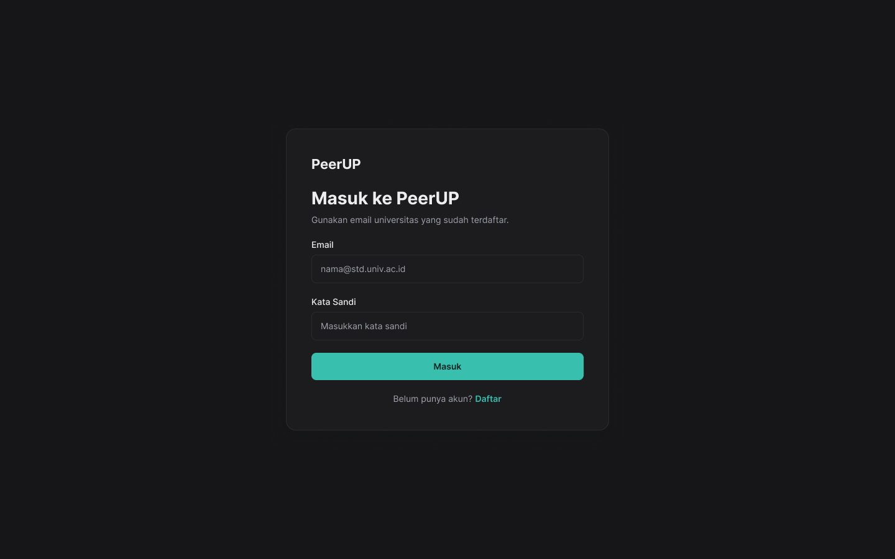
</p>
<p align="center">
<i>Gambar 6.1. Rancangan Antarmuka I-01 - Masuk</i>
</p>

Tabel 6.1. Spesifikasi Objek Antarmuka I-01

| Id_Objek | Jenis | Konten | Keterangan |
| :--- | :--- | :--- | :--- |
| *I01-01* | *Text Field* | *Email, Kata Sandi* | *Masukan kredensial akun yang sudah terdaftar.* |
| *I01-02* | *Button* | *Masuk* | *Memanggil `UserController.authLogin(email, password)`. Jika berhasil, pengguna diarahkan ke I-03.* |
| *I01-03* | *Link* | *Daftar* | *Membuka I-02.* |

## 6.2 Rancangan Antarmuka I-02

**Antarmuka:** I-02  
**Nama Layar:** Daftar Akun

<p align="center">
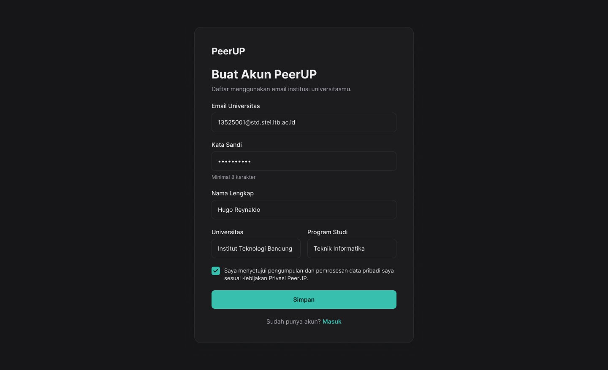
</p>
<p align="center">
<i>Gambar 6.2. Rancangan Antarmuka I-02 - Daftar Akun</i>
</p>

Tabel 6.2. Spesifikasi Objek Antarmuka I-02

| Id_Objek | Jenis | Konten | Keterangan |
| :--- | :--- | :--- | :--- |
| *I02-01* | *Text Field* | *Email Universitas, Kata Sandi, Nama Lengkap, Universitas, Program Studi* | *Data registrasi akun. Kata sandi minimal 8 karakter.* |
| *I02-02* | *Checkbox* | *Persetujuan Kebijakan Privasi* | *Wajib dicentang sebelum akun dapat dibuat.* |
| *I02-03* | *Button* | *Simpan* | *Memanggil `UserController.processRegistration(data)`; Validator memeriksa domain email universitas. Jika berhasil diarahkan ke I-01, jika gagal ke I-02a.* |
| *I02-04* | *Link* | *Masuk* | *Membuka I-01.* |

## 6.3 Rancangan Antarmuka I-02a

**Antarmuka:** I-02a  
**Nama Layar:** Daftar Akun Gagal

<p align="center">
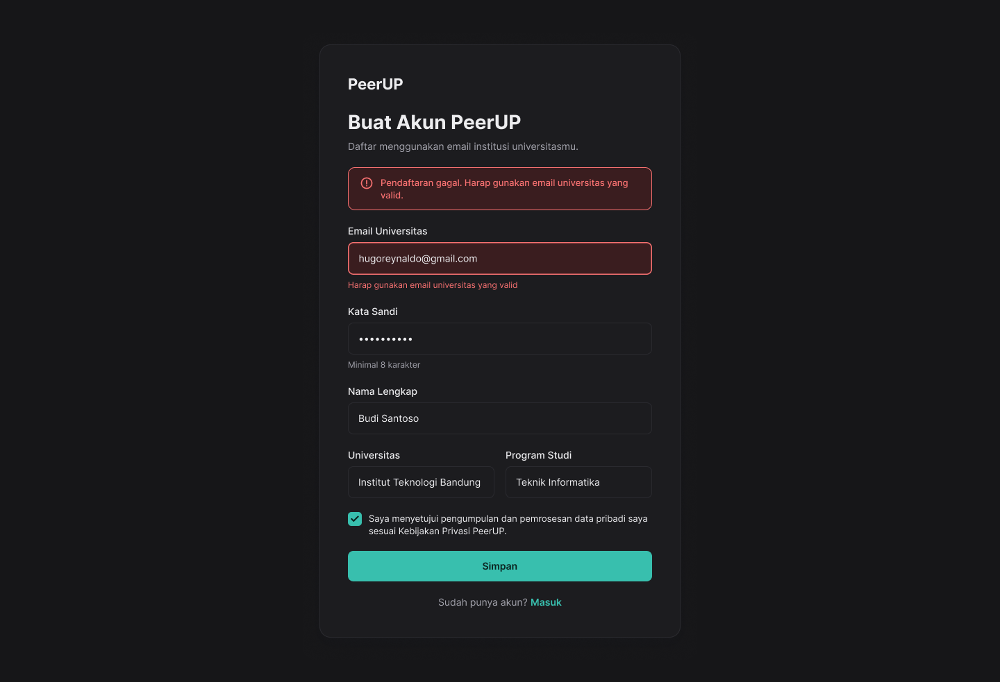
</p>
<p align="center">
<i>Gambar 6.3. Rancangan Antarmuka I-02a - Daftar Akun Gagal</i>
</p>

Tabel 6.3. Spesifikasi Objek Antarmuka I-02a

| Id_Objek | Jenis | Konten | Keterangan |
| :--- | :--- | :--- | :--- |
| *I02a-01* | *Alert* | *Pendaftaran gagal. Harap gunakan email universitas yang valid.* | *Ditampilkan ketika Validator menolak domain email.* |
| *I02a-02* | *Text Field (Error)* | *Email Universitas* | *Field ditandai merah dengan pesan "Harap gunakan email universitas yang valid". Isian lain tetap tersimpan.* |
| *I02a-03* | *Button* | *Simpan* | *Mengirim ulang registrasi, sama seperti I02-03.* |

## 6.4 Rancangan Antarmuka I-03

**Antarmuka:** I-03  
**Nama Layar:** Beranda

<p align="center">
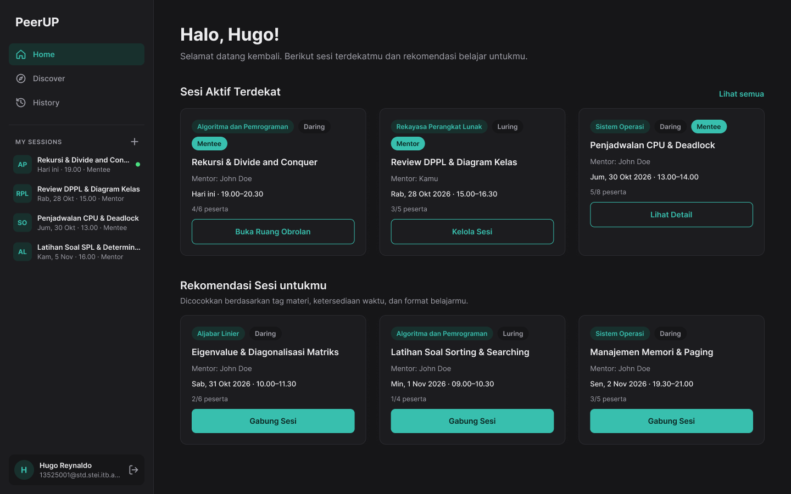
</p>
<p align="center">
<i>Gambar 6.4. Rancangan Antarmuka I-03 - Beranda</i>
</p>

Tabel 6.4. Spesifikasi Objek Antarmuka I-03

| Id_Objek | Jenis | Konten | Keterangan |
| :--- | :--- | :--- | :--- |
| *I03-01* | *Navigation Menu* | *Home, Discover, History* | *Membuka I-03, I-04, dan I-09. Sidebar ini sama pada seluruh layar setelah login.* |
| *I03-02* | *List* | *My Sessions* | *Daftar sesi aktif pengguna. Item membuka I-05 atau I-05a; tombol + membuka I-11.* |
| *I03-03* | *Card* | *Nama dan email pengguna, ikon keluar* | *Kartu membuka I-07. Ikon keluar mengakhiri login dan kembali ke I-01.* |
| *I03-04* | *Card List* | *Sesi Aktif Terdekat* | *Hasil `SessionController.getUpcomingSessions(idUser)`. Tombol kartu membuka I-10 (Buka Ruang Obrolan), I-05a (Kelola Sesi), atau I-05 (Lihat Detail).* |
| *I03-05* | *Link* | *Lihat semua* | *Membuka I-09.* |
| *I03-06* | *Card List* | *Rekomendasi Sesi untukmu* | *Hasil `SessionController.findRecommendation(idUser)`. Tombol Gabung Sesi membuka I-05.* |
| *I03-07* | *Link* | *Cari sesi lain* | *Membuka I-04.* |

## 6.5 Rancangan Antarmuka I-03a

**Antarmuka:** I-03a  
**Nama Layar:** Beranda (Preferensi Belum Diatur)

<p align="center">
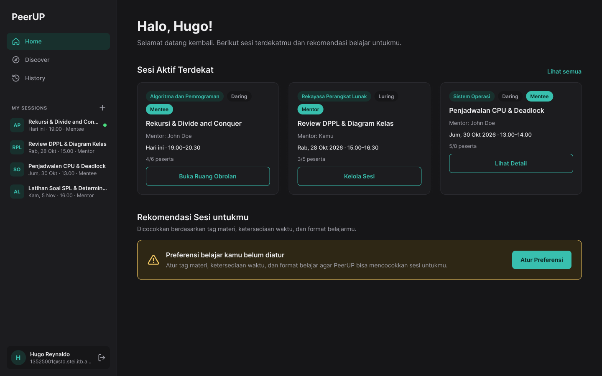
</p>
<p align="center">
<i>Gambar 6.5. Rancangan Antarmuka I-03a - Beranda (Preferensi Belum Diatur)</i>
</p>

Tabel 6.5. Spesifikasi Objek Antarmuka I-03a

| Id_Objek | Jenis | Konten | Keterangan |
| :--- | :--- | :--- | :--- |
| *I03a-01* | *Alert* | *Preferensi belajar kamu belum diatur* | *Ditampilkan menggantikan rekomendasi ketika `Preference.isComplete()` bernilai false.* |
| *I03a-02* | *Button* | *Atur Preferensi* | *Membuka I-08.* |

## 6.6 Rancangan Antarmuka I-04

**Antarmuka:** I-04  
**Nama Layar:** Discover

<p align="center">
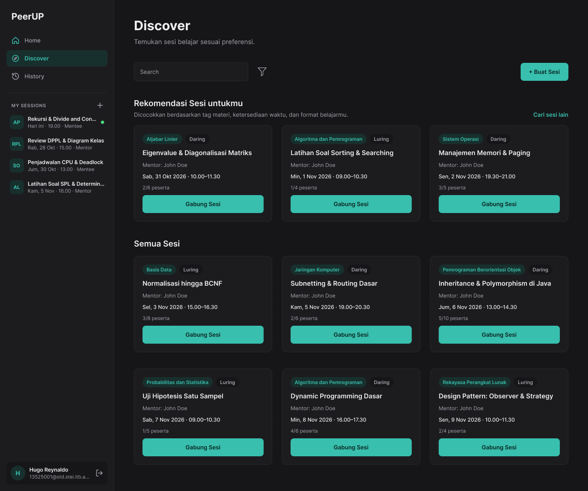
</p>
<p align="center">
<i>Gambar 6.6. Rancangan Antarmuka I-04 - Discover</i>
</p>

Tabel 6.6. Spesifikasi Objek Antarmuka I-04

| Id_Objek | Jenis | Konten | Keterangan |
| :--- | :--- | :--- | :--- |
| *I04-01* | *Search Field* | *Search* | *Mencari sesi berdasarkan judul atau tag materi.* |
| *I04-02* | *Icon Button* | *Filter* | *Menyaring sesi berdasarkan tag materi, format, dan jadwal.* |
| *I04-03* | *Button* | *+ Buat Sesi* | *Membuka I-11.* |
| *I04-04* | *Card List* | *Rekomendasi Sesi untukmu* | *Hasil `SessionController.findRecommendation(idUser)`.* |
| *I04-05* | *Card List* | *Semua Sesi* | *Seluruh sesi terbuka yang belum dimulai. Tombol Gabung Sesi pada kartu membuka I-05.* |

## 6.7 Rancangan Antarmuka I-05

**Antarmuka:** I-05  
**Nama Layar:** Detail Sesi (Mentee)

<p align="center">
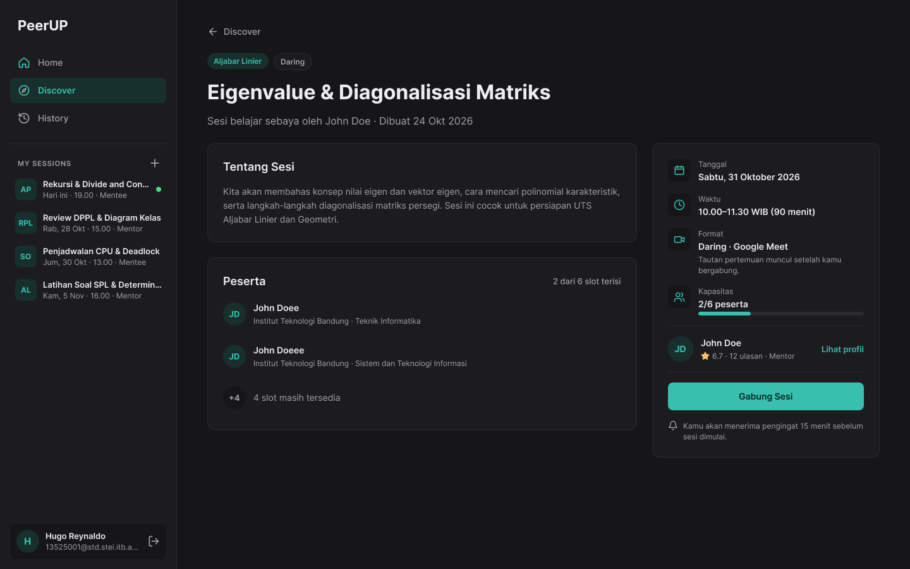
</p>
<p align="center">
<i>Gambar 6.7. Rancangan Antarmuka I-05 - Detail Sesi (Mentee)</i>
</p>

Tabel 6.7. Spesifikasi Objek Antarmuka I-05

| Id_Objek | Jenis | Konten | Keterangan |
| :--- | :--- | :--- | :--- |
| *I05-01* | *Text* | *Judul, tag materi, format, deskripsi* | *Detail sesi dari `SessionController.getSessionDetail(idSession, idUser)`.* |
| *I05-02* | *Panel* | *Tanggal, Waktu, Format, Kapasitas* | *Tautan pertemuan disembunyikan sampai pengguna bergabung.* |
| *I05-03* | *List* | *Peserta* | *Daftar Mentee yang sudah bergabung dan sisa slot.* |
| *I05-04* | *Link* | *Lihat profil* | *Membuka I-07 milik Mentor.* |
| *I05-05* | *Button* | *Gabung Sesi* | *Memanggil `SessionController.processRegistration(idSession, idMentee)`; slot diperiksa dengan `hasAvailableSlot()`. Jika berhasil, pengguna menjadi peserta dan tautan pertemuan ditampilkan.* |

## 6.8 Rancangan Antarmuka I-05a

**Antarmuka:** I-05a  
**Nama Layar:** Detail Sesi (Mentor)

<p align="center">
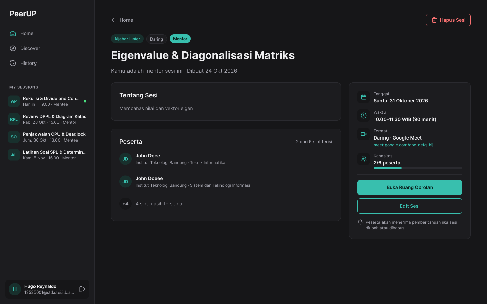
</p>
<p align="center">
<i>Gambar 6.8. Rancangan Antarmuka I-05a - Detail Sesi (Mentor)</i>
</p>

Tabel 6.8. Spesifikasi Objek Antarmuka I-05a

| Id_Objek | Jenis | Konten | Keterangan |
| :--- | :--- | :--- | :--- |
| *I05a-01* | *Button* | *Hapus Sesi* | *Membuka I-12.* |
| *I05a-02* | *Panel* | *Tanggal, Waktu, Format, Kapasitas* | *Tautan pertemuan selalu ditampilkan untuk Mentor.* |
| *I05a-03* | *List* | *Peserta* | *Daftar Mentee yang sudah bergabung.* |
| *I05a-04* | *Button* | *Buka Ruang Obrolan* | *Membuka I-10.* |
| *I05a-05* | *Button* | *Edit Sesi* | *Membuka I-06.* |

## 6.9 Rancangan Antarmuka I-06

**Antarmuka:** I-06  
**Nama Layar:** Edit Sesi

<p align="center">
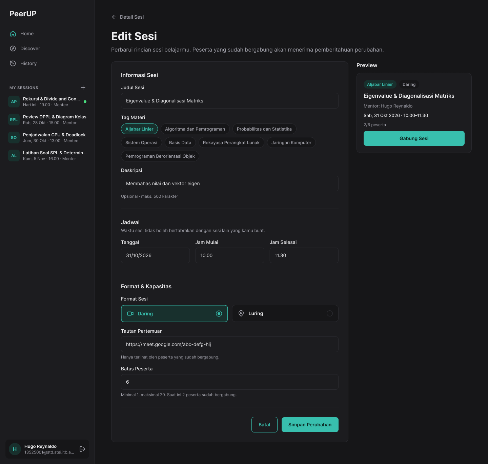
</p>
<p align="center">
<i>Gambar 6.9. Rancangan Antarmuka I-06 - Edit Sesi</i>
</p>

Tabel 6.9. Spesifikasi Objek Antarmuka I-06

| Id_Objek | Jenis | Konten | Keterangan |
| :--- | :--- | :--- | :--- |
| *I06-01* | *Text Field* | *Judul Sesi, Deskripsi* | *Terisi data sesi saat ini.* |
| *I06-02* | *Chip Group* | *Tag Materi* | *Memilih satu tag materi.* |
| *I06-03* | *Text Field* | *Tanggal, Jam Mulai, Jam Selesai* | *Validator menolak jadwal yang bertabrakan dengan sesi lain milik Mentor.* |
| *I06-04* | *Radio Group* | *Daring, Luring* | *Menentukan format sesi.* |
| *I06-05* | *Text Field* | *Tautan Pertemuan, Batas Peserta* | *Batas peserta harus 1–20 dan tidak kurang dari jumlah peserta saat ini.* |
| *I06-06* | *Card* | *Preview* | *Pratinjau kartu sesi yang diperbarui sesuai isian.* |
| *I06-07* | *Button* | *Simpan Perubahan* | *Memanggil `SessionController.editSession(idSession, idMentor, data)`, lalu kembali ke I-05a.* |
| *I06-08* | *Button* | *Batal* | *Kembali ke I-05a tanpa menyimpan.* |

## 6.10 Rancangan Antarmuka I-07

**Antarmuka:** I-07  
**Nama Layar:** Profil

<p align="center">
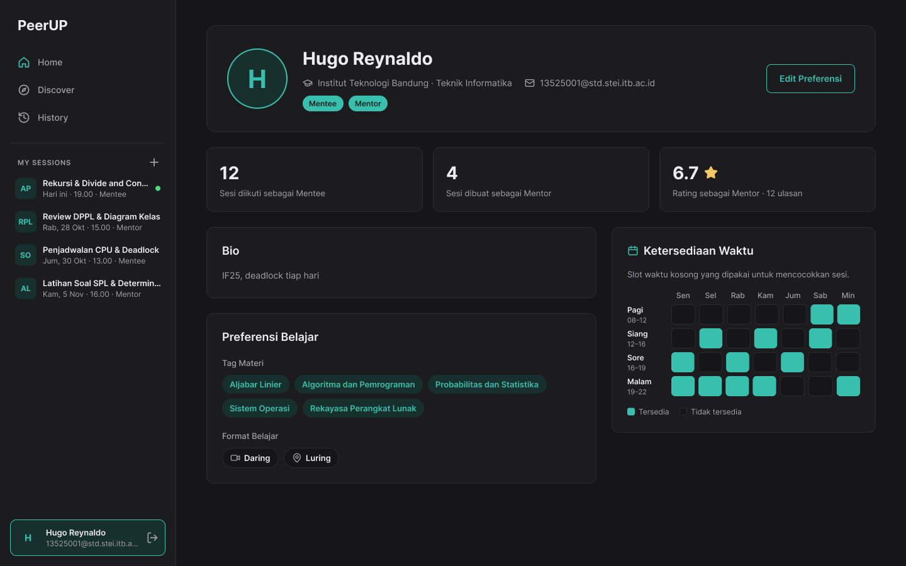
</p>
<p align="center">
<i>Gambar 6.10. Rancangan Antarmuka I-07 - Profil</i>
</p>

Tabel 6.10. Spesifikasi Objek Antarmuka I-07

| Id_Objek | Jenis | Konten | Keterangan |
| :--- | :--- | :--- | :--- |
| *I07-01* | *Text* | *Nama, universitas, program studi, email, peran* | *Data dari `UserController.fetchUserProfile(idUser)`.* |
| *I07-02* | *Button* | *Edit Preferensi* | *Membuka I-08. Hanya tampil pada profil milik sendiri.* |
| *I07-03* | *Card* | *Statistik sesi dan rating* | *Ringkasan jumlah sesi sebagai Mentee, sebagai Mentor, dan rating Mentor.* |
| *I07-04* | *Chip Group* | *Tag Materi, Format Belajar* | *Data dari `UserController.fetchUserPreference(idUser)`.* |
| *I07-05* | *Grid* | *Ketersediaan Waktu* | *Slot waktu kosong per hari (hanya baca).* |

## 6.11 Rancangan Antarmuka I-08

**Antarmuka:** I-08  
**Nama Layar:** Edit Preferensi

<p align="center">
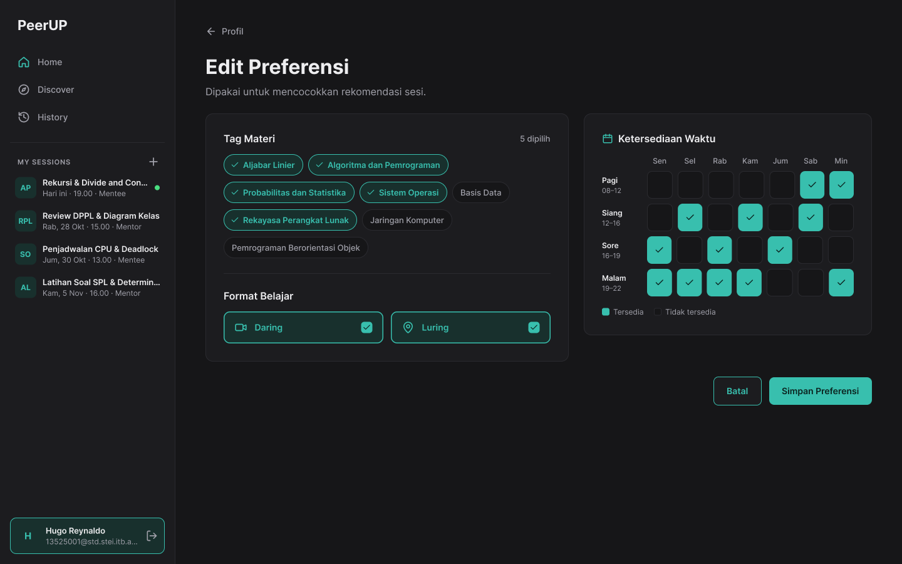
</p>
<p align="center">
<i>Gambar 6.11. Rancangan Antarmuka I-08 - Edit Preferensi</i>
</p>

Tabel 6.11. Spesifikasi Objek Antarmuka I-08

| Id_Objek | Jenis | Konten | Keterangan |
| :--- | :--- | :--- | :--- |
| *I08-01* | *Chip Group* | *Tag Materi* | *Memilih satu atau lebih tag materi.* |
| *I08-02* | *Checkbox Group* | *Daring, Luring* | *Memilih format belajar.* |
| *I08-03* | *Grid* | *Ketersediaan Waktu* | *Memilih slot waktu kosong per hari.* |
| *I08-04* | *Button* | *Simpan Preferensi* | *Memanggil `UserController.savePreference(idUser, materialTags, availability, sessionFormatPreference)`; Validator memastikan semua bagian terisi. Kembali ke I-07.* |
| *I08-05* | *Button* | *Batal* | *Kembali ke I-07 tanpa menyimpan.* |

## 6.12 Rancangan Antarmuka I-09

**Antarmuka:** I-09  
**Nama Layar:** History

<p align="center">
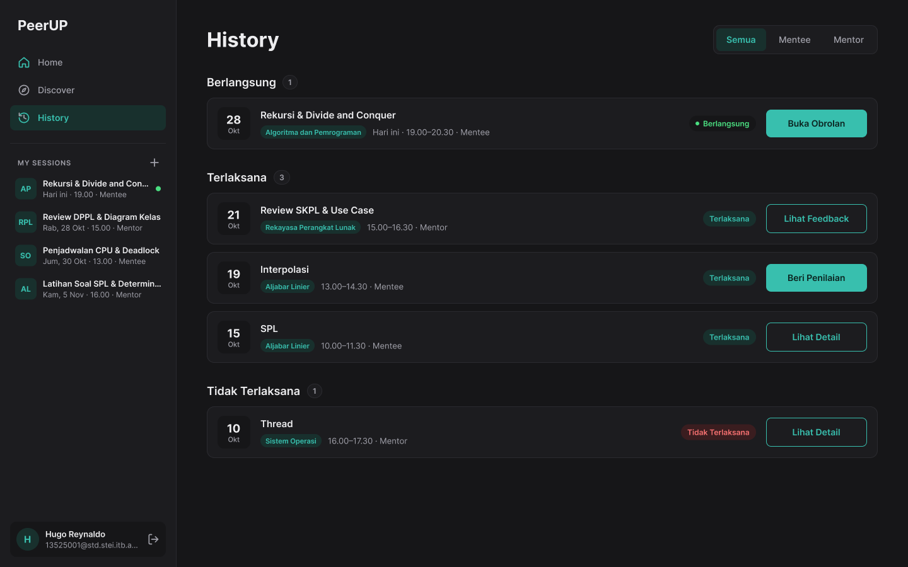
</p>
<p align="center">
<i>Gambar 6.12. Rancangan Antarmuka I-09 - History</i>
</p>

Tabel 6.12. Spesifikasi Objek Antarmuka I-09

| Id_Objek | Jenis | Konten | Keterangan |
| :--- | :--- | :--- | :--- |
| *I09-01* | *Segmented Control* | *Semua, Mentee, Mentor* | *Menyaring riwayat berdasarkan peran pengguna.* |
| *I09-02* | *List* | *Berlangsung, Terlaksana, Tidak Terlaksana* | *Hasil `SessionController.fetchUserHistory(idUser)` yang dikelompokkan berdasarkan status.* |
| *I09-03* | *Button* | *Buka Obrolan* | *Membuka I-10.* |
| *I09-04* | *Button* | *Lihat Feedback* | *Membuka I-15 (Mentor).* |
| *I09-05* | *Button* | *Beri Penilaian* | *Membuka I-14 (Mentee).* |
| *I09-06* | *Button* | *Lihat Detail* | *Membuka I-05 atau I-05a.* |

## 6.13 Rancangan Antarmuka I-10

**Antarmuka:** I-10  
**Nama Layar:** Grup Obrolan

<p align="center">
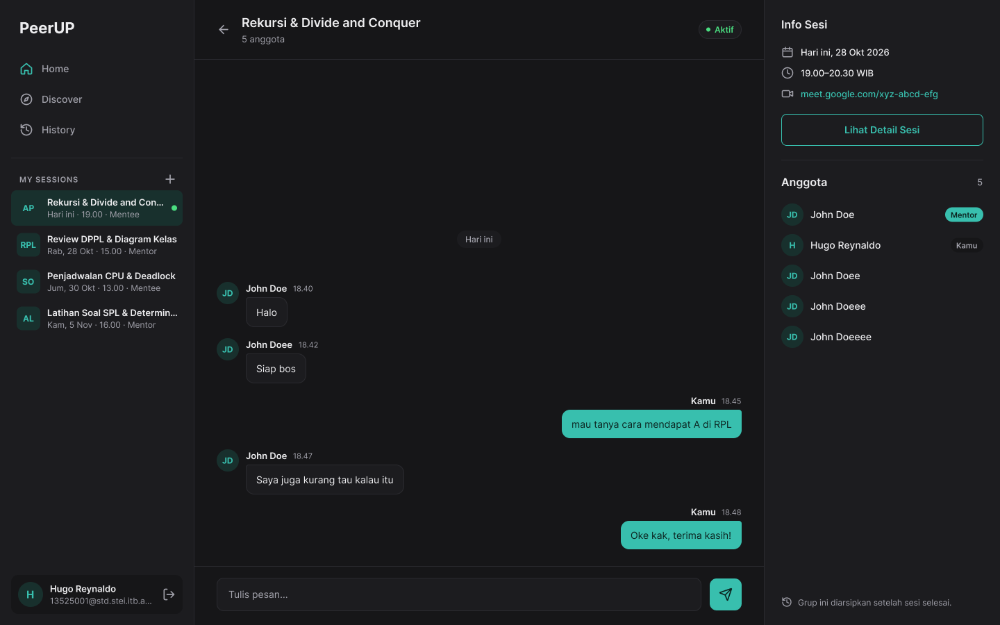
</p>
<p align="center">
<i>Gambar 6.13. Rancangan Antarmuka I-10 - Grup Obrolan</i>
</p>

Tabel 6.13. Spesifikasi Objek Antarmuka I-10

| Id_Objek | Jenis | Konten | Keterangan |
| :--- | :--- | :--- | :--- |
| *I10-01* | *List* | *Pesan* | *Riwayat pesan dari `ChatController.getGroupChat(idSession, idUser)`; pesan baru diterima secara real-time.* |
| *I10-02* | *Text Field* | *Tulis pesan...* | *Masukan isi pesan.* |
| *I10-03* | *Icon Button* | *Kirim* | *Memanggil `ChatController.sendMessage(idGroupChat, idUser, text)`.* |
| *I10-04* | *Panel* | *Info Sesi* | *Jadwal dan tautan pertemuan sesi.* |
| *I10-05* | *Button* | *Lihat Detail Sesi* | *Membuka I-05 atau I-05a.* |
| *I10-06* | *List* | *Anggota* | *Daftar Mentor dan Mentee dalam grup. Nama membuka I-07.* |

## 6.14 Rancangan Antarmuka I-11

**Antarmuka:** I-11  
**Nama Layar:** Buat Sesi

<p align="center">
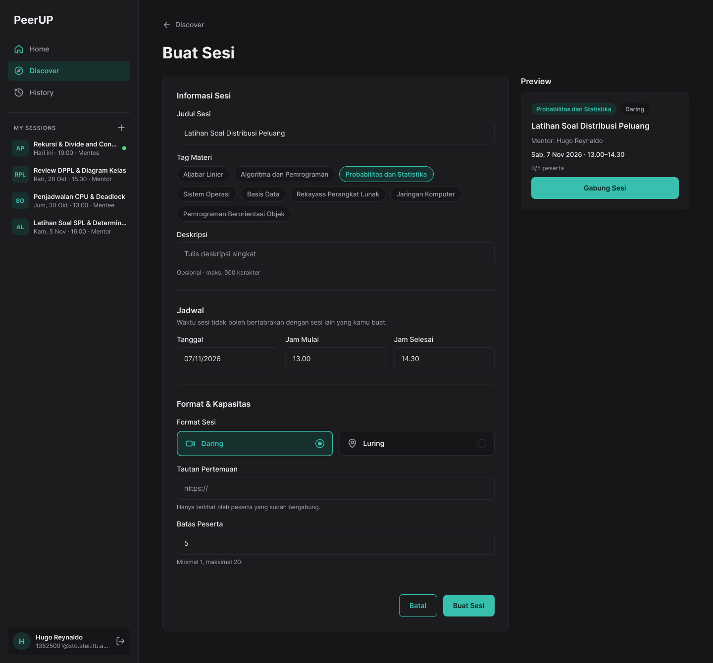
</p>
<p align="center">
<i>Gambar 6.14. Rancangan Antarmuka I-11 - Buat Sesi</i>
</p>

Tabel 6.14. Spesifikasi Objek Antarmuka I-11

| Id_Objek | Jenis | Konten | Keterangan |
| :--- | :--- | :--- | :--- |
| *I11-01* | *Text Field* | *Judul Sesi, Deskripsi* | *Deskripsi bersifat opsional.* |
| *I11-02* | *Chip Group* | *Tag Materi* | *Memilih satu tag materi.* |
| *I11-03* | *Text Field* | *Tanggal, Jam Mulai, Jam Selesai* | *Validator menolak jadwal yang bertabrakan dengan sesi lain milik Mentor.* |
| *I11-04* | *Radio Group* | *Daring, Luring* | *Menentukan format sesi.* |
| *I11-05* | *Text Field* | *Tautan Pertemuan, Batas Peserta* | *Batas peserta harus 1–20.* |
| *I11-06* | *Card* | *Preview* | *Pratinjau kartu sesi yang diperbarui sesuai isian.* |
| *I11-07* | *Button* | *Buat Sesi* | *Memanggil `SessionController.processSessionCreation(idMentor, data)`, lalu membuka I-05a.* |
| *I11-08* | *Button* | *Batal* | *Kembali ke I-04 tanpa menyimpan.* |

## 6.15 Rancangan Antarmuka I-12

**Antarmuka:** I-12  
**Nama Layar:** Konfirmasi Hapus Sesi

<p align="center">
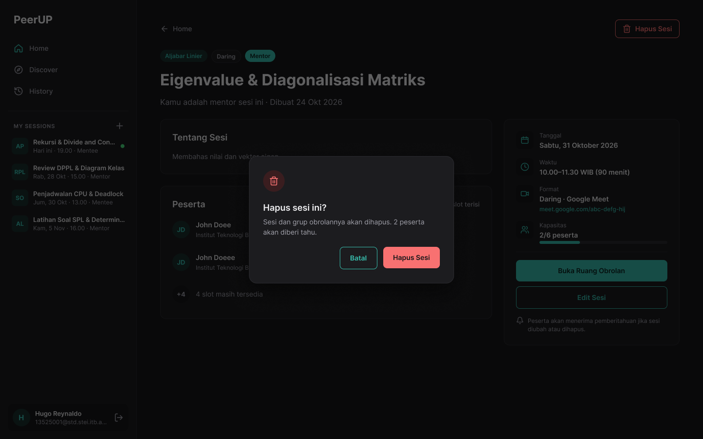
</p>
<p align="center">
<i>Gambar 6.15. Rancangan Antarmuka I-12 - Konfirmasi Hapus Sesi</i>
</p>

Tabel 6.15. Spesifikasi Objek Antarmuka I-12

| Id_Objek | Jenis | Konten | Keterangan |
| :--- | :--- | :--- | :--- |
| *I12-01* | *Dialog* | *Hapus sesi ini?* | *Konfirmasi sebelum sesi dihapus.* |
| *I12-02* | *Button* | *Batal* | *Menutup dialog dan kembali ke I-05a.* |
| *I12-03* | *Button* | *Hapus Sesi* | *Memanggil `SessionController.deleteSession(idSession, idMentor)`; peserta diberi notifikasi. Kembali ke I-03.* |

## 6.16 Rancangan Antarmuka I-13

**Antarmuka:** I-13  
**Nama Layar:** Konfirmasi Keluar Sesi

<p align="center">
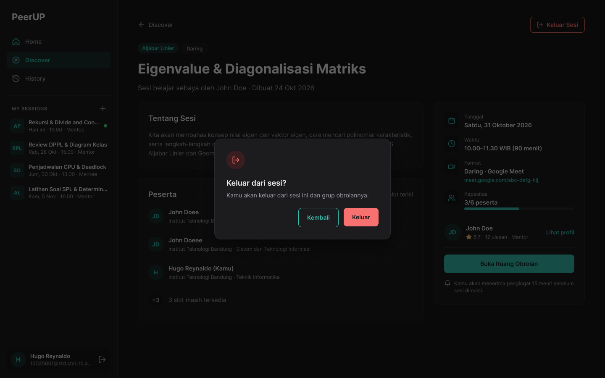
</p>
<p align="center">
<i>Gambar 6.16. Rancangan Antarmuka I-13 - Konfirmasi Keluar Sesi</i>
</p>

Tabel 6.16. Spesifikasi Objek Antarmuka I-13

| Id_Objek | Jenis | Konten | Keterangan |
| :--- | :--- | :--- | :--- |
| *I13-01* | *Button* | *Keluar Sesi* | *Membuka dialog konfirmasi.* |
| *I13-02* | *Dialog* | *Keluar dari sesi?* | *Konfirmasi sebelum Mentee keluar dari sesi.* |
| *I13-03* | *Button* | *Kembali* | *Menutup dialog.* |
| *I13-04* | *Button* | *Keluar* | *Memanggil `SessionController.cancelParticipation(idSession, idMentee)`; pengguna dikeluarkan dari peserta dan grup obrolan. Kembali ke I-03.* |

## 6.17 Rancangan Antarmuka I-14

**Antarmuka:** I-14  
**Nama Layar:** Konfirmasi Keterlaksanaan & Penilaian

<p align="center">
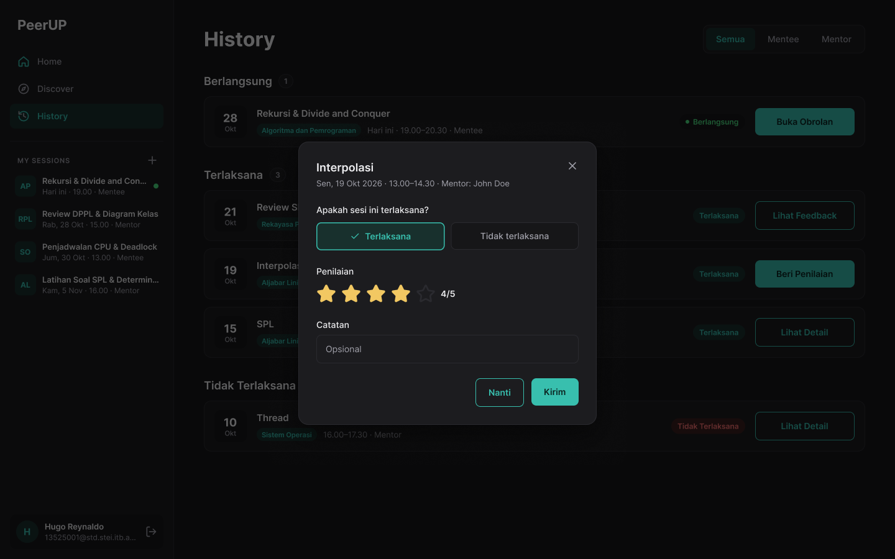
</p>
<p align="center">
<i>Gambar 6.17. Rancangan Antarmuka I-14 - Konfirmasi Keterlaksanaan & Penilaian</i>
</p>

Tabel 6.17. Spesifikasi Objek Antarmuka I-14

| Id_Objek | Jenis | Konten | Keterangan |
| :--- | :--- | :--- | :--- |
| *I14-01* | *Option Group* | *Terlaksana, Tidak terlaksana* | *Memanggil `SessionController.processSessionConfirmation(idSession, idUser, status, alasan)`.* |
| *I14-02* | *Rating* | *1–5 bintang* | *Penilaian untuk sesi.* |
| *I14-03* | *Text Field* | *Catatan* | *Opsional.* |
| *I14-04* | *Button* | *Kirim* | *Memanggil `FeedbackController.submitFeedback(idSession, idMentee, rating, comment)`, lalu kembali ke I-09.* |
| *I14-05* | *Button* | *Nanti, ikon tutup* | *Menutup dialog tanpa menyimpan. Penilaian dapat diisi kemudian dari I-09.* |

## 6.18 Rancangan Antarmuka I-15

**Antarmuka:** I-15  
**Nama Layar:** Feedback Sesi

<p align="center">
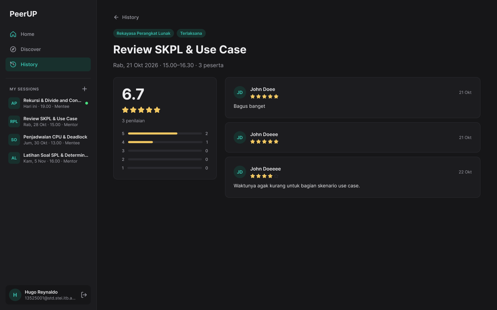
</p>
<p align="center">
<i>Gambar 6.18. Rancangan Antarmuka I-15 - Feedback Sesi</i>
</p>

Tabel 6.18. Spesifikasi Objek Antarmuka I-15

| Id_Objek | Jenis | Konten | Keterangan |
| :--- | :--- | :--- | :--- |
| *I15-01* | *Text* | *Judul sesi, tag materi, status, jadwal* | *Informasi sesi yang telah selesai.* |
| *I15-02* | *Card* | *Rata-rata rating, jumlah penilaian, distribusi* | *Ringkasan dari `FeedbackController.retrieveFeedbackBySession(idSession, idMentor)`.* |
| *I15-03* | *List* | *Feedback Mentee* | *Nama, rating, tanggal, dan catatan dari setiap Mentee.* |
| *I15-04* | *Link* | *History* | *Kembali ke I-09.* |

## 6.19 Rancangan Antarmuka I-16

**Antarmuka:** I-16  
**Nama Layar:** Notifikasi Pengingat Sesi

<p align="center">
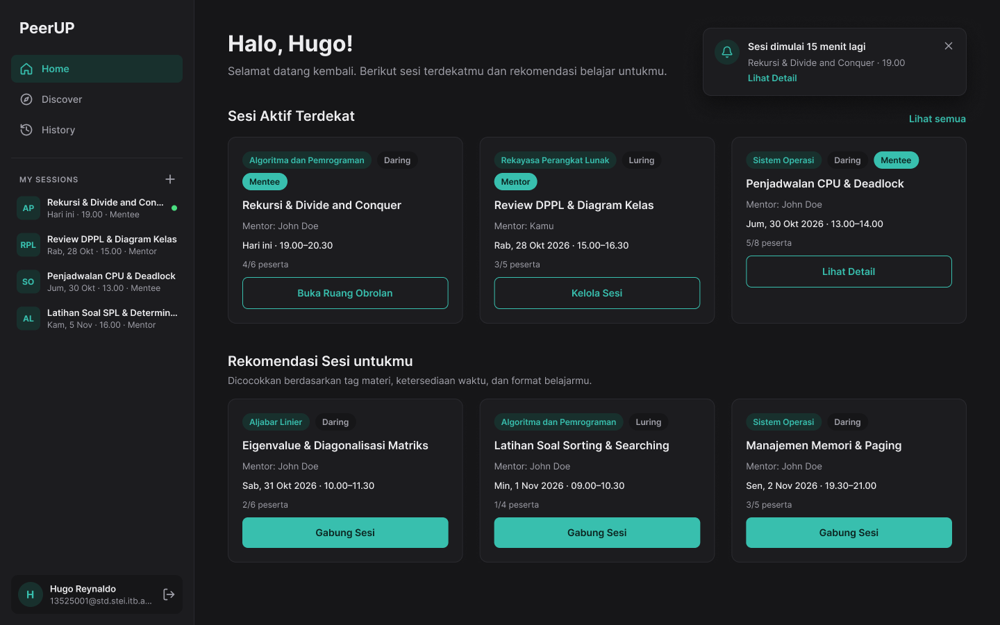
</p>
<p align="center">
<i>Gambar 6.19. Rancangan Antarmuka I-16 - Notifikasi Pengingat Sesi</i>
</p>

Tabel 6.19. Spesifikasi Objek Antarmuka I-16

| Id_Objek | Jenis | Konten | Keterangan |
| :--- | :--- | :--- | :--- |
| *I16-01* | *Toast* | *Sesi dimulai 15 menit lagi, nama dan jam sesi* | *Dikirim oleh `NotificationController.sendSessionReminders(now)` 15 menit sebelum sesi dimulai.* |
| *I16-02* | *Link* | *Lihat Detail* | *Memanggil `NotificationController.markAsRead(idNotification, idUser)`, lalu membuka I-05 atau I-05a.* |
| *I16-03* | *Icon Button* | *Tutup* | *Menutup notifikasi.* |

## 6.20 Rancangan Antarmuka Keseluruhan

Tabel 6.20. Rancangan Antarmuka Keseluruhan

| No | Tampilan Antarmuka |
| :--- | :--- |
| I-01<br>Masuk |  |
| I-02<br>Daftar Akun |  |
| I-02a<br>Daftar Akun Gagal |  |
| I-03<br>Beranda |  |
| I-03a<br>Beranda (Preferensi Belum Diatur) |  |
| I-04<br>Discover |  |
| I-05<br>Detail Sesi (Mentee) |  |
| I-05a<br>Detail Sesi (Mentor) |  |
| I-06<br>Edit Sesi |  |
| I-07<br>Profil |  |
| I-08<br>Edit Preferensi |  |
| I-09<br>History |  |
| I-10<br>Grup Obrolan |  |
| I-11<br>Buat Sesi |  |
| I-12<br>Konfirmasi Hapus Sesi |  |
| I-13<br>Konfirmasi Keluar Sesi |  |
| I-14<br>Konfirmasi Keterlaksanaan & Penilaian |  |
| I-15<br>Feedback Sesi |  |
| I-16<br>Notifikasi Pengingat Sesi |  |

<br>

---

# BAB 7: Matriks Kerunutan

Petakan kelas perancangan dengan use case yang terkait. Gunakan **BAB 6 Traceability pada dokumen SKPL** sebagai acuan keterkaitan kelas analisis dan use case, lalu sesuaikan dengan realisasi use case dan kelas perancangan pada BAB 3–BAB 5 DPPL.

Tabel 7.1. Matriks Kerunutan Kelas terhadap Use Case

| Kelas | Use Case Terkait |
| :--- | :--- |
| *[ID kelas - Nama kelas]* | *[ID UC - Nama use case; tuliskan seluruh use case terkait]* |
| *[ID kelas - Nama kelas]* | *[ID UC - Nama use case]* |
| *...* | *...* |
