<h1>
IF2150 REKAYASA PERANGKAT LUNAK
<br>
TUGAS 5
<br>
DESKRIPSI PERANCANGAN PERANGKAT LUNAK (DPPL)
</h1>
<br>

## *antri.in*
<br>

### Untuk: *Angel*

Dipersiapkan oleh:
| Informasi | Keterangan |
| --- | --- |
| Kelas | *01* |
| Kelompok | *10*  |

| NIM | Nama |
|---|---|
| *13525145* | *Muhammad Nur Fikri Hariyawan* |
| *13525085* | *Bayu Palamarta Wirawan*       |
| *13525133* | *Chatima Anandakhorita*        |
| *13525148* | *Athallah Nanda Andita*        |
| *13525091* | *Muhammad Fauzi Muharam*       |
---

## Daftar Perubahan

| Revisi | Deskripsi |
| :--- | :--- |
| *A* | *Perbaikan Kelas Perancangan.* |
| *B* |  |
| *C* |  |
| ... |  |

---

<br>

> **Petunjuk pengerjaan:** *[Silahkan hapus bagian ini setelah selesai mengerjakan]*
>
> Dokumen ini melanjutkan **Deskripsi Perancangan Perangkat Lunak**. Gunakan nama, ID, kebutuhan, dan use case yang konsisten dengan kedua dokumen tersebut. Contoh pola ID baru di bawah dapat disesuaikan dengan kesepakatan kelompok, ID yang sudah ada tetap dipertahankan.

<br>

---


# BAB 1: Pendahuluan

## 1.1 Tujuan Penulisan Dokumen
Dokumen ini bertujuan untuk menjabarkan rancangan perangkat lunak antri.in yang mencakup pendahuluan, perancangan arsitektur, realisasi setiap use case melalui sequence diagram dan diagram kelas, serta keterkaitan kelas perancangan dengan use case. Dokumen ini akan digunakan oleh kelompok Ducklings sebagai acuan dalam pengembangan, serta asisten dosen dan dosen sebagai acuan dalam penilaian.

## 1.2 Lingkup Masalah
Fenomena makanan viral memicu antrean panjang berjam-jam yang membebani pelanggan, karena mereka harus datang lebih awal, menunggu di lokasi, dan mengantre tanpa informasi stok menu maupun estimasi waktu tunggu, ditambah proses pemesanan dan pembayaran di kasir yang memakan waktu 2-5 menit per transaksi. Aplikasi pesan-antar seperti GoFood, GrabFood, dan ShopeeFood pun hanya berfokus pada pengantaran dan tidak membatasi kuota transaksi per rentang waktu, sehingga restoran kewalahan saat pesanan online dan pelanggan fisik datang bersamaan. Celah utamanya adalah belum adanya integrasi antara pemantauan antrean real-time, pengaturan slot waktu, serta pemesanan dan pembayaran awal, sehingga antri.in hadir untuk menghapus waktu berpikir di kasir, meratakan kedatangan pelanggan berbasis kuota jam, dan memberi kebebasan bagi konsumen selama menunggu. Dari fenomena tersebut perangkat lunak bernama antri.in yang akan kami kembangkan merupakan sistem pemesanan makanan viral dengan antrean digital berbasis web yang bertujuan agar pengguna tidak perlu mengantri secara langsung pada restoran. Sistem ini memungkinkan pengguna untuk mencari restoran makanan viral, melihat informasi makanan dan restoran, melakukan pemesanan, memantau antrean dan estimasi pesanan akan selesai, serta fitur booking tempat jika pengguna memutuskan untuk dine-in. Cara kerja dari aplikasi berbasis web ini adalah pertama pengguna memilih restoran yang tersedia, kemudian pengguna dapat membaca informasi mengenai makanan yang terdapat di restoran tersebut. Jika sudah, pengguna dapat memilih makanan yang akan dibeli dan lanjut ke proses pembayaran. Ketika pengguna sudah membayar, barulah akan mendapatkan nomor antrian dan estimasi pesanan selesai sehingga pengguna dapat memperkirakan waktu kedatangan.

## 1.3 Definisi, Istilah, dan Singkatan
Semua definisi dan singkatan yang digunakan dalam dokumen ini beserta penjelasannya.

Tabel 1.3. Definisi Istilah dan Singkatan

| Singkatan, Akronim, atau Istilah | Penjelasan |
| :--- | :--- |
| *P/L* | *Singkatan dari Perangkat Lunak, yaitu aplikasi yang memberikan perintah kepada komputer untuk menjalankan tugas tertentu.* |
| *DPPL* | *Singkatan dari Spesifikasi Kebutuhan Perangkat Lunak, yaitu dokumen yang merangkum kriteria-kriteria yang diperlukan untuk membangun aplikasi menjalankan tugasnya.* |
| *US* | *Singkatan dari User Story.* |
| *A* | *Singkatan dari Aktivitas.* |
| *R* | *Singkatan dari Requirement.* |
| *KF* | *Singkatan dari Kebutuhan Fungsional.* |
| *KNF* | *Singkatan dari Kebutuhan Non-Fungsional.* |
| *UC* | *Singkatan dari Use Case.* |
| *C* | *Singkatan dari Class.* |
| *EARS* | *Easy Approach to Requirements Syntax, yaitu pola penulisan kebutuhan agar konsisten dan mudah diuji.* |
| *AC* | *Singkatan dari Aktor.* |
| *Algo* | *Singkatan dari Algoritma.* |
| *...* | *...* |

## 1.4 Aturan Penomoran
Tuliskan aturan penomoran (ID) yang digunakan dalam dokumen ini. Gunakan pola ID yang **sama** dengan yang sudah dipakai pada dokumen-dokumen sebelumnya, jangan membuat pola baru di dokumen ini.

Tabel 1.4. Aturan Penomoran

| Hal/Bagian | Penomoran | Keterangan |
| :--- | :--- | :--- |
| *User Story* | *USXX* | Mulai dari 01, 02, dan seterusnya |
| *Kebutuhan Fungsional* | *KFXX* | Mulai dari 01, 02, dan seterusnya |
| *Kebutuhan Non-Fungsional* | *KNFXX* | Mulai dari 01, 02, dan seterusnya |
| *Aktivitas* | *AXX* | Mulai dari 01, 02, dan seterusnya |
| *Use Case* | *UCXX* | Mulai dari 01, 02, dan seterusnya |
| *Kelas* | *CXX* | Mulai dari 01, 02, dan seterusnya |
| *Requirement* | *RXX* | Mulai dari 01, 02, dan seterusnya |
| *Aktor* | *ACXX* | Mulai dari 01, 02, dan seterusnya |
| *Algoritma* | *Algo-XX* | Mulai dari 01, 02, dan seterusnya |
| *...* | *...* |

## 1.5 Referensi
Cantumkan dokumentasi P/L yang dirujuk oleh dokumen ini, **minimal dokumen SKPL dan APL**. Tambahkan buku, panduan, atau dokumentasi lain apabila digunakan.

SKPL<br>
APL<br>
Pressman, R. S., _Software Engineering: A Practitioner's Approach_, _8th Edition_, McGraw-Hill, 2015.  
Sommerville, I., _Software Engineering_, _10th Edition_, Pearson, 2016.  
Larman, C., _Applying UML and Patterns: An Introduction to Object-Oriented Analysis and Design and Iterative Development_, _3rd Edition_, Prentice Hall, 2004.

## 1.6 Deskripsi Umum Dokumen (Ikhtisar)
Tuliskan sistematika pembahasan dokumen ini secara ringkas dan runut, dengan maksimal 1 paragraf.

<br>

---

# BAB 2: Perancangan Arsitektur

## 2.1 Rancangan Lingkungan Implementasi

Sebutkan *operating system*, DBMS, *development tools*, *filing system*, dan bahasa pemrograman yang digunakan.

| Komponen | Spesifikasi |
| :--- | :--- |
| *Server* | *Lokal (localhost)* |
| *Client* | *Google Chrome* |
| *DBMS* | *PostgreSQL 15+* |
| *OS* | *Windows 11* |
| *Bahasa Pemrograman* | *Typescript* |
| *API* | *REST API* |
| *filing system* | *NTFS* |
| *Code Editor / IDE* | *Visual Studio Code* |
| *Package Manager* | *npm* |
| *Version Control* | *Git* |
| *API Testing Tool* | *Postman* |
| *Database Management Tool* | *pgAdmin* |

## 2.2 Style/Pattern Arsitektur Acuan

Tentukan *architectural style* atau *pattern* yang menjadi acuan aplikasi, misalnya *layered architecture*, *client-server*, *repository*, *pipe and filter*, atau MVC (*Model-View-Controller*).


Gunakan hasil **BAB 1 Style/Pattern Arsitektur Acuan pada dokumen APL**, termasuk alasan pemilihan dan gambar penerapannya pada P/L kelompok. Gunakan komponen aplikasi sendiri pada gambar, bukan hanya contoh pola umum.

Style yang dipilih adalah Architectural Style MVC. Pola arsitektur ini memisahkan aplikasi menjadi 3 komponen utama, yaitu Model, View, dan Controller. Model berperan sebagai representasi data dan logika bisnis, View sebagai pengatur tampilan informasi kepada pengguna, dan Controller berperan sebagai penghubung Model dan View.

Alasan Pemilihan:
1. Berdasarkan jenis pengguna:
- Pelanggan: Dengan MVC, View pelanggan dapat diperbaiki berulang kali tanpa menyentuh logika pemesanan atau pembayaran. Selain itu, informasi sensitif seperti rekening dan e-wallet hanya diakses lewat Controller, tidak langsung oleh View.
- Restoran: Karena Model menjadi sumber data tunggal, perubahan dari sisi restoran secara otomatis tersedia untuk View pelanggan tanpa menduplikasi data.
- Admin: View admin berupa panel kerja yang berbeda dari antarmuka pelanggan, sehingga bisa dikembangkan sendiri.
  
2. Berdasarkan alur proses bisnis: 
- Data antrean yang sama muncul di HalamanStatusAntrean (pelanggan) dan DashboardAntreanPage (restoran). Dengan MVC, perubahan di Model (misalnya setelah dequeue) dapat memperbarui kedua View sekaligus.
- Aplikasi membutuhkan proses validasi yang cukup kompleks. Dengan MVC, proses bisnis yang kompleks bisa dipisahkan dengan antarmuka supaya tidak terlalu menganggu tampilan.
- MVC memudahkan pengembangan fitur yang berbeda seperti registrasi restoran, pencarian restoran, booking, pre-order, pembayaran, dan pengelolaan antrean.

3. Berdasarkan KF dan KNF:
- Pemisahan peran pengguna (KF21, KF15, KF19, KF20)
Sistem melayani tiga aktor (pelanggan, restoran, admin) dengan fitur yang berbeda. Dalam MVC, setiap aktor dapat dilayani oleh Controller dan View terpisah (misalnya PelangganController, RestoranController, AdminController), sementara Model tetap dipakai bersama. Hal ini mempermudah pengaturan hak akses dan alur registrasi/login/logout.

- Banyak tampilan dari data yang sama (KF01, KF02, KF03, KF13)
Data restoran, antrean, dan pesanan ditampilkan ke beberapa pihak dan di beberapa halaman. MVC memungkinkan satu Model menyediakan data yang sama untuk View yang berbeda tanpa menduplikasi logika.

- Pembaruan antrean yang saling terhubung (KF04, KF08, KF17, KF18)
Ketika restoran melakukan dequeue atau mengubah kuota, tampilan pelanggan harus ikut diperbarui. Pola Model sebagai sumber data tunggal dan View yang menyesuaikan diri terhadap perubahan Model cocok untuk menjaga sinkronisasi ini.

- Logika bisnis yang kompleks dan terpusat (KF05, KF06, KF07, KF09, KF10)
Pemeriksaan stok, dua mode pemesanan (booking dan pre-order), validasi reservasi maksimal seminggu sebelumnya, serta penyimpanan tiket antrean merupakan aturan bisnis. Dalam MVC, aturan ini ditempatkan di Model/Controller, bukan di tampilan, sehingga mudah diuji dan diubah.

- Response time (KNF02, KNF09, KNF12)
Pemisahan lapisan membuat Model dapat dioptimalkan secara mandiri tanpa memengaruhi View, sehingga target 1 detik untuk menampilkan restoran dan 10 detik untuk konfirmasi pembayaran lebih mudah dicapai.

- Reliability (KNF03, KNF06, KNF10, KNF14)
Nomor antrean unik, pencegahan pemesanan meja ganda, konfirmasi semua pembayaran, dan pencegahan double-charge adalah aturan integritas data. Dengan MVC, aturan ini dipusatkan di Model sehingga konsisten, apa pun Controller atau View yang memanggilnya.

- Security (KNF08)
Privasi nomor rekening dan e-wallet dapat dijaga dengan memastikan View tidak pernah mengakses data sensitif secara langsung. Seluruh akses melewati Controller yang melakukan otorisasi dan validasi, dan Model yang mengelola enkripsi atau penyamaran data.

- Availability (KNF01, KNF05, KNF07, KNF11)
Fitur yang harus tersedia setiap saat seperti daftar restoran, nomor antrean, dan pendaftaran dapat dipelihara dan diperbarui per komponen.

- Ergonomy (KNF04, KNF13)
Antarmuka yang minimalis dan mudah digunakan membutuhkan iterasi desain tampilan yang sering. Karena View terpisah dari logika, desain UI dapat diubah tanpa menyentuh logika bisnis.

<p align="center">

</p>
<p align="center">
<i>Gambar 1. Arsitektur MVC</i>
</p>

## 2.3 Identifikasi Komponen / Modul / Subsistem

Identifikasi komponen, modul, atau subsistem penyusun aplikasi berdasarkan *pattern* yang telah ditetapkan. Jelaskan tanggung jawab masing-masing komponen. Pengelompokan dapat mengikuti lapisan arsitektur atau fungsi/peran komponen dalam sistem.

Dapat menyalin dari dokumen DPPL sebelumnya

Tabel 2.3. Identifikasi Komponen/Modul/Subsistem

| Nama Komponen/Modul/Subsistem | Jenis | Penjelasan |
| :--- | :--- | :--- |
| *ModelAkun*                 | *Model*                | *Menyimpan identitas dan kredensial pengguna (Pelanggan, Admin), hak akses (role), serta token dan status sesi login.*     |
| *ModelRestoran*               | *Model*                | *Menyimpan profil restoran mitra, status verifikasi dan keaktifan, dokumen perizinan, daftar menu beserta stok, serta konfigurasi kuota antrean dan kapasitas meja.*                                                       |
| *ModelAntrean*                | *Model*                | *Menyimpan antrean per restoran dan tiket antrean (nomor urut, tipe dine-in/takeaway, status, estimasi waktu tunggu).*                                      |                                      |
| *ModelPesanan*           | *Model*          | *Menyimpan keranjang sementara, data pesanan (mode, jumlah rombongan, jadwal booking, total harga, status), dan riwayat transaksi pembayaran.*                                             |
| *ModelKeluhan*         | *Model*          | *Menyimpan isi, waktu kirim, dan status keluhan pelanggan.*                                          |
| *AkunView*        | *View*          | *Halaman registrasi, login, profil, dan dialog konfirmasi logout untuk Pelanggan, Restoran, dan Admin.*                |
| *PencarianView*           | *View*          | *Halaman pencarian dan filter restoran, kartu ringkasan restoran, serta pesan hasil kosong.*                                                              |
| *PemesananView*                      | *View*               | *Halaman pemilihan menu dan mode layanan (dine-in, takeaway, booking), keranjang, checkout, pembayaran, dan konfirmasi tiket antrean.*                        |
| *StatusAntreanView*                   | *View*               | *Halaman pelanggan untuk melihat status antrean secara real-time dan menerima notifikasi pengambilan pesanan.*       |
| *MitraView*                     | *View*               | *Formulir pendaftaran mitra restoran (restoran) dan halaman peninjauan pengajuan (admin).*          |
| *KelolaAntreanView*                   | *View*               | *Dashboard antrean restoran, tombol dequeue, dan dialog konfirmasi dequeue.*                                |
| *PengaturanView*                    | *View*           | *Halaman restoran untuk mengatur kuota antrean, kapasitas meja, serta menu dan stok makanan.*                                                      |
| *KelolaRestoranView*       | *View* | *Halaman admin untuk melihat daftar restoran mitra dan dialog konfirmasi penghapusan restoran.* |
| *KeluhanView*                    | *View*    | *Formulir pengiriman keluhan (pelanggan) dan daftar keluhan (admin).*   |
| *AutentikasiController*                    | *Controller*    | *Registrasi akun, validasi kredensial, penerbitan token sesi, dan logout untuk semua peran.*   |
| *PencarianController*                    | *Controller*    | *Menjalankan pencarian dan filter restoran, mengambil preview menu dan status antrean.*   |
| *PemesananController*                    | *Controller*    | *Mengatur alur pemesanan: mencatat item ke keranjang, memvalidasi stok dan kuota meja, memvalidasi booking (maks. 7 hari), membuat pesanan, serta menerbitkan tiket antrean setelah pembayaran lunas.*   |
| *MetodePembayaranController*                    | *Controller*    | *Formulir pengiriman keluhan (pelanggan) dan daftar keluhan (admin).Membuat tagihan, memverifikasi status pembayaran, dan menangani timeout melalui PaymentGatewayAdapter.*   |
| *PemantauAntreanController*                    | *Controller*    | *Membaca data antrean dan mendorong pembaruan status antrean ke pelanggan secara real-time.*   |
| *PengajuanMitraController*                    | *Controller*    | *Memvalidasi dan menyimpan pengajuan mitra, serta memproses keputusan admin (setujui/tolak) dan memicu notifikasi email.*   |
| *KelolaAntreanController*                    | *Controller*    | *Menampilkan dashboard antrean, memproses dequeue manual maupun otomatis (timeout 30 menit), dan memperbarui antrean.*   |
| *PengaturanKuotaController*                    | *Controller*    | *Memvalidasi input dan menyimpan kuota antrean serta kapasitas meja, termasuk penutupan antrean sementara.*   |
| *KelolaMenuController*                    | *Controller*    | *Menambah, mengubah, menghapus menu, dan memperbarui stok.*   |
| *KelolaDataRestoranController*                    | *Controller*    | *Menonaktifkan dan menghapus data restoran beserta relasi menunya.*   |
| *KeluhanController*                    | *Controller*    | *Menerima dan menyimpan keluhan pelanggan serta menampilkan daftar keluhan kepada admin.*   |
| *PaymentGatewayAdapter*                    | *Integrasi Eksternal*    | *Penghubung ke Payment Gateway: mengirim permintaan transaksi dan menerima status lunas, gagal, atau kedaluwarsa. Penyedia dapat diganti tanpa mengubah controller.*   |
| *NotifikasiEmail*                    | *Integrasi Eksternal*    | *Mengirim email hasil verifikasi pendaftaran mitra (diterima/ditolak) melalui layanan email pihak ketiga.*   |
| *Payment Gateway*                    | *Sistem Eksternal*    | *Sistem pihak ketiga yang memvalidasi dan mengotorisasi pembayaran digital (penyedia belum ditentukan).*   |
| *Layanan Email*                    | *Sistem Eksternal*    | *Layanan pengiriman email pihak ketiga.*   |
| *BasisDataPostgreSQL*                    | *Pendukung*    | *Penyimpanan seluruh data transaksional dan operasional pada PostgreSQL 15+ di lingkungan sistem sendiri; diakses oleh seluruh komponen Model.*   |
| *...* | *...* | *...* |

## 2.4 Model Arsitektur Perangkat Lunak

Buat model arsitektur dalam bentuk satu atau lebih *view* yang memperlihatkan interaksi dan kolaborasi komponen, modul, serta subsistem dalam menjalankan fungsi sistem. Pilih notasi yang sesuai. Contoh *view*: *Logical View*, *Process View*, *Development View*, dan *Physical View*.

Gunakan hasil **BAB 3 Model Arsitektur Perangkat Lunak pada dokumen APL**. 

### 2.4.1 Logical View

Tuliskan secara singkat model arsitektur yang dipilih dan alasan model tersebut cocok untuk aplikasi.

Arsitektur aplikasi **antri.in** dibagi menjadi beberapa lapisan utama:
1. **Layer View (Antarmuka Pengguna)**
   - Berfungsi untuk menampilkan antarmuka interaktif kepada pengguna, baik untuk pelanggan, pengelola restoran, maupun pihak mitra.
   - **Komponen**: `AkunView`, `KeluhanView`, `StatusAntreanView`, `KelolaAntreanView`, `PemesananView`, `PencarianView`, `KelolaRestoranView`, `PengaturanView`, dan `MitraView`. Setiap komponen *view* menangani fungsi spesifik seperti melihat status antrean, pemesanan menu, hingga pendaftaran mitra baru.

2. **Layer Controller (Logika Bisnis & Kendali)**
   - Menerima input dari *View*, memproses alur kerja (*use case*), dan memperbarui data pada *Model*.
   - **Komponen**: `AutentikasiController`, `KeluhanController`, `PemantauAntreanController`, `KelolaAntreanController`, `PemesananController`, `MetodePembayaranController`, `PencarianController`, `KelolaDataRestoranController`, `PengaturanKuotaController`, `KelolaMenuController`, dan `PengajuanMitraController`.

3. **Layer Model (Domain Data & Aturan Bisnis)**
   - Mengelola data utama, status aplikasi, serta transaksi bisnis.
   - **Komponen**: 
     - `ModelAkun`: Mengelola sesi dan kredensial pengguna.
     - `ModelKeluhan`: Mengelola catatan keluhan dari pengguna.
     - `ModelAntrean`: Mengelola siklus antrean, nomor tiket, dan status penerbitan antrean.
     - `ModelPesanan`: Mengelola rincian transaksi dan pesanan pelanggan.
     - `ModelRestoran`: Mengelola data restoran, stok menu, kuota meja, dan status kemitraan.

4. **Integrasi Eksternal & Layer Pendukung (Infrastructure/Persistence)**
   - **Integrasi Eksternal**:
     - `PaymentGatewayAdapter` yang terhubung ke layanan *Payment Gateway* eksternal untuk pemrosesan transaksi.
     - `NotifikasiEmail` yang terhubung ke *Layanan Email* eksternal untuk pengiriman pesan notifikasi/konfirmasi.
   - **Pendukung (Database)**: `BasisDataPostgreSQL` digunakan untuk menyimpan data relasional bagi semua model data aplikasi.

<p align="center">

</p>
<p align="center">
<i>Gambar 2. Logical View antri.in</i>
</p>

### 2.4.2 Process View

Process View dipilih karena antri.in memiliki tiga perilaku yang hanya terlihat saat sistem berjalan, yaitu pembayaran yang bersifat asinkron, pembaruan antrean secara *real-time*, dan proses yang dipicu oleh waktu. 

Komponen pada Tabel 2.1 berjalan di dalam proses berikut:
1. **Proses Klien (Google Chrome)**
   - Setiap pengguna yang sedang aktif, baik Pelanggan, Restoran, maupun Admin, menjalankan satu browser yang memuat komponen-komponen.
   - **Komponen**: `AkunView`, `PencarianView`, `PemesananView`, `KeluhanView`, `MitraView`, `KelolaAntreanView`, `PengaturanView`, `KelolaRestoranView`, dan `StatusAntreanView`.
2. **Proses Server Aplikasi (*localhost*, Windows 11)**
   - Satu proses server melayani banyak permintaan secara bersamaan dan terbagi menjadi empat unit eksekusi:
     - **Thread penanganan request REST**: setiap permintaan HTTP ditangani oleh satu *thread* secara sinkron. Komponen: `AutentikasiController`, `PencarianController`, `PemesananController`, `MetodePembayaranController`, `PengajuanMitraController`, `KeluhanController`, `KelolaAntreanController`, `PengaturanKuotaController`, `KelolaMenuController`, dan `KelolaDataRestoranController`.
     - **Kanal real-time**: koneksi yang tetap terbuka selama pelanggan memantau antrean, sehingga perubahan dapat didorong (*push*) tanpa pelanggan memuat ulang halaman. Komponen: `PemantauAntreanController`.
     - **Lapisan Model**: dipakai bersama oleh seluruh *thread*, sehingga akses ke data yang sama perlu dijaga dengan transaksi basis data. Komponen: `ModelAkun`, `ModelKeluhan`, `ModelPesanan`, `ModelRestoran`, dan `ModelAntrean`.
     - **Pekerja integrasi**: menangani komunikasi dengan sistem eksternal secara asinkron agar *request* pengguna tidak tertahan menunggu respons pihak luar. Komponen: `PaymentGatewayAdapter` dan `NotifikasiEmail`.

3. **Proses DBMS (PostgreSQL 15+)**
   - Proses terpisah yang menyimpan seluruh data secara persisten. **Komponen**: `BasisDataPostgreSQL`.

4. **Sistem Eksternal**
   - Proses di luar batas P/L yang berkomunikasi melalui pekerja integrasi. **Komponen**: *Payment Gateway* dan *Layanan Email*.

<p align="center">

</p>
<p align="center">
<i>Gambar 3. Process View antri.in</i>
</p>

<br>

---


# BAB 3: Realisasi Use Case

## 3.1 Use Case 1

**ID Use Case:** *UC01*  
**Nama Use Case:** *Mencari dan filter resto*

### 3.1.1 Identifikasi Kelas

Identifikasi kelas yang terkait dengan use case tersebut. Kelas di tahap perancangan dapat berbeda dengan dengan kelas di tahap analisis. Dapat menggunakan tabel di bawah:

Tabel 3.1. Identifikasi Kelas Use Case [UC01]

| No | Nama Kelas Perancangan | Nama Kelas Analisis Terkait |
|:--- | :--- | :--- |
| 1 | *Pelanggan* | *Pelanggan* |
| 2 | *Restoran* | *Restoran* |
| 3 | *Menu* | *Menu* |
| 4 | *Antrean* | *Antrean* |
| 5 | *PencarianRestoPage* | *PencarianRestoPage* |
| 6 | *PencarianController* | *PencarianController* |

### 3.1.2 Sequence Diagram

Buat *sequence diagram* untuk **setiap skenario use case**, mencakup skenario normal dan alternatif pada subbab 4.4 SKPL. Diagram melibatkan kelas-kelas yang telah diidentifikasi pada SKPL. 

- **Skenario Normal**

<p align="center">
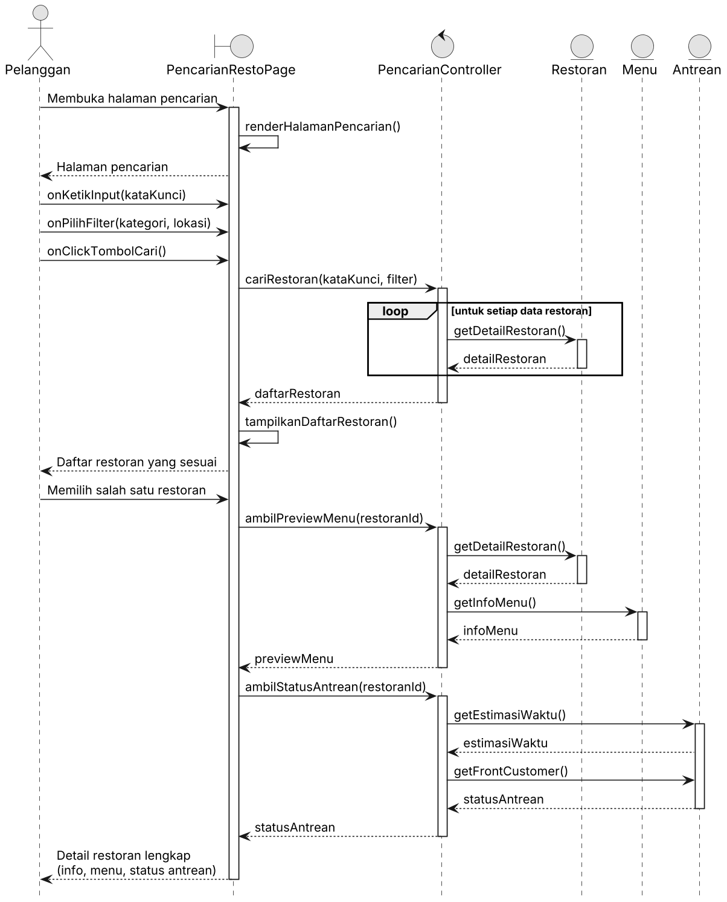
</p>
<p align="center">
<i>Gambar 4. Sequence Diagram UC01</i>
</p>

- **Skenario Alternatif 1: Hasil Pencarian Tidak Ditemukan**

<p align="center">
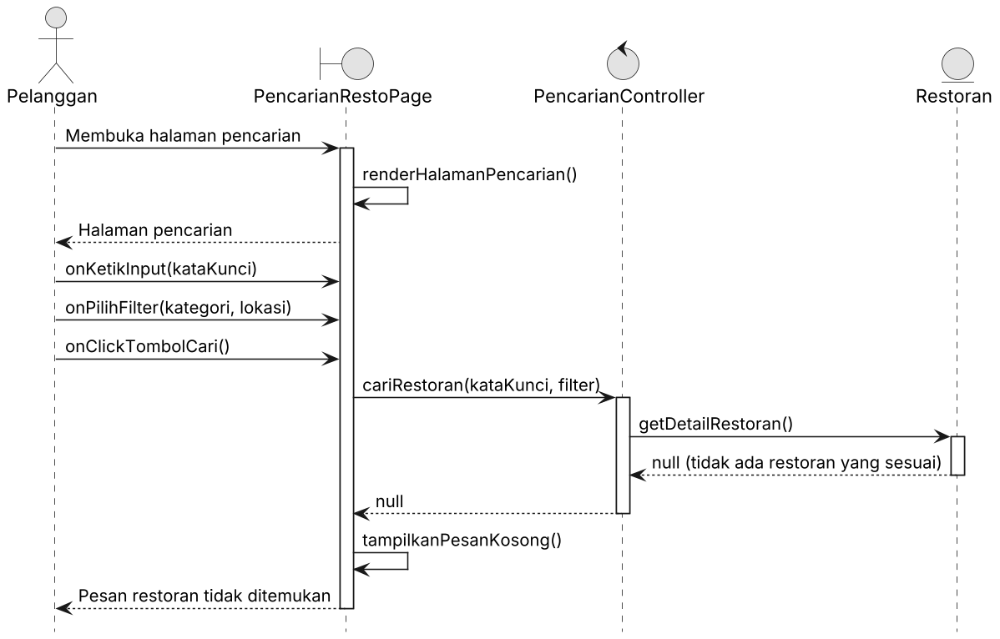
</p>
<p align="center">
<i>Gambar 5. Sequence Diagram UC01 - Hasil Pencarian Tidak Ditemukan</i>
</p>


### 3.1.3 Diagram Kelas

Buatlah diagram kelas untuk use case ini yang terdiri atas kelas-kelas dari 3.1.1. **Setiap kelas pada diagram wajib menampilkan atribut dan metode/operasi langsung di dalam kotak kelasnya**, sehingga tidak perlu membuat tabel daftar atribut dan metode per kelas pada subbab ini. Daftar lengkap atribut dan metode seluruh kelas disajikan pada Tabel 4.1 (Bab 4).

<p align="center">

</p>
<p align="center">
<i>Gambar 6. Diagram Kelas UC01</i>
</p>

Pada diagram, pastikan:
- Atribut dituliskan beserta visibilitas dan tipe datanya, misalnya `- email: String`.
- Operasi dituliskan beserta visibilitas, parameter, dan tipe kembaliannya, misalnya `+ login(email: String, password: String): Boolean`.
- Relasi antarkelas (asosiasi, agregasi, komposisi, generalisasi, dan dependensi) digambarkan lengkap dengan multiplisitas.
- Semua operasi yang dipanggil pada sequence diagram 3.1.2 (skenario normal dan alternatif) ada pada kelas yang bersangkutan.
- Kelas yang sama dengan kelas di use case lain memakai nama, atribut, dan metode yang konsisten.


## 3.2 Use Case 2

**ID Use Case:** *UC02*  
**Nama Use Case:** *Melakukan pemesanan dan pembayaran digital*

### 3.2.1 Identifikasi Kelas

Identifikasi kelas yang terkait dengan use case tersebut. Kelas di tahap perancangan dapat berbeda dengan dengan kelas di tahap analisis. Dapat menggunakan tabel di bawah:

Tabel 3.2. Identifikasi Kelas Use Case [UC02]

| No | Nama Kelas Perancangan | Nama Kelas Analisis Terkait |
|:--- | :--- | :--- |
| 1 | *Pelanggan* | *Pelanggan* |
| 2 | *Menu* | *Menu* |
| 3 | *Keranjang* | *Keranjang* |
| 4 | *Pesanan* | *Pesanan* |
| 5 | *MetodePembayaranController* | *MetodePembayaranController* |
| 6 | *RiwayatTransaksi* | *RiwayatTransaksi* |
| 7 | *TiketAntrean* | *TiketAntrean* |
| ... | *...* | *...* |

### 3.2.2 Sequence Diagram

Buat *sequence diagram* untuk **setiap skenario use case**, mencakup skenario normal dan alternatif pada subbab 4.4 SKPL. Diagram melibatkan kelas-kelas yang telah diidentifikasi pada SKPL. 

- **Skenario Normal**

<p align="center">

</p>
<p align="center">
<i>Gambar 7. Sequence Diagram UC02 - Skenario Normal</i>
</p>

- **Skenario Alternatif 1: Pre-Order Takeaway**

<p align="center">

</p>
<p align="center">
<i>Gambar 8. Sequence Diagram UC02 - Pre-Order Takeaway</i>
</p>

- **Skenario Alternatif 2: Booking Tempat**

<p align="center">

</p>
<p align="center">
<i>Gambar 9. Sequence Diagram UC02 - Booking Tempat</i>
</p> <!-- SAMA DENGAN SKENARIO NORMAL!!! -->

- **Skenario Alternatif 3: Stok Menu Habis**

<p align="center">
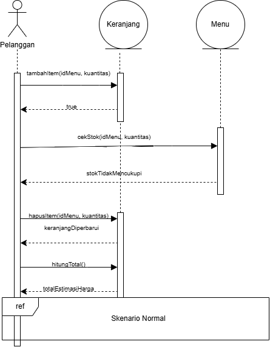
</p>
<p align="center">
<i>Gambar 10. Sequence Diagram UC02 - Stok Menu Habis</i>
</p> 

- **Skenario Alternatif 4: Batas Waktu Pembayaran Habis (Timeout) / Pembayaran Gagal**

<p align="center">

</p>
<p align="center">
<i>Gambar 11. Sequence Diagram UC02 - Batas Waktu Pembayaran Habis (Timeout) / Pembayaran Gagal</i>
</p>

- **Skenario Alternatif 5: Tanggal Booking Tidak Valid atau Kuota Jadwal Penuh**

<p align="center">
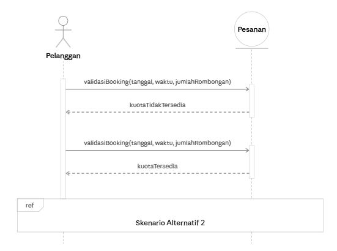
</p>
<p align="center">
<i>Gambar 12. Sequence Diagram UC02 - Batas Waktu Pembayaran Habis (Timeout) / Pembayaran Gagal</i>
</p>

### 3.2.3 Diagram Kelas

Buatlah diagram kelas untuk use case ini yang terdiri atas kelas-kelas dari 3.1.1. **Setiap kelas pada diagram wajib menampilkan atribut dan metode/operasi langsung di dalam kotak kelasnya**, sehingga tidak perlu membuat tabel daftar atribut dan metode per kelas pada subbab ini. Daftar lengkap atribut dan metode seluruh kelas disajikan pada Tabel 4.1 (Bab 4).

<p align="center">
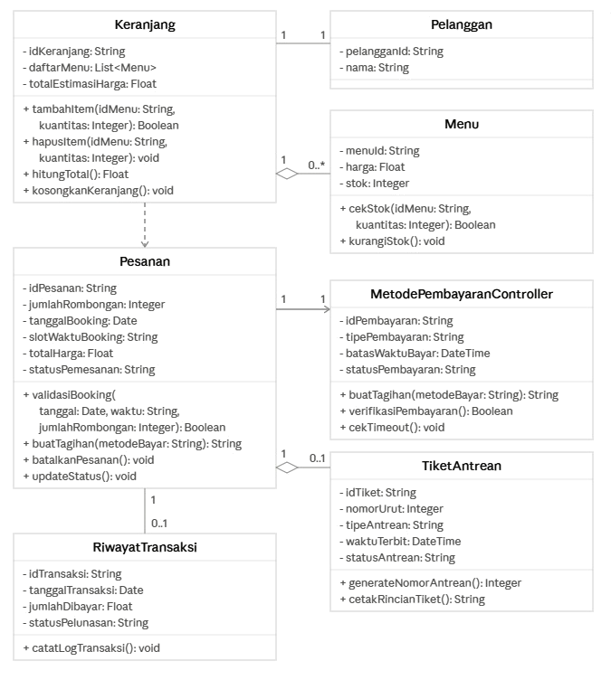
</p>
<p align="center">
<i>Gambar 13. Diagram Kelas UC02</i>
</p>

<br>

## 3.3 Use Case 3

**ID Use Case:** *UC03*  
**Nama Use Case:** *Menampilkan Status Antrean*

### 3.3.1 Identifikasi Kelas

Identifikasi kelas yang terkait dengan use case tersebut. Kelas di tahap perancangan dapat berbeda dengan dengan kelas di tahap analisis. Dapat menggunakan tabel di bawah:

Tabel 3.3. Identifikasi Kelas Use Case [UC03]

| No | Nama Kelas Perancangan | Nama Kelas Analisis Terkait |
|:--- | :--- | :--- |
| 1 | *HalamanStatusAntrean* | *HalamanStatusAntrean* |
| 2 | *PemantauAntreanController* | *PemantauAntreanController* |
| 3 | *TiketAntrean* | *TiketAntrean* |
| 4 | *Antrean* | *Antrean* |
| 5 | *Pesanan* | *Pesanan* |
| 6 | *Pelanggan* | *Pelanggan* |
| ... | *...* | *...* |

### 3.3.2 Sequence Diagram

Buat *sequence diagram* untuk **setiap skenario use case**, mencakup skenario normal dan alternatif pada subbab 4.4 SKPL. Diagram melibatkan kelas-kelas yang telah diidentifikasi pada SKPL. 

- **Skenario Normal**

<p align="center">

</p>
<p align="center">
<i>Gambar 14. Sequence Diagram UC03</i>
</p>

### 3.3.3 Diagram Kelas

Buatlah diagram kelas untuk use case ini yang terdiri atas kelas-kelas dari 3.1.1. **Setiap kelas pada diagram wajib menampilkan atribut dan metode/operasi langsung di dalam kotak kelasnya**, sehingga tidak perlu membuat tabel daftar atribut dan metode per kelas pada subbab ini. Daftar lengkap atribut dan metode seluruh kelas disajikan pada Tabel 4.1 (Bab 4).

<p align="center">

</p>
<p align="center">
<i>Gambar 15. Diagram Kelas UC03</i>
</p>

<br>

## 3.4 Use Case 4

**ID Use Case:** *UC04*  
**Nama Use Case:** *Pendaftaran Mitra Restoran Baru*

### 3.4.1 Identifikasi Kelas

Identifikasi kelas yang terkait dengan use case tersebut. Kelas di tahap perancangan dapat berbeda dengan dengan kelas di tahap analisis. Dapat menggunakan tabel di bawah:

Tabel 3.4. Identifikasi Kelas Use Case [UC04]

| No | Nama Kelas Perancangan | Nama Kelas Analisis Terkait |
|:--- | :--- | :--- |
| 1 | *RegistrasiRestoPage* | *RegistrasiRestoPage* |
| 2 | *PengajuanMitraController* | *PengajuanMitraController* |
| 3 | *Restoran* | *Restoran* |
| 4 | *DokumenVerifikasi* | *DokumenVerifikasi* |
| 5 | *Menu* | *Menu* |

### 3.4.2 Sequence Diagram

Buat *sequence diagram* untuk **setiap skenario use case**, mencakup skenario normal dan alternatif pada subbab 4.4 SKPL. Diagram melibatkan kelas-kelas yang telah diidentifikasi pada SKPL. 

- **Skenario Normal**

<p align="center">

</p>
<p align="center">
<i>Gambar 16. Sequence Diagram UC04</i>
</p>

- **Skenario Alternatif 1: Data Form Tidak Lengkap atau Format Tidak Sesuai**

<p align="center">

</p>
<p align="center">
<i>Gambar 17. Sequence Diagram UC04 - Data Form Tidak Lengkap atau Format Tidak Sesuai</i>
</p>

### 3.4.3 Diagram Kelas

Buatlah diagram kelas untuk use case ini yang terdiri atas kelas-kelas dari 3.1.1. **Setiap kelas pada diagram wajib menampilkan atribut dan metode/operasi langsung di dalam kotak kelasnya**, sehingga tidak perlu membuat tabel daftar atribut dan metode per kelas pada subbab ini. Daftar lengkap atribut dan metode seluruh kelas disajikan pada Tabel 4.1 (Bab 4).

<p align="center">

</p>
<p align="center">
<i>Gambar 18. Diagram Kelas UC04</i>
</p>

<br>

## 3.5 Use Case 5

**ID Use Case:** *UC05*  
**Nama Use Case:** *Memverifikasi Pendaftaran Restoran*

### 3.5.1 Identifikasi Kelas

Identifikasi kelas yang terkait dengan use case tersebut. Kelas di tahap perancangan dapat berbeda dengan dengan kelas di tahap analisis. Dapat menggunakan tabel di bawah:

Tabel 3.5. Identifikasi Kelas Use Case [UC05]

| No | Nama Kelas Perancangan | Nama Kelas Analisis Terkait |
|:--- | :--- | :--- |
| 1 | *VerifikasiRestoranPage* | *VerifikasiRestoranPage* |
| 2 | *PengajuanMitraController* | *PengajuanMitraController* |
| 3 | *Restoran* | *Restoran* |
| 4 | *DokumenVerifikasi* | *DokumenVerifikasi* |
| 5 | *Menu* | *Menu* |
| 6 | *Admin* | *Admin* |
| 7 | *NotifikasiEmail* | *NotifikasiEmail* |

### 3.5.2 Sequence Diagram

Buat *sequence diagram* untuk **setiap skenario use case**, mencakup skenario normal dan alternatif pada subbab 4.4 SKPL. Diagram melibatkan kelas-kelas yang telah diidentifikasi pada SKPL. 

- **Skenario Normal**

<p align="center">

</p>
<p align="center">
<i>Gambar 19. Sequence Diagram UC05</i>
</p>

- **Skenario Alternatif 1: Pengajuan Pendaftaran Ditolak**

<p align="center">

</p>
<p align="center">
<i>Gambar 20. Sequence Diagram UC05 - Pengajuan Pendaftaran Ditolak</i>
</p>

### 3.5.3 Diagram Kelas

Buatlah diagram kelas untuk use case ini yang terdiri atas kelas-kelas dari 3.1.1. **Setiap kelas pada diagram wajib menampilkan atribut dan metode/operasi langsung di dalam kotak kelasnya**, sehingga tidak perlu membuat tabel daftar atribut dan metode per kelas pada subbab ini. Daftar lengkap atribut dan metode seluruh kelas disajikan pada Tabel 4.1 (Bab 4).

<p align="center">

</p>
<p align="center">
<i>Gambar 21. Diagram Kelas UC05</i>
</p>

<br>


## 3.6 Use Case 6

**ID Use Case:** *UC06*  
**Nama Use Case:** *Mengelola Antrean*

### 3.6.1 Identifikasi Kelas

Identifikasi kelas yang terkait dengan use case tersebut. Kelas di tahap perancangan dapat berbeda dengan dengan kelas di tahap analisis. Dapat menggunakan tabel di bawah:

Tabel 3.6. Identifikasi Kelas Use Case [UC06]

| No | Nama Kelas Perancangan | Nama Kelas Analisis Terkait |
|:--- | :--- | :--- |
| 1 | *Pelanggan* | *Pelanggan* |
| 2 | *Restoran* | *Restoran* |
| 3 | *Antrean* | *Antrean* |
| 4 | *Pesanan* | *Pesanan* |
| 5 | *TiketAntrean* | *TiketAntrean* |
| 6 | *KelolaAntreanController* | *KelolaAntreanController* |
| 7 | *KonfirmasiDequeuePage* | *KonfirmasiDequeuePage* |
| 8 | *KelolaAntreanPage* | *KelolaAntreanPage* |
| ... | *...* | *...* |

### 3.6.2 Sequence Diagram

Buat *sequence diagram* untuk **setiap skenario use case**, mencakup skenario normal dan alternatif pada subbab 4.4 SKPL. Diagram melibatkan kelas-kelas yang telah diidentifikasi pada SKPL. 

- **Skenario Normal**

<p align="center">

</p>
<p align="center">
<i>Gambar 22. Sequence Diagram UC06</i>
</p>

- **Skenario Alternatif 1: Restoran membatalkan dequeue**

<p align="center">
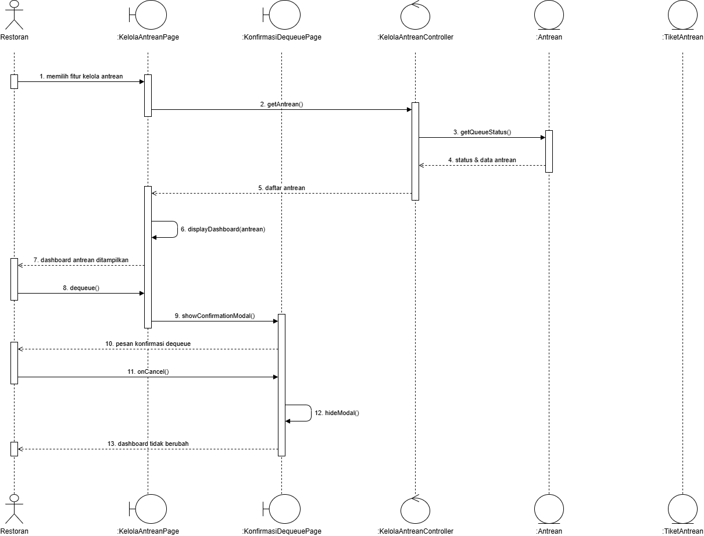
</p>
<p align="center">
<i>Gambar 23. Sequence Diagram UC06 - Restoran membatalkan dequeue</i>
</p>

- **Skenario Alternatif 2: Pelanggan tidak hadir**

<p align="center">

</p>
<p align="center">
<i>Gambar 24. Sequence Diagram UC06 - Pelanggan tidak hadir</i>
</p>

### 3.6.3 Diagram Kelas

Buatlah diagram kelas untuk use case ini yang terdiri atas kelas-kelas dari 3.1.1. **Setiap kelas pada diagram wajib menampilkan atribut dan metode/operasi langsung di dalam kotak kelasnya**, sehingga tidak perlu membuat tabel daftar atribut dan metode per kelas pada subbab ini. Daftar lengkap atribut dan metode seluruh kelas disajikan pada Tabel 4.1 (Bab 4).

<p align="center">
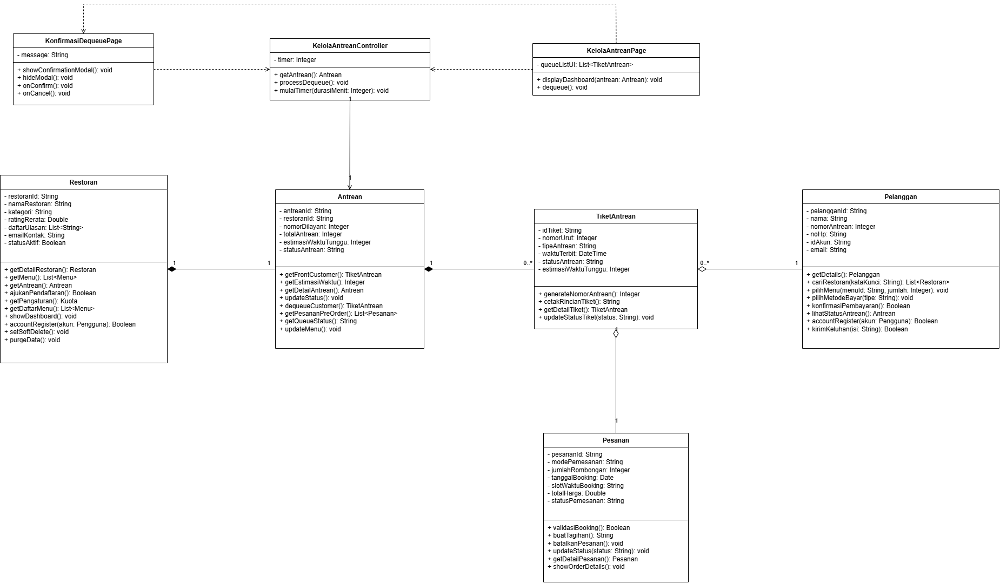
</p>
<p align="center">
<i>Gambar 25. Diagram Kelas UC06</i>
</p>

<br>

## 3.7 Use Case 7

**ID Use Case:** *UC07*  
**Nama Use Case:** *Mengatur Kuota Antrean & Meja*

### 3.7.1 Identifikasi Kelas

Identifikasi kelas yang terkait dengan use case tersebut. Kelas di tahap perancangan dapat berbeda dengan dengan kelas di tahap analisis. Dapat menggunakan tabel di bawah:

Tabel 3.7. Identifikasi Kelas Use Case [UC07]

| No | Nama Kelas Perancangan | Nama Kelas Analisis Terkait |
|:--- | :--- | :--- |
| 1 | *Kuota* | *Kuota* |
| 2 | *PengaturanKuotaController* | *PengaturanKuotaController* |
| 3 | *PengaturanKuotaPage* | *PengaturanKuotaPage* |
| 4 | *Restoran* | *Restoran* |
| ... | *...* | *...* |

### 3.7.2 Sequence Diagram

Buat *sequence diagram* untuk **setiap skenario use case**, mencakup skenario normal dan alternatif pada subbab 4.4 SKPL. Diagram melibatkan kelas-kelas yang telah diidentifikasi pada SKPL. 

- **Skenario Normal**

<p align="center">
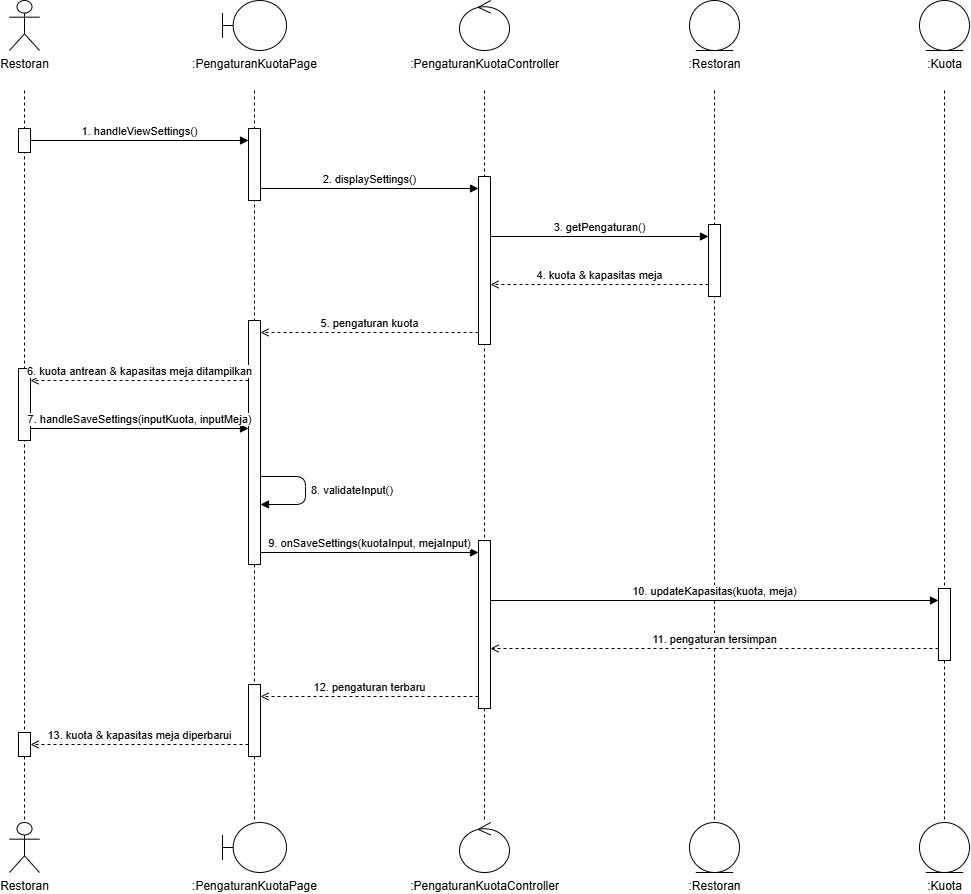
</p>
<p align="center">
<i>Gambar 26. Sequence Diagram UC07</i>
</p>

- **Skenario Alternatif 1: Input Tidak Valid**

<p align="center">

</p>
<p align="center">
<i>Gambar 27. Sequence Diagram UC07 - Input Tidak Valid</i>
</p>

- **Skenario Alternatif 2: Restoran Menutup Antrean Sementara**

<p align="center">
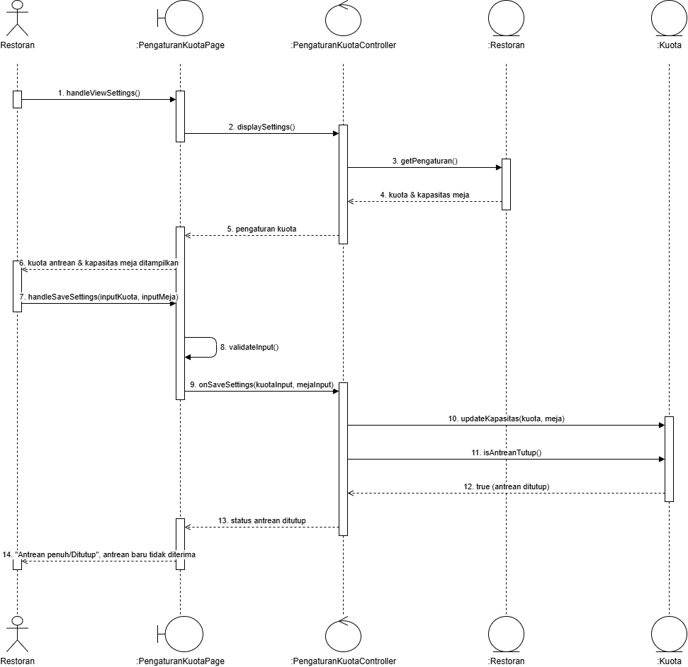
</p>
<p align="center">
<i>Gambar 28. Sequence Diagram UC07 - Restoran Menutup Antrean Sementara</i>
</p>

### 3.7.3 Diagram Kelas

Buatlah diagram kelas untuk use case ini yang terdiri atas kelas-kelas dari 3.1.1. **Setiap kelas pada diagram wajib menampilkan atribut dan metode/operasi langsung di dalam kotak kelasnya**, sehingga tidak perlu membuat tabel daftar atribut dan metode per kelas pada subbab ini. Daftar lengkap atribut dan metode seluruh kelas disajikan pada Tabel 4.1 (Bab 4).

<p align="center">
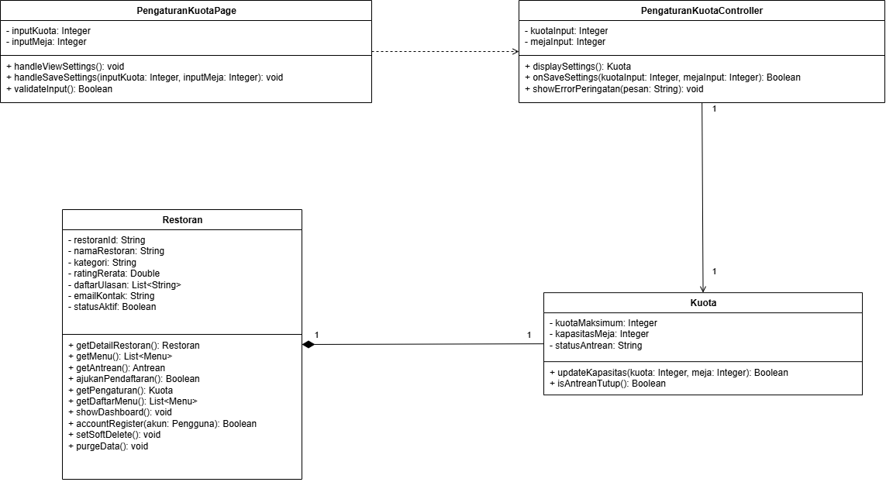
</p>
<p align="center">
<i>Gambar 29. Diagram Kelas UC07</i>
</p>

<br>

## 3.8 Use Case 8

**ID Use Case:** *UC08*  
**Nama Use Case:** *Mengelola Stok dan Menu Makanan*

### 3.8.1 Identifikasi Kelas

Identifikasi kelas yang terkait dengan use case tersebut. Kelas di tahap perancangan dapat berbeda dengan dengan kelas di tahap analisis. Dapat menggunakan tabel di bawah:

Tabel 3.8. Identifikasi Kelas Use Case [UC08]

| No | Nama Kelas Perancangan | Nama Kelas Analisis Terkait |
|:--- | :--- | :--- |
| 1 | *Menu* | *Menu* |
| 2 | *PengaturanMenuPage* | *PengaturanMenuPage* |
| 3 | *KelolaMenuController* | *KelolaMenuController* |
| 4 | *Restoran* | *Restoran* |
| ... | *...* | *...* |

### 3.8.2 Sequence Diagram

Buat *sequence diagram* untuk **setiap skenario use case**, mencakup skenario normal dan alternatif pada subbab 4.4 SKPL. Diagram melibatkan kelas-kelas yang telah diidentifikasi pada SKPL. 

- **Skenario Normal**

<p align="center">
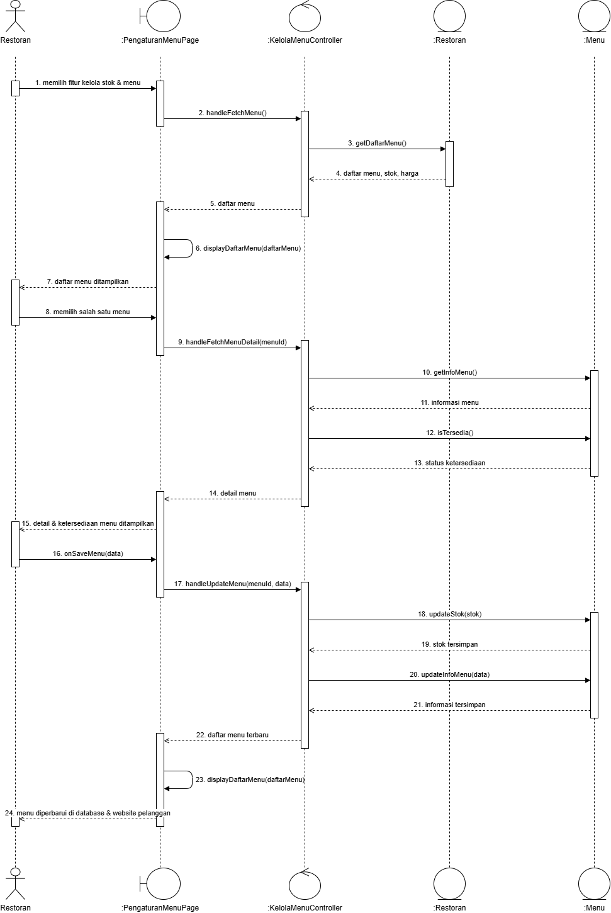
</p>
<p align="center">
<i>Gambar 30. Sequence Diagram UC08</i>
</p>

- **Skenario Alternatif 1: Restoran menambahkan menu baru**

<p align="center">
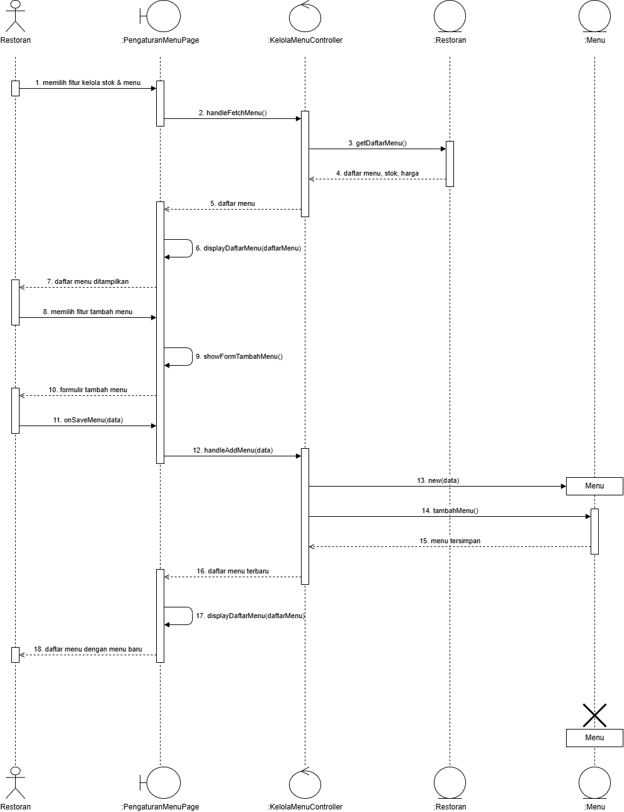
</p>
<p align="center">
<i>Gambar 31. Sequence Diagram UC08 - Restoran menambahkan menu baru</i>
</p>

- **Skenario Alternatif 2: Restoran menghapus salah satu menu**

<p align="center">
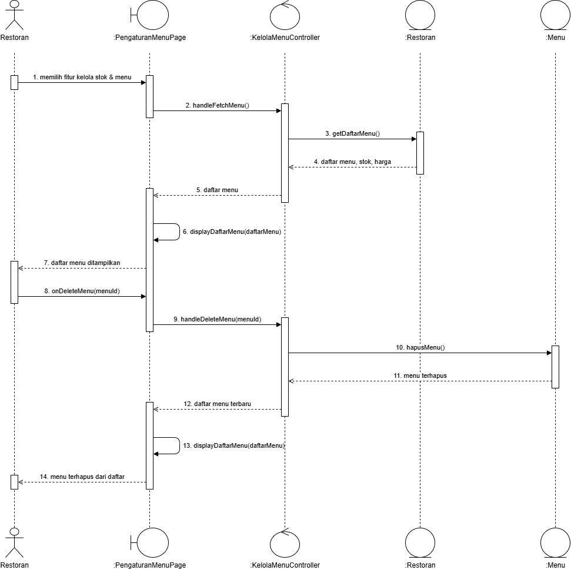
</p>
<p align="center">
<i>Gambar 32. Sequence Diagram UC08 - Restoran menghapus salah satu menu</i>
</p>

- **Skenario Alternatif 3: Stok makanan tidak cukup**

<p align="center">
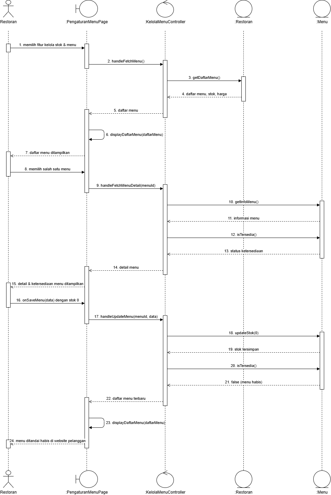
</p>
<p align="center">
<i>Gambar 33. Sequence Diagram UC08 - Stok makanan tidak cukup</i>
</p>

### 3.8.3 Diagram Kelas

Buatlah diagram kelas untuk use case ini yang terdiri atas kelas-kelas dari 3.1.1. **Setiap kelas pada diagram wajib menampilkan atribut dan metode/operasi langsung di dalam kotak kelasnya**, sehingga tidak perlu membuat tabel daftar atribut dan metode per kelas pada subbab ini. Daftar lengkap atribut dan metode seluruh kelas disajikan pada Tabel 4.1 (Bab 4).

<p align="center">
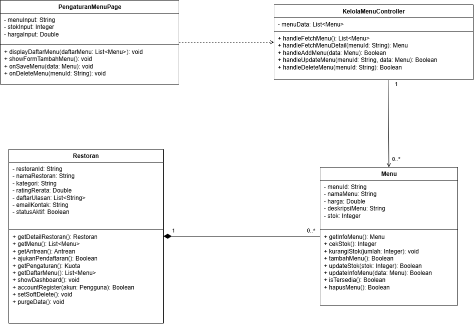
</p>
<p align="center">
<i>Gambar 34. Diagram Kelas UC08</i>
</p>

Pada diagram, pastikan:
- Atribut dituliskan beserta visibilitas dan tipe datanya, misalnya `- email: String`.
- Operasi dituliskan beserta visibilitas, parameter, dan tipe kembaliannya, misalnya `+ login(email: String, password: String): Boolean`.
- Relasi antarkelas (asosiasi, agregasi, komposisi, generalisasi, dan dependensi) digambarkan lengkap dengan multiplisitas.
- Semua operasi yang dipanggil pada sequence diagram 3.1.2 (skenario normal dan alternatif) ada pada kelas yang bersangkutan.
- Kelas yang sama dengan kelas di use case lain memakai nama, atribut, dan metode yang konsisten.

Silahkan lanjutkan untuk  *use case* berikutnya dengan content yang sama dengan 3.1

<br>

## 3.09 Use Case 09

**ID Use Case:** *UC09*  
**Nama Use Case:** *Menampilkan Dashboard Antrean Restoran*

### 3.09.1 Identifikasi Kelas

Identifikasi kelas yang terkait dengan use case tersebut. Kelas di tahap perancangan dapat berbeda dengan dengan kelas di tahap analisis. Dapat menggunakan tabel di bawah:

Tabel 3.09. Identifikasi Kelas Use Case [UC09]

| No | Nama Kelas Perancangan | Nama Kelas Analisis Terkait |
| :--- | :--- | :--- |
| 1 | *DashboardAntreanPage* | *DashboardAntreanPage* |
| 2 | *KelolaAntreanController* | *KelolaAntreanController* |
| 3 | *Antrean* | *Antrean* |
| 4 | *TiketAntrean* | *TiketAntrean* |
| 5 | *Restoran* | *Restoran* |
| 6 | *Pesanan* | *Pesanan* |
| ... | *...* | *...* |

### 3.09.2 Sequence Diagram

Buat *sequence diagram* untuk **setiap skenario use case**, mencakup skenario normal dan alternatif pada subbab 4.4 SKPL. Diagram melibatkan kelas-kelas yang telah diidentifikasi pada SKPL. 

- **Skenario Normal**

<p align="center">
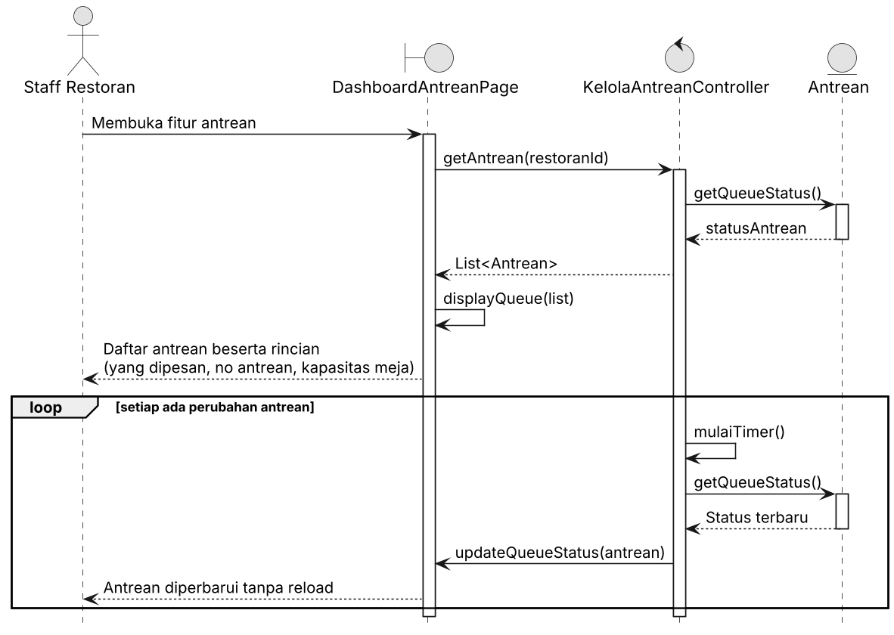
</p>
<p align="center">
<i>Gambar 35. Sequence Diagram UC09</i>
</p>

- **Skenario Alternatif 1: Antrean Kosong saat Resto Baru Didaftarkan maupun Baru Buka**

<p align="center">
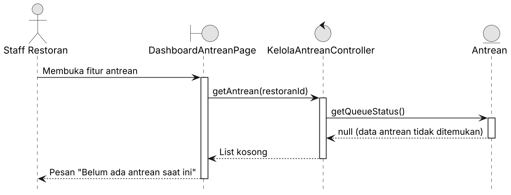
</p>
<p align="center">
<i>Gambar 36. Sequence Diagram UC09 - Antrean Kosong saat Resto Baru Didaftarkan maupun Baru Buka</i>
</p>


### 3.09.3 Diagram Kelas

Buatlah diagram kelas untuk use case ini yang terdiri atas kelas-kelas dari 3.1.1. **Setiap kelas pada diagram wajib menampilkan atribut dan metode/operasi langsung di dalam kotak kelasnya**, sehingga tidak perlu membuat tabel daftar atribut dan metode per kelas pada subbab ini. Daftar lengkap atribut dan metode seluruh kelas disajikan pada Tabel 4.1 (Bab 4).

<p align="center">
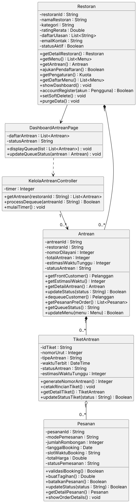
</p>
<p align="center">
<i>Gambar 37. Diagram Kelas UC09</i>
</p>

<br>

## 3.10 Use Case 10

**ID Use Case:** *UC10*  
**Nama Use Case:** *Registrasi Akun*

### 3.10.1 Identifikasi Kelas

Identifikasi kelas yang terkait dengan use case tersebut. Kelas di tahap perancangan dapat berbeda dengan dengan kelas di tahap analisis. Dapat menggunakan tabel di bawah:

Tabel 3.10. Identifikasi Kelas Use Case [UC10]

| No | Nama Kelas Perancangan | Nama Kelas Analisis Terkait |
|:--- | :--- | :--- |
| 1 | *RegistrasiPage* | *RegistrasiPage* |
| 2 | *AutentikasiController* | *AutentikasiController* |
| 3 | *Pengguna* | *Pengguna* |
| 4 | *SesiPengguna* | *SesiPengguna* |
| 5 | *Pelanggan* | *Pelanggan* |
| 6 | *Admin* | *Admin* |
| 7 | *Restoran* | *Restoran* |
| ... | *...* | *...* |

### 3.10.2 Sequence Diagram

Buat *sequence diagram* untuk **setiap skenario use case**, mencakup skenario normal dan alternatif pada subbab 4.4 SKPL. Diagram melibatkan kelas-kelas yang telah diidentifikasi pada SKPL. 

- **Skenario Normal**

<p align="center">
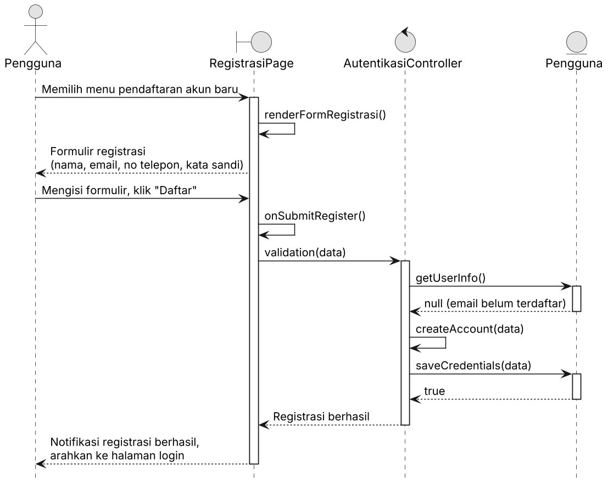
</p>
<p align="center">
<i>Gambar 38. Sequence Diagram UC10</i>
</p>

- **Skenario Alternatif 1: Email atau Nomor Telepon Sudah Terdaftar**

<p align="center">
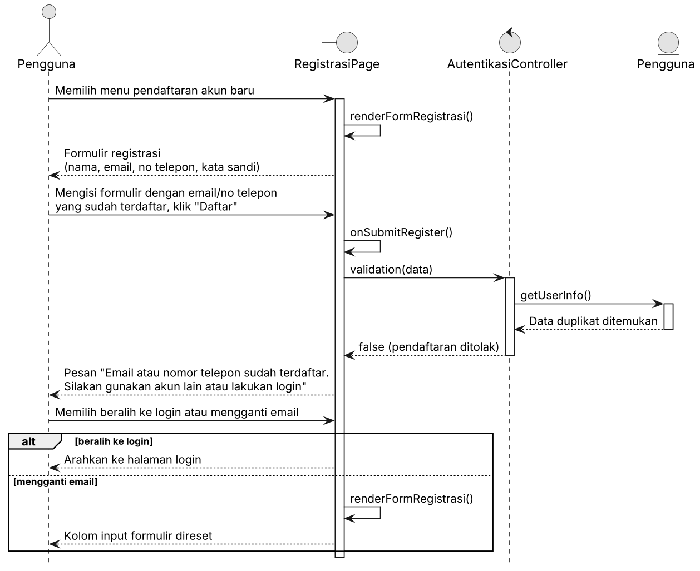
</p>
<p align="center">
<i>Gambar 39. Sequence Diagram UC10 - Email atau Nomor Telepon Sudah Terdaftar</i>
</p>

- **Skenario Alternatif 2: ata Sandi Tidak Sesuai Kriteria Keamanan atau Konfirmasi Salah**

<p align="center">
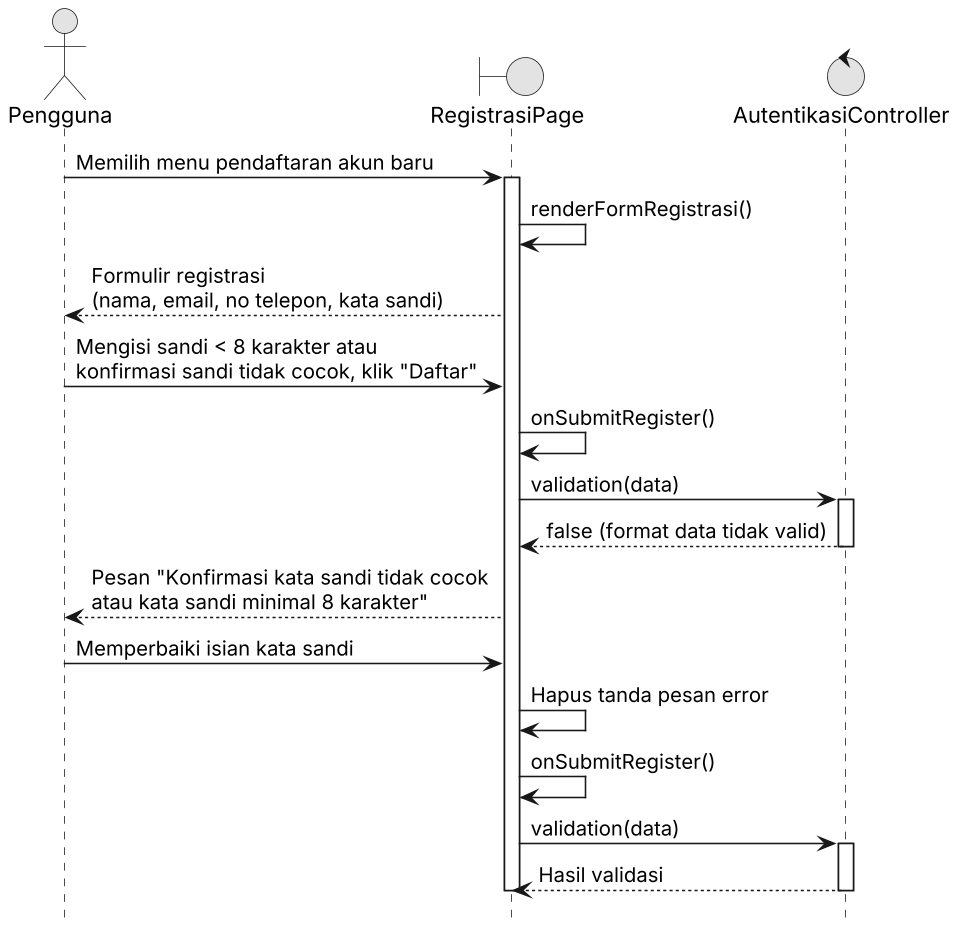
</p>
<p align="center">
<i>Gambar 40. Sequence Diagram UC10 - ata Sandi Tidak Sesuai Kriteria Keamanan atau Konfirmasi Salah</i>
</p>

### 3.10.3 Diagram Kelas

Buatlah diagram kelas untuk use case ini yang terdiri atas kelas-kelas dari 3.1.1. **Setiap kelas pada diagram wajib menampilkan atribut dan metode/operasi langsung di dalam kotak kelasnya**, sehingga tidak perlu membuat tabel daftar atribut dan metode per kelas pada subbab ini. Daftar lengkap atribut dan metode seluruh kelas disajikan pada Tabel 4.1 (Bab 4).

<p align="center">
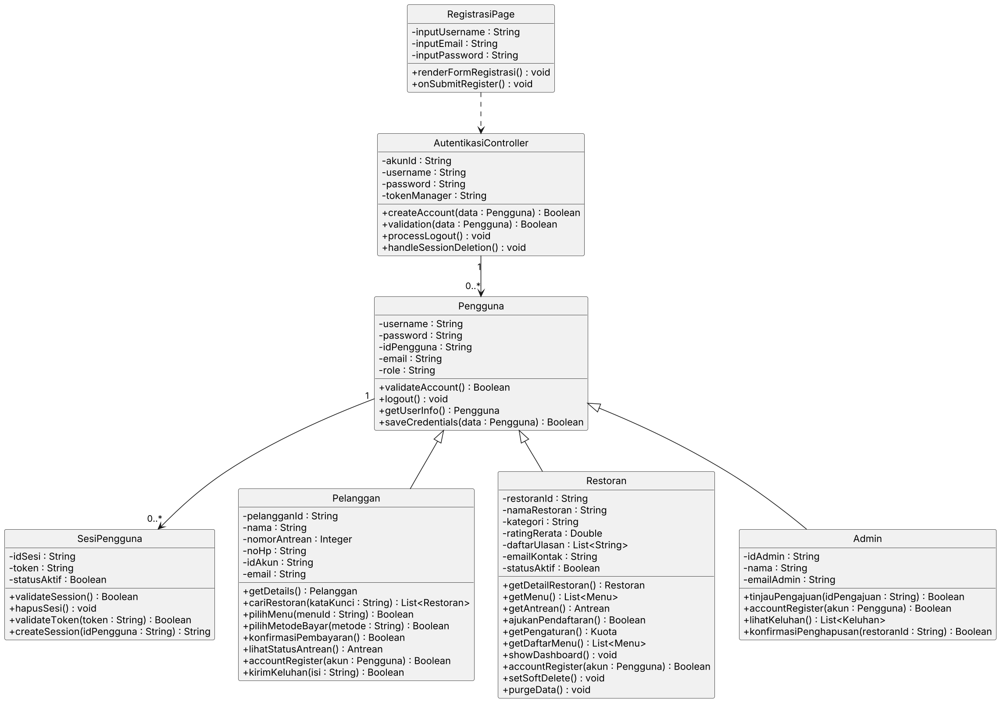
</p>
<p align="center">
<i>Gambar 41. Diagram Kelas UC10</i>
</p>

<br>

## 3.11 Use Case 11

**ID Use Case:** *UC11*  
**Nama Use Case:** *Registrasi Akun*

### 3.11.1 Identifikasi Kelas

Identifikasi kelas yang terkait dengan use case tersebut. Kelas di tahap perancangan dapat berbeda dengan dengan kelas di tahap analisis. Dapat menggunakan tabel di bawah:

Tabel 3.11. Identifikasi Kelas Use Case [UC11]

| No | Nama Kelas Perancangan | Nama Kelas Analisis Terkait |
|:--- | :--- | :--- |
| 1 | *LoginPage* | *LoginPage* |
| 2 | *AutentikasiController* | *AutentikasiController* |
| 3 | *Pengguna* | *Pengguna* |
| 4 | *SesiPengguna* | *SesiPengguna* |
| ... | *...* | *...* |

### 3.11.2 Sequence Diagram

Buat *sequence diagram* untuk **setiap skenario use case**, mencakup skenario normal dan alternatif pada subbab 4.4 SKPL. Diagram melibatkan kelas-kelas yang telah diidentifikasi pada SKPL. 

- **Skenario Normal**

<p align="center">
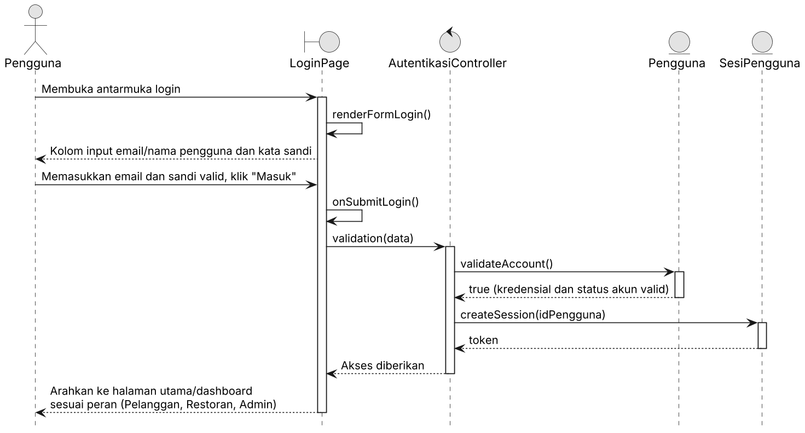
</p>
<p align="center">
<i>Gambar 42. Sequence Diagram UC11</i>
</p>

- **Skenario Alternatif 1: Kredensial Salah (Email atau Kata Sandi Tidak Cocok)**

<p align="center">
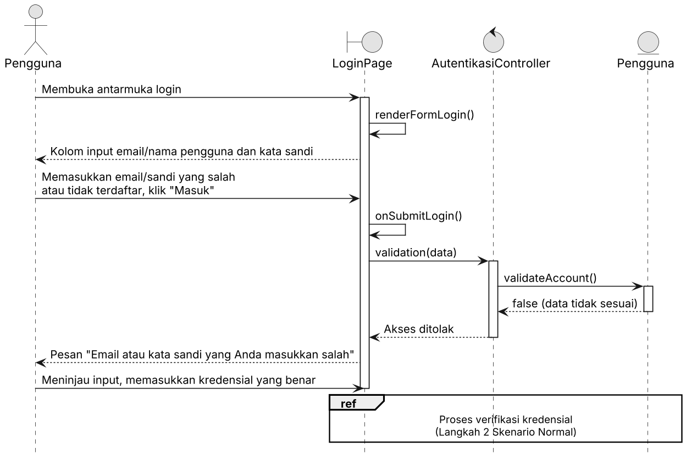
</p>
<p align="center">
<i>Gambar 43. Sequence Diagram UC11 - Kredensial Salah (Email atau Kata Sandi Tidak Cocok)</i>
</p>


### 3.11.3 Diagram Kelas

Buatlah diagram kelas untuk use case ini yang terdiri atas kelas-kelas dari 3.1.1. **Setiap kelas pada diagram wajib menampilkan atribut dan metode/operasi langsung di dalam kotak kelasnya**, sehingga tidak perlu membuat tabel daftar atribut dan metode per kelas pada subbab ini. Daftar lengkap atribut dan metode seluruh kelas disajikan pada Tabel 4.1 (Bab 4).

<p align="center">

</p>
<p align="center">
<i>Gambar 44. Diagram Kelas UC11</i>
</p>

<br>

## 3.12 Use Case 12

**ID Use Case:** *UC12*  
**Nama Use Case:** *Keluar Akun*

### 3.12.1 Identifikasi Kelas

Identifikasi kelas yang terkait dengan use case tersebut. Kelas di tahap perancangan dapat berbeda dengan dengan kelas di tahap analisis. Dapat menggunakan tabel di bawah:

Tabel 3.12. Identifikasi Kelas Use Case [UC12]

| No | Nama Kelas Perancangan | Nama Kelas Analisis Terkait |
|:--- | :--- | :--- |
| 1 | *HalamanProfilePage* | *HalamanProfilePage* |
| 2 | *KonfirmasiLogoutPage* | *KonfirmasiLogoutPage* |
| 3 | *LoginPage* | *LoginPage* |
| 4 | *AutentikasiController* | *AutentikasiController* |
| 5 | *Pengguna* | *Pengguna* |
| 6 | *SesiPengguna* | *SesiPengguna* |
| ... | *...* | *...* |

### 3.12.2 Sequence Diagram

Buat *sequence diagram* untuk **setiap skenario use case**, mencakup skenario normal dan alternatif pada subbab 4.4 SKPL. Diagram melibatkan kelas-kelas yang telah diidentifikasi pada SKPL. 

- **Skenario Normal**

<p align="center">

</p>
<p align="center">
<i>Gambar 45. Sequence Diagram UC12</i>
</p>

- **Skenario Alternatif 1: Aktor Membatalkan Keluar Akun**

<p align="center">

</p>
<p align="center">
<i>Gambar 46. Sequence Diagram UC12 - Aktor Membatalkan Keluar Akun</i>
</p>

### 3.12.3 Diagram Kelas

Buatlah diagram kelas untuk use case ini yang terdiri atas kelas-kelas dari 3.1.1. **Setiap kelas pada diagram wajib menampilkan atribut dan metode/operasi langsung di dalam kotak kelasnya**, sehingga tidak perlu membuat tabel daftar atribut dan metode per kelas pada subbab ini. Daftar lengkap atribut dan metode seluruh kelas disajikan pada Tabel 4.1 (Bab 4).

<p align="center">

</p>
<p align="center">
<i>Gambar 47. Diagram Kelas UC12</i>
</p>

<br>

## 3.13 Use Case 13

**ID Use Case:** *UC13*  
**Nama Use Case:** *Penyampaian Keluhan Pelanggan*

### 3.13.1 Identifikasi Kelas

Identifikasi kelas yang terkait dengan use case tersebut. Kelas di tahap perancangan dapat berbeda dengan dengan kelas di tahap analisis. Dapat menggunakan tabel di bawah:

Tabel 3.13. Identifikasi Kelas Use Case [UC13]

| No | Nama Kelas Perancangan | Nama Kelas Analisis Terkait |
|:--- | :--- | :--- |
| 1 | *KeluhanFormPage* | *KeluhanFormPage* |
| 2 | *KeluhanController* | *KeluhanController* |
| 3 | *Keluhan* | *Keluhan* |
| 4 | *Pelanggan* | *Pelanggan* |

### 3.13.2 Sequence Diagram

Buat *sequence diagram* untuk **setiap skenario use case**, mencakup skenario normal dan alternatif pada subbab 4.4 SKPL. Diagram melibatkan kelas-kelas yang telah diidentifikasi pada SKPL. 

- **Skenario Normal**

<p align="center">

</p>
<p align="center">
<i>Gambar 48. Sequence Diagram UC13</i>
</p>

### 3.13.3 Diagram Kelas

Buatlah diagram kelas untuk use case ini yang terdiri atas kelas-kelas dari 3.1.1. **Setiap kelas pada diagram wajib menampilkan atribut dan metode/operasi langsung di dalam kotak kelasnya**, sehingga tidak perlu membuat tabel daftar atribut dan metode per kelas pada subbab ini. Daftar lengkap atribut dan metode seluruh kelas disajikan pada Tabel 4.1 (Bab 4).

<p align="center">

</p>
<p align="center">
<i>Gambar 49. Diagram Kelas UC13</i>
</p>

<br>

## 3.14 Use Case 14

**ID Use Case:** *UC14*  
**Nama Use Case:** *Penanggapan Keluhan Pelanggan*

### 3.14.1 Identifikasi Kelas

Identifikasi kelas yang terkait dengan use case tersebut. Kelas di tahap perancangan dapat berbeda dengan dengan kelas di tahap analisis. Dapat menggunakan tabel di bawah:

Tabel 3.14. Identifikasi Kelas Use Case [UC14]

| No | Nama Kelas Perancangan | Nama Kelas Analisis Terkait |
|:--- | :--- | :--- |
| 1 | *KeluhanDashboardPage* | *KeluhanDashboardPage* |
| 2 | *KeluhanController* | *KeluhanController* |
| 3 | *Keluhan* | *Keluhan* |
| 4 | *Admin* | *Admin* |

### 3.14.2 Sequence Diagram

Buat *sequence diagram* untuk **setiap skenario use case**, mencakup skenario normal dan alternatif pada subbab 4.4 SKPL. Diagram melibatkan kelas-kelas yang telah diidentifikasi pada SKPL. 

- **Skenario Normal**

<p align="center">

</p>
<p align="center">
<i>Gambar 50. Sequence Diagram UC14</i>
</p>

### 3.14.3 Diagram Kelas

Buatlah diagram kelas untuk use case ini yang terdiri atas kelas-kelas dari 3.1.1. **Setiap kelas pada diagram wajib menampilkan atribut dan metode/operasi langsung di dalam kotak kelasnya**, sehingga tidak perlu membuat tabel daftar atribut dan metode per kelas pada subbab ini. Daftar lengkap atribut dan metode seluruh kelas disajikan pada Tabel 4.1 (Bab 4).

<p align="center">

</p>
<p align="center">
<i>Gambar 51. Diagram Kelas UC14</i>
</p>

<br>


## 3.15 Use Case 15

**ID Use Case:** *UC15*  
**Nama Use Case:** *Penghapusan Restoran*

### 3.15.1 Identifikasi Kelas

Identifikasi kelas yang terkait dengan use case tersebut. Kelas di tahap perancangan dapat berbeda dengan dengan kelas di tahap analisis. Dapat menggunakan tabel di bawah:

Tabel 3.15. Identifikasi Kelas Use Case [UC15]

| No | Nama Kelas Perancangan | Nama Kelas Analisis Terkait |
|:--- | :--- | :--- |
| 1 | *DashboardKelolaRestoranPage* | *DashboardKelolaRestoranPage* |
| 2 | *KonfirmasiHapusRestoranPage* | *KonfirmasiHapusRestoranPage* |
| 3 | *KelolaDataRestoranController* | *KelolaDataRestoranController* |
| 4 | *Restoran* | *Restoran* |
| 5 | *Menu* | *Menu* |
| 6 | *Admin* | *Admin* |
| ... | *...* | *...* |

### 3.15.2 Sequence Diagram

Buat *sequence diagram* untuk **setiap skenario use case**, mencakup skenario normal dan alternatif pada subbab 4.4 SKPL. Diagram melibatkan kelas-kelas yang telah diidentifikasi pada SKPL. 

- **Skenario Normal**

<p align="center">

</p>
<p align="center">
<i>Gambar 52. Sequence Diagram UC15</i>
</p>

- **Skenario Alternatif 1: Admin Membatalkan Proses Penghapusan Restoran**

<p align="center">

</p>
<p align="center">
<i>Gambar 53. Sequence Diagram UC15 - Admin Membatalkan Proses Penghapusan Restoran</i>
</p>

### 3.15.3 Diagram Kelas

Buatlah diagram kelas untuk use case ini yang terdiri atas kelas-kelas dari 3.1.1. **Setiap kelas pada diagram wajib menampilkan atribut dan metode/operasi langsung di dalam kotak kelasnya**, sehingga tidak perlu membuat tabel daftar atribut dan metode per kelas pada subbab ini. Daftar lengkap atribut dan metode seluruh kelas disajikan pada Tabel 4.1 (Bab 4).

<p align="center">

</p>
<p align="center">
<i>Gambar 54. Diagram Kelas UC15</i>
</p>

<br>


---

# BAB 4: Diagram Kelas Keseluruhan

## 4.1 Diagram Kelas

**Bagian ini diisi dengan diagram kelas keseluruhan.**

<p align="center">

</p>
<p align="center">
<i>Gambar 4.1. Diagram Kelas Perancangan Keseluruhan antri.in</i>
</p>

Tabel 4.1. Daftar Kelas Perancangan Keseluruhan

| ID Kelas | Nama Kelas | Atribut | Metode/Operasi |
| :--- | :--- | :--- | :--- |
| *C01* | *Pelanggan* | *pelangganId, nama, nomorAntrean, noHp, idAkun, email* | *getDetails(), cariRestoran(), pilihMenu(), pilihMetodeBayar(), konfirmasiPembayaran(), lihatStatusAntrean(), accountRegister(), kirimKeluhan()* |
| *C02* | *Restoran* | *restoranId, namaRestoran, kategori, ratingRerata, daftarUlasan, emailKontak, statusAktif* | *getDetailRestoran(), getMenu(), getAntrean(), ajukanPendaftaran(), getPengaturan(), getDaftarMenu(), showDashboard(), accountRegister(), setSoftDelete(), purgeData()* |
| *C03* | *Menu* | *menuId, namaMenu, harga, deskripsiMenu, stok* | *getInfoMenu(), cekStok(), kurangiStok(), tambahMenu(), updateStok(), updateInfoMenu(), isTersedia(), hapusMenu()* |
| *C04* | *Antrean* | *antreanId, restoranId, nomorDilayani, totalAntrean, estimasiWaktuTunggu, statusAntrean* | *getFrontCustomer(), getEstimasiWaktu(), getDetailAntrean(), updateStatus(), dequeueCustomer(), getPesananPreOrder(), getQueueStatus(), updateMenu()* |
| *C05* | *Keranjang* | *idKeranjang, daftarMenu, totalEstimasiHarga* | *tambahItem(), hapusItem(), hitungTotal(), kosongkanKeranjang()* |
| *C06* | *Pesanan* | *pesananId, modePemesanan, jumlahRombongan, tanggalBooking, slotWaktuBooking, totalHarga, statusPemesanan* | *validasiBooking(), buatTagihan(), batalkanPesanan(), updateStatus(), getDetailPesanan(), showOrderDetails()* |
| *C07* | *MetodePembayaranController* | *idPembayaran, tipePembayaran, batasWaktuBayar, statusPembayaran* | *buatTagihan(), verifikasiPembayaran(), cekTimeout()* |
| *C08* | *RiwayatTransaksi* | *idTransaksi, tanggalTransaksi, jumlahDibayar, statusPelunasan* | *catatLogTransaksi(), getBuktiPembayaran()* |
| *C09* | *TiketAntrean* | *idTiket, nomorUrut, tipeAntrean, waktuTerbit, statusAntrean, estimasiWaktuTunggu* | *generateNomorAntrean(), cetakRincianTiket(), getDetailTiket(), updateStatusTiket()* |
| *C10* | *PemantauAntreanController* | *antreanId* | *getStatusAntrean(), updateTampilanAntrean()* |
| *C11* | *HalamanStatusAntrean* | *antreanId, statusAntrean, sisaAntrean* | *tampilkanStatusAntrean(), renderData()* |
| *C12* | *PengajuanMitraController* | *idPengajuan, status, tglPengajuan, alasanPenolakan* | *validasiKelengkapan(), simpanPengajuan(), setujui(), tolak(alasan)* |
| *C13* | *DokumenVerifikasi* | *idDokumen, jenisDokumen* | *unggahDokumen(), validasiFormat()* |
| *C14* | *Admin* | *idAdmin, nama, emailAdmin* | *tinjauPengajuan(), accountRegister(), lihatKeluhan(), konfirmasiPenghapusan()* |
| *C15* | *NotifikasiEmail* | *penerima, isiPesan, jenis* | *kirimEmail()* |
| *C16* | *KelolaAntreanController* | *timer* | *getAntrean(), processDequeue(), mulaiTimer()* |
| *C17* | *KonfirmasiDequeuePage* | *message* | *showConfirmationModal(), hideModal(), onConfirm(), onCancel()* |
| *C18* | *KelolaAntreanPage* | *queueListUI* | *displayDashboard(antrean: Antrean), dequeue()* |
| *C19* | *DashboardAntreanPage* | *daftarAntrean, statusAntrean* | *displayQueue(), updateQueueStatus()* |
| *C20* | *Kuota* | *kuotaMaksimum, kapasitasMeja, statusAntrean* | *updateKapasitas(), isAntreanTutup()* |
| *C21* | *PengaturanKuotaController* | *kuotaInput, mejaInput* | *displaySettings(), onSaveSettings(), showErrorPeringatan()* |
| *C22* | *PengaturanKuotaPage* | *inputKuota, inputMeja* | *handleViewSettings(), handleSaveSettings(), validateInput()* |
| *C23* | *PengaturanMenuPage* | *menuInput, stokInput, hargaInput* | *displayDaftarMenu(), showFormTambahMenu(), onSaveMenu(), onDeleteMenu()* |
| *C24* | *KelolaMenuController* | *menuData* | *handleFetchMenu(),  handleFetchMenuDetail(), handleAddMenu(), handleUpdateMenu(), handleDeleteMenu()* |
| *C25* | *Pengguna* | *username, password, idPengguna, email, role* | *validateAccount(), logout(), getUserInfo(), saveCredentials()* |
| *C26* | *HalamanProfilPage* | *idPengguna, namaUser* | *tekanTombolLogout()* |
| *C27* | *KonfirmasiLogoutPage* | *pesanKonfirmasi* | *konfirmasiYa(), konfirmasiBatal()* |
| *C28* | *AutentikasiController* | *akunId, username, password, tokenManager* | *createAccount(), validation(), processLogout(), handleSessionDeletion()* |
| *C29* | *SesiPengguna* | *idSesi, token, statusAktif* | *validateSession(), hapusSesi(), validateToken()* |
| *C30* | *Keluhan* | *idKeluhan, isiKeluhan, waktuKirim, status* | *simpanKeluhan(), updateStatusKeluhan()* |
| *C31* | *DashboardKelolaRestoranPage* | *daftarRestoran, kataKunci* | *pilihRestoran(), klikHapusRestoran()* |
| *C32* | *KonfirmasiHapusRestoranPage* | *restoranId, pesanPeringatan* | *setujuiPenghapusan(), batalHapus()* |
| *C33* | *KelolaDataRestoranController* | *restoranId* | *hapusDataRestoran(), nonaktifkanRelasiMenu()* |
| *C34* | *PencarianRestoPage* | *inputKataKunci, filterKategori, filterLokasi, daftarResto* | *renderHalamanPencarian(), onKetikInput(), onPilihFilter(), onClickTombolCari(), tampilkanDaftarRestoran(), tampilkanPesanKosong()* |
| *C35* | *PencarianController* | *kataKunci, filterSelected* | *cariRestoran(), terapkanFilter(), ambilStatusAntrean(), ambilPreviewMenu()* |
| *C36* | *VerifikasiRestoranPage* | *idPengajuan, berkasMitra* | *tampilkanDetailBerkas(), renderStatusVerifikasi()* |
| *C37* | *RegistrasiRestoPage* | *formResto, dokumenUpload* | 8renderFormRegistrasi(), onSubmitRegistrasi()* |
| *C38* | *RegistrasiPage* | *inputUsername, inputEmail, inputPassword* | *renderFormRegistrasi(), onSubmitRegister()* |
| *C39* | *LoginPage* | *inputUsername, inputPassword* | *renderFormLogin(), onSubmitLogin()* |
| *C40* | *KeluhanFormPage* | *inputKeluhan, waktuKirim* | *renderFormKeluhan(), onSubmitKeluhan()* |
| *C41* | *KeluhanController* | *daftarKeluhan* | *kirimKeluhan(), tampilkanKeluhan(), tanggapiKeluhan()* |
| *C42* | *KeluhanDashboardPage* | *listKeluhanUI* | *displayKeluhanList(), showDetailKeluhan()* |
| *...* | *...* | *...* | *...* |

---

# BAB 5: Perancangan Rinci Kelas

Bagian ini diisi dengan daftar seluruh kelas dalam tabel berikut:

Tabel 5.1. Daftar Kelas Perancangan dan Kelas Analisis Terkait

| No | Nama Kelas Perancangan | Nama Kelas Analisis Terkait |
| :--- | :--- | :--- |
| 1 | *Pelanggan* | *Pelanggan* |
| 2 | *Restoran* | *Restoran* |
| 3 | *Menu* | *Menu* |
| 4 | *Antrean* | *Antrean* |
| 5 | *Keranjang* | *Keranjang* |
| 6 | *Pesanan* | *Pesanan* |
| 7 | *MetodePembayaranController* | *MetodePembayaranController* |
| 8 | *RiwayatTransaksi* | *RiwayatTransaksi* |
| 9 | *TiketAntrean* | *TiketAntrean* |
| 10 | *PemantauAntreanController* | *PemantauAntreanController* |
| 11 | *HalamanStatusAntrean* | *HalamanStatusAntrean* |
| 12 | *PengajuanMitraController* | *PengajuanMitraController* |
| 13 | *DokumenVerifikasi* | *DokumenVerifikasi* |
| 14 | *Admin* | *Admin* |
| 15 | *NotifikasiEmail* | *NotifikasiEmail* |
| 16 | *KelolaAntreanController* | *KelolaAntreanController* |
| 17 | *KonfirmasiDequeuePage* | *KonfirmasiDequeuePage* |
| 18 | *KelolaAntreanPage* | *KelolaAntreanPage* |
| 19 | *DashboardAntreanPage* | *DashboardAntreanPage* |
| 20 | *Kuota* | *Kuota* |
| 21 | *PengaturanKuotaController* | *PengaturanKuotaController* |
| 22 | *PengaturanKuotaPage* | *PengaturanKuotaPage* |
| 23 | *PengaturanMenuPage* | *PengaturanMenuPage* |
| 24 | *KelolaMenuController* | *KelolaMenuController* |
| 25 | *Pengguna* | *Pengguna* |
| 26 | *HalamanProfilPage* | *HalamanProfilePage* |
| 27 | *KonfirmasiLogoutPage* | *KonfirmasiLogoutPage* |
| 28 | *AutentikasiController* | *AutentikasiController* |
| 29 | *SesiPengguna* | *SesiPengguna* |
| 30 | *Keluhan* | *Keluhan* |
| 31 | *DashboardKelolaRestoranPage* | *DashboardKelolaRestoranPage* |
| 32 | *KonfirmasiHapusRestoranPage* | *KonfirmasiHapusRestoranPage* |
| 33 | *KelolaDataRestoranController* | *KelolaDataRestoranController* |
| 34 | *PencarianRestoPage* | *PencarianRestoPage* |
| 35 | *PencarianController* | *PencarianController* |
| 36 | *VerifikasiRestoranPage* | *VerifikasiRestoranPage* |
| 37 | *RegistrasiRestoPage* | *RegistrasiRestoPage* |
| 38 | *RegistrasiPage* | *RegistrasiPage* |
| 39 | *LoginPage* | *LoginPage* |
| 40 | *KeluhanFormPage* | *KeluhanFormPage* |
| 41 | *KeluhanController* | *KeluhanController* |
| 42 | *KeluhanDashboardPage* | *KeluhanDashboardPage* |
| ... | *...* | *...* |

Untuk **setiap kelas**, identifikasi operasi berdasarkan tanggung jawab kelas beserta *visibility*-nya, serta atribut beserta *visibility* dan tipenya. Buat subbab tersendiri untuk setiap kelas.

## 5.1 Kelas Pelanggan

**Nama Kelas:** *Pelanggan*  
**ID Kelas:** *C01*

Tabel 5.1.1. Operasi Kelas Pelanggan

| Nama Operasi | Visibility (private, public) | Keterangan |
| :--- | :--- | :--- |
| *getDetails(pelangganId: string): Pelanggan* | *public* | Mengambil data profil pelanggan. |
| *cariRestoran(kataKunci: string): Restoran[]* | *public* | Mencari restoran mitra berdasarkan kata kunci. |
| *pilihMenu(menuId: string, jumlah: integer): void* | *public* | Memilih menu dan memasukkannya ke keranjang. |
| *pilihMetodeBayar(tipePembayaran: string): void* | *public* | Memilih metode pembayaran dan membuat tagihan pesanan. |
| *konfirmasiPembayaran(idPembayaran: string): void* | *public* | Mengonfirmasi pembayaran dan menerima tiket antrean. |
| *lihatStatusAntrean(antreanId: string): void* | *public* | Membuka halaman status antrean. |
| *accountRegister(data: object): boolean* | *public* | Mendaftarkan akun pelanggan baru. |
| *kirimKeluhan(isi: string): boolean* | *public* | Mengirim keluhan ke admin. |

Tabel 5.1.2. Atribut Kelas Pelanggan

| Nama Atribut | Visibility (private, public) | Tipe |
| :--- | :--- | :--- |
| *pelangganId* | *private* | *string* |
| *nama* | *private* | *string* |
| *nomorAntrean* | *private* | *integer* |
| *noHp* | *private* | *string* |
| *idAkun* | *private* | *string* |
| *email* | *private* | *string* |

### 5.1.1 Algoritma/Query

**Nama Kelas:** *Pelanggan*  
**Nama Operasi:** *getDetails(pelangganId: string): Pelanggan*  
**ID Algoritma:** *Algo-001*

```text
FUNCTION getDetails(pelangganId) RETURNS Pelanggan
    data <- SELECT * FROM pelanggan WHERE pelanggan_id = pelangganId
    IF data IS NULL THEN
        RETURN NULL
    END IF
    RETURN data
END FUNCTION
```

Tabel 5.1.1.1. Query Operasi getDetails

| No Query | Query | Keterangan |
| :--- | :--- | :--- |
| *Q-001* | `SELECT pelanggan_id, nama, no_hp, id_akun, email FROM pelanggan WHERE pelanggan_id = $1;` | Mengambil data profil pelanggan. |

### 5.1.2 Algoritma/Query

**Nama Kelas:** *Pelanggan*  
**Nama Operasi:** *cariRestoran(kataKunci: string): Restoran[]*  
**ID Algoritma:** *Algo-002*

```text
FUNCTION cariRestoran(kataKunci) RETURNS Restoran[]
    IF kataKunci IS EMPTY THEN
        kataKunci <- ""
    END IF
    RETURN PencarianController.cariRestoran(kataKunci)
END FUNCTION
```

### 5.1.3 Algoritma/Query

**Nama Kelas:** *Pelanggan*  
**Nama Operasi:** *pilihMenu(menuId: string, jumlah: integer): void*  
**ID Algoritma:** *Algo-003*

```text
PROCEDURE pilihMenu(menuId, jumlah)
    IF jumlah <= 0 THEN
        tampilkanError("Jumlah menu tidak valid")
        RETURN
    END IF
    menu <- Menu(menuId).getInfoMenu()
    IF NOT menu.isTersedia(jumlah) THEN
        tampilkanError("Stok menu tidak mencukupi")
        RETURN
    END IF
    keranjang.tambahItem(menu, jumlah)
END PROCEDURE
```

### 5.1.4 Algoritma/Query

**Nama Kelas:** *Pelanggan*  
**Nama Operasi:** *pilihMetodeBayar(tipePembayaran: string): void*  
**ID Algoritma:** *Algo-004*

```text
PROCEDURE pilihMetodeBayar(tipePembayaran)
    IF keranjang.daftarMenu IS EMPTY THEN
        tampilkanError("Keranjang masih kosong")
        RETURN
    END IF
    IF pesanan.modePemesanan = BOOKING THEN
        IF NOT pesanan.validasiBooking(restoranId) THEN
            tampilkanError("Slot booking sudah penuh")
            RETURN
        END IF
    END IF
    tagihan <- pesanan.buatTagihan(pelangganId, restoranId, keranjang, tipePembayaran)
    tampilkanTagihan(tagihan.kodeBayar, tagihan.totalHarga, tagihan.batasWaktuBayar)
END PROCEDURE
```

### 5.1.5 Algoritma/Query

**Nama Kelas:** *Pelanggan*  
**Nama Operasi:** *konfirmasiPembayaran(idPembayaran: string): void*  
**ID Algoritma:** *Algo-005*

```text
PROCEDURE konfirmasiPembayaran(idPembayaran)
    hasil <- MetodePembayaranController.verifikasiPembayaran(idPembayaran)
    IF hasil.sukses = false THEN
        tampilkanError("Pembayaran belum diterima")
        RETURN
    END IF
    keranjang.kosongkanKeranjang()
    IF hasil.tiket IS NOT NULL THEN
        nomorAntrean <- hasil.tiket.nomorUrut
        hasil.tiket.cetakRincianTiket()
    ELSE
        tampilkanPesan("Pembayaran berhasil, booking Anda telah dikonfirmasi")
    END IF
END PROCEDURE
```

### 5.1.6 Algoritma/Query

**Nama Kelas:** *Pelanggan*  
**Nama Operasi:** *lihatStatusAntrean(antreanId: string): void*  
**ID Algoritma:** *Algo-006*

```text
PROCEDURE lihatStatusAntrean(antreanId)
    IF antreanId IS NULL THEN
        tampilkanPesan("Anda belum memiliki antrean")
        RETURN
    END IF
    HalamanStatusAntrean.tampilkanStatusAntrean(antreanId)
END PROCEDURE
```

### 5.1.7 Algoritma/Query

**Nama Kelas:** *Pelanggan*  
**Nama Operasi:** *accountRegister(data: object): boolean*  
**ID Algoritma:** *Algo-007*

```text
FUNCTION accountRegister(data) RETURNS boolean
    data.role <- PELANGGAN
    sukses <- AutentikasiController.createAccount(data)
    IF NOT sukses THEN
        RETURN false
    END IF
    pelangganId <- generateId()
    idAkun <- id akun yang baru dibuat
    INSERT INTO pelanggan VALUES (pelangganId, data.nama, data.noHp, idAkun, data.email)
    RETURN true
END FUNCTION
```

Tabel 5.1.7.1. Query Operasi accountRegister

| No Query | Query | Keterangan |
| :--- | :--- | :--- |
| *Q-002* | `INSERT INTO pelanggan (pelanggan_id, nama, no_hp, id_akun, email) VALUES ($1, $2, $3, $4, $5);` | Menyimpan data profil pelanggan baru. |

### 5.1.8 Algoritma/Query

**Nama Kelas:** *Pelanggan*  
**Nama Operasi:** *kirimKeluhan(isi: string): boolean*  
**ID Algoritma:** *Algo-008*

```text
FUNCTION kirimKeluhan(isi) RETURNS boolean
    IF isi IS EMPTY THEN
        RETURN false
    END IF
    RETURN KeluhanController.kirimKeluhan(isi, pelangganId)
END FUNCTION
```

## 5.2 Kelas Restoran

**Nama Kelas:** *Restoran*  
**ID Kelas:** *C02*

| Nama Operasi | Visibility (private, public) | Keterangan |
| :--- | :--- | :--- |
| *getDetailRestoran(restoranId: string): Restoran* | *public* | Mengambil detail restoran beserta ulasannya. |
| *getMenu(restoranId: string): Menu[]* | *public* | Mengambil menu yang tersedia untuk dipesan pelanggan. |
| *getAntrean(restoranId: string): Antrean* | *public* | Mengambil data antrean milik restoran. |
| *ajukanPendaftaran(form: object, dokumen: File[]): string* | *public* | Mengajukan pendaftaran restoran sebagai mitra. |
| *getPengaturan(restoranId: string): object* | *public* | Mengambil pengaturan kuota dan jumlah meja. |
| *getDaftarMenu(restoranId: string): Menu[]* | *public* | Mengambil seluruh menu aktif untuk dikelola mitra. |
| *showDashboard(): void* | *public* | Menampilkan dashboard restoran mitra. |
| *accountRegister(idAkun: string): boolean* | *public* | Menautkan akun mitra ke data restoran. |
| *setSoftDelete(): void* | *public* | Menonaktifkan restoran tanpa menghapus datanya. |
| *purgeData(): void* | *public* | Membersihkan data operasional restoran yang dihapus. |

Tabel 5.2.2. Atribut Kelas Restoran

| Nama Atribut | Visibility (private, public) | Tipe |
| :--- | :--- | :--- |
| *restoranId* | *private* | *string* |
| *namaRestoran* | *private* | *string* |
| *kategori* | *private* | *string* |
| *ratingRerata* | *private* | *number* |
| *daftarUlasan* | *private* | *Ulasan[]* |
| *emailKontak* | *private* | *string* |
| *statusAktif* | *private* | *boolean* |

### 5.2.1 Algoritma/Query

**Nama Kelas:** *Restoran*  
**Nama Operasi:** *getDetailRestoran(restoranId: string): Restoran*  
**ID Algoritma:** *Algo-009*

```text
FUNCTION getDetailRestoran(restoranId) RETURNS Restoran
    restoran <- SELECT * FROM restoran WHERE restoran_id = restoranId AND status_aktif = true
    IF restoran IS NULL THEN
        RETURN NULL
    END IF
    RETURN restoran
END FUNCTION
```

Tabel 5.2.1.1. Query Operasi getDetailRestoran

| No Query | Query | Keterangan |
| :--- | :--- | :--- |
| *Q-003* | `SELECT * FROM restoran WHERE restoran_id = $1 AND status_aktif = true;` | Mengambil detail restoran aktif. |

### 5.2.2 Algoritma/Query

**Nama Kelas:** *Restoran*  
**Nama Operasi:** *getMenu(restoranId: string): Menu[]*  
**ID Algoritma:** *Algo-010*

```text
FUNCTION getMenu(restoranId) RETURNS Menu[]
    RETURN SELECT * FROM menu WHERE restoran_id = restoranId
           AND aktif = true AND stok > 0
           ORDER BY nama_menu ASC
END FUNCTION
```

Tabel 5.2.2.1. Query Operasi getMenu

| No Query | Query | Keterangan |
| :--- | :--- | :--- |
| *Q-004* | `SELECT * FROM menu WHERE restoran_id = $1 AND aktif = true AND stok > 0 ORDER BY nama_menu ASC;` | Mengambil menu yang masih tersedia. |

### 5.2.3 Algoritma/Query

**Nama Kelas:** *Restoran*  
**Nama Operasi:** *getAntrean(restoranId: string): Antrean*  
**ID Algoritma:** *Algo-011*

```text
FUNCTION getAntrean(restoranId) RETURNS Antrean
    antrean <- SELECT * FROM antrean WHERE restoran_id = restoranId
    IF antrean IS NULL THEN
        RETURN NULL
    END IF
    RETURN antrean
END FUNCTION
```

Tabel 5.2.3.1. Query Operasi getAntrean

| No Query | Query | Keterangan |
| :--- | :--- | :--- |
| *Q-005* | `SELECT * FROM antrean WHERE restoran_id = $1;` | Mengambil data antrean restoran. |

### 5.2.4 Algoritma/Query

**Nama Kelas:** *Restoran*  
**Nama Operasi:** *ajukanPendaftaran(form: object, dokumen: File[]): string*  
**ID Algoritma:** *Algo-012*

```text
FUNCTION ajukanPendaftaran(form, dokumen) RETURNS string
    IF NOT PengajuanMitraController.validasiKelengkapan(form, dokumen) THEN
        RETURN NULL
    END IF
    form.dokumen <- dokumen
    RETURN PengajuanMitraController.simpanPengajuan(form)
END FUNCTION
```

### 5.2.5 Algoritma/Query

**Nama Kelas:** *Restoran*  
**Nama Operasi:** *getPengaturan(restoranId: string): object*  
**ID Algoritma:** *Algo-013*

```text
FUNCTION getPengaturan(restoranId) RETURNS object
    pengaturan <- SELECT kuota_maksimum, kapasitas_meja FROM pengaturan_kuota
                  WHERE restoran_id = restoranId
    IF pengaturan IS NULL THEN
        RETURN {kuotaMaksimum: 0, kapasitasMeja: 0}
    END IF
    RETURN pengaturan
END FUNCTION
```

Tabel 5.2.5.1. Query Operasi getPengaturan

| No Query | Query | Keterangan |
| :--- | :--- | :--- |
| *Q-006* | `SELECT kuota_maksimum, kapasitas_meja FROM pengaturan_kuota WHERE restoran_id = $1;` | Mengambil pengaturan kuota restoran. |

### 5.2.6 Algoritma/Query

**Nama Kelas:** *Restoran*  
**Nama Operasi:** *getDaftarMenu(restoranId: string): Menu[]*  
**ID Algoritma:** *Algo-014*

```text
FUNCTION getDaftarMenu(restoranId) RETURNS Menu[]
    RETURN SELECT * FROM menu WHERE restoran_id = restoranId AND aktif = true
           ORDER BY nama_menu ASC
END FUNCTION
```

Tabel 5.2.6.1. Query Operasi getDaftarMenu

| No Query | Query | Keterangan |
| :--- | :--- | :--- |
| *Q-007* | `SELECT * FROM menu WHERE restoran_id = $1 AND aktif = true ORDER BY nama_menu ASC;` | Mengambil seluruh menu aktif, termasuk yang stoknya habis. |

### 5.2.7 Algoritma/Query

**Nama Kelas:** *Restoran*  
**Nama Operasi:** *showDashboard(): void*  
**ID Algoritma:** *Algo-015*

```text
PROCEDURE showDashboard()
    restoran <- getDetailRestoran(restoranId)
    IF restoran IS NULL THEN
        tampilkanError("Restoran tidak ditemukan atau tidak aktif")
        RETURN
    END IF
    antrean <- getAntrean(restoranId)
    daftarMenu <- getDaftarMenu(restoranId)
    renderTeks("Restoran", restoran.namaRestoran)
    renderTeks("Rating", restoran.ratingRerata)
    renderTeks("Status Antrean", antrean.statusAntrean)
    renderTeks("Total Antrean", antrean.totalAntrean)
    FOR EACH m IN daftarMenu DO
        renderBaris(m.namaMenu, m.harga, m.stok)
    END FOR
END PROCEDURE
```

### 5.2.8 Algoritma/Query

**Nama Kelas:** *Restoran*  
**Nama Operasi:** *accountRegister(idAkun: string): boolean*  
**ID Algoritma:** *Algo-016*

```text
FUNCTION accountRegister(idAkun) RETURNS boolean
    IF idAkun IS NULL THEN
        RETURN false
    END IF
    jumlahBaris <- UPDATE restoran SET id_akun = idAkun WHERE restoran_id = restoranId
    IF jumlahBaris = 0 THEN
        RETURN false
    END IF
    RETURN true
END FUNCTION
```

Tabel 5.2.8.1. Query Operasi accountRegister

| No Query | Query | Keterangan |
| :--- | :--- | :--- |
| *Q-008* | `UPDATE restoran SET id_akun = $2 WHERE restoran_id = $1;` | Menautkan akun mitra ke restoran. |

### 5.2.9 Algoritma/Query

**Nama Kelas:** *Restoran*  
**Nama Operasi:** *setSoftDelete(): void*  
**ID Algoritma:** *Algo-017*

```text
PROCEDURE setSoftDelete()
    statusAktif <- false
    UPDATE restoran SET status_aktif = false, dihapus_pada = now()
        WHERE restoran_id = restoranId
END PROCEDURE
```

Tabel 5.2.9.1. Query Operasi setSoftDelete

| No Query | Query | Keterangan |
| :--- | :--- | :--- |
| *Q-009* | `UPDATE restoran SET status_aktif = false, dihapus_pada = NOW() WHERE restoran_id = $1;` | Menandai restoran sebagai terhapus. |

### 5.2.10 Algoritma/Query

**Nama Kelas:** *Restoran*  
**Nama Operasi:** *purgeData(): void*  
**ID Algoritma:** *Algo-018*

```text
PROCEDURE purgeData()
    IF statusAktif = true THEN
        RETURN                      // hanya untuk restoran yang sudah di-soft delete
    END IF
    DELETE FROM pengaturan_kuota WHERE restoran_id = restoranId
    UPDATE antrean SET status_antrean = TUTUP, total_antrean = 0
        WHERE restoran_id = restoranId
END PROCEDURE
```

Tabel 5.2.10.1. Query Operasi purgeData

| No Query | Query | Keterangan |
| :--- | :--- | :--- |
| *Q-010* | `DELETE FROM pengaturan_kuota WHERE restoran_id = $1;` | Menghapus pengaturan kuota restoran. |
| *Q-011* | `UPDATE antrean SET status_antrean = 'TUTUP', total_antrean = 0 WHERE restoran_id = $1;` | Menutup antrean restoran. |

---

## 5.3 Kelas Menu

**Nama Kelas:** *Menu*  
**ID Kelas:** *C03*

Tabel 5.3.1. Operasi Kelas Menu

| Nama Operasi | Visibility (private, public) | Keterangan |
| :--- | :--- | :--- |
| *getInfoMenu(): Menu* | *public* | Mengambil informasi lengkap menu. |
| *cekStok(): integer* | *public* | Mengambil jumlah stok menu saat ini. |
| *kurangiStok(jumlah: integer): boolean* | *public* | Mengurangi stok setelah pesanan dibayar. |
| *tambahMenu(restoranId: string, data: object): string* | *public* | Menambahkan menu baru ke restoran. |
| *updateStok(stokBaru: integer): boolean* | *public* | Mengubah jumlah stok menu. |
| *updateInfoMenu(data: object): boolean* | *public* | Mengubah nama, deskripsi, dan harga menu. |
| *isTersedia(jumlah: integer): boolean* | *public* | Memeriksa apakah stok cukup untuk jumlah yang dipesan. |
| *hapusMenu(): boolean* | *public* | Menonaktifkan menu. |

Tabel 5.3.2. Atribut Kelas Menu

| Nama Atribut | Visibility (private, public) | Tipe |
| :--- | :--- | :--- |
| *menuId* | *private* | *string* |
| *namaMenu* | *private* | *string* |
| *harga* | *private* | *number* |
| *deskripsiMenu* | *private* | *string* |
| *stok* | *private* | *integer* |

### 5.3.1 Algoritma/Query

**Nama Kelas:** *Menu*  
**Nama Operasi:** *getInfoMenu(): Menu*  
**ID Algoritma:** *Algo-019*

```text
FUNCTION getInfoMenu() RETURNS Menu
    data <- SELECT * FROM menu WHERE menu_id = menuId AND aktif = true
    IF data IS NULL THEN
        RETURN NULL
    END IF
    namaMenu <- data.namaMenu
    harga <- data.harga
    deskripsiMenu <- data.deskripsiMenu
    stok <- data.stok
    RETURN this
END FUNCTION
```

Tabel 5.3.1.1. Query Operasi getInfoMenu

| No Query | Query | Keterangan |
| :--- | :--- | :--- |
| *Q-012* | `SELECT menu_id, nama_menu, harga, deskripsi_menu, stok FROM menu WHERE menu_id = $1 AND aktif = true;` | Mengambil informasi menu. |

### 5.3.2 Algoritma/Query

**Nama Kelas:** *Menu*  
**Nama Operasi:** *cekStok(): integer*  
**ID Algoritma:** *Algo-020*

```text
FUNCTION cekStok() RETURNS integer
    stok <- SELECT stok FROM menu WHERE menu_id = menuId AND aktif = true
    IF stok IS NULL THEN
        RETURN 0
    END IF
    RETURN stok
END FUNCTION
```

Tabel 5.3.2.1. Query Operasi cekStok

| No Query | Query | Keterangan |
| :--- | :--- | :--- |
| *Q-013* | `SELECT stok FROM menu WHERE menu_id = $1 AND aktif = true;` | Mengambil stok terbaru menu. |

### 5.3.3 Algoritma/Query

**Nama Kelas:** *Menu*  
**Nama Operasi:** *kurangiStok(jumlah: integer): boolean*  
**ID Algoritma:** *Algo-021*

```text
FUNCTION kurangiStok(jumlah) RETURNS boolean
    IF jumlah <= 0 THEN
        RETURN false
    END IF
    jumlahBaris <- UPDATE menu SET stok = stok - jumlah
                   WHERE menu_id = menuId AND stok >= jumlah
    IF jumlahBaris = 0 THEN
        RETURN false                // stok tidak mencukupi
    END IF
    stok <- stok - jumlah
    RETURN true
END FUNCTION
```

Tabel 5.3.3.1. Query Operasi kurangiStok

| No Query | Query | Keterangan |
| :--- | :--- | :--- |
| *Q-014* | `UPDATE menu SET stok = stok - $2 WHERE menu_id = $1 AND stok >= $2;` | Mengurangi stok tanpa membuatnya negatif. |

### 5.3.4 Algoritma/Query

**Nama Kelas:** *Menu*  
**Nama Operasi:** *tambahMenu(restoranId: string, data: object): string*  
**ID Algoritma:** *Algo-022*

```text
FUNCTION tambahMenu(restoranId, data) RETURNS string
    IF data.namaMenu IS EMPTY OR data.harga <= 0 OR data.stok < 0 THEN
        RETURN NULL
    END IF
    menuId <- generateId()
    INSERT INTO menu VALUES (menuId, restoranId, data.namaMenu, data.deskripsiMenu,
                             data.harga, data.stok, aktif = true)
    RETURN menuId
END FUNCTION
```

Tabel 5.3.4.1. Query Operasi tambahMenu

| No Query | Query | Keterangan |
| :--- | :--- | :--- |
| *Q-015* | `INSERT INTO menu (menu_id, restoran_id, nama_menu, deskripsi_menu, harga, stok, aktif) VALUES ($1, $2, $3, $4, $5, $6, true);` | Menyimpan menu baru. |

### 5.3.5 Algoritma/Query

**Nama Kelas:** *Menu*  
**Nama Operasi:** *updateStok(stokBaru: integer): boolean*  
**ID Algoritma:** *Algo-023*

```text
FUNCTION updateStok(stokBaru) RETURNS boolean
    IF stokBaru < 0 THEN
        RETURN false
    END IF
    UPDATE menu SET stok = stokBaru WHERE menu_id = menuId AND aktif = true
    stok <- stokBaru
    RETURN true
END FUNCTION
```

Tabel 5.3.5.1. Query Operasi updateStok

| No Query | Query | Keterangan |
| :--- | :--- | :--- |
| *Q-016* | `UPDATE menu SET stok = $2 WHERE menu_id = $1 AND aktif = true;` | Mengubah jumlah stok menu. |

### 5.3.6 Algoritma/Query

**Nama Kelas:** *Menu*  
**Nama Operasi:** *updateInfoMenu(data: object): boolean*  
**ID Algoritma:** *Algo-024*

```text
FUNCTION updateInfoMenu(data) RETURNS boolean
    IF data.namaMenu IS EMPTY OR data.harga <= 0 THEN
        RETURN false
    END IF
    UPDATE menu SET nama_menu = data.namaMenu, deskripsi_menu = data.deskripsiMenu,
        harga = data.harga WHERE menu_id = menuId AND aktif = true
    namaMenu <- data.namaMenu
    deskripsiMenu <- data.deskripsiMenu
    harga <- data.harga
    RETURN true
END FUNCTION
```

Tabel 5.3.6.1. Query Operasi updateInfoMenu

| No Query | Query | Keterangan |
| :--- | :--- | :--- |
| *Q-017* | `UPDATE menu SET nama_menu = $2, deskripsi_menu = $3, harga = $4 WHERE menu_id = $1 AND aktif = true;` | Mengubah informasi menu. |

### 5.3.7 Algoritma/Query

**Nama Kelas:** *Menu*  
**Nama Operasi:** *isTersedia(jumlah: integer): boolean*  
**ID Algoritma:** *Algo-025*

```text
FUNCTION isTersedia(jumlah) RETURNS boolean
    IF cekStok() >= jumlah THEN
        RETURN true
    END IF
    RETURN false
END FUNCTION
```

### 5.3.8 Algoritma/Query

**Nama Kelas:** *Menu*  
**Nama Operasi:** *hapusMenu(): boolean*  
**ID Algoritma:** *Algo-026*

```text
FUNCTION hapusMenu() RETURNS boolean
    jumlahBaris <- UPDATE menu SET aktif = false, stok = 0 WHERE menu_id = menuId
    IF jumlahBaris = 0 THEN
        RETURN false
    END IF
    stok <- 0
    RETURN true
END FUNCTION
```

Tabel 5.3.8.1. Query Operasi hapusMenu

| No Query | Query | Keterangan |
| :--- | :--- | :--- |
| *Q-018* | `UPDATE menu SET aktif = false, stok = 0 WHERE menu_id = $1;` | Menonaktifkan menu (soft delete). |

---

## 5.4 Kelas Antrean

**Nama Kelas:** *Antrean*  
**ID Kelas:** *C04*

Tabel 5.4.1. Operasi Kelas Antrean

| Nama Operasi | Visibility (private, public) | Keterangan |
| :--- | :--- | :--- |
| *getFrontCustomer(): TiketAntrean* | *public* | Mengambil tiket antrean terdepan yang masih menunggu. |
| *getEstimasiWaktu(): integer* | *public* | Menghitung estimasi waktu tunggu dalam menit. |
| *getDetailAntrean(antreanId: string): Antrean* | *public* | Mengambil detail data antrean. |
| *updateStatus(status: StatusAntrean, total: integer): void* | *public* | Memperbarui status dan total antrean. |
| *dequeueCustomer(): void* | *public* | Memajukan nomor antrean yang sedang dilayani. |
| *getPesananPreOrder(): Pesanan[]* | *public* | Mengambil pesanan pre-order milik pelanggan dalam antrean. |
| *getQueueStatus(): StatusAntrean* | *public* | Mengambil status antrean terbaru. |
| *updateMenu(pesananId: string, menuId: string, jumlah: integer): boolean* | *public* | Mengubah jumlah menu pre-order sebelum pelanggan dipanggil. |

Tabel 5.4.2. Atribut Kelas Antrean

| Nama Atribut | Visibility (private, public) | Tipe |
| :--- | :--- | :--- |
| *antreanId* | *private* | *string* |
| *restoranId* | *private* | *string* |
| *nomorDilayani* | *private* | *integer* |
| *totalAntrean* | *private* | *integer* |
| *estimasiWaktuTunggu* | *private* | *integer* |
| *statusAntrean* | *private* | *StatusAntrean* |

### 5.4.1 Algoritma/Query

**Nama Kelas:** *Antrean*  
**Nama Operasi:** *getFrontCustomer(): TiketAntrean*  
**ID Algoritma:** *Algo-027*

```text
FUNCTION getFrontCustomer() RETURNS TiketAntrean
    tiket <- SELECT * FROM tiket_antrean WHERE antrean_id = antreanId
             AND status_antrean = MENUNGGU ORDER BY nomor_urut ASC LIMIT 1
    IF tiket IS NULL THEN
        RETURN NULL
    END IF
    RETURN tiket
END FUNCTION
```

Tabel 5.4.1.1. Query Operasi getFrontCustomer

| No Query | Query | Keterangan |
| :--- | :--- | :--- |
| *Q-019* | `SELECT * FROM tiket_antrean WHERE antrean_id = $1 AND status_antrean = 'MENUNGGU' ORDER BY nomor_urut ASC LIMIT 1;` | Mengambil tiket antrean terdepan. |

### 5.4.2 Algoritma/Query

**Nama Kelas:** *Antrean*  
**Nama Operasi:** *getEstimasiWaktu(): integer*  
**ID Algoritma:** *Algo-028*

```text
FUNCTION getEstimasiWaktu() RETURNS integer
    rataRataLayanan <- 10           // menit per pelanggan
    IF totalAntrean <= 0 THEN
        estimasiWaktuTunggu <- 0
    ELSE
        estimasiWaktuTunggu <- totalAntrean * rataRataLayanan
    END IF
    RETURN estimasiWaktuTunggu
END FUNCTION
```

### 5.4.3 Algoritma/Query

**Nama Kelas:** *Antrean*  
**Nama Operasi:** *getDetailAntrean(antreanId: string): Antrean*  
**ID Algoritma:** *Algo-029*

```text
FUNCTION getDetailAntrean(antreanId) RETURNS Antrean
    data <- SELECT * FROM antrean WHERE antrean_id = antreanId
    IF data IS NULL THEN
        RETURN NULL
    END IF
    RETURN data
END FUNCTION
```

Tabel 5.4.3.1. Query Operasi getDetailAntrean

| No Query | Query | Keterangan |
| :--- | :--- | :--- |
| *Q-020* | `SELECT * FROM antrean WHERE antrean_id = $1;` | Mengambil detail antrean. |

### 5.4.4 Algoritma/Query

**Nama Kelas:** *Antrean*  
**Nama Operasi:** *updateStatus(status: StatusAntrean, total: integer): void*  
**ID Algoritma:** *Algo-030*

```text
PROCEDURE updateStatus(status, total)
    statusAntrean <- status
    totalAntrean <- total
    estimasiWaktuTunggu <- getEstimasiWaktu()
    UPDATE antrean SET status_antrean = statusAntrean, total_antrean = totalAntrean,
        estimasi_waktu_tunggu = estimasiWaktuTunggu WHERE antrean_id = antreanId
END PROCEDURE
```

Tabel 5.4.4.1. Query Operasi updateStatus

| No Query | Query | Keterangan |
| :--- | :--- | :--- |
| *Q-021* | `UPDATE antrean SET status_antrean = $2, total_antrean = $3, estimasi_waktu_tunggu = $4 WHERE antrean_id = $1;` | Memperbarui status, total, dan estimasi antrean. |

### 5.4.5 Algoritma/Query

**Nama Kelas:** *Antrean*  
**Nama Operasi:** *dequeueCustomer(): void*  
**ID Algoritma:** *Algo-031*

```text
PROCEDURE dequeueCustomer()
    nomorDilayani <- nomorDilayani + 1
    UPDATE antrean SET nomor_dilayani = nomorDilayani WHERE antrean_id = antreanId
END PROCEDURE
```

Tabel 5.4.5.1. Query Operasi dequeueCustomer

| No Query | Query | Keterangan |
| :--- | :--- | :--- |
| *Q-022* | `UPDATE antrean SET nomor_dilayani = nomor_dilayani + 1 WHERE antrean_id = $1;` | Memajukan nomor yang sedang dilayani. |

### 5.4.6 Algoritma/Query

**Nama Kelas:** *Antrean*  
**Nama Operasi:** *getPesananPreOrder(): Pesanan[]*  
**ID Algoritma:** *Algo-032*

```text
FUNCTION getPesananPreOrder() RETURNS Pesanan[]
    daftar <- SELECT pesanan FROM pesanan JOIN tiket_antrean
              WHERE tiket.antrean_id = antreanId AND pesanan.mode_pemesanan = PRE_ORDER
              AND tiket.status_antrean IN (MENUNGGU, DIPANGGIL)
              ORDER BY tiket.nomor_urut ASC
    RETURN daftar
END FUNCTION
```

Tabel 5.4.6.1. Query Operasi getPesananPreOrder

| No Query | Query | Keterangan |
| :--- | :--- | :--- |
| *Q-023* | `SELECT p.*, t.nomor_urut FROM pesanan p JOIN tiket_antrean t ON t.pesanan_id = p.pesanan_id WHERE t.antrean_id = $1 AND p.mode_pemesanan = 'PRE_ORDER' AND t.status_antrean IN ('MENUNGGU', 'DIPANGGIL') ORDER BY t.nomor_urut ASC;` | Mengambil pesanan pre-order sesuai urutan antrean. |

### 5.4.7 Algoritma/Query

**Nama Kelas:** *Antrean*  
**Nama Operasi:** *getQueueStatus(): StatusAntrean*  
**ID Algoritma:** *Algo-033*

```text
FUNCTION getQueueStatus() RETURNS StatusAntrean
    status <- SELECT status_antrean FROM antrean WHERE antrean_id = antreanId
    IF status IS NULL THEN
        RETURN TERBUKA
    END IF
    statusAntrean <- status
    RETURN statusAntrean
END FUNCTION
```

Tabel 5.4.7.1. Query Operasi getQueueStatus

| No Query | Query | Keterangan |
| :--- | :--- | :--- |
| *Q-024* | `SELECT status_antrean FROM antrean WHERE antrean_id = $1;` | Mengambil status antrean terbaru. |

### 5.4.8 Algoritma/Query

**Nama Kelas:** *Antrean*  
**Nama Operasi:** *updateMenu(pesananId: string, menuId: string, jumlah: integer): boolean*  
**ID Algoritma:** *Algo-034*

```text
FUNCTION updateMenu(pesananId, menuId, jumlah) RETURNS boolean
    IF jumlah <= 0 THEN
        RETURN false
    END IF
    menu <- Menu(menuId).getInfoMenu()
    IF NOT menu.isTersedia(jumlah) THEN
        RETURN false
    END IF
    jumlahBaris <- UPDATE detail_pesanan SET jumlah = jumlah, subtotal = jumlah * menu.harga
                   WHERE pesanan_id = pesananId AND menu_id = menuId
    IF jumlahBaris = 0 THEN
        RETURN false
    END IF
    RETURN true
END FUNCTION
```

Tabel 5.4.8.1. Query Operasi updateMenu

| No Query | Query | Keterangan |
| :--- | :--- | :--- |
| *Q-025* | `UPDATE detail_pesanan SET jumlah = $3, subtotal = $4 WHERE pesanan_id = $1 AND menu_id = $2;` | Mengubah jumlah menu pre-order. |

---

## 5.5 Kelas Keranjang

**Nama Kelas:** *Keranjang*  
**ID Kelas:** *C05*

Tabel 5.5.1. Operasi Kelas Keranjang

| Nama Operasi | Visibility (private, public) | Keterangan |
| :--- | :--- | :--- |
| *tambahItem(menu: Menu, jumlah: integer): void* | *public* | Menambahkan menu ke keranjang. |
| *hapusItem(menuId: string): void* | *public* | Menghapus menu dari keranjang. |
| *hitungTotal(): number* | *public* | Menghitung total estimasi harga. |
| *kosongkanKeranjang(): void* | *public* | Mengosongkan seluruh isi keranjang. |

Tabel 5.5.2. Atribut Kelas Keranjang

| Nama Atribut | Visibility (private, public) | Tipe |
| :--- | :--- | :--- |
| *idKeranjang* | *private* | *string* |
| *daftarMenu* | *private* | *ItemKeranjang[]* |
| *totalEstimasiHarga* | *private* | *number* |

### 5.5.1 Algoritma/Query

**Nama Kelas:** *Keranjang*  
**Nama Operasi:** *tambahItem(menu: Menu, jumlah: integer): void*  
**ID Algoritma:** *Algo-035*

```text
PROCEDURE tambahItem(menu, jumlah)
    item <- daftarMenu.find(menu.menuId)
    IF item IS NULL THEN
        daftarMenu.tambah({menu: menu, jumlah: jumlah})
    ELSE
        item.jumlah <- item.jumlah + jumlah
    END IF
    hitungTotal()
END PROCEDURE
```

### 5.5.2 Algoritma/Query

**Nama Kelas:** *Keranjang*  
**Nama Operasi:** *hapusItem(menuId: string): void*  
**ID Algoritma:** *Algo-036*

```text
PROCEDURE hapusItem(menuId)
    item <- daftarMenu.find(menuId)
    IF item IS NULL THEN
        RETURN
    END IF
    daftarMenu.hapus(item)
    hitungTotal()
END PROCEDURE
```

### 5.5.3 Algoritma/Query

**Nama Kelas:** *Keranjang*  
**Nama Operasi:** *hitungTotal(): number*  
**ID Algoritma:** *Algo-037*

```text
FUNCTION hitungTotal() RETURNS number
    totalEstimasiHarga <- 0
    FOR EACH item IN daftarMenu DO
        totalEstimasiHarga <- totalEstimasiHarga + (item.menu.harga * item.jumlah)
    END FOR
    RETURN totalEstimasiHarga
END FUNCTION
```

### 5.5.4 Algoritma/Query

**Nama Kelas:** *Keranjang*  
**Nama Operasi:** *kosongkanKeranjang(): void*  
**ID Algoritma:** *Algo-038*

```text
PROCEDURE kosongkanKeranjang()
    daftarMenu <- []
    totalEstimasiHarga <- 0
END PROCEDURE
```

---

## 5.6 Kelas Pesanan

**Nama Kelas:** *Pesanan*  
**ID Kelas:** *C06*

Tabel 5.6.1. Operasi Kelas Pesanan

| Nama Operasi | Visibility (private, public) | Keterangan |
| :--- | :--- | :--- |
| *validasiBooking(restoranId: string): boolean* | *public* | Memeriksa ketersediaan slot booking. |
| *buatTagihan(pelangganId: string, restoranId: string, keranjang: Keranjang, tipePembayaran: string): object* | *public* | Menyimpan pesanan dan membuat tagihan pembayaran. |
| *batalkanPesanan(): boolean* | *public* | Membatalkan pesanan yang belum diproses. |
| *updateStatus(status: StatusPesanan): void* | *public* | Memperbarui status pesanan. |
| *getDetailPesanan(pesananId: string): Pesanan* | *public* | Mengambil detail pesanan beserta item menunya. |
| *showOrderDetails(): void* | *public* | Menampilkan rincian pesanan kepada pengguna. |

Tabel 5.6.2. Atribut Kelas Pesanan

| Nama Atribut | Visibility (private, public) | Tipe |
| :--- | :--- | :--- |
| *pesananId* | *private* | *string* |
| *modePemesanan* | *private* | *ModePemesanan* |
| *jumlahRombongan* | *private* | *integer* |
| *tanggalBooking* | *private* | *Date* |
| *slotWaktuBooking* | *private* | *string* |
| *totalHarga* | *private* | *number* |
| *statusPemesanan* | *private* | *StatusPesanan* |

### 5.6.1 Algoritma/Query

**Nama Kelas:** *Pesanan*  
**Nama Operasi:** *validasiBooking(restoranId: string): boolean*  
**ID Algoritma:** *Algo-039*

```text
FUNCTION validasiBooking(restoranId) RETURNS boolean
    IF jumlahRombongan <= 0 OR tanggalBooking < hariIni() THEN
        RETURN false
    END IF
    kapasitasMeja <- Restoran.getPengaturan(restoranId).kapasitasMeja
    terpakai <- SELECT COUNT(*) FROM pesanan WHERE restoran_id = restoranId
                AND tanggal_booking = tanggalBooking AND slot_waktu_booking = slotWaktuBooking
                AND status_pemesanan <> DIBATALKAN
    IF terpakai >= kapasitasMeja THEN
        RETURN false
    END IF
    RETURN true
END FUNCTION
```

Tabel 5.6.1.1. Query Operasi validasiBooking

| No Query | Query | Keterangan |
| :--- | :--- | :--- |
| *Q-026* | `SELECT COUNT(*) FROM pesanan WHERE restoran_id = $1 AND tanggal_booking = $2 AND slot_waktu_booking = $3 AND status_pemesanan <> 'DIBATALKAN';` | Menghitung booking yang sudah ada pada slot yang sama. |

### 5.6.2 Algoritma/Query

**Nama Kelas:** *Pesanan*  
**Nama Operasi:** *buatTagihan(pelangganId: string, restoranId: string, keranjang: Keranjang, tipePembayaran: string): object*  
**ID Algoritma:** *Algo-040*

```text
FUNCTION buatTagihan(pelangganId, restoranId, keranjang, tipePembayaran) RETURNS object
    pesananId <- generateId()
    totalHarga <- keranjang.hitungTotal()
    statusPemesanan <- MENUNGGU_PEMBAYARAN
    BEGIN TRANSACTION
        INSERT INTO pesanan VALUES (pesananId, pelangganId, restoranId, modePemesanan,
            jumlahRombongan, tanggalBooking, slotWaktuBooking, totalHarga, statusPemesanan)
        FOR EACH item IN keranjang.daftarMenu DO
            INSERT INTO detail_pesanan VALUES (pesananId, item.menu.menuId, item.jumlah,
                item.menu.harga * item.jumlah)
        END FOR
    COMMIT
    tagihan <- MetodePembayaranController.buatTagihan(pesananId, totalHarga, tipePembayaran)
    RETURN tagihan
END FUNCTION
```

Tabel 5.6.2.1. Query Operasi buatTagihan

| No Query | Query | Keterangan |
| :--- | :--- | :--- |
| *Q-027* | `INSERT INTO pesanan (pesanan_id, pelanggan_id, restoran_id, mode_pemesanan, jumlah_rombongan, tanggal_booking, slot_waktu_booking, total_harga, status_pemesanan) VALUES ($1, $2, $3, $4, $5, $6, $7, $8, 'MENUNGGU_PEMBAYARAN');` | Menyimpan data pesanan baru. |
| *Q-028* | `INSERT INTO detail_pesanan (pesanan_id, menu_id, jumlah, subtotal) VALUES ($1, $2, $3, $4);` | Menyimpan setiap item menu dalam pesanan. |

### 5.6.3 Algoritma/Query

**Nama Kelas:** *Pesanan*  
**Nama Operasi:** *batalkanPesanan(): boolean*  
**ID Algoritma:** *Algo-041*

```text
FUNCTION batalkanPesanan() RETURNS boolean
    jumlahBaris <- UPDATE pesanan SET status_pemesanan = DIBATALKAN
                   WHERE pesanan_id = pesananId
                   AND status_pemesanan IN (MENUNGGU_PEMBAYARAN, DIKONFIRMASI)
    IF jumlahBaris = 0 THEN
        RETURN false                // pesanan sudah diproses atau tidak ditemukan
    END IF
    statusPemesanan <- DIBATALKAN
    RETURN true
END FUNCTION
```

Tabel 5.6.3.1. Query Operasi batalkanPesanan

| No Query | Query | Keterangan |
| :--- | :--- | :--- |
| *Q-029* | `UPDATE pesanan SET status_pemesanan = 'DIBATALKAN' WHERE pesanan_id = $1 AND status_pemesanan IN ('MENUNGGU_PEMBAYARAN', 'DIKONFIRMASI');` | Membatalkan pesanan yang belum diproses. |

### 5.6.4 Algoritma/Query

**Nama Kelas:** *Pesanan*  
**Nama Operasi:** *updateStatus(status: StatusPesanan): void*  
**ID Algoritma:** *Algo-042*

```text
PROCEDURE updateStatus(status)
    IF statusPemesanan = DIBATALKAN THEN
        RETURN                      // pesanan batal tidak dapat diubah
    END IF
    statusPemesanan <- status
    UPDATE pesanan SET status_pemesanan = statusPemesanan WHERE pesanan_id = pesananId
END PROCEDURE
```

Tabel 5.6.4.1. Query Operasi updateStatus

| No Query | Query | Keterangan |
| :--- | :--- | :--- |
| *Q-030* | `UPDATE pesanan SET status_pemesanan = $2 WHERE pesanan_id = $1;` | Memperbarui status pesanan. |

### 5.6.5 Algoritma/Query

**Nama Kelas:** *Pesanan*  
**Nama Operasi:** *getDetailPesanan(pesananId: string): Pesanan*  
**ID Algoritma:** *Algo-043*

```text
FUNCTION getDetailPesanan(pesananId) RETURNS Pesanan
    data <- SELECT pesanan, detail_pesanan, menu FROM pesanan
            JOIN detail_pesanan JOIN menu WHERE pesanan.pesanan_id = pesananId
    IF data IS EMPTY THEN
        RETURN NULL
    END IF
    RETURN data
END FUNCTION
```

Tabel 5.6.5.1. Query Operasi getDetailPesanan

| No Query | Query | Keterangan |
| :--- | :--- | :--- |
| *Q-031* | `SELECT p.*, d.menu_id, m.nama_menu, d.jumlah, d.subtotal FROM pesanan p JOIN detail_pesanan d ON d.pesanan_id = p.pesanan_id JOIN menu m ON m.menu_id = d.menu_id WHERE p.pesanan_id = $1;` | Mengambil pesanan beserta item menunya. |

### 5.6.6 Algoritma/Query

**Nama Kelas:** *Pesanan*  
**Nama Operasi:** *showOrderDetails(): void*  
**ID Algoritma:** *Algo-044*

```text
PROCEDURE showOrderDetails()
    detail <- getDetailPesanan(pesananId)
    IF detail IS NULL THEN
        tampilkanError("Pesanan tidak ditemukan")
        RETURN
    END IF
    renderTeks("Mode Pemesanan", detail.modePemesanan)
    IF detail.modePemesanan = BOOKING THEN
        renderTeks("Jadwal", detail.tanggalBooking + " " + detail.slotWaktuBooking)
        renderTeks("Jumlah Rombongan", detail.jumlahRombongan)
    END IF
    FOR EACH item IN detail.daftarItem DO
        renderBaris(item.namaMenu, item.jumlah, item.subtotal)
    END FOR
    renderTeks("Total", detail.totalHarga)
    renderTeks("Status", detail.statusPemesanan)
END PROCEDURE
```

---

## 5.7 Kelas MetodePembayaranController

**Nama Kelas:** *MetodePembayaranController*  
**ID Kelas:** *C07*

Tabel 5.7.1. Operasi Kelas MetodePembayaranController

| Nama Operasi | Visibility (private, public) | Keterangan |
| :--- | :--- | :--- |
| *buatTagihan(pesananId: string, total: number, tipePembayaran: string): object* | *public* | Membuat tagihan pembayaran dengan batas waktu. |
| *verifikasiPembayaran(idPembayaran: string): object* | *public* | Memverifikasi pembayaran dan memproses pesanan yang lunas. |
| *cekTimeout(): void* | *public* | Membatalkan tagihan yang melewati batas waktu bayar. |

Tabel 5.7.2. Atribut Kelas MetodePembayaranController

| Nama Atribut | Visibility (private, public) | Tipe |
| :--- | :--- | :--- |
| *idPembayaran* | *private* | *string* |
| *tipePembayaran* | *private* | *string* |
| *batasWaktuBayar* | *private* | *DateTime* |
| *statusPembayaran* | *private* | *StatusPembayaran* |

### 5.7.1 Algoritma/Query

**Nama Kelas:** *MetodePembayaranController*  
**Nama Operasi:** *buatTagihan(pesananId: string, total: number, tipePembayaran: string): object*  
**ID Algoritma:** *Algo-045*

```text
FUNCTION buatTagihan(pesananId, total, tipePembayaran) RETURNS object
    IF tipePembayaran NOT IN (QRIS, TRANSFER_BANK, E_WALLET) THEN
        RETURN NULL
    END IF
    idPembayaran <- generateId()
    this.tipePembayaran <- tipePembayaran
    batasWaktuBayar <- now() + 15 menit
    statusPembayaran <- MENUNGGU
    kodeBayar <- PaymentGateway.buatTagihan(idPembayaran, total, tipePembayaran)
    INSERT INTO pembayaran VALUES (idPembayaran, pesananId, tipePembayaran, total,
                                   kodeBayar, batasWaktuBayar, statusPembayaran)
    RETURN {idPembayaran: idPembayaran, kodeBayar: kodeBayar,
            totalHarga: total, batasWaktuBayar: batasWaktuBayar}
END FUNCTION
```

Tabel 5.7.1.1. Query Operasi buatTagihan

| No Query | Query | Keterangan |
| :--- | :--- | :--- |
| *Q-032* | `INSERT INTO pembayaran (id_pembayaran, pesanan_id, tipe_pembayaran, jumlah, kode_bayar, batas_waktu_bayar, status_pembayaran) VALUES ($1, $2, $3, $4, $5, NOW() + INTERVAL '15 minutes', 'MENUNGGU');` | Menyimpan tagihan pembayaran baru. |

### 5.7.2 Algoritma/Query

**Nama Kelas:** *MetodePembayaranController*  
**Nama Operasi:** *verifikasiPembayaran(idPembayaran: string): object*  
**ID Algoritma:** *Algo-046*

```text
FUNCTION verifikasiPembayaran(idPembayaran) RETURNS object
    IF PaymentGateway.cekStatus(idPembayaran) <> LUNAS THEN
        RETURN {sukses: false, tiket: NULL}
    END IF
    pembayaran <- UPDATE pembayaran SET status_pembayaran = LUNAS
                  WHERE id_pembayaran = idPembayaran AND status_pembayaran = MENUNGGU
                  RETURNING pesanan_id, jumlah
    IF pembayaran IS NULL THEN
        RETURN {sukses: false, tiket: NULL}     // sudah diproses atau kedaluwarsa
    END IF
    statusPembayaran <- LUNAS
    RiwayatTransaksi.catatLogTransaksi(idPembayaran, pembayaran.jumlah)
    pesanan <- Pesanan.getDetailPesanan(pembayaran.pesananId)
    pesanan.updateStatus(DIBAYAR)
    FOR EACH item IN pesanan.daftarItem DO
        Menu(item.menuId).kurangiStok(item.jumlah)
    END FOR
    tiket <- NULL
    IF pesanan.modePemesanan <> BOOKING THEN
        antrean <- Restoran.getAntrean(pesanan.restoranId)
        tiket <- TiketAntrean.generateNomorAntrean(antrean.antreanId, pesanan.pelangganId,
                                                    pesanan.pesananId, pesanan.modePemesanan)
    END IF
    RETURN {sukses: true, tiket: tiket}
END FUNCTION
```

Tabel 5.7.2.1. Query Operasi verifikasiPembayaran

| No Query | Query | Keterangan |
| :--- | :--- | :--- |
| *Q-033* | `UPDATE pembayaran SET status_pembayaran = 'LUNAS' WHERE id_pembayaran = $1 AND status_pembayaran = 'MENUNGGU' RETURNING pesanan_id, jumlah;` | Menandai pembayaran sebagai lunas. |

### 5.7.3 Algoritma/Query

**Nama Kelas:** *MetodePembayaranController*  
**Nama Operasi:** *cekTimeout(): void*  
**ID Algoritma:** *Algo-047*

```text
PROCEDURE cekTimeout()
    daftarKedaluwarsa <- UPDATE pembayaran SET status_pembayaran = KEDALUWARSA
                         WHERE status_pembayaran = MENUNGGU AND batas_waktu_bayar < now()
                         RETURNING pesanan_id
    FOR EACH p IN daftarKedaluwarsa DO
        pesanan <- Pesanan.getDetailPesanan(p.pesananId)
        pesanan.batalkanPesanan()
    END FOR
END PROCEDURE
```

Tabel 5.7.3.1. Query Operasi cekTimeout

| No Query | Query | Keterangan |
| :--- | :--- | :--- |
| *Q-034* | `UPDATE pembayaran SET status_pembayaran = 'KEDALUWARSA' WHERE status_pembayaran = 'MENUNGGU' AND batas_waktu_bayar < NOW() RETURNING pesanan_id;` | Menandai tagihan yang melewati batas waktu. |

---

## 5.8 Kelas RiwayatTransaksi

**Nama Kelas:** *RiwayatTransaksi*  
**ID Kelas:** *C08*

Tabel 5.8.1. Operasi Kelas RiwayatTransaksi

| Nama Operasi | Visibility (private, public) | Keterangan |
| :--- | :--- | :--- |
| *catatLogTransaksi(idPembayaran: string, jumlah: number): string* | *public* | Mencatat transaksi yang telah lunas. |
| *getBuktiPembayaran(idTransaksi: string): object* | *public* | Mengambil bukti pembayaran suatu transaksi. |

Tabel 5.8.2. Atribut Kelas RiwayatTransaksi

| Nama Atribut | Visibility (private, public) | Tipe |
| :--- | :--- | :--- |
| *idTransaksi* | *private* | *string* |
| *tanggalTransaksi* | *private* | *DateTime* |
| *jumlahDibayar* | *private* | *number* |
| *statusPelunasan* | *private* | *StatusPelunasan* |

### 5.8.1 Algoritma/Query

**Nama Kelas:** *RiwayatTransaksi*  
**Nama Operasi:** *catatLogTransaksi(idPembayaran: string, jumlah: number): string*  
**ID Algoritma:** *Algo-048*

```text
FUNCTION catatLogTransaksi(idPembayaran, jumlah) RETURNS string
    idTransaksi <- generateId()
    tanggalTransaksi <- now()
    jumlahDibayar <- jumlah
    statusPelunasan <- LUNAS
    INSERT INTO riwayat_transaksi VALUES (idTransaksi, idPembayaran, tanggalTransaksi,
                                          jumlahDibayar, statusPelunasan)
    RETURN idTransaksi
END FUNCTION
```

Tabel 5.8.1.1. Query Operasi catatLogTransaksi

| No Query | Query | Keterangan |
| :--- | :--- | :--- |
| *Q-035* | `INSERT INTO riwayat_transaksi (id_transaksi, id_pembayaran, tanggal_transaksi, jumlah_dibayar, status_pelunasan) VALUES ($1, $2, NOW(), $3, 'LUNAS');` | Mencatat transaksi yang lunas. |

### 5.8.2 Algoritma/Query

**Nama Kelas:** *RiwayatTransaksi*  
**Nama Operasi:** *getBuktiPembayaran(idTransaksi: string): object*  
**ID Algoritma:** *Algo-049*

```text
FUNCTION getBuktiPembayaran(idTransaksi) RETURNS object
    bukti <- SELECT riwayat_transaksi, pembayaran FROM riwayat_transaksi
             JOIN pembayaran WHERE riwayat_transaksi.id_transaksi = idTransaksi
    IF bukti IS NULL THEN
        RETURN NULL
    END IF
    RETURN bukti
END FUNCTION
```

Tabel 5.8.2.1. Query Operasi getBuktiPembayaran

| No Query | Query | Keterangan |
| :--- | :--- | :--- |
| *Q-036* | `SELECT r.id_transaksi, r.tanggal_transaksi, r.jumlah_dibayar, r.status_pelunasan, p.tipe_pembayaran, p.pesanan_id FROM riwayat_transaksi r JOIN pembayaran p ON p.id_pembayaran = r.id_pembayaran WHERE r.id_transaksi = $1;` | Mengambil data bukti pembayaran. |

---

## 5.9 Kelas TiketAntrean

**Nama Kelas:** *TiketAntrean*  
**ID Kelas:** *C09*

Tabel 5.9.1. Operasi Kelas TiketAntrean

| Nama Operasi | Visibility (private, public) | Keterangan |
| :--- | :--- | :--- |
| *generateNomorAntrean(antreanId: string, pelangganId: string, pesananId: string, tipe: string): TiketAntrean* | *public* | Menerbitkan tiket dengan nomor urut berikutnya. |
| *cetakRincianTiket(): void* | *public* | Menampilkan rincian tiket kepada pelanggan. |
| *getDetailTiket(idTiket: string): TiketAntrean* | *public* | Mengambil detail tiket antrean. |
| *updateStatusTiket(status: StatusAntrean): void* | *public* | Memperbarui status tiket antrean. |

Tabel 5.9.2. Atribut Kelas TiketAntrean

| Nama Atribut | Visibility (private, public) | Tipe |
| :--- | :--- | :--- |
| *idTiket* | *private* | *string* |
| *nomorUrut* | *private* | *integer* |
| *tipeAntrean* | *private* | *string* |
| *waktuTerbit* | *private* | *DateTime* |
| *statusAntrean* | *private* | *StatusAntrean* |
| *estimasiWaktuTunggu* | *private* | *integer* |

### 5.9.1 Algoritma/Query

**Nama Kelas:** *TiketAntrean*  
**Nama Operasi:** *generateNomorAntrean(antreanId: string, pelangganId: string, pesananId: string, tipe: string): TiketAntrean*  
**ID Algoritma:** *Algo-050*

```text
FUNCTION generateNomorAntrean(antreanId, pelangganId, pesananId, tipe) RETURNS TiketAntrean
    antrean <- Antrean.getDetailAntrean(antreanId)
    IF antrean IS NULL OR antrean.statusAntrean = TUTUP THEN
        RETURN NULL
    END IF
    nomorUrut <- SELECT COALESCE(MAX(nomor_urut), 0) + 1 FROM tiket_antrean
                 WHERE antrean_id = antreanId AND DATE(waktu_terbit) = hariIni()
    idTiket <- generateId()
    tipeAntrean <- tipe
    waktuTerbit <- now()
    statusAntrean <- MENUNGGU
    estimasiWaktuTunggu <- antrean.getEstimasiWaktu()
    INSERT INTO tiket_antrean VALUES (idTiket, antreanId, pelangganId, pesananId, nomorUrut,
        tipeAntrean, waktuTerbit, statusAntrean, estimasiWaktuTunggu)
    Kuota.updateKapasitas(antrean.restoranId)
    RETURN this
END FUNCTION
```

Tabel 5.9.1.1. Query Operasi generateNomorAntrean

| No Query | Query | Keterangan |
| :--- | :--- | :--- |
| *Q-037* | `SELECT COALESCE(MAX(nomor_urut), 0) + 1 FROM tiket_antrean WHERE antrean_id = $1 AND DATE(waktu_terbit) = CURRENT_DATE;` | Menentukan nomor urut berikutnya hari ini. |
| *Q-038* | `INSERT INTO tiket_antrean (id_tiket, antrean_id, pelanggan_id, pesanan_id, nomor_urut, tipe_antrean, waktu_terbit, status_antrean, estimasi_waktu_tunggu) VALUES ($1, $2, $3, $4, $5, $6, NOW(), 'MENUNGGU', $7);` | Menyimpan tiket antrean baru. |

### 5.9.2 Algoritma/Query

**Nama Kelas:** *TiketAntrean*  
**Nama Operasi:** *cetakRincianTiket(): void*  
**ID Algoritma:** *Algo-051*

```text
PROCEDURE cetakRincianTiket()
    renderTeks("Nomor Antrean", nomorUrut)
    renderTeks("Tipe Antrean", tipeAntrean)
    renderTeks("Waktu Terbit", waktuTerbit)
    renderTeks("Estimasi Waktu Tunggu", estimasiWaktuTunggu + " menit")
    renderTombol("Simpan Tiket")
END PROCEDURE
```

### 5.9.3 Algoritma/Query

**Nama Kelas:** *TiketAntrean*  
**Nama Operasi:** *getDetailTiket(idTiket: string): TiketAntrean*  
**ID Algoritma:** *Algo-052*

```text
FUNCTION getDetailTiket(idTiket) RETURNS TiketAntrean
    data <- SELECT * FROM tiket_antrean WHERE id_tiket = idTiket
    IF data IS NULL THEN
        RETURN NULL
    END IF
    RETURN data
END FUNCTION
```

Tabel 5.9.3.1. Query Operasi getDetailTiket

| No Query | Query | Keterangan |
| :--- | :--- | :--- |
| *Q-039* | `SELECT * FROM tiket_antrean WHERE id_tiket = $1;` | Mengambil detail tiket antrean. |

### 5.9.4 Algoritma/Query

**Nama Kelas:** *TiketAntrean*  
**Nama Operasi:** *updateStatusTiket(status: StatusAntrean): void*  
**ID Algoritma:** *Algo-053*

```text
PROCEDURE updateStatusTiket(status)
    IF statusAntrean IN (SELESAI, DILEWATI, DIBATALKAN) THEN
        RETURN                      // tiket yang sudah final tidak diubah
    END IF
    statusAntrean <- status
    UPDATE tiket_antrean SET status_antrean = statusAntrean WHERE id_tiket = idTiket
END PROCEDURE
```

Tabel 5.9.4.1. Query Operasi updateStatusTiket

| No Query | Query | Keterangan |
| :--- | :--- | :--- |
| *Q-040* | `UPDATE tiket_antrean SET status_antrean = $2 WHERE id_tiket = $1;` | Memperbarui status tiket antrean. |

---

## 5.10 Kelas PemantauAntreanController

**Nama Kelas:** *PemantauAntreanController*  
**ID Kelas:** *C10*

Tabel 5.10.1. Operasi Kelas PemantauAntreanController

| Nama Operasi | Visibility (private, public) | Keterangan |
| :--- | :--- | :--- |
| *getStatusAntrean(antreanId: string): Antrean* | *public* | Mengambil status, nomor dilayani, dan estimasi antrean. |
| *updateTampilanAntrean(): void* | *public* | Memperbarui tampilan status antrean secara berkala. |

Tabel 5.10.2. Atribut Kelas PemantauAntreanController

| Nama Atribut | Visibility (private, public) | Tipe |
| :--- | :--- | :--- |
| *antreanId* | *private* | *string* |

### 5.10.1 Algoritma/Query

**Nama Kelas:** *PemantauAntreanController*  
**Nama Operasi:** *getStatusAntrean(antreanId: string): Antrean*  
**ID Algoritma:** *Algo-054*

```text
FUNCTION getStatusAntrean(antreanId) RETURNS Antrean
    this.antreanId <- antreanId
    data <- SELECT nomor_dilayani, total_antrean, estimasi_waktu_tunggu, status_antrean
            FROM antrean WHERE antrean_id = antreanId
    IF data IS NULL THEN
        RETURN NULL
    END IF
    RETURN data
END FUNCTION
```

Tabel 5.10.1.1. Query Operasi getStatusAntrean

| No Query | Query | Keterangan |
| :--- | :--- | :--- |
| *Q-041* | `SELECT nomor_dilayani, total_antrean, estimasi_waktu_tunggu, status_antrean FROM antrean WHERE antrean_id = $1;` | Mengambil status antrean terbaru. |

### 5.10.2 Algoritma/Query

**Nama Kelas:** *PemantauAntreanController*  
**Nama Operasi:** *updateTampilanAntrean(): void*  
**ID Algoritma:** *Algo-055*

```text
PROCEDURE updateTampilanAntrean()
    WHILE halaman status antrean masih terbuka DO
        HalamanStatusAntrean.tampilkanStatusAntrean(antreanId)
        tunggu(10 detik)
    END WHILE
END PROCEDURE
```

## 5.11 Kelas HalamanStatusAntrean
 
**Nama Kelas:** *HalamanStatusAntrean*  
**ID Kelas:** *C11*
 
Tabel 5.11.1. Operasi Kelas HalamanStatusAntrean
 
| Nama Operasi | Visibility (private, public) | Keterangan |
| :--- | :--- | :--- |
| *tampilkanStatusAntrean(antreanId: string): void* | *public* | Mengambil dan menampilkan status serta sisa antrean pelanggan. |
| *renderData(): void* | *public* | Merender data status antrean ke tampilan. |
 
Tabel 5.11.2. Atribut Kelas HalamanStatusAntrean
 
| Nama Atribut | Visibility (private, public) | Tipe |
| :--- | :--- | :--- |
| *antreanId* | *private* | *string* |
| *statusAntrean* | *private* | *StatusAntrean* |
| *sisaAntrean* | *private* | *integer* |
 
### 5.11.1 Algoritma/Query
 
**Nama Kelas:** *HalamanStatusAntrean*  
**Nama Operasi:** *tampilkanStatusAntrean(antreanId: string): void*  
**ID Algoritma:** *Algo-056*
 
```text
PROCEDURE tampilkanStatusAntrean(antreanId)
    this.antreanId <- antreanId
    antrean <- PemantauAntreanController.getStatusAntrean(antreanId)
    IF antrean IS NULL THEN
        tampilkanError("Antrean tidak ditemukan")
        RETURN
    END IF
    tiket <- TiketAntrean.getDetailTiket(idTiketPelanggan)
    statusAntrean <- antrean.statusAntrean
    sisaAntrean <- tiket.nomorUrut - antrean.nomorDilayani - 1
    IF sisaAntrean < 0 THEN
        sisaAntrean <- 0
    END IF
    renderData()
END PROCEDURE
```
 
### 5.11.2 Algoritma/Query
 
**Nama Kelas:** *HalamanStatusAntrean*  
**Nama Operasi:** *renderData(): void*  
**ID Algoritma:** *Algo-057*
 
```text
PROCEDURE renderData()
    renderTeks("Nomor Antrean", tiket.nomorUrut)
    renderTeks("Status", statusAntrean)
    renderTeks("Antrean di depan Anda", sisaAntrean)
END PROCEDURE
```
 
---
 
## 5.12 Kelas PengajuanMitraController
 
**Nama Kelas:** *PengajuanMitraController*  
**ID Kelas:** *C12*
 
Tabel 5.12.1. Operasi Kelas PengajuanMitraController
 
| Nama Operasi | Visibility (private, public) | Keterangan |
| :--- | :--- | :--- |
| *validasiKelengkapan(form: object, dokumen: File[]): boolean* | *public* | Memeriksa kelengkapan data dan format dokumen pengajuan. |
| *simpanPengajuan(form: object): string* | *public* | Menyimpan pengajuan mitra beserta dokumennya. |
| *setujui(idPengajuan: string): boolean* | *public* | Menyetujui pengajuan dan mendaftarkan restoran sebagai mitra. |
| *tolak(idPengajuan: string, alasan: string): boolean* | *public* | Menolak pengajuan disertai alasan penolakan. |
 
Tabel 5.12.2. Atribut Kelas PengajuanMitraController
 
| Nama Atribut | Visibility (private, public) | Tipe |
| :--- | :--- | :--- |
| *idPengajuan* | *private* | *string* |
| *status* | *private* | *StatusPengajuan* |
| *tglPengajuan* | *private* | *Date* |
| *alasanPenolakan* | *private* | *string* |
 
### 5.12.1 Algoritma/Query
 
**Nama Kelas:** *PengajuanMitraController*  
**Nama Operasi:** *validasiKelengkapan(form: object, dokumen: File[]): boolean*  
**ID Algoritma:** *Algo-058*
 
```text
FUNCTION validasiKelengkapan(form, dokumen) RETURNS boolean
    IF form.namaRestoran IS EMPTY OR form.kategori IS EMPTY
       OR form.emailKontak IS EMPTY OR form.alamat IS EMPTY THEN
        RETURN false
    END IF
    IF dokumen IS EMPTY THEN
        RETURN false
    END IF
    FOR EACH f IN dokumen DO
        IF NOT DokumenVerifikasi.validasiFormat(f) THEN
            RETURN false
        END IF
    END FOR
    RETURN true
END FUNCTION
```
 
### 5.12.2 Algoritma/Query
 
**Nama Kelas:** *PengajuanMitraController*  
**Nama Operasi:** *simpanPengajuan(form: object): string*  
**ID Algoritma:** *Algo-059*
 
```text
FUNCTION simpanPengajuan(form) RETURNS string
    idPengajuan <- generateId()
    status <- MENUNGGU
    tglPengajuan <- now()
    BEGIN TRANSACTION
        INSERT INTO pengajuan_mitra VALUES (idPengajuan, form, status, tglPengajuan)
        FOR EACH f IN form.dokumen DO
            DokumenVerifikasi.unggahDokumen(idPengajuan, f)
        END FOR
    COMMIT
    NotifikasiEmail.kirimEmail(form.emailKontak, "Pengajuan diterima, menunggu verifikasi", PENGAJUAN)
    RETURN idPengajuan
END FUNCTION
```
 
Tabel 5.12.2.1. Query Operasi simpanPengajuan
 
| No Query | Query | Keterangan |
| :--- | :--- | :--- |
| *Q-042* | `INSERT INTO pengajuan_mitra (id_pengajuan, nama_restoran, kategori, email_kontak, alamat, status, tgl_pengajuan) VALUES ($1, $2, $3, $4, $5, 'MENUNGGU', NOW());` | Menyimpan data pengajuan mitra baru. |
 
### 5.12.3 Algoritma/Query
 
**Nama Kelas:** *PengajuanMitraController*  
**Nama Operasi:** *setujui(idPengajuan: string): boolean*  
**ID Algoritma:** *Algo-060*
 
```text
FUNCTION setujui(idPengajuan) RETURNS boolean
    BEGIN TRANSACTION
        pengajuan <- UPDATE pengajuan_mitra SET status = DISETUJUI
                     WHERE id_pengajuan = idPengajuan AND status = MENUNGGU RETURNING *
        IF pengajuan IS NULL THEN
            ROLLBACK
            RETURN false
        END IF
        INSERT INTO restoran dari data pengajuan dengan status_aktif = true
    COMMIT
    NotifikasiEmail.kirimEmail(pengajuan.emailKontak, "Pengajuan mitra disetujui", PERSETUJUAN)
    RETURN true
END FUNCTION
```
 
Tabel 5.12.3.1. Query Operasi setujui
 
| No Query | Query | Keterangan |
| :--- | :--- | :--- |
| *Q-043* | `UPDATE pengajuan_mitra SET status = 'DISETUJUI' WHERE id_pengajuan = $1 AND status = 'MENUNGGU' RETURNING *;` | Mengubah status pengajuan menjadi disetujui. |
| *Q-044* | `INSERT INTO restoran (restoran_id, nama_restoran, kategori, lokasi, email_kontak, status_aktif) VALUES ($1, $2, $3, $4, $5, true);` | Mendaftarkan restoran sebagai mitra aktif. |
 
### 5.12.4 Algoritma/Query
 
**Nama Kelas:** *PengajuanMitraController*  
**Nama Operasi:** *tolak(idPengajuan: string, alasan: string): boolean*  
**ID Algoritma:** *Algo-061*
 
```text
FUNCTION tolak(idPengajuan, alasan) RETURNS boolean
    IF alasan IS EMPTY THEN
        RETURN false
    END IF
    pengajuan <- UPDATE pengajuan_mitra SET status = DITOLAK, alasan_penolakan = alasan
                 WHERE id_pengajuan = idPengajuan AND status = MENUNGGU RETURNING email_kontak
    IF pengajuan IS NULL THEN
        RETURN false
    END IF
    NotifikasiEmail.kirimEmail(pengajuan.emailKontak, "Pengajuan ditolak: " + alasan, PENOLAKAN)
    RETURN true
END FUNCTION
```
 
Tabel 5.12.4.1. Query Operasi tolak
 
| No Query | Query | Keterangan |
| :--- | :--- | :--- |
| *Q-045* | `UPDATE pengajuan_mitra SET status = 'DITOLAK', alasan_penolakan = $2 WHERE id_pengajuan = $1 AND status = 'MENUNGGU' RETURNING email_kontak;` | Menolak pengajuan dan menyimpan alasannya. |
 
---
 
## 5.13 Kelas DokumenVerifikasi
 
**Nama Kelas:** *DokumenVerifikasi*  
**ID Kelas:** *C13*
 
Tabel 5.13.1. Operasi Kelas DokumenVerifikasi
 
| Nama Operasi | Visibility (private, public) | Keterangan |
| :--- | :--- | :--- |
| *unggahDokumen(idPengajuan: string, file: File): string* | *public* | Mengunggah dan menyimpan dokumen verifikasi pengajuan. |
| *validasiFormat(file: File): boolean* | *public* | Memeriksa ekstensi dan ukuran dokumen. |
 
Tabel 5.13.2. Atribut Kelas DokumenVerifikasi
 
| Nama Atribut | Visibility (private, public) | Tipe |
| :--- | :--- | :--- |
| *idDokumen* | *private* | *string* |
| *jenisDokumen* | *private* | *string* |
 
### 5.13.1 Algoritma/Query
 
**Nama Kelas:** *DokumenVerifikasi*  
**Nama Operasi:** *unggahDokumen(idPengajuan: string, file: File): string*  
**ID Algoritma:** *Algo-062*
 
```text
FUNCTION unggahDokumen(idPengajuan, file) RETURNS string
    IF NOT validasiFormat(file) THEN
        RETURN NULL
    END IF
    idDokumen <- generateId()
    jenisDokumen <- file.jenis
    path <- Storage.simpan(file)
    INSERT INTO dokumen_verifikasi VALUES (idDokumen, idPengajuan, jenisDokumen, path)
    RETURN idDokumen
END FUNCTION
```
 
Tabel 5.13.1.1. Query Operasi unggahDokumen
 
| No Query | Query | Keterangan |
| :--- | :--- | :--- |
| *Q-046* | `INSERT INTO dokumen_verifikasi (id_dokumen, id_pengajuan, jenis_dokumen, path_file) VALUES ($1, $2, $3, $4);` | Menyimpan metadata dokumen yang diunggah. |
 
### 5.13.2 Algoritma/Query
 
**Nama Kelas:** *DokumenVerifikasi*  
**Nama Operasi:** *validasiFormat(file: File): boolean*  
**ID Algoritma:** *Algo-063*
 
```text
FUNCTION validasiFormat(file) RETURNS boolean
    IF file.ekstensi NOT IN ["pdf", "jpg", "jpeg", "png"] THEN
        RETURN false
    END IF
    IF file.ukuran > 5 MB THEN
        RETURN false
    END IF
    RETURN true
END FUNCTION
```
 
---
 
## 5.14 Kelas Admin
 
**Nama Kelas:** *Admin*  
**ID Kelas:** *C14*
 
Tabel 5.14.1. Operasi Kelas Admin
 
| Nama Operasi | Visibility (private, public) | Keterangan |
| :--- | :--- | :--- |
| *tinjauPengajuan(idPengajuan: string): object* | *public* | Mengambil detail pengajuan beserta dokumennya untuk ditinjau. |
| *accountRegister(dataAkun: object): boolean* | *public* | Mendaftarkan akun mitra restoran yang telah disetujui. |
| *lihatKeluhan(): Keluhan[]* | *public* | Melihat daftar keluhan pelanggan. |
| *konfirmasiPenghapusan(restoranId: string): boolean* | *public* | Mengonfirmasi penghapusan data restoran. |
 
Tabel 5.14.2. Atribut Kelas Admin
 
| Nama Atribut | Visibility (private, public) | Tipe |
| :--- | :--- | :--- |
| *idAdmin* | *private* | *string* |
| *nama* | *private* | *string* |
| *emailAdmin* | *private* | *string* |
 
### 5.14.1 Algoritma/Query
 
**Nama Kelas:** *Admin*  
**Nama Operasi:** *tinjauPengajuan(idPengajuan: string): object*  
**ID Algoritma:** *Algo-064*
 
```text
FUNCTION tinjauPengajuan(idPengajuan) RETURNS object
    pengajuan <- SELECT * FROM pengajuan_mitra WHERE id_pengajuan = idPengajuan
    IF pengajuan IS NULL THEN
        RETURN NULL
    END IF
    dokumen <- SELECT * FROM dokumen_verifikasi WHERE id_pengajuan = idPengajuan
    RETURN {pengajuan: pengajuan, dokumen: dokumen}
END FUNCTION
```
 
Tabel 5.14.1.1. Query Operasi tinjauPengajuan
 
| No Query | Query | Keterangan |
| :--- | :--- | :--- |
| *Q-047* | `SELECT * FROM pengajuan_mitra WHERE id_pengajuan = $1;` | Mengambil detail pengajuan. |
| *Q-048* | `SELECT * FROM dokumen_verifikasi WHERE id_pengajuan = $1;` | Mengambil dokumen milik pengajuan. |
 
### 5.14.2 Algoritma/Query
 
**Nama Kelas:** *Admin*  
**Nama Operasi:** *accountRegister(dataAkun: object): boolean*  
**ID Algoritma:** *Algo-065*
 
```text
FUNCTION accountRegister(dataAkun) RETURNS boolean
    dataAkun.role <- MITRA
    sukses <- AutentikasiController.createAccount(dataAkun)
    IF sukses THEN
        NotifikasiEmail.kirimEmail(dataAkun.email, "Akun mitra telah dibuat", REGISTRASI)
    END IF
    RETURN sukses
END FUNCTION
```
 
### 5.14.3 Algoritma/Query
 
**Nama Kelas:** *Admin*  
**Nama Operasi:** *lihatKeluhan(): Keluhan[]*  
**ID Algoritma:** *Algo-066*
 
```text
FUNCTION lihatKeluhan() RETURNS Keluhan[]
    RETURN KeluhanController.tampilkanKeluhan()
END FUNCTION
```
 
### 5.14.4 Algoritma/Query
 
**Nama Kelas:** *Admin*  
**Nama Operasi:** *konfirmasiPenghapusan(restoranId: string): boolean*  
**ID Algoritma:** *Algo-067*
 
```text
FUNCTION konfirmasiPenghapusan(restoranId) RETURNS boolean
    IF restoranId IS NULL THEN
        RETURN false
    END IF
    RETURN KelolaDataRestoranController.hapusDataRestoran(restoranId)
END FUNCTION
```
 
---
 
## 5.15 Kelas NotifikasiEmail
 
**Nama Kelas:** *NotifikasiEmail*  
**ID Kelas:** *C15*
 
Tabel 5.15.1. Operasi Kelas NotifikasiEmail
 
| Nama Operasi | Visibility (private, public) | Keterangan |
| :--- | :--- | :--- |
| *kirimEmail(penerima: string, isiPesan: string, jenis: JenisNotifikasi): boolean* | *public* | Mengirim email notifikasi dan mencatat hasil pengiriman. |
 
Tabel 5.15.2. Atribut Kelas NotifikasiEmail
 
| Nama Atribut | Visibility (private, public) | Tipe |
| :--- | :--- | :--- |
| *penerima* | *private* | *string* |
| *isiPesan* | *private* | *string* |
| *jenis* | *private* | *JenisNotifikasi* |
 
### 5.15.1 Algoritma/Query
 
**Nama Kelas:** *NotifikasiEmail*  
**Nama Operasi:** *kirimEmail(penerima: string, isiPesan: string, jenis: JenisNotifikasi): boolean*  
**ID Algoritma:** *Algo-068*
 
```text
FUNCTION kirimEmail(penerima, isiPesan, jenis) RETURNS boolean
    IF NOT formatEmailValid(penerima) THEN
        RETURN false
    END IF
    subjek <- tentukanSubjek(jenis)
    berhasil <- EmailService.send(penerima, subjek, isiPesan)
    IF berhasil THEN
        statusKirim <- TERKIRIM
    ELSE
        statusKirim <- GAGAL
    END IF
    INSERT INTO log_notifikasi VALUES (penerima, jenis, statusKirim, now())
    RETURN berhasil
END FUNCTION
```
 
Tabel 5.15.1.1. Query Operasi kirimEmail
 
| No Query | Query | Keterangan |
| :--- | :--- | :--- |
| *Q-049* | `INSERT INTO log_notifikasi (penerima, jenis, status, waktu_kirim) VALUES ($1, $2, $3, NOW());` | Mencatat riwayat pengiriman email. |
 
---
 
## 5.16 Kelas KelolaAntreanController
 
**Nama Kelas:** *KelolaAntreanController*  
**ID Kelas:** *C16*
 
Tabel 5.16.1. Operasi Kelas KelolaAntreanController
 
| Nama Operasi | Visibility (private, public) | Keterangan |
| :--- | :--- | :--- |
| *getAntrean(restoranId: string): TiketAntrean[]* | *public* | Mengambil daftar tiket antrean yang masih menunggu. |
| *processDequeue(restoranId: string): TiketAntrean* | *public* | Memanggil tiket antrean terdepan dan memperbarui kapasitas. |
| *mulaiTimer(idTiket: string): void* | *public* | Menjalankan batas waktu kehadiran pelanggan yang dipanggil. |
 
Tabel 5.16.2. Atribut Kelas KelolaAntreanController
 
| Nama Atribut | Visibility (private, public) | Tipe |
| :--- | :--- | :--- |
| *timer* | *private* | *integer* |
 
### 5.16.1 Algoritma/Query
 
**Nama Kelas:** *KelolaAntreanController*  
**Nama Operasi:** *getAntrean(restoranId: string): TiketAntrean[]*  
**ID Algoritma:** *Algo-069*
 
```text
FUNCTION getAntrean(restoranId) RETURNS TiketAntrean[]
    daftar <- SELECT tiket FROM tiket_antrean JOIN antrean
              WHERE antrean.restoran_id = restoranId AND tiket.status_antrean = MENUNGGU
              ORDER BY tiket.nomor_urut ASC
    RETURN daftar
END FUNCTION
```
 
Tabel 5.16.1.1. Query Operasi getAntrean
 
| No Query | Query | Keterangan |
| :--- | :--- | :--- |
| *Q-050* | `SELECT t.* FROM tiket_antrean t JOIN antrean a ON t.antrean_id = a.antrean_id WHERE a.restoran_id = $1 AND t.status_antrean = 'MENUNGGU' ORDER BY t.nomor_urut ASC;` | Mengambil tiket antrean menunggu sesuai urutan. |
 
### 5.16.2 Algoritma/Query
 
**Nama Kelas:** *KelolaAntreanController*  
**Nama Operasi:** *processDequeue(restoranId: string): TiketAntrean*  
**ID Algoritma:** *Algo-070*
 
```text
FUNCTION processDequeue(restoranId) RETURNS TiketAntrean
    antrean <- Restoran.getAntrean(restoranId)
    terdepan <- antrean.getFrontCustomer()
    IF terdepan IS NULL THEN
        RETURN NULL
    END IF
    BEGIN TRANSACTION
        antrean.dequeueCustomer()
        terdepan.updateStatusTiket(DIPANGGIL)
    COMMIT
    pelanggan <- Pelanggan.getDetails(terdepan.pelangganId)
    NotifikasiEmail.kirimEmail(pelanggan.email, "Giliran Anda telah tiba", PANGGILAN)
    Kuota.updateKapasitas(restoranId)
    mulaiTimer(terdepan.idTiket)
    RETURN terdepan
END FUNCTION
```
 
Tabel 5.16.2.1. Query Operasi processDequeue
 
| No Query | Query | Keterangan |
| :--- | :--- | :--- |
| *Q-051* | `UPDATE antrean SET nomor_dilayani = $2 WHERE antrean_id = $1;` | Memajukan nomor antrean yang sedang dilayani. |
| *Q-052* | `UPDATE tiket_antrean SET status_antrean = 'DIPANGGIL' WHERE id_tiket = $1;` | Mengubah status tiket terdepan menjadi dipanggil. |
 
### 5.16.3 Algoritma/Query
 
**Nama Kelas:** *KelolaAntreanController*  
**Nama Operasi:** *mulaiTimer(idTiket: string): void*  
**ID Algoritma:** *Algo-071*
 
```text
PROCEDURE mulaiTimer(idTiket)
    timer <- 300                          // detik
    WHILE timer > 0 DO
        tunggu(1 detik)
        timer <- timer - 1
        IF TiketAntrean.getDetailTiket(idTiket).statusAntrean = HADIR THEN
            RETURN
        END IF
    END WHILE
    UPDATE tiket_antrean SET status_antrean = DILEWATI
        WHERE id_tiket = idTiket AND status_antrean = DIPANGGIL
END PROCEDURE
```
 
Tabel 5.16.3.1. Query Operasi mulaiTimer
 
| No Query | Query | Keterangan |
| :--- | :--- | :--- |
| *Q-053* | `UPDATE tiket_antrean SET status_antrean = 'DILEWATI' WHERE id_tiket = $1 AND status_antrean = 'DIPANGGIL';` | Melewati tiket bila pelanggan tidak hadir. |
 
---
 
## 5.17 Kelas KonfirmasiDequeuePage
 
**Nama Kelas:** *KonfirmasiDequeuePage*  
**ID Kelas:** *C17*
 
Tabel 5.17.1. Operasi Kelas KonfirmasiDequeuePage
 
| Nama Operasi | Visibility (private, public) | Keterangan |
| :--- | :--- | :--- |
| *showConfirmationModal(message: string): void* | *public* | Menampilkan dialog konfirmasi pemanggilan antrean. |
| *hideModal(): void* | *public* | Menutup dialog konfirmasi. |
| *onConfirm(): void* | *public* | Meneruskan pemanggilan antrean ke controller. |
| *onCancel(): void* | *public* | Membatalkan pemanggilan antrean. |
 
Tabel 5.17.2. Atribut Kelas KonfirmasiDequeuePage
 
| Nama Atribut | Visibility (private, public) | Tipe |
| :--- | :--- | :--- |
| *message* | *private* | *string* |
 
### 5.17.1 Algoritma/Query
 
**Nama Kelas:** *KonfirmasiDequeuePage*  
**Nama Operasi:** *showConfirmationModal(message: string): void*  
**ID Algoritma:** *Algo-072*
 
```text
PROCEDURE showConfirmationModal(message)
    this.message <- message
    renderDialog(message)
    renderTombol("Ya", "Batal")
END PROCEDURE
```
 
### 5.17.2 Algoritma/Query
 
**Nama Kelas:** *KonfirmasiDequeuePage*  
**Nama Operasi:** *hideModal(): void*  
**ID Algoritma:** *Algo-073*
 
```text
PROCEDURE hideModal()
    tutupDialog()
END PROCEDURE
```
 
### 5.17.3 Algoritma/Query
 
**Nama Kelas:** *KonfirmasiDequeuePage*  
**Nama Operasi:** *onConfirm(): void*  
**ID Algoritma:** *Algo-074*
 
```text
PROCEDURE onConfirm()
    hideModal()
    dipanggil <- KelolaAntreanController.processDequeue(restoranIdSesi)
    IF dipanggil IS NULL THEN
        tampilkanPesan("Tidak ada antrean yang menunggu")
    ELSE
        daftar <- KelolaAntreanController.getAntrean(restoranIdSesi)
        KelolaAntreanPage.displayDashboard(daftar)
    END IF
END PROCEDURE
```
 
### 5.17.4 Algoritma/Query
 
**Nama Kelas:** *KonfirmasiDequeuePage*  
**Nama Operasi:** *onCancel(): void*  
**ID Algoritma:** *Algo-075*
 
```text
PROCEDURE onCancel()
    hideModal()                 // antrean tidak berubah
END PROCEDURE
```
 
---
 
## 5.18 Kelas KelolaAntreanPage
 
**Nama Kelas:** *KelolaAntreanPage*  
**ID Kelas:** *C18*
 
Tabel 5.18.1. Operasi Kelas KelolaAntreanPage
 
| Nama Operasi | Visibility (private, public) | Keterangan |
| :--- | :--- | :--- |
| *displayDashboard(antrean: TiketAntrean[]): void* | *public* | Menampilkan daftar antrean kepada mitra restoran. |
| *dequeue(): void* | *public* | Membuka dialog konfirmasi pemanggilan antrean. |
 
Tabel 5.18.2. Atribut Kelas KelolaAntreanPage
 
| Nama Atribut | Visibility (private, public) | Tipe |
| :--- | :--- | :--- |
| *queueListUI* | *private* | *TiketAntrean[]* |
 
### 5.18.1 Algoritma/Query
 
**Nama Kelas:** *KelolaAntreanPage*  
**Nama Operasi:** *displayDashboard(antrean: TiketAntrean[]): void*  
**ID Algoritma:** *Algo-076*
 
```text
PROCEDURE displayDashboard(antrean)
    queueListUI <- antrean
    IF antrean IS EMPTY THEN
        tampilkanPesan("Belum ada antrean")
        nonaktifkanTombol("Panggil")
    ELSE
        FOR EACH t IN antrean DO
            renderBaris(t.nomorUrut, t.tipeAntrean, t.statusAntrean, t.estimasiWaktuTunggu)
        END FOR
        aktifkanTombol("Panggil")
    END IF
END PROCEDURE
```
 
### 5.18.2 Algoritma/Query
 
**Nama Kelas:** *KelolaAntreanPage*  
**Nama Operasi:** *dequeue(): void*  
**ID Algoritma:** *Algo-077*
 
```text
PROCEDURE dequeue()
    IF queueListUI IS EMPTY THEN
        RETURN
    END IF
    pesan <- "Panggil antrean nomor " + queueListUI[0].nomorUrut + "?"
    KonfirmasiDequeuePage.showConfirmationModal(pesan)
END PROCEDURE
```
 
---
 
## 5.19 Kelas DashboardAntreanPage
 
**Nama Kelas:** *DashboardAntreanPage*  
**ID Kelas:** *C19*
 
Tabel 5.19.1. Operasi Kelas DashboardAntreanPage
 
| Nama Operasi | Visibility (private, public) | Keterangan |
| :--- | :--- | :--- |
| *displayQueue(): void* | *public* | Menampilkan daftar antrean dan nomor yang sedang dilayani. |
| *updateQueueStatus(): void* | *public* | Memperbarui status antrean secara berkala. |
 
Tabel 5.19.2. Atribut Kelas DashboardAntreanPage
 
| Nama Atribut | Visibility (private, public) | Tipe |
| :--- | :--- | :--- |
| *daftarAntrean* | *private* | *TiketAntrean[]* |
| *statusAntrean* | *private* | *StatusAntrean* |
 
### 5.19.1 Algoritma/Query
 
**Nama Kelas:** *DashboardAntreanPage*  
**Nama Operasi:** *displayQueue(): void*  
**ID Algoritma:** *Algo-078*
 
```text
PROCEDURE displayQueue()
    antrean <- Restoran.getAntrean(restoranId)
    daftarAntrean <- KelolaAntreanController.getAntrean(restoranId)
    renderTeks("Sedang Dilayani", antrean.nomorDilayani)
    renderTeks("Status Antrean", statusAntrean)
    IF daftarAntrean IS EMPTY THEN
        tampilkanPesan("Tidak ada antrean")
    ELSE
        FOR EACH t IN daftarAntrean DO
            renderBaris(t.nomorUrut, t.statusAntrean)
        END FOR
    END IF
END PROCEDURE
```
 
### 5.19.2 Algoritma/Query
 
**Nama Kelas:** *DashboardAntreanPage*  
**Nama Operasi:** *updateQueueStatus(): void*  
**ID Algoritma:** *Algo-079*
 
```text
PROCEDURE updateQueueStatus()
    WHILE halaman masih terbuka DO
        statusAntrean <- Restoran.getAntrean(restoranId).getQueueStatus()
        displayQueue()
        tunggu(10 detik)
    END WHILE
END PROCEDURE
```
 
---
 
## 5.20 Kelas Kuota
 
**Nama Kelas:** *Kuota*  
**ID Kelas:** *C20*
 
Tabel 5.20.1. Operasi Kelas Kuota
 
| Nama Operasi | Visibility (private, public) | Keterangan |
| :--- | :--- | :--- |
| *updateKapasitas(restoranId: string): void* | *public* | Menghitung ulang kapasitas meja dan status antrean restoran. |
| *isAntreanTutup(): boolean* | *public* | Memeriksa apakah kuota antrean sudah penuh. |
 
Tabel 5.20.2. Atribut Kelas Kuota
 
| Nama Atribut | Visibility (private, public) | Tipe |
| :--- | :--- | :--- |
| *kuotaMaksimum* | *private* | *integer* |
| *kapasitasMeja* | *private* | *integer* |
| *statusAntrean* | *private* | *StatusAntrean* |
 
### 5.20.1 Algoritma/Query
 
**Nama Kelas:** *Kuota*  
**Nama Operasi:** *updateKapasitas(restoranId: string): void*  
**ID Algoritma:** *Algo-080*
 
```text
PROCEDURE updateKapasitas(restoranId)
    kuotaMaksimum <- Restoran.getPengaturan(restoranId).kuotaMaksimum
    terisi <- SELECT COUNT(*) FROM tiket_antrean JOIN antrean
              WHERE antrean.restoran_id = restoranId
              AND tiket.status_antrean IN (MENUNGGU, DIPANGGIL)
    kapasitasMeja <- kuotaMaksimum - terisi
    IF isAntreanTutup() THEN
        statusAntrean <- TUTUP
    ELSE
        statusAntrean <- TERBUKA
    END IF
    Restoran.getAntrean(restoranId).updateStatus(statusAntrean, terisi)
END PROCEDURE
```
 
Tabel 5.20.1.1. Query Operasi updateKapasitas
 
| No Query | Query | Keterangan |
| :--- | :--- | :--- |
| *Q-054* | `SELECT COUNT(*) FROM tiket_antrean t JOIN antrean a ON t.antrean_id = a.antrean_id WHERE a.restoran_id = $1 AND t.status_antrean IN ('MENUNGGU', 'DIPANGGIL');` | Menghitung jumlah tiket antrean aktif. |
| *Q-055* | `UPDATE antrean SET status_antrean = $2, total_antrean = $3 WHERE restoran_id = $1;` | Memperbarui status dan total antrean restoran. |
 
### 5.20.2 Algoritma/Query
 
**Nama Kelas:** *Kuota*  
**Nama Operasi:** *isAntreanTutup(): boolean*  
**ID Algoritma:** *Algo-081*
 
```text
FUNCTION isAntreanTutup() RETURNS boolean
    IF kapasitasMeja <= 0 THEN
        RETURN true
    END IF
    RETURN false
END FUNCTION
```

## 5.21 Kelas PengaturanKuotaController

**Nama Kelas:** *PengaturanKuotaController*  
**ID Kelas:** *C21*

Tabel 5.21.1. Operasi Kelas PengaturanKuotaController

| Nama Operasi | Visibility (private, public) | Keterangan |
| :--- | :--- | :--- |
| *displaySettings(restoranId: string): object* | *public* | Mengambil pengaturan kuota dan jumlah meja restoran. |
| *onSaveSettings(restoranId: string, kuota: integer, meja: integer): boolean* | *public* | Menyimpan pengaturan kuota dan jumlah meja baru. |
| *showErrorPeringatan(pesan: string): void* | *public* | Meneruskan pesan peringatan ke halaman pengaturan. |

Tabel 5.21.2. Atribut Kelas PengaturanKuotaController

| Nama Atribut | Visibility (private, public) | Tipe |
| :--- | :--- | :--- |
| *kuotaInput* | *private* | *integer* |
| *mejaInput* | *private* | *integer* |

### 5.21.1 Algoritma/Query

**Nama Kelas:** *PengaturanKuotaController*  
**Nama Operasi:** *displaySettings(restoranId: string): object*  
**ID Algoritma:** *Algo-082*

```text
FUNCTION displaySettings(restoranId) RETURNS object
    pengaturan <- SELECT kuota_maksimum, kapasitas_meja FROM pengaturan_kuota
                  WHERE restoran_id = restoranId
    IF pengaturan IS NULL THEN
        RETURN {kuotaMaksimum: 0, kapasitasMeja: 0}
    END IF
    RETURN pengaturan
END FUNCTION
```

Tabel 5.21.1.1. Query Operasi displaySettings

| No Query | Query | Keterangan |
| :--- | :--- | :--- |
| *Q-056* | `SELECT kuota_maksimum, kapasitas_meja FROM pengaturan_kuota WHERE restoran_id = $1;` | Mengambil pengaturan kuota restoran. |

### 5.21.2 Algoritma/Query

**Nama Kelas:** *PengaturanKuotaController*  
**Nama Operasi:** *onSaveSettings(restoranId: string, kuota: integer, meja: integer): boolean*  
**ID Algoritma:** *Algo-083*

```text
FUNCTION onSaveSettings(restoranId, kuota, meja) RETURNS boolean
    kuotaInput <- kuota
    mejaInput <- meja
    IF kuotaInput <= 0 OR mejaInput <= 0 THEN
        showErrorPeringatan("Kuota dan jumlah meja harus lebih dari 0")
        RETURN false
    END IF
    UPDATE pengaturan_kuota SET kuota_maksimum = kuotaInput, kapasitas_meja = mejaInput
        WHERE restoran_id = restoranId
    Kuota.updateKapasitas(restoranId)
    RETURN true
END FUNCTION
```

Tabel 5.21.2.1. Query Operasi onSaveSettings

| No Query | Query | Keterangan |
| :--- | :--- | :--- |
| *Q-057* | `UPDATE pengaturan_kuota SET kuota_maksimum = $2, kapasitas_meja = $3 WHERE restoran_id = $1;` | Menyimpan pengaturan kuota dan jumlah meja. |

### 5.21.3 Algoritma/Query

**Nama Kelas:** *PengaturanKuotaController*  
**Nama Operasi:** *showErrorPeringatan(pesan: string): void*  
**ID Algoritma:** *Algo-084*

```text
PROCEDURE showErrorPeringatan(pesan)
    PengaturanKuotaPage.tampilkanError(pesan)
END PROCEDURE
```

---

## 5.22 Kelas PengaturanKuotaPage

**Nama Kelas:** *PengaturanKuotaPage*  
**ID Kelas:** *C22*

Tabel 5.22.1. Operasi Kelas PengaturanKuotaPage

| Nama Operasi | Visibility (private, public) | Keterangan |
| :--- | :--- | :--- |
| *handleViewSettings(): void* | *public* | Menampilkan pengaturan kuota yang sedang berlaku. |
| *handleSaveSettings(): void* | *public* | Mengirim pengaturan baru ke controller. |
| *validateInput(): boolean* | *public* | Memeriksa input kuota dan jumlah meja sebelum disimpan. |

Tabel 5.22.2. Atribut Kelas PengaturanKuotaPage

| Nama Atribut | Visibility (private, public) | Tipe |
| :--- | :--- | :--- |
| *inputKuota* | *private* | *integer* |
| *inputMeja* | *private* | *integer* |

### 5.22.1 Algoritma/Query

**Nama Kelas:** *PengaturanKuotaPage*  
**Nama Operasi:** *handleViewSettings(): void*  
**ID Algoritma:** *Algo-085*

```text
PROCEDURE handleViewSettings()
    pengaturan <- PengaturanKuotaController.displaySettings(restoranIdSesi)
    inputKuota <- pengaturan.kuotaMaksimum
    inputMeja <- pengaturan.kapasitasMeja
    renderInput(inputKuota, inputMeja)
    renderTombol("Simpan")
END PROCEDURE
```

### 5.22.2 Algoritma/Query

**Nama Kelas:** *PengaturanKuotaPage*  
**Nama Operasi:** *handleSaveSettings(): void*  
**ID Algoritma:** *Algo-086*

```text
PROCEDURE handleSaveSettings()
    IF NOT validateInput() THEN
        RETURN
    END IF
    sukses <- PengaturanKuotaController.onSaveSettings(restoranIdSesi, inputKuota, inputMeja)
    IF sukses THEN
        tampilkanPesan("Pengaturan berhasil disimpan")
    END IF
END PROCEDURE
```

### 5.22.3 Algoritma/Query

**Nama Kelas:** *PengaturanKuotaPage*  
**Nama Operasi:** *validateInput(): boolean*  
**ID Algoritma:** *Algo-087*

```text
FUNCTION validateInput() RETURNS boolean
    IF inputKuota IS EMPTY OR inputMeja IS EMPTY THEN
        tampilkanError("Kuota dan jumlah meja wajib diisi")
        RETURN false
    END IF
    IF inputKuota BUKAN angka OR inputMeja BUKAN angka THEN
        tampilkanError("Kuota dan jumlah meja harus berupa angka")
        RETURN false
    END IF
    IF inputKuota <= 0 OR inputMeja <= 0 THEN
        tampilkanError("Kuota dan jumlah meja harus lebih dari 0")
        RETURN false
    END IF
    RETURN true
END FUNCTION
```

---

## 5.23 Kelas PengaturanMenuPage

**Nama Kelas:** *PengaturanMenuPage*  
**ID Kelas:** *C23*

Tabel 5.23.1. Operasi Kelas PengaturanMenuPage

| Nama Operasi | Visibility (private, public) | Keterangan |
| :--- | :--- | :--- |
| *displayDaftarMenu(): void* | *public* | Menampilkan daftar menu milik restoran. |
| *showFormTambahMenu(menuId: string): void* | *public* | Menampilkan formulir tambah menu, atau formulir ubah bila menuId diisi. |
| *onSaveMenu(): void* | *public* | Menyimpan menu baru atau perubahan menu. |
| *onDeleteMenu(menuId: string): void* | *public* | Menghapus menu setelah dikonfirmasi. |

Tabel 5.23.2. Atribut Kelas PengaturanMenuPage

| Nama Atribut | Visibility (private, public) | Tipe |
| :--- | :--- | :--- |
| *menuInput* | *private* | *object* |
| *stokInput* | *private* | *integer* |
| *hargaInput* | *private* | *number* |

### 5.23.1 Algoritma/Query

**Nama Kelas:** *PengaturanMenuPage*  
**Nama Operasi:** *displayDaftarMenu(): void*  
**ID Algoritma:** *Algo-088*

```text
PROCEDURE displayDaftarMenu()
    daftar <- KelolaMenuController.handleFetchMenu(restoranIdSesi)
    IF daftar IS EMPTY THEN
        tampilkanPesan("Belum ada menu")
    ELSE
        FOR EACH m IN daftar DO
            renderBaris(m.namaMenu, m.harga, m.stok, tombol: "Ubah", "Hapus")
        END FOR
    END IF
    renderTombol("Tambah Menu")
END PROCEDURE
```

### 5.23.2 Algoritma/Query

**Nama Kelas:** *PengaturanMenuPage*  
**Nama Operasi:** *showFormTambahMenu(menuId: string): void*  
**ID Algoritma:** *Algo-089*

```text
PROCEDURE showFormTambahMenu(menuId)
    IF menuId IS NULL THEN
        menuInput <- {menuId: NULL, namaMenu: "", deskripsiMenu: ""}
        hargaInput <- 0
        stokInput <- 0
    ELSE
        menu <- KelolaMenuController.handleFetchMenuDetail(menuId)
        menuInput <- {menuId: menu.menuId, namaMenu: menu.namaMenu, deskripsiMenu: menu.deskripsiMenu}
        hargaInput <- menu.harga
        stokInput <- menu.stok
    END IF
    renderForm(menuInput, hargaInput, stokInput)
    renderTombol("Simpan")
END PROCEDURE
```

### 5.23.3 Algoritma/Query

**Nama Kelas:** *PengaturanMenuPage*  
**Nama Operasi:** *onSaveMenu(): void*  
**ID Algoritma:** *Algo-090*

```text
PROCEDURE onSaveMenu()
    IF menuInput.namaMenu IS EMPTY OR hargaInput <= 0 OR stokInput < 0 THEN
        tampilkanError("Nama, harga, dan stok menu tidak valid")
        RETURN
    END IF
    data <- {namaMenu: menuInput.namaMenu, deskripsiMenu: menuInput.deskripsiMenu,
             harga: hargaInput, stok: stokInput}
    IF menuInput.menuId IS NULL THEN
        sukses <- KelolaMenuController.handleAddMenu(restoranIdSesi, data)
    ELSE
        sukses <- KelolaMenuController.handleUpdateMenu(menuInput.menuId, data)
    END IF
    IF sukses THEN
        tutupForm()
        displayDaftarMenu()
    ELSE
        tampilkanError("Menu gagal disimpan")
    END IF
END PROCEDURE
```

### 5.23.4 Algoritma/Query

**Nama Kelas:** *PengaturanMenuPage*  
**Nama Operasi:** *onDeleteMenu(menuId: string): void*  
**ID Algoritma:** *Algo-091*

```text
PROCEDURE onDeleteMenu(menuId)
    jawaban <- tampilkanKonfirmasi("Hapus menu ini?")
    IF jawaban = BATAL THEN
        RETURN
    END IF
    sukses <- KelolaMenuController.handleDeleteMenu(menuId)
    IF sukses THEN
        displayDaftarMenu()
    ELSE
        tampilkanError("Menu gagal dihapus")
    END IF
END PROCEDURE
```

---

## 5.24 Kelas KelolaMenuController

**Nama Kelas:** *KelolaMenuController*  
**ID Kelas:** *C24*

Tabel 5.24.1. Operasi Kelas KelolaMenuController

| Nama Operasi | Visibility (private, public) | Keterangan |
| :--- | :--- | :--- |
| *handleFetchMenu(restoranId: string): Menu[]* | *public* | Mengambil daftar menu aktif milik restoran. |
| *handleFetchMenuDetail(menuId: string): Menu* | *public* | Mengambil detail satu menu. |
| *handleAddMenu(restoranId: string, data: object): boolean* | *public* | Menambahkan menu baru. |
| *handleUpdateMenu(menuId: string, data: object): boolean* | *public* | Memperbarui informasi, harga, dan stok menu. |
| *handleDeleteMenu(menuId: string): boolean* | *public* | Menghapus (menonaktifkan) menu. |

Tabel 5.24.2. Atribut Kelas KelolaMenuController

| Nama Atribut | Visibility (private, public) | Tipe |
| :--- | :--- | :--- |
| *menuData* | *private* | *Menu[]* |

### 5.24.1 Algoritma/Query

**Nama Kelas:** *KelolaMenuController*  
**Nama Operasi:** *handleFetchMenu(restoranId: string): Menu[]*  
**ID Algoritma:** *Algo-092*

```text
FUNCTION handleFetchMenu(restoranId) RETURNS Menu[]
    menuData <- SELECT * FROM menu WHERE restoran_id = restoranId AND aktif = true
                ORDER BY nama_menu ASC
    RETURN menuData
END FUNCTION
```

Tabel 5.24.1.1. Query Operasi handleFetchMenu

| No Query | Query | Keterangan |
| :--- | :--- | :--- |
| *Q-058* | `SELECT * FROM menu WHERE restoran_id = $1 AND aktif = true ORDER BY nama_menu ASC;` | Mengambil daftar menu aktif restoran. |

### 5.24.2 Algoritma/Query

**Nama Kelas:** *KelolaMenuController*  
**Nama Operasi:** *handleFetchMenuDetail(menuId: string): Menu*  
**ID Algoritma:** *Algo-093*

```text
FUNCTION handleFetchMenuDetail(menuId) RETURNS Menu
    menu <- SELECT * FROM menu WHERE menu_id = menuId AND aktif = true
    IF menu IS NULL THEN
        RETURN NULL
    END IF
    RETURN menu
END FUNCTION
```

Tabel 5.24.2.1. Query Operasi handleFetchMenuDetail

| No Query | Query | Keterangan |
| :--- | :--- | :--- |
| *Q-059* | `SELECT * FROM menu WHERE menu_id = $1 AND aktif = true;` | Mengambil detail satu menu. |

### 5.24.3 Algoritma/Query

**Nama Kelas:** *KelolaMenuController*  
**Nama Operasi:** *handleAddMenu(restoranId: string, data: object): boolean*  
**ID Algoritma:** *Algo-094*

```text
FUNCTION handleAddMenu(restoranId, data) RETURNS boolean
    IF data.namaMenu IS EMPTY OR data.harga <= 0 OR data.stok < 0 THEN
        RETURN false
    END IF
    menuId <- generateId()
    INSERT INTO menu VALUES (menuId, restoranId, data.namaMenu, data.deskripsiMenu,
                             data.harga, data.stok, aktif = true)
    RETURN true
END FUNCTION
```

Tabel 5.24.3.1. Query Operasi handleAddMenu

| No Query | Query | Keterangan |
| :--- | :--- | :--- |
| *Q-060* | `INSERT INTO menu (menu_id, restoran_id, nama_menu, deskripsi_menu, harga, stok, aktif) VALUES ($1, $2, $3, $4, $5, $6, true);` | Menambahkan menu baru. |

### 5.24.4 Algoritma/Query

**Nama Kelas:** *KelolaMenuController*  
**Nama Operasi:** *handleUpdateMenu(menuId: string, data: object): boolean*  
**ID Algoritma:** *Algo-095*

```text
FUNCTION handleUpdateMenu(menuId, data) RETURNS boolean
    IF data.namaMenu IS EMPTY OR data.harga <= 0 OR data.stok < 0 THEN
        RETURN false
    END IF
    jumlahBaris <- UPDATE menu SET nama_menu = data.namaMenu, deskripsi_menu = data.deskripsiMenu,
                   harga = data.harga, stok = data.stok
                   WHERE menu_id = menuId AND aktif = true
    IF jumlahBaris = 0 THEN
        RETURN false
    END IF
    RETURN true
END FUNCTION
```

Tabel 5.24.4.1. Query Operasi handleUpdateMenu

| No Query | Query | Keterangan |
| :--- | :--- | :--- |
| *Q-061* | `UPDATE menu SET nama_menu = $2, deskripsi_menu = $3, harga = $4, stok = $5 WHERE menu_id = $1 AND aktif = true;` | Memperbarui informasi, harga, dan stok menu. |

### 5.24.5 Algoritma/Query

**Nama Kelas:** *KelolaMenuController*  
**Nama Operasi:** *handleDeleteMenu(menuId: string): boolean*  
**ID Algoritma:** *Algo-096*

```text
FUNCTION handleDeleteMenu(menuId) RETURNS boolean
    jumlahBaris <- UPDATE menu SET aktif = false, stok = 0 WHERE menu_id = menuId
    IF jumlahBaris = 0 THEN
        RETURN false
    END IF
    RETURN true
END FUNCTION
```

Tabel 5.24.5.1. Query Operasi handleDeleteMenu

| No Query | Query | Keterangan |
| :--- | :--- | :--- |
| *Q-062* | `UPDATE menu SET aktif = false, stok = 0 WHERE menu_id = $1;` | Menonaktifkan menu (soft delete). |

---

## 5.25 Kelas Pengguna

**Nama Kelas:** *Pengguna*  
**ID Kelas:** *C25*

Tabel 5.25.1. Operasi Kelas Pengguna

| Nama Operasi | Visibility (private, public) | Keterangan |
| :--- | :--- | :--- |
| *validateAccount(username: string, password: string): boolean* | *public* | Mencocokkan username/email dan kata sandi pengguna. |
| *logout(): void* | *public* | Mencatat bahwa pengguna telah keluar. |
| *getUserInfo(): object* | *public* | Mengambil informasi profil pengguna. |
| *saveCredentials(): boolean* | *public* | Menyimpan data akun baru beserta kata sandi yang di-hash. |

Tabel 5.25.2. Atribut Kelas Pengguna

| Nama Atribut | Visibility (private, public) | Tipe |
| :--- | :--- | :--- |
| *username* | *private* | *string* |
| *password* | *private* | *string* |
| *idPengguna* | *private* | *string* |
| *email* | *private* | *string* |
| *role* | *private* | *Role* |

### 5.25.1 Algoritma/Query

**Nama Kelas:** *Pengguna*  
**Nama Operasi:** *validateAccount(username: string, password: string): boolean*  
**ID Algoritma:** *Algo-097*

```text
FUNCTION validateAccount(username, password) RETURNS boolean
    akun <- SELECT id_pengguna, password_hash, role FROM pengguna
            WHERE username = username OR email = username
    IF akun IS NULL THEN
        RETURN false
    END IF
    IF NOT cocokkanHash(password, akun.passwordHash) THEN
        RETURN false
    END IF
    idPengguna <- akun.idPengguna
    role <- akun.role
    RETURN true
END FUNCTION
```

Tabel 5.25.1.1. Query Operasi validateAccount

| No Query | Query | Keterangan |
| :--- | :--- | :--- |
| *Q-063* | `SELECT id_pengguna, password_hash, role FROM pengguna WHERE username = $1 OR email = $1;` | Mengambil akun berdasarkan username atau email. |

### 5.25.2 Algoritma/Query

**Nama Kelas:** *Pengguna*  
**Nama Operasi:** *logout(): void*  
**ID Algoritma:** *Algo-098*

```text
PROCEDURE logout()
    UPDATE pengguna SET terakhir_logout = now() WHERE id_pengguna = idPengguna
END PROCEDURE
```

Tabel 5.25.2.1. Query Operasi logout

| No Query | Query | Keterangan |
| :--- | :--- | :--- |
| *Q-064* | `UPDATE pengguna SET terakhir_logout = NOW() WHERE id_pengguna = $1;` | Mencatat waktu logout pengguna. |

### 5.25.3 Algoritma/Query

**Nama Kelas:** *Pengguna*  
**Nama Operasi:** *getUserInfo(): object*  
**ID Algoritma:** *Algo-099*

```text
FUNCTION getUserInfo() RETURNS object
    info <- SELECT id_pengguna, username, email, role FROM pengguna
            WHERE id_pengguna = idPengguna
    IF info IS NULL THEN
        RETURN NULL
    END IF
    RETURN info
END FUNCTION
```

Tabel 5.25.3.1. Query Operasi getUserInfo

| No Query | Query | Keterangan |
| :--- | :--- | :--- |
| *Q-065* | `SELECT id_pengguna, username, email, role FROM pengguna WHERE id_pengguna = $1;` | Mengambil informasi profil pengguna. |

### 5.25.4 Algoritma/Query

**Nama Kelas:** *Pengguna*  
**Nama Operasi:** *saveCredentials(): boolean*  
**ID Algoritma:** *Algo-100*

```text
FUNCTION saveCredentials() RETURNS boolean
    idPengguna <- generateId()
    passwordHash <- hash(password)
    INSERT INTO pengguna VALUES (idPengguna, username, email, passwordHash, role)
    IF gagal THEN
        RETURN false
    END IF
    RETURN true
END FUNCTION
```

Tabel 5.25.4.1. Query Operasi saveCredentials

| No Query | Query | Keterangan |
| :--- | :--- | :--- |
| *Q-066* | `INSERT INTO pengguna (id_pengguna, username, email, password_hash, role) VALUES ($1, $2, $3, $4, $5);` | Menyimpan akun pengguna baru. |

---

## 5.26 Kelas HalamanProfilPage

**Nama Kelas:** *HalamanProfilPage*  
**ID Kelas:** *C26*

Tabel 5.26.1. Operasi Kelas HalamanProfilPage

| Nama Operasi | Visibility (private, public) | Keterangan |
| :--- | :--- | :--- |
| *tekanTombolLogout(): void* | *public* | Membuka dialog konfirmasi logout. |

Tabel 5.26.2. Atribut Kelas HalamanProfilPage

| Nama Atribut | Visibility (private, public) | Tipe |
| :--- | :--- | :--- |
| *idPengguna* | *private* | *string* |
| *namaUser* | *private* | *string* |

### 5.26.1 Algoritma/Query

**Nama Kelas:** *HalamanProfilPage*  
**Nama Operasi:** *tekanTombolLogout(): void*  
**ID Algoritma:** *Algo-101*

```text
PROCEDURE tekanTombolLogout()
    IF idPengguna IS NULL THEN
        arahkanKe(LoginPage)
        RETURN
    END IF
    KonfirmasiLogoutPage.tampilkan("Apakah Anda yakin ingin keluar, " + namaUser + "?")
END PROCEDURE
```

---

## 5.27 Kelas KonfirmasiLogoutPage

**Nama Kelas:** *KonfirmasiLogoutPage*  
**ID Kelas:** *C27*

Tabel 5.27.1. Operasi Kelas KonfirmasiLogoutPage

| Nama Operasi | Visibility (private, public) | Keterangan |
| :--- | :--- | :--- |
| *konfirmasiYa(): void* | *public* | Meneruskan permintaan logout ke controller. |
| *konfirmasiBatal(): void* | *public* | Membatalkan logout dan menutup dialog. |

Tabel 5.27.2. Atribut Kelas KonfirmasiLogoutPage

| Nama Atribut | Visibility (private, public) | Tipe |
| :--- | :--- | :--- |
| *pesanKonfirmasi* | *private* | *string* |

### 5.27.1 Algoritma/Query

**Nama Kelas:** *KonfirmasiLogoutPage*  
**Nama Operasi:** *konfirmasiYa(): void*  
**ID Algoritma:** *Algo-102*

```text
PROCEDURE konfirmasiYa()
    token <- ambilTokenDiKlien()
    sukses <- AutentikasiController.processLogout(token)
    tutupDialog()
    IF sukses THEN
        hapusTokenDiKlien()
        arahkanKe(LoginPage)
    ELSE
        tampilkanError("Logout gagal, silakan coba lagi")
    END IF
END PROCEDURE
```

### 5.27.2 Algoritma/Query

**Nama Kelas:** *KonfirmasiLogoutPage*  
**Nama Operasi:** *konfirmasiBatal(): void*  
**ID Algoritma:** *Algo-103*

```text
PROCEDURE konfirmasiBatal()
    tutupDialog()               // sesi pengguna tetap aktif
END PROCEDURE
```

---

## 5.28 Kelas AutentikasiController

**Nama Kelas:** *AutentikasiController*  
**ID Kelas:** *C28*

Tabel 5.28.1. Operasi Kelas AutentikasiController

| Nama Operasi | Visibility (private, public) | Keterangan |
| :--- | :--- | :--- |
| *createAccount(data: object): boolean* | *public* | Memvalidasi dan membuat akun pengguna baru. |
| *validation(username: string, password: string): string* | *public* | Memvalidasi login dan membuat token sesi. |
| *processLogout(token: string): boolean* | *public* | Memproses logout pengguna. |
| *handleSessionDeletion(token: string): boolean* | *public* | Menghapus sesi pengguna yang aktif. |

Tabel 5.28.2. Atribut Kelas AutentikasiController

| Nama Atribut | Visibility (private, public) | Tipe |
| :--- | :--- | :--- |
| *akunId* | *private* | *string* |
| *username* | *private* | *string* |
| *password* | *private* | *string* |
| *tokenManager* | *private* | *TokenManager* |

### 5.28.1 Algoritma/Query

**Nama Kelas:** *AutentikasiController*  
**Nama Operasi:** *createAccount(data: object): boolean*  
**ID Algoritma:** *Algo-104*

```text
FUNCTION createAccount(data) RETURNS boolean
    IF data.username IS EMPTY OR data.email IS EMPTY OR data.password IS EMPTY THEN
        RETURN false
    END IF
    IF NOT formatEmailValid(data.email) OR panjang(data.password) < 8 THEN
        RETURN false
    END IF
    jumlah <- SELECT COUNT(*) FROM pengguna WHERE email = data.email OR username = data.username
    IF jumlah > 0 THEN
        RETURN false
    END IF
    IF data.role IS NULL THEN
        data.role <- PELANGGAN
    END IF
    pengguna <- Pengguna(data.username, data.email, data.password, data.role)
    RETURN pengguna.saveCredentials()
END FUNCTION
```

Tabel 5.28.1.1. Query Operasi createAccount

| No Query | Query | Keterangan |
| :--- | :--- | :--- |
| *Q-067* | `SELECT COUNT(*) FROM pengguna WHERE email = $1 OR username = $2;` | Memeriksa apakah email atau username sudah terdaftar. |

### 5.28.2 Algoritma/Query

**Nama Kelas:** *AutentikasiController*  
**Nama Operasi:** *validation(username: string, password: string): string*  
**ID Algoritma:** *Algo-105*

```text
FUNCTION validation(username, password) RETURNS string
    pengguna <- Pengguna()
    IF NOT pengguna.validateAccount(username, password) THEN
        RETURN NULL
    END IF
    info <- pengguna.getUserInfo()
    token <- tokenManager.generate(info.idPengguna, info.role)
    INSERT INTO sesi_pengguna VALUES (generateId(), info.idPengguna, token, true,
                                      now(), now() + 24 jam)
    RETURN token
END FUNCTION
```

Tabel 5.28.2.1. Query Operasi validation

| No Query | Query | Keterangan |
| :--- | :--- | :--- |
| *Q-068* | `INSERT INTO sesi_pengguna (id_sesi, id_pengguna, token, status_aktif, waktu_login, waktu_kedaluwarsa) VALUES ($1, $2, $3, true, NOW(), NOW() + INTERVAL '24 hours');` | Membuat sesi baru setelah login berhasil. |

### 5.28.3 Algoritma/Query

**Nama Kelas:** *AutentikasiController*  
**Nama Operasi:** *processLogout(token: string): boolean*  
**ID Algoritma:** *Algo-106*

```text
FUNCTION processLogout(token) RETURNS boolean
    IF NOT SesiPengguna.validateToken(token) THEN
        RETURN false
    END IF
    sukses <- handleSessionDeletion(token)
    IF NOT sukses THEN
        RETURN false
    END IF
    pengguna <- Pengguna(tokenManager.ambilIdPengguna(token))
    pengguna.logout()
    RETURN true
END FUNCTION
```

### 5.28.4 Algoritma/Query

**Nama Kelas:** *AutentikasiController*  
**Nama Operasi:** *handleSessionDeletion(token: string): boolean*  
**ID Algoritma:** *Algo-107*

```text
FUNCTION handleSessionDeletion(token) RETURNS boolean
    IF token IS EMPTY THEN
        RETURN false
    END IF
    RETURN SesiPengguna.hapusSesi(token)
END FUNCTION
```

---

## 5.29 Kelas SesiPengguna

**Nama Kelas:** *SesiPengguna*  
**ID Kelas:** *C29*

Tabel 5.29.1. Operasi Kelas SesiPengguna

| Nama Operasi | Visibility (private, public) | Keterangan |
| :--- | :--- | :--- |
| *validateSession(idSesi: string): boolean* | *public* | Memeriksa apakah sesi masih aktif dan belum kedaluwarsa. |
| *hapusSesi(token: string): boolean* | *public* | Menonaktifkan sesi berdasarkan token. |
| *validateToken(token: string): boolean* | *public* | Memeriksa keabsahan token sesi. |

Tabel 5.29.2. Atribut Kelas SesiPengguna

| Nama Atribut | Visibility (private, public) | Tipe |
| :--- | :--- | :--- |
| *idSesi* | *private* | *string* |
| *token* | *private* | *string* |
| *statusAktif* | *private* | *boolean* |

### 5.29.1 Algoritma/Query

**Nama Kelas:** *SesiPengguna*  
**Nama Operasi:** *validateSession(idSesi: string): boolean*  
**ID Algoritma:** *Algo-108*

```text
FUNCTION validateSession(idSesi) RETURNS boolean
    sesi <- SELECT status_aktif, waktu_kedaluwarsa FROM sesi_pengguna WHERE id_sesi = idSesi
    IF sesi IS NULL THEN
        RETURN false
    END IF
    IF sesi.statusAktif = false OR sesi.waktuKedaluwarsa < now() THEN
        RETURN false
    END IF
    RETURN true
END FUNCTION
```

Tabel 5.29.1.1. Query Operasi validateSession

| No Query | Query | Keterangan |
| :--- | :--- | :--- |
| *Q-069* | `SELECT status_aktif, waktu_kedaluwarsa FROM sesi_pengguna WHERE id_sesi = $1;` | Mengambil status dan masa berlaku sesi. |

### 5.29.2 Algoritma/Query

**Nama Kelas:** *SesiPengguna*  
**Nama Operasi:** *hapusSesi(token: string): boolean*  
**ID Algoritma:** *Algo-109*

```text
FUNCTION hapusSesi(token) RETURNS boolean
    jumlahBaris <- UPDATE sesi_pengguna SET status_aktif = false
                   WHERE token = token AND status_aktif = true
    IF jumlahBaris = 0 THEN
        RETURN false
    END IF
    statusAktif <- false
    RETURN true
END FUNCTION
```

Tabel 5.29.2.1. Query Operasi hapusSesi

| No Query | Query | Keterangan |
| :--- | :--- | :--- |
| *Q-070* | `UPDATE sesi_pengguna SET status_aktif = false WHERE token = $1 AND status_aktif = true;` | Menonaktifkan sesi pengguna. |

### 5.29.3 Algoritma/Query

**Nama Kelas:** *SesiPengguna*  
**Nama Operasi:** *validateToken(token: string): boolean*  
**ID Algoritma:** *Algo-110*

```text
FUNCTION validateToken(token) RETURNS boolean
    IF token IS EMPTY OR NOT verifikasiTandaTangan(token) THEN
        RETURN false
    END IF
    sesi <- SELECT status_aktif, waktu_kedaluwarsa FROM sesi_pengguna WHERE token = token
    IF sesi IS NULL OR sesi.statusAktif = false OR sesi.waktuKedaluwarsa < now() THEN
        RETURN false
    END IF
    RETURN true
END FUNCTION
```

Tabel 5.29.3.1. Query Operasi validateToken

| No Query | Query | Keterangan |
| :--- | :--- | :--- |
| *Q-071* | `SELECT status_aktif, waktu_kedaluwarsa FROM sesi_pengguna WHERE token = $1;` | Mengambil status sesi berdasarkan token. |

---

## 5.30 Kelas Keluhan

**Nama Kelas:** *Keluhan*  
**ID Kelas:** *C30*

Tabel 5.30.1. Operasi Kelas Keluhan

| Nama Operasi | Visibility (private, public) | Keterangan |
| :--- | :--- | :--- |
| *simpanKeluhan(isi: string, pelangganId: string): void* | *public* | Menyimpan keluhan baru dari pelanggan. |
| *updateStatusKeluhan(status: StatusKeluhan): void* | *public* | Memperbarui status keluhan. |

Tabel 5.30.2. Atribut Kelas Keluhan

| Nama Atribut | Visibility (private, public) | Tipe |
| :--- | :--- | :--- |
| *idKeluhan* | *private* | *string* |
| *isiKeluhan* | *private* | *string* |
| *waktuKirim* | *private* | *Date* |
| *status* | *private* | *StatusKeluhan* |

### 5.30.1 Algoritma/Query

**Nama Kelas:** *Keluhan*  
**Nama Operasi:** *simpanKeluhan(isi: string, pelangganId: string): void*  
**ID Algoritma:** *Algo-111*

```text
PROCEDURE simpanKeluhan(isi, pelangganId)
    idKeluhan <- generateId()
    isiKeluhan <- isi
    waktuKirim <- now()
    status <- BARU
    INSERT INTO keluhan VALUES (idKeluhan, pelangganId, isiKeluhan, waktuKirim, status)
END PROCEDURE
```

Tabel 5.30.1.1. Query Operasi simpanKeluhan

| No Query | Query | Keterangan |
| :--- | :--- | :--- |
| *Q-072* | `INSERT INTO keluhan (id_keluhan, pelanggan_id, isi_keluhan, waktu_kirim, status) VALUES ($1, $2, $3, NOW(), 'BARU');` | Menyimpan keluhan pelanggan. |

### 5.30.2 Algoritma/Query

**Nama Kelas:** *Keluhan*  
**Nama Operasi:** *updateStatusKeluhan(status: StatusKeluhan): void*  
**ID Algoritma:** *Algo-112*

```text
PROCEDURE updateStatusKeluhan(statusBaru)
    IF statusBaru NOT IN (BARU, DIPROSES, DITANGGAPI, SELESAI) THEN
        RETURN
    END IF
    status <- statusBaru
    UPDATE keluhan SET status = status WHERE id_keluhan = idKeluhan
END PROCEDURE
```

Tabel 5.30.2.1. Query Operasi updateStatusKeluhan

| No Query | Query | Keterangan |
| :--- | :--- | :--- |
| *Q-073* | `UPDATE keluhan SET status = $2 WHERE id_keluhan = $1;` | Memperbarui status keluhan. |

## 5.31 Kelas DashboardKelolaRestoranPage

**Nama Kelas:** *DashboardKelolaRestoranPage*  
**ID Kelas:** *C31*

Tabel 5.31.1. Operasi Kelas DashboardKelolaRestoranPage

| Nama Operasi | Visibility (private, public) | Keterangan |
| :--- | :--- | :--- |
| *pilihRestoran(restoranId: string): void* | *public* | Memilih restoran dari daftar restoran mitra. |
| *klikHapusRestoran(): void* | *public* | Membuka dialog konfirmasi penghapusan. |

Tabel 5.31.2. Atribut Kelas DashboardKelolaRestoranPage

| Nama Atribut | Visibility (private, public) | Tipe |
| :--- | :--- | :--- |
| *daftarRestoran* | *private* | *Restoran[]* |
| *kataKunci* | *private* | *string* |

### 5.31.1 Algoritma/Query

**Nama Kelas:** *DashboardKelolaRestoranPage*  
**Nama Operasi:** *pilihRestoran(restoranId: string): void*  
**ID Algoritma:** *Algo-113*

```text
PROCEDURE pilihRestoran(restoranId)
    restoranTerpilih <- daftarRestoran.find(restoranId)
    sorotBaris(restoranTerpilih)
    aktifkanTombolHapus()
END PROCEDURE
```

### 5.31.2 Algoritma/Query

**Nama Kelas:** *DashboardKelolaRestoranPage*  
**Nama Operasi:** *klikHapusRestoran(): void*  
**ID Algoritma:** *Algo-114*

```text
PROCEDURE klikHapusRestoran()
    IF restoranTerpilih IS NULL THEN RETURN
    KonfirmasiHapusRestoranPage.tampilkan(restoranTerpilih.restoranId)
END PROCEDURE
```

---

## 5.32 Kelas KonfirmasiHapusRestoranPage

**Nama Kelas:** *KonfirmasiHapusRestoranPage*  
**ID Kelas:** *C32*

Tabel 5.32.1. Operasi Kelas KonfirmasiHapusRestoranPage

| Nama Operasi | Visibility (private, public) | Keterangan |
| :--- | :--- | :--- |
| *setujuiPenghapusan(): void* | *public* | Meneruskan persetujuan penghapusan ke controller. |
| *batalHapus(): void* | *public* | Membatalkan penghapusan dan menutup dialog. |

Tabel 5.32.2. Atribut Kelas KonfirmasiHapusRestoranPage

| Nama Atribut | Visibility (private, public) | Tipe |
| :--- | :--- | :--- |
| *restoranId* | *private* | *string* |
| *pesanPeringatan* | *private* | *string* |

### 5.32.1 Algoritma/Query

**Nama Kelas:** *KonfirmasiHapusRestoranPage*  
**Nama Operasi:** *setujuiPenghapusan(): void*  
**ID Algoritma:** *Algo-115*

```text
PROCEDURE setujuiPenghapusan()
    sukses <- KelolaDataRestoranController.hapusDataRestoran(restoranId)
    tutupDialog()
    IF sukses THEN muatUlangDaftarRestoran() ELSE tampilkanError()
END PROCEDURE
```

### 5.32.2 Algoritma/Query

**Nama Kelas:** *KonfirmasiHapusRestoranPage*  
**Nama Operasi:** *batalHapus(): void*  
**ID Algoritma:** *Algo-116*

```text
PROCEDURE batalHapus()
    tutupDialog()               // data restoran tidak berubah
END PROCEDURE
```

---

## 5.33 Kelas KelolaDataRestoranController

**Nama Kelas:** *KelolaDataRestoranController*  
**ID Kelas:** *C33*

Tabel 5.33.1. Operasi Kelas KelolaDataRestoranController

| Nama Operasi | Visibility (private, public) | Keterangan |
| :--- | :--- | :--- |
| *hapusDataRestoran(restoranId: string): boolean* | *public* | Menghapus data restoran setelah dikonfirmasi admin. |
| *nonaktifkanRelasiMenu(restoranId: string): void* | *public* | Menonaktifkan relasi menu restoran. |

Tabel 5.33.2. Atribut Kelas KelolaDataRestoranController

| Nama Atribut | Visibility (private, public) | Tipe |
| :--- | :--- | :--- |
| *restoranId* | *private* | *string* |

### 5.33.1 Algoritma/Query

**Nama Kelas:** *KelolaDataRestoranController*  
**Nama Operasi:** *hapusDataRestoran(restoranId: string): boolean*  
**ID Algoritma:** *Algo-117*

```text
FUNCTION hapusDataRestoran(restoranId) RETURNS boolean
    restoran <- Restoran.getDetailRestoran(restoranId)
    IF restoran IS NULL THEN RETURN false
    BEGIN TRANSACTION
        restoran.setSoftDelete()
        nonaktifkanRelasiMenu(restoranId)
        restoran.purgeData()
    COMMIT
    RETURN true
END FUNCTION
```

### 5.33.2 Algoritma/Query

**Nama Kelas:** *KelolaDataRestoranController*  
**Nama Operasi:** *nonaktifkanRelasiMenu(restoranId: string): void*  
**ID Algoritma:** *Algo-118*

```text
PROCEDURE nonaktifkanRelasiMenu(restoranId)
    UPDATE menu SET aktif = false, stok = 0 WHERE restoran_id = restoranId
END PROCEDURE
```

Tabel 5.33.2.1. Query Operasi nonaktifkanRelasiMenu

| No Query | Query | Keterangan |
| :--- | :--- | :--- |
| *Q-074* | `UPDATE menu SET aktif = false, stok = 0 WHERE restoran_id = $1;` | Menonaktifkan seluruh menu restoran. |

---

## 5.34 Kelas PencarianRestoPage

**Nama Kelas:** *PencarianRestoPage*  
**ID Kelas:** *C34*

Tabel 5.34.1. Operasi Kelas PencarianRestoPage

| Nama Operasi | Visibility (private, public) | Keterangan |
| :--- | :--- | :--- |
| *renderHalamanPencarian(): void* | *public* | Merender halaman pencarian dan filter. |
| *onKetikInput(teks: string): void* | *public* | Menangani input kata kunci. |
| *onPilihFilter(filter: object): void* | *public* | Menangani pemilihan filter kategori/lokasi. |
| *onClickTombolCari(): void* | *public* | Memicu pencarian ke controller. |
| *tampilkanDaftarRestoran(daftar: Restoran[]): void* | *public* | Menampilkan kartu ringkasan restoran. |
| *tampilkanPesanKosong(): void* | *public* | Menampilkan pesan bila hasil pencarian tidak ditemukan. |

Tabel 5.34.2. Atribut Kelas PencarianRestoPage

| Nama Atribut | Visibility (private, public) | Tipe |
| :--- | :--- | :--- |
| *inputKataKunci* | *private* | *string* |
| *filterKategori* | *private* | *string* |
| *filterLokasi* | *private* | *string* |
| *daftarResto* | *private* | *Restoran[]* |

### 5.34.1 Algoritma/Query

**Nama Kelas:** *PencarianRestoPage*  
**Nama Operasi:** *renderHalamanPencarian(): void*  
**ID Algoritma:** *Algo-119*

```text
PROCEDURE renderHalamanPencarian()
    renderKolomCari(); renderPilihanFilter(kategori, lokasi)
    tampilkanDaftarRestoran(daftarResto)
END PROCEDURE
```

### 5.34.2 Algoritma/Query

**Nama Kelas:** *PencarianRestoPage*  
**Nama Operasi:** *onKetikInput(teks: string): void*  
**ID Algoritma:** *Algo-120*

```text
PROCEDURE onKetikInput(teks)
    inputKataKunci <- teks
END PROCEDURE
```

### 5.34.3 Algoritma/Query

**Nama Kelas:** *PencarianRestoPage*  
**Nama Operasi:** *onPilihFilter(filter: object): void*  
**ID Algoritma:** *Algo-121*

```text
PROCEDURE onPilihFilter(filter)
    filterKategori <- filter.kategori
    filterLokasi   <- filter.lokasi
END PROCEDURE
```

### 5.34.4 Algoritma/Query

**Nama Kelas:** *PencarianRestoPage*  
**Nama Operasi:** *onClickTombolCari(): void*  
**ID Algoritma:** *Algo-122*

```text
PROCEDURE onClickTombolCari()
    hasil <- PencarianController.cariRestoran(inputKataKunci)
    hasil <- PencarianController.terapkanFilter({kategori: filterKategori, lokasi: filterLokasi})
    daftarResto <- hasil
    IF hasil IS EMPTY THEN tampilkanPesanKosong()
    ELSE tampilkanDaftarRestoran(hasil)
END PROCEDURE
```

### 5.34.5 Algoritma/Query

**Nama Kelas:** *PencarianRestoPage*  
**Nama Operasi:** *tampilkanDaftarRestoran(daftar: Restoran[]): void*  
**ID Algoritma:** *Algo-123*

```text
PROCEDURE tampilkanDaftarRestoran(daftar)
    FOR EACH r IN daftar DO
        renderKartu(r.namaRestoran, r.kategori, r.ratingRerata, r.statusAntrean, r.previewMenu)
    END FOR
END PROCEDURE
```

### 5.34.6 Algoritma/Query

**Nama Kelas:** *PencarianRestoPage*  
**Nama Operasi:** *tampilkanPesanKosong(): void*  
**ID Algoritma:** *Algo-124*

```text
PROCEDURE tampilkanPesanKosong()
    kosongkanDaftar()
    tampilkanPesan("Restoran tidak ditemukan")
END PROCEDURE
```

---

## 5.35 Kelas PencarianController

**Nama Kelas:** *PencarianController*  
**ID Kelas:** *C35*

Tabel 5.35.1. Operasi Kelas PencarianController

| Nama Operasi | Visibility (private, public) | Keterangan |
| :--- | :--- | :--- |
| *cariRestoran(kataKunci: string): Restoran[]* | *public* | Mencari restoran aktif berdasarkan kata kunci. |
| *terapkanFilter(filter: object): Restoran[]* | *public* | Menerapkan filter kategori dan lokasi. |
| *ambilStatusAntrean(restoranId: string): StatusAntrean* | *public* | Mengambil status antrean untuk kartu restoran. |
| *ambilPreviewMenu(restoranId: string): Menu[]* | *public* | Mengambil pratinjau menu restoran. |

Tabel 5.35.2. Atribut Kelas PencarianController

| Nama Atribut | Visibility (private, public) | Tipe |
| :--- | :--- | :--- |
| *kataKunci* | *private* | *string* |
| *filterSelected* | *private* | *object* |

### 5.35.1 Algoritma/Query

**Nama Kelas:** *PencarianController*  
**Nama Operasi:** *cariRestoran(kataKunci: string): Restoran[]*  
**ID Algoritma:** *Algo-125*

```text
FUNCTION cariRestoran(kataKunci) RETURNS Restoran[]
    hasil <- SELECT * FROM restoran WHERE status_aktif = true AND nama_restoran ILIKE '%kataKunci%'
    FOR EACH r IN hasil DO
        r.statusAntrean <- ambilStatusAntrean(r.restoranId)
        r.previewMenu   <- ambilPreviewMenu(r.restoranId)
    END FOR
    RETURN hasil
END FUNCTION
```

Tabel 5.35.1.1. Query Operasi cariRestoran

| No Query | Query | Keterangan |
| :--- | :--- | :--- |
| *Q-075* | `SELECT * FROM restoran WHERE status_aktif = true AND nama_restoran ILIKE '%' \|\| $1 \|\| '%';` | Mencari restoran aktif berdasarkan nama. |

### 5.35.2 Algoritma/Query

**Nama Kelas:** *PencarianController*  
**Nama Operasi:** *terapkanFilter(filter: object): Restoran[]*  
**ID Algoritma:** *Algo-126*

```text
FUNCTION terapkanFilter(filter) RETURNS Restoran[]
    filterSelected <- filter
    RETURN SELECT * FROM restoran WHERE status_aktif = true
           AND (filter.kategori IS NULL OR kategori = filter.kategori)
           AND (filter.lokasi   IS NULL OR lokasi   = filter.lokasi)
           AND nama_restoran ILIKE '%kataKunci%'
END FUNCTION
```

Tabel 5.35.2.1. Query Operasi terapkanFilter

| No Query | Query | Keterangan |
| :--- | :--- | :--- |
| *Q-076* | `SELECT * FROM restoran WHERE status_aktif = true AND ($1::text IS NULL OR kategori = $1) AND ($2::text IS NULL OR lokasi = $2) AND nama_restoran ILIKE '%' \|\| $3 \|\| '%';` | Mencari restoran dengan filter kategori dan lokasi. |

### 5.35.3 Algoritma/Query

**Nama Kelas:** *PencarianController*  
**Nama Operasi:** *ambilStatusAntrean(restoranId: string): StatusAntrean*  
**ID Algoritma:** *Algo-127*

```text
FUNCTION ambilStatusAntrean(restoranId) RETURNS StatusAntrean
    status <- SELECT status_antrean FROM antrean WHERE restoran_id = restoranId
    IF status IS NULL THEN RETURN TERBUKA
    RETURN status
END FUNCTION
```

Tabel 5.35.3.1. Query Operasi ambilStatusAntrean

| No Query | Query | Keterangan |
| :--- | :--- | :--- |
| *Q-077* | `SELECT status_antrean, total_antrean, estimasi_waktu_tunggu FROM antrean WHERE restoran_id = $1;` | Mengambil status dan panjang antrean. |

### 5.35.4 Algoritma/Query

**Nama Kelas:** *PencarianController*  
**Nama Operasi:** *ambilPreviewMenu(restoranId: string): Menu[]*  
**ID Algoritma:** *Algo-128*

```text
FUNCTION ambilPreviewMenu(restoranId) RETURNS Menu[]
    RETURN SELECT nama_menu, harga, stok FROM menu WHERE restoran_id = restoranId LIMIT 3
END FUNCTION
```

Tabel 5.35.4.1. Query Operasi ambilPreviewMenu

| No Query | Query | Keterangan |
| :--- | :--- | :--- |
| *Q-078* | `SELECT nama_menu, harga, stok FROM menu WHERE restoran_id = $1 ORDER BY nama_menu LIMIT 3;` | Mengambil pratinjau tiga menu. |

---

## 5.36 Kelas VerifikasiRestoranPage

**Nama Kelas:** *VerifikasiRestoranPage*  
**ID Kelas:** *C36*

Tabel 5.36.1. Operasi Kelas VerifikasiRestoranPage

| Nama Operasi | Visibility (private, public) | Keterangan |
| :--- | :--- | :--- |
| *tampilkanDetailBerkas(idPengajuan: string): void* | *public* | Menampilkan detail data dan dokumen pengajuan. |
| *renderStatusVerifikasi(status: StatusPengajuan): void* | *public* | Menampilkan status hasil verifikasi. |

Tabel 5.36.2. Atribut Kelas VerifikasiRestoranPage

| Nama Atribut | Visibility (private, public) | Tipe |
| :--- | :--- | :--- |
| *idPengajuan* | *private* | *string* |
| *berkasMitra* | *private* | *DokumenVerifikasi[]* |

### 5.36.1 Algoritma/Query

**Nama Kelas:** *VerifikasiRestoranPage*  
**Nama Operasi:** *tampilkanDetailBerkas(idPengajuan: string): void*  
**ID Algoritma:** *Algo-129*

```text
PROCEDURE tampilkanDetailBerkas(idPengajuan)
    data <- Admin.tinjauPengajuan(idPengajuan)
    berkasMitra <- data.dokumen
    renderDetailRestoran(data.pengajuan); renderDaftarBerkas(berkasMitra)
    renderTombol("Setujui", "Tolak")
END PROCEDURE
```

### 5.36.2 Algoritma/Query

**Nama Kelas:** *VerifikasiRestoranPage*  
**Nama Operasi:** *renderStatusVerifikasi(status: StatusPengajuan): void*  
**ID Algoritma:** *Algo-130*

```text
PROCEDURE renderStatusVerifikasi(status)
    IF status = DISETUJUI THEN tampilkanPesan("Pengajuan disetujui")
    ELSE IF status = DITOLAK THEN tampilkanPesan("Pengajuan ditolak")
    ELSE tampilkanPesan("Menunggu verifikasi")
END PROCEDURE
```

---

## 5.37 Kelas RegistrasiRestoPage

**Nama Kelas:** *RegistrasiRestoPage*  
**ID Kelas:** *C37*

Tabel 5.37.1. Operasi Kelas RegistrasiRestoPage

| Nama Operasi | Visibility (private, public) | Keterangan |
| :--- | :--- | :--- |
| *renderFormRegistrasi(): void* | *public* | Merender formulir pendaftaran mitra restoran. |
| *onSubmitRegistrasi(): void* | *public* | Mengirim data formulir dan dokumen ke controller. |

Tabel 5.37.2. Atribut Kelas RegistrasiRestoPage

| Nama Atribut | Visibility (private, public) | Tipe |
| :--- | :--- | :--- |
| *formResto* | *private* | *object* |
| *dokumenUpload* | *private* | *File[]* |

### 5.37.1 Algoritma/Query

**Nama Kelas:** *RegistrasiRestoPage*  
**Nama Operasi:** *renderFormRegistrasi(): void*  
**ID Algoritma:** *Algo-131*

```text
PROCEDURE renderFormRegistrasi()
    renderInput(namaRestoran, kategori, emailKontak, alamat)
    renderUnggahDokumen(dokumenUpload)
    renderTombol("Ajukan Pendaftaran")
END PROCEDURE
```

### 5.37.2 Algoritma/Query

**Nama Kelas:** *RegistrasiRestoPage*  
**Nama Operasi:** *onSubmitRegistrasi(): void*  
**ID Algoritma:** *Algo-132*

```text
PROCEDURE onSubmitRegistrasi()
    IF NOT PengajuanMitraController.validasiKelengkapan(formResto, dokumenUpload) THEN
        tampilkanError("Data tidak lengkap atau format tidak sesuai"); RETURN
    END IF
    idPengajuan <- PengajuanMitraController.simpanPengajuan(formResto)
    tampilkanPesan("Pengajuan terkirim, menunggu verifikasi admin")
END PROCEDURE
```

---

## 5.38 Kelas RegistrasiPage

**Nama Kelas:** *RegistrasiPage*  
**ID Kelas:** *C38*

Tabel 5.38.1. Operasi Kelas RegistrasiPage

| Nama Operasi | Visibility (private, public) | Keterangan |
| :--- | :--- | :--- |
| *renderFormRegistrasi(): void* | *public* | Merender formulir registrasi akun. |
| *onSubmitRegister(): void* | *public* | Mengirim data registrasi ke AutentikasiController. |

Tabel 5.38.2. Atribut Kelas RegistrasiPage

| Nama Atribut | Visibility (private, public) | Tipe |
| :--- | :--- | :--- |
| *inputUsername* | *private* | *string* |
| *inputEmail* | *private* | *string* |
| *inputPassword* | *private* | *string* |

### 5.38.1 Algoritma/Query

**Nama Kelas:** *RegistrasiPage*  
**Nama Operasi:** *renderFormRegistrasi(): void*  
**ID Algoritma:** *Algo-133*

```text
PROCEDURE renderFormRegistrasi()
    renderInput(inputUsername, inputEmail, noHp, inputPassword, konfirmasiSandi)
    renderTombol("Daftar")
END PROCEDURE
```

### 5.38.2 Algoritma/Query

**Nama Kelas:** *RegistrasiPage*  
**Nama Operasi:** *onSubmitRegister(): void*  
**ID Algoritma:** *Algo-134*

```text
PROCEDURE onSubmitRegister()
    sukses <- AutentikasiController.createAccount({username: inputUsername,
              email: inputEmail, password: inputPassword, ...})
    IF sukses THEN arahkanKe(LoginPage)
    ELSE tampilkanError("Email/nomor telepon sudah terdaftar atau sandi tidak sesuai kriteria")
END PROCEDURE
```

---

## 5.39 Kelas LoginPage

**Nama Kelas:** *LoginPage*  
**ID Kelas:** *C39*

Tabel 5.39.1. Operasi Kelas LoginPage

| Nama Operasi | Visibility (private, public) | Keterangan |
| :--- | :--- | :--- |
| *renderFormLogin(): void* | *public* | Merender formulir login. |
| *onSubmitLogin(): void* | *public* | Mengirim kredensial ke AutentikasiController. |

Tabel 5.39.2. Atribut Kelas LoginPage

| Nama Atribut | Visibility (private, public) | Tipe |
| :--- | :--- | :--- |
| *inputUsername* | *private* | *string* |
| *inputPassword* | *private* | *string* |

### 5.39.1 Algoritma/Query

**Nama Kelas:** *LoginPage*  
**Nama Operasi:** *renderFormLogin(): void*  
**ID Algoritma:** *Algo-135*

```text
PROCEDURE renderFormLogin()
    renderInput(inputUsername, inputPassword)
    renderTombol("Masuk")
END PROCEDURE
```

### 5.39.2 Algoritma/Query

**Nama Kelas:** *LoginPage*  
**Nama Operasi:** *onSubmitLogin(): void*  
**ID Algoritma:** *Algo-136*

```text
PROCEDURE onSubmitLogin()
    token <- AutentikasiController.validation(inputUsername, inputPassword)
    IF token IS NULL THEN tampilkanError("Email atau kata sandi salah"); RETURN
    simpanTokenDiKlien(token)
    arahkanKeBerandaSesuaiRole()
END PROCEDURE
```

---

## 5.40 Kelas KeluhanFormPage

**Nama Kelas:** *KeluhanFormPage*  
**ID Kelas:** *C40*

Tabel 5.40.1. Operasi Kelas KeluhanFormPage

| Nama Operasi | Visibility (private, public) | Keterangan |
| :--- | :--- | :--- |
| *renderFormKeluhan(): void* | *public* | Merender formulir pengiriman keluhan. |
| *onSubmitKeluhan(): void* | *public* | Mengirim isi keluhan ke KeluhanController. |

Tabel 5.40.2. Atribut Kelas KeluhanFormPage

| Nama Atribut | Visibility (private, public) | Tipe |
| :--- | :--- | :--- |
| *inputKeluhan* | *private* | *string* |
| *waktuKirim* | *private* | *Date* |

### 5.40.1 Algoritma/Query

**Nama Kelas:** *KeluhanFormPage*  
**Nama Operasi:** *renderFormKeluhan(): void*  
**ID Algoritma:** *Algo-137*

```text
PROCEDURE renderFormKeluhan()
    renderTextArea(inputKeluhan)
    renderTombol("Kirim Keluhan")
END PROCEDURE
```

### 5.40.2 Algoritma/Query

**Nama Kelas:** *KeluhanFormPage*  
**Nama Operasi:** *onSubmitKeluhan(): void*  
**ID Algoritma:** *Algo-138*

```text
PROCEDURE onSubmitKeluhan()
    IF inputKeluhan IS EMPTY THEN tampilkanError("Isi keluhan wajib diisi"); RETURN
    waktuKirim <- now()
    sukses <- KeluhanController.kirimKeluhan(inputKeluhan, pelangganId)
    IF sukses THEN tampilkanPesan("Keluhan berhasil dikirim")
END PROCEDURE
```

---

## 5.41 Kelas KeluhanController

**Nama Kelas:** *KeluhanController*  
**ID Kelas:** *C41*

Tabel 5.41.1. Operasi Kelas KeluhanController

| Nama Operasi | Visibility (private, public) | Keterangan |
| :--- | :--- | :--- |
| *kirimKeluhan(isi: string, pelangganId: string): boolean* | *public* | Menerima dan menyimpan keluhan pelanggan. |
| *tampilkanKeluhan(): Keluhan[]* | *public* | Mengambil daftar keluhan untuk admin. |
| *tanggapiKeluhan(idKeluhan: string, tanggapan: string): boolean* | *public* | Mencatat tanggapan admin dan memperbarui status keluhan. |

Tabel 5.41.2. Atribut Kelas KeluhanController

| Nama Atribut | Visibility (private, public) | Tipe |
| :--- | :--- | :--- |
| *daftarKeluhan* | *private* | *Keluhan[]* |

### 5.41.1 Algoritma/Query

**Nama Kelas:** *KeluhanController*  
**Nama Operasi:** *kirimKeluhan(isi: string, pelangganId: string): boolean*  
**ID Algoritma:** *Algo-139*

```text
FUNCTION kirimKeluhan(isi, pelangganId) RETURNS boolean
    IF isi IS EMPTY THEN RETURN false
    Keluhan.simpanKeluhan(isi, pelangganId)
    RETURN true
END FUNCTION
```

### 5.41.2 Algoritma/Query

**Nama Kelas:** *KeluhanController*  
**Nama Operasi:** *tampilkanKeluhan(): Keluhan[]*  
**ID Algoritma:** *Algo-140*

```text
FUNCTION tampilkanKeluhan() RETURNS Keluhan[]
    daftarKeluhan <- SELECT * FROM keluhan ORDER BY waktu_kirim DESC
    RETURN daftarKeluhan
END FUNCTION
```

Tabel 5.41.2.1. Query Operasi tampilkanKeluhan

| No Query | Query | Keterangan |
| :--- | :--- | :--- |
| *Q-079* | `SELECT * FROM keluhan ORDER BY waktu_kirim DESC;` | Mengambil seluruh keluhan, terbaru lebih dulu. |

### 5.41.3 Algoritma/Query

**Nama Kelas:** *KeluhanController*  
**Nama Operasi:** *tanggapiKeluhan(idKeluhan: string, tanggapan: string): boolean*  
**ID Algoritma:** *Algo-141*

```text
FUNCTION tanggapiKeluhan(idKeluhan, tanggapan) RETURNS boolean
    IF tanggapan IS EMPTY THEN RETURN false
    UPDATE keluhan SET tanggapan = tanggapan WHERE id_keluhan = idKeluhan
    Keluhan(idKeluhan).updateStatusKeluhan(DITANGGAPI)
    RETURN true
END FUNCTION
```

Tabel 5.41.3.1. Query Operasi tanggapiKeluhan

| No Query | Query | Keterangan |
| :--- | :--- | :--- |
| *Q-080* | `UPDATE keluhan SET tanggapan = $2 WHERE id_keluhan = $1;` | Menyimpan tanggapan admin. |

---

## 5.42 Kelas KeluhanDashboardPage

**Nama Kelas:** *KeluhanDashboardPage*  
**ID Kelas:** *C42*

Tabel 5.42.1. Operasi Kelas KeluhanDashboardPage

| Nama Operasi | Visibility (private, public) | Keterangan |
| :--- | :--- | :--- |
| *displayKeluhanList(daftar: Keluhan[]): void* | *public* | Menampilkan daftar keluhan kepada admin. |
| *showDetailKeluhan(idKeluhan: string): void* | *public* | Menampilkan detail satu keluhan. |

Tabel 5.42.2. Atribut Kelas KeluhanDashboardPage

| Nama Atribut | Visibility (private, public) | Tipe |
| :--- | :--- | :--- |
| *listKeluhanUI* | *private* | *Keluhan[]* |

### 5.42.1 Algoritma/Query

**Nama Kelas:** *KeluhanDashboardPage*  
**Nama Operasi:** *displayKeluhanList(daftar: Keluhan[]): void*  
**ID Algoritma:** *Algo-142*

```text
PROCEDURE displayKeluhanList(daftar)
    listKeluhanUI <- daftar
    IF daftar IS EMPTY THEN tampilkanPesan("Belum ada keluhan")
    ELSE FOR EACH k IN daftar DO renderBaris(k.isiKeluhan, k.waktuKirim, k.status)
END PROCEDURE
```

### 5.42.2 Algoritma/Query

**Nama Kelas:** *KeluhanDashboardPage*  
**Nama Operasi:** *showDetailKeluhan(idKeluhan: string): void*  
**ID Algoritma:** *Algo-143*

```text
PROCEDURE showDetailKeluhan(idKeluhan)
    keluhan <- listKeluhanUI.find(idKeluhan)
    renderDetail(keluhan)
    renderFormTanggapan(onSubmit -> KeluhanController.tanggapiKeluhan)
END PROCEDURE
```

---

# BAB 6: Perancangan Antarmuka

## 6.1 Rancangan Antarmuka I-01

Masukkan versi awal prototipe antarmuka, dimana untuk setiap antarmuka/layar, tuliskan spesifikasi rinci objek yang ditampilkan dan reaksi sistem terhadap interaksi pengguna.

**Antarmuka:** *I-01*  
**Nama Layar:** *PencarianRestoPage*

<p align="center">
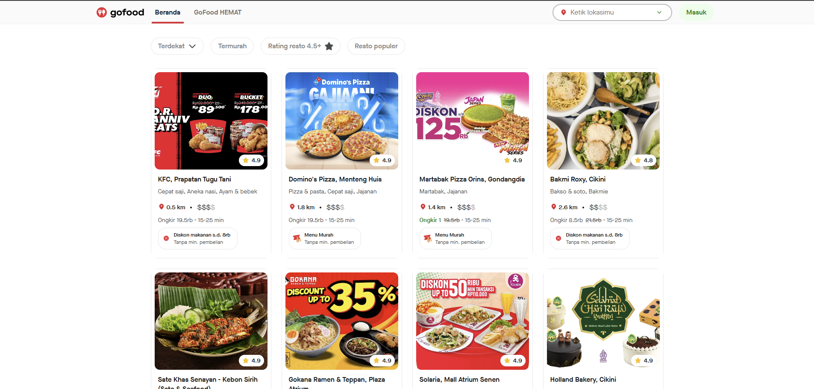
</p>
<p align="center">
<i>Gambar 6.1. Rancangan Antarmuka I-01 - PencarianRestoPage</i>
</p>

Tabel 6.1. Spesifikasi Objek Antarmuka [ID Layar]

| Id_Objek | Jenis | Konten | Keterangan |
| :--- | :--- | :--- | :--- |
| *[ID objek]* | *[Jenis objek, misalnya Button, RTF Box, dll]* | *[String yang tampil pada layar]* | *[Reaksi sistem, layar tujuan, tautan, atau ID algoritma yang dijalankan]* |
| *[ID objek]* | *[Jenis objek]* | *[Konten yang ditampilkan]* | *[Reaksi sistem atau nama file terkait beserta deskripsi ringkasnya]* |
| *...* | *...* | *...* | *...* |


## 6.X Rancangan Antarmuka [ID Layar X]

*[Ulangi pola 6.1 untuk layar berikutnya sampai semua layar teridentifikasi]*

## 6.Y Rancangan Antarmuka Keseluruhan

Tuliskan daftar gambar seluruh antarmuka. Berikan ID unik untuk setiap tampilan dan gunakan ID yang sama pada subbab perancangan antarmuka masing-masing.

Tabel 6.Y. Rancangan Antarmuka Keseluruhan

| No | Tampilan Antarmuka |
| :--- | :--- |
| *[I-01]* |  |
| *[I-02]* | *[Sisipkan gambar antarmuka I-02]* |
| *[I-XX]* | *[Sisipkan gambar antarmuka berikutnya]* |

<br>

---

# BAB 7: Matriks Kerunutan

Petakan kelas perancangan dengan use case yang terkait. Gunakan **BAB 6 Traceability pada dokumen SKPL** sebagai acuan keterkaitan kelas analisis dan use case, lalu sesuaikan dengan realisasi use case dan kelas perancangan pada BAB 3–BAB 5 DPPL.

Tabel 7.1. Matriks Kerunutan Kelas terhadap Use Case

| Kelas | Use Case Terkait |
| :--- | :--- |
| *C01 - Pelanggan* | *UC01 - Mencari dan filter resto<br>UC02 - Melakukan pemesanan dan pembayaran digital<br>UC03 - Menampilkan Status Antrean<br>UC06 - Mengelola Antrian<br>UC10 - Registrasi Akun<br>UC13 - Penyampaian Keluhan Pelanggan* |
| *C02 - Restoran* | *UC01 - Mencari dan filter resto<br>UC04 - Pendaftaran Mitra Restoran Baru<br>UC06 - Mengelola Antrian<br>UC07 - Mengatur Kuota Antrean & Meja<br>UC08 - Mengelola Stok dan Menu Makanan<br>UC09 - Menampilkan Dashboard Antrean Restoran<br>UC10 - Registrasi Akun<br>UC15 - Penghapusan Restoran* |
| *C03 - Menu* | *UC01 - Mencari dan filter resto<br>UC02 - Melakukan pemesanan dan pembayaran digital<br>UC04 - Pendaftaran Mitra Restoran Baru<br>UC08 - Mengelola Stok dan Menu Makanan* |
| *C04 - Antrean* | *UC01 - Mencari dan filter resto<br>UC03 - Menampilkan Status Antrean<br>UC06 - Mengelola Antrian<br>UC09 - Menampilkan Dashboard Antrean Restoran* |
| *C05 - Keranjang* | *UC02 - Melakukan pemesanan dan pembayaran digital* |
| *C06 - Pesanan* | *UC02 - Melakukan pemesanan dan pembayaran digital<br>UC03 - Menampilkan Status Antrean<br>UC06 - Mengelola Antrian<br>UC09 - Menampilkan Dashboard Antrean Restoran* |
| *C07 - MetodePembayaranController* | *UC02 - Melakukan pemesanan dan pembayaran digital* |
| *C08 - RiwayatTransaksi* | *UC02 - Melakukan pemesanan dan pembayaran digital* |
| *C09 - TiketAntrean* | *UC02 - Melakukan pemesanan dan pembayaran digital<br>UC03 - Menampilkan Status Antrean<br>UC06 - Mengelola Antrian* |
| *C10 - PemantauAntreanController* | *UC03 - Menampilkan Status Antrean* |
| *C11 - HalamanStatusAntrean* | *UC03 - Menampilkan Status Antrean* |
| *C12 - PengajuanMitraController* | *UC04 - Pendaftaran Mitra Restoran Baru<br>UC05 - Memverifikasi Pendaftaran Restoran* |
| *C13 - DokumenVerifikasi* | *UC04 - Pendaftaran Mitra Restoran Baru* |
| *C14 - Admin* | *UC05 - Memverifikasi Pendaftaran Restoran<br>UC10 - Registrasi Akun<br>UC14 - Penanggapan Keluhan Pelanggan<br>UC15 - Penghapusan Restoran* |
| *C15 - NotifikasiEmail* | *UC05 - Memverifikasi Pendaftaran Restoran* |
| *C16 - KelolaAntreanController* | *UC06 - Mengelola Antrian* |
| *C17 - KonfirmasiDequeuePage* | *UC06 - Mengelola Antrian* |
| *C18 - KelolaAntreanPage* | *UC06 - Mengelola Antrian* |
| *C19 - DashboardAntreanPage* | *UC09 - Menampilkan Dashboard Antrean Restoran* |
| *C20 - Kuota* | *UC07 - Mengatur Kuota Antrean & Meja* |
| *C21 - PengaturanKuotaController* | *UC07 - Mengatur Kuota Antrean & Meja* |
| *C22 - PengaturanKuotaPage* | *UC07 - Mengatur Kuota Antrean & Meja* |
| *C23 - PengaturanMenuPage* | *UC08 - Mengelola Stok dan Menu Makanan* |
| *C24 - KelolaMenuController* | *UC08 - Mengelola Stok dan Menu Makanan* |
| *C25 - Pengguna* | *UC10 - Registrasi Akun<br>UC11 - Login Akun<br>UC12 - Keluar Akun* |
| *C26 - HalamanProfilPage* | *UC12 - Keluar Akun* |
| *C27 - KonfirmasiLogoutPage* | *UC12 - Keluar Akun* |
| *C28 - AutentikasiController* | *UC12 - Keluar Akun* |
| *C29 - SesiPengguna* | *UC12 - Keluar Akun* |
| *C30 - Keluhan* | *UC13 - Penyampaian Keluhan Pelanggan<br>UC14 - Penanggapan Keluhan Pelanggan* |
| *C31 - DashboardKelolaRestoranPage* | *UC15 - Penghapusan Restoran* |
| *C32 - KonfirmasiHapusRestoranPage* | *UC15 - Penghapusan Restoran* |
| *C33 - KelolaDataRestoranController* | *UC15 - Penghapusan Restoran* |
| *C34 - PencarianRestoPage* | *UC01 - Mencari dan filter resto* |
| *C35 - PencarianController* | *UC01 - Mencari dan filter resto* |
| *C36 - VerifikasiRestoranPage* | *UC05 - Memverifikasi Pendaftaran Restoran* |
| *C37 - RegistrasiRestoPage* | *UC04 - Pendaftaran Mitra Restoran Baru* |
| *C38 - RegistrasiPage* | *UC10 - Registrasi Akun* |
| *C39 - LoginPage* | *UC11 - Login Akun* |
| *C40 - KeluhanFormPage* | *UC13 - Penyampaian Keluhan Pelanggan* |
| *C41 - KeluhanController* | *UC13 - Penyampaian Keluhan Pelanggan<br>UC14 - Penanggapan Keluhan Pelanggan* |
| *C42 - KeluhanDashboardPage* | *UC14 - Penanggapan Keluhan Pelanggan* |
| *...* | *...* |
