<h1>
IF2150 REKAYASA PERANGKAT LUNAK
<br>
TUGAS 5
<br>
DESKRIPSI PERANCANGAN PERANGKAT LUNAK (DPPL)
</h1>
<br>

## LawHub
### <p align="center">

</p>

### Untuk: Mikhael Andrian Yonatan

Dipersiapkan oleh:
| Informasi | Keterangan |
| --- | --- |
| Kelas | K03 |
| Kelompok | G05 |

| NIM | Nama |
|---|---|
| 13525057 | Raya Medina Farrelin |
| 13525003 | Cherinette Corsane Khassyah Purceria |
| 13525108 | Khasya Nurul Amini |
| 13525150 | Livy Chandra |
| 13525138 | Cathrine Angel Siburian |
---

## Daftar Perubahan

| Revisi | Deskripsi |
| :--- | :--- |
| *A* | *Deskripsikan perubahan yang dilakukan dari dokumen sebelumnya pada dokumen ini. Jika tidak terdapat perubahan, harap kosongkan tabel.* |
| *B* |  |
| *C* |  |
| ... |  |

---

<br>

> **Petunjuk pengerjaan:** *[Silahkan hapus bagian ini setelah selesai mengerjakan]*
>
> Dokumen ini melanjutkan **Deskripsi Perancangan Perangkat Lunak**. Gunakan nama, ID, kebutuhan, dan use case yang konsisten dengan kedua dokumen tersebut. Contoh pola ID baru di bawah dapat disesuaikan dengan kesepakatan kelompok, ID yang sudah ada tetap dipertahankan.

<br>

---


# BAB 1: Pendahuluan

## 1.1 Tujuan Penulisan Dokumen

Dokumen Deskripsi Perancangan Perangkat Lunak (DPPL) ini disusun untuk menjabarkan rancangan perangkat lunak LawHub, yaitu platform layanan konsultasi hukum digital yang menghadirkan fitur HaloLaw dan SearchLaw. Dokumen ini menerjemahkan kebutuhan yang telah ditetapkan pada Spesifikasi Kebutuhan Perangkat Lunak (SKPL) dan Arsitektur Perangkat Lunak (APL) menjadi rancangan yang siap diimplementasikan, mencakup rancangan arsitektur berbasis Model-View-Controller (MVC), identifikasi komponen, realisasi setiap use case melalui sequence diagram dan diagram kelas, diagram kelas keseluruhan, serta matriks kerunutan antara kelas perancangan dan use case.

Dokumen ini ditujukan bagi tim pengembang LawHub sebagai acuan dalam tahap implementasi dan pengujian, serta bagi dosen dan asisten mata kuliah IF2150 Rekayasa Perangkat Lunak sebagai bahan penilaian kesesuaian rancangan dengan kebutuhan yang telah ditetapkan.

## 1.2 Lingkup Masalah
LawHub merupakan platform layanan konsultasi hukum digital yang dikembangkan untuk memperluas akses bantuan hukum bagi masyarakat Indonesia, di tengah tingginya angka sengketa dan konflik hukum yang belum terselesaikan serta terbatasnya kanal konsultasi hukum yang interaktif dan efisien. Berbeda dari laman bantuan hukum yang sudah ada dan umumnya berfokus pada forum tanya jawab terbuka, LawHub menghadirkan dua fitur utama, yaitu HaloLaw untuk konsultasi hukum on-demand secara langsung dengan mitra pengacara melalui chat, dan SearchLaw untuk membantu masyarakat menemukan dasar hukum yang relevan dengan kasus yang dihadapi, sehingga proses konsultasi hukum menjadi lebih cepat, transparan, dan mudah diakses oleh berbagai kalangan.

## 1.3 Definisi, Istilah, dan Singkatan

Tabel 1.3. Definisi Istilah dan Singkatan

| Singkatan, Akronim, atau Istilah | Penjelasan |
| :--- | :--- |
| P/L | Singkatan dari Perangkat Lunak, yaitu aplikasi yang memberikan perintah kepada komputer untuk menjalankan tugas tertentu. |
| SKPL | Singkatan dari Spesifikasi Kebutuhan Perangkat Lunak, yaitu dokumen yang merangkum kriteria-kriteria yang diperlukan untuk membangun aplikasi menjalankan tugasnya. |
| KF | Singkatan dari Kebutuhan Fungsional. |
| KNF | Singkatan dari Kebutuhan Non-Fungsional. |
| UC | Singkatan dari Use Case. |
| EARS | Easy Approach to Requirements Syntax, yaitu pola penulisan kebutuhan agar konsisten dan mudah diuji. |

## 1.4 Aturan Penomoran

Tabel 1.4. Aturan Penomoran

| Hal/Bagian | Penomoran |
| :--- | :--- |
| Kebutuhan Fungsional | KFXX | 
| Kebutuhan Non-Fungsional | KNFXX | 
| Use Case | UCXX | 
| Kelas | CXX | 
| Kebutuhan | RXX | 
|

## 1.5 Referensi
Cantumkan dokumentasi P/L yang dirujuk oleh dokumen ini, **minimal dokumen SKPL dan APL**. Tambahkan buku, panduan, atau dokumentasi lain apabila digunakan.

## 1.6 Deskripsi Umum Dokumen (Ikhtisar)
Tuliskan sistematika pembahasan dokumen ini secara ringkas dan runut, dengan maksimal 1 paragraf.

<br>

---

# BAB 2: Perancangan Arsitektur

## 2.1 Rancangan Lingkungan Implementasi

Tabel 2.1  Rancangan Lingkungan Implementasi

| Komponen | Spesifikasi | Keterangan |
| :--- | :--- | :--- |
| Server | Local | |
| Client | Chromium Based Browser | |
| DBMS | PostgreSQL  | |
| OS | Cross-platform (Windows/Linux/MacOS) melalui browser | |
| Development Tools | Visual Studio Code, Git dan GitHub, Node.js, React, Express, Socket.IO, Postman, Figma, draw.io |  Node.js dan Express untuk backend (MVC), React untuk frontend, Socket.IO untuk live chat, Postman untuk pengujian API  |
| Filing System |File system lokal pada server (folder uploads/) | |
| Bahasa Pemrograman | JavaScript | |


## 2.2 Style/Pattern Arsitektur Acuan

Architectural style atau pattern yang menjadi acuan untuk aplikasi LawHub yang kami kembangkan adalah MVC (Model-View-Controller). Pada MVC, view berperan untuk memperlihatkan antarmuka pada perangkat lunak. View menerima aksi atau masukan awal dari pengguna lalu meneruskan informasi ke controller. Pada LawHub, view direpresentasikan dengan kelas antarmuka seperti SearchLawpage, DaftarMitraPengacaraPage, dan ChatKonsultasiPage. Lalu, controller menjadi penghubung antara view dan model. Controller menerima permintaan pengguna dari view, memproses logika melalui model, dan mengembalikan view setelah data selesai diproses. Contoh controller pada LawHub adalah SesiKonsultasiController dan PencarianMitraController.Terakhir, model merupakan representasi struktur data dan state aplikasi. Model menerima masukan permintaan data yang diperlukan sesuai instruksi controller. Setelah itu, model melakukan operasi create, read, update, dan delete pada database. Selain itu, model juga dapat menyimpan informasi apabila diinstruksikan oleh database. Contoh model pada LawHub adalah Kasus, MitraPengacara, dan DasarHukum.

<p align="center">

</p>
<p align="center">
<i>Gambar 1. Arsitektur MVC LawHub</i>
</p>

MVC dipilih karena sesuai dengan karakteristik aplikasi Lawhub serta kebutuhan fungsional dan non-fungsional. Pada class diagram yang telah dibuat, LawHub telah memakai stereotype <<boundery>>, <<control>>, dan <<entity>> yang dapat langsung diadaptasi dengan rancangan arsitektur MVC tanpa perlu mengatur ulang struktur kelas. Selain itu, LawHub memiliki tiga aktor dengan antarmuka yang berbeda tetapi ketiganya dapat memanipulasi data yang sama. Dengan MVC, antarmuka untuk setiap peran dapat dikembangakn secara mandiri tanpa perlu memengaruhi logika di belakangnya. Kemudian, berdasarkan alur bisnis dan KF, fitur dengan algoritma pencarian membutuhkan pemisahan tugas antara view dan controller. View hanya memproses masukan pengguna, sementara logika pencariannya dijalankan oleh controller. Terakhir, MVC mendukung keamanan sistem saat mengenkripsi pesan karena dapat diisolasi pada controller dan model.


## 2.3 Identifikasi Komponen / Modul / Subsistem

Tabel 2.3. Identifikasi Komponen/Modul/Subsistem

| Nama Komponen/Modul/Subsistem | Jenis | Penjelasan |
| :--- | :--- | :--- |
RegistrasiView | View | Menampilkan formulir pendaftaran akun bagi masyarakat dan mitra pengacar, serta meneruskan input ke RegistrasiController. |
AutentikasiView | View | Menampilkan halaman login bagi masyarakat dan mitra pengacara untuk masuk sebagai akun terdaftar |
BerandaView | View | Menampilkan halaman utama setelah login. |
StatusVerifikasiMitraView | View | Menampilkan status terkini verifikasi akun kepada Mitra Pengacara, serta menampilkan dokumen pendaftar bagi Admin untuk ditinjau dan diverifikasi. |
EditProfilMitraPage | View |  Menampilkan formulir pengeditan profil/identitas firma serta pengunggahan dan pengeditan dokumen legalitas milik Mitra Pengacara. |
SearchLawView | View | Menampilkan hasil pencarian pasal berdasarkan kata kunci yang dimasukkan pengguna pada fitur SearchLaw. |
DaftarMitraPengacaraPage | View | Menampilkan daftar Mitra Pengacara lengkap dengan filter pencarian. |
KonsultasiView | View |  Menampilkan pemilihan Mitra Pengacara dan jadwal konsultasi, konfirmasi penerimaan konsultasi oleh Mitra Pengacara, serta ruang chat sesi konsultasi (HaloLaw) antara Masyarakat dan Mitra Pengacara. |
UlasanView | View | Menampilkan formulir pengisian ulasan, feedback, dan rating setelah sesi konsultasi selesai. |
LaporanView | View | Menampilkan formulir pelaporan pelanggaran akun (oleh Masyarakat maupun Mitra Pengacara) dan pelaporan ulasan yang dianggap tidak relevan (oleh Mitra Pengacara), serta halaman tinjauan laporan bagi Admin. |
HistoryView | View | Menampilkan riwayat kasus dan sesi konsultasi yang telah dilakukan Masyarakat maupun Mitra Pengacara. |
LiveChatAdminView | View | Menampilkan ruang live chat bagi Masyarakat untuk bertanya dan bagi Admin untuk menjawab pertanyaan. |
PembayaranView | View | Menampilkan pemilihan metode dan konfirmasi pembayaran sesi konsultasi. |
PencairanDanaView | View | Menampilkan formulir pengajuan pencairan dana bagi Mitra Pengacara. |
RegistrasiController | Controller | Mengatur alur pendaftaran akun baru, termasuk validasi data dan pembuatan akun Masyarakat, serta pendaftaran akun dan pengunggahan dokumen legalitas Mitra Pengacara untuk diverifikasi.
AutentikasiController | Controller | Mengelola proses log in dan verifikasi kredensial, dipakai bersama oleh Masyarakat maupun Mitra Pengacara. |
| VerifikasiMitraController | Controller | Mengelola proses verifikasi Mitra Pengacara, mencakup penampilan status bagi Mitra Pengacara maupun peninjauan dan penentuan status oleh Admin berdasarkan dokumen legalitas. |
| ProfilMitraController | Controller | Mengelola pembaruan profil dan dokumen legalitas Mitra Pengacara. |
| SearchLawController | Controller | Memproses permintaan pencarian pasal berdasarkan kata kunci pada basis data peraturan perundang-undangan dalam fitur SearchLaw. |
| PencarianMitraController | Controller | Memproses pencarian dan filter daftar Mitra Pengacara berdasarkan kasus yang dimasukkan Masyarakat dalam fitur HaloLaw. |
| KonsultasiController | Controller | Mengelola pemilihan Mitra Pengacara dan jadwal sesi konsultasi oleh Masyarakat, alur penerimaan sesi oleh Mitra Pengacara, serta berjalannya sesi konsultasi melalui chat yang baru dapat dimulai setelah pembayaran lunas. |
| UlasanController | Controller | Mengelola pengiriman ulasan, feedback, dan rating dari Masyarakat kepada Mitra Pengacara. |
| LaporanController | Controller | Mengatur alur pelaporan pelanggaran akun maupun ulasan (baik oleh Masyarakat maupun Mitra Pengacara), serta memproses tinjauan laporan dan eksekusi pemblokiran akun yang melanggar kebijakan oleh Admin. |
| RiwayatController | Controller | Mengambil dan menyusun data riwayat kasus/konsultasi yang telah dilakukan Masyarakat maupun Mitra Pengacara. |
| LiveChatController | Controller | Mengelola pengiriman dan penerimaan pesan live chat antara Masyarakat dan Admin. |
| PembayaranController | Controller | Memproses transaksi pembayaran sesi konsultasi melalui PaymentGatewayAdapter; pembayaran harus lunas sebagai syarat sebelum sesi chat dibuka. |
| PencairanDanaController | Controller | Memproses permintaan dan validasi pencairan dana Mitra Pengacara ke rekening terdaftar melalui PaymentGatewayAdapter, secara terpisah dan tidak otomatis setelah pembayaran diterima sistem. |
Masyarakat | Model | Menyimpan data akun Masyarakat yang mengajukan kasus, mencari pasal dan mitra, berkonsultasi, membayar, memberi ulasan, dan melapor. |
MitraPengacara | Model | Menyimpan data akun dan profil Mitra Pengacara, mencakup tag keahlian, status verifikasi, status ketersediaan, rating, saldo, dan rekening pencairan. |
Admin | Model | Menyimpan data akun Admin yang memverifikasi Mitra Pengacara, meninjau laporan, memblokir akun, dan melayani live chat. |
Kasus | Model | Menyimpan data kasus/kondisi Masyarakat yang menjadi dasar pencarian dan pemilihan Mitra Pengacara pada fitur HaloLaw, serta dikaitkan dengan sesi konsultasi dan riwayat penanganan. |
DasarHukum | Model | Menyimpan data peraturan dan perundang-undangan (pasal) yang menjadi basis data pencarian pada fitur SearchLaw. |
DokumenLegalitas | Model | Menyimpan berkas dan data legalitas yang diunggah Mitra Pengacara untuk keperluan verifikasi. |
SesiKonsultasi | Model | Menyimpan data sesi konsultasi antara Masyarakat dan Mitra Pengacara beserta status dan waktu mulai/selesai. |
Ulasan | Model | Menyimpan data ulasan berupa teks, foto, dan/atau rating yang diberikan Masyarakat setelah sesi konsultasi, dan ditampilkan pada profil Mitra Pengacara. |
Laporan | Model | Menyimpan data laporan pelanggaran akun maupun ulasan beserta status peninjauannya oleh Admin. |
Pembayaran | Model | Menyimpan data transaksi pembayaran sesi konsultasi, termasuk metode, jumlah, status, dan waktu transaksi. |
LiveChat | Model | Menyimpan data percakapan live chat antara Masyarakat dan Admin. |
| PencairanDana | Model | Menyimpan data transaksi pencairan dana Mitra Pengacara, termasuk jumlah, tanggal, status, dan rekening tujuan. |
| PaymentGatewayAdapter | Integrasi Eksternal | Mengirim permintaan otorisasi ke Payment Gateway pihak ketiga (dummy) untuk pembayaran sesi konsultasi maupun pencairan dana Mitra Pengacara, lalu meneruskan status transaksi ke PembayaranController dan PencairanDanaController. |
| Database | Penyimpanan Data | Menyimpan seluruh data Model secara persisten dan terpusat, diakses oleh seluruh Controller LawHub. |

## 2.4 Model Arsitektur Perangkat Lunak

*Architectural View* adalah bagaimana cara kita melihat/mendeskripsikan arsitektur sebuah sistem dari sudut pandang tertentu. Dalam perancangan arsitektur aplikasi, dibutuhkan *Architectural View* yang dapat mempermudah pemahaman dari proses aplikasi yang akan dikembangkan. Tujuan dari *Architectural View* adalah menjadi bahan komunikasi, pemisahan masalah, mempermudah analisis, dan pemandu saat eksekusi pengembangan sistem tersebut.

### 2.4.1 Logical View

Logical View dipilih karena bertujuan untuk menunjukkan interaksi dan alur pemrosesan antarkomponen arsitektur tingkat tinggi yang masing-masing dapat mewadahi satu atau lebih kelas fungsional. Selain itu, logical View juga mampu memvisualisasikan pemisahan fungsi  MVC, sehingga alur pemrosesan antar-aktor (Masyarakat, Pengacara, Admin) mudah dipahami.

<p align="center">

</p>
<p align="center">
<i>Gambar 2. Diagram Logical View LawHub</i>
</p>

Diagram dibagi menjadi tiga jalur utama, yaitu View, Controller, dan Model, sesuai dengan penerapan pola arsitektur Model-View-Controller (MVC) yang telah ditetapkan pada BAB 1. Komponen Integrasi Eksternal (PaymentGatewayAdapter) diletakkan di luar jalur utama (sebelah kanan) karena komponen ini bertindak sebagai perantara komunikasi diluar dari sistem dan hanya dipanggil oleh Controller. Komponen Penyimpanan Data (Database) diletakkan di bagian paling bawah sebagai fondasi penyimpanan data keseluruhan.

Seluruh hubungan pada Gambar 2 memiliki hubungan antar komponen sebagai berikut:
1. **View → Controller:**
   - `RegistrasiView` meneruskan input pendaftaran ke `RegistrasiController`.
   - `AutentikasiView` dan `BerandaView` meneruskan permintaan login dan navigasi ke `AutentikasiController`.
   - `StatusVerifikasiMitraView` memanggil `VerifikasiMitraController` untuk peninjauan berkas pendaftaran mitra.
   - `EditProfilMitraPage` memanggil `ProfilMitraController` untuk pembaruan profil dan dokumen.
   - `SearchLawView` memanggil `SearchLawController` untuk pencarian pasal perundang-undangan.
   - `DaftarMitraPengacaraPage` memanggil `PencarianMitraController` untuk memfilter data pengacara.
   - `KonsultasiView` memanggil `KonsultasiController` untuk pemilihan jadwal, penerimaan sesi, dan ruang *chat*.
   - `UlasanView` memanggil `UlasanController` untuk pengiriman *feedback* dan *rating*.
   - `LaporanView` memanggil `LaporanController` untuk pelaporan pelanggaran akun atau ulasan.
   - `HistoryView` memanggil `RiwayatController` untuk memuat riwayat kasus dan transaksi.
   - `LiveChatAdminView` memanggil `LiveChatController` untuk layanan *support*.
   - `PembayaranView` memanggil `PembayaranController` untuk konfirmasi transaksi konsultasi.
   - `PencairanDanaView` memanggil `PencairanDanaController` untuk pengajuan pencairan saldo mitra.

2. **Controller → Model:**
   - `RegistrasiController` mengelola data pada Model `Masyarakat`, `MitraPengacara`, dan `DokumenLegalitas`.
   - `AutentikasiController` mengelola validasi kredensial pada Model `Masyarakat`, `MitraPengacara`, dan `Admin`.
   - `VerifikasiMitraController` dan `ProfilMitraController` mengolah data pada Model `MitraPengacara` dan `DokumenLegalitas`.
   - `SearchLawController` mengakses data pada Model `DasarHukum`.
   - `PencarianMitraController` dan `KonsultasiController` mengolah data pada Model `MitraPengacara`, `Kasus`, dan `SesiKonsultasi`.
   - `UlasanController` memperbarui data pada Model `Ulasan` dan `MitraPengacara`.
   - `LaporanController` mengolah data pada Model `Laporan`, `Ulasan`, `Masyarakat`, dan `MitraPengacara`.
   - `RiwayatController` mengambil data dari Model `SesiKonsultasi`, `Kasus`, dan `Pembayaran`.
   - `LiveChatController` mengelola komunikasi pada Model `LiveChat`, `Admin`, dan `Masyarakat`.
   - `PembayaranController` dan `PencairanDanaController` mengolah data transaksi pada Model `Pembayaran`, `SesiKonsultasi`, `PencairanDana`, dan `MitraPengacara`.

3. **Controller → Integrasi Eksternal:**
   - `PembayaranController` dan `PencairanDanaController` memanggil `PaymentGatewayAdapter` untuk mengirim permintaan otorisasi transaksi finansial dan meneruskan status hasilnya kembali ke sistem.

4. **Penyimpanan Data (Model → Database):**
   - Seluruh Model (`Masyarakat`, `MitraPengacara`, `Admin`, `Kasus`, `DasarHukum`, `DokumenLegalitas`, `SesiKonsultasi`, `Ulasan`, `Laporan`, `Pembayaran`, `LiveChat`, dan `PencairanDana`) akan disimpan datanya pada `Database`.

Gambar 2 adalah contoh *Logical View* dalam bentuk *block diagram*. Seluruh komponen pada Tabel 2.1 digambarkan dan dikelompokkan sesuai pola MVC (*View*, *Controller*, *Model*), ditambah komponen pendukung dan basis data. Sistem di luar P/L, seperti *Payment Gateway (dummy)*, digambarkan dengan garis putus-putus dan tidak perlu dimasukkan ke Tabel 2.1. Setiap garis diberi label: "Memanggil" untuk *View* yang memanggil *Controller*, "akses" untuk *Controller* yang mengakses *Model*, serta agregasi dan komposisi untuk hubungan antar-*Model*.

<br>

---


# BAB 3: Realisasi Use Case

## 3.1 Use Case [Nama Use Case 1]

**ID Use Case:** *[UC01 sesuai SKPL]*  
**Nama Use Case:** *[Nama use case sesuai SKPL]*

### 3.1.1 Identifikasi Kelas

Identifikasi kelas yang terkait dengan use case tersebut. Kelas di tahap perancangan dapat berbeda dengan dengan kelas di tahap analisis. Dapat menggunakan tabel di bawah:

Tabel 3.1. Identifikasi Kelas Use Case [UC01]

| No | Nama Kelas Perancangan | Nama Kelas Analisis Terkait |
|:--- | :--- | :--- |
| 1 | *[Nama kelas perancangan]* | *[Nama kelas analisis pada SKPL]* |
| 2 | *[Nama kelas perancangan]* | *[Nama kelas analisis pada SKPL]* |
| ... | *...* | *...* |

### 3.1.2 Sequence Diagram

Buat *sequence diagram* untuk **setiap skenario use case**, mencakup skenario normal dan alternatif pada subbab 4.4 SKPL. Diagram melibatkan kelas-kelas yang telah diidentifikasi pada SKPL.

- **Skenario Normal**

<p align="center">

</p>
<p align="center">
<i>Gambar X. Sequence Diagram [UC01]</i>
</p>

- **Skenario Alternatif [Nomor]: [Nama Skenario]**

<p align="center">

</p>
<p align="center">
<i>Gambar X. Sequence Diagram [UC01] - [Nama skenario alternatif]</i>
</p>

### 3.1.3 Diagram Kelas

Buatlah diagram kelas untuk use case ini yang terdiri atas kelas-kelas dari 3.1.1. **Setiap kelas pada diagram wajib menampilkan atribut dan metode/operasi langsung di dalam kotak kelasnya**, sehingga tidak perlu membuat tabel daftar atribut dan metode per kelas pada subbab ini. Daftar lengkap atribut dan metode seluruh kelas disajikan pada Tabel 4.1 (Bab 4).

<p align="center">

</p>
<p align="center">
<i>Gambar X. Diagram Kelas [Nama Uce Case]</i>
</p>

Pada diagram, pastikan:
- Atribut dituliskan beserta visibilitas dan tipe datanya, misalnya `- email: String`.
- Operasi dituliskan beserta visibilitas, parameter, dan tipe kembaliannya, misalnya `+ login(email: String, password: String): Boolean`.
- Relasi antarkelas (asosiasi, agregasi, komposisi, generalisasi, dan dependensi) digambarkan lengkap dengan multiplisitas.
- Semua operasi yang dipanggil pada sequence diagram 3.1.2 (skenario normal dan alternatif) ada pada kelas yang bersangkutan.
- Kelas yang sama dengan kelas di use case lain memakai nama, atribut, dan metode yang konsisten.

## 3.2 Use Case XX

Silahkan lanjutkan untuk  *use case* berikutnya dengan content yang sama dengan 3.1

<br>

---
## 3.6 Use Case UC06

**ID Use Case:** *UC06*  
**Nama Use Case:** *Memverifikasi Pendaftar Mitra Pengacara*

### 3.6.1 Identifikasi Kelas

Tabel 3.6.1 Identifikasi Kelas Use Case [UC06]

| No | Nama Kelas Perancangan | Nama Kelas Analisis Terkait |
|:--- | :--- | :--- |
| 1 | *StatusVerifikasiMitraView* | *VerifikasiMitraPage* |
| 2 | *VerifikasiMitraController* | *VerifikasiMitraController* |
| 3 | *Admin* | *Admin* |

### 3.6.2 Sequence Diagram

Buat *sequence diagram* untuk **setiap skenario use case**, mencakup skenario normal dan alternatif pada subbab 4.4 SKPL. Diagram melibatkan kelas-kelas yang telah diidentifikasi pada SKPL. 

- **Skenario Normal**

<p align="center">

</p>
<p align="center">
<i>Gambar 6. Sequence Diagram UC06</i>
</p>

- **Skenario Alternatif 1 : Admin meminta penambahan/revisi dokumen**
- **Skenario Alternatif 2 : Dokumen tidak memenuhi syarat atau terindikasi pelanggaran**

<p align="center">

</p>
<p align="center">
<i>Gambar 2. Sequence Diagram Alternatif UC06 </i>
</p>

### 3.6.3 Diagram Kelas

<p align="center">
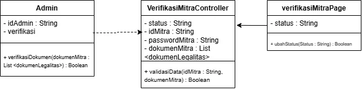
</p>
<p align="center">
<i>Gambar 6. Diagram Kelas UC06</i>
</p>

## 3.7 Use Case UC07

**ID Use Case:** *UC07*  
**Nama Use Case:** *Verifikasi Akun Pengacara (Edit Profil)*

### 3.7.1 Identifikasi Kelas

Tabel 3.7.1 Identifikasi Kelas Use Case [UC07]

| No | Nama Kelas Perancangan | Nama Kelas Analisis Terkait |
|:--- | :--- | :--- |
| 1 | *EditProfilMitraPage* | *EditDokumenLegalitasPage* |
| 2 | *EditProfilMitraPage View* | *EditProfilMitraPage* |
| 3 | *MitraPengacara* | *MitraPengacara* |

### 3.7.2 Sequence Diagram


<p align="center">

</p>
<p align="center">
<i>Gambar 7. Sequence Diagram UC07</i>
</p>

### 3.7.3 Diagram Kelas

<p align="center">
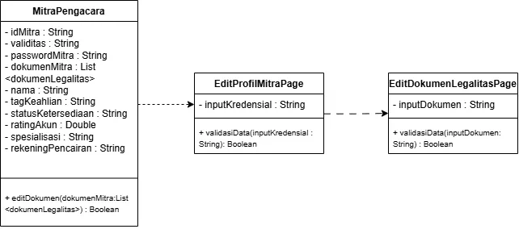
</p>
<p align="center">
<i>Gambar 7. Diagram Kelas UC07</i>
</p>

## 3.8 Use Case UC08

**ID Use Case:** *UC08*  
**Nama Use Case:** *Melakukan Pencarian Pasal*

### 3.8.1 Identifikasi Kelas

Tabel 3.8.1 Identifikasi Kelas Use Case [UC08]

| No | Nama Kelas Perancangan | Nama Kelas Analisis Terkait |
|:--- | :--- | :--- |
| 1 | *searchLawController* | *searchLawController* |
| 2 | *searchLawPage* | *searchLawPage* |
| 3 | *Masyarakat* | *Masyarakat* |
| 4 | *Dasar Hukum* | *Dasar Hukum* |

### 3.8.2 Sequence Diagram


<p align="center">
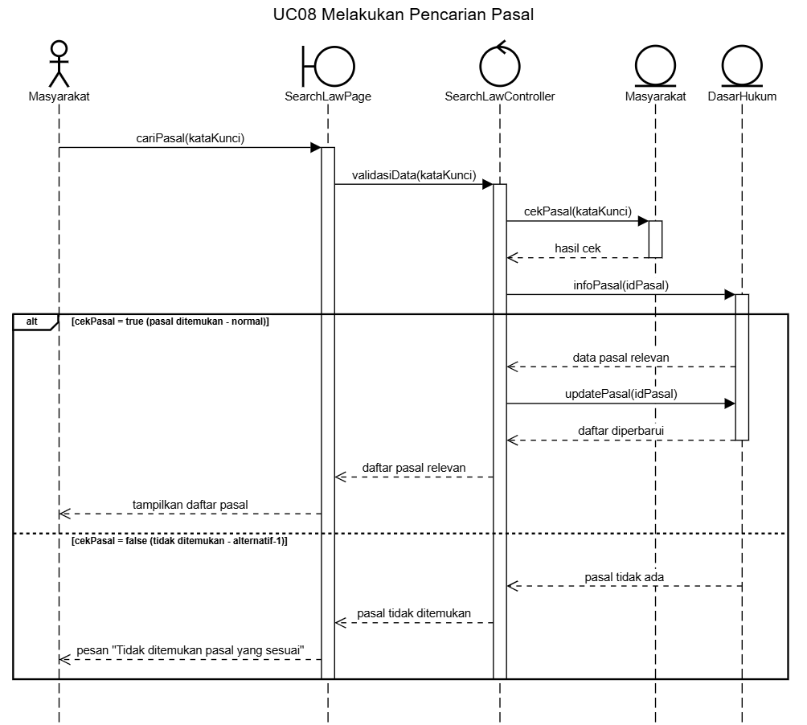
</p>
<p align="center">
<i>Gambar 8. Sequence Diagram UC08</i>
</p>

### 3.8.3 Diagram Kelas

<p align="center">
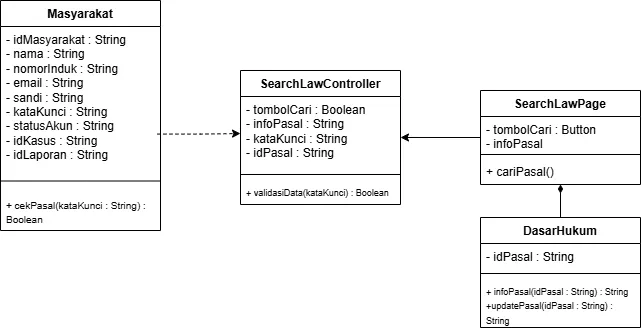
</p>
<p align="center">
<i>Gambar 8. Diagram Kelas UC08</i>
</p>

## 3.9 Use Case UC09

**ID Use Case:** *UC09*  
**Nama Use Case:** *Mencari Mitra Pengacara*

### 3.9.1 Identifikasi Kelas

Tabel 3.9.1 Identifikasi Kelas Use Case [UC09]

| No | Nama Kelas Perancangan | Nama Kelas Analisis Terkait |
|:--- | :--- | :--- |
| 1 | *DaftarMitraPengacaraView* | *DaftarMitraPengacaraPage* |
| 2 | *PencarianMitraController* | *PencarianMitraController* |
| 3 | *Masyarakat* | *Masyarakat* |
| 4 | *Kasus* | *Kasus* |
| 5 | *MitraPengacara* | *MitraPengacara* |
| 6 | *Ulasan* | *Ulasan* |

### 3.9.2 Sequence Diagram


<p align="center">
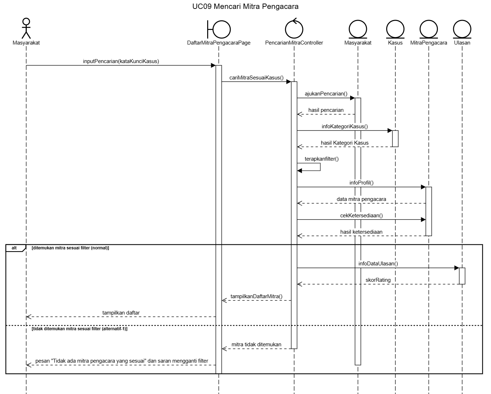
</p>
<p align="center">
<i>Gambar 9. Sequence Diagram UC09</i>
</p>

### 3.9.3 Diagram Kelas

<p align="center">

</p>
<p align="center">
<i>Gambar 9. Diagram Kelas UC09</i>
</p>

## 3.10 Use Case UC10

**ID Use Case:** *UC10*  
**Nama Use Case:** *Memilih Mitra Pengacara untuk Sesi Konsultasi*

### 3.10.1 Identifikasi Kelas

Tabel 3.10.1 Identifikasi Kelas Use Case [UC10]

| No | Nama Kelas Perancangan | Nama Kelas Analisis Terkait |
|:--- | :--- | :--- |
| 1 | *PemilihanJadwalKonsultasiView* | *PemilihanJadwalKonsultasiPage* |
| 2 | *PenjadwalanKonsultasiController* | *PenjadwalanKonsultasiController* |
| 3 | *Masyarakat* | *Masyarakat* |
| 4 | *Kasus* | *Kasus* |
| 5 | *MitraPengacara* | *MitraPengacara* |
| 6 | *SesiKonsultasi* | *SesiKonsultasi* |

### 3.10.2 Sequence Diagram


<p align="center">
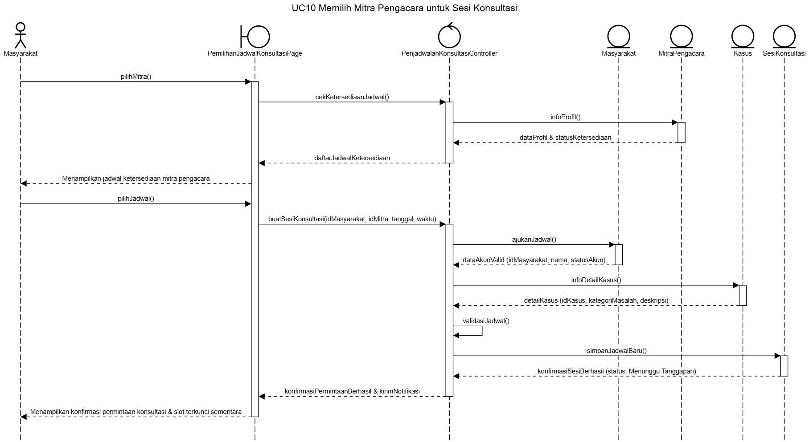
</p>
<p align="center">
<i>Gambar 9. Sequence Diagram UC09</i>
</p>

- **Skenario Alternatif 1 : Semua jadwal penuh atau tidak sesuai kebutuhan masyarakat**
<p align="center">

</p>
<p align="center">
<i>Gambar 10. Sequence Diagram Alternatif UC10 </i>
</p>

### 3.10.3 Diagram Kelas

<p align="center">

</p>
<p align="center">
<i>Gambar 10. Diagram Kelas UC10</i>
</p>


## 3.11 Use Case UC11

**ID Use Case:** UC11  
**Nama Use Case:** Menanggapi Sesi Konsultasi

### 3.11.1 Identifikasi Kelas

Tabel 3.11.1 Identifikasi Kelas Use Case [UC11]

| No | Nama Kelas Perancangan | Nama Kelas Analisis Terkait |
|:--- | :--- | :--- |
| 1 | KonfirmasiKonsultasiPage | KonfirmasiKonsultasiPage |
| 2 | SesiKonsultasiController | SesiKonsultasiController |
| 3 | MitraPengacara | MitraPengacara |
| 4 | SesiKonsultasi | SesiKonsultasi |

### 3.11.2 Sequence Diagram

- **Skenario Normal**

<p align="center">

</p>
<p align="center">
<i>Gambar 35. Sequence Diagram [UC11]</i>
</p>

- **Skenario Alternatif 1: Mitra menolak permintaan konsultasi**

<p align="center">
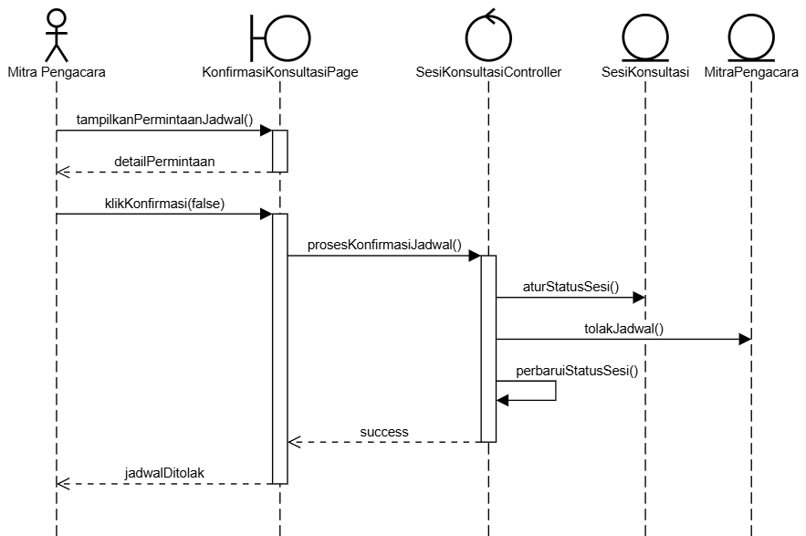
</p>
<p align="center">
<i>Gambar 36. Sequence Diagram [UC11] - Mitra menolak permintaan konsultasi</i>
</p>

- **Skenario Alternatif 2: Mitra tidak merespon dalam waktu tertentu**

<p align="center">
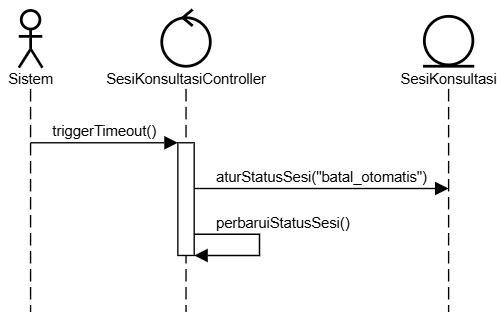
</p>
<p align="center">
<i>Gambar 37. Sequence Diagram [UC11] - Mitra tidak merespon dalam waktu tertentu</i>
</p>

### 3.11.3 Diagram Kelas

<p align="center">
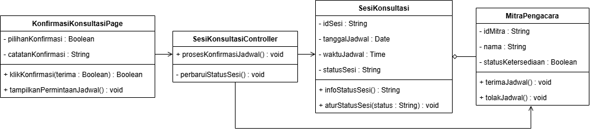
</p>
<p align="center">
<i>Gambar 38. Diagram Kelas Menanggapi Sesi Konsultasi</i>
</p>

## 3.12 Use Case UC12

**ID Use Case:** UC12
**Nama Use Case:** Melakukan Sesi Konsultasi

### 3.12.1 Identifikasi Kelas

Tabel 3.12.1 Identifikasi Kelas Use Case [UC12]

| No | Nama Kelas Perancangan | Nama Kelas Analisis Terkait |
|:--- | :--- | :--- |
| 1 | ChatKonsultasiPage | ChatKonsultasiPage |
| 2 | SesiKonsultasiController | SesiKonsultasiController |
| 3 | Masyarakat | Masyarakat |
| 4 | MitraPengacara | MitraPengacara |
| 5 | Kasus | Kasus |
| 6 | SesiKonsultasi | SesiKonsultasi |
| 7 | Pembayaran | Pembayaran |

### 3.12.2 Sequence Diagram

- **Skenario Normal**

<p align="center">
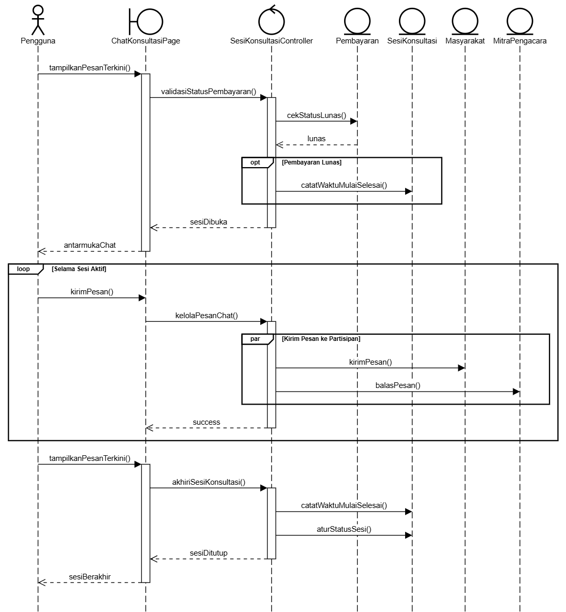
</p>
<p align="center">
<i>Gambar 39. Sequence Diagram [UC12]</i>
</p>

- **Skenario Alternatif 1: Sesi terputus/salah satu pihak tidak merespon**

<p align="center">
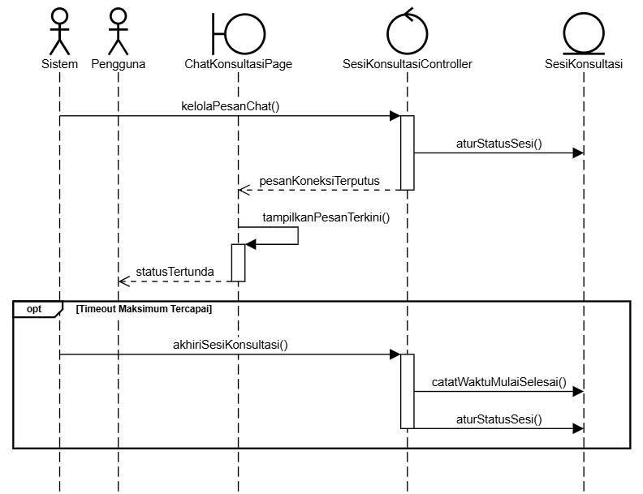
</p>
<p align="center">
<i>Gambar 40. Sequence Diagram [UC12] - Sesi terputus/salah satu pihak tidak merespon</i>
</p>

### 3.12.3 Diagram Kelas

<p align="center">
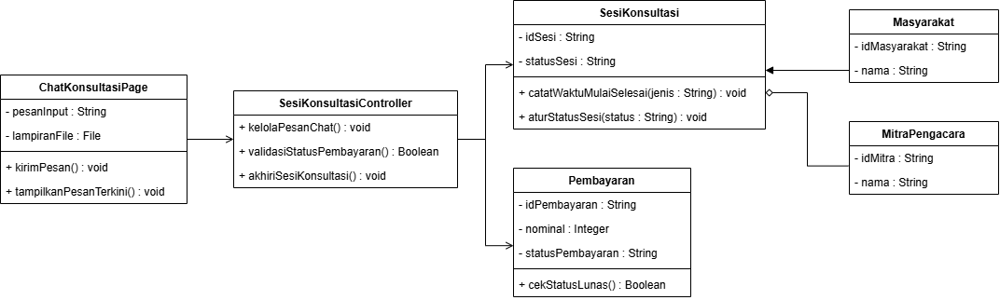
</p>
<p align="center">
<i>Gambar 41. Diagram Kelas Melakukan Sesi Konsultasi</i>
</p>

## 3.13 Use Case UC13

**ID Use Case:** UC13
**Nama Use Case:** Memberi Ulasan, Feedback, dan/atau Rating

### 3.13.1 Identifikasi Kelas

Tabel 3.13.1 Identifikasi Kelas Use Case [UC13]

| No | Nama Kelas Perancangan | Nama Kelas Analisis Terkait |
|:--- | :--- | :--- |
| 1 | UlasanPage | UlasanPage |
| 2 | UlasanController | UlasanController |
| 3 | Masyarakat | Masyarakat |
| 4 | Ulasan | Ulasan |

### 3.13.2 Sequence Diagram

- **Skenario Normal**

<p align="center">

</p>
<p align="center">
<i>Gambar 42. Sequence Diagram [UC13]</i>
</p>

- **Skenario Alternatif 1: Gagal mengirim ulasan**

<p align="center">

</p>
<p align="center">
<i>Gambar 43. Sequence Diagram [UC13] - Gagal mengirim ulasan</i>
</p>

### 3.13.3 Diagram Kelas

<p align="center">
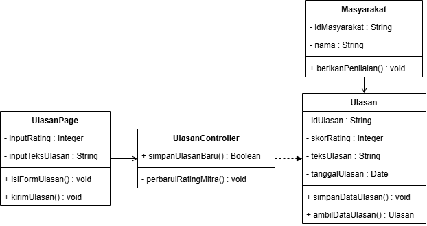
</p>
<p align="center">
<i>Gambar 44. Diagram Kelas Memberi Ulasan, Feedback, dan/atau Rating</i>
</p>

## 3.14 Use Case UC14

**ID Use Case:** UC14
**Nama Use Case:** Melaporkan Pelanggaran Akun

### 3.14.1 Identifikasi Kelas

Tabel 3.14.1 Identifikasi Kelas Use Case [UC14]

| No | Nama Kelas Perancangan | Nama Kelas Analisis Terkait |
|:--- | :--- | :--- |
| 1 | LaporanAkunPage | LaporanAkunPage |
| 2 | LaporanController | LaporanController |
| 3 | Masyarakat | Masyarakat |
| 4 | Laporan | Laporan |

### 3.14.2 Sequence Diagram

- **Skenario Normal**

<p align="center">

</p>
<p align="center">
<i>Gambar 45. Sequence Diagram [UC14]</i>
</p>

- **Skenario Alternatif 1: Formulir laporan tidak lengkap**

<p align="center">
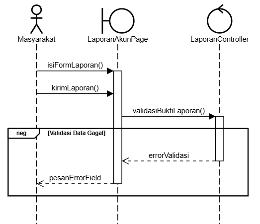
</p>
<p align="center">
<i>Gambar 46. Sequence Diagram [UC14] - Formulir laporan tidak lengkap</i>
</p>

### 3.14.3 Diagram Kelas

<p align="center">
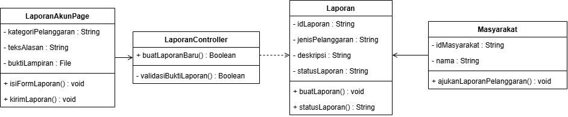
</p>
<p align="center">
<i>Gambar 47. Diagram Kelas Melaporkan Pelanggaran Akun</i>
</p>

## 3.15 Use Case UC15

**ID Use Case:** UC15
**Nama Use Case:** Melaporkan Pelanggaran

### 3.15.1 Identifikasi Kelas

Tabel 3.15.1 Identifikasi Kelas Use Case [UC15]

| No | Nama Kelas Perancangan | Nama Kelas Analisis Terkait |
|:--- | :--- | :--- |
| 1 | LaporanAkunPage | LaporanAkunPage |
| 2 | LaporanController | LaporanController |
| 3 | Masyarakat | Masyarakat |
| 4 | Laporan | Laporan |
| 5 | Mitra Pengacara | Mitra Pengacara |

### 3.15.2 Sequence Diagram

- **Skenario Normal**

<p align="center">

</p>
<p align="center">
<i>Gambar 48. Sequence Diagram [UC15]</i>
</p>

- **Skenario Alternatif 1: Formulir laporan tidak lengkap**

<p align="center">

</p>
<p align="center">
<i>Gambar 49. Sequence Diagram [UC15] - Formulir laporan tidak lengkap</i>
</p>

### 3.15.3 Diagram Kelas

<p align="center">

</p>
<p align="center">
<i>Gambar 50. Diagram Kelas Melaporkan Pelanggara</i>
</p>

## 3.16 Use Case UC16

**ID Use Case:** UC16
**Nama Use Case:** Melaporkan Ulasan

### 3.16.1 Identifikasi Kelas

Tabel 3.16. Identifikasi Kelas Use Case [UC16]

| No | Nama Kelas Perancangan | Nama Kelas Analisis Terkait |
|:--- | :--- | :--- |
| 1 | LaporanUlasanPage | LaporanView |
| 2 | LaporanController| LaporanController | 
| 3 | Laporan | Laporan |
| 4 | Ulasan | Alasan |

### 3.16.2 Sequence Diagram

- **Skenario Normal**

<p align="center">

</p>
<p align="center">
<i>Gambar 48. Sequence Diagram UC16</i>
</p>

- **Skenario Alternatif 1 : Formulir Laporan Tidak Lengkap**

<p align="center">
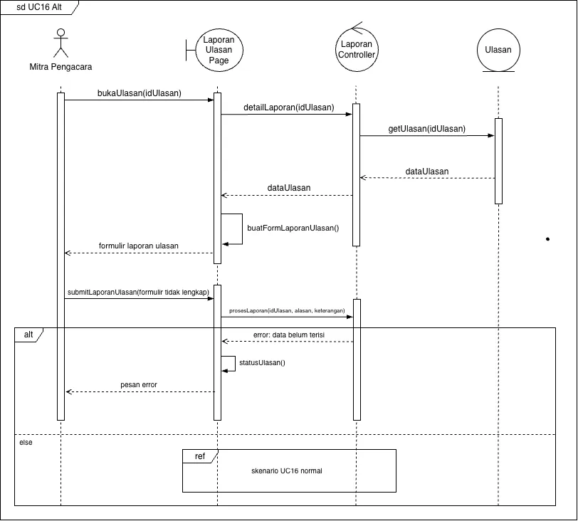
</p>
<p align="center">
<i>Gambar 49. Sequence Diagram UC16 - formulir tidak lengkap</i>
</p>

### 3.16.3 Diagram Kelas

<p align="center">

</p>
<p align="center">
<i>Gambar 50. Diagram Kelas Melaporkan Ulasan</i>
</p>

## 3.17 Use Case UC17

**ID Use Case:** UC17
**Nama Use Case:** Memblokir Akun

### 3.17.1 Identifikasi Kelas

Tabel 3.17. Identifikasi Kelas Use Case [UC17]

| No | Nama Kelas Perancangan | Nama Kelas Analisis Terkait |
|:--- | :--- | :--- |
| 1 | TinjauanPage | LaporanView |
| 2 | ModerasiAkunController| LaporanController | 
| 3 | Admin | Admin |
| 4 | Laporan | Laporan |

### 3.17.2 Sequence Diagram

- **Skenario Normal**

<p align="center">

</p>
<p align="center">
<i>Gambar 51. Sequence Diagram UC17</i>
</p>

- **Skenario Alternatif 1 : Laporan Tidak Disetujui Admin**

<p align="center">
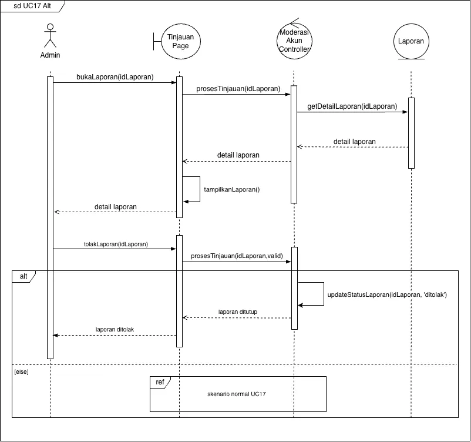
</p>
<p align="center">
<i>Gambar 52. Sequence Diagram UC17 - laporan tidak disetujui admin</i>
</p>

### 3.17.3 Diagram Kelas

<p align="center">

</p>
<p align="center">
<i>Gambar 53. Diagram Kelas Memblokir Akun</i>
</p>

## 3.18 Use Case UC18

**ID Use Case:** UC18
**Nama Use Case:** Melihat Riwayat Penanganan

### 3.18.1 Identifikasi Kelas

Tabel 3.18. Identifikasi Kelas Use Case [UC18]

| No | Nama Kelas Perancangan | Nama Kelas Analisis Terkait |
|:--- | :--- | :--- |
| 1 | HistoryPage | HistoryView |
| 2 | RiwayatController | RiwayatController |
| 3 | Masyarakat | Masyarakat | 
| 4 | MitraPengacara | MitraPengacara |
| 5 | Kasus | Kasus |
| 6 | SesiKonsultasi | SesiKonsultasi |

### 3.18.2 Sequence Diagram

- **Skenario Normal**

<p align="center">

</p>
<p align="center">
<i>Gambar 54. Sequence Diagram UC18</i>
</p>

- **Skenario Alternatif 1 : Laporan Tidak Disetujui Admin**

<p align="center">
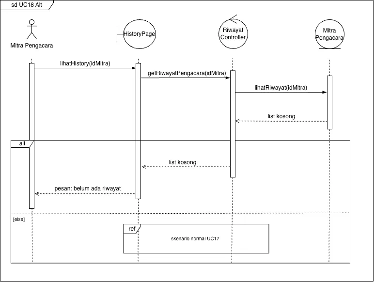
</p>
<p align="center">
<i>Gambar 55. Sequence Diagram UC18 - laporan tidak disetujui admin</i>
</p>

### 3.18.3 Diagram Kelas

<p align="center">
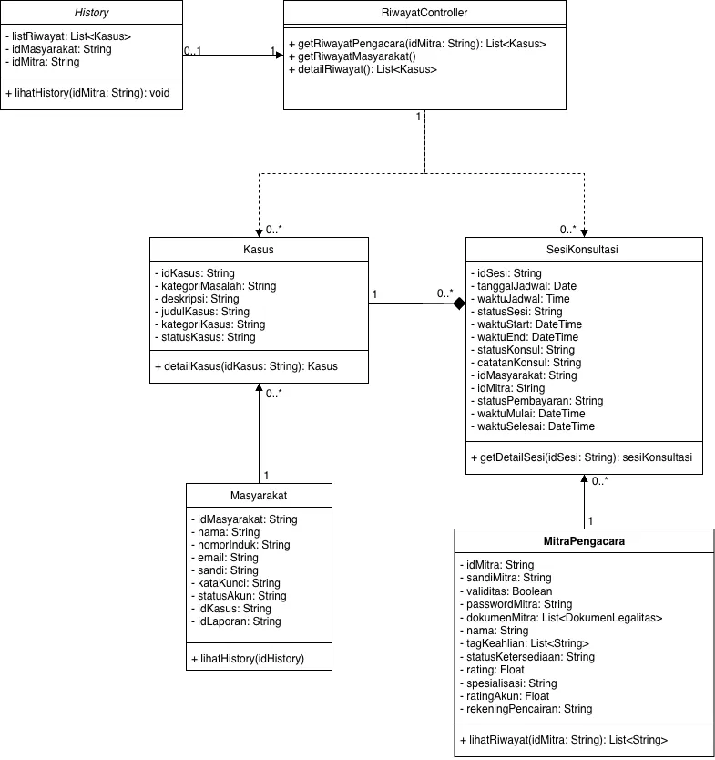
</p>
<p align="center">
<i>Gambar 56. Diagram Kelas Melihat Riwayat Penanganan</i>
</p>

## 3.19 Use Case UC19

**ID Use Case:** UC19
**Nama Use Case:** Live Chat dengan Admin

### 3.19.1 Identifikasi Kelas

Tabel 3.19. Identifikasi Kelas Use Case [UC19 & UC20]

| No | Nama Kelas Perancangan | Nama Kelas Analisis Terkait |
|:--- | :--- | :--- |
| 1 | LiveChatMasyarakatPage | LiveChatView | 
| 2 | LiveChatController | LiveChatController | 
| 3 | Masyarakat | Masyarakat |
| 4 | Admin | Admin |
| 5 | LiveChat | LiveChat |

### 3.19.2 Sequence Diagram

- **Skenario Normal**

<p align="center">
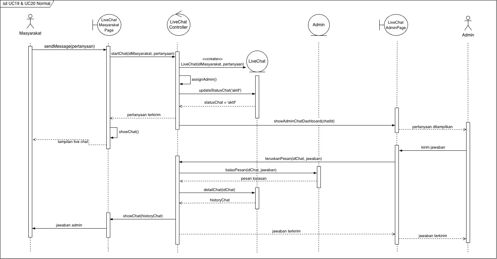
</p>
<p align="center">
<i>Gambar 57. Sequence Diagram UC19 & UC20</i>
</p>

- **Skenario Alternatif 1 : Tidak Ada Admin yang Tersedia

<p align="center">

</p>
<p align="center">
<i>Gambar 58. Sequence Diagram UC1 & UC20 - tidak ada admin yang standby</i>
</p>

### 3.19.3 Diagram Kelas

<p align="center">

</p>
<p align="center">
<i>Gambar 59. Diagram Kelas Live Chat Masyarakat</i>
</p>

<p align="center">
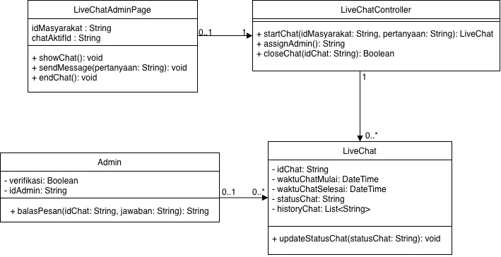
</p>
<p align="center">
<i>Gambar 60. Diagram Kelas Live Chat Admin</i>
</p>

## 3.21 Use Case UC21

**ID Use Case:** UC21
**Nama Use Case:** Membayar Biaya Sesi Konsultasi

### 3.21.1 Identifikasi Kelas

Tabel 3.21. Identifikasi Kelas Use Case [UC21]

| No | Nama Kelas Perancangan | Nama Kelas Analisis Terkait |
|:--- | :--- | :--- | 
| 1 | PembayaranPage | PembayaranPage |
| 2 | PembayaranController | PembayaranController |
| 3 | Masyarakat  | Masyarakat |
| 4 | SesiKonsultasi | SesiKonsultasi |
| 5 | Pembayaran | Pembayaran |

### 3.21.2 Sequence Diagram

- **Skenario Normal**

<p align="center">
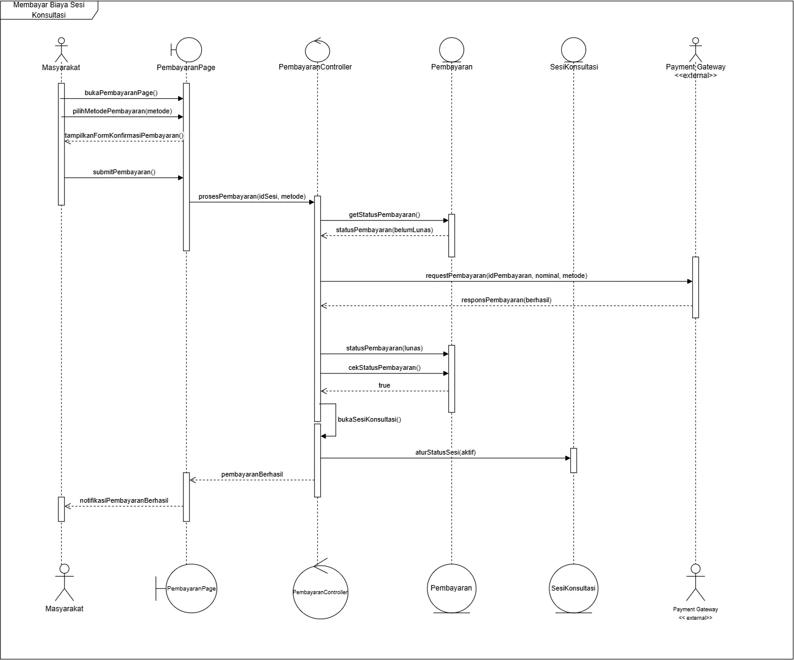
</p>
<p align="center">
<i>Gambar 61. Sequence Diagram UC21</i>
</p>

-**Skenario Alternatif 1: Pembayaran ditolak**

<p align="center">
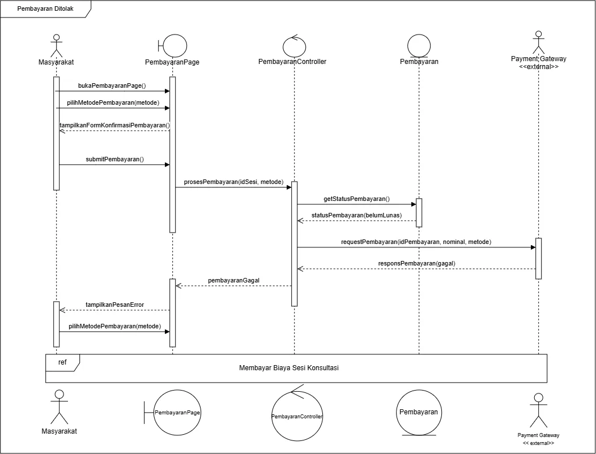
</p>
<p align="center">
<i>Gambar 62. Sequence Diagram UC21 - Pembayaran ditolak</i>
</p>

### 3.21.3 Diagram Kelas

<p align="center">
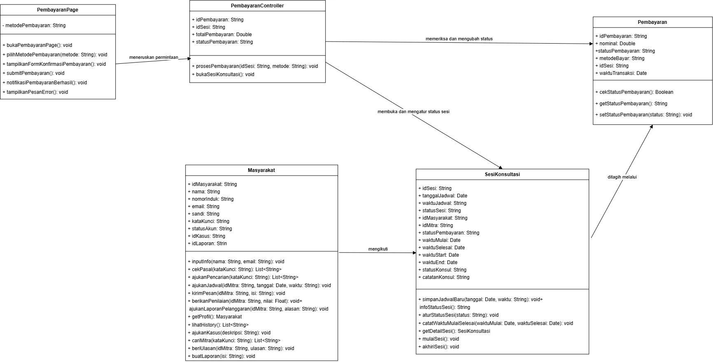
</p>
<p align="center">
<i>Gambar 63. Diagram Kelas Membayar Biaya Sesi Konsultasi</i>
</p>

<br>

## 3.22 Use Case UC22

**ID Use Case:** UC22
**Nama Use Case:** Mencairkan Dana

### 3.22.1 Identifikasi Kelas

Tabel 3.22. Identifikasi Kelas Use Case [UC22]

| No | Nama Kelas Perancangan | Nama Kelas Analisis Terkait |
|:--- | :--- | :--- | 
| 1 | PencairanDanaPage | PencairanDanaPage |
| 2 | PencairanDanaController | PencairanDanaController |
| 3 | MitraPengacara | MitraPengacara |
| 4 | PencairanDana | PencairanDana |

### 3.22.2 Sequence Diagram

- **Skenario Normal**

<p align="center">

</p>
<p align="center">
<i>Gambar 64. Sequence Diagram UC22</i>
</p>

-**Skenario Alternatif 1: Pencairan ditolak**

<p align="center">
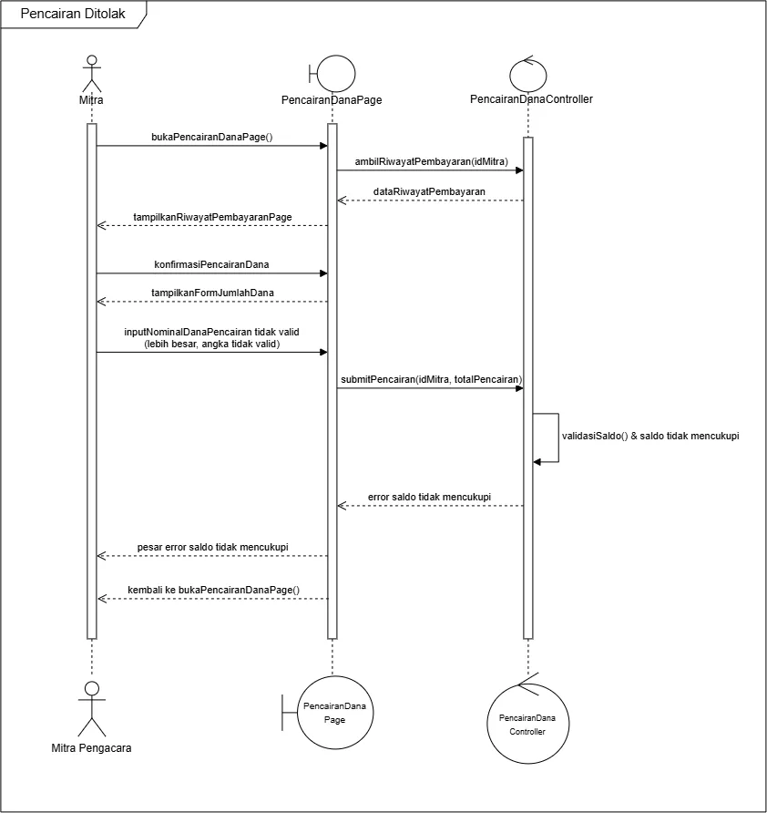
</p>
<p align="center">
<i>Gambar 65. Sequence Diagram UC22 - Pencairan ditolak</i>
</p>

### 3.22.3 Diagram Kelas

<p align="center">

</p>
<p align="center">
<i>Gambar 66. Diagram Kelas Mencairkan Dana</i>
</p>

<br>
---

# BAB 4: Diagram Kelas Keseluruhan

## 4.1 Diagram Kelas

**Bagian ini diisi dengan diagram kelas keseluruhan.**

<p align="center">

</p>
<p align="center">
<i>Gambar 4.1. Diagram Kelas Perancangan Keseluruhan [Nama P/L]</i>
</p>

Tabel 4.1. Daftar Kelas Perancangan Keseluruhan

| ID Kelas | Nama Kelas | Atribut | Metode/Operasi |
| :--- | :--- | :--- | :--- |
| *[C01]* | *[Nama kelas]* | *[Daftar atribut]* | *[Daftar metode/operasi]* |
| *[C02]* | *[Nama kelas]* | *[Daftar atribut]* | *[Daftar metode/operasi]* |
| *[C03]* | *[Nama kelas]* | *[Daftar atribut]* | *[Daftar metode/operasi]* |
| *...* | *...* | *...* | *...* |

---

# BAB 5: Perancangan Rinci Kelas

Bagian ini diisi dengan daftar seluruh kelas dalam tabel berikut:

Tabel 5.1. Daftar Kelas Perancangan dan Kelas Analisis Terkait

| No | Nama Kelas Perancangan | Nama Kelas Analisis Terkait |
| :--- | :--- | :--- |
| 1 | *[Nama kelas perancangan]* | *[Nama kelas analisis pada SKPL atau -]* |
| 2 | *[Nama kelas perancangan]* | *[Nama kelas analisis pada SKPL atau -]* |
| ... | *...* | *...* |

Untuk **setiap kelas**, identifikasi operasi berdasarkan tanggung jawab kelas beserta *visibility*-nya, serta atribut beserta *visibility* dan tipenya. Buat subbab tersendiri untuk setiap kelas.

## 5.1 Kelas RegistrasiMasyarakatPage

**Nama Kelas:** *RegistrasiMasyarakatPage*  
**ID Kelas:** *C01*

Tabel 5.1.1. Operasi Kelas RegistrasiMasyarakatPage

| Nama Operasi | Visibility (private, public) | Keterangan |
| :--- | :--- | :--- |
| *bukaFormRegistrasi(): void* | *public* | *menampilkan antarmuka formulir registrasi masyarakat.* |
| *submitRegistrasi(nama: String, nomorInduk: String, email: String, sandi: String): void* | *public* | *Mengirimkan data registrasi masyarakat ke controller untuk diproses.* |
| *tampilkanPesanSukses(): void* | *public* | *Menampilkan notifikasi bahwa registrasi akun berhasil.* |
| *tampilkanPesanError(pesan: String): void* | *public* | *Menampilkan notifikasi kesalahan input atau kegagalan registrasi.* |

Tabel 5.1.2. Atribut Kelas RegistrasiMasyarakatPage

| Nama Atribut | Visibility (private, public) | Tipe |
| :--- | :--- | :--- |
| *tombolRegistrasi* | *private* | *Button* |
| *inputNama* | *private* | *String* |
| *inputNomorInduk* | *private* | *String* |
| *inputEmail* | *private* | *String* |
| *inputSandi* | *private* | *String* |


### 5.1.1 Algoritma/Query

**Nama Kelas:** *RegistrasiMasyarakatPage*  
**Nama Operasi:** *sumbitRegistrasi(nama: String, nomorInduk: String, email: String, sandi: String): void*  
**ID Algoritma:** *[Algo-001]*

```text
PROCEDURE submitRegistrasi(nama: String, nomorInduk: String, email: String, sandi: String)
    IF nama isEmpty OR nomorInduk isEmpty OR email isEmpty OR sandi isEmpty THEN
        tampilkanPesanError("Semua field formulir registrasi wajib diisi.")
        RETURN
    END IF

    berhasil <- RegistrasiMasyarakatController.buatAkun(nama, nomorInduk, email, sandi)
    IF berhasil = true THEN
        tampilkanPesanSukses()
    ELSE
        tampilkanPesanError("Registrasi gagal. Email sudah terdaftar atau kata sandi terlalu lemah.")
    END IF
END PROCEDURE
```


## 5.2 Kelas LoginMasyarakatPage

**Nama Kelas:** *LoginMasyarakatPage*  
**ID Kelas:** *C02*

Tabel 5.2.1. Operasi Kelas LoginMasyarakatPage

| Nama Operasi | Visibility (private, public) | Keterangan |
| :--- | :--- | :--- |
| *bukaFormLogin(): void* | *public* | *menampilkan antarmuka formulir login masyarakat.* |
| *submitVerifikasi(email: String, sandi: String): void* | *public* | *Mengirim kredensial login ke controller untuk diautentikasi.* |
| *arahkanKeBeranda(): void* | *public* | *Mengarahkan tampilan ke halaman beranda (BerandaPage / C03) setelah login berhasil.* |
| *tampilkanPesanError(pesan: String): void* | *public* | *Menampilkan notifikasi kegalalan login.* |

Tabel 5.2.2. Atribut Kelas LoginMasyarakatPage

| Nama Atribut | Visibility (private, public) | Tipe |
| :--- | :--- | :--- |
| *tombolLogin* | *private* | *Button* |
| *inputKredensial* | *private* | *String* |

### 5.2.1 Algoritma/Query

**Nama Kelas:** *LoginMasyarakatPage*  
**Nama Operasi:** *sumbitVerifikasi(email: String, sandi: String): void*  
**ID Algoritma:** *[Algo-002]*

```text
PROCEDURE submitVerifikasi(email: String, sandi: String)
    IF email isEmpty OR sandi isEmpty THEN
        tampilkanPesanError("Email dan password wajib diisi.")
        RETURN
    END IF

    statusLogin <- AutentikasiController.validasiData(email, sandi)
    IF statusLogin = true THEN
        arahkanKeBeranda()
    ELSE
        tampilkanPesanError("Email/password salah atau akun tidak ditemukan.")
    END IF
END PROCEDURE
```


## 5.3 Kelas BerandaPage

**Nama Kelas:** *BerandaPage*  
**ID Kelas:** *C03*

Tabel 5.3.1. Operasi Kelas BerandaPage

| Nama Operasi | Visibility (private, public) | Keterangan |
| :--- | :--- | :--- |
| *tampilkanBeranda(): void* | *public* | *Menampilkan halaman utama dengan pilihan fitur HaloLaw dan SearchLaw..* |
| *pilihFitur(namaFitur: String): void* | *public* | *Mengarahkan masyarakat ke modul fitur yang dipilih.* |

Tabel 5.3.2. Atribut Kelas BerandaPage

| Nama Atribut | Visibility (private, public) | Tipe |
| :--- | :--- | :--- |
| *pilihanFitur* | *private* | *String* |

### 5.3.1 Algoritma/Query

**Nama Kelas:** *BerandaPage*  
**Nama Operasi:** *pilihFitur(namaFitur: String): void*  
**ID Algoritma:** *[Algo-003]*

```text
PROCEDURE pilihFitur(namaFitur: String)
    IF namaFitur = "HaloLaw" THEN
        arahkanKeLamanDaftarMitra()
    ELSE IF namaFitur = "SearchLaw" THEN
        arahkanKeLamanSearchLaw()
    ELSE
        tampilkanPesanError("Fitur tidak valid.")
    END IF
END PROCEDURE
```


## 5.4 Kelas RegistrasiMitraPage

**Nama Kelas:** *RegistrasiMitraPage*  
**ID Kelas:** *C04*

Tabel 5.4.1. Operasi Kelas RegistrasiMitraPage

| Nama Operasi | Visibility (private, public) | Keterangan |
| :--- | :--- | :--- |
| *bukaFormRegistrasiMitra(): void* | *public* | *Menampilkan antarmuka pendaftaran akun dan pengunggahan berkas bagi mitra pengacara.* |
| *submitRegistrasi(nama: String, email: String, sandi: String, dokumen: File): void* | *public* | *Mengirimkan data registrasi dan dokumen legalitas mitra ke controller.* |

Tabel 5.4.2. Atribut Kelas RegistrasiMitraPage

| Nama Atribut | Visibility (private, public) | Tipe |
| :--- | :--- | :--- |
| *tombolRegistrasi* | *private* | *Button* |
| *inputDokumen* | *private* | *File* |

### 5.4.1 Algoritma/Query

**Nama Kelas:** *RegistrasiMitraPage*  
**Nama Operasi:** *submitRegistrasi(nama: String, email: String, sandi: String, dokumen: File): void*  
**ID Algoritma:** *[Algo-004]*

```text
PROCEDURE submitRegistrasi(nama: String, email: String, sandi: String, dokumen: File)
    IF nama isEmpty OR email isEmpty OR sandi isEmpty OR dokumen isNull THEN
        tampilkanPesanError("Semua field data diri dan berkas legalitas wajib diisi.")
        RETURN
    END IF

    berhasil <- RegistrasiMitraController.buatAkunBaru(nama, email, sandi, dokumen)
    IF berhasil = true THEN
        tampilkanNotifikasiPending() 
    ELSE
        tampilkanPesanError("Pendaftaran gagal. Periksa format berkas atau lengkapi field yang diminta.")
    END IF
END PROCEDURE
```


## 5.5 Kelas LoginMitraPage

**Nama Kelas:** *LoginMitraPage*  
**ID Kelas:** *C05*

Tabel 5.5.1. Operasi Kelas LoginMitraPage

| Nama Operasi | Visibility (private, public) | Keterangan |
| :--- | :--- | :--- |
| *submitVerifikasi(email: String, sandi: String): void* | *public* | *Mengirimkan kredensial login mitra ke controller* |
| *tampilkanPesanError(pesan: String): void* | *public* | *Menampilkan peringatan kesalahan login atau status akun belum disetujui.* |

Tabel 5.5.2. Atribut Kelas LoginMitraPage

| Nama Atribut | Visibility (private, public) | Tipe |
| :--- | :--- | :--- |
| *tombolVerifikasi* | *private* | *Button* |
| *inputKredensial* | *private* | *String* |

### 5.5.1 Algoritma/Query

**Nama Kelas:** *LoginMitraPage*  
**Nama Operasi:** *submitVerifikasi(email: String, sandi: String): void*  
**ID Algoritma:** *[Algo-005]*

```text
PROCEDURE submitVerifikasi(email: String, sandi: String)
    IF email isEmpty OR sandi isEmpty THEN
        tampilkanPesanError("Email dan password wajib diisi.")
        RETURN
    END IF

    statusLogin <- AutentikasiController.validasiData(email, sandi)
    IF statusLogin = true THEN
        arahkanKeHalamanMitra()
    ELSE
        tampilkanPesanError("email/password salah atau akun mitra belum terverifikasi oleh Admin.")
    END IF
END PROCEDURE
```


## 5.6 Kelas StatusVerifikasiMitraPage

**Nama Kelas:** *StatusVerifikasiMitraPage*  
**ID Kelas:** *C06*

Tabel 5.6.1. Operasi Kelas StatusVerifikasiMitraPage

| Nama Operasi | Visibility (private, public) | Keterangan |
| :--- | :--- | :--- |
| *infoStatus(idMitra: String): void* | *public* | *Meminta dan menampilkan status verifikasi akun pendaftaran mitra terkini.* |

Tabel 5.6.2. Atribut Kelas StatusVerifikasiMitraPage

| Nama Atribut | Visibility (private, public) | Tipe |
| :--- | :--- | :--- |
| *status* | *private* | *String* |

### 5.6.1 Algoritma/Query

**Nama Kelas:** *StatusVerifikasiMitraPage*  
**Nama Operasi:** *infoStatus(idMitra: String): void*  
**ID Algoritma:** *[Algo-006]*

```text
PROCEDURE infoStatus(idMitra: String)
    statusAkun <- VerifikasiMitraController.validasiData(idMitra)
    IF statusAkun IS NULL THEN
        tampilkanPesanError("Data pengajuan pendaftaran tidak ditemukan.")
    ELSE
        tampilkanStatusPadaLayar(statusAkun)
    END IF
END PROCEDURE
```


## 5.7 Kelas VerifikasiMitraPage

**Nama Kelas:** *VerifikasiMitraPage*  
**ID Kelas:** *C07*

Tabel 5.7.1. Operasi Kelas VerifikasiMitraPage

| Nama Operasi | Visibility (private, public) | Keterangan |
| :--- | :--- | :--- |
| *ubahStatus(idMitra: String, statusBaru: String, catatan: String): void* | *public* | *Mengubah status verifikasi pendaftar mitra berdasarkan keputusan peninjauan admin.* |

Tabel 5.7.2. Atribut Kelas VerifikasiMitraPage

| Nama Atribut | Visibility (private, public) | Tipe |
| :--- | :--- | :--- |
| *status* | *private* | *String* |

### 5.7.1 Algoritma/Query

**Nama Kelas:** *VerifikasiMitraPage*  
**Nama Operasi:** *ubahStatus(idMitra: String, statusBaru: String, catatan: String): void*  
**ID Algoritma:** *[Algo-007]*

```text
PROCEDURE ubahStatus(idMitra: String, statusBaru: String, catatan: String)
    berhasil <- VerifikasiMitraController.updateStatusVerifikasi(idMitra, statusBaru, catatan)
    IF berhasil = true THEN
        tampilkanNotifikasi("Status verifikasi pendaftar berhasil diperbarui.")
        perbaruiDaftarPengajuanAdmin()
    ELSE
        tampilkanPesanError("Gagal memperbarui status verifikasi.")
    END IF
END PROCEDURE
```


## 5.8 Kelas EditProfilMitraPage

**Nama Kelas:** *EditProfilMitraPage*  
**ID Kelas:** *C08*

Tabel 5.8.1. Operasi Kelas EditProfilMitraPage

| Nama Operasi | Visibility (private, public) | Keterangan |
| :--- | :--- | :--- |
| *validasiData(inputKredensial: String, tagKeahlian: String): Boolean* | *public* | *Memeriksa keabsahan data profil dan tag keahlian sebelum disimpan.* |

Tabel 5.8.2. Atribut Kelas EditProfilMitraPage

| Nama Atribut | Visibility (private, public) | Tipe |
| :--- | :--- | :--- |
| *inputKredensial* | *private* | *String* |

### 5.8.1 Algoritma/Query

**Nama Kelas:** *EditProfilMitraPage*  
**Nama Operasi:** *validasiData(inputKredensial: String, tagKeahlian: String): Boolean*  
**ID Algoritma:** *[Algo-008]*

```text
FUNCTION validasiData(inputKredensial: String, tagKeahlian: String): Boolean
    IF inputKredensial isEmpty THEN
        tampilkanPesanError("Deskripsi profil atau identitas tidak boleh kosong.")
        RETURN false
    END IF

    IF tagKeahlian isEmpty THEN
        tampilkanPesanError("Pilih minimal satu tag keahlian spesialisasi.")
        RETURN false
    END IF

    RETURN true
END FUNCTION
```


## 5.9 EditDokumenLegalitasPage

**Nama Kelas:** EditDokumenLegalitasPage
**ID Kelas:** C09

Tabel 5.9.1. Operasi Kelas EditDokumenLegalitasPage

| Nama Operasi | Visibility (private, public) | Keterangan |
| :--- | :--- | :--- |
| validasiData(inputDokumen: String): Boolean | public | Memeriksa dokumen legalitas yang diunggah mitra pengacara (tidak kosong, format dan ukuran sesuai ketentuan) sebelum dokumen diteruskan untuk disimpan dan diverifikasi ulang oleh admin. Mengembalikan true jika valid dan false jika tidak. |

Tabel 5.9.2. Atribut Kelas EditDokumenLegalitasPage

| Nama Atribut | Visibility (private, public) | Tipe |
| :--- | :--- | :--- |
| inputDokumen | private | String |

### 5.9.1 Algoritma/Query

**Nama Kelas:** EditDokumenLegalitasPage
**Nama Operasi:** validasiData(inputDokumen: String): Boolean
**ID Algoritma:** Algo-009

```text
FUNCTION validasiData(inputDokumen: String): Boolean
    IF inputDokumen IS NULL OR inputDokumen IS EMPTY THEN
        tampilkanPesanError("Dokumen legalitas belum dipilih.")
        RETURN false
    ELSE IF formatFile(inputDokumen) NOT IN FORMAT_DIIZINKAN THEN
        tampilkanPesanError("Format dokumen tidak didukung.")
        RETURN false
    ELSE IF ukuranFile(inputDokumen) > UKURAN_MAKS THEN
        tampilkanPesanError("Ukuran dokumen melebihi batas.")
        RETURN false
    ELSE
        RETURN true
    END IF
END FUNCTION
```


## 5.10 SearchLawPage

**Nama Kelas:** SearchLawPage
**ID Kelas:** C10

Tabel 5.10.1. Operasi Kelas SearchLawPage

| Nama Operasi | Visibility (private, public) | Keterangan |
| :--- | :--- | :--- |
| cariPasal(kataKunci: String): void | public | Menerima kata kunci dari masyarakat saat tombol cari ditekan, meneruskannya ke SearchLawController, lalu menampilkan daftar pasal yang relevan atau pesan bahwa pasal tidak ditemukan. |

Tabel 5.10.2. Atribut Kelas SearchLawPage

| Nama Atribut | Visibility (private, public) | Tipe |
| :--- | :--- | :--- |
| tombolCari | private | Boolean |
| infoPasal | private | List<DasarHukum> |

### 5.10.1 Algoritma/Query

**Nama Kelas:** SearchLawPage
**Nama Operasi:** cariPasal(kataKunci: String): void
**ID Algoritma:** Algo-010

```text
PROCEDURE cariPasal(kataKunci: String)
    IF kataKunci IS NULL OR kataKunci IS EMPTY THEN
        tampilkanPesanError("Masukkan minimal satu kata kunci.")
    ELSE
        infoPasal <- SearchLawController.validasiData(kataKunci)
        IF infoPasal IS NULL OR infoPasal IS EMPTY THEN
            tampilkanPesanError("Tidak ditemukan pasal yang sesuai. Coba gunakan kata kunci lain.")
        ELSE
            tampilkanDaftarPasal(infoPasal)
        END IF
    END IF
END PROCEDURE
```


## 5.11 DaftarMitraPengacaraPage

**Nama Kelas:** DaftarMitraPengacaraPage
**ID Kelas:** C11

Tabel 5.11.1. Operasi Kelas DaftarMitraPengacaraPage

| Nama Operasi | Visibility (private, public) | Keterangan |
| :--- | :--- | :--- |
| inputPencarian(kataKunciKasus: String, filterKeahlian: String): void | public | Menerima kata kunci kasus dan filter keahlian dari masyarakat, meneruskannya ke PencarianMitraController, lalu menampilkan hasilnya atau pesan bahwa tidak ada mitra yang sesuai. |
| tampilkanDaftarMitra(daftarMitra: List<MitraPengacara>): void | public | Menampilkan daftar mitra pengacara beserta profil dan ulasannya pada layar. |

Tabel 5.11.2. Atribut Kelas DaftarMitraPengacaraPage

| Nama Atribut | Visibility (private, public) | Tipe |
| :--- | :--- | :--- |
| kataKunciKasus | private | String |
| filterKeahlian | private | String |

### 5.11.1 Algoritma/Query

**Nama Kelas:** DaftarMitraPengacaraPage
**Nama Operasi:** inputPencarian(kataKunciKasus: String, filterKeahlian: String): void
**ID Algoritma:** Algo-011-1

```text
PROCEDURE inputPencarian(kataKunciKasus: String, filterKeahlian: String)
    daftarMitra <- PencarianMitraController.cariMitraSesuaiKasus(kataKunciKasus)
    IF filterKeahlian IS NOT NULL THEN
        daftarMitra <- PencarianMitraController.terapkanFilter(daftarMitra, filterKeahlian)
    END IF
    IF daftarMitra IS NULL OR daftarMitra IS EMPTY THEN
        tampilkanPesanError("Tidak ada mitra pengacara yang sesuai. Ubah atau hapus filter, atau gunakan kata kunci lain.")
    ELSE
        tampilkanDaftarMitra(daftarMitra)
    END IF
END PROCEDURE
```

**Nama Operasi:** tampilkanDaftarMitra(daftarMitra: List<MitraPengacara>): void
**ID Algoritma:** Algo-011-2

```text
PROCEDURE tampilkanDaftarMitra(daftarMitra: List<MitraPengacara>)
    FOR EACH mitra IN daftarMitra DO
        profil <- MitraPengacara.infoProfil(mitra.idMitra)
        ulasan <- Ulasan.infoDataUlasan(mitra.idMitra)
        tampilkanKartuMitra(profil, ulasan)
    END FOR
END PROCEDURE
```


## 5.12 PemilihanJadwalKonsultasiPage

**Nama Kelas:** PemilihanJadwalKonsultasiPage
**ID Kelas:** C12

Tabel 5.12.1. Operasi Kelas PemilihanJadwalKonsultasiPage

| Nama Operasi | Visibility (private, public) | Keterangan |
| :--- | :--- | :--- |
| pilihMitra(pilihanMitra: String): void | public | Menyimpan mitra pengacara yang dipilih masyarakat ke atribut pilihanMitra, lalu menampilkan jadwal ketersediaan mitra tersebut atau pesan bahwa jadwal penuh. |
| pilihJadwal(pilihanTanggal: Date, pilihanWaktu: Time): void | public | Menyimpan jadwal yang dipilih ke atribut pilihanTanggal dan pilihanWaktu, lalu mengirim permintaan sesi konsultasi ke PenjadwalanKonsultasiController untuk mitra yang sudah dipilih. Menampilkan notifikasi jika berhasil, atau pesan error jika jadwal tidak tersedia. |

Tabel 5.12.2. Atribut Kelas PemilihanJadwalKonsultasiPage

| Nama Atribut | Visibility (private, public) | Tipe |
| :--- | :--- | :--- |
| pilihanMitra | private | String |
| pilihanTanggal | private | Date |
| pilihanWaktu | private | Time |

### 5.12.1 Algoritma/Query

**Nama Kelas:** PemilihanJadwalKonsultasiPage
**Nama Operasi:** pilihMitra(pilihanMitra: String): void
**ID Algoritma:** Algo-012-1

```text
PROCEDURE pilihMitra(pilihanMitra: String)
    jadwalTersedia <- PenjadwalanKonsultasiController.validasiJadwal(pilihanMitra)
    IF jadwalTersedia IS NULL OR jadwalTersedia IS EMPTY THEN
        tampilkanPesanError("Tidak ada jadwal tersedia. Silakan pilih mitra pengacara lain.")
    ELSE
        tampilkanJadwalTersedia(jadwalTersedia)
    END IF
END PROCEDURE
```

**Nama Operasi:** pilihJadwal(pilihanTanggal: Date, pilihanWaktu: Time): void
**ID Algoritma:** Algo-012-2

```text
PROCEDURE pilihJadwal(pilihanTanggal: Date, pilihanWaktu: Time)
    idMasyarakat <- ambilIdPenggunaLogin()
    berhasil <- PenjadwalanKonsultasiController.buatSesiKonsultasi(idMasyarakat, pilihanMitra, pilihanTanggal, pilihanWaktu)
    IF berhasil = true THEN
        tampilkanNotifikasi("Permintaan konsultasi berhasil dikirim. Menunggu tanggapan mitra pengacara.")
    ELSE
        tampilkanPesanError("Jadwal yang dipilih tidak tersedia. Silakan pilih jadwal lain.")
    END IF
END PROCEDURE
```


## 5.13 KonfirmasiKonsultasiPage

**Nama Kelas:** KonfirmasiKonsultasiPage
**ID Kelas:** C13

Tabel 5.13.1. Operasi Kelas KonfirmasiKonsultasiPage

| Nama Operasi | Visibility (private, public) | Keterangan |
| :--- | :--- | :--- |
| klikKonfirmasi(terima: Boolean): Boolean | public | Mengirim tanggapan mitra pengacara (true = terima, false = tolak) beserta catatanKonfirmasi ke SesiKonsultasiController. Mengembalikan true jika tanggapan berhasil diproses. |
| tampilkanPermintaanJadwal(): void | public | Menampilkan detail permintaan sesi konsultasi (masyarakat, jadwal, ringkasan masalah) yang dibuka mitra pengacara dari notifikasi. |

Tabel 5.13.2. Atribut Kelas KonfirmasiKonsultasiPage

| Nama Atribut | Visibility (private, public) | Tipe |
| :--- | :--- | :--- |
| pilihanKonfirmasi | private | String |
| catatanKonfirmasi | private | String |

### 5.13.1 Algoritma/Query

**Nama Kelas:** KonfirmasiKonsultasiPage
**Nama Operasi:** klikKonfirmasi(terima: Boolean): Boolean
**ID Algoritma:** Algo-013-1

```text
FUNCTION klikKonfirmasi(terima: Boolean): Boolean
    idSesi <- ambilIdSesiDariNotifikasi()
    IF terima = true THEN
        pilihanKonfirmasi <- "terima"
        statusBaru <- "terjadwal"
    ELSE
        pilihanKonfirmasi <- "tolak"
        statusBaru <- "dibatalkan"
    END IF
    berhasil <- SesiKonsultasiController.prosesKonfirmasiJadwal(idSesi, statusBaru, catatanKonfirmasi)
    IF berhasil = true THEN
        tampilkanNotifikasi("Tanggapan permintaan konsultasi berhasil dikirim.")
    ELSE
        tampilkanPesanError("Gagal memproses tanggapan permintaan konsultasi.")
    END IF
    RETURN berhasil
END FUNCTION
```

Tabel 5.13.1. Query Operasi tampilkanDaftarMitra

| No Query | Query | Keterangan |
| :--- | :--- | :--- |
| *[Q-001]* | *[Tuliskan query]* | *[Fungsi query]* |


## 5.14 ChatKonsultasiPage

**Nama Kelas:** ChatKonsultasiPage
**ID Kelas:** C14

Tabel 5.14.1. Operasi Kelas ChatKonsultasiPage

| Nama Operasi | Visibility (private, public) | Keterangan |
| :--- | :--- | :--- |
| kirimPesan(): void | public | Memastikan pembayaran sesi sudah lunas, lalu mengirim isi pesanInput (dan lampiranFile jika ada) ke SesiKonsultasiController dan menampilkan pesan terkini. |
| tampilkanPesanTerkini(): void | public | Mengambil dan menampilkan pesan terbaru pada sesi chat yang sedang aktif secara berurutan. |

Tabel 5.14.2. Atribut Kelas ChatKonsultasiPage

| Nama Atribut | Visibility (private, public) | Tipe |
| :--- | :--- | :--- |
| pesanInput | private | String |
| lampiranFile | private | String |

### 5.14.1 Algoritma/Query

**Nama Kelas:** ChatKonsultasiPage
**Nama Operasi:** kirimPesan(): void
**ID Algoritma:** Algo-014-1

```text
PROCEDURE kirimPesan()
    idSesi <- ambilIdSesiAktif()
    idPengirim <- ambilIdPenggunaLogin()
    lunas <- SesiKonsultasiController.validasiStatusPembayaran(idSesi)
    IF lunas = false THEN
        tampilkanPesanError("Pembayaran sesi konsultasi belum lunas. Chat belum dapat dibuka.")
    ELSE IF pesanInput IS EMPTY AND lampiranFile IS NULL THEN
        tampilkanPesanError("Pesan tidak boleh kosong.")
    ELSE
        SesiKonsultasiController.kelolaPesanChat(idSesi, idPengirim, pesanInput, lampiranFile)
        tampilkanPesanTerkini()
    END IF
END PROCEDURE
```

**Nama Operasi:** tampilkanPesanTerkini(): void
**ID Algoritma:** Algo-014-2

```text
PROCEDURE tampilkanPesanTerkini()
    idSesi <- ambilIdSesiAktif()
    daftarPesan <- SesiKonsultasiController.kelolaPesanChat(idSesi, NULL, NULL, NULL)
    FOR EACH pesan IN daftarPesan DO
        tampilkanBalonPesan(pesan)
    END FOR
    gulirKePesanTerbaru()
END PROCEDURE
```


## 5.15 UlasanPage

**Nama Kelas:** UlasanPage
**ID Kelas:** C15

Tabel 5.15.1. Operasi Kelas UlasanPage

| Nama Operasi | Visibility (private, public) | Keterangan |
| :--- | :--- | :--- |
| isiFormUlasan(): void | public | Menampilkan formulir ulasan setelah sesi konsultasi selesai, lalu menyimpan isian masyarakat ke atribut inputRating dan inputTeksUlasan. |
| kirimUlasan(): Boolean | public | Memverifikasi isian formulir, meneruskan data ke UlasanController.simpanUlasanBaru() jika valid, lalu menampilkan notifikasi berhasil dikirim. Jika tidak valid, menampilkan pesan error pada field yang bermasalah dan mengembalikan false. |

Tabel 5.15.2. Atribut Kelas UlasanPage

| Nama Atribut | Visibility (private, public) | Tipe |
| :--- | :--- | :--- |
| inputRating | private | Integer |
| inputTeksUlasan | private | String |

### 5.15.1 Algoritma/Query

**Nama Kelas:** UlasanPage
**Nama Operasi:** isiFormUlasan(): void
**ID Algoritma:** Algo-015-1

```text
PROCEDURE isiFormUlasan()
    idSesi <- ambilIdSesiAktif()
    tampilkanFormulirUlasan(idSesi)
    inputRating <- nilai rating dari masyarakat
    inputTeksUlasan <- teks ulasan dari masyarakat
END PROCEDURE
```

**Nama Operasi:** kirimUlasan(): Boolean
**ID Algoritma:** Algo-015-2

```text
FUNCTION kirimUlasan(): Boolean
    idSesi <- ambilIdSesiAktif()
    IF inputRating IS NULL THEN
        tampilkanPesanError("Rating belum diisi.")
        RETURN false
    ELSE
        berhasil <- UlasanController.simpanUlasanBaru(idSesi, inputRating, inputTeksUlasan)
        IF berhasil = true THEN
            tampilkanNotifikasi("Ulasan berhasil dikirim.")
        ELSE
            tampilkanPesanError("Gagal mengirim ulasan.")
        END IF
        RETURN berhasil
    END IF
END FUNCTION
```


## 5.16 LaporanAkunPage

**Nama Kelas:** LaporanAkunPage
**ID Kelas:** C16

Tabel 5.16.1. Operasi Kelas LaporanAkunPage

| Nama Operasi | Visibility (private, public) | Keterangan |
| :--- | :--- | :--- |
| isiFormLaporan(): void | public | Menampilkan formulir laporan pelanggaran (kategori pelanggaran, deskripsi, bukti pendukung) bagi masyarakat (UC14) dan menyimpan isiannya ke atribut kelas. |
| kirimLaporan(): Boolean | public | Memverifikasi kelengkapan formulir dan bukti, lalu membuat laporan baru melalui LaporanController (UC14). Menampilkan notifikasi berhasil atau pesan error, dan mengembalikan true jika laporan berhasil dibuat. |
| buatFormLaporan(): void | public | Menampilkan formulir laporan pelanggaran bagi mitra pengacara (UC15) dan menyimpan isiannya ke atribut kelas. |
| submitLaporan(): Boolean | public | Memverifikasi kelengkapan formulir dan meneruskannya ke LaporanController untuk diproses (UC15). Menampilkan notifikasi berhasil atau pesan error, dan mengembalikan true jika berhasil. |

Tabel 5.16.2. Atribut Kelas LaporanAkunPage

| Nama Atribut | Visibility (private, public) | Tipe |
| :--- | :--- | :--- |
| kategoriPelanggaran | private | String |
| teksAlasan | private | String |
| buktiLampiran | private | String |
| idLaporan | private | String |

### 5.16.1 Algoritma/Query

**Nama Kelas:** LaporanAkunPage
**Nama Operasi:** isiFormLaporan(): void
**ID Algoritma:** Algo-016-1

```text
PROCEDURE isiFormLaporan()
    tampilkanFormulirLaporan()
    kategoriPelanggaran <- kategori dari pelapor
    teksAlasan <- deskripsi dari pelapor
    buktiLampiran <- bukti dari pelapor
END PROCEDURE
```

**Nama Operasi:** kirimLaporan(): Boolean
**ID Algoritma:** Algo-016-2

```text
FUNCTION kirimLaporan(): Boolean
    idPelapor <- ambilIdPenggunaLogin()
    idTerlapor <- ambilIdTerlaporDariSesi()
    IF kategoriPelanggaran IS NULL OR teksAlasan IS NULL OR teksAlasan IS EMPTY THEN
        tampilkanPesanError("Lengkapi kategori pelanggaran dan deskripsi laporan.")
        RETURN false
    ELSE
        buktiValid <- LaporanController.validasiBuktiLaporan(buktiLampiran)
        IF buktiValid = false THEN
            tampilkanPesanError("Bukti pendukung tidak valid.")
            RETURN false
        ELSE
            idLaporan <- LaporanController.buatLaporanBaru(idPelapor, idTerlapor, kategoriPelanggaran, teksAlasan, buktiLampiran)
            IF idLaporan IS NULL THEN
                tampilkanPesanError("Gagal mengirim laporan.")
                RETURN false
            ELSE
                tampilkanNotifikasi("Laporan berhasil dikirim dan menunggu tinjauan admin.")
                RETURN true
            END IF
        END IF
    END IF
END FUNCTION
```

**Nama Operasi:** buatFormLaporan(): void
**ID Algoritma:** Algo-016-3

```text
PROCEDURE buatFormLaporan()
    tampilkanFormulirLaporan()
    kategoriPelanggaran <- kategori dari pelapor
    teksAlasan <- deskripsi dari pelapor
    buktiLampiran <- bukti dari pelapor
END PROCEDURE
```

**Nama Operasi:** submitLaporan(): Boolean
**ID Algoritma:** Algo-016-4

```text
FUNCTION submitLaporan(): Boolean
    idPelapor <- ambilIdPenggunaLogin()
    idTerlapor <- ambilIdTerlaporDariSesi()
    IF kategoriPelanggaran IS NULL OR teksAlasan IS NULL OR teksAlasan IS EMPTY THEN
        tampilkanPesanError("Lengkapi kategori pelanggaran dan deskripsi laporan.")
        RETURN false
    ELSE
        berhasil <- LaporanController.prosesLaporan(idPelapor, idTerlapor, kategoriPelanggaran, teksAlasan, buktiLampiran)
        IF berhasil = true THEN
            tampilkanNotifikasi("Laporan berhasil dikirim dan menunggu tinjauan admin.")
        ELSE
            tampilkanPesanError("Gagal mengirim laporan.")
        END IF
        RETURN berhasil
    END IF
END FUNCTION
```

## 5.17 Kelas LaporanUlasanPage 

**Nama Kelas:** *LaporanUlasanPage *  
**ID Kelas:** *C17*

Tabel 5.17.1. Operasi Kelas LaporanUlasanPage 

| Nama Operasi | Visibility (private, public) | Keterangan |
| :--- | :--- | :--- |
| *bukaFormLaporanUlasan(): void* | *public* | *Menampilkan antarmuka formulir laporan dan ulasan dari masyarakat.* |
| *submitLaporanUlasan(alasan: String, keterangan: String): void* | *public* | *Mengirimkan data laporan dan ulasan dari masyarakat ke controller untuk diproses.* |
| *statusUlasan(): String* | *public* | *Menampilkan status ulasan (diterima/menunggu/ditolak).* |

Tabel 5.17.2. Atribut Kelas LaporanUlasanPage 

| Nama Atribut | Visibility (private, public) | Tipe |
| :--- | :--- | :--- |
| *idUlasan* | *private* | *String* |
| *idMitra* | *private* | *String* |


### 5.17.1 Algoritma/Query

**Nama Kelas:** *LaporanUlasanPage *  
**Nama Operasi:** *submitLaporanUlasan(alasan: String, keterangan: String): void*  
**ID Algoritma:** *[Algo-017]*

```text
PROCEDURE submitLaporanUlasan(alasan: String, keterangan: String)
    IF alasan isEmpty OR keterangan isEmpty THEN
        tampilkanPesanError("Alasan dan keterangan laporan wajib diisi.")
        RETURN
    END IF

    idUlasan <- generateIdUlasan()
    berhasil <- Q-171 dengan parameter idUlasan, idMitra, alasan, dan keterangan
    IF berhasil = true THEN
        tampilkanPesanSukses()
    ELSE
        tampilkanPesanError("Pengiriman laporan dan ulasan gagal. Silakan coba lagi.")
    END IF
END PROCEDURE
```

Tabel 5.17.3. Query Operasi

| No Query | Query | Keterangan |
| :--- | :--- | :--- |
| Q-171 | `INSERT INTO laporan_ulasan (idUlasan, idMitra, alasan, keterangan, statusUlasan) VALUES (?, ?, ?, ?, ‘Menunggu’)` | Menyimpan laporan dan ulasan baru dari masyarakat dengan status awal “Menunggu”. |

## 5.18 Kelas TinjauanPage 

**Nama Kelas:** *TinjauanPage  *  
**ID Kelas:** *C18*

Tabel 5.18.1. Operasi Kelas TinjauanPage 

| Nama Operasi | Visibility (private, public) | Keterangan |
| :--- | :--- | :--- |
| *submitHasilLaporan(idLaporan: String, hasil: String): void* | *public* | *Mengirimkan data laporan masyarakat ke controller untuk diproses.* |
| *tampilkanLaporan(): void* | *public* | *Menampilkan antarmuka keseluruhan laporan* ||
| *tolakLaporan(idLaporan: String): void* | *public* | *Mengubah status laporan menjadi “Ditolak”.* |

Tabel 5.18.2. Atribut Kelas TinjauanPage 

| Nama Atribut | Visibility (private, public) | Tipe |
| :--- | :--- | :--- |
| *idAdmin* | *private* | *String* |
| *pilihLaporan* | *private* | *String* |


### 5.18.1 Algoritma/Query

**Nama Kelas:** *TinjauanPage*  
**Nama Operasi:** *submitHasil(idLaporan: String, hasil: String): void*  
**ID Algoritma:** *[Algo-018]*

```text
PROCEDURE submitHasilLaporan(idLaporan: String, hasil: String)
    IF idLaporan isEmpty OR hasil isEmpty THEN
        tampilkanPesanError("Hasil tinjauan wajib diisi.")
        RETURN
    END IF

    berhasil <- Q-181 dengan parameter hasil, idAdmin, dan idLaporan
    IF berhasil = true THEN
        tampilkanPesanSukses()
    ELSE
        tampilkanPesanError("Penyimpanan hasil tinjauan gagal. Silakan coba lagi.")
    END IF
END PROCEDURE
```
Tabel 5.18.3. Query Operasi

| No Query | Query | Keterangan |
| :--- | :--- | :--- |
| Q-181 | `UPDATE laporan_ulasan SET statusUlasan = ?, idAdmin = ? WHERE idUlasan = ?` | Memperbarui status laporan dan ulasan sesuai hasil tinjauan admin. |

## 5.19 Kelas HistoryPage 

**Nama Kelas:** *HistoryPage*  
**ID Kelas:** *C19*

Tabel 5.19.1. Operasi Kelas HistoryPage 

| Nama Operasi | Visibility (private, public) | Keterangan |
| :--- | :--- | :--- |
| *lihatHistory(idMitra: String): void* | *public* | *menampilkan antarmuka riwayat penanganan mitra.* |

Tabel 5.19.2. Atribut Kelas HistoryPage 

| Nama Atribut | Visibility (private, public) | Tipe |
| :--- | :--- | :--- |
| *listRiwayat* | *private* | *List<Kasus>* |
| *idMasyarakat* | *private* | *String* |
| *idMitra* | *private* | *String* |

### 5.19.1 Algoritma/Query

**Nama Kelas:** *HistoryPage *  
**Nama Operasi:** *lihatHistory(idMitra: String): void*  
**ID Algoritma:** *[Algo-019]*

```text
PROCEDURE lihatHistory(idMitra: String)
    listRiwayat <- Q-191 dengan parameter idMitra

    IF listRiwayat isEmpty THEN
        tampilkanPesanKosong("Belum ada riwayat penanganan.")
        RETURN
    END IF

    tampilkanDaftarRiwayat(listRiwayat)
END PROCEDURE
```

Tabel 5.19.3. Query Operasi

| No Query | Query | Keterangan |
| :--- | :--- | :--- |
| Q-191 | `SELECT idKasus, idMasyarakat, tanggalKasus, statusKasus FROM kasus WHERE idMitra = ? ORDER BY tanggalKasus DESC` | Mengambil daftar riwayat penanganan kasus oleh mitra, diurutkan dari yang terbaru. |

## 5.20 Kelas LiveChatMasyarakatPage 

**Nama Kelas:** *LiveChatMasyarakatPage*  
**ID Kelas:** *C20*

Tabel 5.20.1. Operasi Kelas LiveChatMasyarakatPage 

| Nama Operasi | Visibility (private, public) | Keterangan |
| :--- | :--- | :--- |
| *showChat(): void* | *public* | *Menampilkan antarmuka live chat beserta riwayat percakapan antara masyarakat dan admin.* |
| *sendMessage(pertanyaan: String): void* | *public* | *Mengirimkan pertanyaan dari masyarakat ke admin melalui sesi live chat yang sedang aktif.* |
| *endChat(): void* | *public* | *Mengakhiri sesi live chat dan menutup antarmuka percakapan.* |

Tabel 5.20.2. Atribut Kelas LiveChatMasyarakatPage 

| Nama Atribut | Visibility (private, public) | Tipe |
| :--- | :--- | :--- |
| *idMasyarakat* | *private* | *String* |
| *chatAktifId* | *private* | *String* |


### 5.20.1 Algoritma/Query

**Nama Kelas:** *LiveChatMasyarakatPage*  
**Nama Operasi:** *sendMessage(pertanyaan: String): void*
**ID Algoritma:** *[Algo-020]*

```text
PROCEDURE sendMessage(pertanyaan: String)
    IF pertanyaan isEmpty THEN
        tampilkanPesanError("Pesan tidak boleh kosong.")
        RETURN
    END IF

    idPesan <- generateIdPesan()
    berhasil <- Q-201 dengan parameter idPesan, ckatAktifId, idMasyarakat, dan pertanyaan
    IF berhasil = true THEN
        tampilkanPesanDiChat(pertanyaan)
    ELSE
        tampilkanPesanError("Pesan gagal terkirim. Silakan coba lagi.")
    END IF
END PROCEDURE
```

Tabel 5.20.3. Query Operasi

| No Query | Query | Keterangan |
| :--- | :--- | :--- |
| Q-201 | `INSERT INTO pesan_chat (idPesan, idChat, idPengirim, isiPesan, waktuKirim) VALUES (?, ?, ?, ?, NOW())` | Menyimpan pesan yang dikirim masyarakat ke dalam sesi live chat yang sedang aktif. |

## 5.21 Kelas LiveChatAdminPage 

**Nama Kelas:** *LiveChatAdminPage*  
**ID Kelas:** *C21*

Tabel 5.21.1. Operasi Kelas LiveChatAdminPage 

| Nama Operasi | Visibility (private, public) | Keterangan |
| :--- | :--- | :--- |
| *showChat(): void* | *public* | *Menampilkan antarmuka live chat beserta riwayat percakapan antara masyarakat dan admin.* |
| *sendMessage(jawaban: String): void* | *public* | *Mengirimkan pertanyaan dari admin ke masyarakat melalui sesi live chat yang sedang aktif.* |
| *endChat(): void* | *public* | *Mengakhiri sesi live chat dan menutup antarmuka percakapan.* |

Tabel 5.21.2. Atribut Kelas LiveChatAdminPage 

| Nama Atribut | Visibility (private, public) | Tipe |
| :--- | :--- | :--- |
| *idMasyarakat* | *private* | *String* |
| *idAdmin* | *private* | *String* |
| *chatAktifId* | *private* | *String* |


### 5.21.1 Algoritma/Query

**Nama Kelas:** *LiveChatAdminPage*  
**Nama Operasi:** *sumbitRegistrasi(nama: String, nomorInduk: String, email: String, sandi: String): void*  
**ID Algoritma:** *[Algo-021]*

```text
PROCEDURE sendMessage(jawaban: String)
    IF jawaban isEmpty THEN
        tampilkanPesanError("Pesan tidak boleh kosong.")
        RETURN
    END IF

    idPesan <- generateIdPesan()
    berhasil <- Q-201 dengan parameter idPesan, chatAktifId, idAdmin, dan jawaban
    IF berhasil = true THEN
        tampilkanPesanDiChat(jawaban)
    ELSE
        tampilkanPesanError("Pesan gagal terkirim. Silakan coba lagi.")
    END IF
END PROCEDURE
```

## 5.22 Kelas PembayaranPage 

**Nama Kelas:** *PembayaranPage*  
**ID Kelas:** *C22*

Tabel 5.22.1. Operasi Kelas PembayaranPage 

| Nama Operasi | Visibility (private, public) | Keterangan |
| :--- | :--- | :--- |
| *bukaPembayaranPage(): void* | *public* | *Menampilkan antarmuka pembayaran bagi masyarakat.* |
| *pilihMetodePembayaran(metode: String): void* | *public* | *Masyarakat memilih metode pembayaran yang ingin digunakan.* |
| *tampilkanFormKonfirmasiPembayaran(): void* | *public* | *Menampilkan antarmuka formulir konfirmasi pembayaran.* |
| *submitPembayaran(): void* | *public* | *Mengirimkan data pembayaran ke controller untuk diproses.* |
| *notifikasiPembayaranBerhasil(): void* | *public* | *Menampilkan notifikasi bahwa pembayaran berhasil.* |
| *tampilkanPesanError(pesan: String): void* | *public* | *Menampilkan pesan error kegagalan pembayaran seperti melewati batas waktu, saldo tidak mencukupi, dsb.* |

Tabel 5.22.2. Atribut Kelas PembayaranPage 

| Nama Atribut | Visibility (private, public) | Tipe |
| :--- | :--- | :--- |
| *metodePembayaran* | *private* | *String* |


### 5.22.1 Algoritma/Query

**Nama Kelas:** *PembayaranPage*  
**Nama Operasi:** *submitPembayaran(): void* 
**ID Algoritma:** *[Algo-022]*

```text
PROCEDURE submitPembayaran()
    IF metodePembayaran isEmpty THEN
        tampilkanPesanError("Metode pembayaran wajib dipilih.")
        RETURN
    END IF

    idPembayaran <- generateIdPembayaran()
    berhasil <- Q-221 dengan parameter idPembayaran, idSesi, metodePembayaran
    IF berhasil = true THEN
        notifikasiPembayaranBerhasil()
    ELSE
        tampilkanPesanError("Pembayaran gagal. Silakan coba lagi.")
    END IF
END PROCEDURE
```

Tabel 5.22.3. Query Operasi

| No Query | Query | Keterangan |
| :--- | :--- | :--- |
| Q-221 | `INSERT INTO pembayaran (idPembayaran, idSesi, metodePembayaran, statusPembayaran, waktuBayar) VALUES (?, ?, ?, 'Berhasil', NOW())` | Menyimpan data pembayaran sesi konsultasi dengan status “Berhasil”. |

## 5.23 Kelas PencairanDanaPage 

**Nama Kelas:** *PencairanDanaPage*  
**ID Kelas:** *C23*

Tabel 5.23.1. Operasi Kelas PencairanDanaPage 

| Nama Operasi | Visibility (private, public) | Keterangan |
| :--- | :--- | :--- |
| *bukaPencairanDanaPage(): void* | *public* | *Menampilkan antarmuka pencairan dana bagi mitra.* |
| *tampilkanRiwayatPembayaranPage(riwayat: List<String>): void* | *public* | *Menampilkan antarmuka riwayat pembayaran yang pernah masuk ke mitra.* |
| *konfirmasiPencairanDana(): void* | *public* | *Menampilkan konfirmasi pencairan dana.* |
| *tampilkanFormJumlahDana(): void* | *public* | *Menampilkan antarmuka formulir jumlah dana yang ingin dicairkan.* |
| *submitPencairan(): void* | *public* | *Mengirimkan data pencairan dana ke controller untuk diproses.* |
| *notifikasiPencairanDanaBerhasil(): void* | *public* | *Menampilkan notifikasi bahwa pencairan dana berhasil.* |
| *tampilkanPesanError(pesan: String): void* | *public* | *Menampilkan pesan error kegagalan pencairan dana seperti saldo tidak mencukupi, rekening tidak ditemukan, dsb.* |


Tabel 5.23.2. Atribut Kelas PencairanDanaPage 

| Nama Atribut | Visibility (private, public) | Tipe |
| :--- | :--- | :--- |
| *idPencairan* | *private* | *String* |
| *inputNominalPencairan* | *private* | *String* |
| *inputRekeningTujuan* | *private* | *String* |

### 5.23.1 Algoritma/Query

**Nama Kelas:** *PencairanDanaPage*  
**Nama Operasi:** *submitPencairan(): void*  
**ID Algoritma:** *[Algo-023]*

```text
PROCEDURE submitPencairan()
    IF inputNominalPencairan isEmpty OR inputRekeningTujuan isEmpty THEN
        tampilkanPesanError("Nominal dan rekening tujuan pencairan wajib diisi.")
        RETURN
    END IF

    totalPencairan <- toDouble(inputNominalPencairan)
    IF totalPencairan <= 0 THEN
        tampilkanPesanError("Nominal pencairan harus lebih dari 0.")
        RETURN
    END IF

    saldoMitra <- Q-231 dengan parameter idMitra
    IF saldoMitra < totalPencairan THEN
        tampilkanPesanError("Saldo tidak mencukupi.")
        RETURN
    END IF

    idPencairan <- generateIdPencairan()
    berhasil <- Q-511 dengan parameter idPencairan, idMitra, totalPencairan, dan inputRekeningTujuan
    IF berhasil = true THEN
        notifikasiPencairanDanaBerhasil()
    ELSE
        tampilkanPesanError("Pencairan dana gagal. Silakan coba lagi.")
    END IF
END PROCEDURE
```

Tabel 5.23.3. Query Operasi

| No Query | Query | Keterangan |
| :--- | :--- | :--- |
| Q-231 | `SELECT saldo FROM akun_mitra WHERE idMitra = ?` | Mengambil saldo mitra untuk dicek terhadap nominal pencairan. |

## 5.24 Kelas RegistrasiMasyarakatController 

**Nama Kelas:** *RegistrasiMasyarakatController*  
**ID Kelas:** *C24*

Tabel 5.24.1. Operasi Kelas RegistrasiMasyarakatController 

| Nama Operasi | Visibility (private, public) | Keterangan |
| :--- | :--- | :--- |
| *buatAkun(nama: String, nomorInduk: String, email: String, sandiHash: String): Boolean* | *public* | *Membuat akun baru dengan meminta input nama, nomor induk. Email, dan sandi dari pengguna.* |
| *validasiData(email: String, sandi: String): Boolean* | *public* | *Melakukan validasi data dengan mencocokan email dan sandi dari input pengguna dengan kombinasi email dan sandi dari database.* |

Tabel 5.24.2. Atribut Kelas RegistrasiMasyarakatController 

| Nama Atribut | Visibility (private, public) | Tipe |
| :--- | :--- | :--- |
| *idRegistrasi* | *private* | *String* |


### 5.24.1 Algoritma/Query

**Nama Kelas:** *RegistrasiMasyarakatController*  
**Nama Operasi:** *buatAkun(nama: String, nomorInduk: String, email: String, sandi: String): Boolean*  
**ID Algoritma:** *[Algo-024]*

```text
FUNCTION buatAkun(nama: String, nomorInduk: String, email: String, sandi: String): Boolean
    emailTerdaftar <- Q-241 dengan parameter email
    IF emailTerdaftar not isEmpty THEN
        RETURN false
    END IF

    IF sandi.length < 8 THEN
        RETURN false
    END IF

    idRegistrasi <- generateIdRegistrasi()
    berhasil <- Q-242 dengan parameter idRegistrasi, nama, nomorInduk, email, sandi
    RETURN berhasil
END FUNCTION
```

Tabel 5.24.3. Query Operasi

| No Query | Query | Keterangan |
| :--- | :--- | :--- |
| Q-241 | `SELECT idAkun FROM akun_masyarakat WHERE email = ?` | Mengecek apakah email sudah terdaftar. |
| Q-242 | `INSERT INTO akun_masyarakat (idAkun, nama, nomorInduk, email, sandi) VALUES (?, ?, ?, ?, ?)` | Menyimpan akunn masyarakat baru. |

## 5.25 Kelas AutentikasiController 

**Nama Kelas:** *AutentikasiController*  
**ID Kelas:** *C25*

Tabel 5.25.1. Operasi Kelas AutentikasiController 

| Nama Operasi | Visibility (private, public) | Keterangan |
| :--- | :--- | :--- |
| *autentikasiMasyarakat(email: String, sandi: String): Boolean* | *private* | *Melakukan validasi input email dan sandi pengguna masyarakat dengan data di database.* |
| *autentikasiMitra(email: String, sandi: String): Boolean* | *private* | *Melakukan validasi input email dan sandi pengguna mitra dengan data di data base.* |
| *verifikasiSandi(sandiInput: String, sandiHash: String): Boolean* | *private* | *Memverifikasi kecocokan sandi yang diinput pengguna dengan sandi ter-hash yang tersimpan di database, mengembalikan true jika cocok dan false jika tidak.* |

Tabel 5.25.2. Atribut Kelas AutentikasiController 

| Nama Atribut | Visibility (private, public) | Tipe |
| :--- | :--- | :--- |
| *-* | *-* | *-* |


### 5.25.1 Algoritma/Query

**Nama Kelas:** *AutentikasiController*  
**Nama Operasi:** *verifikasiSandi(sandiInput: String, sandiHash: String): Boolean*  
**ID Algoritma:** *[Algo-025]*

```text
FUNCTION verifikasiSandi(sandiInput: String, sandiHash: String): Boolean
    hashInput <- hash(sandiInput)
    IF hashInput = sandiHash THEN
        RETURN true
    END IF
    RETURN false
END FUNCTION
```

## 5.26 Kelas RegistrasiMitraController 

**Nama Kelas:** *RegistrasiMitraController* 
**ID Kelas:** *C26*

Tabel 5.26.1. Operasi Kelas RegistrasiMitraController 

| Nama Operasi | Visibility (private, public) | Keterangan |
| :--- | :--- | :--- |
| *mendaftarMitra(nama: String, email: String, sandi: String, berkas: File): Boolean* | *public* | *Mengambil data registrasi dari input pengguna mitra* |
| *validasiBerkas(berkas: File): void* | *private* | *Admin meninjau kesesuaian berkas dengan ketentuan yang ada* |

Tabel 5.26.2. Atribut Kelas RegistrasiMitraController 

| Nama Atribut | Visibility (private, public) | Tipe |
| :--- | :--- | :--- |
| *idRegistrasi* | *private* | *String* |


### 5.26.1 Algoritma/Query

**Nama Kelas:** *RegistrasiMitraController*  
**Nama Operasi:** *mendaftarMitra(nama: String, email: String, sandi: String, berkas: File): Boolean* 
**ID Algoritma:** *[Algo-026]*

```text
FUNCTION mendaftarMitra(nama: String, email: String, sandi: String, berkas: File): Boolean
    emailTerdaftar <- Q-261 dengan parameter email
    IF emailTerdaftar not isEmpty THEN
        RETURN false
    END IF

    IF sandi.length < 8 THEN
        RETURN false
    END IF

    idRegistrasi <- generateIdRegistrasi()
    berhasil <- Q-262 dengan parameter idRegistrasi, nama, email, sandi, berkas
    RETURN berhasil
END FUNCTION
```

Tabel 5.26.3. Query Operasi

| No Query | Query | Keterangan |
| :--- | :--- | :--- |
| Q-261 | `SELECT idMitra FROM akun_mitra WHERE email = ?` | Mengecek apakah email mitra sudah terdaftar. |
| Q-262 | `INSERT INTO akun_mitra (idMitra, nama, email, sandi, berkas, statusVerifikasi) VALUES (?, ?, ?, ?, ?, 'Menunggu')` | Menyimpan akun mitra baru beserta berkas dengan status verifikasi awal “Menunggu”. |

## 5.27 Kelas VerifikasiMitraController 

**Nama Kelas:** *VerifikasiMitraController*  
**ID Kelas:** *C27*

Tabel 5.27.1. Operasi Kelas VerifikasiMitraController 

| Nama Operasi | Visibility (private, public) | Keterangan |
| :--- | :--- | :--- |
| *ambilStatusVerifikasi(idMitra: String): String* | *public* | *Mengambil status verifikasi mitra dari hasil penilaian admin.* |
| *validasiData(idMitra: String, dokumenMitra): Boolean* | *public* | *Melakukan verifikasi dokumen mitra dan mengubah status verifikasi.* |

Tabel 5.27.2. Atribut Kelas VerifikasiMitraController 

| Nama Atribut | Visibility (private, public) | Tipe |
| :--- | :--- | :--- |
| *status* | *private* | *String* |
| *idMitra* | *private* | *String* |
| *passwordMitra* | *private* | *String* |
| *dokumenMitra* | *private* | *List<dokumenLegalitas>* |


### 5.27.1 Algoritma/Query

**Nama Kelas:** *VerifikasiMitraController*  
**Nama Operasi:** *validasiData(idMitra: String, dokumenMitra): Boolean*
**ID Algoritma:** *[Algo-027]*

```text
FUNCTION validasiData(idMitra: String, dokumenMitra): Boolean
    IF dokumenMitra isEmpty THEN
        RETURN false
    END IF

    mitraTerdaftar <- Q-271 dengan parameter idMitra
    IF mitraTerdaftar isEmpty THEN
        RETURN false
    END IF

    berhasil <- Q-272 dengan parameter idMitra
    RETURN berhasil
END FUNCTION
```

Tabel 5.27.3. Query Operasi

| No Query | Query | Keterangan |
| :--- | :--- | :--- |
| Q-271 | `SELECT idMitra FROM akun_mitra WHERE idMitra = ?` | Mengecek apakah mitra terdaftar. |
| Q-272 | `UPDATE akun_mitra SET statusVerifikasi = 'Terverifikasi' WHERE idMitra = ?` | Mengubah status verifikasi mitra menjadi “Terverifikasi”. |

Mitra edit profil, nambah file. File di verifikasi ulang 

## 5.28 Kelas ProfilMitraController 

**Nama Kelas:** *ProfilMitraController*  
**ID Kelas:** *C28*

Tabel 5.28.1. Operasi Kelas ProfilMitraController 

| Nama Operasi | Visibility (private, public) | Keterangan |
| :--- | :--- | :--- |
| *validasiData(idMitra: String, dokumenMitra: File, mode: String): Boolean* | *public* | *Menyimpan dokumen mitra saat edit profil sesuai tombol yang dipilih: “Edit” menimpa dokumen lama, “Tambah” langsung menambahkan dokumen baru tanpa menghapus dokumen lama, lalu mengubah status verifikasi dari “Terverifikasi” menjadi “Menunggu” untuk ditinjau ulang oleh admin.* |

Tabel 5.28.2. Atribut Kelas ProfilMitraController 

| Nama Atribut | Visibility (private, public) | Tipe |
| :--- | :--- | :--- |
| *inputDokumen* | *private* | *String* |


### 5.28.1 Algoritma/Query

**Nama Kelas:** *ProfilMitraController*  
**Nama Operasi:** *validasiData(idMitra: String, dokumenMitra: File): Boolean*  
**ID Algoritma:** *[Algo-028]*

```text
FUNCTION validasiData(idMitra: String, dokumenMitra: File, mode: String): Boolean
    IF dokumenMitra isEmpty THEN
        RETURN false
    END IF

    mitraTerdaftar <- Q-281 dengan parameter idMitra
    IF mitraTerdaftar isEmpty THEN
        RETURN false
    END IF

    IF mode = "Edit" THEN
        berhasil <- Q-282 dengan parameter dokumenMitra dan idMitra
    ELSE
        idDokumen <- generateIdDokumen()
        tersimpan <- Q-283 dengan parameter idDokumen, idMitra, dan dokumenMitra
        IF tersimpan = false THEN
            RETURN false
        END IF
        berhasil <- Q-284 dengan parameter idMitra
    END IF

    RETURN berhasil
END FUNCTION
```

Tabel 5.28.3. Query Operasi

| No Query | Query | Keterangan |
| :--- | :--- | :--- |
| Q-281 | `SELECT idMitra FROM akun_mitra WHERE idMitra = ?` | Mengecek apakah mitra terdaftar. |
| Q-282 | `UPDATE akun_mitra SET berkas = ?, statusVerifikasi = 'Menunggu' WHERE idMitra = ?` | Menimpa dokumen lama dengan dokumen baru dan mengubah status verifikasi menjadi “Menunggu”. |
| Q-283 | `INSERT INTO dokumen_mitra (idDokumen, idMitra, berkas) VALUES (?, ?, ?)` | Menyimpan dokumen baru mitra tanpa menghapus dokumen lama, tidak peduli duplikat atau tidak. |
| Q-284 | `UPDATE akun_mitra SET statusVerifikasi = 'Menunggu' WHERE idMitra = ?` | Mengubah status verifikasi mitra menjadi “Menunggu” setelah dokumen baru ditambahkan. |

## 5.29 Kelas SearchLawController 

**Nama Kelas:** *SearchLawController*  
**ID Kelas:** *C29*

Tabel 5.29.1. Operasi Kelas SearchLawController

| Nama Operasi | Visibility (private, public) | Keterangan |
| :--- | :--- | :--- |
| *validasiData(kataKunci: String): Boolean* | *public* | *Melakukan pencarian pasal yang sesuai dengan kata kunci* |

Tabel 5.29.2. Atribut Kelas SearchLawController 

| Nama Atribut | Visibility (private, public) | Tipe |
| :--- | :--- | :--- |
| *tombolCari* | *private* | *Button* |
| *infoPasal* | *private* | *String* |
| *kataKunci* | *private* | *String* |
| *idPasal* | *private* | *String* |


### 5.29.1 Algoritma/Query

**Nama Kelas:** *SearchLawController*  
**Nama Operasi:** *validasiData(kataKunci: String): Boolean*  
**ID Algoritma:** *[Algo-029]*

```text
FUNCTION validasiData(kataKunci: String): Boolean
    IF kataKunci isEmpty THEN
        RETURN false
    END IF

    hasilPencarian <- Q-291 dengan parameter kataKunci
    IF hasilPencarian isEmpty THEN
        RETURN false
    END IF

    idPasal <- hasilPencarian.idPasal
    infoPasal <- hasilPencarian.infoPasal
    RETURN true
END FUNCTION
```

Tabel 5.29.3. Query Operasi

| No Query | Query | Keterangan |
| :--- | :--- | :--- |
| Q-291 | `SELECT idPasal, infoPasal FROM pasal WHERE nomorPasal LIKE CONCAT('%', ?, '%') OR infoPasal LIKE CONCAT('%', ?, '%')` | Mencari pasal yang nomor atau isinya sesuai dengan kata kunci. |

## 5.30 Kelas PencarianMitraController

**Nama Kelas:** *PencarianMitraController*  
**ID Kelas:** *C30*

Tabel 5.30.1. Operasi Kelas PencarianMitraController

| Nama Operasi | Visibility (private, public) | Keterangan |
| :--- | :--- | :--- |
| *cariMitraSesuaiKasus(idKasus: String, filterKeahlian: String): List<MitraPengacara>* | *public* | *Memproses pencarian dan mencocokkan mitra pengacara berdasarkan kategori kasus dan tag keahlian.* |
| *terapkanFilter(kategori: String, ratingMin: Float): List<MitraPengacara>* | *public* | *Menyaring daftar mitra berdasarkan kriteria filter tambahan.* |

Tabel 5.30.2. Atribut Kelas PencarianMitraController

| Nama Atribut | Visibility (private, public) | Tipe |
| :--- | :--- | :--- |
| *-* | *-* | *-* |

### 5.30.1 Algoritma/Query

**Nama Kelas:** *PencarianMitraController*  
**Nama Operasi:** *cariMitraSesuaiKasus(idKasus: String, filterKeahlian: String): List<MitraPengacara>*  
**ID Algoritma:** *[Algo-030]*

```text
PROCEDURE ubahStatus(idMitra: String, statusBaru: String, catatan: String)
    berhasil <- VerifikasiMitraController.updateStatusVerifikasi(idMitra, statusBaru, catatan)
    IF berhasil = true THEN
        tampilkanNotifikasi("Status verifikasi pendaftar berhasil diperbarui.")
        perbaruiDaftarPengajuanAdmin()
    ELSE
        tampilkanPesanError("Gagal memperbarui status verifikasi.")
    END IF
END PROCEDURE
```

Tabel 5.30.1. Query Operasi -

| No Query | Query | Keterangan |
| :--- | :--- | :--- |
| *-* | *-* | *Pengontrol meneruskan operasi pemanggilan data ke entitas Kasus dan MitraPengacara.* |


## 5.31 Kelas PenjadwalanKonsultasiController

**Nama Kelas:** *PenjadwalanKonsultasiController*  
**ID Kelas:** *C31*

Tabel 5.31.1. Operasi Kelas PenjadwalanKonsultasiController

| Nama Operasi | Visibility (private, public) | Keterangan |
| :--- | :--- | :--- |
| *buatSesiKonsultasi(idMasyarakat: String, idMitra: String, tanggal: String, waktu: String, idKasus: String): Boolean* | *public* | *Membuat pengajuan jadwal konsultasi baru.* |
| *validasiJadwal(idMitra: String, tanggal: String, waktu: String): Boolean* | *public* | *Memeriksa ketersediaan jadwal mitra pada jam dan tanggal yang dipilih.* |

Tabel 5.31.2. Atribut Kelas PenjadwalanKonsultasiController

| Nama Atribut | Visibility (private, public) | Tipe |
| :--- | :--- | :--- |
| *-* | *-* | *-* |

### 5.31.1 Algoritma/Query

**Nama Kelas:** *PenjadwalanKonsultasiController*  
**Nama Operasi:** *buatSesiKonsultasi(idMasyarakat: String, idMitra: String, tanggal: String, waktu: String, idKasus: String): Boolean*  
**ID Algoritma:** *[Algo-031-1]*

```text
FUNCTION buatSesiKonsultasi(idMasyarakat: String, idMitra: String, tanggal: String, waktu: String, idKasus: String): Boolean
    IF validasiJadwal(idMitra, tanggal, waktu) = false THEN
        RETURN false
    END IF

    sesiBaru <- SesiKonsultasi.simpanJadwalBaru(idMasyarakat, idMitra, tanggal, waktu, idKasus, "Menunggu Konfirmasi")
    IF sesiBaru IS NOT NULL THEN
        RETURN true
    END IF
    RETURN false
END FUNCTION
```

### 5.31.2 Algoritma/Query

**Nama Kelas:** *PenjadwalanKonsultasiController*  
**Nama Operasi:** *validasiJadwal(idMitra: String, tanggal: String, waktu: String): Boolean*  
**ID Algoritma:** *[Algo-031-2]*

```text
FUNCTION validasiJadwal(idMitra: String, tanggal: String, waktu: String): Boolean
    statusTersedia <- MitraPengacara.cekKetersediaanJadwal(idMitra, tanggal, waktu)
    RETURN statusTersedia
END FUNCTION
```


## 5.32 Kelas SesiKonsultasiController

**Nama Kelas:** *SesiKonsultasiController*  
**ID Kelas:** *C32*

Tabel 5.32.1. Operasi Kelas SesiKonsultasiController

| Nama Operasi | Visibility (private, public) | Keterangan |
| :--- | :--- | :--- |
| *prosesKonfirmasiJadwal(idSesi: String, statusTerima: Boolean): Boolean* | *public* | *Memproses konfirmasi penerimaan/penolakan jadwal sesi oleh mitra.* |
| *perbaruiStatusSesi(idSesi: String, statusBaru: String): void* | *public* | *Memperbarui status siklus hidup sesi konsultasi.* |
| *kelolaPesanChat(idSesi: String, pesan: String, senderId: String): Boolean* | *public* | *Mengelola lalu lintas pengiriman pesan ruang konsultasi real-time.* |
| *validasiStatusPembayaran(idSesi: String): Boolean* | *public* | *Memastikan status pembayaran telah lunas sebelum membuka sesi chat.* |
| *akhiriSesiKonsultasi(idSesi: String): Boolean* | *public* | *Menutup sesi chat konsultasi dan mencatat waktu penyelesaian.* |

Tabel 5.32.2. Atribut Kelas SesiKonsultasiController

| Nama Atribut | Visibility (private, public) | Tipe |
| :--- | :--- | :--- |
| *-* | *-* | *-* |

### 5.32.1 Algoritma/Query

**Nama Kelas:** *SesiKonsultasiController*  
**Nama Operasi:** *prosesKonfirmasiJadwal(idSesi: String, statusTerima: Boolean): Boolean*  
**ID Algoritma:** *[Algo-032]*

```text
FUNCTION prosesKonfirmasiJadwal(idSesi: String, statusTerima: Boolean): Boolean
    sesi <- SesiKonsultasi.getDetailSesi(idSesi)
    IF sesi IS NULL THEN
        RETURN false
    END IF

    IF statusTerima = true THEN
        SesiKonsultasi.aturStatusSesi(idSesi, "Terjadwal")
    ELSE
        SesiKonsultasi.aturStatusSesi(idSesi, "Ditolak")
    END IF

    RETURN true
END FUNCTION
```


## 5.33 Kelas UlasanController

**Nama Kelas:** *UlasanController*  
**ID Kelas:** *C33*

Tabel 5.33.1. Operasi Kelas UlasanController

| Nama Operasi | Visibility (private, public) | Keterangan |
| :--- | :--- | :--- |
| *simpanUlasanBaru(idSesi: String, idMasyarakat: String, idMitra: String, rating: Integer, teks: String): Boolean* | *public* | *Menyimpan data ulasan baru dan memicu kalkulasi ulang skor rating mitra pengacara.* |
| *perbaruiRatingMitra(idMitra: String): void* | *public* | *Menghitung rerata skor rating mitra setelah ulasan baru ditambahkan.* |

Tabel 5.33.2. Atribut Kelas UlasanController

| Nama Atribut | Visibility (private, public) | Tipe |
| :--- | :--- | :--- |
| *-* | *-* | *-* |

### 5.33.1 Algoritma/Query

**Nama Kelas:** *UlasanController*  
**Nama Operasi:** *simpanUlasanBaru(idSesi: String, idMasyarakat: String, idMitra: String, rating: Integer, teks: String): Boolean*  
**ID Algoritma:** *[Algo-033]*

```text
FUNCTION simpanUlasanBaru(idSesi: String, idMasyarakat: String, idMitra: String, rating: Integer, teks: String): Boolean
    IF rating < 1 OR rating > 5 THEN
        RETURN false
    END IF

    statusSimpan <- Ulasan.simpanDataUlasan(idSesi, idMasyarakat, idMitra, rating, teks)
    IF statusSimpan = true THEN
        perbaruiRatingMitra(idMitra)
        RETURN true
    END IF
    RETURN false
END FUNCTION
```


## 5.34 Kelas LaporanController

**Nama Kelas:** *LaporanController*  
**ID Kelas:** *C34*

Tabel 5.34.1. Operasi Kelas LaporanController

| Nama Operasi | Visibility (private, public) | Keterangan |
| :--- | :--- | :--- |
| *buatLaporanBaru(idPelapor: String, idTerlapor: String, jenis: String, deskripsi: String, bukti: String): Boolean* | *public* | *Membuat entri laporan pelanggaran akun atau ulasan baru.* |
| *validasiBuktiLaporan(bukti: String): Boolean* | *public* | *Memerikasa berkas bukti yang dilampirkan pelapor.* |

Tabel 5.34.2. Atribut Kelas LaporanController

| Nama Atribut | Visibility (private, public) | Tipe |
| :--- | :--- | :--- |
| *-* | *-* | *-* |

### 5.34.1 Algoritma/Query

**Nama Kelas:** *LaporanController*  
**Nama Operasi:** *buatLaporanBaru(idPelapor: String, idTerlapor: String, jenis: String, deskripsi: String, bukti: String): Boolean*  
**ID Algoritma:** *[Algo-034]*

```text
FUNCTION buatLaporanBaru(idPelapor: String, idTerlapor: String, jenis: String, deskripsi: String, bukti: String): Boolean
    IF deskripsi IS EMPTY THEN
        RETURN false
    END IF

    IF validasiBuktiLaporan(bukti) = false THEN
        RETURN false
    END IF

    statusSimpan <- Laporan.simpanDataLaporan(idPelapor, idTerlapor, jenis, deskripsi, bukti, "Pending")
    RETURN statusSimpan
END FUNCTION
```


## 5.35 ModerasiAkunController

**Nama Kelas:** ModerasiAkunController
**ID Kelas:** C35

Tabel 5.35.1. Operasi Kelas ModerasiAkunController

| Nama Operasi | Visibility (private, public) | Keterangan |
| :--- | :--- | :--- |
| prosesTinjauan(idLaporan: String, hasil: String): Boolean | public | Memproses hasil tinjauan admin terhadap laporan: jika disetujui, memicu pemblokiran akun terlapor; jika ditolak, menutup laporan dengan status 'ditolak'. Memberi notifikasi hasil tinjauan kepada pelapor. |
| prosesBlokirAkun(idTerlapor: String): Boolean | public | Mengeksekusi pemblokiran akun terlapor yang melanggar kebijakan sistem. |
| updateStatusLaporan(idLaporan: String, status: String): void | public | Memperbarui status laporan setelah ditinjau admin. |

Tabel 5.35.2. Atribut Kelas ModerasiAkunController

| Nama Atribut | Visibility (private, public) | Tipe |
| :--- | :--- | :--- |
| - | - | - |

### 5.35.1 Algoritma/Query

**Nama Kelas:** ModerasiAkunController
**Nama Operasi:** prosesTinjauan(idLaporan: String, hasil: String): Boolean
**ID Algoritma:** Algo-035-1

```text
FUNCTION prosesTinjauan(idLaporan: String, hasil: String): Boolean
    laporan <- Laporan.getDetailLaporan(idLaporan)
    IF laporan IS NULL THEN
        RETURN false
    ELSE IF hasil = "disetujui" THEN
        berhasil <- prosesBlokirAkun(laporan.idTerlapor)
        IF berhasil = true THEN
            updateStatusLaporan(idLaporan, "disetujui")
            kirimNotifikasi(laporan.idPelapor, "Laporan Anda disetujui dan akun terlapor telah diblokir.")
        END IF
        RETURN berhasil
    ELSE
        updateStatusLaporan(idLaporan, "ditolak")
        kirimNotifikasi(laporan.idPelapor, "Laporan Anda ditolak karena tidak cukup bukti atau tidak melanggar kebijakan.")
        RETURN true
    END IF
END FUNCTION
```

**Nama Operasi:** prosesBlokirAkun(idTerlapor: String): Boolean
**ID Algoritma:** Algo-035-2

```text
FUNCTION prosesBlokirAkun(idTerlapor: String): Boolean
    berhasil <- ubahStatusAkun(idTerlapor, "diblokir")
    IF berhasil = true THEN
        kirimNotifikasi(idTerlapor, "Akun Anda diblokir karena melanggar kebijakan sistem.")
    END IF
    RETURN berhasil
END FUNCTION
```

**Nama Operasi:** updateStatusLaporan(idLaporan: String, status: String): void
**ID Algoritma:** Algo-035-3

```text
PROCEDURE updateStatusLaporan(idLaporan: String, status: String)
    laporan <- Laporan.getDetailLaporan(idLaporan)
    laporan.statusLaporan <- status
    simpanLaporan(laporan)
END PROCEDURE
```


## 5.36 RiwayatController

**Nama Kelas:** RiwayatController
**ID Kelas:** C36

Tabel 5.36.1. Operasi Kelas RiwayatController

| Nama Operasi | Visibility (private, public) | Keterangan |
| :--- | :--- | :--- |
| getRiwayatPengacara(idMitra: String): List<Kasus> | public | Mengambil riwayat penanganan kasus milik mitra pengacara beserta detail kasus dan sesinya. |
| getRiwayatMasyarakat(idMasyarakat: String): List<Kasus> | public | Mengambil riwayat kasus/konsultasi milik masyarakat beserta detail kasus dan sesinya. |
| detailRiwayat(): List<Kasus> | public | Melengkapi daftar riwayat yang sedang diproses (hasil getRiwayatPengacara atau getRiwayatMasyarakat) dengan detail kasus dan sesi konsultasi, lalu mengurutkannya dari yang terbaru. |

Tabel 5.36.2. Atribut Kelas RiwayatController

| Nama Atribut | Visibility (private, public) | Tipe |
| :--- | :--- | :--- |
| - | - | - |

### 5.36.1 Algoritma/Query

**Nama Kelas:** RiwayatController
**Nama Operasi:** getRiwayatPengacara(idMitra: String): List<Kasus>
**ID Algoritma:** Algo-036-1

```text
FUNCTION getRiwayatPengacara(idMitra: String): List<Kasus>
    daftarIdRiwayat <- MitraPengacara.lihatRiwayat(idMitra)
    IF daftarIdRiwayat IS NULL OR daftarIdRiwayat IS EMPTY THEN
        RETURN daftar kosong
    ELSE
        RETURN detailRiwayat()
    END IF
END FUNCTION
```

**Nama Operasi:** getRiwayatMasyarakat(idMasyarakat: String): List<Kasus>
**ID Algoritma:** Algo-036-2

```text
FUNCTION getRiwayatMasyarakat(idMasyarakat: String): List<Kasus>
    daftarIdRiwayat <- Masyarakat.lihatHistory(idMasyarakat)
    IF daftarIdRiwayat IS NULL OR daftarIdRiwayat IS EMPTY THEN
        RETURN daftar kosong
    ELSE
        RETURN detailRiwayat()
    END IF
END FUNCTION
```

**Nama Operasi:** detailRiwayat(): List<Kasus>
**ID Algoritma:** Algo-036-3

```text
FUNCTION detailRiwayat(): List<Kasus>
    daftarRiwayat <- daftar kosong
    FOR EACH item IN daftarIdRiwayat DO
        kasus <- Kasus.detailKasus(item.idKasus)
        sesi <- SesiKonsultasi.getDetailSesi(item.idSesi)
        tambahkan kasus dan sesi ke daftarRiwayat
    END FOR
    urutkan daftarRiwayat berdasarkan waktu sesi, terbaru lebih dulu
    RETURN daftarRiwayat
END FUNCTION
```


## 5.37 LiveChatController

**Nama Kelas:** LiveChatController
**ID Kelas:** C37

Tabel 5.37.1. Operasi Kelas LiveChatController

| Nama Operasi | Visibility (private, public) | Keterangan |
| :--- | :--- | :--- |
| startChat(idMasyarakat: String, pertanyaan: String): LiveChat | public | Membuat percakapan live chat baru berisi pertanyaan masyarakat, mencarikan admin yang standby, dan mengatur status chat ('aktif' jika ada admin, 'menunggu' jika tidak). |
| assignAdmin(): String | public | Mencari admin yang sedang standby dan mengembalikan idAdmin-nya; mengembalikan NULL jika tidak ada. |
| closeChat(idChat: String): Boolean | public | Menutup percakapan live chat dan mengubah statusnya menjadi 'ditutup'. |

Tabel 5.37.2. Atribut Kelas LiveChatController

| Nama Atribut | Visibility (private, public) | Tipe |
| :--- | :--- | :--- |
| - | - | - |

### 5.37.1 Algoritma/Query

**Nama Kelas:** LiveChatController
**Nama Operasi:** startChat(idMasyarakat: String, pertanyaan: String): LiveChat
**ID Algoritma:** Algo-037-1

```text
FUNCTION startChat(idMasyarakat: String, pertanyaan: String): LiveChat
    chat <- buat LiveChat baru dengan idMasyarakat dan pertanyaan
    idAdmin <- assignAdmin()
    IF idAdmin IS NULL THEN
        chat.updateStatusChat("menunggu")
    ELSE
        chat.updateStatusChat("aktif")
        LiveChatAdminPage.showAdminChatDashboard(chat.idChat)
    END IF
    RETURN chat
END FUNCTION
```

**Nama Operasi:** assignAdmin(): String
**ID Algoritma:** Algo-037-2

```text
FUNCTION assignAdmin(): String
    idAdmin <- cariAdminStandby()
    RETURN idAdmin
END FUNCTION
```

**Nama Operasi:** closeChat(idChat: String): Boolean
**ID Algoritma:** Algo-037-3

```text
FUNCTION closeChat(idChat: String): Boolean
    chat <- LiveChat.detailChat(idChat)
    IF chat IS NULL THEN
        RETURN false
    ELSE
        chat.updateStatusChat("ditutup")
        RETURN true
    END IF
END FUNCTION
```


## 5.38 PembayaranController

**Nama Kelas:** PembayaranController
**ID Kelas:** C38

Tabel 5.38.1. Operasi Kelas PembayaranController

| Nama Operasi | Visibility (private, public) | Keterangan |
| :--- | :--- | :--- |
| prosesPembayaran(idSesi: String, metodePembayaran: String): Boolean | public | Mengirim transaksi ke payment gateway pihak ketiga sesuai metode yang dipilih, menyimpan hasilnya, dan mengubah status menjadi 'lunas' jika berhasil. Memanggil bukaSesiChat() setelah lunas. |
| bukaSesiChat(idSesi: String): Boolean | public | Memastikan pembayaran sesi sudah lunas, lalu menandai sesi konsultasi siap dibuka untuk chat. Mengembalikan false jika belum lunas. |

Tabel 5.38.2. Atribut Kelas PembayaranController

| Nama Atribut | Visibility (private, public) | Tipe |
| :--- | :--- | :--- |
| idPembayaran | private | String |
| idSesi | private | String |
| totalPembayaran | private | Double |
| statusPembayaran | private | String |

### 5.38.1 Algoritma/Query

**Nama Kelas:** PembayaranController
**Nama Operasi:** prosesPembayaran(idSesi: String, metodePembayaran: String): Boolean
**ID Algoritma:** Algo-038-1

```text
FUNCTION prosesPembayaran(idSesi: String, metodePembayaran: String): Boolean
    respons <- PaymentGateway.prosesTransaksi(idSesi, totalPembayaran, metodePembayaran)
    IF respons.status = "berhasil" THEN
        statusPembayaran <- "lunas"
        simpanPembayaran(idPembayaran, idSesi, metodePembayaran, totalPembayaran, statusPembayaran)
        bukaSesiChat(idSesi)
        RETURN true
    ELSE
        statusPembayaran <- "gagal"
        simpanPembayaran(idPembayaran, idSesi, metodePembayaran, totalPembayaran, statusPembayaran)
        RETURN false
    END IF
END FUNCTION
```

**Nama Operasi:** bukaSesiChat(idSesi: String): Boolean
**ID Algoritma:** Algo-038-2

```text
FUNCTION bukaSesiChat(idSesi: String): Boolean
    status <- Pembayaran.getStatus(idSesi)
    IF status = "lunas" THEN
        SesiKonsultasi.aturStatusSesi("siap dimulai")
        RETURN true
    ELSE
        RETURN false
    END IF
END FUNCTION
```


## 5.39 PencairanDanaController

**Nama Kelas:** PencairanDanaController
**ID Kelas:** C39

Tabel 5.39.1. Operasi Kelas PencairanDanaController

| Nama Operasi | Visibility (private, public) | Keterangan |
| :--- | :--- | :--- |
| validasiSaldo(idMitra: String, totalPencairan: Double): Boolean | public | Memeriksa apakah jumlah dana yang diajukan tidak melebihi saldo mitra pengacara. |
| prosesPencairan(idMitra: String, totalPencairan: Double): Boolean | public | Memvalidasi saldo, membuat data pencairan dana ke rekening terdaftar mitra, dan memperbarui statusnya. Dilakukan terpisah dan tidak otomatis setelah pembayaran diterima. |

Tabel 5.39.2. Atribut Kelas PencairanDanaController

| Nama Atribut | Visibility (private, public) | Tipe |
| :--- | :--- | :--- |
| idPencairan | private | String |
| idMitra | private | String |
| totalPencairan | private | Double |
| statusPencairan | private | String |
| rekeningTujuan | private | String |

### 5.39.1 Algoritma/Query

**Nama Kelas:** PencairanDanaController
**Nama Operasi:** validasiSaldo(idMitra: String, totalPencairan: Double): Boolean
**ID Algoritma:** Algo-039-1

```text
FUNCTION validasiSaldo(idMitra: String, totalPencairan: Double): Boolean
    saldoMitra <- ambilSaldoMitra(idMitra)
    IF totalPencairan > saldoMitra THEN
        RETURN false
    ELSE
        RETURN true
    END IF
END FUNCTION
```

**Nama Operasi:** prosesPencairan(idMitra: String, totalPencairan: Double): Boolean
**ID Algoritma:** Algo-039-2

```text
FUNCTION prosesPencairan(idMitra: String, totalPencairan: Double): Boolean
    saldoCukup <- validasiSaldo(idMitra, totalPencairan)
    IF saldoCukup = false THEN
        RETURN false
    ELSE
        rekeningTujuan <- MitraPengacara.rekeningPencairan
        statusPencairan <- "diproses"
        simpanPencairan(idPencairan, idMitra, totalPencairan, statusPencairan, rekeningTujuan)
        kurangiSaldoMitra(idMitra, totalPencairan)
        statusPencairan <- PencairanDana.getStatus(idPencairan)
        RETURN true
    END IF
END FUNCTION
```


## 5.40 Kelas Masyarakat

**Nama Kelas:** *Masyarakat*  
**ID Kelas:** *C40*

Tabel 5.40.1. Operasi Kelas Masyarakat

| Nama Operasi | Visibility (private, public) | Keterangan |
| :--- | :--- | :--- |
| *inputInfo(nama: String, nomorInduk: String, email: String, sandi: String): Boolean* | *public* | *Menyimpan data pendaftaran entitas akun masyarakat baru ke basis data.* |
| *cekEmailTerdaftar(email: String): Boolean* | *public* | *Memeriksa apakah alamat email sudah tersimpan dalam basis data akun masyarakat.* |

Tabel 5.40.2. Atribut Kelas Masyarakat

| Nama Atribut | Visibility (private, public) | Tipe |
| :--- | :--- | :--- |
| idMasyarakat | private | String |
| nama | private | String |
| nomorInduk| private | String |
| email | private | String |
| sandi| private | String |
| statusAkun    | private | String |

### 5.40.1 Algoritma/Query

**Nama Kelas:** *Masyarakat*  
**Nama Operasi:** *cekEmailTerdaftar(email: String): Boolean*  
**ID Algoritma:** *[Algo-040]*

```text
FUNCTION cekEmailTerdaftar(email: String): Boolean
    hasil <- Q-401 dengan parameter email
    IF hasil IS NOT NULL THEN
        RETURN true
    END IF
    RETURN false
END FUNCTION
```

Tabel 5.40.3. Query Operasi

| No Query | Query | Keterangan |
| :--- | :--- | :--- |
| Q-401 | `SELECT idMasyarakat FROM masyarakat WHERE email = ?;` | Mengecek keberadaan email masyarakat pada sistem. |
| Q-002 | `INSERT INTO masyarakat (idMasyarakat, nama, nomorInduk, email, sandi, statusAkun) VALUES (?, ?, ?, ?, ?, ?);` | Menambahkan baris data akun masyarakat baru. |


## 5.41 Kelas MitraPengacara

**Nama Kelas:** *MitraPengacara*  
**ID Kelas:** *C41*

Tabel 5.41.1. Operasi Kelas MitraPengacara

| Nama Operasi | Visibility (private, public) | Keterangan |
| :--- | :--- | :--- |
| *cekKetersediaanJadwal(idMitra: String, tanggal: String, waktu: String): Boolean* | *public* | *Memeriksa ketersediaan slot jadwal mitra pada tabel sesi konsultasi.* |
| *infoProfil(idMitra: String): MitraPengacara* | *public* | *Mengambil detail profil dan tag keahlian mitra pengacara.* |

Tabel 5.41.2. Atribut Kelas MitraPengacara

| Nama Atribut | Visibility (private, public) | Tipe |
| :--- | :--- | :--- |
| idMitra | private | String |
| nama | private | String |
| sandiMitra | private | String |
| tagKeahlian | private | String |
| statusKetersediaan| private | String |
| rating | private | Float |
| saldo | private | Double |
| rekeningPencairan | private | String | 

### 5.41.1 Algoritma/Query

**Nama Kelas:** *MitraPengacara*  
**Nama Operasi:** *cekKetersediaanJadwal(idMitra: String, tanggal: String, waktu: String): Boolean*  
**ID Algoritma:** *[Algo-041]*

```text
FUNCTION cekKetersediaanJadwal(idMitra: String, tanggal: String, waktu: String): Boolean
    sesiBentrok <- Q-411 dengan parameter idMitra, tanggal, dan waktu
    IF sesiBentrok not isEmpty THEN
        RETURN false
    END IF
    RETURN true
END FUNCTION
```

Tabel 5.41.3. Query Operasi

| No Query | Query | Keterangan |
| :--- | :--- | :--- |
| Q-411 | `SELECT idSesi FROM sesi_konsultasi WHERE idMitra = ? AND tanggalJadwal = ? AND waktuJadwal = ? AND statusSesi != 'Dibatalkan'` | Memeriksa jadwal bentrok mitra. |
| Q-412 | `SELECT * FROM mitra_pengacara WHERE idMitra = ?;` | Memuat profil lengkap mitra pengacara. |


## 5.42 Kelas Admin

**Nama Kelas:** *Admin*  
**ID Kelas:** *C42*

Tabel 5.42.1. Operasi Kelas Admin

| Nama Operasi | Visibility (private, public) | Keterangan |
| :--- | :--- | :--- |
| *verifikasiDokumen(idDokumen: String, status: String): Boolean* | *public* | *Memperbarui status verifikasi dokumen legalitas mitra oleh admin.* |
| *login(idAdmin: String, sandi: String): Boolean* | *public* | *Memverifikasi identitas kredensial akun admin.* |

Tabel 5.42.2. Atribut Kelas Admin

| Nama Atribut | Visibility (private, public) | Tipe |
| :--- | :--- | :--- |
| idAdmin | private | String |
| verifikasi | private | String |

### 5.42.1 Algoritma/Query

**Nama Kelas:** *Admin*  
**Nama Operasi:** *verifikasiDokumen(idDokumen: String, status: String): Boolean*  
**ID Algoritma:** *[Algo-042]*

```text
FUNCTION verifikasiDokumen(idDokumen: String, status: String): Boolean
    statusUpdate <- Q-42-1 dengan parameter status dan idDokumen
    IF statusUpdate = true THEN
        RETURN true
    END IF
    RETURN false
END FUNCTION
```

Tabel 5.42.3. Query Operasi

| No Query | Query | Keterangan |
| :--- | :--- | :--- |
| Q-421 | `UPDATE dokumen_legalitas SET statusValiditas = ? WHERE idDokumen = ?;` | Mengubah status keabsahan dokumen pendaftaran mitra. |


## 5.43 Kelas Kasus

**Nama Kelas:** *Kasus*  
**ID Kelas:** *C43*

Tabel 5.43.1. Operasi Kelas Kasus

| Nama Operasi | Visibility (private, public) | Keterangan |
| :--- | :--- | :--- |
| *infoDetailKasus(idKasus: String): Kasus* | *public* | *Mengambil detail deskripsi dan kategori kasus masyarakat berdasarkan idKasus.* |
| *infoKategoriKasus(idKasus: String): String* | *public* | *Mengembalikan nama tag/kategori masalah dari kasus.* |

Tabel 5.43.2. Atribut Kelas Kasus

| Nama Atribut | Visibility (private, public) | Tipe |
| :--- | :--- | :--- |
| idKasus | private | String |
| kategoriMasalah | private | String |
| dekripsi | private | String |
| *...* | *...* | *...* |

### 5.43.1 Algoritma/Query

**Nama Kelas:** *Kasus*  
**Nama Operasi:** *infoDetailKasus(idKasus: String): Kasus*  
**ID Algoritma:** *[Algo-043]*

```text
FUNCTION infoDetailKasus(idKasus: String): Kasus
    dataKasus <- Q-431 dengan parameter idKasus
    IF dataKasus IS NULL THEN
        RETURN NULL
    END IF
    RETURN dataKasus
END FUNCTION
```

Tabel 5.43.3. Query Operasi

| No Query | Query | Keterangan |
| :--- | :--- | :--- |
| Q-431 | `SELECT * FROM kasus WHERE idKasus = ?;` | Mengambil detail entitas kasus dari database. |


## 5.44 DasarHukum

**Nama Kelas:** DasarHukum
**ID Kelas:** C44

Tabel 5.44.1. Operasi Kelas DasarHukum

| Nama Operasi | Visibility (private, public) | Keterangan |
| :--- | :--- | :--- |
| infoPasal(idPasal: String): DasarHukum | public | Mengambil data peraturan atau pasal berdasarkan idPasal untuk ditampilkan pada fitur SearchLaw. |
| updatePasal(idPasal: String, dataPasal: String): Boolean | public | Memperbarui data peraturan atau pasal berdasarkan idPasal. Mengembalikan true jika berhasil. |

Tabel 5.44.2. Atribut Kelas DasarHukum

| Nama Atribut | Visibility (private, public) | Tipe |
| :--- | :--- | :--- |
| idPasal | private | String |

### 5.44.1 Algoritma/Query

**Nama Kelas:** DasarHukum
**Nama Operasi:** infoPasal(idPasal: String): DasarHukum
**ID Algoritma:** Algo-044-1

```text
FUNCTION infoPasal(idPasal: String): DasarHukum
    hasil <- jalankanQuery(Q-001, idPasal)
    IF hasil IS NULL OR hasil IS EMPTY THEN
        RETURN NULL
    ELSE
        RETURN hasil
    END IF
END FUNCTION
```

**Nama Operasi:** updatePasal(idPasal: String, dataPasal: String): Boolean
**ID Algoritma:** Algo-044-2

```text
FUNCTION updatePasal(idPasal: String, dataPasal: String): Boolean
    pasalAda <- jalankanQuery(Q-001, idPasal)
    IF pasalAda IS NULL OR pasalAda IS EMPTY THEN
        RETURN false
    ELSE
        jalankanQuery(Q-002, idPasal, dataPasal)
        RETURN true
    END IF
END FUNCTION
```

Tabel 5.44.3. Query Operasi

| No Query | Query | Keterangan |
| :--- | :--- | :--- |
| Q-001 | `SELECT * FROM dasar_hukum WHERE idPasal = ?;` | Mengambil data peraturan/pasal berdasarkan idPasal (operasi infoPasal dan pemeriksaan di updatePasal). |
| Q-002 | `UPDATE dasar_hukum SET isiPasal = ? WHERE idPasal = ?;` | Memperbarui isi pasal berdasarkan idPasal (operasi updatePasal). |


## 5.45 DokumenLegalitas

**Nama Kelas:** DokumenLegalitas
**ID Kelas:** C45

Tabel 5.45.1. Operasi Kelas DokumenLegalitas

| Nama Operasi | Visibility (private, public) | Keterangan |
| :--- | :--- | :--- |
| tambahDokumen(berkas: File): String | public | Menyimpan berkas legalitas yang diunggah mitra pengacara ke file system server dengan status validitas awal false (menunggu verifikasi admin). Mengembalikan idDokumen, atau NULL jika gagal. |

Tabel 5.45.2. Atribut Kelas DokumenLegalitas

| Nama Atribut | Visibility (private, public) | Tipe |
| :--- | :--- | :--- |
| idDokumen | private | String |
| validitas | private | Boolean |

### 5.45.1 Algoritma/Query

**Nama Kelas:** DokumenLegalitas
**Nama Operasi:** tambahDokumen(berkas: File): String
**ID Algoritma:** Algo-045

```text
FUNCTION tambahDokumen(berkas: File): String
    idDokumen <- buatIdDokumen()
    alamatBerkas <- simpanBerkasKeFileSystem(berkas)
    validitas <- false
    berhasil <- jalankanQuery(Q-001, idDokumen, alamatBerkas, validitas)
    IF berhasil = true THEN
        RETURN idDokumen
    ELSE
        RETURN NULL
    END IF
END FUNCTION
```

Tabel 5.45.3. Query Operasi

| No Query | Query | Keterangan |
| :--- | :--- | :--- |
| Q-001 | `INSERT INTO dokumen_legalitas (idDokumen, alamatBerkas, validitas) VALUES (?, ?, ?);` | Menyimpan data dokumen legalitas baru; berkasnya disimpan di file system server dan basis data hanya menyimpan alamatnya (operasi tambahDokumen). |


## 5.46 SesiKonsultasi

**Nama Kelas:** SesiKonsultasi
**ID Kelas:** C46

Tabel 5.46.1. Operasi Kelas SesiKonsultasi

| Nama Operasi | Visibility (private, public) | Keterangan |
| :--- | :--- | :--- |
| simpanJadwalBaru(sesi: SesiKonsultasi): Boolean | public | Menyimpan permintaan sesi konsultasi baru dengan status 'menunggu tanggapan mitra'. |
| infoStatusSesi(): String | public | Mengembalikan status sesi konsultasi ini (statusSesi). |
| aturStatusSesi(status: String): void | public | Mengubah status sesi konsultasi ini (misalnya 'terjadwal' atau 'dibatalkan'). |
| catatWaktuMulaiSelesai(jenis: String): void | public | Mencatat waktu saat ini sebagai waktu mulai (jenis = "mulai") atau waktu selesai (jenis = "selesai") sesi konsultasi ini. |
| getDetailSesi(idSesi: String): SesiKonsultasi | public | Mengambil data lengkap sesi konsultasi berdasarkan idSesi. |
| mulaiSesi(): void | public | Memulai sesi konsultasi ini setelah pembayaran lunas: mencatat waktu mulai dan mengubah statusKonsul menjadi 'berlangsung'. |
| akhiriSesi(): void | public | Mengakhiri sesi konsultasi ini: mencatat waktu selesai dan mengubah statusKonsul menjadi 'selesai'. |

Tabel 5.46.2. Atribut Kelas SesiKonsultasi

| Nama Atribut | Visibility (private, public) | Tipe |
| :--- | :--- | :--- |
| idSesi | private | String |
| tanggalJadwal | private | Date |
| waktuJadwal | private | Time |
| statusSesi | private | String |
| waktuStart | private | DateTime |
| waktuEnd | private | DateTime |
| statusKonsul | private | String |
| catatanKonsul | private | String |
| idMasyarakat | private | String |
| idMitra | private | String |
| statusPembayaran | private | String |
| waktuMulai | private | DateTime |
| waktuSelesai | private | DateTime |

### 5.46.1 Algoritma/Query

**Nama Kelas:** SesiKonsultasi
**Nama Operasi:** simpanJadwalBaru(sesi: SesiKonsultasi): Boolean
**ID Algoritma:** Algo-046-1

```text
FUNCTION simpanJadwalBaru(sesi: SesiKonsultasi): Boolean
    sesi.idSesi <- buatIdSesi()
    sesi.statusSesi <- "menunggu tanggapan mitra"
    berhasil <- jalankanQuery(Q-001, sesi.idSesi, sesi.idMasyarakat, sesi.idMitra, sesi.tanggalJadwal, sesi.waktuJadwal, sesi.statusSesi)
    RETURN berhasil
END FUNCTION
```

**Nama Operasi:** infoStatusSesi(): String
**ID Algoritma:** Algo-046-2

```text
FUNCTION infoStatusSesi(): String
    RETURN statusSesi
END FUNCTION
```

**Nama Operasi:** aturStatusSesi(status: String): void
**ID Algoritma:** Algo-046-3

```text
PROCEDURE aturStatusSesi(status: String)
    statusSesi <- status
    jalankanQuery(Q-003, statusSesi, idSesi)
END PROCEDURE
```

**Nama Operasi:** catatWaktuMulaiSelesai(jenis: String): void
**ID Algoritma:** Algo-046-4

```text
PROCEDURE catatWaktuMulaiSelesai(jenis: String)
    IF jenis = "mulai" THEN
        waktuMulai <- waktuSekarang()
        jalankanQuery(Q-004, waktuMulai, idSesi)
    ELSE IF jenis = "selesai" THEN
        waktuSelesai <- waktuSekarang()
        jalankanQuery(Q-005, waktuSelesai, idSesi)
    END IF
END PROCEDURE
```

**Nama Operasi:** getDetailSesi(idSesi: String): SesiKonsultasi
**ID Algoritma:** Algo-046-5

```text
FUNCTION getDetailSesi(idSesi: String): SesiKonsultasi
    hasil <- jalankanQuery(Q-002, idSesi)
    IF hasil IS NULL OR hasil IS EMPTY THEN
        RETURN NULL
    ELSE
        RETURN hasil
    END IF
END FUNCTION
```

**Nama Operasi:** mulaiSesi(): void
**ID Algoritma:** Algo-046-6

```text
PROCEDURE mulaiSesi()
    IF statusPembayaran = "lunas" THEN
        catatWaktuMulaiSelesai("mulai")
        statusKonsul <- "berlangsung"
        jalankanQuery(Q-006, statusKonsul, idSesi)
    END IF
END PROCEDURE
```

**Nama Operasi:** akhiriSesi(): void
**ID Algoritma:** Algo-046-7

```text
PROCEDURE akhiriSesi()
    catatWaktuMulaiSelesai("selesai")
    statusKonsul <- "selesai"
    jalankanQuery(Q-006, statusKonsul, idSesi)
END PROCEDURE
```

Tabel 5.46.3. Query Operasi

| No Query | Query | Keterangan |
| :--- | :--- | :--- |
| Q-001 | `INSERT INTO sesi_konsultasi (idSesi, idMasyarakat, idMitra, tanggalJadwal, waktuJadwal, statusSesi) VALUES (?, ?, ?, ?, ?, ?);` | Menyimpan permintaan sesi baru (simpanJadwalBaru). |
| Q-002 | `SELECT * FROM sesi_konsultasi WHERE idSesi = ?;` | Mengambil data sesi (getDetailSesi). |
| Q-003 | `UPDATE sesi_konsultasi SET statusSesi = ? WHERE idSesi = ?;` | Mengubah status sesi (aturStatusSesi). |
| Q-004 | `UPDATE sesi_konsultasi SET waktuMulai = ? WHERE idSesi = ?;` | Mencatat waktu mulai (catatWaktuMulaiSelesai). |
| Q-005 | `UPDATE sesi_konsultasi SET waktuSelesai = ? WHERE idSesi = ?;` | Mencatat waktu selesai (catatWaktuMulaiSelesai). |
| Q-006 | `UPDATE sesi_konsultasi SET statusKonsul = ? WHERE idSesi = ?;` | Mengubah status konsultasi (mulaiSesi dan akhiriSesi). |


## 5.47 Ulasan

**Nama Kelas:** Ulasan
**ID Kelas:** C47

Tabel 5.47.1. Operasi Kelas Ulasan

| Nama Operasi | Visibility (private, public) | Keterangan |
| :--- | :--- | :--- |
| infoDataUlasan(idMitra: String): List<Ulasan> | public | Mengambil ringkasan ulasan (skor rating dan teks ulasan) milik mitra pengacara untuk ditampilkan pada daftar mitra. |
| simpanDataUlasan(): void | public | Menyimpan data ulasan ini (idMitra, skorRating, teksUlasan, foto) beserta tanggal ulasan ke basis data. |
| ambilDataUlasan(): Ulasan | public | Mengambil kembali data ulasan ini dari basis data berdasarkan idUlasan, misalnya untuk ditampilkan pada profil mitra pengacara setelah ulasan disimpan. |
| getUlasan(idUlasan: String): Ulasan | public | Mengambil satu ulasan berdasarkan idUlasan (misalnya saat ulasan dilaporkan). |

Tabel 5.47.2. Atribut Kelas Ulasan

| Nama Atribut | Visibility (private, public) | Tipe |
| :--- | :--- | :--- |
| idUlasan | private | String |
| skorRating | private | Integer |
| teksUlasan | private | String |
| tanggalUlasan | private | Date |
| idMitra | private | String |
| foto | private | String |
| rating | private | Integer |

### 5.47.1 Algoritma/Query

**Nama Kelas:** Ulasan
**Nama Operasi:** infoDataUlasan(idMitra: String): List<Ulasan>
**ID Algoritma:** Algo-047-1

```text
FUNCTION infoDataUlasan(idMitra: String): List<Ulasan>
    hasil <- jalankanQuery(Q-001, idMitra)
    IF hasil IS NULL THEN
        RETURN daftar kosong
    ELSE
        RETURN hasil
    END IF
END FUNCTION
```

**Nama Operasi:** simpanDataUlasan(): void
**ID Algoritma:** Algo-047-2

```text
PROCEDURE simpanDataUlasan()
    idUlasan <- buatIdUlasan()
    tanggalUlasan <- tanggalSekarang()
    jalankanQuery(Q-002, idUlasan, idMitra, skorRating, teksUlasan, foto, tanggalUlasan)
END PROCEDURE
```

**Nama Operasi:** ambilDataUlasan(): Ulasan
**ID Algoritma:** Algo-047-3

```text
FUNCTION ambilDataUlasan(): Ulasan
    hasil <- jalankanQuery(Q-003, idUlasan)
    IF hasil IS NULL OR hasil IS EMPTY THEN
        RETURN NULL
    ELSE
        RETURN hasil
    END IF
END FUNCTION
```

**Nama Operasi:** getUlasan(idUlasan: String): Ulasan
**ID Algoritma:** Algo-047-4

```text
FUNCTION getUlasan(idUlasan: String): Ulasan
    hasil <- jalankanQuery(Q-003, idUlasan)
    IF hasil IS NULL OR hasil IS EMPTY THEN
        RETURN NULL
    ELSE
        RETURN hasil
    END IF
END FUNCTION
```

Tabel 5.47.3. Query Operasi

| No Query | Query | Keterangan |
| :--- | :--- | :--- |
| Q-001 | `SELECT idUlasan, skorRating, teksUlasan FROM ulasan WHERE idMitra = ?;` | Mengambil ringkasan ulasan mitra (infoDataUlasan). |
| Q-002 | `INSERT INTO ulasan (idUlasan, idMitra, skorRating, teksUlasan, foto, tanggalUlasan) VALUES (?, ?, ?, ?, ?, ?);` | Menyimpan ulasan baru (simpanDataUlasan). |
| Q-003 | `SELECT * FROM ulasan WHERE idUlasan = ?;` | Mengambil satu ulasan berdasarkan idUlasan (ambilDataUlasan dan getUlasan). |

## 5.48 Kelas Laporan 

**Nama Kelas:** *Laporan*  
**ID Kelas:** *C48*

Tabel 5.48.1. Operasi Kelas Laporan 

| Nama Operasi | Visibility (private, public) | Keterangan |
| :--- | :--- | :--- |
| *buatLaporan(idPelapor: String, idUlasan: String, alasan: String, keterangan: String): Laporan* | *public* | *Membuat laporan baru mengenai pelanggaran selama sesi konsultasi, pelanggaran pada ulasan, dan ajuan untuk pemblokiran akun. idUlasan diisi hanya untuk laporan ulasan, sedangkan idTerlapor (mitra atau masyarakat) diisi untuk laporan lainnya.* |
| *statusLaporan(): String* | *public* | *Mengirimkan status laporan (diterima/menunggu/ditolak).* |
| *getDetailLaporan(idLaporan: String): Laporan* | *private* | *Mengambil detail laporan untuk dinilai oleh admin.* |

Tabel 5.48.2. Atribut Kelas Laporan 

| Nama Atribut | Visibility (private, public) | Tipe |
| :--- | :--- | :--- |
| *idLaporan* | *private* | *String* |
| *idPelapor* | *private* | *String* |
| *idTerlapor* | *private* | *String* |
| *idUlasan* | *private* | *String* |
| *jenisPelanggaran* | *private* | *String* |
| *deskripsi* | *private* | *String* |
| *statusLaporan* | *private* | *String* |
| *tanggalLaporan* | *private* | *Date* |


### 5.48.1 Algoritma/Query

**Nama Kelas:** *Laporan*  
**Nama Operasi:** *buatLaporan(idPelapor: String, idTerlapor: String, idUlasan: String, alasan: String, keterangan: String): Laporan*   
**ID Algoritma:** *[Algo-048]*

```text
FUNCTION buatLaporan(idPelapor: String, idTerlapor: String, idUlasan: String, alasan: String, keterangan: String): Laporan
    IF alasan isEmpty OR keterangan isEmpty THEN
        RETURN null
    END IF

    IF idUlasan not isEmpty THEN
        ulasanTerdaftar <- Q-481 dengan parameter idUlasan
        IF ulasanTerdaftar isEmpty THEN
            RETURN null
        END IF

        IF idPelapor = ulasanTerdaftar.idMitra THEN
            idTerlapor <- ulasanTerdaftar.idMasyarakat
        ELSE
            idTerlapor <- ulasanTerdaftar.idMitra
        END IF
    ELSE
        IF idTerlapor isEmpty THEN
            RETURN null
        END IF
    END IF

    idLaporan <- generateIdLaporan()
    berhasil <- Q-482 dengan parameter idLaporan, idPelapor, idTerlapor, idUlasan, alasan, keterangan
    IF berhasil = false THEN
        RETURN null
    END IF

    laporanBaru <- Laporan(idLaporan, idPelapor, idTerlapor, idUlasan, alasan, keterangan, "Menunggu")
    RETURN laporanBaru
END FUNCTION
```

Tabel 5.48.3. Query Operasi

| No Query | Query | Keterangan |
| :--- | :--- | :--- |
| Q-481 | `SELECT idMitra, idMasyarakat FROM ulasan WHERE idUlasan = ?` | Mengecek apakah ulasan terdaftar dan mengambil mitra serta masyarakat yang terkait dengan ulasan tersebut. |
| Q-482 | `INSERT INTO laporan (idLaporan, idPelapor, idTerlapor, idUlasan, jenisPelanggaran, deskripsi, statusLaporan, tanggalLaporan) VALUES (?, ?, ?, ?, ?, ?, 'Menunggu', NOW())` | Menyimpan laporan baru dengan status awal “Menunggu”. |

cekStatusLunas diganti jadi cekStatusPembayaran

## 5.49 Kelas Pembayaran 

**Nama Kelas:** *Pembayaran*  
**ID Kelas:** *C49*

Tabel 5.49.1. Operasi Kelas Pembayaran 

| Nama Operasi | Visibility (private, public) | Keterangan |
| :--- | :--- | :--- |
| *cekStatusPembayaran(): Boolean* | *public* | *Mengecek status pembayaran terbaru.* |
| *getStatusPembayaran(): String* | *public* | *Mengambil status pembayaran terbaru.* |
| *setStatusPembayaran(): void* | *public* | *Mengubah atau meng-update status pembayaran.* |

Tabel 5.49.2. Atribut Kelas Pembayaran 

| Nama Atribut | Visibility (private, public) | Tipe |
| :--- | :--- | :--- |
| *idPembayaran* | *private* | *String* |
| *nominal* | *private* | *Double* |
| *statusPembayaran* | *private* | *String* |
| *metodeBayar* | *private* | *String* |
| *idSesi* | *private* | *String* |
| *waktuTransaksi* | *private* | *Date* |


### 5.49.1 Algoritma/Query

**Nama Kelas:** *Pembayaran*  
**Nama Operasi:** *cekStatusPembayaran(): Boolean*  
**ID Algoritma:** *[Algo-049]*

```text
PROCEDURE submitRegistrasi(nama: String, nomorInduk: String, email: String, sandi: String)
FUNCTION cekStatusPembayaran(): Boolean
    hasil <- Q-491 dengan parameter idPembayaran
    IF hasil isEmpty THEN
        RETURN false
    END IF

    IF hasil.statusPembayaran = "Berhasil" THEN
        RETURN true
    END IF
    RETURN false
END FUNCTION
```

Tabel 5.49.3. Query Operasi

| No Query | Query | Keterangan |
| :--- | :--- | :--- |
| Q-491 | `SELECT statusPembayaran FROM pembayaran WHERE idPembayaran = ?` | Mengambil status pembayaran terbaru berdasarkan id pembayaran. |

## 5.50 Kelas LiveChat 

**Nama Kelas:** *LiveChat*  
**ID Kelas:** *C50*

Tabel 5.50.1. Operasi Kelas LiveChat 

| Nama Operasi | Visibility (private, public) | Keterangan |
| :--- | :--- | :--- |
| *updateStatusChat(statusChat: String): void* | *public* | *Mengubah atau meng-update status chat.* |

Tabel 5.50.2. Atribut Kelas LiveChat 

| Nama Atribut | Visibility (private, public) | Tipe |
| :--- | :--- | :--- |
| *idChat* | *private* | *String* |
| *waktuChatMulai* | *private* | *DateTime* |
| *waktuChatSelesai* | *private* | *DateTime* |
| *statusChat* | *private* | *String* |
| *historyChat* | *private* | *List<String>* |


### 5.50.1 Algoritma/Query

**Nama Kelas:** *LiveChat*  
**Nama Operasi:** *updateStatusChat(statusChat: String): void* 
**ID Algoritma:** *[Algo-050]*

```text
PROCEDURE updateStatusChat(statusChat: String)
    IF statusChat isEmpty THEN
        tampilkanPesanError("Status chat wajib diisi.")
        RETURN
    END IF

    berhasil <- Q-501 dengan parameter statusChat dan idChat
    IF berhasil = false THEN
        tampilkanPesanError("Pembaruan status chat gagal. Silakan coba lagi.")
    END IF
END PROCEDURE
```

Tabel 5.50.3. Query Operasi

| No Query | Query | Keterangan |
| :--- | :--- | :--- |
| Q-501 | `UPDATE live_chat SET statusChat = ? WHERE idChat = ?` | Memperbarui status chat berdasarkan id chat. |

## 5.51 Kelas PencairanDana 

**Nama Kelas:** *PencairanDana*  
**ID Kelas:** *C51*

Tabel 5.51.1. Operasi Kelas PencairanDana 

| Nama Operasi | Visibility (private, public) | Keterangan |
| :--- | :--- | :--- |
| *pencairanDana(totalPencairan: Double, rekeningTujuan: String): void* | *public* | *Melakukan pencairan dana.* |
| *getStatus(): String* | *public* | *Mengambil status pencairan dana terbaru.* |

Tabel 5.51.2. Atribut Kelas PencairanDana 

| Nama Atribut | Visibility (private, public) | Tipe |
| :--- | :--- | :--- |
| *idMitra* | *private* | *String* |
| *idPencairan* | *private* | *String* |
| *totalPencairan* | *private* | *Double* |
| *tanggalPengajuan* | *private* | *Date* |
| *statusPencairan* | *private* | *String* |
| *rekeningTujuan* | *private* | *String* |


### 5.51.1 Algoritma/Query

**Nama Kelas:** *PencairanDana*  
**Nama Operasi:** *pencairanDana(totalPencairan: Double, rekeningTujuan: String): void*  
**ID Algoritma:** *[Algo-051]*

```text
PROCEDURE pencairanDana(totalPencairan: Double, rekeningTujuan: String)
    IF totalPencairan <= 0 OR rekeningTujuan isEmpty THEN
        tampilkanPesanError("Nominal dan rekening tujuan pencairan wajib diisi dengan benar.")
        RETURN
    END IF

    idPencairan <- generateIdPencairan()
    berhasil <- Q-511 dengan parameter idPencairan, idMitra, totalPencairan, dan rekeningTujuan
    IF berhasil = false THEN
        tampilkanPesanError("Pencairan dana gagal. Silakan coba lagi.")
    END IF
END PROCEDURE
```

Tabel 5.51.3. Query Operasi

| No Query | Query | Keterangan |
| :--- | :--- | :--- |
| Q-511 | `INSERT INTO pencairan_dana (idPencairan, idMitra, totalPencairan, tanggalPengajuan, statusPencairan, rekeningTujuan) VALUES (?, ?, ?, NOW(), 'Menunggu', ?)`| Menyimpan pengajuan pencairan dana mitra dengan status awal “Menunggu”. |

<br>

---

# BAB 6: Perancangan Antarmuka

## 6.1 Rancangan Antarmuka UI-01
**Antarmuka:** UI-01 
**Nama Layar:** Registrasi Masyarakat

<p align="center">
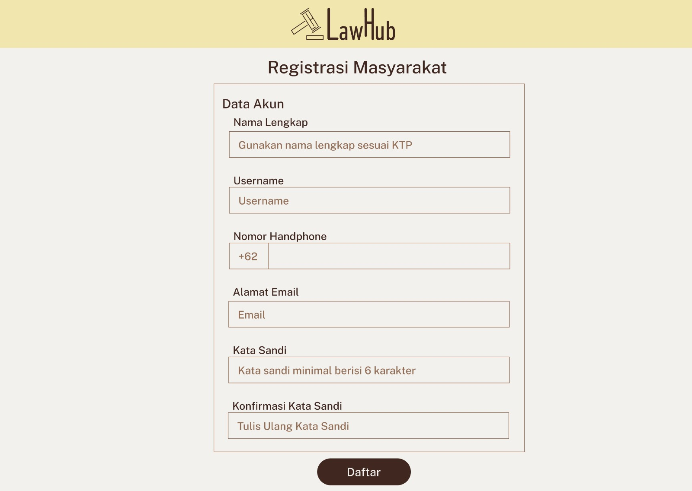
</p>
<p align="center">
<i>Gambar 6.1. Rancangan Antarmuka UI-01 - Registrasi Masyarakat</i>
</p>

Tabel 6.1. Spesifikasi Objek Antarmuka UI-01

| Id_Objek | Jenis | Konten | Keterangan |
| :--- | :--- | :--- | :--- |
| O-01 | Button | Daftar | Memproses data registrasi yang telah diisi. Sistem memvalidasi kelengkapan dan kesesuaian data, termasuk konfirmasi kata sandi, sebelum melanjutkan proses pendaftaran akun. |
| O-02 | Input Fields | Data Akun (Nama Lengkap, Username, Nomor Handphone, Alamat Email, Kata Sandi, Konfirmasi Kata Sandi) | Menyediakan kolom input data masyarakat yang terdiri atas nama lengkap sesuai KTP, username, nomor handphone dengan kode negara +62, alamat email, kata sandi minimal 6 karakter, dan konfirmasi kata sandi. |

## 6.2 Rancangan Antarmuka UI-02
**Antarmuka:** UI-02 
**Nama Layar:** Login Masyarakat

<p align="center">
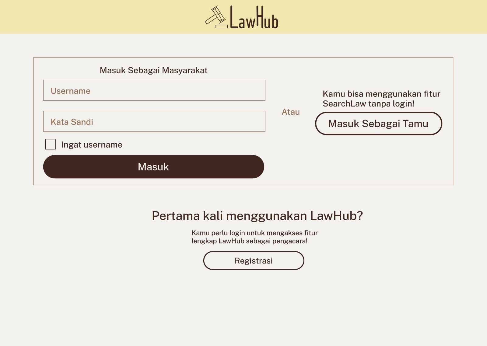
</p>
<p align="center">
<i>Gambar 6.2. Rancangan Antarmuka UI-02 -Login Masyarakat</i>
</p>

Tabel 6.2. Spesifikasi Objek Antarmuka UI-02

| Id_Objek | Jenis | Konten | Keterangan |
| :--- | :--- | :--- | :--- |
| O-03 | Input Fields | Data Login (Username, Kata Sandi) | Menyediakan kolom input username dan kata sandi untuk autentikasi pengguna masyarakat.|
| O-04 | Checkbox | Ingat username | Memungkinkan pengguna memilih opsi untuk mengingat username agar lebih mudah saat melakukan login berikutnya. |
| O-05 | Button | Masuk | Memproses data login dan memvalidasi username serta kata sandi. Jika valid, sistem mengarahkan pengguna ke halaman utama masyarakat. |
| O-06 | Button | Masuk Sebagai Tamu | Mengarahkan pengguna ke halaman tamu agar dapat menggunakan fitur SearchLaw tanpa login. |
| O-07 | Button | Registrasi | Mengarahkan pengguna ke halaman registrasi untuk membuat akun baru. |

## 6.3 Rancangan Antarmuka UI-03
**Antarmuka:** UI-03 
**Nama Layar:** Beranda Masyarakat

<p align="center">
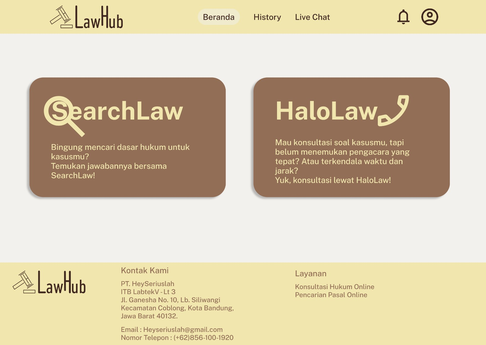
</p>
<p align="center">
<i>Gambar 6.3. Rancangan Antarmuka UI-03 - Beranda Masyarakat</i>
</p>

Tabel 6.3. Spesifikasi Objek Antarmuka UI-03

| Id_Objek | Jenis | Konten | Keterangan |
| :--- | :--- | :--- | :--- |
| O-08 | Logo | Logo LawHub (Header) | Menampilkan logo utama LawHub pada bagian navigasi atas dan mengarahkan pengguna kembali ke halaman Beranda |
| O-09 | Button | Beranda | Mengarahkan pengguna ke halaman utama (Beranda) |
| O-10 | Button | History | Mengarahkan pengguna ke halaman riwayat pencarian atau aktivitas konsultasi |
| O-11 | Button | Live Chat | Mengarahkan pengguna ke fitur obrolan langsung (Live Chat) |
| O-12 | Button | SearchLaw | Menampilkan deskripsi fitur pencarian dasar hukum ("Bingung mencari dasar hukum...") dan mengarahkan ke halaman SearchLaw |
| O-13 | Button | HaloLaw | Menampilkan deskripsi fitur konsultasi pengacara ("Mau konsultasi soal kasusmu...") dan mengarahkan ke halaman HaloLaw |

## 6.4 Rancangan Antarmuka UI-04
**Antarmuka:** UI-04 
**Nama Layar:** SearchLaw

<p align="center">
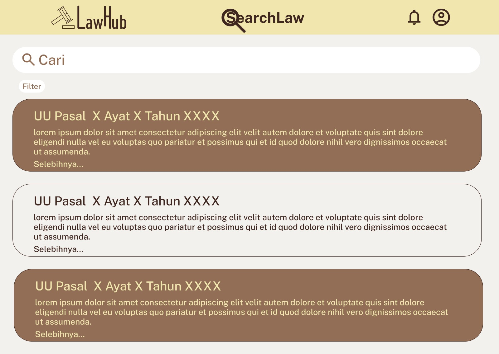
</p>
<p align="center">
<i>Gambar 6.4. Rancangan Antarmuka UI-04 - SearchLaw</i>
</p>

Tabel 6.4. Spesifikasi Objek Antarmuka UI-04

| Id_Objek | Jenis | Konten | Keterangan |
| :--- | :--- | :--- | :--- |
| O-14| Logo | Logo SearchLaw (Header) | Menampilkan identitas dan logo fitur SearchLaw di bagian tengah header |
| O-15 | Input Field | Search Bar ("Cari") | Memungkinkan pengguna memasukkan kata kunci, judul undang-undang, atau nomor pasal yang ingin dicari |
| O-16 | Button | Tombol Filter | Membuka opsi filter/penyaringan untuk membatasi kriteria pencarian dokumen hukum. |
| O-17 | Container | Hasil Pencarian | Menampilkan ringkasan dokumen hukum (UU Pasal X Ayat X Tahun XXXX) beserta teks pratinjau isi pasal |
| O-18 | Text Link | Tautan "Selebihnya..." | Mengarahkan pengguna ke halaman rincian/detail lengkap dari pasal atau undang-undang yang dipilih |

## 6.5 Rancangan Antarmuka UI-05
**Antarmuka:** UI-05 
**Nama Layar:** HaloLaw Form Kasus

<p align="center">
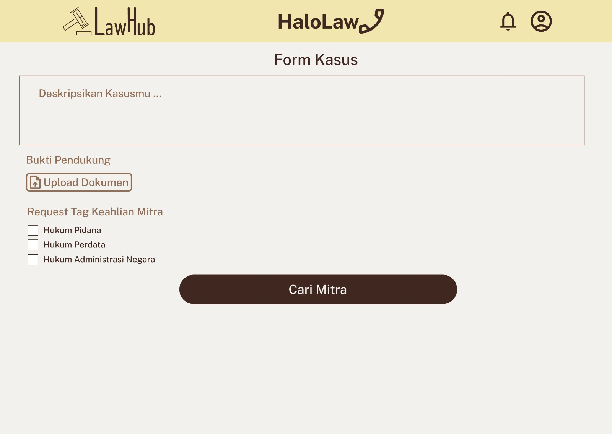
</p>
<p align="center">
<i>Gambar 6.5. Rancangan Antarmuka UI-05 - Halo Law Form Page</i>
</p>

Tabel 6.5. Spesifikasi Objek Antarmuka UI-05

| Id_Objek | Jenis | Konten | Keterangan |
| :--- | :--- | :--- | :--- |
| O-19 | Logo | Logo HaloLaw (Header) | Menampilkan identitas dan logo fitur HaloLaw di bagian tengah header |
| O-20 | Input Field | Deskripsi Kasus ("Deskripsikan Kasusmu ...") | Memungkinkan pengguna mengetikkan penjelasan kronologi atau detail permasalahan hukum yang dihadapi |
| O-21 | File Upload | Tombol "Upload Dokumen" (Bukti Pendukung) | Memungkinkan pengguna mengunggah berkas atau dokumen bukti pendukung terkait kasus |
| O-22  | Checkbox | Checkbox Request Tag Keahlian Mitra | Memungkinkan pengguna memilih opsi kategori keahlian hukum (Hukum Pidana, Hukum Perdata, Hukum Administrasi Negara) yang dibutuhkan|
| O-23 | Button | Tombol "Cari Mitra" | Memproses data pengisian formulir dan mengarahkan pengguna ke daftar atau pencarian mitra pengacara yang sesuai |

## 6.6 Rancangan Antarmuka UI-06
**Antarmuka:** UI-06 
**Nama Layar:** HaloLaw List Mitra

<p align="center">
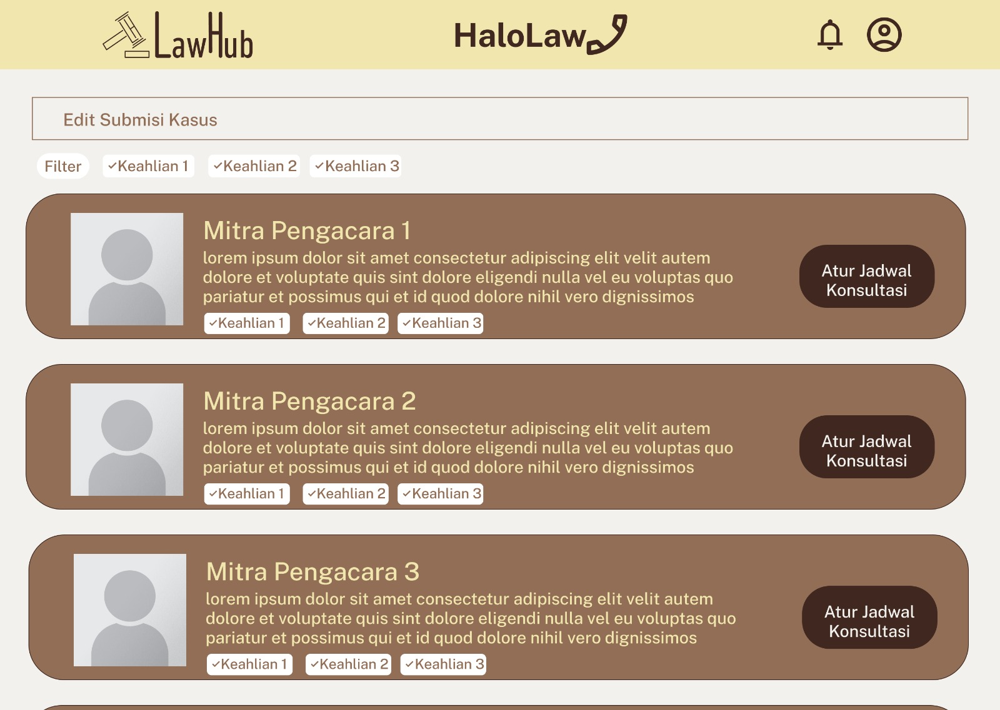
</p>
<p align="center">
<i>Gambar 6.6. Rancangan Antarmuka UI-06 - Halo Law List Mitra Page</i>
</p>

Tabel 6.6. Spesifikasi Objek Antarmuka UI-06

| Id_Objek | Jenis | Konten | Keterangan |
| :--- | :--- | :--- | :--- |
| O-24 | Button | Tombol "Edit Submisi Kasus" | Mengarahkan pengguna kembali ke halaman formulir untuk mengubah rincian kasus yang telah dimasukkan. |
| O-24| Filter | Filter & Tag Keahlian | Memungkinkan pengguna menyaring daftar mitra pengacara berdasarkan kriteria keahlian yang dipilih. |
| O-25 | Container | Profil Mitra Pengacara | Menampilkan informasi ringkas mitra pengacara yang mencakup foto profil, nama, deskripsi pengalaman, dan tag bidang keahlian. |
| O-26 | Button | Tombol "Atur Jadwal Konsultasi" | Mengarahkan pengguna ke halaman atau modul penjadwalan konsultasi dengan mitra pengacara yang dipilih. |

## 6.7 Rancangan Antarmuka UI-07
**Antarmuka:** UI-07 
**Nama Layar:** HaloLaw List Mitra Kosong

<p align="center">
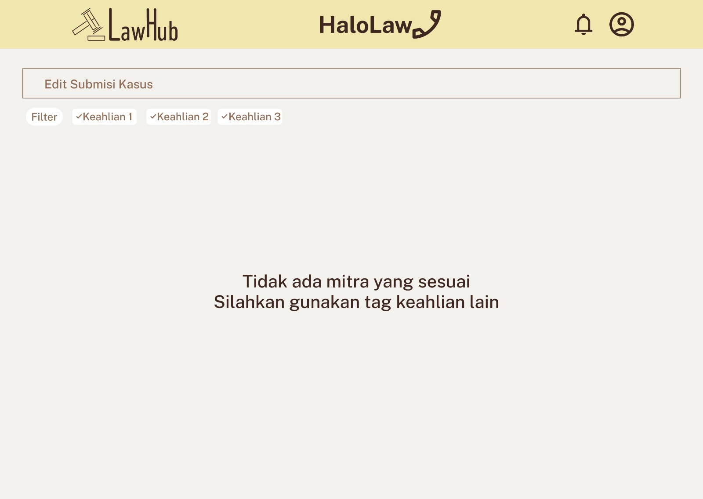
</p>
<p align="center">
<i>Gambar 6.7. Rancangan Antarmuka UI-07 - Halo Law List Mitra Kosong</i>
</p>

Tabel 6.7. Spesifikasi Objek Antarmuka UI-07

| Id_Objek | Jenis | Konten | Keterangan |
| :--- | :--- | :--- | :--- |
| O-27 | Button | Tombol "Edit Submisi Kasus" | Mengarahkan pengguna kembali ke halaman formulir untuk mengubah rincian kasus yang telah dimasukkan. |
| O-28 | Filter | Filter & Tag Keahlian | Memungkinkan pengguna menyaring daftar mitra pengacara berdasarkan kriteria keahlian yang dipilih. |
| O-29 | Text Info | Pesan Empty State ("Tidak ada mitra...") | Menampilkan informasi bahwa tidak ada mitra pengacara yang sesuai dengan kriteria/filter terpilih, serta memberi petunjuk untuk memilih tag keahlian lain. |

## 6.8 Rancangan Antarmuka UI-08
**Antarmuka:** UI-08 
**Nama Layar:** Pemilihan Jadwal Konsultasi

<p align="center">
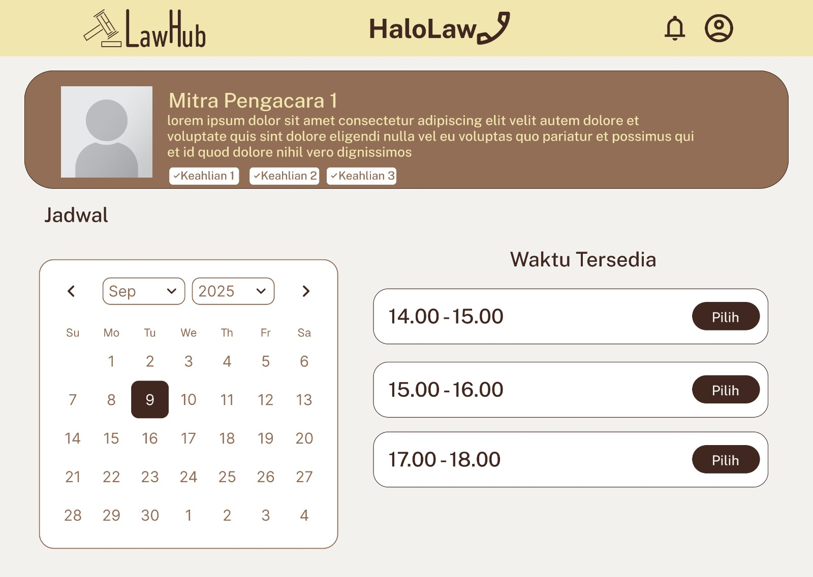
</p>
<p align="center">
<i>Gambar 6.8. Rancangan Antarmuka UI-08 - Pemilihan Jadwal Konsultasi</i>
</p>

Tabel 6.8. Spesifikasi Objek Antarmuka UI-08

| Id_Objek | Jenis | Konten | Keterangan |
| :--- | :--- | :--- | :--- |
| O-30 | Container | Data Ringkasan Mitra Pengacara | Menampilkan informasi ringkas mitra pengacara terpilih (foto profil, nama, deskripsi, dan tag keahlian). |
| O-31 | Date Picker | Kalender Pemilihan Tanggal | Memungkinkan pengguna memilih tanggal konsultasi dengan navigasi pilihan bulan dan tahun. |
| O-32 | List | List Slot Waktu ("Waktu Tersedia") | Menampilkan daftar pilihan slot jam konsultasi yang tersedia pada tanggal yang dipilih. |
| O-33 | Button | Tombol "Pilih" | Memilih slot waktu konsultasi tertentu dan melanjutkannya ke tahap konfirmasi. |

## 6.9 Rancangan Antarmuka UI-09
**Antarmuka:** UI-09 
**Nama Layar:** Pembayaran

<p align="center">
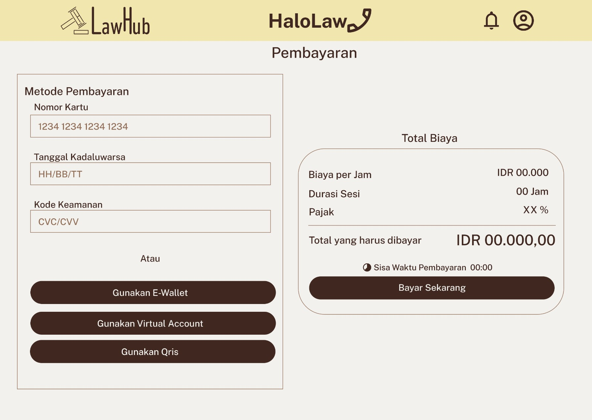
</p>
<p align="center">
<i>Gambar 6.9. Rancangan Antarmuka UI-09 - Pembayaran</i>
</p>

Tabel 6.9. Spesifikasi Objek Antarmuka UI-09

| Id_Objek | Jenis | Konten | Keterangan |
| :--- | :--- | :--- | :--- |
| O-34 | Input Fields | Data Kartu (Nomor Kartu, Tanggal Kadaluwarsa, Kode Keamanan CVC/CVV) | Menyediakan kolom input detail kartu (nomor kartu, tanggal kadaluwarsa HH/BB/TT, dan kode CVC/CVV) untuk metode pembayaran kartu kredit/debit. |
| O-35 | Button | Tombol "Gunakan E-Wallet" | Memungkinkan pengguna memilih metode pembayaran melalui dompet digital (E-Wallet). |
| O-36 | Button | Tombol "Gunakan Virtual Account" | Memungkinkan pengguna memilih metode pembayaran melalui Virtual Account bank. |
| O-37 | Button | Tombol "Gunakan Qris" | Memungkinkan pengguna memilih metode pembayaran menggunakan pemindaian kode QRIS. |
| O-38 | Text Info | Ringkasan Total Biaya | Menampilkan rincian komponen biaya meliputi Biaya per Jam, Durasi Sesi, Pajak, dan Total yang harus dibayar. |
| O-39 | Timer | Sisa Waktu Pembayaran | Menampilkan indikator penghitung waktu mundur (countdown timer) batas waktu penyelesaian transaksi. |
| O-40 | Button | Tombol "Bayar Sekarang" | Memproses transaksi pembayaran sesuai metode dan rincian yang dipilih. |

## 6.10 Rancangan Antarmuka UI-10
**Antarmuka:** UI-10 
**Nama Layar:** Chat Konsultasi Masyarakat

<p align="center">
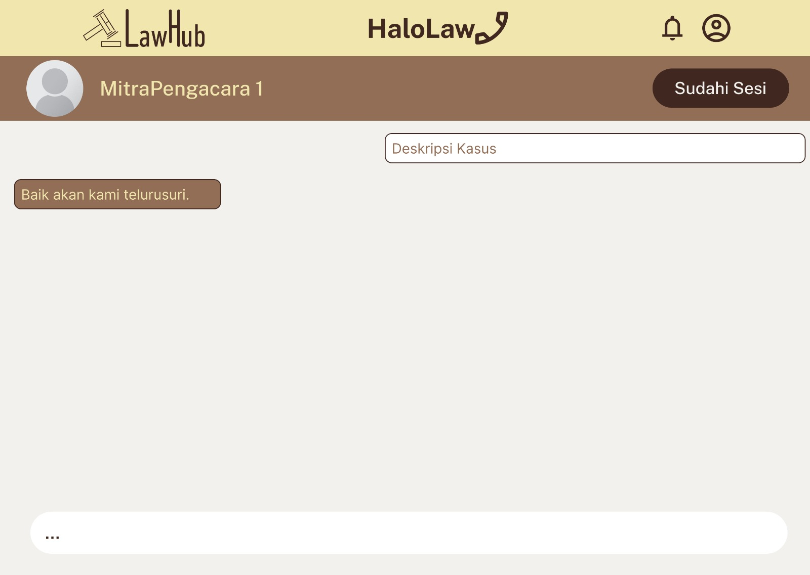
</p>
<p align="center">
<i>Gambar 6.10. Rancangan Antarmuka UI-10 - Chat Konsultasi Masyarakat</i>
</p>

Tabel 6.10. Spesifikasi Objek Antarmuka UI-10

| Id_Objek | Jenis | Konten | Keterangan |
| :--- | :--- | :--- | :--- |
| O-41 | Text Info | Profil Mitra Pengacara (Sub-header) | Menampilkan foto profil dan nama mitra pengacara yang sedang aktif melayani sesi konsultasi. |
| O-42 | Button | Tombol "Sudahi Sesi" | Memungkinkan pengguna untuk mengakhiri sesi obrolan/konsultasi secara langsung. |
| O-43 | Chat Bubble  | Bubble Pesan Chat | Menampilkan balon percakapan pesan teks yang dikirim oleh  pengguna. |
| O-44 | Chat Bubble  | Bubble Pesan Chat | Menampilkan balon percakapan pesan teks yang dikirim oleh mitra pengacara. |
| O-45 | Input Field | Field Pesan Chat ("...") | Menyediakan kolom input teks untuk mengetik dan mengirimkan pesan baru dalam obrolan konsultasi. |

## 6.11 Rancangan Antarmuka UI-11
**Antarmuka:** UI-11 
**Nama Layar:** Chat Konsultasi Mitra

<p align="center">
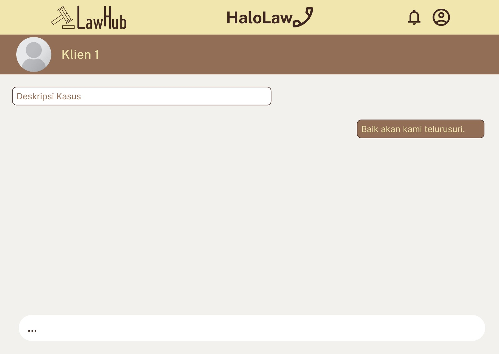
</p>
<p align="center">
<i>Gambar 6.11. Rancangan Antarmuka UI-11 - Chat Konsultasi Mitra</i>
</p>

Tabel 6.11. Spesifikasi Objek Antarmuka UI-11

| Id_Objek | Jenis | Konten | Keterangan |
| :--- | :--- | :--- | :--- |
| O-46 | Text Info | Profil Klien (Sub-header) | Menampilkan foto profil dan nama/identitas klien (Klien 1) yang sedang berkonsultasi dengan mitra.|
| O-47 | Chat Bubble  | Bubble Pesan Chat | Menampilkan balon percakapan pesan teks yang dikirim oleh  pengguna. |
| O-48 | Chat Bubble  | Bubble Pesan Chat | Menampilkan balon percakapan pesan teks yang dikirim oleh mitra pengacara. |
| O-49 | Input Field | Field Pesan Chat ("...") | Menyediakan kolom input teks untuk mengetik dan mengirimkan pesan baru dalam obrolan konsultasi. |

## 6.12 Rancangan Antarmuka UI-12
**Antarmuka:** UI-12 
**Nama Layar:** Form Ulasan

<p align="center">
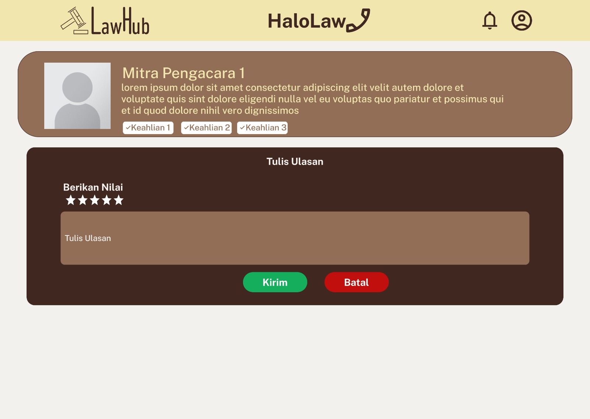
</p>
<p align="center">
<i>Gambar 6.12. Rancangan Antarmuka UI-12 - Form Ulasan</i>
</p>

Tabel 6.12. Spesifikasi Objek Antarmuka UI-12

| Id_Objek | Jenis | Konten | Keterangan |
| :--- | :--- | :--- | :--- |
| O-50 |  Container | Ringkasan Mitra Pengacara | Menampilkan informasi ringkas mitra pengacara yang diulas (foto profil, nama, deskripsi, dan tag keahlian). |
| O-51 | Button | Rating Bintang ("Berikan Nilai") | Memungkinkan pengguna memberikan penilaian tingkat kepuasan layanan dalam bentuk jumlah bintang (1-5 bintang). |
| O-52 | Input Field | Field Ulasan ("Tulis Ulasan") | Menyediakan kolom input teks bagi pengguna untuk mengetik ulasan atau umpan balik tertulis mengenai konsultasi. |
| O-53 | Button | Tombol "Kirim" | Memproses dan menyimpan nilai rating serta ulasan pengguna ke sistem. |
| O-54 | Button | Tombol "Batal" | Membatalkan pengisian ulasan dan mengarahkan pengguna kembali ke halaman sebelumnya. |

## 6.13 Rancangan Antarmuka UI-13
**Antarmuka:** UI-13 
**Nama Layar:** History Chat

<p align="center">
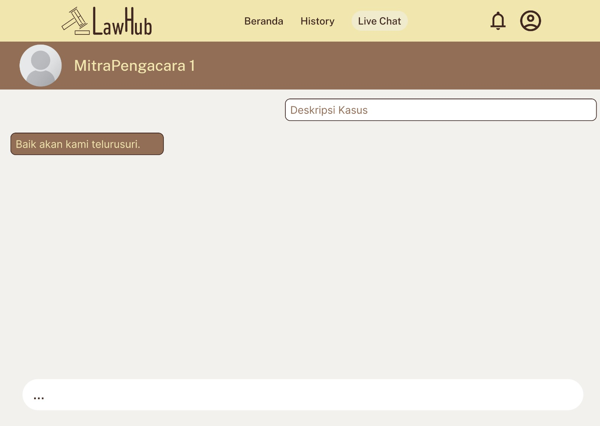
</p>
<p align="center">
<i>Gambar 6.13. Rancangan Antarmuka UI-13 - History Chat</i>
</p>

Tabel 6.13. Spesifikasi Objek Antarmuka UI-13

| Id_Objek | Jenis | Konten | Keterangan |
| :--- | :--- | :--- | :--- |
| O-55 |  Text Info | Profil Mitra Pengacara (Sub-header) | Menampilkan foto profil dan nama mitra pengacara (MitraPengacara 1) dalam ruang percakapan. |
| O-56 | Chat Bubble  | Bubble Pesan Chat | Menampilkan balon percakapan pesan teks yang dikirim oleh  pengguna. |
| O-57 | Chat Bubble | Bubble Pesan Chat | Menampilkan balon percakapan riwayat pesan teks dalam obrolan konsultasi. |

## 6.14 Rancangan Antarmuka UI-14
**Antarmuka:** UI-14 
**Nama Layar:** List History Chat Masyarakat

<p align="center">
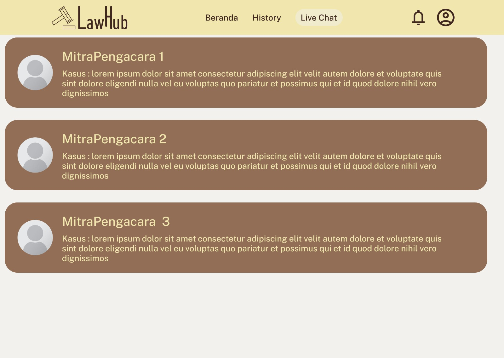
</p>
<p align="center">
<i>Gambar 6.14. Rancangan Antarmuka UI-14 - List History Chat Masyarakat</i>
</p>

Tabel 6.14. Spesifikasi Objek Antarmuka UI-14

| Id_Objek | Jenis | Konten | Keterangan |
| :--- | :--- | :--- | :--- |
| O-58 | Container | Riwayat Konsultasi | Menampilkan daftar kartu riwayat sesi konsultasi hukum yang pernah dilakukan oleh pengguna. |
| O-59 | Text Info | Informasi Mitra Pengacara (Foto & Nama) | Menampilkan foto profil dan nama mitra pengacara pada masing-masing item riwayat. |
| O-60 | Text Info | Ringkasan Kasus ("Kasus : ...") | Menampilkan pratinjau atau deskripsi singkat kasus yang telah dikonsultasikan pada sesi tersebut. |

## 6.15 Rancangan Antarmuka UI-15
**Antarmuka:** UI-15 
**Nama Layar:** List History Chat Mitra

<p align="center">
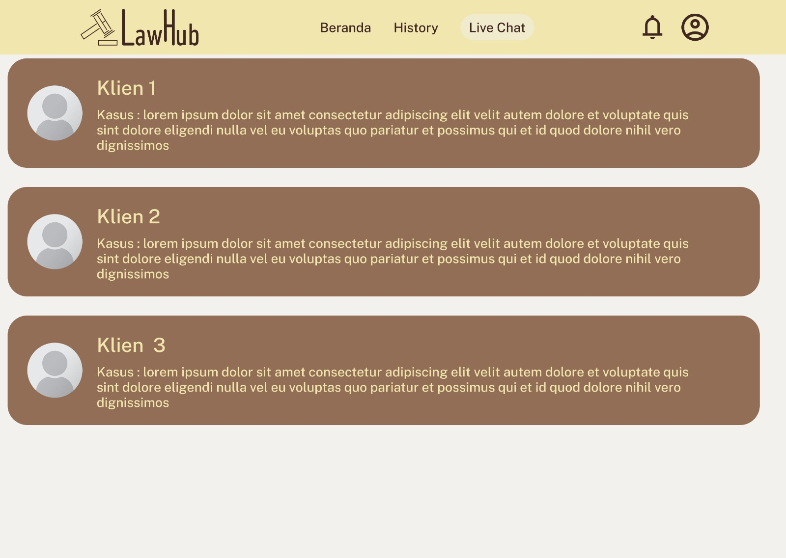
</p>
<p align="center">
<i>Gambar 6.15. Rancangan Antarmuka UI-15 - List History Chat Mitra</i>
</p>

Tabel 6.15. Spesifikasi Objek Antarmuka UI-15

| Id_Objek | Jenis | Konten | Keterangan |
| :--- | :--- | :--- | :--- |
| O-61 | Container | Riwayat Konsultasi | Menampilkan daftar kartu riwayat sesi konsultasi hukum yang pernah dilakukan oleh mitra pengacara. |
| O-62 | Text Info | Informasi Klien (Foto & Nama) | Menampilkan foto profil dan nama klien pada masing-masing item riwayat. |
| O-63 | Text Info | Ringkasan Kasus ("Kasus : ...") | Menampilkan pratinjau atau deskripsi singkat kasus yang telah dikonsultasikan pada sesi tersebut. |

## 6.16 Rancangan Antarmuka UI-16
**Antarmuka:** UI-16 
**Nama Layar:** Live Chat Masyarakat

<p align="center">
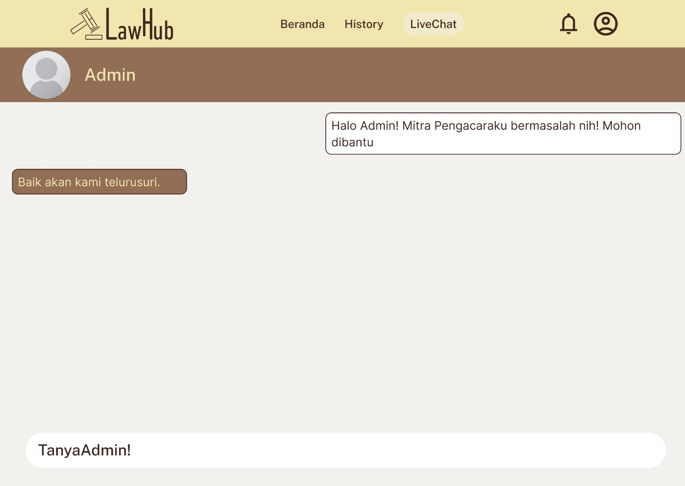
</p>
<p align="center">
<i>Gambar 6.16. Rancangan Antarmuka UI-16 - Live Chat Masyarakat</i>
</p>

Tabel 6.16. Spesifikasi Objek Antarmuka UI-16

| Id_Objek | Jenis | Konten | Keterangan |
| :--- | :--- | :--- | :--- |
| O-64 | Text Info | Profil Admin (Sub-header) | Menampilkan foto profil dan nama/identitas Admin yang melayani sesi bantuan pelanggan. |
| O-65 | Chat Bubble | Bubble Pesan Chat | Menampilkan balon percakapan riwayat pesan teks antara pengguna dan Admin. |
| O-66 | Input Field | Field Pesan Chat ("TanyaAdmin!") | Menyediakan kolom input teks untuk mengetik dan mengirimkan pesan bantuan kepada Admin. |

## 6.17 Rancangan Antarmuka UI-17
**Antarmuka:** UI-17 
**Nama Layar:** Live Chat Admin

<p align="center">
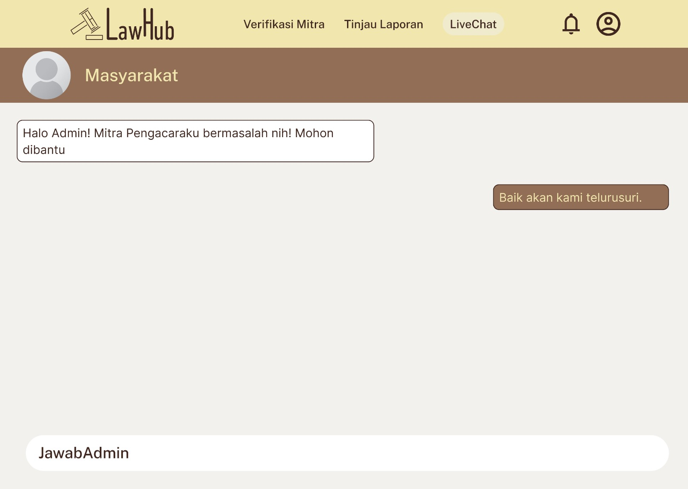
</p>
<p align="center">
<i>Gambar 6.17. Rancangan Antarmuka UI-17 - List History Chat Admin</i>
</p>

Tabel 6.17. Spesifikasi Objek Antarmuka UI-17

| Id_Objek | Jenis | Konten | Keterangan |
| :--- | :--- | :--- | :--- |
| O-67 | Text Info | Profil Masyarakat (Sub-header) | Menampilkan foto profil dan nama/identitas Admin yang melayani sesi bantuan pelanggan. |
| O-68 | Chat Bubble | Bubble Pesan Chat | Menampilkan balon percakapan riwayat pesan teks antara pengguna dan Admin. |
| O-69 | Input Field | Field Pesan Chat ("JawabAdmin") | Menyediakan kolom input teks untuk mengetik dan mengirimkan pesan jawaban. |

## 6.X Rancangan Antarmuka [ID Layar X]

*[Ulangi pola 6.1 untuk layar berikutnya sampai semua layar teridentifikasi]*

## 6.Y Rancangan Antarmuka Keseluruhan

Tuliskan daftar gambar seluruh antarmuka. Berikan ID unik untuk setiap tampilan dan gunakan ID yang sama pada subbab perancangan antarmuka masing-masing.

Tabel 6.Y. Rancangan Antarmuka Keseluruhan

| No | Tampilan Antarmuka |
| :--- | :--- |
| [UI-01] |  |
| [UI-02] |  |
| [UI-03]|  |
| [UI-04]|  |
| [UI-05]|  |
| [UI-06]|  |
| [UI-07]|  |
| [UI-08]|  |
| [UI-09]|  |
| [UI-10]|  |
| [UI-11]|  |
| [UI-12]|  |
| [UI-13]|  |
| [UI-14]|  |
| [UI-15]|  |
| [UI-16]|  |
| [UI-17]|  |
<br>

---

# BAB 7: Matriks Kerunutan

Petakan kelas perancangan dengan use case yang terkait. Gunakan **BAB 6 Traceability pada dokumen SKPL** sebagai acuan keterkaitan kelas analisis dan use case, lalu sesuaikan dengan realisasi use case dan kelas perancangan pada BAB 3–BAB 5 DPPL.

Tabel 7.1. Matriks Kerunutan Kelas terhadap Use Case

| Kelas | Use Case Terkait |
| :--- | :--- |
| C01 - RegistrasiMasyarakatPage | UC01 - Melakukan Registrasi Akun bagi Masyarakat |
| C02 - LoginMasyarakatPage | UC02 - Melakukan Login bagi Masyarakat |
| C03 - BerandaPage | UC02 - Melakukan Login bagi Masyarakat |
| C04 - RegistrasiMitraPage | UC03 - Melakukan Registrasi Akun bagi Mitra Pengacara |
| C05 - LoginMitraPage | UC04 - Melakukan Login bagi Mitra Pengacara |
| C06 - StatusVerifikasiMitraPage | UC05 - Melihat Status Registrasi Akun Mitra Pengacara |
| C07 - VerifikasiMitraPage | UC06 - Memverifikasi Pendaftar Mitra Pengacara |
| C08 - EditProfilMitraPage | UC07 - Verifikasi Akun Pengacara |
| C09 - EditDokumenLegalitasPage | UC07 - Verifikasi Akun Pengacara |
| C10 - SearchLawPage | UC08 - Melakukan Pencarian Pasal |
| C11 - DaftarMitraPengacaraPage | UC09 - Melihat Daftar Pengacara |
| C12 - PemilihanJadwalKonsultasiPage | UC10 - Memilih Mitra Pengacara untuk Sesi Konsultasi |
| C13 - KonfirmasiKonsultasiPage | UC11 - Menanggapi Sesi Konsultasi |
| C14 - ChatKonsultasiPage | UC12 - Melakukan Sesi Konsultasi |
| C15 - UlasanPage | UC13 - Memberi Ulasan, Feedback, dan/atau Rating |
| C16 - LaporanAkunPage / LaporanUlasanPage | UC14 - Melaporkan Pelanggaran, UC15 - Melaporkan Pelanggaran |
| C17 - LaporanUlasanPage | UC16 - Melaporkan Ulasan |
| C18 - TinjauanPage | UC17 - Memblokir Akun |
| C19 - HistoryPage | UC18 - Melihat Riwayat Penanganan |
| C20 - LiveChatMasyarakatPage | UC19 - Menanyakan Masalah Teknis |
| C21 - LiveChatAdminPage | UC20 - Menjawab Pertanyaan |
| C22 - PembayaranPage | UC21 - Membayar Biaya Sesi Konsultasi |
| C23 - PencairanDanaPage | UC22 - Mencairkan Dana |
| C24 - RegistrasiMasyarakatController | UC01 - Melakukan Registrasi Akun bagi Masyarakat |
| C25 - AutentikasiController | UC02 - Melakukan Login bagi Masyarakat, UC04 - Melakukan Login bagi Mitra Pengacara |
| C26 - RegistrasiMitraController | UC03 - Melakukan Registrasi Akun bagi Mitra Pengacara |
| C27 - VerifikasiMitraController | UC05 - Melihat Status Registrasi Akun Mitra Pengacara, UC06 - Memverifikasi Pendaftar Mitra Pengacara |
| C28 - ProfilMitraController | UC07 - Verifikasi Akun Pengacara |
| C29 - SearchLawController | UC08 - Melakukan Pencarian Pasal |
| C30 - PencarianMitraController | UC09 - Melihat Daftar Pengacara |
| C31 - PenjadwalanKonsultasiController | UC10 - Memilih Mitra Pengacara untuk Sesi Konsultasi |
| C32 - SesiKonsultasiController | UC11 - Menanggapi Sesi Konsultasi, UC12 - Melakukan Sesi Konsultasi |
| C33 - UlasanController | UC13 - Memberi Ulasan, Feedback, dan/atau Rating |
| C34 - LaporanController | UC14 - Melaporkan Pelanggaran, UC15 - Melaporkan Pelanggaran, UC16 - Melaporkan Ulasan |
| C35 - ModerasiAkunController | UC17 - Memblokir Akun |
| C36 - RiwayatController | UC18 - Melihat Riwayat Penanganan |
| C37 - LiveChatController | UC19 - Menanyakan Masalah Teknis, UC20 - Menjawab Pertanyaan |
| C38 - PembayaranController | UC21 - Membayar Biaya Sesi Konsultasi |
| C39 - PencairanDanaController | UC22 - Mencairkan Dana |
| C40 - Masyarakat | UC01 - Melakukan Registrasi Akun bagi Masyarakat, UC02 - Melakukan Login bagi Masyarakat, UC08 - Melakukan Pencarian Pasal, UC09 - Melihat Daftar Pengacara, UC10 - Memilih Mitra Pengacara untuk Sesi Konsultasi, UC12 - Melakukan Sesi Konsultasi, UC13 - Memberi Ulasan, Feedback, dan/atau Rating, UC14 - Melaporkan Pelanggaran, UC18 - Melihat Riwayat Penanganan, UC19 - Menanyakan Masalah Teknis, UC21 - Membayar Biaya Sesi Konsultasi |
| C41 - MitraPengacara | UC03 - Melakukan Registrasi Akun bagi Mitra Pengacara, UC04 - Melakukan Login bagi Mitra Pengacara, UC05 - Melihat Status Registrasi Akun Mitra Pengacara, UC06 - Memverifikasi Pendaftar Mitra Pengacara, UC07 - Verifikasi Akun Pengacara, UC09 - Melihat Daftar Pengacara, UC11 - Menanggapi Sesi Konsultasi, UC12 - Melakukan Sesi Konsultasi, UC15 - Melaporkan Pelanggaran, UC16 - Melaporkan Ulasan, UC18 - Melihat Riwayat Penanganan, UC22 - Mencairkan Dana |
| C42 - Admin | UC06 - Memverifikasi Pendaftar Mitra Pengacara, UC17 - Memblokir Akun, UC19 - Menanyakan Masalah Teknis, UC20 - Menjawab Pertanyaan |
| C43 - Kasus | UC10 - Memilih Mitra Pengacara untuk Sesi Konsultasi, UC12 - Melakukan Sesi Konsultasi, UC18 - Melihat Riwayat Penanganan |
| C44 - DasarHukum | UC08 - Melakukan Pencarian Pasal |
| C45 - DokumenLegalitas | UC03 - Melakukan Registrasi Akun bagi Mitra Pengacara, UC05 - Melihat Status Registrasi Akun Mitra Pengacara, UC06 - Memverifikasi Pendaftar Mitra Pengacara, UC07 - Verifikasi Akun Pengacara |
| C46 - SesiKonsultasi | UC10 - Memilih Mitra Pengacara untuk Sesi Konsultasi, UC11 - Menanggapi Sesi Konsultasi, UC12 - Melakukan Sesi Konsultasi, UC18 - Melihat Riwayat Penanganan, UC21 - Membayar Biaya Sesi Konsultasi |
| C47 - Ulasan / Laporan | UC09 - Melihat Daftar Pengacara, UC13 - Memberi Ulasan, Feedback, dan/atau Rating, UC16 - Melaporkan Ulasan |
| C48 - Laporan |  UC14 - Melaporkan Pelanggaran, UC15 - Melaporkan Pelanggaran, UC16 - Melaporkan Ulasan, UC17 - Memblokir Akun |
| C49 - Pembayaran | UC12 - Melakukan Sesi Konsultasi, UC21 - Membayar Biaya Sesi Konsultasi |
| C50 - LiveChat | UC19 - Menanyakan Masalah Teknis, UC20 - Menjawab Pertanyaan |
| C51 - PencairanDana | UC22 - Mencairkan Dana |
