<h1>
IF2150 REKAYASA PERANGKAT LUNAK
<br>
TUGAS 5
<br>
DESKRIPSI PERANCANGAN PERANGKAT LUNAK (DPPL)
</h1>
<br>

## *LaporKota*
<p align="center">

</p>

### Untuk: *Jordhy*

Dipersiapkan oleh:
| Informasi | Keterangan |
| --- | --- |
| Kelas | *K - 03* |
| Kelompok | *G07* |

| NIM | Nama |
| --- | --- |
| *13525051* | *Rafi Pradipta Andira Sulistyo* |
| *13525105* | *Pasaribu Fritz T.A.M.* |
| *13525075* | *Bagas Anugrah Putra* |
| *13525099* | *Gede Pranajayanta Suputra* |
| *13525015* | *Muhammad Atallah Ramadhan* |
---

## Daftar Perubahan

| Revisi | Deskripsi |
| :--- | :--- |
| *A* | *Deskripsikan perubahan yang dilakukan dari dokumen sebelumnya pada dokumen ini. Jika tidak terdapat perubahan, harap kosongkan tabel.* |
| *B* |  |
| *C* |  |
| ... |  |


---


# BAB 1: Pendahuluan

## 1.1 Tujuan Penulisan Dokumen
Dokumen Deskripsi Perancangan Perangkat Lunak (DPPL) ini disusun untuk memberikan panduan teknis, struktural, dan prosedural yang presisi bagi tim pengembang dalam mengimplementasikan platform LaporKota ke dalam bentuk kode program. Dokumen ini menjabarkan pemodelan arsitektur sistem, realisasi detail use case ke dalam sequence diagram dan class diagram, perancangan antarmuka pengguna, serta pemetaan keterlacakan kelas terhadap kebutuhan fungsional perangkat lunak. Dokumen ini ditujukan bagi Tim Pengembang (*software developer*) sebagai acuan implementasi kode, Tim Penguji (*quality assurance*) sebagai acuan pengujian integrasi struktural, serta Asisten dan Dosen Pengampu mata kuliah IF2150 Rekayasa Perangkat Lunak untuk mengevaluasi kesesuaian hasil rancangan dengan spesifikasi kebutuhan yang telah ditetapkan pada SKPL.

## 1.2 Lingkup Masalah
Perangkat lunak yang akan dikembangkan adalah LaporKota, sebuah platform pelaporan kerusakan infrastruktur publik berbasis website yang dirancang untuk mempermudah warga dalam menyampaikan dan memantau laporannya. Sistem pelaporan ini memfasilitasi pengguna untuk melaporkan masalah fasilitas umum dalam lingkup satu kota, kapan saja dan di mana saja dengan menyertakan foto serta koordinat lokasi. Dengan adanya sistem ini diharapkan pengguna tidak lagi kesulitan mencari saluran pengaduan yang responsif dan proses perbaikan kerusakan fasilitas publik dapat berjalan dengan efisien.

## 1.3 Definisi, Istilah, dan Singkatan
Semua definisi dan singkatan yang digunakan dalam dokumen ini beserta penjelasannya.

Tabel 1.3. Definisi Istilah dan Singkatan

| Singkatan, Akronim, atau Istilah | Penjelasan |
| :--- | :--- |
| *P/L* | *Singkatan dari Perangkat Lunak, yaitu aplikasi yang memberikan perintah kepada komputer untuk menjalankan tugas tertentu.* |
| *SKPL* | *Singkatan dari Spesifikasi Kebutuhan Perangkat Lunak, yaitu dokumen yang merangkum kriteria-kriteria yang diperlukan untuk membangun aplikasi menjalankan tugasnya.* |
| *KF* | *Singkatan dari Kebutuhan Fungsional, yaitu fungsi atau perilaku yang dimiliki sistem.* |
| *KNF* | *Singkatan dari Kebutuhan Non-Fungsional, yaitu kualitas sistem seperti kecepatan, keamanan, dan ketersediaan.* |
| *UC* | *Singkatan dari Use Case, yaitu gambaran interaksi antara aktor dan sistem.* |
| *CD* | *Singkatan dari Class Diagram, Diagram yang menggambarkan struktur kelas beserta atribut, metode, dan hubungan antarkelas di dalam sistem.* |
| *GPS* | *Singkatan dari Global Positioning System, yaitu sistem navigasi berbasis satelit untuk menentukan posisi.* |
| *API* | *Singkatan dari Application Programming Interface, yaitu antarmuka yang memungkinkan program saling terhubung.* |
| *Latitude / Longitude* | *Garis lintang dan garis bujur, yaitu dua nilai koordinat posisi di bumi.* |
| *DPPL* | *Singkatan dari Deskripsi Perancangan Perangkat Lunak, yaitu dokumen yang berfungsi sebagai panduan bagi pengembang untuk mengimplementasikan perangkat lunak dalam bentuk kode program.* |
| *APL* | *Singkatan dari Arsitektur Perangkat Lunak, yaitu dokumen yang menetapkan pola arsitektur, komponen, dan model view dari perangkat lunak.* |
| *...* | *...* |

## 1.4 Aturan Penomoran
Tuliskan aturan penomoran (ID) yang digunakan dalam dokumen ini. Gunakan pola ID yang **sama** dengan yang sudah dipakai pada dokumen-dokumen sebelumnya, jangan membuat pola baru di dokumen ini.

Tabel 1.4. Aturan Penomoran

| Hal/Bagian | Penomoran | Keterangan |
| :--- | :--- | :--- |
| *Kebutuhan Fungsional* | *KFXX* | Contoh: KF01 |
| *Kebutuhan Non-Fungsional* | *KNFXX* | Contoh: KNF02 |
| *Use Case* | *UCXX* | Contoh: UC03 |
| *Kelas* | *CXX* | Contoh: C04 |
| *...* | *...* |

## 1.5 Referensi
| Nomor | Judul Referensi | Sumber |
| :--- | :--- | :--- |
| 1 | Dokumen Spesifikasi Kebutuhan Perangkat Lunak LaporKota | Repository IF2150-RPL-K03-G07/docs/M5/K03_G07_SKPL.md |
| 2 | Dokumen Aristektur Perangkat Lunak LaporKota | Repository IF2150-RPL-K03-G07/docs/M6/K03_G07_APL.md |

## 1.6 Deskripsi Umum Dokumen (Ikhtisar)
Dokumen Deskripsi Perancangan Perangkat Lunak (DPPL) ini disusun dengan sistematika berikut. **BAB 1: Pendahuluan** memuat tujuan penulisan dokumen, lingkup masalah, daftar definisi, aturan penomoran, referensi, serta ikhtisar dokumen. **BAB 2: Perancangan Arsitektur** menjelaskan rancangan lingkungan implementasi, pola arsitektur (beserta alasan pemilihannya), identifikasi komponen (beserta tanggung jawabnya), dan model arsitektur yang mengacu pada dokumen APL. **BAB 3: Realisasi Use Case**  menguraikan perancangan setiap Use Case melalui identifikasi kelas perancangan, sequence diagram (untuk skenario normal dan alternatif), serta diagram kelas. **BAB 4: Diagram Kelas Keseluruhan** menggambungkan seluruh kelas perancangan dalam satu diagram. **BAB 5: Perancangan Rinci Kelas** merincikan setiap kelas meiliputi operasi dan atribut yang terkait dengan tiap kelas, serta implementasi algoritma/query yang penting pada kelas tersebut. **BAB 6: Perancangan Antarmuka** menggambarkan rancangan tampilan antarmuka pada perangkat lunak sebagai gambaran visual. **BAB 7: Matriks Kerunutan** memetakan keterkaitan setiap kelas perancangan dengan use case untuk memastikan rancangan telah mendukung kebutuhan pada SKPL.

<br>

---

# BAB 2: Perancangan Arsitektur

## 2.1 Rancangan Lingkungan Implementasi

Sebutkan *operating system*, DBMS, *development tools*, *filing system*, dan bahasa pemrograman yang digunakan.

| Komponen | Spesifikasi |
| :--- | :--- |
| *Server/Hosting* | Vercel dengan *runtime* Node.js 24 (LTS) |
| *Framework* | Next.js 16.3 dan React 19.3 |
| *Backend-as-a-Service* | Supabase (Auth, Database, Storage, Realtime) |
| *DBMS* | PostgreSQL 17 yang dikelola oleh Supabase |
| *Penyimpanan Berkas* | Supabase Storage |
| *Layanan Peta* | *Tile* OpenStreetMap yang ditampilkan dengan pustaka Leaflet |
| *Client* | *Web browser* modern versi terbaru (Google Chrome, Mozilla Firefox, Safari, Microsoft Edge) yang mendukung JavaScript, WebSocket, dan *Geolocation API* |
| *Perangkat Klien* | Warga dan Eksekutor Lapangan: *smartphone* atau laptop yang memiliki kamera dan layanan lokasi (GPS). Tim Administrasi: komputer atau laptop |
| *OS* | *Cross platform* melalui *browser* (Android, iOS, Windows, macOS, Linux, bisa banyak OS asal terhubung dengan jaringan internet) |
| *Jaringan* | Koneksi internet dengan protokol HTTPS |


## 2.2 Style/Pattern Arsitektur Acuan

LaporKota menggunakan pola arsitektur *client-server*. Pemilihan pola arsitektur *client-server* didasarkan pada karakteristik LaporKota yang telah ditetapkan pada dokumen SKPL sebelumnya. 

<p align="center">

</p>
<p align="center">
<i>Gambar 1. Arsitektur client-server</i>
</p>

## Style Arsitektur yang Dipilih

Pada pola *client-server*, fungsionalitas sistem disusun sebagai sekumpulan layanan yang disediakan oleh *server*, sedangkan *client* mengakses layanan tersebut melalui jaringan. Pola ini terdiri atas tiga bagian sebagai berikut: 

1. ***Client*** adalah antarmuka yang digunakan oleh pengguna. *Client* bertugas menampilkan data, menerima masukan pengguna, memanfaatkan fitur perangkat seperti kamera dan GPS, serta meneruskan permintaan ke *server*. *Client* tidak menyimpan data laporan secara permanen dan tidak menjalankan aturan bisnis. LaporKota memiliki tiga jenis *client* sesuai dengan aktornya, yaitu *client* Warga, *client* Eksekutor Lapangan, dan *client* Tim Administrasi.
2. ***Server*** menyediakan layanan yang dipakai bersama oleh seluruh *client*. *Server* menjalankan *logic* aplikasi melalui kelas-kelas *controller*, misalnya validasi berkas, pengecekan laporan duplikat, peralihan status laporan, dan pengiriman notifikasi. *Server* juga memuat kelas-kelas *entity* yang merepresentasikan data yang diolah oleh *controller*, seperti laporan, pengguna, dan hasil perbaikan.
3. ***Database*** menyimpan seluruh data *entity* serta berkas foto dan video secara terpusat dan persisten. Data laporan dicatat ke *database* melalui *server*, sedangkan berkas foto dan video diunggah langsung dari *client* ke penyimpanan berkas karena batas ukuran *request* pada *server* (batasan vercel). Dengan penyimpanan terpusat ini, seluruh *client* selalu memperoleh data yang sama dan *updated*.
4. **Jaringan** menghubungkan *client* dengan *server* melalui koneksi internet dengan protokol HTTPS.


## Alasan Pemilihan

Pola *client-server* dipilih karena LaporKota memiliki tiga aktor dengan perangkat dan kebutuhan antarmuka yang berbeda, tetapi seluruhnya mengolah data laporan yang sama. Warga dan Eksekutor Lapangan membutuhkan *client* yang dapat mengakses kamera dan GPS perangkat, sedangkan Tim Administrasi membutuhkan *client* untuk mengelola antrean laporan. Karena satu laporan berpindah tangan dari Warga ke Tim Administrasi, Eksekutor Lapangan, lalu kembali ke Tim Administrasi untuk diverifikasi ulang, setiap aktor harus melihat status laporan yang sama dan mutakhir sehingga data perlu dikelola oleh satu *server* dan disimpan pada sarana yang terpusat di *database*. Selain itu, beberapa kebutuhan fungsional hanya dapat dijalankan di *server* karena membutuhkan akses ke seluruh data laporan, yaitu pemeriksaan duplikasi dalam radius 20 meter (KF05, KF06) dan perhitungan ulang urutan prioritas (KF13), sedangkan penguncian koordinat GPS (KF01) dijalankan di *client*. Pengumpulan layanan di *server* juga mendukung kebutuhan nonfungsional, yaitu setiap laporan memiliki tepat satu ID tiket unik karena ID diterbitkan secara terpusat (KNF06), dan hak akses antrean verifikasi dapat dibatasi hanya untuk Tim Administrasi (KNF07).

Konsekuensi dari pola ini adalah server dan layanan Supabase menjadi titik kegagalan tunggal, sehingga ketersediaan 24 jam (KNF02) bergantung pada ketersediaan Vercel dan Supabase, serta waktu respons (KNF03, KNF05) bergantung pada kualitas jaringan pengguna. Risiko ini diterima karena beban LaporKOta tergolong sedang dan tidak membutuhkan ketersediaan tingkat kritis.


## 2.3 Identifikasi Komponen / Modul / Subsistem


Tabel 2.3. Identifikasi Komponen/Modul/Subsistem

| Nama Komponen/Modul/Subsistem | Jenis                 | Penjelasan                                                                                                                                                                                                |
| :---------------------------- | :-------------------- | :-------------------------------------------------------------------------------------------------------------------------------------------------------------------------------------------------------- |
| LaporPage                     | Client                | Menampilkan formulir pelaporan Warga, mengunci koordinat GPS via Geolocation API, menandai lokasi via Leaflet, memicu verifikasi anti-bot, mengunggah media bukti, dan memanggil LaporanController        |
| StatusLaporanPage             | Client                | Menampilkan linimasa status tiket pribadi (termasuk alasan penolakan), memvisualisasikan peta sebaran publik via Leaflet secara anonim, menerima upvote, dan memanggil StatusController                   |
| ValidasiPage                  | Client                | Menampilkan antrean laporan Diterima bagi Tim Administrasi, menyediakan filter kategori dan waktu, menampilkan rincian tiket, serta memanggil ValidasiController untuk persetujuan atau penolakan.        |
| EvaluasiPage                  | Client                | Menampilkan antarmuka evaluasi bagi Tim Administrasi untuk mengomparasi bukti kerusakan awal dan hasil kerja perbaikan, serta memanggil EvaluasiController untuk konfirmasi hasil penanganan              |
| PenugasanPage                 | Client                | Menampilkan daftar tugas Dikerjakan bagi Eksekutor sesuai prioritas, menyediakan filter kategori dan lokasi, tautan navigasi Google Maps, membuka HasilPerbaikanForm, dan memanggil PenugasanController   |
| HasilPerbaikanForm            | Client                | Menampilkan formulir bagi Eksekutor untuk mengisi catatan teknis perbaikan, mengunggah foto atau video bukti penyelesaian ke Supabase Storage, dan memanggil PerbaikanController                          |
| NotifikasiController          | Server                | Mengonstruksi pesan perubahan status tiket laporan dan menyalurkan notifikasi secara real-time ke antarmuka akun Warga pelapor melalui kanal WebSocket Supabase Realtime                                  |
| LaporanController             | Server                | Memvalidasi kelayakan berkas, memeriksa lokasi, mengecek duplikasi radius 20 meter, mengalihkan duplikat menjadi upvote, menerbitkan ID tiket unik, serta memanggil NotifikasiController                  |
| StatusController              | Server                | Mengambil linimasa laporan warga, menyajikan data laporan publik secara anonim, memproses upvote, dan memicu kalkulasi ulang skor prioritas serta pembaruan notifikasi                                    |
| ValidasiController            | Server                | Menyusun antrean laporan Diterima, menyimpan alasan penolakan (status Ditolak), menyetujui laporan (status Dikerjakan), menghitung prioritas, serta memanggil NotifikasiController                        |
| EvaluasiController            | Server                | Menyimpan evaluasi admin, menyetujui laporan (status Berhasil) atau mengembalikan tugas (status Dikerjakan), merekam stempel waktu, serta memanggil NotifikasiController                                  |
| PenugasanController           | Server                | Mengambil laporan Dikerjakan dari basis data untuk mengonstruksi ListTugas, serta mengoordinasikan fitur pengurutan prioritas dan penyaringan kategori atau lokasi penugasan                              |
| PerbaikanController           | Server                | Memvalidasi kelengkapan bukti kerja, mengaitkan rekaman HasilPerbaikan ke laporan di basis data, dan memperbarui status tiket agar siap dievaluasi oleh Tim Administrasi                                  |
| Notifikasi                    | Server                | Entitas data pesan perubahan status laporan yang menyimpan idNotifikasi, isi pesan, waktu kirim, dan status baca, serta menyediakan operasi pembuatan pesan notifikasi                                    |
| Laporan                       | Server                | Entitas data utama laporan yang menyimpan atribut tiket, status (Diterima, Ditolak, Dikerjakan, Berhasil), waktu masuk, skor prioritas, dan alasan penolakan, serta mengelola mutasi statusnya            |
| Lokasi                        | Server                | Entitas data posisi geospasial yang menyimpan koordinat latitude dan longitude kerusakan, serta menyediakan metode hitungJarak untuk kalkulasi radius deteksi duplikasi laporan                           | 
| Video                         | Server                | Entitas data berkas audio-visual bukti laporan dan hasil perbaikan dengan batasan format MP4, MOV, atau MKV maksimal 10 MB, serta memvalidasi keabsahan spesifikasi berkas                                |
| Foto                          | Server                | Entitas data berkas gambar bukti laporan dan hasil perbaikan dengan batasan format JPG atau PNG maksimal 10 MB, serta memvalidasi keabsahan spesifikasi berkas gambar                                     |
| Upvote                        | Server                | Entitas data dukungan warga pada laporan aktif melalui idUpvote dan waktuUpvote guna meningkatkan tingkat urgensi dan prioritas penanganan laporan kerusakan                                              |
| Evaluasi                      | Server                | Entitas data verifikasi hasil kerja yang memuat idEvaluasi, keputusan persetujuan, uraian catatan evaluasi, dan waktu evaluasi penanganan oleh Tim Administrasi                                           |
| ListTugas                     | Server                | Entitas data koleksi penugasan aktif Eksekutor yang memuat daftar laporan yang harus ditangani beserta metode pengurutan skala prioritas dan penyaringan kategori tugas                                   |
| HasilPerbaikan                | Server                | Entitas data dokumentasi penanganan fisik fasilitas yang menyimpan idHasil, catatan teknis, waktu unggah, identitas eksekutor, serta relasi berkas media bukti penyelesaian kerja                         |
| User                          | Server                | Entitas data akun seluruh pengguna yang menyimpan idUser, nama, email, dan role, serta menyediakan metode validasi hak akses untuk peran Warga, Tim Administrasi, dan Eksekutor Lapangan                  |
| PostgreSQL                    | Database              | Menyimpan seluruh data entitas model secara terpusat dan persisten, menjaga integritas relasional data antartabel, dan menjamin keunikan ID tiket laporan                                                 |
| Supabase Auth                 | Database              | Menyimpan kredensial identitas pengguna, mengelola sesi login, dan menegakkan otorisasi hak akses berbasis peran (Role-Based Access Control) bagi seluruh aktor sistem                                    |
| Supabase Storage              | Database              | Menyimpan berkas biner foto dan video bukti laporan serta bukti hasil perbaikan fisik yang diunggah langsung dari klien guna mengatasi batasan ukuran muatan request serverless Vercel                    |

## 2.4 Model Arsitektur Perangkat Lunak


### 2.4.1 Logical View

<p align="center">

</p>
<p align="center">
<i>Gambar 2. Logical View pada LaporKota</i>
</p>

Gambar 2 menunjukkan model arsitektur Client-Server dari sistem LaporKota dalam perspektif Logical View dengan menggunakan Block Diagram. Seluruh komponen pada Tabel 2.1 digambarkan dan dikelompokkan sesuai pola Client-Server (*Client*, *Server*, *Database*). Setiap garis antar komponen diberi label yang merincikan bentuk hubungan pada masing-masing komponen.

Model Logical View ini dipilih karena *LaporKota* memiliki tiga peran dengan hak akses yang berbeda (berdasarkan SKPL 2.3) dan enam use case yang masing-masing dilayani halaman dan controller sendiri, sehingga pembagian tanggung jawab antarkomponen perlu terlihat lebih jelas dalam satu gambar. Selain itu, beberapa KNF hanya dapat dibuktikan lewat letak tanggung jawab komponen: seperti pembatasan akses (KNF07, KNF12), serta tiket unik dan pemeriksaan duplikasi laporan (KNF05, KNF06).


<br>

---


# BAB 3: Realisasi Use Case

## 3.1 Use Case Mengirim Laporan Kerusakan

**ID Use Case:** UC01  
**Nama Use Case:** Mengirim Laporan Kerusakan

### 3.1.1 Identifikasi Kelas

Tabel 3.1 memetakan kelas perancangan yang terlibat dalam realisasi UC01 ke kelas analisis pada SKPL. Kelas analisis Warga direalisasikan sebagai kelas perancangan User dengan atribut role bernilai "Warga", karena akun ketiga aktor dikelola oleh satu kelas yang sama.

Tabel 3.1. Identifikasi Kelas Use Case UC01

| No | Nama Kelas Perancangan | Nama Kelas Analisis Terkait |
|:--- | :--- | :--- |
| 1 | LaporPage | C11 - LaporPage |
| 2 | LaporanController | C17 - LaporanController |
| 3 | NotifikasiController | C23 - NotifikasiController |
| 4 | User | C01 - Warga |
| 5 | Laporan | C02 - Laporan |
| 6 | Lokasi | C03 - Lokasi |
| 7 | Foto | C04 - Foto |
| 8 | Video | C05 - Video |
| 9 | Notifikasi | C10 - Notifikasi |

### 3.1.2 Sequence Diagram

- **Skenario Normal**

<p align="center">
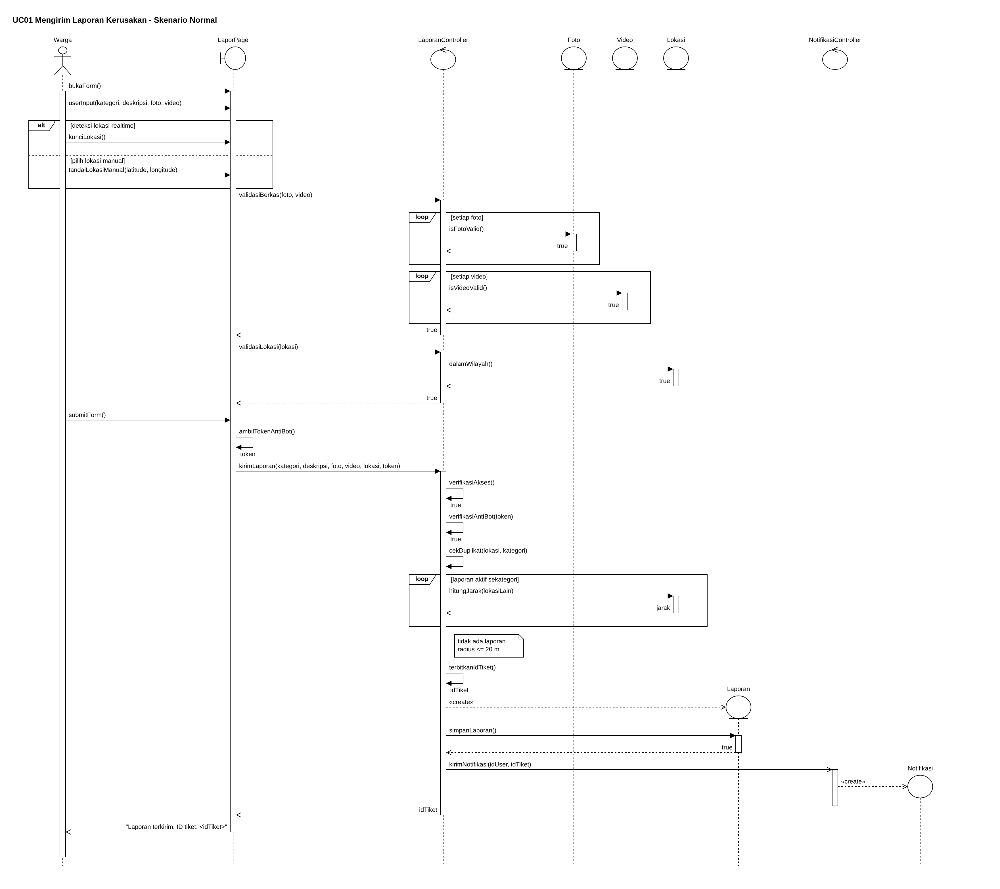
</p>
<p align="center">
<i>Gambar 3. Sequence Diagram UC01 Mengirim Laporan Kerusakan</i>
</p>


- **Skenario Alternatif 1: Foto/Video Tidak Valid**

<p align="center">
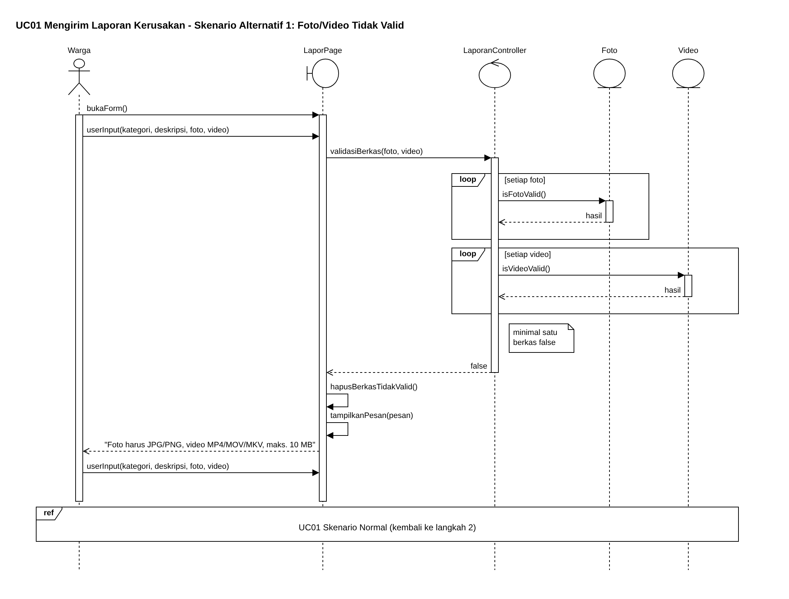
</p>
<p align="center">
<i>Gambar 4. Sequence Diagram UC01 - Foto/Video Tidak Valid</i>
</p>


- **Skenario Alternatif 2: Lokasi di Luar Daerah Penanganan**

<p align="center">
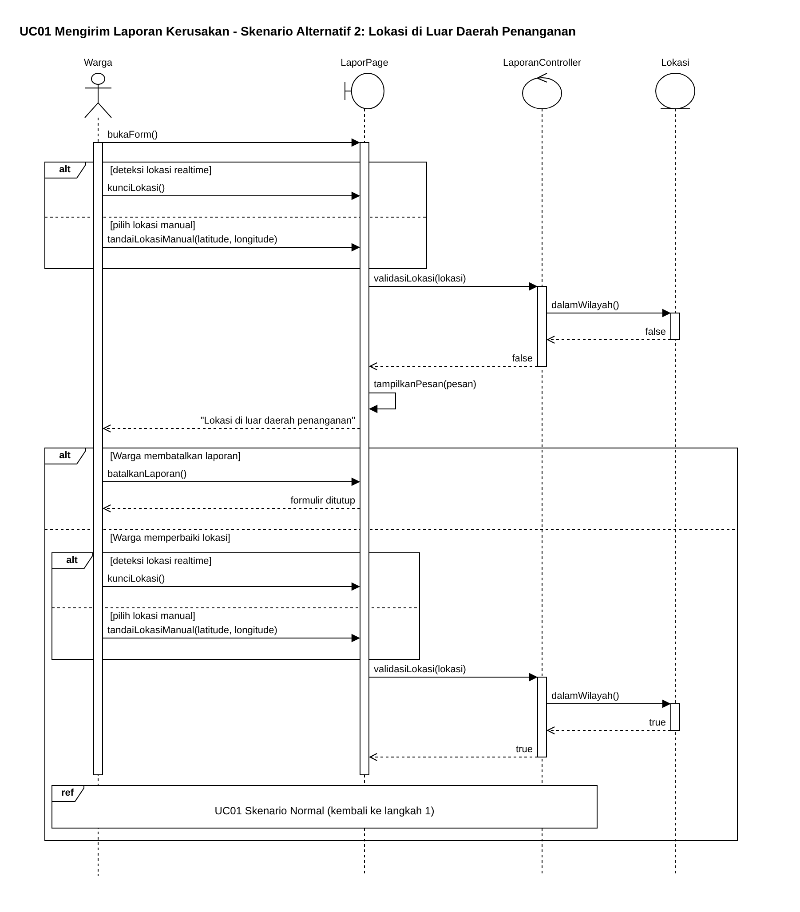
</p>
<p align="center">
<i>Gambar 5. Sequence Diagram UC01 - Lokasi di Luar Daerah Penanganan</i>
</p>


### 3.1.3 Diagram Kelas

<p align="center">
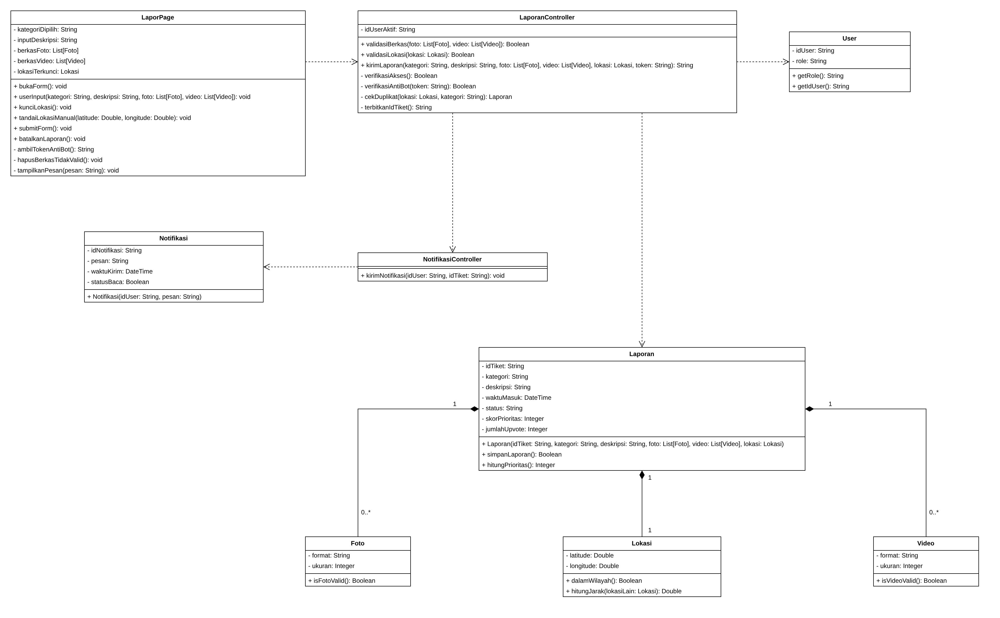
</p>
<p align="center">
<i>Gambar 6. Diagram Kelas Mengirim Laporan Kerusakan</i>
</p>

## 3.2 Use Case Memvalidasi Laporan Baru

**ID Use Case:** UC02  
**Nama Use Case:** Memvalidasi Laporan Baru

### 3.2.1 Identifikasi Kelas


Tabel 3.2. Identifikasi Kelas Use Case UC02

| No | Nama Kelas Perancangan | Nama Kelas Analisis Terkait |
|:---|:---|:---|
| 1 | ValidasiPage | C12 - ValidasiPage |
| 2 | ValidasiController | C18 - ValidasiController |
| 3 | NotifikasiController | C23 - NotifikasiController |
| 4 | User | C01 - User |
| 5 | Laporan | C02 - Laporan |
| 6 | Lokasi | C03 - Lokasi |
| 7 | Foto | C04 - Foto |
| 8 | Video | C05 - Video |
| 9 | Upvote | C06 - Upvote |
| 10 | Notifikasi | C10 - Notifikasi |

### 3.2.2 Sequence Diagram

- **Skenario Normal: Menyetujui Laporan Kerusakan (Status: "Dikerjakan")**

<p align="center">
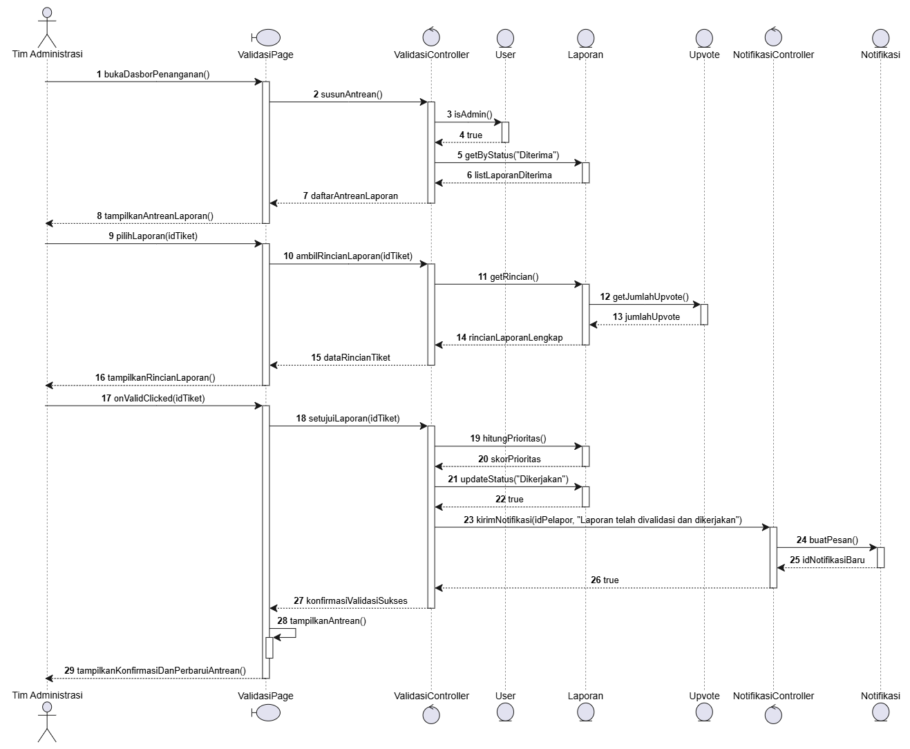
</p>
<p align="center">
<i>Gambar 7. Sequence Diagram UC02 - Skenario Normal</i>
</p>

- **Skenario Alternatif 1: Menyaring Antrean Sebelum Meninjau**

<p align="center">
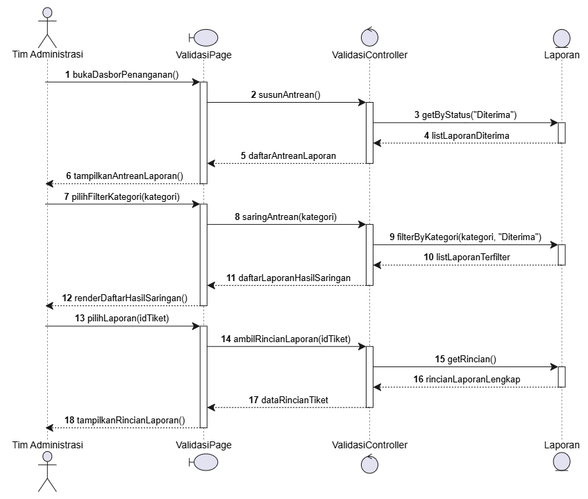
</p>
<p align="center">
<i>Gambar 8. Sequence Diagram UC02 - Menyaring Antrean Sebelum Meninjau</i>
</p>

- **Skenario Alternatif 2: Laporan Dinyatakan Tidak Valid (Status: "Ditolak")**

<p align="center">
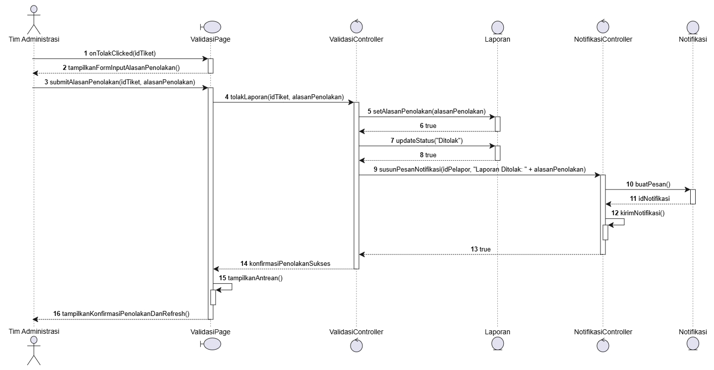
</p>
<p align="center">
<i>Gambar 9. Sequence Diagram UC02 - Laporan Dinyatakan Tidak Valid</i>
</p>

### 3.2.3 Diagram Kelas

<p align="center">
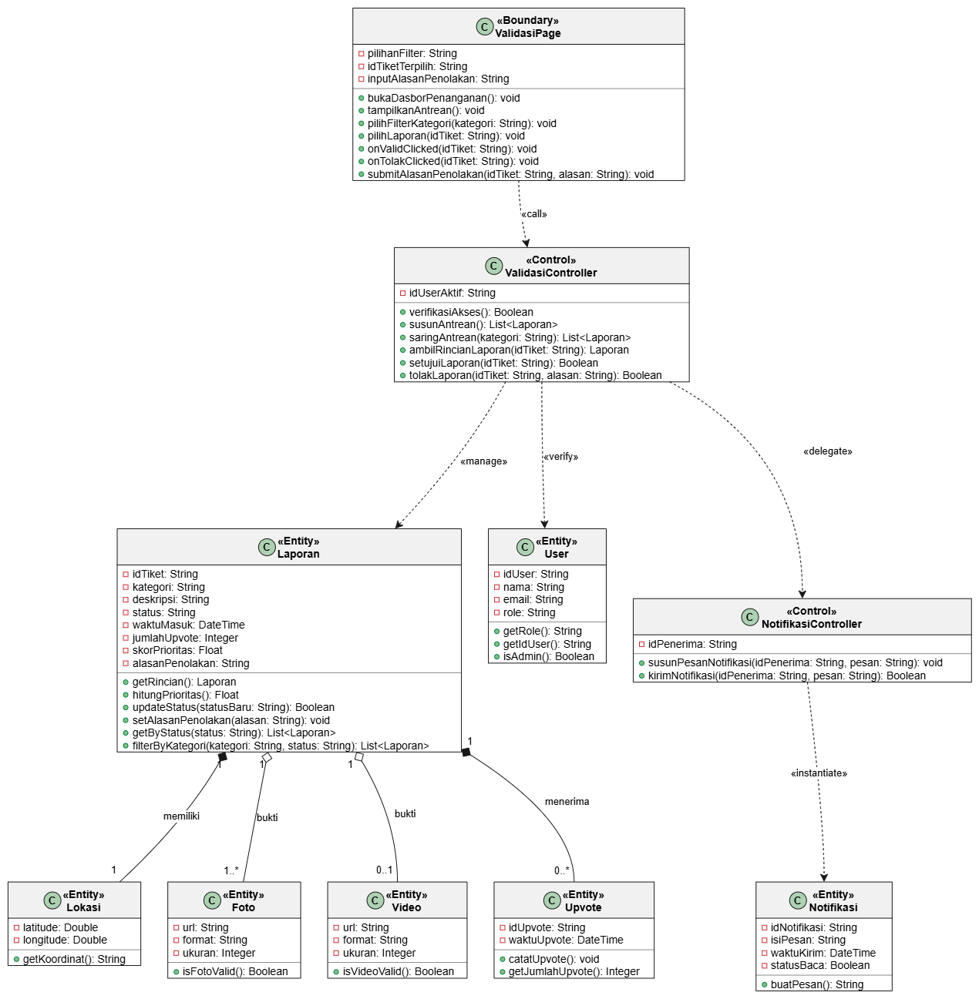
</p>
<p align="center">
<i>Gambar 10. Diagram Kelas Memvalidasi Laporan Baru</i>
</p>

## 3.3 Use Case Melihat Penugasan Lapangan

**ID Use Case:** *UC03*  
**Nama Use Case:** *Melihat Penugasan Lapangan*

### 3.3.1 Identifikasi Kelas

Tabel 3.3. Identifikasi Kelas Use Case UC03

| No | Nama Kelas Perancangan | Nama Kelas Analisis Terkait |
|:--- | :--- | :--- |
| 1 | *PenugasanPage* | *C13 - PenugasanPage* |
| 2 | *PenugasanController* | *C19 - PenugasanController* |
| 3 | *ListTugas* | *C07 - ListTugas* |
| 4 | *Laporan* | *C02 - Laporan* |
| 5 | *User* | *C01 - User* |
| 6 | *Foto* | *C04 - Foto* |
| 7 | *Video* | *C05 - Video* |

### 3.3.2 Sequence Diagram

- **Skenario Normal**

<p align="center">

</p>
<p align="center">
<i>Gambar 11. Sequence Diagram UC03</i>
</p>

- **Skenario Alternatif [1]: Menyaring Daftar Penugasan Berdasarkan Kategori**

<p align="center">
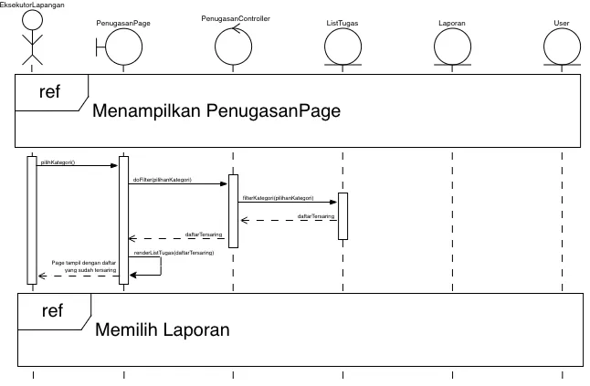
</p>
<p align="center">
<i>Gambar 12. Sequence Diagram UC03 - Menyaring Daftar Penugasan Berdasarkan Kategori</i>
</p>

- **Skenario Alternatif [2]: Belum Ada Penugasan yang Tersedia**

<p align="center">

</p>
<p align="center">
<i>Gambar 13. Sequence Diagram UC03 - Belum Ada Penugasan yang Tersedia</i>
</p>

### 3.3.3 Diagram Kelas


<p align="center">
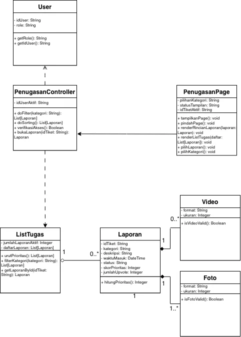
</p>
<p align="center">
<i>Gambar 14. Diagram Kelas Melihat Penugasan Lapangan</i>
</p>

## 3.4 Use Case Melaporkan Hasil Penugasan

**ID Use Case:** *UC04*  
**Nama Use Case:** *Melaporkan Hasil Penugasan*

### 3.4.1 Identifikasi Kelas


Tabel 3.4. Identifikasi Kelas Use Case UC04

| No | Nama Kelas Perancangan | Nama Kelas Analisis Terkait |
|:--- | :--- | :--- |
| 1 | *PenugasanPage* | *C13 - PenugasanPage* |
| 2 | *PenugasanController* | *C19 - PenugasanController* |
| 3 | *HasilPerbaikanForm* | *C14 - HasilPerbaikanForm* |
| 4 | *PerbaikanController* | *C20 - PerbaikanController* |
| 5 | *ListTugas* | *C07 - ListTugas* |
| 6 | *Laporan* | *C02 - Laporan* |
| 7 | *HasilPerbaikan* | *C08 - HasilPerbaikan* |
| 8 | *User* | *C01 - User* |
| 9 | *Foto* | *C04 - Foto* |
| 10 | *Video* | *C05 - Video* |

### 3.4.2 Sequence Diagram

- **Skenario Normal**

<p align="center">

</p>
<p align="center">
<i>Gambar 15. Sequence Diagram UC04</i>
</p>

- **Skenario Alternatif 1: Data Laporan Belum Lengkap**

<p align="center">
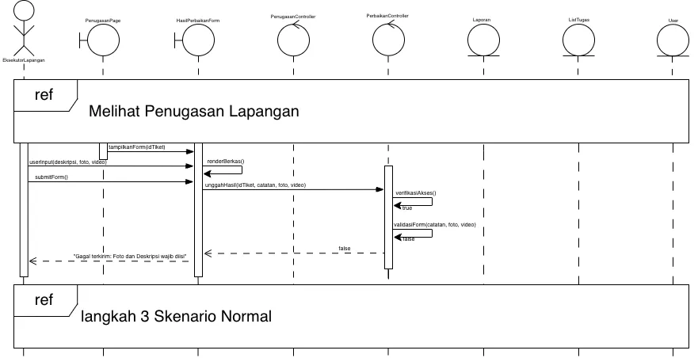
</p>
<p align="center">
<i>Gambar 16. Sequence Diagram UC04 - Data Laporan Belum Lengkap</i>
</p>

- **Skenario Alternatif 2: Data Laporan Belum Lengkap**

<p align="center">

</p>
<p align="center">
<i>Gambar 16. Sequence Diagram UC04 - Data Laporan Belum Lengkap</i>
</p>

### 3.4.3 Diagram Kelas


<p align="center">

</p>
<p align="center">
<i>Gambar 17. Diagram Kelas Melaporkan Hasil Penugasan</i>
</p>

## 3.5 Use Case Mengevaluasi Hasil Kerja

**ID Use Case:** *UC05*  
**Nama Use Case:** *Mengevaluasi Hasil Kerja*

### 3.5.1 Identifikasi Kelas


Tabel 3.5. Identifikasi Kelas Use Case [UC01]

| No | Nama Kelas Perancangan | Nama Kelas Analisis Terkait |
| :--- | :--- | :--- |
| 1 | *EvaluasiPage* | *C15 - EvaluasiPage* |
| 2 | *EvaluasiController* | *C21 - EvaluasiController* |
| 3 | *Evaluasi* | *C09 - Evaluasi* |
| 4 | *Laporan* | *C02 - Laporan* |
| 5 | *HasilPerbaikan* | *C08 - HasilPerbaikan* |
| 6 | *User* | *C01 - User* |
| 7 | *Foto* | *C04 - Foto* |
| 8 | *Video* | *C05 - Video* |
| 9 | *NotifikasiController* | *C23 - NotifikasiController* |
| 10 | *Notifikasi* | *C10 - Notifikasi* |

### 3.5.2 Sequence Diagram


- **Skenario Normal**

<p align="center">
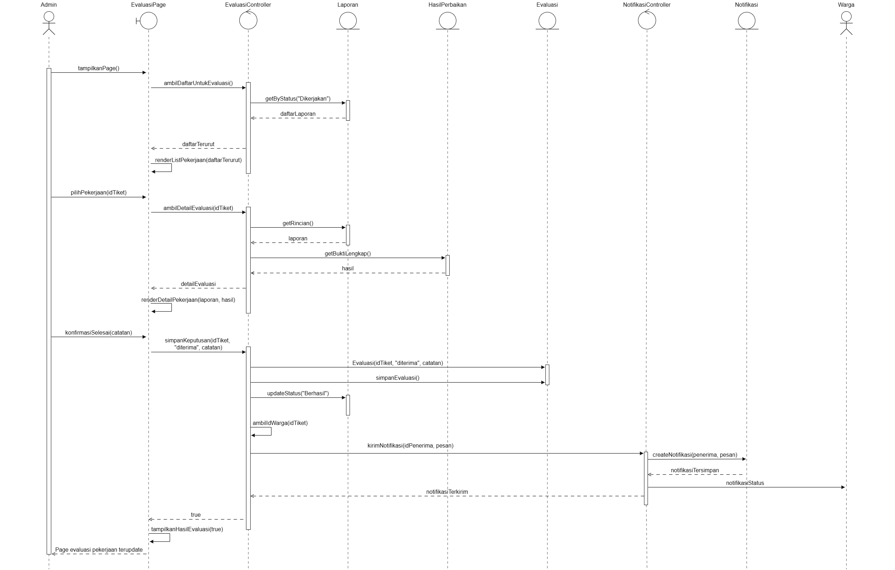
</p>
<p align="center">
<i>Gambar 18. Sequence Diagram UC05</i>
</p>

- **Skenario Alternatif 1: Pekerjaan belum selesai**

<p align="center">

</p>
<p align="center">
<i>Gambar 19. Sequence Diagram UC05 - Pekerjaan belum selesai</i>
</p>

- **Skenario Alternatif 2: Foto/video pekerjaan tidak ada atau tidak jelas**

<p align="center">

</p>
<p align="center">
<i>Gambar 20. Sequence Diagram UC05 - Pekerjaan belum selesai</i>
</p>

### 3.5.3 Diagram Kelas


<p align="center">
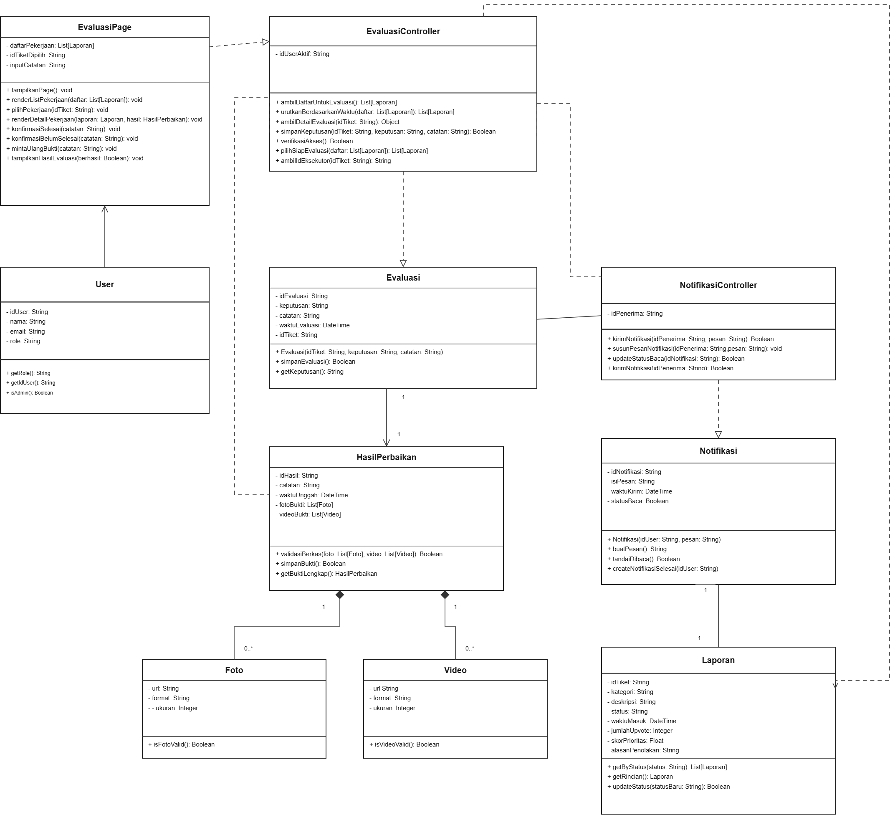
</p>
<p align="center">
<i>Gambar 21. Diagram Kelas [Nama Uce Case]</i>
</p>

## 3.6 Use Case Memantau Status Laporan

**ID Use Case:** *UC06*  
**Nama Use Case:** *Memantau Status Laporan*

### 3.6.1 Identifikasi Kelas

Identifikasi kelas yang terkait dengan use case tersebut. Kelas di tahap perancangan dapat berbeda dengan dengan kelas di tahap analisis. Dapat menggunakan tabel di bawah:

Tabel 3.6. Identifikasi Kelas Use Case [UC06]

| No | Nama Kelas Perancangan | Nama Kelas Analisis Terkait |
|:--- | :--- | :--- |
| 1 | StatusLaporanPage | C16 - StatusLaporanPage |
| 2 | StatusController | C22 - StatusController |
| 3 | NotifikasiController | C23 - NotifikasiController |
| 4 | User | C01 - Warga |
| 5 | Laporan | C02 - Laporan |
| 6 | Lokasi | C03 - Lokasi |
| 7 | Foto | C04 - Foto |
| 8 | Video | C05 - Video |
| 9 | Upvote | C06 - Upvote |
| 10 | HasilPerbaikan | C08 - HasilPerbaikan |
| 11 | Notifikasi | C10 - Notifikasi |

### 3.6.2 Sequence Diagram

- **Skenario Normal**

<p align="center">
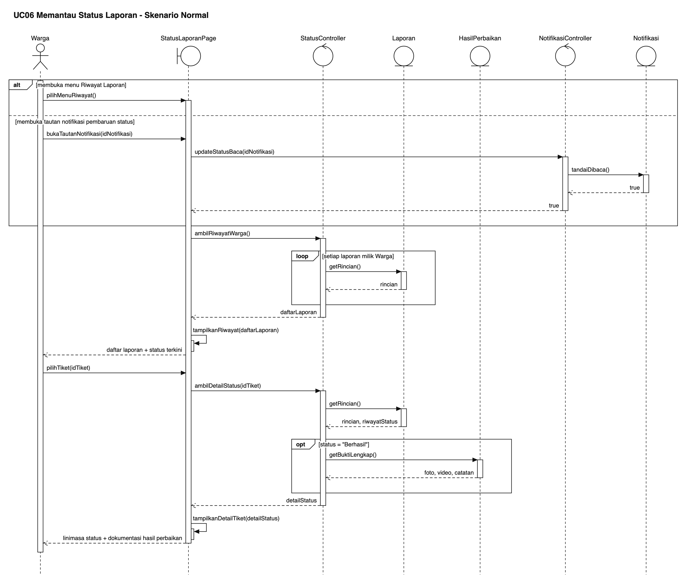
</p>
<p align="center">
<i>Gambar 22. Sequence Diagram UC06</i>
</p>

- **Skenario Alternatif 1: Memantau Laporan Publik via Peta Sebaran dan Memberikan Dukungan (Upvote)**

<p align="center">
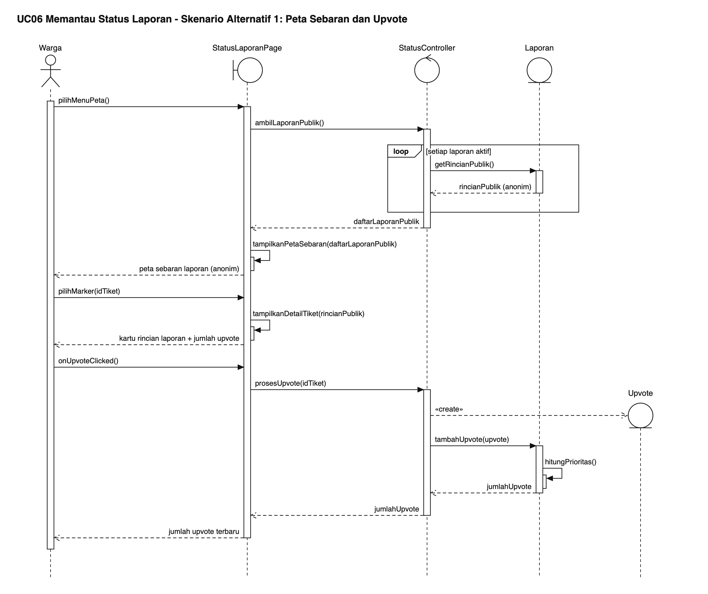
</p>
<p align="center">
<i>Gambar 23. Sequence Diagram UC06 - Memantau Laporan Publik via Peta Sebaran dan Memberikan Dukungan (Upvote)</i>
</p>

- **Skenario Alternatif 2: Memantau Laporan yang Berstatus "Ditolak"**

<p align="center">
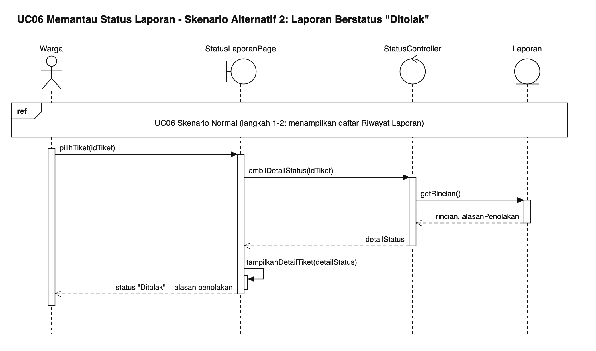
</p>
<p align="center">
<i>Gambar 24. Sequence Diagram UC06 - Laporan Berstatus "Ditolak"</i>
</p>

### 3.6.3 Diagram Kelas


<p align="center">
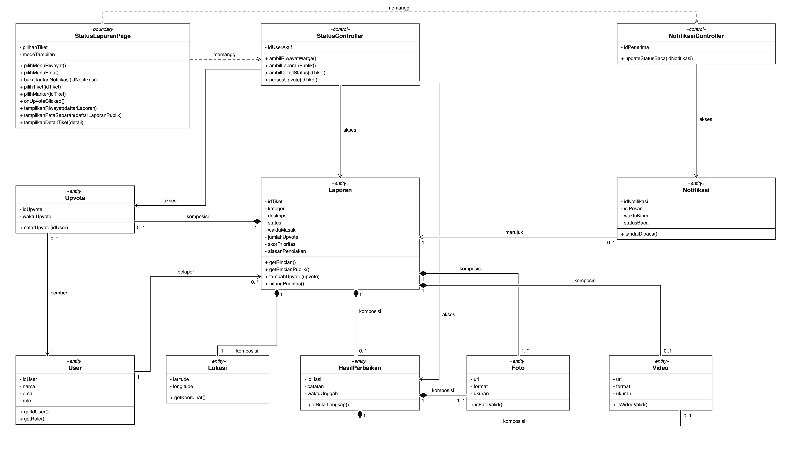
</p>
<p align="center">
<i>Gambar 25. Diagram Kelas Memantau Status Laporan</i>
</p>

<br>

---

# BAB 4: Diagram Kelas Keseluruhan

## 4.1 Diagram Kelas

<p align="center">

</p>
<p align="center">
<i>Gambar 4.1. Diagram Kelas Perancangan Keseluruhan [Nama P/L]</i>
</p>

Tabel 4.1. Daftar Kelas Perancangan Keseluruhan

| ID Kelas | Nama Kelas | Atribut | Metode/Operasi |
| :--- | :--- | :--- | :--- |
| C01 | User | - idUser: String<br>- nama: String<br>- email: String<br>- role: String | + getRole(): String<br>+ getIdUser(): String<br>+ isAdmin(): Boolean |
| C02 | Laporan | - idTiket: String<br>- kategori: String<br>- deskripsi: String<br>- status: String<br>- waktuMasuk: DateTime<br>- jumlahUpvote: Integer<br>- skorPrioritas: Float<br>- alasanPenolakan: String | + Laporan(idTiket: String, kategori: String, deskripsi: String, foto: List[Foto], video: List[Video], lokasi: Lokasi)<br>+ simpanLaporan(): Boolean<br>+ hitungPrioritas(): Float<br>+ getRincian(): Laporan<br>+ getRincianPublik(): Laporan<br>+ tambahUpvote(upvote: Upvote): Integer<br>+ updateStatus(statusBaru: String): Boolean<br>+ setAlasanPenolakan(alasan: String): void<br>+ getByStatus(status: String): List[Laporan]<br>+ filterByKategori(kategori: String, status: String): List[Laporan] |
| C03 | Lokasi | - latitude: Double<br>- longitude: Double | + dalamWilayah(): Boolean<br>+ hitungJarak(lokasiLain: Lokasi): Double<br>+ getKoordinat(): String |
| C04 | Foto | - url: String<br>- format: String<br>- ukuran: Integer | + isFotoValid(): Boolean |
| C05 | Video | - url: String<br>- format: String<br>- ukuran: Integer | + isVideoValid(): Boolean |
| C06 | Upvote | - idUpvote: String<br>- waktuUpvote: DateTime | + catatUpvote(idUser: String): void<br>+ getJumlahUpvote(): Integer |
| C07 | ListTugas | - jumlahLaporanAktif: Integer<br>- daftarLaporan: List[Laporan] | + urutPrioritas(): List[Laporan]<br>+ filterKategori(kategori: String): List[Laporan]<br>+ getLaporanById(idTiket: String): Laporan |
| C08 | HasilPerbaikan | - idHasil: String<br>- catatan: String<br>- waktuUnggah: DateTime<br>- fotoBukti: List[Foto]<br>- videoBukti: List[Video] | + validasiBerkas(foto: List[Foto], video: List[Video]): Boolean<br>+ simpanBukti(): Boolean<br>+ getBuktiLengkap(): HasilPerbaikan |
| C09 | Evaluasi | - idEvaluasi: String<br>- idTiket: String<br>- keputusan: String<br>- catatan: String<br>- waktuEvaluasi: DateTime | + Evaluasi(idTiket: String, keputusan: String, catatan: String)<br>+ simpanEvaluasi(): Boolean<br>+ getKeputusan(): String |
| C10 | Notifikasi | - idNotifikasi: String<br>- isiPesan: String<br>- waktuKirim: DateTime<br>- statusBaca: Boolean | + Notifikasi(idUser: String, pesan: String)<br>+ createNotifikasi(idUser: String, pesan: String): Boolean<br>+ createNotifikasiSelesai(idUser: String): Boolean<br>+ buatPesan(): String<br>+ tandaiDibaca(): Boolean |
| C11 | LaporPage | - kategoriDipilih: String<br>- inputDeskripsi: String<br>- berkasFoto: List[Foto]<br>- berkasVideo: List[Video]<br>- lokasiTerkunci: Lokasi | + bukaForm(): void<br>+ userInput(kategori: String, deskripsi: String, foto: List[Foto], video: List[Video]): void<br>+ kunciLokasi(): void<br>+ tandaiLokasiManual(latitude: Double, longitude: Double): void<br>+ submitForm(): void<br>+ batalkanLaporan(): void<br>- ambilTokenAntiBot(): String<br>- hapusBerkasTidakValid(): void<br>- tampilkanPesan(pesan: String): void |
| C12 | ValidasiPage | - pilihanFilter: String<br>- idTiketTerpilih: String<br>- inputAlasanPenolakan: String | + bukaDasborPenanganan(): void<br>+ tampilkanAntrean(): void<br>+ pilihFilterKategori(kategori: String): void<br>+ pilihLaporan(idTiket: String): void<br>+ onValidClicked(idTiket: String): void<br>+ onTolakClicked(idTiket: String): void<br>+ submitAlasanPenolakan(idTiket: String, alasan: String): void |
| C13 | PenugasanPage | - pilihanKategori: String<br>- statusTampilan: String<br>- idTiketAktif: String | + tampilkanPage(): void<br>+ pindahPage(): void<br>+ renderRincianLaporan(laporan: Laporan): void<br>+ renderListTugas(daftar: List[Laporan]): void<br>+ pilihLaporan(): void<br>+ pilihKategori(): void |
| C14 | HasilPerbaikanForm | - statusTampilan: String<br>- inputDeskripsi: String<br>- berkasFoto: List[Foto]<br>- berkasVideo: List[Video] | + tampilkanForm(idTiket: String): void<br>+ renderBerkas(): void<br>+ userInput(deskripsi: String, foto: List[Foto], video: List[Video]): void<br>+ submitForm(): void |
| C15 | EvaluasiPage | - daftarPekerjaan: List[Laporan]<br>- idTiketDipilih: String<br>- inputCatatan: String | + tampilkanPage(): void<br>+ renderListPekerjaan(daftar: List[Laporan]): void<br>+ pilihPekerjaan(idTiket: String): void<br>+ renderDetailPekerjaan(laporan: Laporan, hasil: HasilPerbaikan): void<br>+ konfirmasiSelesai(): void<br>+ konfirmasiBelumSelesai(catatan: String): void<br>+ mintaUlangBukti(catatan: String): void<br>+ tampilkanHasilEvaluasi(berhasil: Boolean): void |
| C16 | StatusLaporanPage | - pilihanTiket: String<br>- modeTampilan: String | + pilihMenuRiwayat(): void<br>+ pilihMenuPeta(): void<br>+ bukaTautanNotifikasi(idNotifikasi: String): void<br>+ pilihTiket(idTiket: String): void<br>+ pilihMarker(idTiket: String): void<br>+ onUpvoteClicked(): void<br>+ tampilkanRiwayat(daftarLaporan: List[Laporan]): void<br>+ tampilkanPetaSebaran(daftarLaporanPublik: List[Laporan]): void<br>+ tampilkanDetailTiket(detail: Laporan): void |
| C17 | LaporanController | - idUserAktif: String | + validasiBerkas(foto: List[Foto], video: List[Video]): Boolean<br>+ validasiLokasi(lokasi: Lokasi): Boolean<br>+ kirimLaporan(kategori: String, deskripsi: String, foto: List[Foto], video: List[Video], lokasi: Lokasi, token: String): String<br>- verifikasiAkses(): Boolean<br>- verifikasiAntiBot(token: String): Boolean<br>- cekDuplikat(lokasi: Lokasi, kategori: String): Laporan<br>- terbitkanIdTiket(): String |
| C18 | ValidasiController | - idUserAktif: String | + verifikasiAkses(): Boolean<br>+ susunAntrean(): List[Laporan]<br>+ saringAntrean(kategori: String): List[Laporan]<br>+ ambilRincianLaporan(idTiket: String): Laporan<br>+ setujuiLaporan(idTiket: String): Boolean<br>+ tolakLaporan(idTiket: String, alasan: String): Boolean |
| C19 | PenugasanController | - idUserAktif: String | + doFilter(kategori: String): List[Laporan]<br>+ doSorting(): List[Laporan]<br>+ verifikasiAkses(): Boolean<br>+ bukaLaporan(idTiket: String): Laporan |
| C20 | PerbaikanController | - idLaporan: String<br>- idUserAktif: String | + validasiForm(catatan: String, foto: List[Foto], video: List[Video]): Boolean<br>+ verifikasiAkses(): Boolean<br>+ unggahHasil(idTiket: String, catatan: String, foto: List[Foto], video: List[Video]): Boolean |
| C21 | EvaluasiController | - idUserAktif: String | + verifikasiAkses(): Boolean<br>+ ambilDaftarUntukEvaluasi(): List[Laporan]<br>+ pilihSiapEvaluasi(daftar: List[Laporan]): List[Laporan]<br>+ urutkanBerdasarkanWaktu(daftar: List[Laporan]): List[Laporan]<br>+ ambilDetailEvaluasi(idTiket: String): Object<br>+ simpanKeputusan(idTiket: String, keputusan: String, catatan: String): Boolean<br>+ ambilIdEksekutor(idTiket: String): String<br>+ ambilIdWarga(idTiket: String): String |
| C22 | StatusController | - idUserAktif: String | + ambilRiwayatWarga(): List[Laporan]<br>+ ambilLaporanPublik(): List[Laporan]<br>+ ambilDetailStatus(idTiket: String): Laporan<br>+ prosesUpvote(idTiket: String): Integer |
| C23 | NotifikasiController | - idPenerima: String | + susunPesanNotifikasi(idPenerima: String, pesan: String): void<br>+ kirimNotifikasi(idPenerima: String, pesan: String): Boolean<br>+ kirimNotifikasiSelesai(idPenerima: String): Boolean<br>+ updateStatusBaca(idNotifikasi: String): Boolean |


<br>

---

# BAB 5: Perancangan Rinci Kelas

Bagian ini diisi dengan daftar seluruh kelas dalam tabel berikut:

Tabel 5.1. Daftar Kelas Perancangan dan Kelas Analisis Terkait

| No | Nama Kelas Perancangan | Nama Kelas Analisis Terkait |
| :--- | :--- | :--- |
| 1 | *User* | *User* |
| 2 | *Laporan* | *Laporan* |
| 3 | *Lokasi* | *Lokasi* |
| 4 | *Foto* | *Foto* |
| 5 | *Video* | *Video* |
| 6 | *Upvote* | *Upvote* |
| 7 | *ListTugas* | *ListTugas* |
| 8 | *HasilPerbaikan* | *HasilPerbaikan* |
| 9 | *Evaluasi* | *Evaluasi* |
| 10 | *Notifikasi* | *Notifikasi* |
| 11 | *LaporPage* | *LaporPage* |
| 12 | *ValidasiPage* | *ValidasiPage* |
| 13 | *PenugasanPage* | *PenugasanPage* |
| 14 | *HasilPerbaikanForm* | *HasilPerbaikanForm* |
| 15 | *EvaluasiPage* | *EvaluasiPage* |
| 16 | *StatusLaporanPage* | *StatusLaporanPage* |
| 17 | *LaporanController* | *LaporanController* |
| 18 | *ValidasiController* | *ValidasiController* |
| 19 | *PenugasanController* | *PenugasanController* |
| 20 | *PerbaikanController* | *PerbaikanController* |
| 21 | *EvaluasiController* | *EvaluasiController* |
| 22 | *StatusController* | *StatusController* |
| 23 | *NotifikasiController* | *NotifikasiController* |

## 5.1 Kelas User
**Nama Kelas:** *User*  
**ID Kelas:** *C01*

| Nama Operasi | Visibility (private, public) | Keterangan |
| :--- | :--- | :--- |
| *muatProfil(idUser: String): Boolean* | *public* | *Memuat data profil akun (nama, email, dan peran) dari basis data berdasarkan ID akun yang terautentikasi melalui Supabase Auth.* |
| *getIdUser(): String* | *public* | *Mengembalikan ID akun pengguna.* |
| *getRole(): String* | *public* | *Mengembalikan peran pengguna, yaitu "Warga", "TimAdministrasi", atau "EksekutorLapangan".* |
| *isWarga(): Boolean* | *public* | *Memeriksa apakah pengguna berperan sebagai Warga.* |
| *isAdmin(): Boolean* | *public* | *Memeriksa apakah pengguna berperan sebagai Tim Administrasi.* |
| *isEksekutor(): Boolean* | *public* | *Memeriksa apakah pengguna berperan sebagai Eksekutor Lapangan.* |

| Nama Atribut | Visibility (private, public) | Tipe |
| :--- | :--- | :--- |
| *idUser* | *private* | *String* |
| *nama* | *private* | *String* |
| *email* | *private* | *String* |
| *role* | *private* | *String* |

### 5.1.1 Algoritma/Query

**Nama Kelas:** *User*  
**Nama Operasi:** *muatProfil*  
**ID Algoritma:** *[Algo-00x]*

```text
function muatProfil(idUser):
    data <- Q-001(idUser)
    if data = NIL then
        return false
    this.idUser <- data.id_user
    nama <- data.nama
    email <- data.email
    role <- data.role
    return true
```

Tabel 5.1.1. Query Operasi muatProfil

| No Query | Query | Keterangan |
| :--- | :--- | :--- |
| *Q-001* | *SELECT id_user, nama, email, role FROM pengguna WHERE id_user = $1;* | *Mengambil data profil dan peran akun berdasarkan ID akun dari Supabase Auth* |

## 5.2 Kelas Laporan
**Nama Kelas:** *Laporan*  
**ID Kelas:** *C02*

| Nama Operasi | Visibility (private, public) | Keterangan |
| :--- | :--- | :--- |
| *simpanLaporan(): Boolean* | *public* | *Menyimpan data laporan beserta lokasi, foto, dan video bukti ke basis data dengan status awal "Diterima", serta mencatat riwayat status pertama.* |
| *getRincian(): Laporan* | *public* | *Mengembalikan rincian lengkap laporan, termasuk identitas pelapor, untuk Warga pelapor dan Tim Administrasi.* |
| *getRincianPublik(): Laporan* | *public* | *Mengembalikan rincian laporan tanpa identitas pelapor untuk ditampilkan pada peta sebaran publik.* |
| *getKategori(): String* | *public* | *Mengembalikan kategori kerusakan laporan.* |
| *getLokasi(): Lokasi* | *public* | *Mengembalikan objek Lokasi tempat laporan dibuat.* |
| *tambahUpvote(upvote: Upvote): Integer* | *public* | *Mencatat dukungan (upvote) dari seorang Warga, menghitung ulang skor prioritas, dan mengembalikan jumlah upvote terbaru.* |
| *hitungPrioritas(): Float* | *public* | *Menghitung skor prioritas laporan berdasarkan jumlah upvote dan menyimpannya ke basis data.* |
| *updateStatus(statusBaru: String, alasan: String): Boolean* | *public* | *Memperbarui status laporan sesuai alur yang diizinkan, mewajibkan alasan bila status menjadi "Ditolak", dan mencatat riwayat perubahan status.* |
| *tambahHasilPerbaikan(hasil: HasilPerbaikan): void* | *public* | *Menambahkan hasil perbaikan dari Eksekutor Lapangan ke daftar hasil perbaikan laporan.* |

| Nama Atribut | Visibility (private, public) | Tipe |
| :--- | :--- | :--- |
| *idTiket* | *private* | *String* |
| *idPelapor* | *private* | *String* |
| *kategori* | *private* | *String* |
| *deskripsi* | *private* | *String* |
| *status* | *private* | *String* |
| *waktuMasuk* | *private* | *DateTime* |
| *jumlahUpvote* | *private* | *Integer* |
| *skorPrioritas* | *private* | *Float* |
| *alasanPenolakan* | *private* | *String* |
| *lokasi* | *private* | *Lokasi* |
| *fotoBukti* | *private* | *List[Foto]* |
| *videoBukti* | *private* | *List[Video]* |
| *hasilPerbaikan* | *private* | *List[HasilPerbaikan]* |

### 5.2.1 Algoritma/Query

**Nama Kelas:** *Laporan*  
**Nama Operasi:** *simpanLaporan*  
**ID Algoritma:** *[Algo-00x]*

```text
function simpanLaporan():
    status <- "Diterima"
    waktuMasuk <- time.current
    jumlahUpvote <- 0
    skorPrioritas <- 0
    hasil <- Q-001(idTiket, idPelapor, kategori, deskripsi, status, lokasi.latitude, lokasi.longitude, waktuMasuk)
    if hasil = NIL then
        return false
    for f in fotoBukti do
        Q-002(idTiket, f.url, f.format, f.ukuran)
    for v in videoBukti do
        Q-003(idTiket, v.url, v.format, v.ukuran)
    Q-004(idTiket, status, waktuMasuk)
    return true
```

Tabel 5.2.1. Query Operasi simpanLaporan

| No Query | Query | Keterangan |
| :--- | :--- | :--- |
| *Q-001* | *INSERT INTO laporan (id_tiket, id_pelapor, kategori, deskripsi, status, latitude, longitude, waktu_masuk, jumlah_upvote, skor_prioritas) VALUES ($1, $2, $3, $4, $5, $6, $7, $8, 0, 0) RETURNING id_tiket;* | *Menyimpan data laporan baru beserta koordinat lokasinya* |
| *Q-002* | *INSERT INTO foto (id_tiket, url, format, ukuran) VALUES ($1, $2, $3, $4);* | *Menyimpan tautan berkas foto bukti kerusakan yang diunggah ke Supabase Storage* |
| *Q-003* | *INSERT INTO video (id_tiket, url, format, ukuran) VALUES ($1, $2, $3, $4);* | *Menyimpan tautan berkas video bukti kerusakan yang diunggah ke Supabase Storage* |
| *Q-004* | *INSERT INTO riwayat_status (id_tiket, status, waktu) VALUES ($1, $2, $3);* | *Mencatat perubahan status laporan untuk linimasa pelacakan dan log audit* |

### 5.2.2 Algoritma/Query

**Nama Kelas:** *Laporan*  
**Nama Operasi:** *getRincianPublik*  
**ID Algoritma:** *[Algo-00x]*

```text
function getRincianPublik():
    publik <- salinan(this)
    publik.idPelapor <- NIL
    return publik
```

### 5.2.3 Algoritma/Query

**Nama Kelas:** *Laporan*  
**Nama Operasi:** *tambahUpvote*  
**ID Algoritma:** *[Algo-00x]*

```text
function tambahUpvote(upvote):
    if status = "Ditolak" or status = "Berhasil" then
        return jumlahUpvote
    sudahDukung <- Q-005(idTiket, upvote.idUser)
    if sudahDukung > 0 then
        return jumlahUpvote
    Q-006(upvote.idUpvote, idTiket, upvote.idUser, upvote.waktuUpvote)
    jumlahUpvote <- jumlahUpvote + 1
    hitungPrioritas()
    return jumlahUpvote
```

Tabel 5.2.2. Query Operasi tambahUpvote

| No Query | Query | Keterangan |
| :--- | :--- | :--- |
| *Q-005* | *SELECT COUNT(*) FROM upvote WHERE id_tiket = $1 AND id_user = $2;* | *Memeriksa apakah Warga sudah pernah memberikan dukungan pada laporan tersebut* |
| *Q-006* | *INSERT INTO upvote (id_upvote, id_tiket, id_user, waktu_upvote) VALUES ($1, $2, $3, $4);* | *Menyimpan data dukungan (upvote) baru* |

### 5.2.4 Algoritma/Query

**Nama Kelas:** *Laporan*  
**Nama Operasi:** *hitungPrioritas*  
**ID Algoritma:** *[Algo-00x]*

```text
function hitungPrioritas():
    skorPrioritas <- jumlahUpvote
    Q-007(idTiket, jumlahUpvote, skorPrioritas)
    return skorPrioritas
```

Tabel 5.2.3. Query Operasi hitungPrioritas

| No Query | Query | Keterangan |
| :--- | :--- | :--- |
| *Q-007* | *UPDATE laporan SET jumlah_upvote = $2, skor_prioritas = $3 WHERE id_tiket = $1;* | *Memperbarui jumlah upvote dan skor prioritas laporan* |

### 5.2.5 Algoritma/Query

**Nama Kelas:** *Laporan*  
**Nama Operasi:** *updateStatus*  
**ID Algoritma:** *[Algo-00x]*

```text
function updateStatus(statusBaru, alasan):
    if statusBaru = "Ditolak" and alasan = NIL then
        return false
    valid <- (status = "Diterima" and (statusBaru = "Dikerjakan" or statusBaru = "Ditolak"))
             or (status = "Dikerjakan" and statusBaru = "Berhasil")
    if not(valid) then
        return false
    status <- statusBaru
    if statusBaru = "Ditolak" then
        alasanPenolakan <- alasan
    Q-008(idTiket, status, alasanPenolakan)
    Q-004(idTiket, status, time.current)
    return true
```

Tabel 5.2.4. Query Operasi updateStatus

| No Query | Query | Keterangan |
| :--- | :--- | :--- |
| *Q-008* | *UPDATE laporan SET status = $2, alasan_penolakan = $3 WHERE id_tiket = $1;* | *Memperbarui status laporan dan alasan penolakan (bila ada)* |
| *Q-004* | *INSERT INTO riwayat_status (id_tiket, status, waktu) VALUES ($1, $2, $3);* | *Mencatat perubahan status laporan untuk linimasa pelacakan dan log audit* |

## 5.3 Kelas Lokasi
**Nama Kelas:** *Lokasi*  
**ID Kelas:** *C03*

| Nama Operasi | Visibility (private, public) | Keterangan |
| :--- | :--- | :--- |
| *getKoordinat(): List[Float]* | *public* | *Mengembalikan pasangan koordinat latitude dan longitude.* |
| *hitungJarak(lokasiLain: Lokasi): Float* | *public* | *Menghitung jarak (dalam meter) ke lokasi lain menggunakan rumus Haversine, digunakan untuk pemeriksaan duplikasi dalam radius 20 meter.* |
| *dalamWilayah(): Boolean* | *public* | *Memeriksa apakah koordinat berada di dalam batas wilayah penanganan.* |

| Nama Atribut | Visibility (private, public) | Tipe |
| :--- | :--- | :--- |
| *latitude* | *private* | *Float* |
| *longitude* | *private* | *Float* |

### 5.3.1 Algoritma/Query

**Nama Kelas:** *Lokasi*  
**Nama Operasi:** *hitungJarak*  
**ID Algoritma:** *[Algo-00x]*

```text
function hitungJarak(lokasiLain):
    R <- 6371000    { jari-jari bumi dalam meter }
    lat1 <- radian(latitude)
    lat2 <- radian(lokasiLain.latitude)
    dLat <- radian(lokasiLain.latitude - latitude)
    dLon <- radian(lokasiLain.longitude - longitude)
    a <- sin(dLat / 2)^2 + cos(lat1) * cos(lat2) * sin(dLon / 2)^2
    c <- 2 * atan2(sqrt(a), sqrt(1 - a))
    return R * c
```

### 5.3.2 Algoritma/Query

**Nama Kelas:** *Lokasi*  
**Nama Operasi:** *dalamWilayah*  
**ID Algoritma:** *[Algo-00x]*

```text
function dalamWilayah():
    batas <- BATAS_WILAYAH    { daftar titik sudut poligon wilayah penanganan }
    n <- panjang(batas)
    dalam <- false
    j <- n - 1
    i traversal [0..n-1]
        if ((batas[i].latitude > latitude) != (batas[j].latitude > latitude)) and
           (longitude < (batas[j].longitude - batas[i].longitude) * (latitude - batas[i].latitude)
                        / (batas[j].latitude - batas[i].latitude) + batas[i].longitude) then
            dalam <- not(dalam)
        j <- i
    return dalam
```

## 5.4 Kelas Foto
**Nama Kelas:** *Foto*  
**ID Kelas:** *C04*

| Nama Operasi | Visibility (private, public) | Keterangan |
| :--- | :--- | :--- |
| *isFotoValid(): Boolean* | *public* | *Memeriksa apakah berkas foto berformat JPG/PNG dan berukuran maksimal 10 MB.* |

| Nama Atribut | Visibility (private, public) | Tipe |
| :--- | :--- | :--- |
| *url* | *private* | *String* |
| *format* | *private* | *String* |
| *ukuran* | *private* | *Integer* |

### 5.4.1 Algoritma/Query

**Nama Kelas:** *Foto*  
**Nama Operasi:** *isFotoValid*  
**ID Algoritma:** *[Algo-00x]*

```text
function isFotoValid():
    MAKS_UKURAN <- 10 * 1024 * 1024    { 10 MB dalam byte }
    if not(lowercase(format) in {"jpg", "jpeg", "png"}) then
        return false
    if ukuran > MAKS_UKURAN then
        return false
    return true
```

## 5.5 Kelas Video
**Nama Kelas:** *Video*  
**ID Kelas:** *C05*

| Nama Operasi | Visibility (private, public) | Keterangan |
| :--- | :--- | :--- |
| *isVideoValid(): Boolean* | *public* | *Memeriksa apakah berkas video berformat MP4/MOV/MKV dan berukuran maksimal 10 MB.* |

| Nama Atribut | Visibility (private, public) | Tipe |
| :--- | :--- | :--- |
| *url* | *private* | *String* |
| *format* | *private* | *String* |
| *ukuran* | *private* | *Integer* |

### 5.5.1 Algoritma/Query

**Nama Kelas:** *Video*  
**Nama Operasi:** *isVideoValid*  
**ID Algoritma:** *[Algo-00x]*

```text
function isVideoValid():
    MAKS_UKURAN <- 10 * 1024 * 1024    { 10 MB dalam byte }
    if not(lowercase(format) in {"mp4", "mov", "mkv"}) then
        return false
    if ukuran > MAKS_UKURAN then
        return false
    return true
```

**Nama Kelas:** *Laporan*  
**Nama Operasi:** *tambahUpvote*  
**ID Algoritma:** *[Algo-00x]*

```text
function tambahUpvote(upvote):
    if status = "Ditolak" or status = "Berhasil" then
        return jumlahUpvote
    sudahDukung <- Q-005(idTiket, upvote.idUser)
    if sudahDukung > 0 then
        return jumlahUpvote
    Q-006(upvote.idUpvote, idTiket, upvote.idUser, upvote.waktuUpvote)
    jumlahUpvote <- jumlahUpvote + 1
    hitungPrioritas()
    return jumlahUpvote
```

Tabel 5.2.2. Query Operasi tambahUpvote

| No Query | Query | Keterangan |
| :--- | :--- | :--- |
| *Q-005* | *SELECT COUNT(*) FROM upvote WHERE id_tiket = $1 AND id_user = $2;* | *Memeriksa apakah Warga sudah pernah memberikan dukungan pada laporan tersebut* |
| *Q-006* | *INSERT INTO upvote (id_upvote, id_tiket, id_user, waktu_upvote) VALUES ($1, $2, $3, $4);* | *Menyimpan data dukungan (upvote) baru* |

### 5.2.4 Algoritma/Query

**Nama Kelas:** *Laporan*  
**Nama Operasi:** *hitungPrioritas*  
**ID Algoritma:** *[Algo-00x]*

```text
function hitungPrioritas():
    skorPrioritas <- jumlahUpvote
    Q-007(idTiket, jumlahUpvote, skorPrioritas)
    return skorPrioritas
```

Tabel 5.2.3. Query Operasi hitungPrioritas

| No Query | Query | Keterangan |
| :--- | :--- | :--- |
| *Q-007* | *UPDATE laporan SET jumlah_upvote = $2, skor_prioritas = $3 WHERE id_tiket = $1;* | *Memperbarui jumlah upvote dan skor prioritas laporan* |

### 5.2.5 Algoritma/Query

**Nama Kelas:** *Laporan*  
**Nama Operasi:** *updateStatus*  
**ID Algoritma:** *[Algo-00x]*

```text
function updateStatus(statusBaru, alasan):
    if statusBaru = "Ditolak" and alasan = NIL then
        return false
    valid <- (status = "Diterima" and (statusBaru = "Dikerjakan" or statusBaru = "Ditolak"))
             or (status = "Dikerjakan" and statusBaru = "Berhasil")
    if not(valid) then
        return false
    status <- statusBaru
    if statusBaru = "Ditolak" then
        alasanPenolakan <- alasan
    Q-008(idTiket, status, alasanPenolakan)
    Q-004(idTiket, status, time.current)
    return true
```

Tabel 5.2.4. Query Operasi updateStatus

| No Query | Query | Keterangan |
| :--- | :--- | :--- |
| *Q-008* | *UPDATE laporan SET status = $2, alasan_penolakan = $3 WHERE id_tiket = $1;* | *Memperbarui status laporan dan alasan penolakan (bila ada)* |
| *Q-004* | *INSERT INTO riwayat_status (id_tiket, status, waktu) VALUES ($1, $2, $3);* | *Mencatat perubahan status laporan untuk linimasa pelacakan dan log audit* |

## 5.3 Kelas Lokasi
**Nama Kelas:** *Lokasi*  
**ID Kelas:** *C03*

| Nama Operasi | Visibility (private, public) | Keterangan |
| :--- | :--- | :--- |
| *getKoordinat(): List[Float]* | *public* | *Mengembalikan pasangan koordinat latitude dan longitude.* |
| *hitungJarak(lokasiLain: Lokasi): Float* | *public* | *Menghitung jarak (dalam meter) ke lokasi lain menggunakan rumus Haversine, digunakan untuk pemeriksaan duplikasi dalam radius 20 meter.* |
| *dalamWilayah(): Boolean* | *public* | *Memeriksa apakah koordinat berada di dalam batas wilayah penanganan.* |

| Nama Atribut | Visibility (private, public) | Tipe |
| :--- | :--- | :--- |
| *latitude* | *private* | *Float* |
| *longitude* | *private* | *Float* |

### 5.3.1 Algoritma/Query

**Nama Kelas:** *Lokasi*  
**Nama Operasi:** *hitungJarak*  
**ID Algoritma:** *[Algo-00x]*

```text
function hitungJarak(lokasiLain):
    R <- 6371000    { jari-jari bumi dalam meter }
    lat1 <- radian(latitude)
    lat2 <- radian(lokasiLain.latitude)
    dLat <- radian(lokasiLain.latitude - latitude)
    dLon <- radian(lokasiLain.longitude - longitude)
    a <- sin(dLat / 2)^2 + cos(lat1) * cos(lat2) * sin(dLon / 2)^2
    c <- 2 * atan2(sqrt(a), sqrt(1 - a))
    return R * c
```

### 5.3.2 Algoritma/Query

**Nama Kelas:** *Lokasi*  
**Nama Operasi:** *dalamWilayah*  
**ID Algoritma:** *[Algo-00x]*

```text
function dalamWilayah():
    batas <- BATAS_WILAYAH    { daftar titik sudut poligon wilayah penanganan }
    n <- panjang(batas)
    dalam <- false
    j <- n - 1
    i traversal [0..n-1]
        if ((batas[i].latitude > latitude) != (batas[j].latitude > latitude)) and
           (longitude < (batas[j].longitude - batas[i].longitude) * (latitude - batas[i].latitude)
                        / (batas[j].latitude - batas[i].latitude) + batas[i].longitude) then
            dalam <- not(dalam)
        j <- i
    return dalam
```

## 5.4 Kelas Foto
**Nama Kelas:** *Foto*  
**ID Kelas:** *C04*

| Nama Operasi | Visibility (private, public) | Keterangan |
| :--- | :--- | :--- |
| *isFotoValid(): Boolean* | *public* | *Memeriksa apakah berkas foto berformat JPG/PNG dan berukuran maksimal 10 MB.* |

| Nama Atribut | Visibility (private, public) | Tipe |
| :--- | :--- | :--- |
| *url* | *private* | *String* |
| *format* | *private* | *String* |
| *ukuran* | *private* | *Integer* |

### 5.4.1 Algoritma/Query

**Nama Kelas:** *Foto*  
**Nama Operasi:** *isFotoValid*  
**ID Algoritma:** *[Algo-00x]*

```text
function isFotoValid():
    MAKS_UKURAN <- 10 * 1024 * 1024    { 10 MB dalam byte }
    if not(lowercase(format) in {"jpg", "jpeg", "png"}) then
        return false
    if ukuran > MAKS_UKURAN then
        return false
    return true
```

## 5.5 Kelas Video
**Nama Kelas:** *Video*  
**ID Kelas:** *C05*

| Nama Operasi | Visibility (private, public) | Keterangan |
| :--- | :--- | :--- |
| *isVideoValid(): Boolean* | *public* | *Memeriksa apakah berkas video berformat MP4/MOV/MKV dan berukuran maksimal 10 MB.* |

| Nama Atribut | Visibility (private, public) | Tipe |
| :--- | :--- | :--- |
| *url* | *private* | *String* |
| *format* | *private* | *String* |
| *ukuran* | *private* | *Integer* |

### 5.5.1 Algoritma/Query

**Nama Kelas:** *Video*  
**Nama Operasi:** *isVideoValid*  
**ID Algoritma:** *[Algo-00x]*

```text
function isVideoValid():
    MAKS_UKURAN <- 10 * 1024 * 1024    { 10 MB dalam byte }
    if not(lowercase(format) in {"mp4", "mov", "mkv"}) then
        return false
    if ukuran > MAKS_UKURAN then
        return false
    return true
```

## 5.6 Kelas Upvote
*Nama Kelas:* Upvote  
*ID Kelas:* C06

Tabel 5.6.1. Operasi Kelas Upvote

| Nama Operasi | Visibility (private, public) | Keterangan |
| :--- | :--- | :--- |
| catatUpvote(idUser: String): void | public | Menyimpan data pemberian dukungan warga terhadap tiket laporan tertentu ke dalam basis data. |
| getJumlahUpvote(): Integer | public | Menghitung dan mengembalikan total akumulasi dukungan warga pada suatu tiket laporan. |

Tabel 5.6.2. Atribut Kelas Upvote

| Nama Atribut | Visibility (private, public) | Tipe |
| :--- | :--- | :--- |
| idUpvote | private | String |
| waktuUpvote | private | DateTime |

### 5.6.1 Algoritma/Query

*Nama Kelas:* Upvote  
*Nama Operasi:* catatUpvote  
*ID Algoritma:* Algo-006

text
procedure catatUpvote(idUser):
    waktuUpvote <- time.current
    Q-001(idTiket, idUser, waktuUpvote)


Tabel 5.6.3. Query Operasi Kelas Upvote

| No Query | Query | Keterangan |
| :--- | :--- | :--- |
| Q-001 | INSERT INTO upvote (id_tiket, id_user, waktu_upvote) VALUES ($1, $2, $3); | Mencatat rekaman upvote baru dari pengguna terautentikasi ke dalam tabel upvote. |
| Q-002 | SELECT COUNT() FROM upvote WHERE id_tiket = $1;* | Menghitung akumulasi total upvote yang dimiliki oleh suatu tiket laporan. |

## 5.7 Kelas ListTugas
**Nama Kelas:** *ListTugas*  
**ID Kelas:** *C07*

| Nama Operasi | Visibility (private, public) | Keterangan |
| :--- | :--- | :--- |
| *urutPrioritas(): List[Laporan]* | *public* | *Menerima permintaan untuk menghitung skor prioritas setiap laporan dalam ListTugas dan pengurutan berdasarma  skor tersebut dan meneruskannya pada PenugasanController.* |
| *filterKategori(kategori: String): List[Laporan]* | *public* | *Menerima permintaan untuk menyaring setiap laporan dalam ListTugas yang memenuhi kategori tertentu dan meneruskannya pada PenugasanController.* |
| *getLaporanById(idTiket: String): Laporan* | *public* | *Mencari dan mengembalikan objek Laporan dengan ID tertentu.* |

| Nama Atribut | Visibility (private, public) | Tipe |
| :--- | :--- | :--- |
| *jumlahLaporanAktif* | *private* | *Integer* |
| *daftarLaporan* | *private* | *List[Laporan]* |

### 5.7.1 Algoritma/Query

**Nama Kelas:** *ListTugas*  
**Nama Operasi:** *urutPrioritas*  
**ID Algoritma:** *[Algo-00x]*

```text
function urutPrioritas()
    n <- jumlahLaporanAktif
    if n = 0 then
        return daftarLaporan
    i traversal [0..n-1]
        daftarLaporan[i].hitungPrioritas()
    newDaftar <- {algoritma sorting Laporan}
    return newDaftar
    
```

### 5.7.2 Algoritma/Query

**Nama Kelas:** *ListTugas*  
**Nama Operasi:** *filterKategori*  
**ID Algoritma:** *[Algo-00x]*

```text
function filterKategori(kategori):
    n <- jumlahLaporanAktif
    if n = 0 then
        return daftarLaporan
    hasil <- NIL
    x <- 0
    i traversal [0..n-1]
        if laporan.getKategori == kategori then
            hasil[x] <- laporan
            x <- x+1
    return hasil
    
```

## 5.8 Kelas HasilPerbaikan
**Nama Kelas:** *HasilPerbaikan*  
**ID Kelas:** *C08*

| Nama Operasi | Visibility (private, public) | Keterangan |
| :--- | :--- | :--- |
| *validasiBerkas(foto: List[Foto], video: List[Video]): Boolean* | *public* | *Memeriksa format dan ukuran dari setiap berkas bukti perbaikan (foto/video)* |
| *simpanBukti(): Boolean* | *public* | *Menyimpan deskripsi, serta berkas bukti hasil perbaikan ke basis data untuk laporan tertentu.* |
| *getBuktiLengkap(): HasilPerbaikan* | *public* | *Mengembalikan dokumentasi hasil perbaikan beserta deskripsi dan berkas bukti.* |

| Nama Atribut | Visibility (private, public) | Tipe |
| :--- | :--- | :--- |
| *idHasil* | *private* | *String* |
| *catatan* | *private* | *String* |
| *waktuUnggah* | *private* | *DateTime* |
| *fotoBukti* | *private* | *List[Foto]* |
| *videoBukti* | *private* | *List[Video]* |

### 5.8.1 Algoritma/Query


**Nama Kelas:** *HasilPerbaikan*  
**Nama Operasi:** *validasiBerkas*  
**ID Algoritma:** *[Algo-00x]*

```text
function validasiBerkas(foto, video):
    for f in foto do
        if not(f.isFotoValid()) then
            return false
    for v in video do
        if not(v.isVideoValid()) then
            return false
    return true 
```

### 5.8.2 Algoritma/Query


**Nama Kelas:** *HasilPerbaikan*  
**Nama Operasi:** *simpanBukti*  
**ID Algoritma:** *[Algo-00x]*

```text
function simpanBukti():
    waktuUnggah <- time.current
    idHsasil <- Q-001(idTiket, catatan, waktuUnggah)
    if idHasil = NIL then
        return false
    for f in fotoBukti do
        Q-002(idHasil, f.url, f.format, f.ukuran)
    for v in videoBukti do
        Q-003(idHasil, v.url, v.format, v.ukuran)
```


Tabel 5.8.1. Query Operasi [Nama Operasi]

| No Query | Query | Keterangan |
| :--- | :--- | :--- |
| *Q-001* | *INSERT INTO hasil_perbaikan (id_tiket, catatan, waktu_unggah) VALUES ($1, $2, $3) RETURNING id_hasil;* | *Menyimpan data hasil perbaikan untuk suatu laporan dan mengembalikan ID untuk hasil perbaikan tersebut* |
| *Q-002* | *INSERT INTO foto (id_hasil, url, format, ukuran) VALUES ($1, $2, $3, $4);* | *Menyimpan tautan berkas foto bukti yang diunggah ke Supabase Storage* |
| *Q-003* | *INSERT INTO video (id_hasil, url, format, ukuran) VALUES ($1, $2, $3, $4);* | *Menyimpan tautan berkas video bukti yang diunggah ke Supabase Storage* |
| *...* | *...* | *...* |

## 5.9 Kelas Evaluasi
**Nama Kelas:** *Evaluasi*  
**ID Kelas:** *C09*

Tabel 5.9.1. Operasi Kelas Evaluasi

| Nama Operasi | Visibility (private, public) | Keterangan |
| :--- | :--- | :--- |
| *Evaluasi(idTiket: String, keputusan: String, catatan: String)* | *public* | *Konstruktor untuk membuat instansiasi objek Evaluasi baru atas laporan tertentu.* |
| *simpanEvaluasi(): Boolean* | *public* | *Menyimpan rekaman hasil keputusan evaluasi beserta catatan verifikasi ke basis data.* |
| *getKeputusan(): String* | *public* | *Mengembalikan nilai keputusan evaluasi yang ditetapkan oleh Tim Administrasi.* |

Tabel 5.9.2. Atribut Kelas Evaluasi

| Nama Atribut | Visibility (private, public) | Tipe |
| :--- | :--- | :--- |
| *idEvaluasi* | *private* | *String* |
| *idTiket* | *private* | *String* |
| *keputusan* | *private* | *String* |
| *catatan* | *private* | *String* |
| *waktuEvaluasi* | *private* | *DateTime* |

### 5.9.1 Algoritma/Query

**Nama Kelas:** *Evaluasi*  
**Nama Operasi:** *simpanEvaluasi*  
**ID Algoritma:** *Algo-009*

```text
function simpanEvaluasi():
    waktuEvaluasi <- time.current
    idEvaluasi <- Q-001(idTiket, keputusan, catatan, waktuEvaluasi)
    if idEvaluasi = NIL then
        return false
    return true
```

Tabel 5.9.3. Query Operasi simpanEvaluasi

| No Query | Query | Keterangan |
| :--- | :--- | :--- |
| *Q-001* | *INSERT INTO evaluasi (id_tiket, keputusan, catatan, waktu_evaluasi) VALUES ($1, $2, $3, $4) RETURNING id_evaluasi;* | *Menyimpan data hasil evaluasi penanganan perbaikan oleh Tim Administrasi dan mengembalikan idEvaluasi.* |

## 5.10 Kelas Notifikasi
**Nama Kelas:** *Notifikasi*  
**ID Kelas:** *C10*

Tabel 5.10.1. Operasi Kelas Notifikasi

| Nama Operasi | Visibility (private, public) | Keterangan |
| :--- | :--- | :--- |
| *Notifikasi(idUser: String, pesan: String)* | *public* | *Konstruktor untuk membuat objek notifikasi baru.* |
| *createNotifikasi(idUser: String, pesan: String): Boolean* | *public* | *Membuat rekaman notifikasi umum ke basis data untuk pengguna tertentu.* |
| *createNotifikasiSelesai(idUser: String): Boolean* | *public* | *Membuat notifikasi khusus bahwa perbaikan fasilitas publik telah berhasil diselesaikan.* |
| *buatPesan(): String* | *public* | *Mengembalikan teks isi pesan notifikasi.* |
| *tandaiDibaca(): Boolean* | *public* | *Memperbarui status keterbacaan notifikasi menjadi true.* |

Tabel 5.10.2. Atribut Kelas Notifikasi

| Nama Atribut | Visibility (private, public) | Tipe |
| :--- | :--- | :--- |
| *idNotifikasi* | *private* | *String* |
| *isiPesan* | *private* | *String* |
| *waktuKirim* | *private* | *DateTime* |
| *statusBaca* | *private* | *Boolean* |

### 5.10.1 Algoritma/Query

**Nama Kelas:** *Notifikasi*  
**Nama Operasi:** *createNotifikasi*  
**ID Algoritma:** *Algo-010*

```text
function createNotifikasi(idUser, pesan):
    waktuKirim <- time.current
    statusBaca <- false
    idNotifikasi <- Q-001(idUser, pesan, waktuKirim, statusBaca)
    if idNotifikasi = NIL then
        return false
    return true
```

### 5.10.2 Algoritma/Query

**Nama Kelas:** *Notifikasi*  
**Nama Operasi:** *tandaiDibaca*  
**ID Algoritma:** *Algo-011*

```text
function tandaiDibaca():
    statusBaca <- true
    berhasil <- Q-002(idNotifikasi)
    return berhasil
```

Tabel 5.10.3. Query Operasi Kelas Notifikasi

| No Query | Query | Keterangan |
| :--- | :--- | :--- |
| *Q-001* | *INSERT INTO notifikasi (id_user, isi_pesan, waktu_kirim, status_baca) VALUES ($1, $2, $3, $4) RETURNING id_notifikasi;* | *Menyimpan pesan notifikasi baru ke database untuk akun pengguna tertentu.* |
| *Q-002* | *UPDATE notifikasi SET status_baca = TRUE WHERE id_notifikasi = $1;* | *Mengubah status baca notifikasi menjadi true.* |

## 5.11 Kelas LaporPage
**Nama Kelas:** *LaporPage*  
**ID Kelas:** *C11*

| Nama Operasi | Visibility (private, public) | Keterangan |
| :--- | :--- | :--- |
| *bukaForm(): void* | *public* | *Menampilkan formulir pelaporan dan secara otomatis memulai penguncian lokasi perangkat.* |
| *userInput(kategori: String, deskripsi: String, foto: List[Foto], video: List[Video]): void* | *public* | *Menerima isian kategori, deskripsi, serta berkas foto dan video, lalu meminta LaporanController memvalidasi berkas sebelum menampilkan pratinjau.* |
| *kunciLokasi(): void* | *public* | *Mengambil koordinat perangkat melalui Geolocation API dan meminta LaporanController memvalidasi wilayahnya.* |
| *tandaiLokasiManual(latitude: Float, longitude: Float): void* | *public* | *Menerima titik lokasi yang ditandai Warga secara manual pada peta dan meminta LaporanController memvalidasi wilayahnya.* |
| *submitForm(): void* | *public* | *Memeriksa kelengkapan formulir, mengunggah berkas langsung ke Supabase Storage, mengirim laporan ke LaporanController, dan menampilkan hasilnya.* |
| *batalkanLaporan(): void* | *public* | *Membatalkan pengisian laporan dan menutup formulir.* |
| *ambilTokenAntiBot(): String* | *private* | *Mengambil token verifikasi dari layanan anti-bot pada sisi klien.* |
| *hapusBerkasTidakValid(): void* | *private* | *Menghapus berkas foto/video yang tidak lolos validasi dari formulir.* |
| *tampilkanPesan(pesan: String): void* | *private* | *Menampilkan pesan validasi, peringatan, atau konfirmasi kepada Warga.* |

| Nama Atribut | Visibility (private, public) | Tipe |
| :--- | :--- | :--- |
| *inputKategori* | *private* | *String* |
| *inputDeskripsi* | *private* | *String* |
| *berkasFoto* | *private* | *List[Foto]* |
| *berkasVideo* | *private* | *List[Video]* |
| *lokasi* | *private* | *Lokasi* |
| *pesanError* | *private* | *String* |

### 5.11.1 Algoritma/Query

**Nama Kelas:** *LaporPage*  
**Nama Operasi:** *userInput*  
**ID Algoritma:** *[Algo-00x]*

```text
procedure userInput(kategori, deskripsi, foto, video):
    inputKategori <- kategori
    inputDeskripsi <- deskripsi
    berkasFoto <- foto
    berkasVideo <- video
    if not(laporanController.validasiBerkas(berkasFoto, berkasVideo)) then
        hapusBerkasTidakValid()
        tampilkanPesan("Foto harus JPG/PNG, video MP4/MOV/MKV, maks. 10 MB")
    else
        tampilkan pratinjau berkasFoto dan berkasVideo
```

### 5.11.2 Algoritma/Query

**Nama Kelas:** *LaporPage*  
**Nama Operasi:** *kunciLokasi*  
**ID Algoritma:** *[Algo-00x]*

```text
procedure kunciLokasi():
    posisi <- Geolocation API getCurrentPosition(batas waktu 3 detik)
    if posisi = NIL then
        tampilkanPesan("Lokasi tidak terdeteksi, tandai lokasi secara manual pada peta")
        return
    lokasi <- new Lokasi(posisi.latitude, posisi.longitude)
    if not(laporanController.validasiLokasi(lokasi)) then
        lokasi <- NIL
        tampilkanPesan("Lokasi di luar daerah penanganan")
    else
        tampilkan titik lokasi pada peta
```

### 5.11.3 Algoritma/Query

**Nama Kelas:** *LaporPage*  
**Nama Operasi:** *submitForm*  
**ID Algoritma:** *[Algo-00x]*

```text
procedure submitForm():
    if inputKategori = NIL or inputDeskripsi = NIL or lokasi = NIL
       or (berkasFoto kosong and berkasVideo kosong) then
        tampilkanPesan("Lengkapi kategori, deskripsi, lokasi, dan berkas bukti")
        return
    token <- ambilTokenAntiBot()
    for f in berkasFoto do
        f.url <- unggah f ke Supabase Storage
    for v in berkasVideo do
        v.url <- unggah v ke Supabase Storage
    idTiket <- laporanController.kirimLaporan(inputKategori, inputDeskripsi, berkasFoto, berkasVideo, lokasi, token)
    if idTiket = NIL then
        tampilkanPesan("Laporan gagal dikirim, silakan coba lagi")
    else if laporanController.isDuplikat() then
        tampilkanPesan("Laporan serupa sudah ada (ID tiket: " + idTiket + "), laporan Anda dialihkan menjadi dukungan (upvote)")
    else
        tampilkanPesan("Laporan terkirim, ID tiket: " + idTiket)
```

## 5.12 Kelas ValidasiPage
**Nama Kelas:** *ValidasiPage*  
**ID Kelas:** *C12*

Tabel 5.12.1. Operasi Kelas ValidasiPage

| Nama Operasi | Visibility (private, public) | Keterangan |
| :--- | :--- | :--- |
| *bukaDasborPenanganan(): void* | *public* | *Membuka halaman dasbor verifikasi Tim Administrasi, memverifikasi akses, dan memuat antrean laporan Diterima.* |
| *tampilkanAntrean(): void* | *public* | *Merender daftar tiket laporan berstatus Diterima ke dalam tabel antrean.* |
| *pilihFilterKategori(kategori: String): void* | *public* | *Menerapkan penyaringan antrean tiket laporan berdasarkan kategori kerusakan yang dipilih admin.* |
| *pilihLaporan(idTiket: String): void* | *public* | *Menerima aksi klik pada baris antrean dan menampilkan panel rincian bukti laporan di sisi kanan.* |
| *onValidClicked(idTiket: String): void* | *public* | *Mengirimkan perintah persetujuan laporan ke controller saat tombol "Validasi" ditekan.* |
| *onTolakClicked(idTiket: String): void* | *public* | *Membuka modal/kolom isian formulir penulisan alasan penolakan laporan.* |
| *submitAlasanPenolakan(idTiket: String, alasan: String): void* | *public* | *Memvalidasi dan mengirimkan alasan penolakan ke controller saat tombol "Kirim Penolakan" ditekan.* |

Tabel 5.12.2. Atribut Kelas ValidasiPage

| Nama Atribut | Visibility (private, public) | Tipe |
| :--- | :--- | :--- |
| *pilihanFilter* | *private* | *String* |
| *idTiketTerpilih* | *private* | *String* |
| *inputAlasanPenolakan* | *private* | *String* |

### 5.12.1 Algoritma/Query

**Nama Kelas:** *ValidasiPage*  
**Nama Operasi:** *bukaDasborPenanganan*  
**ID Algoritma:** *Algo-012*

```text
procedure bukaDasborPenanganan():
    if not(validasiController.verifikasiAkses()) then
        output("Akses ditolak: Hanya Tim Administrasi yang dapat mengakses halaman ini")
        return
    daftarAntrean <- validasiController.susunAntrean()
    tampilkanAntrean()
```

### 5.12.2 Algoritma/Query

**Nama Kelas:** *ValidasiPage*  
**Nama Operasi:** *onValidClicked*  
**ID Algoritma:** *Algo-013*

```text
procedure onValidClicked(idTiket):
    berhasil <- validasiController.setujuiLaporan(idTiket)
    if berhasil then
        output("Laporan berhasil divalidasi dan diteruskan ke daftar tugas penugasan.")
        bukaDasborPenanganan()
    else
        output("Gagal memvalidasi laporan.")
```

### 5.12.3 Algoritma/Query

**Nama Kelas:** *ValidasiPage*  
**Nama Operasi:** *submitAlasanPenolakan*  
**ID Algoritma:** *Algo-014*

```text
procedure submitAlasanPenolakan(idTiket, alasan):
    if alasan = "" or alasan = NIL then
        output("Gagal terkirim: Alasan penolakan wajib diisi.")
        return
    berhasil <- validasiController.tolakLaporan(idTiket, alasan)
    if berhasil then
        output("Laporan berhasil ditolak dan status diperbarui.")
        bukaDasborPenanganan()
    else
        output("Gagal memproses penolakan laporan.")
```

## 5.13 Kelas PenugasanPage
**Nama Kelas:** *PenugasanPage*  
**ID Kelas:** *C13*
| Nama Operasi | Visibility (private, public) | Keterangan |
| :--- | :--- | :--- |
| *tampilkanPage(): void* | *public* | *Membuka dashboard penugasan Eksekutor Lapangan, meminta verifikasi askes, memuat list laporan yang harus dikerjakan* |
| *pindahPage(): void* | *public* | *Mengalihkan tampilan ke halaman lain* |
| *renderRincianLaporan(laporan: Laporan): void* | *public* | *Menampilkan rincian dari laporan yang dipilih (foto, deskripsi, dll).* |
| *renderListTugas(daftar: List[Laproan]): void* | *public* | *Menampilkan daftar penugasan, yaitu list Laporan berstatus "Dikerjakan" milik User. Menampilkan list kosong jika belum ada penugasan.* |
| *pilihLaporan(): void* | *public* | *Menerima laporan yang dipilih (di-klik) User dan meneruskan idTiket nya ke PenugasanController.* |
| *pilihKategori(): void* | *public* | *Menerima jenis kategori yang dipilih (di-klik) User dan meneruskannya ke PenugasanController.* |

| Nama Atribut | Visibility (private, public) | Tipe |
| :--- | :--- | :--- |
| *pilihanKategori* | *private* | *String* |
| *statusTampilan* | *private* | *String* |
| *idTiketAktif* | *private* | *String* |

### 5.13.1 Algoritma/Query


**Nama Kelas:** *PenugasanPage*  
**Nama Operasi:** *tampilkanPage()*  
**ID Algoritma:** *[Algo-00x]*

```text
procedure tampilkanPage():
    if not(penugasanController.verifikasiAkses()) then
        output("Gagal menampilkan page")
        return
    else
        daftar <- penugasanController.doSorting()
        renderListTugas(daftar)
```

### 5.13.2 Algoritma/Query


**Nama Kelas:** *PenugasanPage*  
**Nama Operasi:** *pilihLaporan()*  
**ID Algoritma:** *[Algo-00x]*

```text
procedure pilihLaporan():
    idTiketAktif <- {id elemen laporan yang di klik}
    laporan <- penugasanController.bukaLaporan(idTiketAktif)
    renderRincianLaporan(laporan)
```


## 5.14 Kelas HasilPerbaikanForm
**Nama Kelas:** *HasilPerbaikanForm*  
**ID Kelas:** *C14*

| Nama Operasi | Visibility (private, public) | Keterangan |
| :--- | :--- | :--- |
| *tampilkanForm(idTiket: String): void* | *public* | *Menampilkan formulir input hasil perbaikan untuk laporan dengan ID tertentu* |
| *renderBerkas(): void* | *public* | *Menampilkan preview foto, video, dan deskripsi yang sudah diinput* |
| *userInput(deskripsi: String, foto: List[Foto], video: List[Video]): void* | *public* | *Menerima deskripsi pekerjaan, serta berkas (foto dan/atau video) dari Eksekutor* |
| *submitForm(): void* | *public* | *Mengirim isi formulir ke PerbaikanController saat aktor menekan "Kirim Laporan" dan menampilkan pesan konfirmasi terkirim.* |

| Nama Atribut | Visibility (private, public) | Tipe |
| :--- | :--- | :--- |
| *statusTampilan* | *private* | *String* |
| *inputDeskripsi* | *private* | *String* |
| *berkasFoto* | *private* | *List[Foto]* |
| *berkasVideo* | *private* | *List[Video]* |

### 5.14.1 Algoritma/Query


**Nama Kelas:** *HasilPernaikanForm*  
**Nama Operasi:** *submitForm()*  
**ID Algoritma:** *[Algo-00x]*

```text
procedure submitForm():
    berhasil <- perbaikanController.unggahHasil(idTiket, inputDeskripsi, berkasFoto, berkasVideo)
    if berhasil then
        output("terkirim")
    else
        output("Gagal terkirim")
```

## 5.15 Kelas EvaluasiPage
**Nama Kelas:** *EvaluasiPage*  
**ID Kelas:** *C15*

Tabel 5.15.1. Operasi Kelas EvaluasiPage

| Nama Operasi | Visibility (private, public) | Keterangan |
| :--- | :--- | :--- |
| *tampilkanPage(): void* | *public* | *Membuka dashboard evaluasi Tim Administrasi, memverifikasi hak akses, dan memuat daftar pekerjaan siap evaluasi.* |
| *renderListPekerjaan(daftar: List[Laporan]): void* | *public* | *Menampilkan daftar pekerjaan yang siap dievaluasi pada panel antarmuka.* |
| *pilihPekerjaan(idTiket: String): void* | *public* | *Menerima tiket pekerjaan yang dipilih admin dan meminta rincian komparasi bukti dari EvaluasiController.* |
| *renderDetailPekerjaan(laporan: Laporan, hasil: HasilPerbaikan): void* | *public* | *Menampilkan perbandingan berdampingan antara foto kerusakan awal dan foto bukti hasil kerja eksekutor.* |
| *konfirmasiSelesai(): void* | *public* | *Mengirimkan keputusan persetujuan pekerjaan selesai saat admin menekan tombol "Konfirmasi Selesai".* |
| *konfirmasiBelumSelesai(catatan: String): void* | *public* | *Mengirimkan penolakan pekerjaan beserta catatan evaluasi saat admin menekan tombol "Belum Selesai".* |
| *mintaUlangBukti(catatan: String): void* | *public* | *Mengirimkan instruksi pengambilan ulang bukti kepada eksekutor saat admin menekan "Minta Ulang Bukti".* |
| *tampilkanHasilEvaluasi(berhasil: Boolean): void* | *public* | *Menampilkan konfirmasi pesan berhasil atau gagalnya pemrosesan evaluasi pada antarmuka.* |

Tabel 5.15.2. Atribut Kelas EvaluasiPage

| Nama Atribut | Visibility (private, public) | Tipe |
| :--- | :--- | :--- |
| *daftarPekerjaan* | *private* | *List[Laporan]* |
| *idTiketDipilih* | *private* | *String* |
| *inputCatatan* | *private* | *String* |

### 5.15.1 Algoritma/Query

**Nama Kelas:** *EvaluasiPage*  
**Nama Operasi:** *tampilkanPage*  
**ID Algoritma:** *Algo-015*

```text
procedure tampilkanPage():
    if not(evaluasiController.verifikasiAkses()) then
        output("Akses ditolak: Hanya Tim Administrasi yang dapat mengakses halaman ini")
        return
    daftarPekerjaan <- evaluasiController.ambilDaftarUntukEvaluasi()
    renderListPekerjaan(daftarPekerjaan)
```

### 5.15.2 Algoritma/Query

**Nama Kelas:** *EvaluasiPage*  
**Nama Operasi:** *pilihPekerjaan*  
**ID Algoritma:** *Algo-016*

```text
procedure pilihPekerjaan(idTiket):
    idTiketDipilih <- idTiket
    detail <- evaluasiController.ambilDetailEvaluasi(idTiket)
    renderDetailPekerjaan(detail.laporan, detail.hasilPerbaikan)
```

### 5.15.3 Algoritma/Query

**Nama Kelas:** *EvaluasiPage*  
**Nama Operasi:** *konfirmasiSelesai*  
**ID Algoritma:** *Algo-017*

```text
procedure konfirmasiSelesai():
    berhasil <- evaluasiController.simpanKeputusan(idTiketDipilih, "Berhasil", inputCatatan)
    tampilkanHasilEvaluasi(berhasil)
    if berhasil then
        daftarPekerjaan <- evaluasiController.ambilDaftarUntukEvaluasi()
        renderListPekerjaan(daftarPekerjaan)
```
## 5.16 Kelas StatusLaporanPage
**Nama Kelas:** *StatusLaporanPage*  
**ID Kelas:** *C16*

Tabel 5.16.1. Operasi Kelas StatusLaporanPage

| Nama Operasi | Visibility (private, public) | Keterangan |
| :--- | :--- | :--- |
| *pilihMenuRiwayat(): void* | *public* | *Mengaktifkan tab Riwayat dan menampilkan linimasa laporan pribadi milik warga.* |
| *pilihMenuPeta(): void* | *public* | *Mengaktifkan tab Peta dan menampilkan visualisasi titik laporan publik pada peta Leaflet.* |
| *bukaTautanNotifikasi(idNotifikasi: String): void* | *public* | *Membuka detail tiket laporan yang bersangkutan langsung dari daftar notifikasi pengguna.* |
| *pilihTiket(idTiket: String): void* | *public* | *Memilih salah satu tiket dari daftar riwayat untuk menampilkan detail linimasa statusnya.* |
| *pilihMarker(idTiket: String): void* | *public* | *Memilih salah satu penanda laporan publik di peta untuk menampilkan kartu ringkas tiket.* |
| *onUpvoteClicked(): void* | *public* | *Mengirimkan penambahan dukungan upvote saat warga menekan tombol upvote pada laporan publik.* |
| *tampilkanRiwayat(daftarLaporan: List[Laporan]): void* | *public* | *Merender daftar kartu laporan warga pelapor beserta badge status dan tanggal pengajuan.* |
| *tampilkanPetaSebaran(daftarLaporanPublik: List[Laporan]): void* | *public* | *Merender penanda-penanda laporan publik pada peta interaktif sesuai koordinat lokasi.* |
| *tampilkanDetailTiket(detail: Laporan): void* | *public* | *Menampilkan panel rincian tiket meliputi foto kerusakan, linimasa tahapan status, dan alasan penolakan jika ada.* |

Tabel 5.16.2. Atribut Kelas StatusLaporanPage

| Nama Atribut | Visibility (private, public) | Tipe |
| :--- | :--- | :--- |
| *pilihanTiket* | *private* | *String* |
| *modeTampilan* | *private* | *String* |

### 5.16.1 Algoritma/Query

**Nama Kelas:** *StatusLaporanPage*  
**Nama Operasi:** *pilihMenuRiwayat*  
**ID Algoritma:** *Algo-018*

```text
procedure pilihMenuRiwayat():
    modeTampilan <- "Riwayat"
    daftarLaporan <- statusController.ambilRiwayatWarga()
    tampilkanRiwayat(daftarLaporan)
```

### 5.16.2 Algoritma/Query

**Nama Kelas:** *StatusLaporanPage*  
**Nama Operasi:** *pilihMenuPeta*  
**ID Algoritma:** *Algo-019*

```text
procedure pilihMenuPeta():
    modeTampilan <- "Peta"
    daftarPublik <- statusController.ambilLaporanPublik()
    tampilkanPetaSebaran(daftarPublik)
```

### 5.16.3 Algoritma/Query

**Nama Kelas:** *StatusLaporanPage*  
**Nama Operasi:** *onUpvoteClicked*  
**ID Algoritma:** *Algo-020*

```text
procedure onUpvoteClicked():
    if pilihanTiket = NIL then
        return
    totalUpvote <- statusController.prosesUpvote(pilihanTiket)
    output("Dukungan berhasil ditambahkan")
```

## 5.17 Kelas LaporanController
**Nama Kelas:** *LaporanController*  
**ID Kelas:** *C17*

| Nama Operasi | Visibility (private, public) | Keterangan |
| :--- | :--- | :--- |
| *validasiBerkas(foto: List[Foto], video: List[Video]): Boolean* | *public* | *Memeriksa format dan ukuran setiap berkas foto dan video bukti kerusakan.* |
| *validasiLokasi(lokasi: Lokasi): Boolean* | *public* | *Memeriksa apakah lokasi laporan tersedia dan berada di dalam wilayah penanganan.* |
| *kirimLaporan(kategori: String, deskripsi: String, foto: List[Foto], video: List[Video], lokasi: Lokasi, token: String): String* | *public* | *Memverifikasi akses dan anti-bot, memvalidasi berkas dan lokasi, memeriksa duplikasi, menerbitkan ID tiket, menyimpan laporan, dan memicu notifikasi ke Warga pelapor. Mengembalikan ID tiket, atau NIL bila gagal.* |
| *isDuplikat(): Boolean* | *public* | *Mengembalikan apakah laporan terakhir yang dikirim terdeteksi sebagai duplikat dan dialihkan menjadi upvote.* |
| *verifikasiAkses(): Boolean* | *private* | *Memeriksa sesi pengguna melalui Supabase Auth dan memastikan pengguna berperan sebagai Warga.* |
| *verifikasiAntiBot(token: String): Boolean* | *private* | *Memverifikasi token anti-bot ke layanan verifikasi untuk memastikan pengiriman dilakukan oleh manusia.* |
| *cekDuplikat(lokasi: Lokasi, kategori: String): Laporan* | *private* | *Mencari laporan aktif berkategori sama dalam radius 20 meter. Mengembalikan laporan tersebut, atau NIL bila tidak ada.* |
| *terbitkanIdTiket(): String* | *private* | *Membuat ID tiket unik untuk laporan baru.* |

| Nama Atribut | Visibility (private, public) | Tipe |
| :--- | :--- | :--- |
| *idUserAktif* | *private* | *String* |
| *statusDuplikat* | *private* | *Boolean* |

### 5.17.1 Algoritma/Query

**Nama Kelas:** *LaporanController*  
**Nama Operasi:** *validasiBerkas*  
**ID Algoritma:** *[Algo-00x]*

```text
function validasiBerkas(foto, video):
    if foto kosong and video kosong then
        return false
    for f in foto do
        if not(f.isFotoValid()) then
            return false
    for v in video do
        if not(v.isVideoValid()) then
            return false
    return true
```

### 5.17.2 Algoritma/Query

**Nama Kelas:** *LaporanController*  
**Nama Operasi:** *validasiLokasi*  
**ID Algoritma:** *[Algo-00x]*

```text
function validasiLokasi(lokasi):
    if lokasi = NIL then
        return false
    return lokasi.dalamWilayah()
```

### 5.17.3 Algoritma/Query

**Nama Kelas:** *LaporanController*  
**Nama Operasi:** *kirimLaporan*  
**ID Algoritma:** *[Algo-00x]*

```text
function kirimLaporan(kategori, deskripsi, foto, video, lokasi, token):
    statusDuplikat <- false
    if not(verifikasiAkses()) then
        return NIL
    if not(verifikasiAntiBot(token)) then
        return NIL
    if not(validasiBerkas(foto, video)) or not(validasiLokasi(lokasi)) then
        return NIL
    duplikat <- cekDuplikat(lokasi, kategori)
    if duplikat != NIL then
        statusDuplikat <- true
        duplikat.tambahUpvote(new Upvote(idUserAktif))
        return duplikat.idTiket
    idTiket <- terbitkanIdTiket()
    laporan <- new Laporan(idTiket, idUserAktif, kategori, deskripsi, lokasi, foto, video)
    if not(laporan.simpanLaporan()) then
        return NIL
    notifikasiController.kirimNotifikasi(idUserAktif, idTiket)
    return idTiket
```

### 5.17.4 Algoritma/Query

**Nama Kelas:** *LaporanController*  
**Nama Operasi:** *verifikasiAkses*  
**ID Algoritma:** *[Algo-00x]*

```text
function verifikasiAkses():
    sesi <- Supabase Auth getUser()
    if sesi = NIL then
        return false
    idUserAktif <- sesi.id
    user <- new User()
    if not(user.muatProfil(idUserAktif)) then
        return false
    return user.isWarga()
```

### 5.17.5 Algoritma/Query

**Nama Kelas:** *LaporanController*  
**Nama Operasi:** *verifikasiAntiBot*  
**ID Algoritma:** *[Algo-00x]*

```text
function verifikasiAntiBot(token):
    if token = NIL then
        return false
    respons <- kirim token dan kunci rahasia ke layanan verifikasi anti-bot
    return respons.success
```

### 5.17.6 Algoritma/Query

**Nama Kelas:** *LaporanController*  
**Nama Operasi:** *cekDuplikat*  
**ID Algoritma:** *[Algo-00x]*

```text
function cekDuplikat(lokasi, kategori):
    RADIUS <- 20          { meter }
    DELTA <- 0.0002       { kurang lebih 22 meter dalam derajat, untuk penyaringan awal }
    kandidat <- Q-001(kategori, lokasi.latitude - DELTA, lokasi.latitude + DELTA,
                      lokasi.longitude - DELTA, lokasi.longitude + DELTA)
    for k in kandidat do
        lokasiLain <- new Lokasi(k.latitude, k.longitude)
        if lokasi.hitungJarak(lokasiLain) <= RADIUS then
            return muat Laporan dengan idTiket = k.id_tiket
    return NIL
```

Tabel 5.17.1. Query Operasi cekDuplikat

| No Query | Query | Keterangan |
| :--- | :--- | :--- |
| *Q-001* | *SELECT id_tiket, latitude, longitude FROM laporan WHERE kategori = $1 AND status IN ('Diterima', 'Dikerjakan') AND latitude BETWEEN $2 AND $3 AND longitude BETWEEN $4 AND $5;* | *Mengambil laporan aktif berkategori sama di sekitar lokasi sebagai kandidat duplikasi* |

### 5.17.7 Algoritma/Query

**Nama Kelas:** *LaporanController*  
**Nama Operasi:** *terbitkanIdTiket*  
**ID Algoritma:** *[Algo-00x]*

```text
function terbitkanIdTiket():
    tanggal <- format(time.current, "YYYYMMDD")
    urutan <- Q-002()
    return "LK-" + tanggal + "-" + padKiri(urutan, 5, "0")
```

Tabel 5.17.2. Query Operasi terbitkanIdTiket

| No Query | Query | Keterangan |
| :--- | :--- | :--- |
| *Q-002* | *SELECT nextval('seq_tiket_laporan');* | *Mengambil nomor urut berikutnya dari sequence basis data sehingga setiap ID tiket dijamin unik* |


## 5.18 Kelas ValidasiController
**Nama Kelas:** *ValidasiController*  
**ID Kelas:** *C18*

Tabel 5.18.1. Operasi Kelas ValidasiController

| Nama Operasi | Visibility (private, public) | Keterangan |
| :--- | :--- | :--- |
| *verifikasiAkses(): Boolean* | *public* | *Memastikan pengguna yang sedang aktif memiliki sesi resmi dengan peran Tim Administrasi.* |
| *susunAntrean(): List[Laporan]* | *public* | *Mengambil seluruh laporan berstatus Diterima yang diurutkan berdasarkan waktu masuk terbaru.* |
| *saringAntrean(kategori: String): List[Laporan]* | *public* | *Menyaring antrean laporan berstatus Diterima berdasarkan kategori tertentu.* |
| *ambilRincianLaporan(idTiket: String): Laporan* | *public* | *Mengambil data detail laporan lengkap beserta berkas media bukti kerusakan dan titik koordinat lokasi.* |
| *setujuiLaporan(idTiket: String): Boolean* | *public* | *Mengubah status laporan menjadi Dikerjakan, menghitung skor prioritas, dan memicu notifikasi validasi ke pelapor.* |
| *tolakLaporan(idTiket: String, alasan: String): Boolean* | *public* | *Mengubah status laporan menjadi Ditolak, menyimpan catatan alasan penolakan, dan mengirimkan notifikasi.* |

Tabel 5.18.2. Atribut Kelas ValidasiController

| Nama Atribut | Visibility (private, public) | Tipe |
| :--- | :--- | :--- |
| *idUserAktif* | *private* | *String* |

### 5.18.1 Algoritma/Query

**Nama Kelas:** *ValidasiController*  
**Nama Operasi:** *susunAntrean*  
**ID Algoritma:** *Algo-028*

```text
function susunAntrean():
    if not(verifikasiAkses()) then
        return NIL
    daftarAntrean <- Q-001
    return daftarAntrean
```

### 5.18.2 Algoritma/Query

**Nama Kelas:** *ValidasiController*  
**Nama Operasi:** *setujuiLaporan*  
**ID Algoritma:** *Algo-029*

```text
function setujuiLaporan(idTiket):
    if not(verifikasiAkses()) then
        return false
    berhasil <- Q-002(idTiket, "Dikerjakan")
    if berhasil then
        laporan <- ambilRincianLaporan(idTiket)
        laporan.hitungPrioritas()
        idPelapor <- Q-004(idTiket)
        notifikasiController.kirimNotifikasi(idPelapor, "Laporan Anda telah divalidasi dan diteruskan ke tim lapangan.")
        return true
    return false
```

### 5.18.3 Algoritma/Query

**Nama Kelas:** *ValidasiController*  
**Nama Operasi:** *tolakLaporan*  
**ID Algoritma:** *Algo-030*

```text
function tolakLaporan(idTiket, alasan):
    if not(verifikasiAkses()) then
        return false
    berhasil <- Q-003(idTiket, "Ditolak", alasan)
    if berhasil then
        idPelapor <- Q-004(idTiket)
        notifikasiController.kirimNotifikasi(idPelapor, "Laporan Anda ditolak dengan alasan: " + alasan)
        return true
    return false
```

Tabel 5.18.3. Query Operasi Kelas ValidasiController

| No Query | Query | Keterangan |
| :--- | :--- | :--- |
| *Q-001* | *SELECT id_tiket, kategori, deskripsi, status, waktu_masuk FROM laporan WHERE status = 'Diterima' ORDER BY waktu_masuk DESC;* | *Mengambil daftar laporan yang menunggu proses validasi oleh Tim Administrasi.* |
| *Q-002* | *UPDATE laporan SET status = $2 WHERE id_tiket = $1;* | *Memperbarui status laporan menjadi Dikerjakan setelah disetujui.* |
| *Q-003* | *UPDATE laporan SET status = $2, alasan_penolakan = $3 WHERE id_tiket = $1;* | *Memperbarui status laporan menjadi Ditolak beserta pencatatan alasan penolakannya.* |
| *Q-004* | *SELECT id_pelapor FROM laporan WHERE id_tiket = $1;* | *Mengambil pengenal akun warga yang mengajukan tiket laporan terkait.* |

## 5.19 Kelas PenugasanController
**Nama Kelas:** *PenugasanController*  
**ID Kelas:** *C19*

| Nama Operasi | Visibility (private, public) | Keterangan |
| :--- | :--- | :--- |
| *doFilter(kategori: String): List[Laporan]* | *public* | *Mengembalikan list laporan yang telah disaring dari ListTugas berdasarkan input kategori.* |
| *doSorting(): List[Laporan]* | *public* | *Mengembalikan list laporan yang telah terurut dari ListTugas berdasarkan skor prioritas dari tertinggi hingga terendah.* |
| *verifikasiAkses(): Boolean* | *public* | *Memastikan pengguna memiliki hak akses (role Eksekutor Lapangan)* |
| *bukaLaporan(idTiket: String): Laporan* | *public* | *Mengembalikan objek Laporan dengan ID tertentu untuk ditampilkan rinciannya* |

| Nama Atribut | Visibility (private, public) | Tipe |
| :--- | :--- | :--- |
| *idUserAktif* | *private* | *String* |

### 5.19.1 Algoritma/Query


**Nama Kelas:** *PenugasanController*  
**Nama Operasi:** *verifikasiAkses()*  
**ID Algoritma:** *[Algo-00x]*

```text
function verifikasiAkses():
    role <- user.getRole()
    return role = "EksekutorLapangan"
```


### 5.19.2 Algoritma/Query


**Nama Kelas:** *PenugasanController*  
**Nama Operasi:** *doSorting()*  
**ID Algoritma:** *[Algo-00x]*

```text
function doSorting():
    daftarLaporan <- Q-001
    listTugas <- {ListTugas baru}
    return listTugas.urutPrioritas()

```

Tabel 5.19.1. Query Operasi [Nama Operasi]

| No Query | Query | Keterangan |
| :--- | :--- | :--- |
| *[Q-001]* | *SELECT (id_ticket, kategori, deskripsi, status, waktu_masuk, jumlah_upvote, skor_prioritas) FROM laporan WHERE (status="Dikerjakan")* | *Mengambil seluruh laporan yang sudah disetujui Tim Administrasi untuk dikerjakan Eksekutor Lapangan* |
| *...* | *...* | *...* |

## 5.20 Kelas PerbaikanController
**Nama Kelas:** *PerbaikanController*  
**ID Kelas:** *C20*

| Nama Operasi | Visibility (private, public) | Keterangan |
| :--- | :--- | :--- |
| *validasiForm(catatan: String, foto: List[Foto], video: List[Video]): Boolean* | *public* | *Memeriksa kelengkapan input user (deskripsi & foto)* |
| *verifikasiAkses(): Boolean* | *public* | *Memastikan pengguna memiliki hak akses (role Eksekutor Lapangan)* |
| *unggahHasil(idTiket: String, catatan: String, foto: List[Foto], video: List[Video]): Boolean* | *public* | *Mengoordinasi verifikasi akses, pemeriksaan eklengkapan, dan pembuatan objek HasilPerbaikan.* |

| Nama Atribut | Visibility (private, public) | Tipe |
| :--- | :--- | :--- |
| *idLaporan* | *private* | *String* |
| *idUserAktif* | *private* | *String* |

### 5.20.1 Algoritma/Query


**Nama Kelas:** *PerbaikanController*  
**Nama Operasi:** *validasiForm*  
**ID Algoritma:** *[Algo-00x]*

```text
function validasiForm(catatan, foto, video):
    if catatan = NIL then
        return false
    if length(foto) = 0 then
        return false
    return true
```

Tabel 5.x.x. Query Operasi [Nama Operasi]

| No Query | Query | Keterangan |
| :--- | :--- | :--- |
| *[Q-001]* | *[Tuliskan query]* | *[Fungsi query]* |
| *...* | *...* | *...* |


### 5.20.2 Algoritma/Query


**Nama Kelas:** *PerbaikanController*  
**Nama Operasi:** *unggahHasil*  
**ID Algoritma:** *[Algo-00x]*

```text
function unggahHasil(idTiket, catatan, foto, video):
    if not(verifikasiAkses()) then
        return false
    if not(validasiForm(catatan, foto, video)) then
        return false
    hasil <- {HasilPerbaikan baru}
    if not(hasil.validasiBerkas(foto, video)) then
        return false
    return hasil.simpanBukti()
```

## 5.21 Kelas EvaluasiController
**Nama Kelas:** *EvaluasiController*  
**ID Kelas:** *C21*

Tabel 5.21.1. Operasi Kelas EvaluasiController

| Nama Operasi | Visibility (private, public) | Keterangan |
| :--- | :--- | :--- |
| *verifikasiAkses(): Boolean* | *public* | *Memastikan pengguna yang login memiliki role Tim Administrasi.* |
| *ambilDaftarUntukEvaluasi(): List[Laporan]* | *public* | *Mengambil daftar laporan yang siap dievaluasi dari basis data.* |
| *pilihSiapEvaluasi(daftar: List[Laporan]): List[Laporan]* | *public* | *Menyaring laporan berstatus Dikerjakan yang telah memiliki kelengkapan berkas hasil perbaikan.* |
| *urutkanBerdasarkanWaktu(daftar: List[Laporan]): List[Laporan]* | *public* | *Mengurutkan daftar penugasan evaluasi berdasarkan waktu unggah hasil kerja dari yang terbaru.* |
| *ambilDetailEvaluasi(idTiket: String): Object* | *public* | *Mengambil objek gabungan Laporan awal dan HasilPerbaikan untuk ditampilkan berdampingan.* |
| *simpanKeputusan(idTiket: String, keputusan: String, catatan: String): Boolean* | *public* | *Mengoordinasikan penyimpanan data evaluasi, pembaruan status laporan, dan pengiriman notifikasi.* |
| *ambilIdEksekutor(idTiket: String): String* | *public* | *Mengambil ID pengguna eksekutor yang menangani tiket laporan terkait.* |
| *ambilIdWarga(idTiket: String): String* | *public* | *Mengambil ID pengguna warga yang pertama kali melaporkan kerusakan.* |

Tabel 5.21.2. Atribut Kelas EvaluasiController

| Nama Atribut | Visibility (private, public) | Tipe |
| :--- | :--- | :--- |
| *idUserAktif* | *private* | *String* |

### 5.21.1 Algoritma/Query

**Nama Kelas:** *EvaluasiController*  
**Nama Operasi:** *verifikasiAkses*  
**ID Algoritma:** *Algo-021*

```text
function verifikasiAkses():
    role <- user.getRole()
    return role = "Tim Administrasi"
```

### 5.21.2 Algoritma/Query

**Nama Kelas:** *EvaluasiController*  
**Nama Operasi:** *ambilDaftarUntukEvaluasi*  
**ID Algoritma:** *Algo-022*

```text
function ambilDaftarUntukEvaluasi():
    if not(verifikasiAkses()) then
        return NIL
    daftar <- Q-001
    daftarSiap <- pilihSiapEvaluasi(daftar)
    return urutkanBerdasarkanWaktu(daftarSiap)
```

### 5.21.3 Algoritma/Query

**Nama Kelas:** *EvaluasiController*  
**Nama Operasi:** *simpanKeputusan*  
**ID Algoritma:** *Algo-023*

```text
function simpanKeputusan(idTiket, keputusan, catatan):
    if not(verifikasiAkses()) then
        return false
    evaluasi <- {Evaluasi baru}
    evaluasi.Evaluasi(idTiket, keputusan, catatan)
    suksesSimpan <- evaluasi.simpanEvaluasi()
    if not(suksesSimpan) then
        return false

    idPelapor <- ambilIdWarga(idTiket)
    idEksekutor <- ambilIdEksekutor(idTiket)

    if keputusan = "Berhasil" then
        Q-002(idTiket, "Berhasil")
        notifikasiController.kirimNotifikasiSelesai(idPelapor)
    else if keputusan = "Belum Selesai" then
        Q-002(idTiket, "Dikerjakan")
        notifikasiController.kirimNotifikasi(idEksekutor, "Perbaikan belum selesai: " + catatan)
    else if keputusan = "Minta Ulang Bukti" then
        Q-002(idTiket, "Dikerjakan")
        notifikasiController.kirimNotifikasi(idEksekutor, "Unggah ulang bukti kerja: " + catatan)
    return true
```

Tabel 5.21.3. Query Operasi Kelas EvaluasiController

| No Query | Query | Keterangan |
| :--- | :--- | :--- |
| *Q-001* | *SELECT l.id_tiket, l.kategori, l.deskripsi, l.status, hp.waktu_unggah, hp.catatan FROM laporan l JOIN hasil_perbaikan hp ON l.id_tiket = hp.id_tiket WHERE l.status = 'Dikerjakan';* | *Mengambil seluruh laporan berstatus Dikerjakan yang telah memiliki bukti perbaikan dari eksekutor.* |
| *Q-002* | *UPDATE laporan SET status = $2 WHERE id_tiket = $1;* | *Memperbarui status laporan di database sesuai keputusan evaluasi.* |

## 5.22 Kelas StatusController
**Nama Kelas:** *StatusController*  
**ID Kelas:** *C22*

Tabel 5.22.1. Operasi Kelas StatusController

| Nama Operasi | Visibility (private, public) | Keterangan |
| :--- | :--- | :--- |
| *ambilRiwayatWarga(): List[Laporan]* | *public* | *Mengambil seluruh daftar laporan yang dibuat oleh akun warga yang sedang masuk.* |
| *ambilLaporanPublik(): List[Laporan]* | *public* | *Mengambil data sebaran seluruh laporan publik dalam kota secara anonim untuk ditampilkan di peta.* |
| *ambilDetailStatus(idTiket: String): Laporan* | *public* | *Mengambil informasi status lengkap, linimasa penanganan, dan alasan penolakan jika status tiket Ditolak.* |
| *prosesUpvote(idTiket: String): Integer* | *public* | *Menambahkan dukungan upvote warga pada laporan aktif, memicu hitung ulang skor prioritas, dan mengembalikan total dukungan terkini.* |

Tabel 5.22.2. Atribut Kelas StatusController

| Nama Atribut | Visibility (private, public) | Tipe |
| :--- | :--- | :--- |
| *idUserAktif* | *private* | *String* |

### 5.22.1 Algoritma/Query

**Nama Kelas:** *StatusController*  
**Nama Operasi:** *ambilRiwayatWarga*  
**ID Algoritma:** *Algo-032*

```text
function ambilRiwayatWarga():
    daftarRiwayat <- Q-001(idUserAktif)
    return daftarRiwayat
```

### 5.22.2 Algoritma/Query

**Nama Kelas:** *StatusController*  
**Nama Operasi:** *ambilLaporanPublik*  
**ID Algoritma:** *Algo-033*

```text
function ambilLaporanPublik():
    daftarPublik <- Q-002
    return daftarPublik
```

### 5.22.3 Algoritma/Query

**Nama Kelas:** *StatusController*  
**Nama Operasi:** *prosesUpvote*  
**ID Algoritma:** *Algo-034*

```text
function prosesUpvote(idTiket):
    upvote <- {Upvote baru}
    upvote.catatUpvote(idUserAktif)
    
    totalUpvote <- Q-003(idTiket)
    laporan <- ambilDetailStatus(idTiket)
    laporan.hitungPrioritas()
    
    return totalUpvote
```

Tabel 5.22.3. Query Operasi Kelas StatusController

| No Query | Query | Keterangan |
| :--- | :--- | :--- |
| *Q-001* | *SELECT id_tiket, kategori, deskripsi, status, waktu_masuk, alasan_penolakan FROM laporan WHERE id_pelapor = $1 ORDER BY waktu_masuk DESC;* | *Mengambil seluruh daftar riwayat laporan pribadi milik akun warga aktif.* |
| *Q-002* | *SELECT l.id_tiket, l.kategori, l.deskripsi, l.status, l.jumlah_upvote, loc.latitude, loc.longitude FROM laporan l JOIN lokasi loc ON l.id_lokasi = loc.id WHERE l.status != 'Ditolak';* | *Mengambil data seluruh laporan aktif untuk visualisasi penanda pada peta sebaran publik.* |
| *Q-003* | *UPDATE laporan SET jumlah_upvote = jumlah_upvote + 1 WHERE id_tiket = $1 RETURNING jumlah_upvote;* | *Menambahkan jumlah upvote pada tiket laporan secara atomik dan mengembalikan nilai terbarunya.* |
| *Q-004* | *SELECT * FROM laporan WHERE id_tiket = $1;* | *Mengambil rincian data lengkap dari tiket laporan tertentu.* |`

## 5.23 Kelas NotifikasiController
**Nama Kelas:** *NotifikasiController*  
**ID Kelas:** *C23*

Tabel 5.23.1. Operasi Kelas NotifikasiController

| Nama Operasi | Visibility (private, public) | Keterangan |
| :--- | :--- | :--- |
| *susunPesanNotifikasi(idPenerima: String, pesan: String): void* | *public* | *Menyusun format teks pesan notifikasi yang akan dikirim.* |
| *kirimNotifikasi(idPenerima: String, pesan: String): Boolean* | *public* | *Menyimpan notifikasi ke database dan menyiarkan notifikasi real-time via WebSocket Supabase Realtime.* |
| *kirimNotifikasiSelesai(idPenerima: String): Boolean* | *public* | *Mengirimkan pesan terstandarisasi bahwa fasilitas publik yang dilaporkan telah berhasil diperbaiki.* |
| *updateStatusBaca(idNotifikasi: String): Boolean* | *public* | *Mengoordinasikan pembaruan status baca notifikasi melalui pemanggilan entitas Notifikasi.* |

Tabel 5.23.2. Atribut Kelas NotifikasiController

| Nama Atribut | Visibility (private, public) | Tipe |
| :--- | :--- | :--- |
| *idPenerima* | *private* | *String* |

### 5.23.1 Algoritma/Query

**Nama Kelas:** *NotifikasiController*  
**Nama Operasi:** *kirimNotifikasi*  
**ID Algoritma:** *Algo-025*

```text
function kirimNotifikasi(idPenerima, pesan):
    notif <- {Notifikasi baru}
    sukses <- notif.createNotifikasi(idPenerima, pesan)
    if sukses then
        realtime.broadcast("channel_user_" + idPenerima, pesan)
        return true
    return false
```

### 5.23.2 Algoritma/Query

**Nama Kelas:** *NotifikasiController*  
**Nama Operasi:** *kirimNotifikasiSelesai*  
**ID Algoritma:** *Algo-026*

```text
function kirimNotifikasiSelesai(idPenerima):
    pesan <- "Laporan kerusakan fasilitas publik Anda telah selesai diperbaiki."
    return kirimNotifikasi(idPenerima, pesan)
```

### 5.23.3 Algoritma/Query

**Nama Kelas:** *NotifikasiController*  
**Nama Operasi:** *updateStatusBaca*  
**ID Algoritma:** *Algo-027*

```text
function updateStatusBaca(idNotifikasi):
    notif <- {Notifikasi baru}
    notif.idNotifikasi <- idNotifikasi
    return notif.tandaiDibaca()
```

Tabel 5.x.x. Query Operasi [Nama Operasi]

| No Query | Query | Keterangan |
| :--- | :--- | :--- |
| *[Q-001]* | *[Tuliskan query]* | *[Fungsi query]* |
| *...* | *...* | *...* |

## 5.X Kelas [Nama Kelas Berikutnya]

*[Ulangi pola 5.1: nama dan ID kelas, tabel operasi, tabel atribut, serta subbab algoritma/query untuk operasi penting jika diperlukan.]*

**Nama Kelas:** *[Nama kelas]*  
**ID Kelas:** *[ID kelas]*

Tabel 5.x.1. Operasi Kelas [Nama Kelas 1]

| Nama Operasi | Visibility (private, public) | Keterangan |
| :--- | :--- | :--- |
| *[Signature operasi, termasuk parameter dan tipe kembalian]* | *[Visibility]* | *[Tanggung jawab operasi]* |
| *...* | *...* | *...* |

Tabel 5.x.2. Atribut Kelas [Nama Kelas 1]

| Nama Atribut | Visibility (private, public) | Tipe |
| :--- | :--- | :--- |
| *[Nama atribut]* | *[Visibility]* | *[Tipe sesuai bahasa pemrograman yang digunakan]* |
| *...* | *...* | *...* |

### 5.x.x Algoritma/Query


**Nama Kelas:** *[Nama kelas]*  
**Nama Operasi:** *[Signature operasi]*  
**ID Algoritma:** *[Algo-00x]*

```text
[Tuliskan pseudocode algoritma operasi di sini.]
```

Tabel 5.x.x. Query Operasi [Nama Operasi]

| No Query | Query | Keterangan |
| :--- | :--- | :--- |
| *[Q-001]* | *[Tuliskan query]* | *[Fungsi query]* |
| *...* | *...* | *...* |

<br>

---

# BAB 6: Perancangan Antarmuka

Bab ini memuat rancangan awal antarmuka untuk setiap halaman *client* pada Tabel 2.3. Setiap layar merealisasikan satu kelas *boundary* pada Tabel 4.1, yaitu LaporPage (I-01), StatusLaporanPage (I-02), ValidasiPage (I-03), EvaluasiPage (I-04), PenugasanPage (I-05), dan HasilPerbaikanForm (I-06). Layar Warga dan Eksekutor Lapangan dirancang untuk *smartphone*, sedangkan layar Tim Administrasi dirancang untuk komputer.

## 6.1 Rancangan Antarmuka I-01

**Antarmuka:** I-01  
**Nama Layar:** Formulir Laporan Kerusakan (Warga, mobile) — formulir dan dialog laporan terkirim

<p align="center">
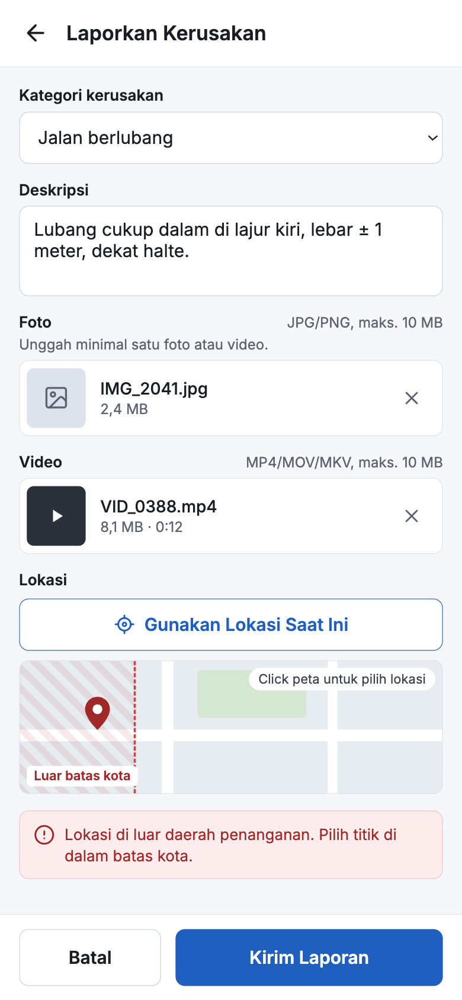
</p>
<p align="center">
<i>Gambar 6.1. Rancangan Antarmuka I-01 - Formulir Laporan Kerusakan</i>
</p>

<p align="center">
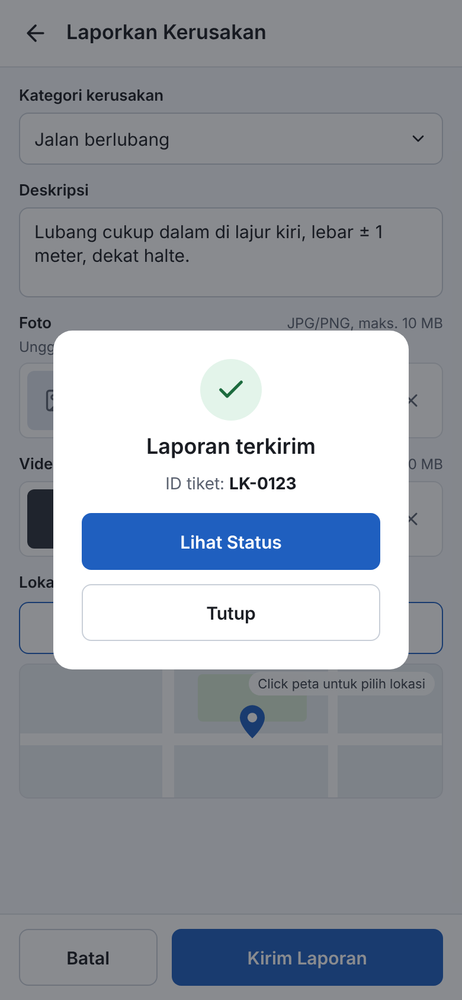
</p>
<p align="center">
<i>Gambar 6.2. Rancangan Antarmuka I-01 - Dialog Laporan Terkirim</i>
</p>

Tabel 6.1. Spesifikasi Objek Antarmuka I-01

| Id_Objek | Jenis | Konten | Keterangan |
| :--- | :--- | :--- | :--- |
| I01-01 | Icon Button | Panah kembali (←) | Membatalkan pengisian dan kembali ke layar sebelumnya tanpa menyimpan data. |
| I01-02 | Label | "Laporkan Kerusakan" | Judul layar. |
| I01-03 | Dropdown | "Kategori kerusakan": Jalan berlubang, Lampu jalan mati, Saluran air tersumbat, Trotoar rusak, Rambu / marka rusak | Wajib dipilih. Kategori disimpan bersama laporan dan dipakai untuk filter di I-03 dan I-05. |
| I01-04 | Text Area | "Deskripsi" (placeholder: "Jelaskan kondisi kerusakan") | Wajib diisi. Berisi uraian kondisi kerusakan dari warga. |
| I01-05 | File Upload | "Foto", "JPG/PNG, maks. 10 MB" | Membuka kamera/galeri. Sistem memeriksa format (JPG/PNG) dan ukuran (≤ 10 MB); berkas yang tidak sesuai ditolak dengan pesan error. |
| I01-06 | File Preview | Thumbnail, nama berkas, dan ukuran (contoh: "IMG_2041.jpg", "2,4 MB") | Menampilkan pratinjau foto yang berhasil diunggah. |
| I01-07 | Icon Button | Ikon × ("Hapus foto") | Menghapus foto dari formulir. |
| I01-08 | File Upload | "Video (opsional)", "MP4/MOV/MKV, maks. 10 MB" | Membuka kamera/galeri. Sistem memeriksa format (MP4/MOV/MKV) dan ukuran (≤ 10 MB); berkas yang tidak sesuai ditolak dengan pesan error. |
| I01-09 | File Preview | Thumbnail video, nama berkas, ukuran, dan durasi (contoh: "VID_0388.mp4", "8,1 MB · 0:12") | Menampilkan pratinjau video yang berhasil diunggah. |
| I01-10 | Icon Button | Ikon × ("Hapus video") | Menghapus video dari formulir. |
| I01-11 | Button | "Gunakan Lokasi Saat Ini" | Meminta izin lokasi perangkat, mengambil koordinat GPS, lalu memindahkan penanda pada peta (I01-12) ke titik tersebut. |
| I01-12 | Map | Peta kecil dengan penanda dan label "Click peta untuk pilih lokasi", area di luar batas kota diarsir dengan label "Luar batas kota" | Klik pada peta memindahkan penanda ke titik yang dipilih (pemilihan lokasi manual). Setiap perubahan titik memicu pengecekan batas daerah penanganan. |
| I01-13 | Alert | "Lokasi di luar daerah penanganan. Pilih titik di dalam batas kota." | Muncul jika titik lokasi berada di luar batas kota. Selama pesan ini aktif, laporan tidak dapat dikirim. |
| I01-14 | Button | "Batal" | Membatalkan pembuatan laporan dan kembali ke layar sebelumnya. |
| I01-15 | Button | "Kirim Laporan" | Memvalidasi seluruh isian (kategori, deskripsi, minimal satu foto/video, lokasi di dalam batas kota). Jika valid, laporan disimpan dengan status **Diterima**, ID tiket dibuat, lalu dialog sukses (I01-16) ditampilkan seperti pada Gambar 6.2. Jika tidak valid, pesan error ditampilkan pada isian yang bermasalah. |
| I01-16 | Dialog | "Laporan terkirim", "ID tiket: LK-0123" | Dialog sukses berbentuk *pop-up* di atas formulir yang muncul setelah laporan berhasil dikirim (Gambar 6.2). |
| I01-17 | Button | "Lihat Status" | Menutup dialog dan membuka layar I-02 Status Laporan. |
| I01-18 | Button | "Tutup" | Menutup dialog sukses. |

## 6.2 Rancangan Antarmuka I-02

**Antarmuka:** I-02  
**Nama Layar:** Status Laporan (Warga, mobile) — tab Riwayat dan tab Peta

<p align="center">
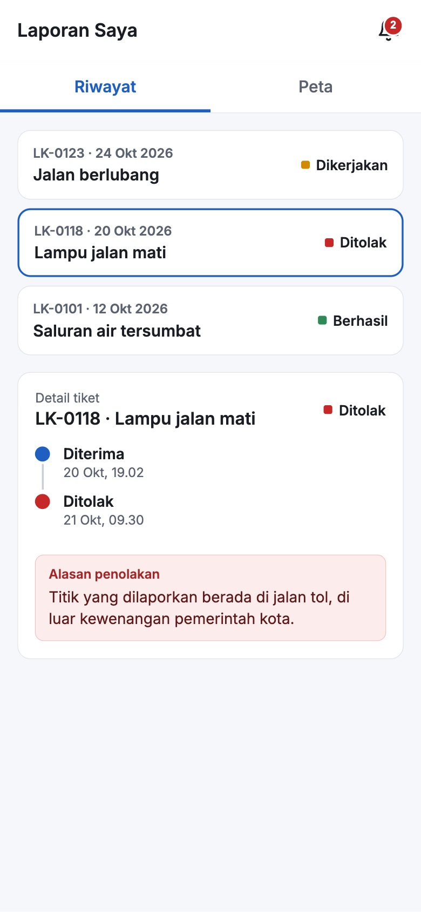
</p>
<p align="center">
<i>Gambar 6.3. Rancangan Antarmuka I-02 - Status Laporan (Tab Riwayat)</i>
</p>

<p align="center">
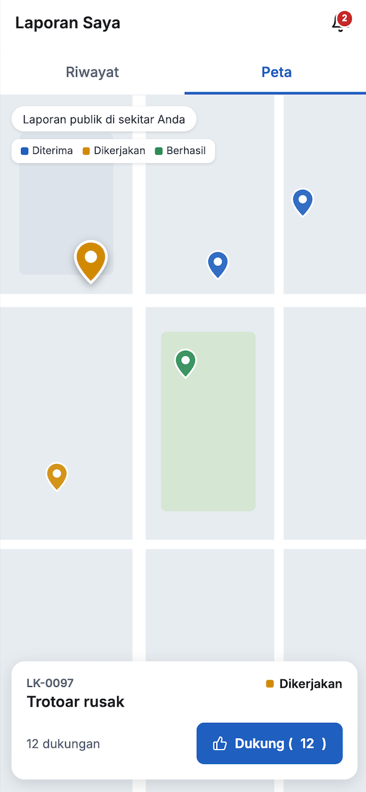
</p>
<p align="center">
<i>Gambar 6.4. Rancangan Antarmuka I-02 - Status Laporan (Tab Peta)</i>
</p>

Tabel 6.2. Spesifikasi Objek Antarmuka I-02

| Id_Objek | Jenis | Konten | Keterangan |
| :--- | :--- | :--- | :--- |
| I02-01 | Label | "Laporan Saya" | Judul layar. |
| I02-02 | Icon Button | Ikon lonceng dengan badge jumlah notifikasi belum dibaca (contoh: "2") | Membuka daftar notifikasi perubahan status laporan milik warga. Memilih notifikasi menampilkan detail tiket terkait pada I02-07. |
| I02-03 | Tab | "Riwayat" | Menampilkan daftar tiket laporan milik warga (I02-05 s.d. I02-09). |
| I02-04 | Tab | "Peta" | Menampilkan peta sebaran laporan publik (I02-10 s.d. I02-12). |
| I02-05 | Card List | Kartu tiket berisi ID tiket, tanggal, kategori, dan status (contoh: "LK-0123 · 24 Okt 2026", "Jalan berlubang") | Daftar laporan milik warga. Klik kartu memilih tiket (kartu diberi garis tepi aksen) dan menampilkan detailnya pada I02-07. |
| I02-06 | Badge | Status: Diterima, Ditolak, Dikerjakan, Berhasil | Penanda status terkini tiket, dengan warna berbeda untuk setiap status. |
| I02-07 | Panel | "Detail tiket", ID tiket · kategori, dan badge status | Menampilkan rincian tiket yang sedang dipilih. |
| I02-08 | Timeline | Tahapan status beserta waktunya (contoh: "Diterima – 20 Okt, 19.02", "Ditolak – 21 Okt, 09.30") | Menampilkan riwayat perubahan status tiket secara berurutan. |
| I02-09 | Info Box | "Alasan penolakan" beserta isi alasan dari Tim Administrasi | Hanya muncul jika status tiket **Ditolak**. Isinya berasal dari alasan yang dikirim di I-03. |
| I02-10 | Map | Peta sebaran laporan publik, dengan label "Laporan publik di sekitar Anda" | Menampilkan seluruh laporan publik dalam batas kota. Tidak menampilkan nama atau identitas pelapor. |
| I02-11 | Legend | Diterima (biru), Dikerjakan (kuning), Berhasil (hijau) | Keterangan arti warna penanda pada peta. |
| I02-12 | Map Marker | Penanda berwarna sesuai status laporan | Klik penanda memilih laporan tersebut dan memperbesar penandanya. |
| I02-13 | Card | ID tiket, kategori, badge status, dan jumlah dukungan (contoh: "LK-0097", "Trotoar rusak", "Dikerjakan", "12 dukungan") | Ringkasan laporan yang dipilih pada peta. Jumlah dukungan mencakup dukungan dari tombol I02-14 dan laporan duplikat (laporan sekategori dalam radius ≤ 20 m) yang otomatis dicatat sebagai dukungan. |
| I02-14 | Button | "Dukung (12)" | Menambah satu dukungan dari warga untuk laporan terpilih (satu dukungan per akun); angka pada tombol dan I02-13 bertambah. |

## 6.3 Rancangan Antarmuka I-03

**Antarmuka:** I-03  
**Nama Layar:** Validasi Laporan (Tim Administrasi, desktop)

<p align="center">
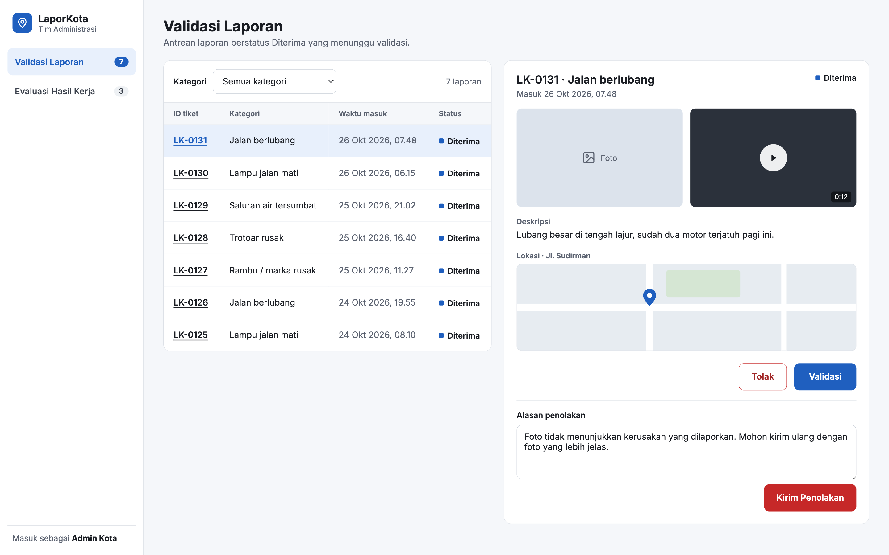
</p>
<p align="center">
<i>Gambar 6.5. Rancangan Antarmuka I-03 - Validasi Laporan</i>
</p>

Tabel 6.3. Spesifikasi Objek Antarmuka I-03

| Id_Objek | Jenis | Konten | Keterangan |
| :--- | :--- | :--- | :--- |
| I03-01 | Sidebar Menu | "Validasi Laporan" dengan badge jumlah antrean (contoh: "7") | Menu aktif. Menampilkan layar I-03. |
| I03-02 | Sidebar Menu | "Evaluasi Hasil Kerja" dengan badge jumlah (contoh: "3") | Membuka layar I-04 Evaluasi Hasil Kerja. |
| I03-03 | Label | "Masuk sebagai Admin Kota" | Menampilkan akun Tim Administrasi yang sedang masuk. |
| I03-04 | Dropdown | "Kategori": Semua kategori, Jalan berlubang, Lampu jalan mati, Saluran air tersumbat, Trotoar rusak, Rambu / marka rusak | Memfilter isi tabel antrean (I03-06) berdasarkan kategori. |
| I03-05 | Label | Jumlah laporan (contoh: "7 laporan") | Jumlah laporan dalam antrean sesuai filter aktif. |
| I03-06 | Table | Kolom: ID tiket, Kategori, Waktu masuk, Status | Antrean laporan berstatus **Diterima**, diurutkan dari waktu masuk terbaru. Baris terpilih diberi latar berwarna. |
| I03-07 | Link | ID tiket (contoh: "LK-0131") | Memilih laporan dan menampilkan rinciannya pada panel kanan (I03-08 s.d. I03-12). |
| I03-08 | Panel | ID tiket · kategori, waktu masuk, badge status (contoh: "LK-0131 · Jalan berlubang", "Masuk 26 Okt 2026, 07.48", "Diterima") | Header panel rincian laporan terpilih. |
| I03-09 | Image Viewer | Foto laporan | Menampilkan foto kiriman warga; klik untuk memperbesar. |
| I03-10 | Video Player | Video laporan dengan durasi (contoh: "0:12") | Memutar video kiriman warga. |
| I03-11 | Text | "Deskripsi" beserta isi deskripsi laporan | Menampilkan deskripsi dari warga. |
| I03-12 | Map | "Lokasi · Jl. Sudirman" dengan penanda | Menampilkan titik lokasi laporan. |
| I03-13 | Button | "Validasi" | Menyatakan laporan valid: status berubah menjadi **Dikerjakan**, laporan keluar dari antrean dan masuk ke Daftar Tugas eksekutor (I-05), lalu notifikasi dikirim ke pelapor. |
| I03-14 | Button | "Tolak" | Menampilkan isian alasan penolakan (I03-15 dan I03-16). |
| I03-15 | Text Area | "Alasan penolakan" (placeholder: "Tuliskan alasan yang akan dikirim ke pelapor") | Wajib diisi sebelum penolakan dikirim. |
| I03-16 | Button | "Kirim Penolakan" | Status laporan berubah menjadi **Ditolak**, alasan disimpan dan ditampilkan ke pelapor di I-02, laporan keluar dari antrean. Jika alasan kosong, sistem menampilkan pesan error. |

## 6.4 Rancangan Antarmuka I-04

**Antarmuka:** I-04  
**Nama Layar:** Evaluasi Hasil Kerja (Tim Administrasi, desktop)

<p align="center">
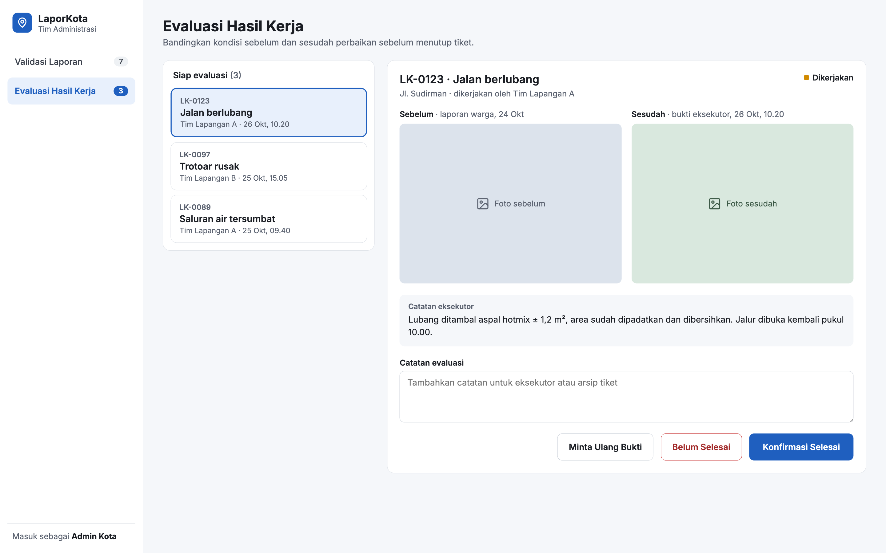
</p>
<p align="center">
<i>Gambar 6.6. Rancangan Antarmuka I-04 - Evaluasi Hasil Kerja</i>
</p>

Tabel 6.4. Spesifikasi Objek Antarmuka I-04

| Id_Objek | Jenis | Konten | Keterangan |
| :--- | :--- | :--- | :--- |
| I04-01 | Sidebar Menu | "Validasi Laporan" dengan badge jumlah (contoh: "7") | Membuka layar I-03 Validasi Laporan. |
| I04-02 | Sidebar Menu | "Evaluasi Hasil Kerja" dengan badge jumlah (contoh: "3") | Menu aktif. Menampilkan layar I-04. |
| I04-03 | Label | "Masuk sebagai Admin Kota" | Menampilkan akun Tim Administrasi yang sedang masuk. |
| I04-04 | Card List | "Siap evaluasi (3)"; kartu berisi ID tiket, kategori, tim eksekutor, dan waktu kirim bukti (contoh: "LK-0123", "Jalan berlubang", "Tim Lapangan A · 26 Okt, 10.20") | Daftar pekerjaan yang hasilnya sudah dikirim eksekutor melalui I-06. Klik kartu menampilkan perbandingan pada area utama. |
| I04-05 | Label | ID tiket · kategori, lokasi, dan tim eksekutor (contoh: "LK-0123 · Jalan berlubang", "Jl. Sudirman · dikerjakan oleh Tim Lapangan A") | Header area utama untuk pekerjaan terpilih. |
| I04-06 | Badge | "Dikerjakan" | Status tiket saat dievaluasi. |
| I04-07 | Image Viewer | "Sebelum · laporan warga, 24 Okt" | Foto kondisi awal dari laporan warga (I-01). Klik untuk memperbesar. |
| I04-08 | Image Viewer | "Sesudah · bukti eksekutor, 26 Okt, 10.20" | Foto bukti hasil perbaikan dari eksekutor (I-06), ditampilkan berdampingan dengan I04-07. Klik untuk memperbesar. |
| I04-09 | Text | "Catatan eksekutor" beserta isi catatan perbaikan | Menampilkan catatan yang dikirim eksekutor. |
| I04-10 | Text Area | "Catatan evaluasi" (placeholder: "Tambahkan catatan untuk eksekutor atau arsip tiket") | Catatan Tim Administrasi; dikirim ke eksekutor bersama keputusan evaluasi dan disimpan pada riwayat tiket. |
| I04-11 | Button | "Minta Ulang Bukti" | Mengembalikan tugas ke eksekutor (I-05) untuk mengunggah ulang bukti. Status tetap **Dikerjakan**. |
| I04-12 | Button | "Belum Selesai" | Menandai perbaikan belum tuntas dan mengembalikan tugas ke Daftar Tugas eksekutor (I-05) beserta catatan evaluasi. Status tetap **Dikerjakan**. |
| I04-13 | Button | "Konfirmasi Selesai" | Mengubah status tiket menjadi **Berhasil**, menghapus pekerjaan dari daftar evaluasi, lalu mengirim notifikasi ke pelapor (I-02). |

## 6.5 Rancangan Antarmuka I-05

**Antarmuka:** I-05  
**Nama Layar:** Daftar Tugas (Eksekutor Lapangan, mobile)

<p align="center">
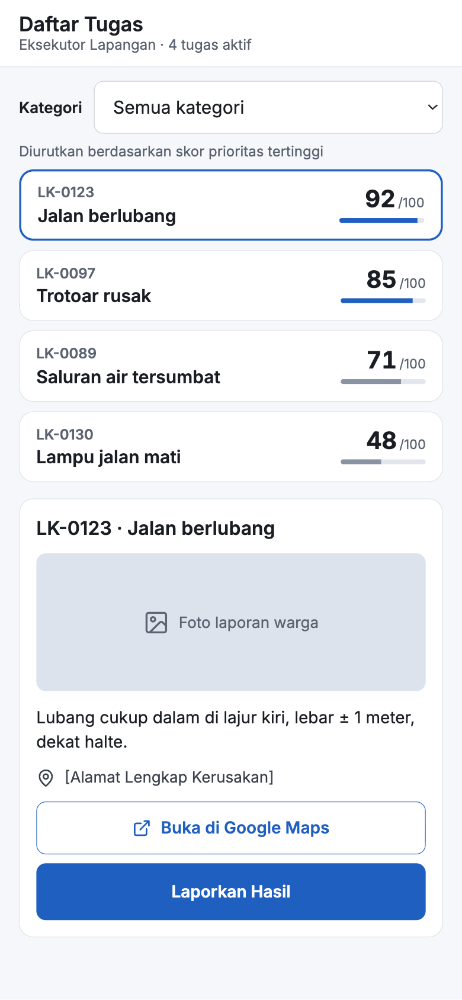
</p>
<p align="center">
<i>Gambar 6.7. Rancangan Antarmuka I-05 - Daftar Tugas</i>
</p>

Tabel 6.5. Spesifikasi Objek Antarmuka I-05

| Id_Objek | Jenis | Konten | Keterangan |
| :--- | :--- | :--- | :--- |
| I05-01 | Label | "Daftar Tugas", "Eksekutor Lapangan · 4 tugas aktif" | Judul layar dan jumlah tugas aktif milik eksekutor. |
| I05-02 | Dropdown | "Kategori": Semua kategori, Jalan berlubang, Lampu jalan mati, Saluran air tersumbat, Trotoar rusak, Rambu / marka rusak | Memfilter daftar tugas (I05-04) berdasarkan kategori. |
| I05-03 | Label | "Diurutkan berdasarkan skor prioritas tertinggi" | Keterangan urutan daftar tugas. |
| I05-04 | Card List | Kartu tugas berisi ID tiket dan kategori (contoh: "LK-0123", "Jalan berlubang") | Daftar tugas berstatus **Dikerjakan** yang hasil perbaikannya belum dikirim, diurutkan dari skor prioritas tertinggi. Klik kartu menampilkan rincian pada I05-06. |
| I05-05 | Indicator | Skor prioritas berupa angka dan bar (contoh: "92 /100") | Menampilkan skor prioritas tugas; panjang bar sebanding dengan skor. |
| I05-06 | Panel | Rincian tugas terpilih (contoh: "LK-0123 · Jalan berlubang") | Menampilkan detail tugas yang sedang dipilih. |
| I05-07 | Image Viewer | "Foto laporan warga" | Menampilkan foto dari laporan warga; klik untuk memperbesar. |
| I05-08 | Text | Deskripsi laporan | Menampilkan deskripsi kerusakan dari warga. |
| I05-09 | Label | Ikon lokasi dan alamat lengkap kerusakan | Menampilkan alamat titik kerusakan. |
| I05-10 | Button | "Buka di Google Maps" | Membuka aplikasi atau situs Google Maps dengan koordinat lokasi kerusakan untuk navigasi. |
| I05-11 | Button | "Laporkan Hasil" | Membuka layar I-06 Formulir Hasil Perbaikan untuk tiket terpilih. |

## 6.6 Rancangan Antarmuka I-06

**Antarmuka:** I-06  
**Nama Layar:** Formulir Hasil Perbaikan (Eksekutor Lapangan, mobile)

<p align="center">
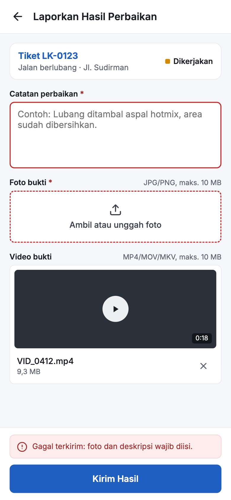
</p>
<p align="center">
<i>Gambar 6.8. Rancangan Antarmuka I-06 - Formulir Hasil Perbaikan</i>
</p>

Tabel 6.6. Spesifikasi Objek Antarmuka I-06

| Id_Objek | Jenis | Konten | Keterangan |
| :--- | :--- | :--- | :--- |
| I06-01 | Icon Button | Panah kembali (←) | Kembali ke layar I-05 Daftar Tugas tanpa mengirim hasil. |
| I06-02 | Label | "Laporkan Hasil Perbaikan" | Judul layar. |
| I06-03 | Card | "Tiket LK-0123", "Jalan berlubang · Jl. Sudirman", badge "Dikerjakan" | Identitas tiket yang sedang dilaporkan hasilnya. |
| I06-04 | Text Area | "Catatan perbaikan *" (placeholder: "Contoh: Lubang ditambal aspal hotmix, area sudah dibersihkan.") | Wajib diisi. Jika kosong saat dikirim, garis tepi berubah merah. |
| I06-05 | File Upload | "Foto bukti *", "JPG/PNG, maks. 10 MB", "Ambil atau unggah foto" | Wajib diisi. Membuka kamera/galeri; sistem memeriksa format dan ukuran berkas. Jika kosong saat dikirim, garis tepi berubah merah. |
| I06-06 | File Upload + Preview | "Video bukti (opsional)", "MP4/MOV/MKV, maks. 10 MB"; pratinjau video, nama berkas, dan ukuran (contoh: "VID_0412.mp4", "9,3 MB") | Mengunggah video bukti dan menampilkan pratinjaunya. Sistem memeriksa format dan ukuran berkas. |
| I06-07 | Icon Button | Ikon × ("Hapus video") | Menghapus video bukti dari formulir. |
| I06-08 | Alert | "Gagal terkirim: foto dan deskripsi wajib diisi." | Muncul jika catatan perbaikan atau foto bukti belum diisi saat tombol Kirim Hasil ditekan. |
| I06-09 | Button | "Kirim Hasil" | Memvalidasi isian wajib. Jika lengkap, hasil perbaikan dikirim dan masuk ke daftar Siap Evaluasi pada I-04, lalu tugas keluar dari daftar aktif I-05. Status tiket tetap **Dikerjakan** sampai dikonfirmasi Tim Administrasi. Jika tidak lengkap, I06-08 ditampilkan. |

## 6.7 Rancangan Antarmuka Keseluruhan

Berikut daftar seluruh antarmuka LaporKota. ID pada tabel ini sama dengan ID yang digunakan pada subbab 6.1 s.d. 6.6.

Tabel 6.7. Rancangan Antarmuka Keseluruhan

| No | Tampilan Antarmuka |
| :--- | :--- |
| I-01 (Formulir) |  |
| I-01 (Laporan Terkirim) |  |
| I-02 (Riwayat) |  |
| I-02 (Peta) |  |
| I-03 |  |
| I-04 |  |
| I-05 |  |
| I-06 |  |

<br>

---
# BAB 7: Matriks Kerunutan


Tabel 7.1. Matriks Kerunutan Kelas terhadap Use Case

| Kelas | Use Case Terkait |
| :--- | :--- |
| *[C01 - User]* | *[UC01 - Mengirim Laporan Kerusakan], [UC02 - Memvalidasi Laporan Baru], [UC03 - Melihat Penugasan Lapangan], [UC04 - Melaporkan Hasil Penugasan], [UC05 - Mengevaluasi Hasil Kerja], [UC06 - Memantau Status Laporan]* |
| *[C02 - Laporan]* | *[UC01 - Mengirim Laporan Kerusakan], [UC02 - Memvalidasi Laporan Baru], [UC03 - Melihat Penugasan Lapangan], [UC04 - Melaporkan Hasil Penugasan], [UC05 - Mengevaluasi Hasil Kerja], [UC06 - Memantau Status Laporan]* |
| *[C03 - Lokasi]* | *[UC01 - Mengirim Laporan Kerusakan], [UC02 - Memvalidasi Laporan Baru], [UC06 - Memantau Status Laporan]* |
| *[C04 - Foto]* | *[UC01 - Mengirim Laporan Kerusakan], [UC02 - Memvalidasi Laporan Baru], [UC03 - Melihat Penugasan Lapangan], [UC04 - Melaporkan Hasil Penugasan], [UC05 - Mengevaluasi Hasil Kerja], [UC06 - Memantau Status Laporan]* |
| *[C05 - Video]* | *[UC01 - Mengirim Laporan Kerusakan], [UC02 - Memvalidasi Laporan Baru], [UC03 - Melihat Penugasan Lapangan], [UC04 - Melaporkan Hasil Penugasan], [UC05 - Mengevaluasi Hasil Kerja], [UC06 - Memantau Status Laporan]* |
| *[C06 - Upvote]* | *[UC02 - Memvalidasi Laporan Baru], [UC06 - Memantau Status Laporan]* |
| *[C07 - ListTugas]* | *[UC03 - Melihat Penugasan Lapangan], [UC04 - Melaporkan Hasil Penugasan]* |
| *[C08 - HasilPerbaikan]* | *[UC04 - Melaporkan Hasil Penugasan], [UC05 - Mengevaluasi Hasil Kerja], [UC06 - Memantau Status Laporan]* |
| *[C09 - Evaluasi]* | *[UC05 - Mengevaluasi Hasil Kerja]* |
| *[C10 - Notifikasi]* | *[UC01 - Mengirim Laporan Kerusakan], [UC02 - Memvalidasi Laporan Baru], [UC05 - Mengevaluasi Hasil Kerja]* |
| *[C11 - LaporPage]* | *[UC01 - Mengirim Laporan Kerusakan]* |
| *[C12 - ValidasiPage]* | *[UC02 - Memvalidasi Laporan Baru]* |
| *[C13 - PenugasanPage]* | *[UC03 - Melihat Penugasan Lapangan], [UC04 - Melaporkan Hasil Penugasan]* |
| *[C14 - HasilPerbaikanForm]* | *[UC04 - Melaporkan Hasil Penugasan]* |
| *[C15 - EvaluasiPage]* | *[UC05 - Mengevaluasi Hasil Kerja]* |
| *[C16 - StatusLaporanPage]* | *[UC06 - Memantau Status Laporan]* |
| *[C17 - LaporanController]* | *[UC01 - Mengirim Laporan Kerusakan]* |
| *[C18 - ValidasiController]* | *[UC02 - Memvalidasi Laporan Baru]* |
| *[C19 - PenugasanController]* | *[UC03 - Melihat Penugasan Lapangan], [UC04 - Melaporkan Hasil Penugasan]* |
| *[C20 - PerbaikanController]* | *[UC04 - Melaporkan Hasil Penugasan]* |
| *[C21 - EvaluasiController]* | *[UC05 - Mengevaluasi Hasil Kerja]* |
| *[C22 - StatusController]* | *[UC06 - Memantau Status Laporan]* |
| *[C23 - NotifikasiController]* | *[UC01 - Mengirim Laporan Kerusakan], [UC02 - Memvalidasi Laporan Baru], [UC05 - Mengevaluasi Hasil Kerja]* |
