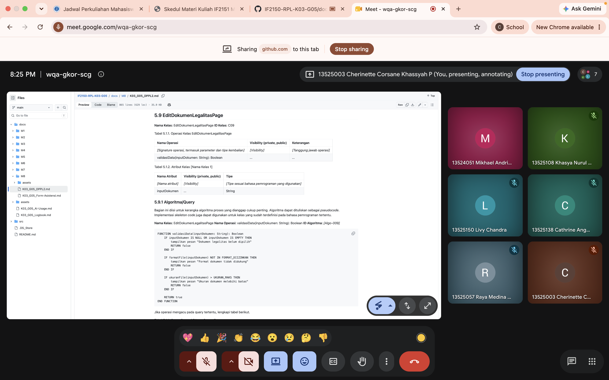
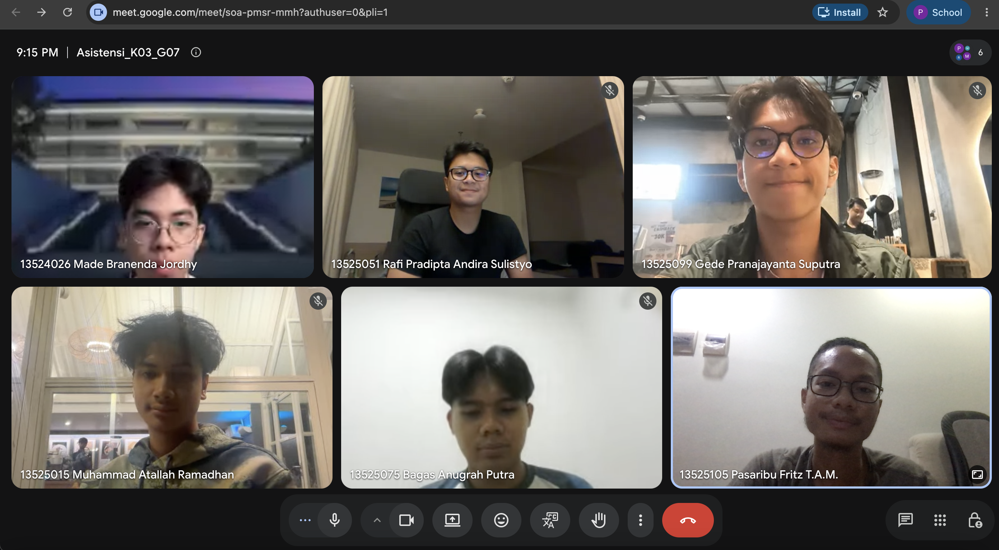

# Form Asistensi

## Tugas Besar IF2150 - Rekayasa Perangkat Lunak

| Informasi | Keterangan |
| --- | --- |
| **Hari** | *\[Selasa\]* |
| **Tanggal** | *\[27/10/2026\]* |
| **Kelas** | *\[K03\]* |
| **Nomor Kelompok** | *\[G07\]*  |
| **Nama Kelompok** | *\[siulan\]*  |
| **Nama Perangkat Lunak** | *\[LaporKota\]*  |
| **Dokumen** | *\[DPPl2\]*  |

### Anggota Kelompok

| NIM | Nama |
| --- | --- |
| *13525051* | *Rafi Pradipta Andira Sulistyo* |
| *13525105* | *Pasaribu Fritz T.A.M.* |
| *13525075* | *Bagas Anugrah Putra* |
| *13525099* | *Gede Pranajayanta Suputra* |
| *13525015* | *Muhammad Atallah Ramadhan* |

### Catatan

| Catatan |
| --- |
| 1. *Kalo ada pop-up buat interface, boleh bikin foto tambahan versi dengan pop-up dan tidak*  |
| 2. *Buat yang query itu intinya adalah perintah yang mengakses (CRUD) ke database/kelas lain* |
| 3. Untuk desain interface sebenernya gapapa aja kalo kalian make tools AI |
| 4. ... |

**Notes for this section:**  
*Catatan dapat dituliskan dalam bentuk paragraf atau poin-poin, disesuaikan saja.* 

## Dokumentasi

<!--  -->

  

  <i>Gambar 1. Dokumentasi kegiatan asistensi.</i>

