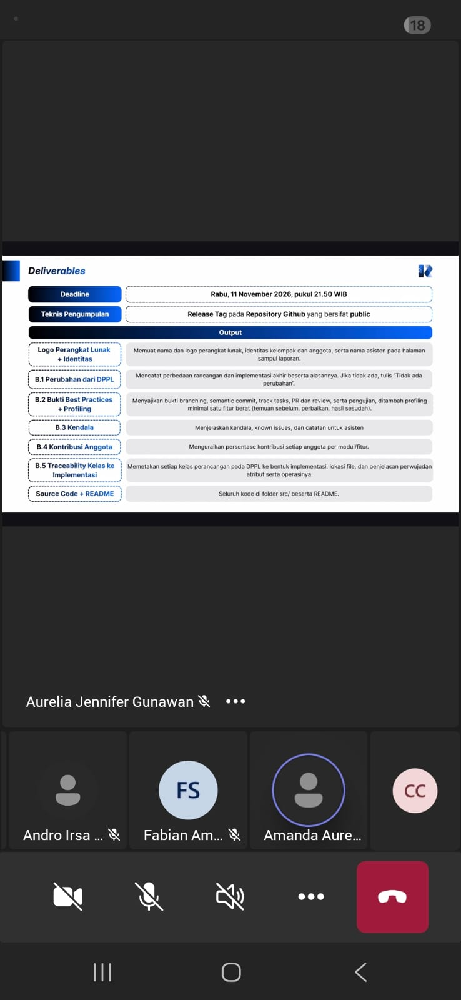

# Form Asistensi

## Tugas Besar IF2150 - Rekayasa Perangkat Lunak

| Informasi | Keterangan |
| --- | --- |
| **Hari** | *\[Senin\]* |
| **Tanggal** | *\[2/11/2026\]* |
| **Kelas** | *\[K02\]* |
| **Nomor Kelompok** | *\[G06\]*  |
| **Nama Kelompok** | *\[Rengginang\]*  |
| **Nama Perangkat Lunak** | *\[SaveBite\]*  |
| **Dokumen** | *\[K02_G06_DPPl2\]*  |

### Anggota Kelompok

| NIM | Nama |
| --- | --- |
| *13525120* | *Nadia Aulia Syafarani* |
| *13525041* | *Renata Puspanegara Ninagan* |
| *13525119* | *Ghina Emelia Yantes* |
| *13525017* | *Cendra Asih Chairunnisa* |
| *13525089* | *Sherin Felicia Danessa* |

### Catatan

| Catatan |
| --- |
| 1. Ketentuan deliverables  |
| 2. Ketentuan implementasi |
| 3. Manajemen data |
| 4. Git workflow |
| 5. Semantic commit message |
| 6. Issue tracking dan task management |
| 7. Code review |
| 8. Performance and quality |

**Notes for this section:**  
*Catatan dapat dituliskan dalam bentuk paragraf atau poin-poin, disesuaikan saja.* 

## Dokumentasi

<!--  -->

  

  <i>Gambar 1. Dokumentasi kegiatan asistensi.</i>

