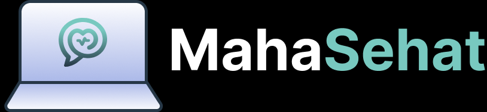

<h1>
IF2150 REKAYASA PERANGKAT LUNAK
 
TUGAS 9
 
IMPLEMENTASI PERANGKAT LUNAK
</h1>
 

## *Mahasehat: Mental Health Monitoring App for Students*

### Untuk: *Stefani Angeline Oroh*

Dipersiapkan oleh:
| Informasi | Keterangan |
| --- | --- |
| Kelas | *03* |
| Kelompok | *04* |

| NIM | Nama |
|---|---|
| *13525021* | *Haikal Muhammad Royyan* |
| *13525066* | *Cynthia Winda Wijaya* |
| *13525081* | *Rendy Salastra Putra* |
| *13525090* | *Sophia Imelda Rogate Marpaung* |
| *13525141* | *Christabelcyne Costan* |
---

**Deadline:** Rabu, 11 November 2026, 21.50 WIB

**Asistensi akbar:** *[Hari, DD Bulan YYYY, HH.MM WIB, lokasi/link]*

---

# BAGIAN B: Laporan Implementasi

## B.1 Perubahan dari DPPL

Tabel B.1. Perubahan dari DPPL

| No | Bagian DPPL | Rancangan Awal | Implementasi Akhir | Alasan |
| :--- | :--- | :--- | :--- | :--- |
| 1 | C21 `PengajuanKonsultasiPage` | Halaman terpisah untuk memilih jadwal dan mengirim pengajuan | Dihapus; fungsi dipindah ke modal "Buat Janji" pada `CariTenagaKesehatanPage` dan `KonsultasiController` | Menghindari dua halaman yang mengerjakan alur UC06 yang sama |
| 2 | C19 `ProfilTenagaKesehatanPage` | Halaman profil tenaga kesehatan terpisah | Tidak ada halaman terpisah; profil dan jadwal tampil pada dialog detail `CariTenagaKesehatanPage` | Semua informasi yang dibutuhkan UC05/UC06 sudah cukup dalam satu page |
| 3 | C22 `JadwalKonsultasiController` dan C23 `KonsultasiController` | Dua controller terpisah | Digabung menjadi `src/controllers/KonsultasiController.js` dengan route `/api/konsultasi` | Operasi jadwal dan pengajuan saling bergantung dan memakai transaksi yang sama |
| 4 | C15 `NotifikasiPengingatController` | Pengingat check-in harian | Tidak diimplementasikan; scheduler hanya menjalankan evaluasi notifikasi darurat (`src/jobs/`); pengingat check-in belum masuk lingkup implementasi | Waktu pengerjaan M9 dipakai untuk alur inti UC01–UC10; kebutuhan pengingat belum diverifikasi |
| 5 | UC07 skenario alternatif 1 | Status "Menunggu Konfirmasi Ulang" | Memakai status `Rescheduled` pada `JadwalKonsultasi`, sesuai `CHECK` constraint dan DPPL Tabel 4.1 | Menjaga konsistensi dengan model dan basis data yang sudah ada |
| 6 | C23 `KonsultasiController` | Operasi hanya `approvePengajuan()` dan `reschedule()` | Ditambah `ajukan`, `daftarSaya`, `daftarMasuk`, `daftarJadwal`, `ubahStatus`, `jadwalUlang`, dan `tolak` | Diperlukan agar halaman pelajar dan nakes memakai satu sumber data yang sama |
| 7 | Basis data `tenaga_kesehatan` | Profil tenaga kesehatan lengkap | Kolom `bio` dan tarif per sesi tidak ada; tarif diambil dari `fasilitas_kesehatan.estimasi_biaya`, bio hanya tersimpan di klien | Mengikuti skema DPPL yang sudah ada; penambahan kolom belum diperlukan untuk alur inti |
| 8 | Basis data `jadwal_konsultasi` | Status pengajuan termasuk penolakan | Tidak ada status "Ditolak"; tombol Tolak mengembalikan slot menjadi `Belum Diajukan` dan `status_ketersediaan = TRUE` | Menjaga `CHECK` constraint yang hanya mengizinkan empat status |
| 9 | C11 `AuthController` | Operasi autentikasi dasar | Ditambah `pengajuanMenunggu` (token konfirmasi untuk dashboard wali) dan `perbaruiProfil` (`PATCH /api/auth/me`) | Dashboard wali perlu menautkan halaman konfirmasi; setelan perlu menyimpan profil ke server |
| 10 | Struktur View | Satu partial sidebar | Markup sidebar disalin di setiap HTML statis (CSS-nya tunggal) | Aplikasi berupa HTML statis tanpa mesin templating; sesuai catatan DPPL tentang View |

## B.2 Bukti Penerapan Best Practices

Tabel B.2. Bukti Best Practices

| Praktik | Bukti | Keterangan |
| :--- | :--- | :--- |
| Branching | [Daftar branch](https://github.com/cynthiawinda/IF2150-RPL-K03-G04/branches) | Memakai `develop` dan branch per fitur, mis. `feat/uc02-batas-waktu-konfirmasi`, `fix/desain-interface`, `24-feat-implement-checkinpage`; digabung lewat PR |
| Semantic commit | [Riwayat commit](https://github.com/cynthiawinda/IF2150-RPL-K03-G04/commits/develop) | Format `<tipe>(<scope>): <deskripsi>`, mis. `feat(auth): ...`, `fix(ui): ...`, `refactor(sidebar): ...` |
| Track tasks | [GitHub Issues](https://github.com/cynthiawinda/IF2150-RPL-K03-G04/issues) | Pembagian fitur per anggota; riwayat pekerjaan juga dicatat di `docs/K03_G04_Logbook.md` |
| Pull request dan review | [Daftar PR](https://github.com/cynthiawinda/IF2150-RPL-K03-G04/pulls) | PR #9, #12, #15, #18, #22, #28, #38, #39; setiap PR di-review minimal satu anggota lain |
| Pengujian | [`src/tests/`](../../src/tests) | `npm test` di folder `src/`: 5 suite lulus (54 tes), 4 suite integrasi DB di-skip bila `TEST_DATABASE_URL` kosong; menguji auth, check-in ganda, laporan, notifikasi darurat, dan scheduler |

### B.2.1 Profiling dan Optimasi

| Informasi | Keterangan |
| :--- | :--- |
| Fitur / proses yang diprofil | `GET /api/reports/summary` — agregasi check-in 90 hari untuk dashboard dan halaman laporan |
| Alat | `performance.now()` pada 10 permintaan berurutan dan `EXPLAIN ANALYZE` PostgreSQL |
| Temuan (sebelum) | Endpoint menjalankan beberapa query (riwayat 90 hari, tanggal check-in terakhir, ringkasan 7 hari) dan mengolah agregasi di Node.js. `EXPLAIN ANALYZE` menunjukkan `Index Scan` memakai `idx_check_in_pelajar_tanggal`; execution time 0,06 ms, tidak ada N+1 |
| Perbaikan | Tidak ada perubahan kode khusus; bottleneck tidak ditemukan. Hasil ringkasan dipakai bersama oleh dashboard dan halaman laporan agar tidak menghitung ulang |
| Hasil (sesudah) | Rata-rata respons **11,1 ms** (min 7,0 ms, maks 26,0 ms) pada DB seed. Waktu didominasi latensi HTTP dan parsing, bukan query basis data |

## B.3 Kendala dan Catatan Penting

1. **Basis data wajib berjalan.** Aplikasi memakai PostgreSQL sesuai `.env`; tanpa koneksi, endpoint mengembalikan error 500. Jalankan `npm run db:seed` pada database kosong untuk membuat skema dan data uji.
2. **`db:seed` hanya untuk database kosong.** `schema.sql` belum memakai `IF NOT EXISTS`, sehingga menjalankannya pada database yang sudah berisi tabel akan gagal.
3. **Akun uji.** Password akun seed: `Password123!`. Contoh: `budi.pelajar@mahasehat.id` (pelajar), `santoso.wali@mahasehat.id` (wali), `siti.psikolog@mahasehat.id` (nakes). `andi.siswa@mahasehat.id` sengaja berstatus *Belum Terverifikasi* untuk menguji konfirmasi wali.
4. **Konfirmasi wali.** Tautan konfirmasi dicetak di log server (`[Mail] Konfirmasi untuk ...`) karena SMTP tidak dikonfigurasi. Dashboard wali juga menyediakan tombol "Tinjau Registrasi" yang membawa token yang sama.
5. **Pengujian integrasi DB.** Isi `TEST_DATABASE_URL` untuk menjalankan 4 suite yang di-skip; isi database tersebut akan dikosongkan oleh test.
6. **Setelan tenaga kesehatan.** Profil inti (nama, email, telepon, jenis, STR) tersimpan ke server. Bio, tempat kerja, dan jadwal praktik masih disimpan di `localStorage` karena kolomnya belum ada di skema.
7. **Notifikasi darurat.** Modal darurat hanya muncul untuk peran wali dan hanya jika ada baris aktif di `notifikasi_darurat`; jalankan scheduler atau isi data uji untuk mencobanya.
8. **Data demo relatif terhadap tanggal seed.** Jadwal konsultasi memakai `CURRENT_DATE + n`; jika database lama tidak di-seed ulang, slot bisa sudah lewat.

## B.4 Kontribusi Anggota

Tabel B.4. Kontribusi Anggota

| NIM | Nama | Modul / Fitur yang Dikerjakan | Persentase Kontribusi |
| :--- | :--- | :--- | :--- |
| *13525021* | *Haikal Muhammad Royyan* | Model C01–C09, autentikasi (UC01, UC02, UC09, UC10), notifikasi darurat (UC08), scheduler, skema/seed, pengujian | *20%* |
| *13525066* | *Cynthia Winda Wijaya* | Halaman registrasi, login, konfirmasi registrasi, pop-up notifikasi, `CariTenagaKesehatanPage`, `CheckInPage`, routing/controller konsultasi | *20%* |
| *13525081* | *Rendy Salastra Putra* | Integrasi FE–BE, `AuthLayout.css`, sidebar/design system, manajemen konsultasi, setelan nakes dan ortu, perbaikan bug dan umpan balik aksi | *20%* |
| *13525090* | *Sophia Imelda Rogate Marpaung* | `DashboardPage` semua peran, `SettingPage`, `ReportPage`, `ResetPasswordPage`, perapian aset/tampilan | *20%* |
| *13525141* | *Christabelcyne Costan* | Backend check-in, backend laporan kesehatan, backend manajemen konsultasi, perbaikan check-in dan konsultasi | *20%* |

## B.5 Traceability Kelas Perancangan ke Implementasi

Tabel B.5. Traceability Kelas Perancangan ke Implementasi

| ID Kelas | Nama Kelas Perancangan | Bentuk Implementasi | Lokasi (File dan Nama) | Keterangan |
| :--- | :--- | :--- | :--- | :--- |
| *C01* | *Pengguna* | Kelas | `src/models/Pengguna.js` — `Pengguna` | Atribut menjadi properti objek; operasi menjadi method statis/instance |
| *C02* | *Pelajar* | Kelas | `src/models/Pelajar.js` — `Pelajar` | Termasuk `setCheckIn`, `getCheckInHistory`, `ajukanKonsultasi` |
| *C03* | *OrangTuaWali* | Kelas | `src/models/OrangTuaWali.js` — `OrangTuaWali` | Ditambah `getPelajarTerhubung`, `getSummaryReport`, `getPengajuanMenunggu` |
| *C04* | *TenagaKesehatan* | Kelas | `src/models/TenagaKesehatan.js` — `TenagaKesehatan` | `getJadwalTersedia`, `perbaruiProfil` |
| *C05* | *RiwayatKesehatan* | Kelas | `src/models/RiwayatKesehatan.js` — `RiwayatKesehatan` | Riwayat disimpan terenkripsi |
| *C06* | *CheckIn* | Kelas | `src/models/CheckIn.js` — `CheckIn` | `createCheckIn`, `getCheckInData` |
| *C07* | *LaporanKesehatan* | Kelas | `src/models/LaporanKesehatan.js` — `LaporanKesehatan` | `evaluateThreshold`, `detectEmergency`; tidak disimpan sebagai tabel |
| *C08* | *FasilitasKesehatan* | Kelas | `src/models/FasilitasKesehatan.js` — `FasilitasKesehatan` | Termasuk `estimasi_biaya` untuk tarif nakes |
| *C09* | *JadwalKonsultasi* | Kelas | `src/models/JadwalKonsultasi.js` — `JadwalKonsultasi` | `reservasi`, `updateStatus`, `updateSchedule`, `findPengajuanMasuk` |
| *C10* | *RegistrationPage* | Halaman HTML + JS | `RegistrationPagePelajar.html`, `RegistrationPageOrangTuaWali.html`, `RegistrationPageTenagaKesehatan.html` + `.js` | Validasi di JS, submit ke `POST /api/auth/register` |
| *C11* | *AuthController* | Controller + route | `src/controllers/authController.js`, `src/routes/authRoutes.js`, `src/middleware/authMiddleware.js` | Register, login, logout, konfirmasi, reset, `me`, `pengajuanMenunggu` |
| *C12* | *KonfirmasiRegistrasiPage* | Halaman HTML + JS | `KonfirmasiRegistrasiPage.html`, `.js`, `KonfirmasiRegistrasiPage.css` | Data dan keputusan diambil dari API konfirmasi |
| *C13* | *CheckInPage* | Halaman HTML + JS | `CheckInPage.html`, `CheckInPage.js`, `CheckInPage.css` | Langkah mood, tidur, makan, pemicu, refleksi |
| *C14* | *CheckInController* | Controller + route | `src/controllers/checkInController.js`, `src/routes/checkInRoutes.js` | `submitCheckIn`, `getHistory`, `getTodayStatus`, enkripsi jurnal |
| *C15* | *NotifikasiPengingatController* | Tidak diimplementasikan | `src/jobs/scheduler.js`, `src/jobs/jalankanEvaluasiDarurat.js` | Pengingat check-in harian belum dibuat; scheduler hanya mengevaluasi notifikasi darurat |
| *C16* | *ReportPage* | Halaman HTML + JS | `ReportPagePelajar.html`, `ReportPageOrangTuaWali.html`, `ReportChart.js`, CSS terkait | Chart dan filter periode di `ReportChart.js` |
| *C17* | *ReportController* | Controller + route | `src/controllers/ReportController.js`, `src/routes/reportRoutes.js` | `summary`, `riwayat`, agregasi dan pembatasan data wali |
| *C18* | *CariTenagaKesehatanPage* | Halaman HTML + JS | `CariTenagaKesehatanPage.html`, `.js`, `.css` | Pencarian, filter, izin lokasi, modal detail dan modal janji |
| *C19* | *ProfilTenagaKesehatanPage* | Dialog dalam halaman Cari | `CariTenagaKesehatanPage.html` (`#Modal_Detail`), `TenagaKesehatanController.selectTenagaKesehatan` | Tidak ada halaman terpisah |
| *C20* | *TenagaKesehatanController* | Controller + route | `src/controllers/TenagaKesehatanController.js`, `src/routes/tenagaKesehatanRoutes.js` | `loadTenagaKesehatan`, `processLocationPermission`, `selectTenagaKesehatan` |
| *C21* | *PengajuanKonsultasiPage* | Dihapus, digabung | Modal `#Modal_Janji` pada `CariTenagaKesehatanPage`; `KonsultasiController.ajukan` | Lihat B.1 butir 1 |
| *C22* | *JadwalKonsultasiController* | Digabung ke controller konsultasi | `src/controllers/KonsultasiController.js`, `src/routes/konsultasiRoutes.js` | `daftarJadwal`, `jadwalUlang`, `daftarMasuk` |
| *C23* | *KonsultasiController* | Controller + route | `src/controllers/KonsultasiController.js`, `src/routes/konsultasiRoutes.js` | `ajukan`, `daftarSaya`, `daftarMasuk`, `ubahStatus`, `jadwalUlang`, `tolak` |
| *C24* | *NotifikasiDaruratController* | Controller + route + halaman | `src/controllers/NotifikasiDaruratController.js`, `src/routes/emergencyRoutes.js`, `NotifikasiDarurat.html/.js`, `emergency-alert.js` | Modal darurat otomatis untuk wali |
| *C25* | *LoginPage* | Halaman HTML + JS | `LoginPage.html`, `LoginPage.js` | Submit ke `POST /api/auth/login` |
| *C26* | *ResetPasswordPage* | Halaman HTML + JS | `ResetPasswordPage.html`, `ResetPasswordPage.js` | Dua langkah: minta tautan dan sandi baru |
| *C27* | *PasswordController* | Controller + route | `src/controllers/passwordController.js`, `src/routes/authRoutes.js` | `forgot-password`, `reset-password` |
| *C28* | *DashboardPage* | Halaman HTML + JS | `DashboardPagePelajar.*`, `DashboardPageOrangTuaWali.*`, `DashboardPageTenagaKesehatan.*` | Data dari `/api/reports/summary`, `/api/konsultasi/*`, `/api/auth/*` |
| *C29* | *SettingPage* | Halaman HTML + JS | `SettingPagePelajar.*`, `SettingPageOrangTuaWali.*`, `SettingPageTenagaKesehatan.*`, `session.js` | Profil, notifikasi, lokasi, izin; logout memakai modal |
