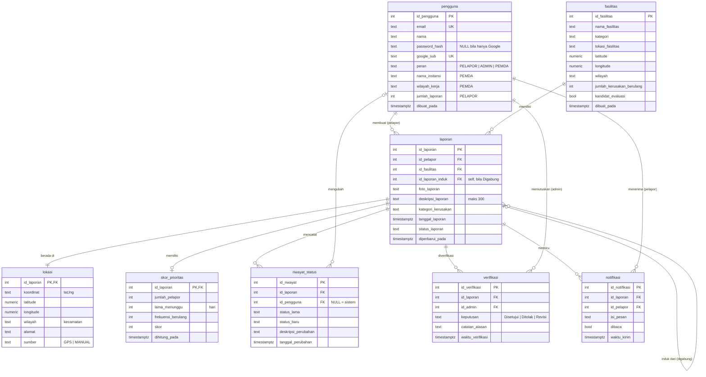
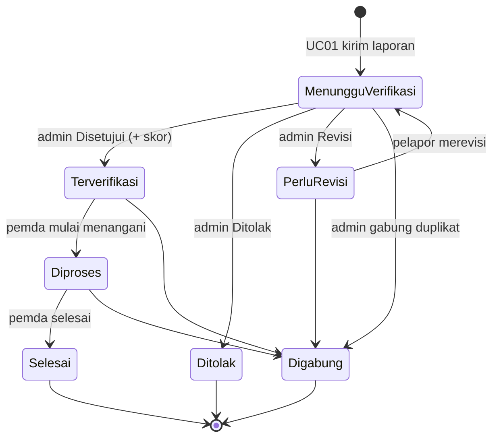

# Basis Data SILEMBUR (PostgreSQL 18)

Skema dibuat oleh `server/src/db/migrations/001_init.sql`. Sumber: atribut kelas DPPL2 BAB 4–5 dan query Q-001..Q-013,
ditambah kolom relasi yang tidak ada di DPPL (gap G1, lihat [KEPUTUSAN.md](KEPUTUSAN.md)).

## ERD

## Pemetaan kelas DPPL → tabel

| Kelas DPPL | Tabel | Catatan |
| :--- | :--- | :--- |
| C01 Pelapor, C02 Admin, C03 PemerintahDaerah | `pengguna` | Satu tabel + kolom `peran` (model "Pengguna" pada DPPL 2.3). `idPelapor/idAdmin/idPemerintah` = `id_pengguna`. |
| C04 Laporan | `laporan` | + FK `id_pelapor`, `id_fasilitas`, `id_laporan_induk` (gap G1). |
| C05 Lokasi | `lokasi` | 1:1 dengan laporan. `koordinat` tetap disimpan sebagai string sesuai DPPL, plus lat/lng numerik untuk perhitungan jarak. |
| C06 Fasilitas | `fasilitas` | + `kandidat_evaluasi` (KF14), lat/lng untuk pencocokan radius. |
| C07 Verifikasi | `verifikasi` | Satu laporan bisa diverifikasi lebih dari sekali (setelah revisi). |
| C08 SkorPrioritas | `skor_prioritas` | 1:0..1, dibuat saat laporan disetujui (Q-008). `namaFasilitasInduk` diturunkan via join ke `fasilitas`. |
| C09 RiwayatStatus | `riwayat_status` | Ditulis HANYA lewat `ubahStatus()` / `catatRiwayat()`. Terhubung ke fasilitas lewat `laporan.id_fasilitas` (KF22). |
| C10 Notifikasi | `notifikasi` | + `dibaca` untuk lencana lonceng I-02. |
| C11 KonfirmasiDuplikat | (tanpa tabel) | Kandidat dihitung dari laporan aktif per fasilitas; jejak penggabungan = `laporan.id_laporan_induk`. |

## Nilai yang dibatasi (CHECK)

- `laporan.status_laporan`: `Menunggu Verifikasi`, `Perlu Revisi`, `Ditolak`, `Terverifikasi`, `Diproses`, `Selesai`, `Digabung`
- `laporan.kategori_kerusakan`, `fasilitas.kategori`: `Jalan Berlubang`, `Lampu Jalan Mati`, `Pohon Tumbang`, `Lainnya`
- `verifikasi.keputusan`: `Disetujui`, `Ditolak`, `Revisi`
- `pengguna.peran`: `PELAPOR`, `ADMIN`, `PEMDA`

## Siklus status laporan

Sumber kebenaran tabel transisi: `TRANSISI_STATUS` di `shared/constants.js`.

## Indeks

`001_init.sql` hanya membuat PK, UNIQUE, dan indeks untuk foreign key. Indeks untuk query berat (mis. Q-004 daftar
prioritas: filter `status_laporan`, `kategori_kerusakan`, `lokasi.wilayah`, urut `skor`) **sengaja** ditambahkan P5
lewat migrasi `5xx_` setelah profiling `EXPLAIN ANALYZE`, sebagai bukti M9 bagian B.2.1.

## Data uji (seed)

`npm run db:seed` mengisi data fiktif: 5 akun (kata sandi `silembur123`), 8 fasilitas di Kota Bandung, 16 laporan di
semua status. Skenario khusus: fasilitas **Jalan Jl. Merdeka** punya 4 laporan dalam 90 hari (kandidat kerusakan
berulang, UC06) dan **PJU Jl. Cihampelas** punya 2 laporan aktif (kandidat duplikat, UC07). Foto contoh dibuat
otomatis ke `server/uploads/seed/`.

| Email | Peran |
| :--- | :--- |
| `warga1@silembur.test`, `warga2@silembur.test`, `warga3@silembur.test` | PELAPOR |
| `admin@silembur.test` | ADMIN |
| `pemda@silembur.test` | PEMDA (Dinas Pekerjaan Umum Kota Bandung) |
